# MASTER CHUNK — Domain 4: Operating, Monitoring, and Securing ML and AI Solutions

*MLA-C02 Domain 4 (24% exam weight) · This is a **standalone, self-contained reference** covering
all ten services/topics tested under this domain, each treated in full depth: Definition,
plain-English Analogy, Purpose, When to Use, When NOT to Use, 4-6 Use Cases, Why It's Important, at
least one explained Mermaid diagram, at least one real, curl-verified AWS documentation image with
discussion, and 2-3 Exam Tips. You should be able to read this single file start to finish and
walk away with full Domain 4 coverage without needing any other file in this repository — though
the other docs in this folder (`README.md`, `ml-cost-optimization.md`,
`responsible-ai-and-guardrails.md`, `model-drift-deep-dive.md`,
`iam-least-privilege-ml-pipelines.md`, `bedrock-guardrails-deep-dive.md`,
`finops-for-ml-token-cost-tracking.md`, `labs.md`) go even deeper on specific sub-topics within
this domain and are cross-linked throughout.*

## How to read this document

Domain 4 asks one overarching question about a system that's already live: **is it still
healthy, still affordable, and still safe?** The ten services below answer that question from
three angles that run continuously and in parallel, not in sequence:

1. **Health** — is the model/agent/FM still behaving correctly? (SageMaker Model Monitor & Model
   Registry, X-Ray, Bedrock, Additional AI Services' DevOps Guru)
2. **Cost** — is it still affordable at current usage? (Cost Management Tools, SageMaker Training
   & Tuning's purchasing options, SageMaker Deployment & Endpoints' sizing choices)
3. **Trust and safety** — is it still secure and responsible? (IAM, KMS, VPC, Additional AI
   Services' CodeGuru, Bedrock's Guardrails)

Every section below follows the exact same structure so you can jump to any one service and get
full value without reading the others first.

## Table of Contents

1. [Cost Management Tools](#1-cost-management-tools)
2. [AWS Identity and Access Management (IAM)](#2-aws-identity-and-access-management-iam)
3. [AWS Key Management Service (KMS)](#3-aws-key-management-service-kms)
4. [AWS X-Ray](#4-aws-x-ray)
5. [Additional AI Services (Lex, CodeGuru, Comprehend Medical, DevOps Guru, HealthLake)](#5-additional-ai-services-lex-codeguru-comprehend-medical-devops-guru-healthlake)
6. [Amazon Bedrock](#6-amazon-bedrock)
7. [Amazon VPC](#7-amazon-vpc)
8. [SageMaker Deployment & Endpoints](#8-sagemaker-deployment--endpoints)
9. [SageMaker Model Monitor & Model Registry](#9-sagemaker-model-monitor--model-registry)
10. [SageMaker Training & Tuning](#10-sagemaker-training--tuning)
11. [Cross-Service Synthesis — How All Ten Fit Together](#11-cross-service-synthesis--how-all-ten-fit-together)
12. [Full Master Exam-Tip Index](#12-full-master-exam-tip-index)
13. [Glossary — Every Term Used in This Document](#13-glossary--every-term-used-in-this-document)
14. [Self-Check Questions](#14-self-check-questions--test-yourself-before-the-exam)
15. [Pricing Model Quick Reference](#15-pricing-model-quick-reference--all-ten-services-side-by-side)
16. [Troubleshooting Quick-Reference](#16-troubleshooting-quick-reference--all-ten-services-side-by-side)
17. [A Second Worked Case Study — Northbridge Insurance](#17-a-second-worked-case-study--northbridge-insurance-fraud--underwriting)
18. [Hands-On Command Reference](#18-hands-on-command-reference)
19. [Final Review Checklist](#19-final-review-checklist)
20. [Exam Blueprint Cross-Reference](#20-exam-blueprint-cross-reference--official-task-statements-mapped-to-this-document)
21. [Quick-Fire Term Disambiguation Pairs](#21-quick-fire-term-disambiguation-pairs)
22. [Appendix — Acronym Expansion Table](#22-appendix--acronym-expansion-table)
23. [Appendix — Index of All Diagrams and Images](#23-appendix--index-of-all-diagrams-and-images-in-this-document)
24. [Closing Note](#24-closing-note-on-how-this-document-relates-to-the-rest-of-the-domain)

---

## 1. Cost Management Tools

### Definition

AWS Cost Management Tools are the suite of native services — **Cost Explorer**, **AWS Budgets**,
**AWS Cost Anomaly Detection**, and **Cost Allocation Tags** — that together let an organization
see, forecast, alert on, and attribute its AWS spend, at whatever granularity (account, service,
tag, linked account) the question requires.

### Plain-English Analogy

Think of a household's financial tools stacked by purpose: a **bank statement** you can filter
and sort (Cost Explorer — see exactly what you spent, broken down any way you like, after the
fact); a **budget app that buzzes your phone** when you're approaching your monthly dining-out
limit (AWS Budgets — a threshold you set yourself, alerting before you blow past it); a **fraud-
alert text from your bank** that fires the moment an unusual charge appears, without you having
pre-configured any specific dollar trigger (Cost Anomaly Detection — ML-based, learns your normal
pattern, flags deviations automatically); and **labeling every receipt** with which family member
or purpose it was for (Cost Allocation Tags — the only reason the bank statement can later be
sorted by "whose spending was this" at all).

### Purpose

An AWS bill, unfiltered, is one number — completely useless for answering "why did this change"
or "who is responsible for this." Cost Management Tools exist to convert that one number into a
queryable, attributable, forecastable, and alertable dataset, which is the only way a growing
organization keeps cloud spend under intentional control rather than discovering problems a
month after the fact when the invoice arrives.

### When to Use

- From day one of any real (non-trivial, non-free-tier-only) AWS usage — Cost Allocation Tags
  specifically are cheapest to apply at resource-creation time and expensive to retrofit later, so
  "when to start" is effectively "immediately."
- Any organization with more than one team, project, or environment sharing an AWS account/
  payer — tagging and Cost Explorer's breakdown are the only way to answer "who is spending what"
  without manual, error-prone bill-splitting.
- Any workload with a hard spending ceiling (a grant-funded research project, a startup's runway-
  constrained budget) — AWS Budgets' threshold alerts are the direct mechanism.
- Any workload with variable, usage-driven cost (GenAI token billing, auto-scaling fleets) where a
  sudden, unexpected spike is a realistic risk — Cost Anomaly Detection's pattern-based alerting
  catches this faster than a human reviewing a dashboard periodically.

### When NOT to Use It / Scope Limits

- These tools report and alert on cost — they don't *automatically* reduce it. A Budget alert
  firing doesn't stop spend; it notifies a human to act. Don't mistake configuring these tools for
  having actually implemented a cost optimization.
- Cost Anomaly Detection needs historical usage to learn a baseline — a brand-new account or
  brand-new service usage with only days of history won't yet have a meaningful anomaly-detection
  baseline; this is a cold-start limitation, not a misconfiguration.
- Extremely small, single-resource, single-owner sandbox accounts may not need a full tagging
  taxonomy — though the habit is cheap enough to form early that there's rarely a good reason to
  skip it even here.

### How It Works

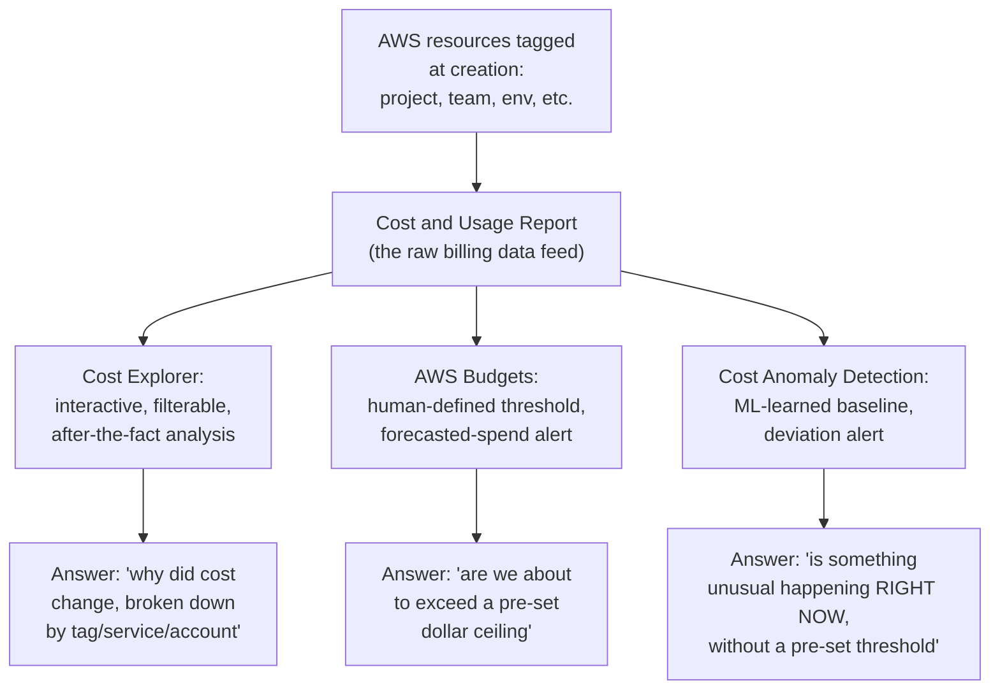

Step by step: every resource's usage flows into the underlying Cost and Usage Report regardless of
which analysis tool you use — the three tools (Explorer, Budgets, Anomaly Detection) are three
different *lenses* on the same underlying data, not three separate cost-tracking systems. Tags
applied at resource creation are what make every lens capable of answering "broken down by
project/team" rather than only "broken down by AWS service" — without tags, you can see that EC2
cost $X, but not which of your five projects' EC2 usage made up that $X.


*Figure: the real AWS Cost Explorer interface — cost broken down over time, filterable and
groupable by service, account, and (critically) by cost allocation tag. This is the primary
after-the-fact analysis tool described in the "How It Works" diagram above; the time-series view
is exactly what a team would use to trace a cost spike back to the specific day/service/tag it
started on. Source: AWS CloudWatch documentation image reused in the AWS cost-tooling
documentation set — docs.aws.amazon.com/AmazonCloudWatch/latest/monitoring/.*


*Figure: the real AWS Budgets console flow for creating a cost budget — a human explicitly
defines a dollar threshold and the alert fires once actual or forecasted spend crosses it. The
direct contrast with Cost Anomaly Detection (below) is visible right here: this mechanism requires
a human to have already guessed the right number, while anomaly detection requires no such guess.
Source: AWS "Control your AWS costs" hands-on tutorial —
docs.aws.amazon.com/hands-on/latest/control-your-costs-free-tier-budgets/.*


*Figure: a Cost Anomaly Detection-powered dashboard surfacing flagged spend anomalies with their
root-cause service attribution automatically, with no pre-set dollar threshold involved at all —
the ML model learns the account's own normal day-to-day variation and flags statistically unusual
deviations from it, catching a spike days before it would cross any fixed Budget line. Source: AWS
Cloud Intelligence Dashboards guidance, "Cost Anomaly Dashboard" —
docs.aws.amazon.com/guidance/latest/cloud-intelligence-dashboards/cost-anomaly-dashboard.html.*

### Key Features / Components

- **Cost Explorer** — interactive UI and API for filtering/grouping historical cost and usage
  data by service, linked account, Region, instance type, and cost allocation tag, plus basic
  forecasting of future spend based on historical trend.
- **AWS Budgets** — human-defined cost, usage, Reserved Instance/Savings Plans utilization, or
  coverage thresholds, each with configurable alert actions (email/SNS) at actual-spend or
  forecasted-spend crossing points.
- **AWS Cost Anomaly Detection** — ML-based, no-threshold-required spend anomaly detection,
  scoped by service, linked account, or cost allocation tag value, with root-cause attribution in
  the alert itself.
- **Cost Allocation Tags** — user-defined (and some AWS-generated) key-value tags on resources
  that, once activated in the Billing console, become groupable dimensions in every other tool
  above.
- **Savings Plans / Reserved Instance recommendations** — Cost Explorer surfaces purchasing
  recommendations based on actual historical usage patterns, directly feeding the purchasing-
  option decisions covered in `ml-cost-optimization.md`.
- **Cost and Usage Report (CUR)** — the most granular, raw billing data export (to S3), the
  underlying data source every higher-level tool above is built on.

### Use Cases — Real Scenarios

1. A finance team builds a monthly Cost Explorer report grouped by `project` tag, replacing a
   previous process of manually estimating each team's AWS spend from incomplete internal
   records.
2. A startup sets an AWS Budget at 80% of its monthly runway-constrained ceiling with a
   forecasted-spend alert, catching a trending-toward-overspend month three weeks early rather
   than at month-end.
3. A platform team configures Cost Anomaly Detection scoped to the `Amazon Bedrock` service
   specifically, catching a GenAI cost spike the same day it starts, well before it would show up
   in an account-wide monthly review.
4. A multi-tenant SaaS company enforces an IAM policy requiring the `customer-id` tag on every
   newly created resource, enabling precise per-customer cost attribution for a usage-based
   pricing model that didn't exist before the tagging policy was enforced.
5. A compliance team pulls a Cost and Usage Report export directly from S3 for a detailed,
   line-item-level audit that Cost Explorer's UI-level granularity doesn't surface.
6. An ML platform team cross-references Cost Explorer's per-tag breakdown against
   `finops-for-ml-token-cost-tracking.md`'s six-category taxonomy to separate GenAI token cost
   from classic SageMaker endpoint cost within the same monthly report.

### Why It's Important

Real-world: cloud spend that isn't visible and attributed is cloud spend that can't be managed —
and ML/GenAI workloads are consistently among the highest-variance cost categories in a modern
AWS bill, making this tooling disproportionately valuable there specifically. Exam weight: general
AWS cost-management tooling appears across every associate-level AWS cert, but MLA-C02 tests it
specifically as the foundation `ml-cost-optimization.md` and `finops-for-ml-token-cost-tracking.md`
build their ML-specific content on top of — expect at least one question testing Budgets vs.
Anomaly Detection as genuinely different mechanisms, not interchangeable synonyms.

### Exam Tips

- "Alert when spend crosses a dollar figure a human defined" → AWS Budgets. "Alert on an unusual
  pattern with no pre-set threshold" → Cost Anomaly Detection — these are the two most frequently
  confused tools on this topic.
- Tags must be **activated** in the Billing console before they become usable as a Cost Explorer/
  Budgets grouping dimension — simply tagging a resource isn't sufficient by itself if this
  activation step was skipped.
- "Which team/project is driving this cost" is always a cost-allocation-tag question, never a
  Cost Explorer or Budgets *feature* question by itself — tags are the prerequisite data; Explorer/
  Budgets are just lenses on top of whatever tags exist.

---

## 2. AWS Identity and Access Management (IAM)

### Definition

AWS IAM is the service that controls **who** (a user, role, or AWS service acting on your behalf)
can do **what** (an API action) to **which** AWS resource, under **what conditions** — the
foundational access-control layer underneath every other AWS service, including every ML/AI
service in this domain.

### Plain-English Analogy

IAM is a company's **badge and keycard system**. Every employee (IAM user) or contractor (IAM
role assumed temporarily) carries a badge that's been programmed (an attached policy) to open
specific doors (specific AWS API actions on specific resources) — a receptionist's badge opens the
lobby and supply closet; an executive's badge opens far more, but even the CEO's badge doesn't
open *literally every* door in a well-run building (there's still a server room requiring
additional authorization). A **permissions boundary** is a facilities-wide rule capping what any
badge — even one an individual manager is allowed to program themselves — can ever be configured
to open, regardless of how generously that manager wants to configure it.

### Purpose

Every ML pipeline touches multiple distinct, high-value resources (training data, model
artifacts, encryption keys, live endpoints) that shouldn't all be reachable by the same identity
with the same breadth of access. IAM exists to make "who can touch what" an explicit, auditable,
enforceable policy decision rather than an implicit default (which, left unmanaged, trends toward
"everyone can touch everything," the single most common real-world security failure mode).

### When to Use

- Every single AWS resource access decision, without exception — there is no "skip IAM" option;
  the only question is how tightly scoped a given policy is, never whether one exists.
  Specifically for ML: every SageMaker Training Job, Processing Job, Pipeline, and endpoint runs
  under an explicit execution role you control the policy of.
- Any scenario requiring an audit trail of exactly who/what accessed a specific resource — IAM
  (paired with CloudTrail) is the mechanism answering that question.
- Multi-account or multi-team environments where different people/systems legitimately need
  different access levels to the same broader ML platform.
- Self-service platforms where you want to grant broad day-to-day flexibility to a team while
  still enforcing a hard ceiling — permissions boundaries exist for exactly this.

### When NOT to Use It / Scope Limits

- There's no legitimate "when not to use IAM" — but there is a legitimate "when the default,
  broadest convenient role is a defensible *temporary* choice": very early, pre-production,
  synthetic-data-only prototyping, with an explicit plan to tighten before any real data or
  production traffic touches the system.
- IAM governs *AWS API-level* access — it does not, by itself, control what happens *inside* an
  application's own business logic once that application already has a broad enough role (e.g.,
  IAM can't stop a training script with legitimate S3 read access from reading a sensitive file
  it technically has permission to read but has no business reason to); IAM is a necessary but not
  sufficient control, typically paired with least-privilege *scoping* (see
  `iam-least-privilege-ml-pipelines.md`) to minimize this residual risk.

### How It Works

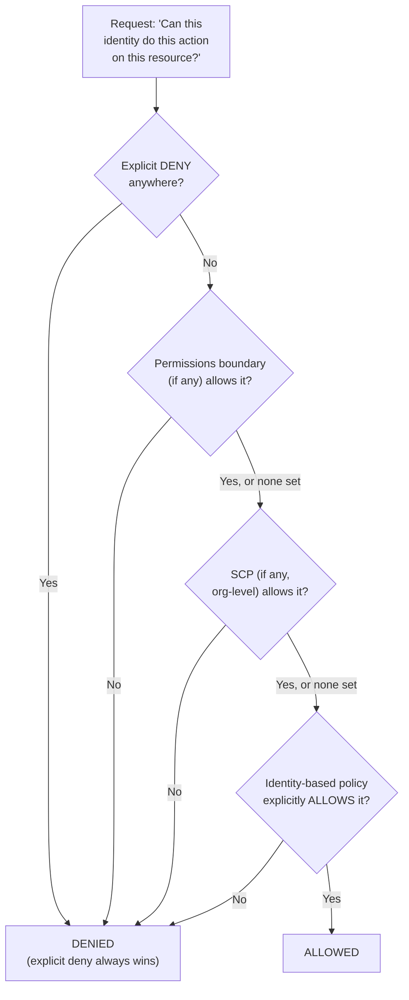

Step by step: IAM's evaluation logic is a chain of filters, and the exam-relevant mental model is
**"default deny, with explicit deny always winning."** Nothing is allowed unless some policy
explicitly says so, and if *any* applicable policy (identity policy, permissions boundary, SCP,
resource-based policy) explicitly denies an action, that deny wins regardless of what every other
policy says — there is no "most permissive policy wins" logic anywhere in IAM.


*Figure: AWS's own diagram of the policy evaluation logic within a single account for a role —
tracing the exact same default-deny, explicit-deny-wins logic shown in the Mermaid diagram above,
straight from AWS's authoritative source. This is worth comparing side by side with the diagram
above to confirm the mental model matches AWS's own documented evaluation order exactly. Source:
AWS IAM User Guide, "Policy evaluation logic" —
docs.aws.amazon.com/IAM/latest/UserGuide/reference_policies_evaluation-logic.html.*


*Figure: how a permissions boundary intersects with an identity's own policy — the effective
permission is only ever the intersection of both, since a boundary can only remove permission,
never grant anything the identity policy didn't already allow. This is the mechanism covered in
full depth, with real policy JSON, in `iam-least-privilege-ml-pipelines.md`'s Pattern 3. Source:
AWS IAM User Guide, "Permissions boundaries for IAM identities" —
docs.aws.amazon.com/IAM/latest/UserGuide/access_policies_boundaries.html.*

### Key Features / Components

- **Users, Groups, Roles** — the three identity types; roles are the one ML pipelines use almost
  exclusively (execution roles for training jobs/endpoints), since they provide *temporary*,
  assumable credentials rather than a long-lived access key.
- **Identity-based and resource-based policies** — a policy attached to an identity (a user/role)
  vs. a policy attached to a resource (an S3 bucket policy, a KMS key policy) — both are evaluated
  together.
- **Permissions boundaries** — the self-service ceiling mechanism, full depth in
  `iam-least-privilege-ml-pipelines.md`.
- **IAM Access Analyzer** — scans existing policies for unintended broad/external access, the
  practical auditing tool.
- **IAM policy simulator** — tests what a policy would allow/deny before attaching it.
- **`sts:AssumeRole` and cross-account trust policies** — the mechanism for temporary, scoped
  cross-account access, covered in full with real JSON in
  `iam-least-privilege-ml-pipelines.md`'s Pattern 4.
- **Condition keys** — narrowing an allow beyond action+resource (e.g., requiring a specific tag,
  source IP range, or Region).

### Use Cases — Real Scenarios

1. A SageMaker training job's execution role is scoped to read exactly one S3 prefix and decrypt
   with exactly one KMS key, so a compromised or buggy job can't reach any other project's data.
2. A multi-account enterprise uses `sts:AssumeRole` with an `ExternalId` condition to let a
   training job in a compute account read data from a separate, locked-down data account without
   any long-lived credential ever being copied between accounts.
3. A data science platform team grants self-service IAM role creation to data scientists, capped
   by a permissions boundary that prevents anyone from ever escalating beyond an organization-
   defined ceiling, even by accident.
4. A security team runs IAM Access Analyzer monthly across all ML-related roles, catching a
   forgotten, overly broad role from an early prototype two years after that prototype was
   retired.
5. A regulated bank's compliance team requires every production FM call to use IAM credentials
   (never Bedrock API keys) specifically for the fine-grained, auditable, condition-key-based
   access control IAM policies provide.
6. A platform engineer uses the IAM policy simulator to validate a newly tightened production
   endpoint role before attaching it, catching an accidental over-tightening in simulation rather
   than in a live outage.

### Why It's Important

Real-world: IAM misconfiguration is consistently one of the top real-world causes of cloud data
breaches, and ML pipelines concentrate unusually large amounts of sensitive data and valuable IP
behind a small number of roles, raising the stakes of getting this right. Exam weight: IAM is
named explicitly in Task Statement 4.3 and tested constantly throughout this domain — expect
scenario questions where "the job works" is a trap distracting from an underlying least-privilege
violation, and expect the permissions-boundary-vs-SCP distinction to be tested directly.

### Exam Tips

- Explicit DENY always wins, in any policy that applies — this single fact resolves a large
  fraction of IAM scenario questions once you check for it first.
- "Cap what one specific self-service identity can ever grant" → permissions boundary. "Cap what
  an entire account/OU can ever do regardless of identity" → Service Control Policy (SCP) —
  different scopes, frequently confused.
- A shared, overly broad role reused across many unrelated jobs is the most common real-world and
  exam-tested least-privilege violation, even when every individual job technically "works" —
  "it works" is never sufficient justification for a broad role.

---

## 3. AWS Key Management Service (KMS)

### Definition

AWS KMS is the managed service for creating, controlling, and using cryptographic keys to encrypt
and decrypt data across AWS — for ML specifically, protecting training data at rest in S3, model
artifacts, EBS volumes backing training/endpoint instances, and data captured by Model Monitor,
all without the application code ever handling raw key material directly.

### Plain-English Analogy

KMS is a **bank vault with a master key the bank itself never lets leave the building**. You
(the customer) get to decide who's on the access list and when the vault opens (the key policy),
but the actual master key (the KMS key's raw cryptographic material) never leaves AWS's
hardware security modules — you only ever interact with it through controlled, logged requests
("please encrypt this," "please decrypt that for this specific authorized person"), never by
being handed the key itself to carry around. **Envelope encryption** (below) is the practical
trick that makes this fast at scale: instead of using the vault's master key to lock every single
document directly (slow, and the master key would be used constantly), the vault generates a
disposable, one-time combination lock for each document (a data key), locks the document with
that, and then locks the disposable combination itself inside the vault using the master key —
so the master key is only ever used to protect a small key, never the bulk data directly.

### Purpose

Sensitive ML training data, model artifacts (which can themselves leak information about training
data), and inference payloads need to be unreadable to anyone without explicit authorization, both
while stored (at rest) and while moving between services (in transit). KMS exists to make this
encryption centrally managed, auditable (every key usage is logged), and revocable (a customer-
managed key's access can be changed or the key disabled, immediately affecting every resource
that depends on it) — properties a simple "just encrypt it with some password" approach has none
of.

### When to Use

- Any S3 bucket holding training data, model artifacts, or batch inference output — server-side
  encryption with a KMS key should be the default, not an afterthought.
- Any EBS volume backing a training instance or model-hosting instance.
- Any scenario where an auditor or regulator needs proof of who could decrypt specific sensitive
  data and when — a customer-managed key's access logging (via CloudTrail) is the direct answer.
- Any scenario explicitly requiring that even AWS itself cannot read the data without the
  customer's authorization — only a customer-managed key (never the AWS-managed default key)
  satisfies this.

### When NOT to Use It / Alternatives

- Fully public, non-sensitive datasets (e.g., an openly published benchmark dataset with no
  confidentiality requirement at all) technically don't *need* encryption for confidentiality,
  though enabling default encryption anyway is near-zero-cost and a reasonable default regardless.
- For extremely high-throughput, latency-sensitive encrypt/decrypt operations where even KMS's
  low added latency is unacceptable, data key caching (reusing a decrypted data key for a bounded
  time/number of operations instead of calling KMS on every single operation) is the correct
  optimization — not abandoning KMS-based encryption altogether.

### How It Works — Key Hierarchy and Envelope Encryption

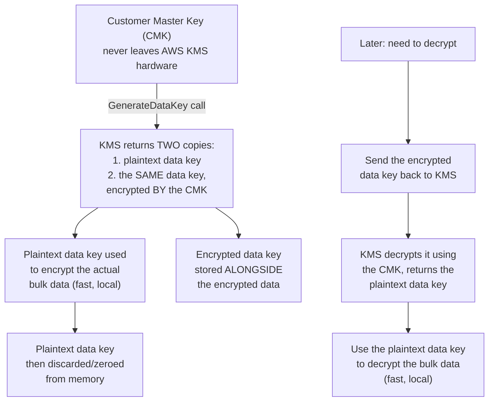


*Figure: AWS's own illustration of the key hierarchy under a root/master key — customer master
keys sit above data keys, which protect the actual bulk data, exactly the two-tier structure the
"How It Works" diagram traces. Source: AWS Key Management Service Developer Guide, "Key
hierarchy" — docs.aws.amazon.com/kms/latest/developerguide/.*


*Figure: the full sequence-level view of envelope encryption via the AWS Encryption SDK — the
`GenerateDataKey` call, the two returned copies, encrypting with the plaintext copy, and
discarding it, matching the Mermaid flow above step for step. This is why envelope encryption
scales: the slow, access-controlled, logged KMS API call only ever touches a small data key, never
the (potentially huge) bulk training dataset itself. Source: AWS Key Management Service
Cryptographic Details Guide — docs.aws.amazon.com/kms/latest/cryptographic-details/.*

Step by step: a training job needing to write encrypted output never sends its actual training
data to KMS at all (that would be slow and KMS isn't designed as a bulk-encryption service) —
instead, it asks KMS for a fresh data key, uses the plaintext copy locally to encrypt the real
data (fast, since this happens entirely outside KMS), stores the KMS-encrypted copy of that data
key right next to the encrypted data, and discards the plaintext copy from memory immediately.
Decryption later reverses this: send the small encrypted data key back to KMS, get the plaintext
copy back, decrypt the actual data locally. The master key (CMK) itself is used constantly for
small key operations, but never once directly against the bulk data.

### Key Features / Components

- **AWS-managed keys** — created and managed by AWS automatically for specific services (e.g.,
  the default S3 encryption key); convenient, but you don't control the key policy or rotation
  schedule, and — the critical audit-relevant limitation — you cannot grant or deny another AWS
  account/service access to it independently of AWS's own defaults.
- **Customer-managed keys (CMKs)** — created and fully controlled by you: custom key policy,
  independent rotation schedule, ability to disable/schedule deletion, and full CloudTrail
  logging of every use — the answer whenever a scenario requires the organization (not AWS) to
  hold ultimate authorization control.
- **Key policies** — the resource-based policy attached directly to a KMS key, the primary access-
  control mechanism (distinct from, and evaluated alongside, any IAM identity-based policy
  granting `kms:Decrypt`).
- **Envelope encryption / `GenerateDataKey`** — the mechanism described above; used automatically
  by most AWS service integrations (S3 SSE-KMS, EBS encryption) without the calling application
  needing to implement it manually.
- **Automatic key rotation** — CMKs can rotate their underlying cryptographic material on a
  schedule (annually, by default when enabled) while keeping the same key ID/ARN, meaning nothing
  encrypted under the key needs re-encryption when rotation happens.
- **Multi-Region keys** — a CMK variant that's replicated as independent but related keys across
  Regions, useful for a cross-Region DR/replication ML pipeline without needing to re-encrypt
  data when it moves Regions.

### Use Cases — Real Scenarios

1. A regulated lending company encrypts all training data, model artifacts, and endpoint storage
   with a single customer-managed KMS key, retaining full audit control over exactly who can
   decrypt what, independent of any AWS default.
2. A healthcare ML team configures envelope encryption data-key caching on a high-throughput
   batch-processing job, reducing the number of direct KMS API calls from millions to thousands
   per run without weakening the underlying encryption guarantee.
3. A security incident response plan includes immediately disabling a specific customer-managed
   key as a containment step, instantly making every resource encrypted under that key
   unreadable, including to a since-compromised but still-technically-authorized IAM role.
4. A multi-Region disaster-recovery setup for a critical fraud-detection model uses a KMS
   Multi-Region key so encrypted model artifacts replicated to a secondary Region remain
   decryptable there without any re-encryption step.
5. An auditor reviewing a loan-denial dispute pulls CloudTrail logs showing exactly which IAM
   role decrypted the specific applicant's training-data record and when, a capability only a
   customer-managed key's full logging provides.
6. A platform team scopes each project's training-job execution role to decrypt with exactly one
   dedicated KMS key (never a shared account-wide key), so a compromised role in one project
   cannot decrypt another project's data even if it somehow gained broader S3 read access.

### Why It's Important

Real-world: encryption at rest is both a baseline security hygiene practice and, in most regulated
industries, an explicit compliance requirement — and the distinction between an AWS-managed and
customer-managed key is frequently the specific fact an audit turns on. Exam weight: KMS is named
explicitly in Task Statement 4.3, and the exam consistently tests the AWS-managed-vs-customer-
managed distinction plus the basic mechanics of envelope encryption, rather than deep cryptographic
theory.

### Exam Tips

- "Even AWS itself must not be able to read this without our authorization" → customer-managed
  key, never the AWS-managed default key — this phrasing is the single most reliable trigger for
  this answer.
- Envelope encryption means the master key (CMK) is never used directly against bulk data — only
  against small data keys; a question implying the CMK itself encrypts a large dataset directly
  is describing the mechanism incorrectly.
- Disabling a customer-managed key is a fast, effective incident-response containment action —
  instantly affecting every resource depending on that key, a fact worth recognizing in an
  incident-response scenario question.

---

## 4. AWS X-Ray

### Definition

AWS X-Ray is a distributed tracing service that records the full path of a request as it travels
through multiple AWS services/hops (API Gateway → Lambda → SageMaker endpoint, or a chain of
Bedrock Agent tool calls), reporting per-hop latency and errors so you can pinpoint exactly which
specific hop is slow or failing in a multi-service pipeline, rather than only knowing the overall
request was slow.

### Plain-English Analogy

X-Ray is like a **package tracking number that shows every single checkpoint** a package passed
through, with a timestamp at each one — not just "your package is delayed," but "it sat at the
regional sorting facility for six hours before moving on." Without this, a customer complaining
about a late package and a shipping company trying to diagnose the delay are both stuck guessing
which of a dozen possible hops caused the problem. With it, the slow hop is identified
immediately, by name, with an exact duration — exactly what X-Ray's trace timeline does for a
multi-service inference pipeline's request path.

### Purpose

A modern ML inference pipeline is rarely one single service call — a request might hit API
Gateway, trigger a Lambda function that does pre-processing, call a SageMaker endpoint, and
return a post-processed result, or a Bedrock Agent might chain a planning call, a tool call, and
a synthesis call. When *overall* latency is too high or an error occurs, "which specific hop is
responsible" is a distinct, harder question than "is this slow" — X-Ray exists specifically to
answer the former without requiring you to manually instrument timing/logging at every hop
yourself.

### When to Use

- Any multi-hop inference pipeline (API Gateway + Lambda + SageMaker, or any multi-service
  chain) where diagnosing *which specific hop* is slow or failing matters.
- Debugging an intermittent, hard-to-reproduce latency spike that only shows up in a fraction of
  real production requests — X-Ray's sampling can capture enough real traces to find the pattern
  without needing to reproduce the issue manually.
- Complementing (not replacing) SageMaker Model Monitor's drift detection — Model Monitor answers
  "is the model's *prediction quality* still good"; X-Ray answers "is the *infrastructure path*
  to get a prediction still fast and reliable" — genuinely different failure surfaces.

### When NOT to Use It / Scope Limits

- A single-hop, single-service call with no multi-service chain to trace has little X-Ray value —
  standard CloudWatch metrics on that one service already answer "is it slow," without needing a
  distributed trace across hops that don't exist.
- X-Ray tells you *where* latency/errors occur, not *why* a model's predictions are wrong — a
  model-quality problem (drift, bias) isn't a tracing problem at all, even if the symptom
  (unhappy users) looks similar from a distance.

### How It Works

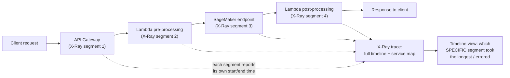


*Figure: AWS's own architecture diagram of how X-Ray instruments a request across multiple
services, collecting segment data from each and assembling it into one coherent trace — the same
multi-hop assembly the Mermaid flow above illustrates. Source: AWS X-Ray Developer Guide, "How
X-Ray works" — docs.aws.amazon.com/xray/latest/devguide/aws-xray-how-it-works.html.*


*Figure: a real X-Ray trace's timeline view — each segment's duration rendered as a bar, making
the slowest hop immediately, visually obvious rather than requiring you to compare raw numbers
across separate per-service dashboards. Source: AWS X-Ray Developer Guide, sample application
walkthrough — docs.aws.amazon.com/xray/latest/devguide/.*


*Figure: X-Ray's service map — a visual graph of every service in the traced path, with error
rates and average latency annotated directly on each node, giving an at-a-glance view of the
whole pipeline's health rather than one trace at a time. Source: AWS X-Ray Developer Guide,
"X-Ray service map" — docs.aws.amazon.com/xray/latest/devguide/.*

Step by step: each service in the chain, once instrumented with the X-Ray SDK (or, for many AWS
services, with X-Ray tracing simply enabled as a configuration flag), records its own segment —
start time, end time, any annotations/errors — and sends it to the X-Ray service. X-Ray then
stitches every segment sharing the same trace ID into one coherent timeline, which is what lets
you see, for one specific slow request, exactly which hop consumed the most time, rather than
only an aggregate "this endpoint's p99 latency is high" metric with no hop-level breakdown.

### Key Features / Components

- **Segments and subsegments** — the basic unit of a trace; a segment covers one service's work,
  a subsegment covers a smaller unit of work within that service (e.g., a specific downstream API
  call a Lambda function makes).
- **Trace timeline** — the per-request visual breakdown of segment durations.
- **Service map** — the aggregate, cross-request visual graph of the whole traced architecture's
  health.
- **Sampling rules** — configurable rules for what fraction of requests get fully traced (tracing
  every single request at high volume is often unnecessary and costly; sampling captures a
  statistically representative subset).
- **Annotations and metadata** — custom key-value data you can attach to a segment (e.g., which
  specific model version served a request), making traces filterable/searchable by business-
  relevant dimensions, not just technical ones.
- **X-Ray Insights** — automated anomaly detection on trace data itself, surfacing an unusual
  error-rate or latency pattern without a human manually reviewing traces one at a time.

### Use Cases — Real Scenarios

1. A travel-booking agent's wrong-answer complaints spike even though every individual Bedrock
   call succeeds quickly in CloudWatch GenAI observability — X-Ray-style tracing (via AgentCore
   Observability for the agent-specific case) isolates a tool-call step as the actual latency/
   failure source, not the model call itself.
2. An API Gateway + Lambda + SageMaker endpoint pipeline's overall p99 latency rises; X-Ray's
   trace timeline shows the Lambda pre-processing step, not the SageMaker endpoint itself, as the
   newly slow hop, redirecting the optimization effort correctly.
3. A platform team configures X-Ray sampling at 5% on a very high-volume endpoint, balancing
   tracing visibility against the added overhead/cost of tracing every single request.
4. An intermittent error affecting roughly 1% of requests is isolated, via X-Ray's service map
   error-rate annotations, to a specific downstream dependency that only fails under a particular
   rare input condition.
5. A team adds a custom X-Ray annotation recording which specific model version handled each
   request, enabling trace filtering by model version during a canary deployment to compare
   latency between the old and new version directly.
6. A security/reliability review uses X-Ray Insights' automated anomaly detection to catch a
   gradually worsening latency trend on one specific hop weeks before it would have crossed a
   fixed CloudWatch alarm threshold.

### Why It's Important

Real-world: a slow or failing multi-service pipeline with no distributed tracing forces teams
into manual, hop-by-hop log correlation to find the root cause — slow, error-prone, and often
simply infeasible under production pressure; X-Ray converts this into a direct, visual answer.
Exam weight: X-Ray is Task 4.1's named tool for infrastructure-health "latency localization," and
the exam specifically tests recognizing X-Ray as complementary to (not a substitute for) Model
Monitor's drift detection and AgentCore Observability's agent-coordination monitoring — three
different tools for three different failure surfaces that can look superficially similar from a
dashboard.

### Exam Tips

- "Which specific hop in a multi-service pipeline is slow" → X-Ray. "Is the model's prediction
  quality still good" → Model Monitor. "Did a multi-step agent's internal coordination succeed" →
  AgentCore Observability — three different questions, three different tools; don't substitute
  one for another on the exam.
- X-Ray requires instrumentation (SDK integration or a tracing flag enabled per service) — it
  doesn't retroactively trace requests that occurred before tracing was turned on.
- Sampling is a deliberate cost/visibility tradeoff, not a limitation to "fix" by always tracing
  100% of requests — a scenario describing acceptable visibility at high volume is testing
  recognition of sampling as the correct lever, not full tracing.

---

## 5. Additional AI Services (Lex, CodeGuru, Comprehend Medical, DevOps Guru, HealthLake)

### Definition

This is a grouped category of five MLA-C02-specific managed AI services that don't fit neatly
into the "classic ML" (SageMaker) or "GenAI" (Bedrock) buckets but are each individually tested:
**Amazon Lex** (conversational chatbot/voice-bot building, pre-GenAI-era), **Amazon CodeGuru**
(automated code review and application performance profiling), **Amazon Comprehend Medical**
(clinical-text NLP extraction), **Amazon DevOps Guru** (ML-powered operational anomaly detection
for applications), and **Amazon HealthLake** (a managed, FHIR-standard healthcare data store with
built-in ML-powered insight extraction).

### Plain-English Analogy

Think of these five as **specialist consultants a company keeps on retainer for narrow, recurring
jobs**, as opposed to SageMaker (a general contractor who can build anything from scratch, given
enough time) or Bedrock (a universally-capable advisor who can discuss nearly any topic via a
foundation model). Lex is the consultant who specifically designs structured phone-tree/chatbot
conversation flows. CodeGuru is the consultant who reviews your code for bugs and profiles your
running application for performance waste. Comprehend Medical is the consultant who reads a
doctor's clinical notes and extracts structured facts (medications, dosages, conditions).
DevOps Guru is the consultant who watches your whole operational posture and flags "something
about how this system is behaving looks wrong" without you telling it what "wrong" looks like in
advance. HealthLake is the specialized, compliant filing cabinet built specifically for healthcare
records in the industry-standard format, with the specialist consultants' outputs already
structured to fit into it.

### Purpose

Each of these exists because its specific sub-domain (structured conversational design, code
quality/performance, clinical-language extraction, anomaly-driven operations, standards-compliant
healthcare data) has enough specialized complexity that a general-purpose ML/GenAI service would
require significant custom work to replicate — these managed services package that specialized
capability as a ready-to-use API, skipping the custom-build effort entirely for their specific
niche.

### When to Use

- **Amazon Lex** — building a structured, intent-and-slot-based conversational interface (a
  customer-service phone tree, a simple task-completion chatbot) where the interaction follows
  predictable, definable intents rather than open-ended conversation.
- **Amazon CodeGuru** — any CI/CD pipeline wanting automated code review (Reviewer) catching
  security/quality issues before merge, or any running application needing automated performance-
  bottleneck profiling (Profiler) without manually instrumenting code.
- **Amazon Comprehend Medical** — extracting structured medical entities (medications, dosages,
  conditions, procedures, protected health information) from unstructured clinical text (doctor's
  notes, discharge summaries) at scale.
- **Amazon DevOps Guru** — any production application where you want automated detection of
  operational anomalies (unusual error rates, resource exhaustion patterns) without manually
  defining every possible failure signature in advance.
- **Amazon HealthLake** — any healthcare organization needing to store, query, and run ML-powered
  insight extraction over patient health data in the industry-standard FHIR format, with built-in
  HIPAA-eligible compliance posture.

### When NOT to Use It / Alternatives

- **Lex** is the wrong choice for open-ended, free-form conversation that doesn't map to a
  defined intent/slot structure — that's squarely Bedrock's territory (a foundation model handles
  genuinely open-ended dialogue far better than an intent-classification-based system ever will).
- **CodeGuru Reviewer** doesn't replace human code review for business-logic correctness — it
  catches security/quality *patterns*, not whether the code correctly implements the intended
  business requirement.
- **Comprehend Medical** is specialized for clinical text specifically — using it on general,
  non-medical text wastes its specialized capability and is better served by general Comprehend
  or an LLM.
- **DevOps Guru** doesn't replace targeted monitoring/alarms for *known* failure modes you can
  already define precisely (a CloudWatch Alarm on a specific metric threshold is simpler and more
  predictable for a well-understood failure pattern) — DevOps Guru's value is specifically for
  *unknown-unknown* anomalies you couldn't have pre-defined a threshold for.
- **HealthLake** is overkill for non-healthcare data, or for healthcare data that doesn't need
  FHIR-standard structuring at all (e.g., a purely internal, non-interoperable research dataset
  might not need the full FHIR compliance overhead).

### How It Works — CI/CD Security Gate (CodeGuru + Inspector)

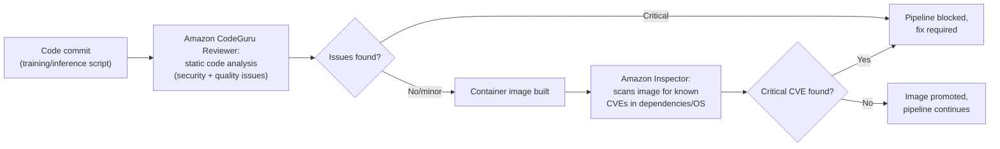


*Figure: the real CodeGuru Reviewer console flow for creating a full-repository code review —
this is the automated static-analysis gate shown in the diagram above, catching security and
quality issues in training/inference code before it's ever built into a container, let alone
deployed to a running job. Source: AWS CodeGuru Reviewer User Guide, "Create code reviews" —
docs.aws.amazon.com/codeguru/latest/reviewer-ug/.*

### How It Works — DevOps Guru's Anomaly Detection

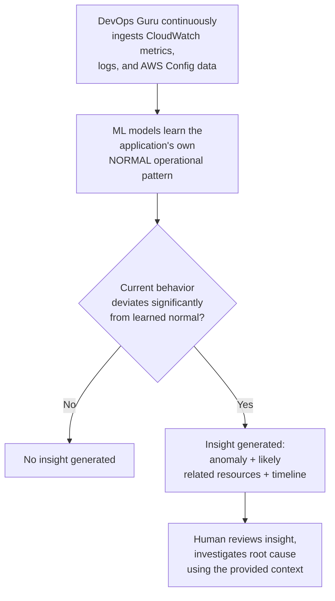


*Figure: the real DevOps Guru console enablement flow — once turned on for a specific resource
scope, it begins the learning phase described in the diagram above with zero manual threshold
configuration required, in direct contrast to a traditional CloudWatch Alarm which always
requires a human-defined threshold. Source: AWS Aurora User Guide's DevOps Guru integration
section — docs.aws.amazon.com/AmazonRDS/latest/AuroraUserGuide/.*

### How It Works — Lex's Intent/Slot Model

Lex conversations are built around **intents** (a defined user goal, e.g., "BookFlight") and
**slots** (the specific pieces of information needed to fulfill that intent, e.g., origin,
destination, date) — Lex's job is mapping a user's natural-language utterance to the correct
intent and extracting slot values from it, then prompting for any missing required slots before
calling a fulfillment Lambda function.


*Figure: the real Amazon Lex V2 console's bot-building flow — defining intents and their
associated slots visually, the structured, predictable interaction model that distinguishes Lex
from an open-ended foundation-model chatbot. Source: AWS Lex V2 Developer Guide, bot tutorial
walkthrough — docs.aws.amazon.com/lexv2/latest/dg/.*

### How It Works — HealthLake's FHIR-Standard Structure


*Figure: AWS's reference architecture for a healthcare interoperability stack, showing where
HealthLake sits relative to data ingestion, FHIR-standard storage, and downstream ML-powered
insight extraction — the practical shape of "a managed, standards-compliant store with built-in
ML extraction" described in the Definition above. Source: AWS Reference Architecture Diagrams,
"Healthcare Interoperability Stack" —
docs.aws.amazon.com/reference-architecture-diagrams/latest/healthcare-interoperability-stack/.*

### Key Features / Components

- **Lex** — intents, slots, slot-filling prompts, fulfillment Lambda integration, multi-language
  support, and (in V2) the ability to use a generative model for more natural utterance
  understanding while keeping the underlying intent/slot structure.
- **CodeGuru Reviewer** — automated static analysis flagging security issues (hardcoded
  credentials, injection risks) and code-quality issues (resource leaks, inefficient patterns) on
  pull requests or full-repository scans.
- **CodeGuru Profiler** — runtime CPU/latency profiling of a running application, identifying the
  specific code paths consuming the most resources, without requiring manual instrumentation.
- **Comprehend Medical** — named entity recognition for medical conditions, medications, dosages,
  anatomy, test/treatment/procedure mentions, plus PHI (protected health information) detection
  specifically.
- **DevOps Guru** — ML-based anomaly detection across CloudWatch metrics/logs/Config data, with
  "insights" bundling a detected anomaly together with likely-related resources and a timeline,
  specifically to accelerate root-cause investigation.
- **HealthLake** — FHIR R4-standard data store, built-in NLP-based insight extraction
  (powered by Comprehend Medical under the hood) over ingested clinical text.

### Use Cases — Real Scenarios

1. A bank's customer-service IVR system uses Lex to handle structured requests ("check my
   balance," "report a lost card") via defined intents, escalating anything outside those defined
   intents to a human agent rather than attempting open-ended generation.
2. A fintech's CI/CD pipeline blocks a commit after CodeGuru Reviewer flags a hardcoded credential
   accidentally left in an inference script, before the container is ever built.
3. A performance team uses CodeGuru Profiler to identify a specific unoptimized data-loading
   function consuming 40% of a training job's total CPU time, a finding plain log review hadn't
   surfaced.
4. A hospital system uses Comprehend Medical to extract structured medication and dosage
   information from thousands of historical, unstructured discharge summaries, feeding a
   downstream analytics pipeline that previously required manual chart review.
5. An e-commerce platform's DevOps Guru flags an unusual operational pattern (a specific Lambda
   function's duration trending up gradually over two weeks) well before it crosses any
   manually-defined CloudWatch Alarm threshold.
6. A healthcare interoperability project ingests clinical documents into HealthLake, which
   automatically extracts structured medical entities via its built-in NLP capability and exposes
   the data in standard FHIR format to downstream analytics and ML pipelines without a custom
   extraction pipeline being built from scratch.

### Why It's Important

Real-world: each of these five services solves a genuinely specialized problem (structured
conversation design, code security/performance, clinical-text extraction, unknown-unknown
operational anomalies, healthcare interoperability) that a general-purpose approach would take
significant custom engineering to replicate — recognizing *when* the specialized service is the
right fit (versus reaching for SageMaker or Bedrock by default) is itself an exam-tested skill.
Exam weight: this cluster is explicitly new, MLA-C02-only exam content (absent from MLA-C01) —
expect at least one question per service in this group, almost always phrased as "which specific
service fits this specific narrow need."

### Exam Tips

- "Structured conversation, defined intents and slots" → Lex. "Open-ended conversation, no fixed
  structure" → Bedrock — don't default to Bedrock just because it's the newer, more capable-
  sounding option; Lex is still the better-fit, correct answer for a genuinely structured
  interaction.
- "Scanning code/containers for vulnerabilities in a CI/CD pipeline" → CodeGuru Reviewer
  (code) + Amazon Inspector (container images) — two complementary tools, not one.
- "Extracting structured facts from unstructured clinical/medical text specifically" →
  Comprehend Medical, not general Comprehend — the "medical/clinical" qualifier is the trigger
  word distinguishing these two.
- "Detect an operational anomaly without defining a threshold in advance" → DevOps Guru. "Alert
  on a specific, already-known metric crossing a defined number" → a standard CloudWatch Alarm —
  these solve different problems (unknown-unknown vs. known-known anomalies).
- "Healthcare data needing industry-standard (FHIR) interoperability plus built-in ML extraction"
  → HealthLake, not a generic S3-based data lake.

---

## 6. Amazon Bedrock

### Definition

Amazon Bedrock is a fully managed service providing API access to multiple foundation models
(FMs) from AWS and third-party providers through one consistent interface, plus a surrounding
platform of GenAI-specific capabilities — Agents (multi-step, tool-using orchestration),
Knowledge Bases (managed RAG retrieval), Guardrails (content safety/filtering), evaluations
(automated quality assessment), and AgentCore Observability (agent-specific monitoring) — without
requiring you to provision, manage, or scale any model-hosting infrastructure yourself.

### Plain-English Analogy

Bedrock is like a **universal electricity outlet standard for foundation models**. Instead of
every appliance (your application) needing a different plug shape for every power company's
infrastructure (each FM provider's own, different API), Bedrock is the standardized outlet — plug
in any supported model from any provider, and the surrounding "building" (Agents, Knowledge
Bases, Guardrails, evaluations, observability) works the same way regardless of which specific
appliance (model) you've plugged in. Switching from one model to another is closer to swapping
which appliance is plugged into the same outlet than rewiring the building.

### Purpose

Building a production GenAI application from scratch — hosting a foundation model, building
retrieval infrastructure for grounding it in your own data, building multi-step orchestration for
tool-using agents, building content-safety filtering, and building observability for all of the
above — is a significant undertaking duplicated by nearly every company attempting GenAI. Bedrock
exists to make all of this available as managed, composable building blocks, so the differentiated
work a company actually needs to do is building the *application logic specific to their use
case*, not re-building FM-hosting infrastructure that provides no competitive differentiation.

### When to Use

- Any application needing foundation-model-powered generation (text, chat, summarization,
  extraction) without the overhead of hosting and scaling the model yourself.
- Any application needing the model's answers grounded in your own proprietary data (RAG) without
  building custom retrieval infrastructure — Bedrock Knowledge Bases.
- Any application needing multi-step, tool-using behavior (an agent that looks up information,
  calls an API, and synthesizes a final answer across several internal steps) — Bedrock Agents.
- Any customer-facing or safety-sensitive application needing content filtering, PII protection,
  or topic restriction — Bedrock Guardrails (full depth in `bedrock-guardrails-deep-dive.md`).
- Scenarios wanting the flexibility to switch or compare foundation models from different
  providers without rewriting the surrounding application architecture.

### When NOT to Use It / Alternatives

- A need for deep, proprietary model customization beyond prompt engineering and fine-tuning
  (e.g., modifying model architecture itself, training entirely from scratch) is outside Bedrock's
  scope — that's SageMaker's training/custom-model territory.
- A genuinely structured, intent-and-slot-based conversational need (not open-ended) is often
  better and more predictably served by Lex than by wrapping a foundation model for a task it's
  comparatively overkill for.
- Extremely latency-sensitive, small-footprint classic ML inference (a simple regression/
  classification model) has no need for a foundation model at all — a classic SageMaker endpoint
  is the right-sized tool.

### How It Works — the Full GenAI Request Lifecycle

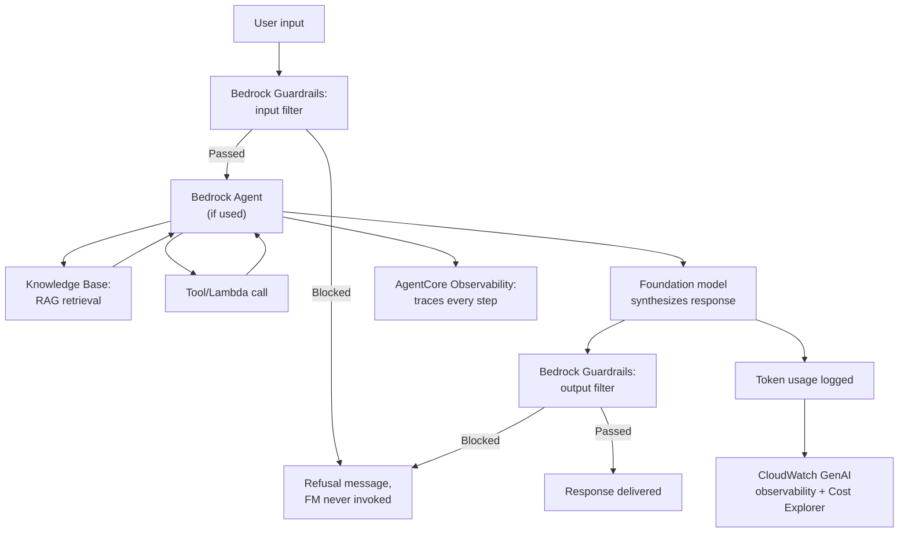


*Figure: a real AWS Machine Learning Blog architecture diagram for a Bedrock-powered generative
AI solution, showing the Knowledge Base/RAG retrieval path alongside the foundation model
invocation path — the practical, real-world shape of the "How It Works" flow above. Source: AWS
Machine Learning Blog architecture diagram, hosted on AWS's documentation CDN.*


*Figure: the Bedrock AgentCore harness architecture — the runtime structure underneath an agent's
planning, tool-calling, and synthesis steps that AgentCore Observability traces end to end,
directly supporting this domain's 4.1.5 "monitoring agent coordination" content covered in full in
the domain `README.md`. Source: AWS Bedrock AgentCore Developer Guide —
docs.aws.amazon.com/bedrock-agentcore/latest/devguide/.*


*Figure: an AWS Prescriptive Guidance reference pattern for a serverless agentic AI architecture —
showing how Bedrock Agents typically compose with serverless compute (Lambda) for tool
implementations, the realistic deployment shape behind the "Tool/Lambda call" step in the flow
diagram above. Source: AWS Prescriptive Guidance, "Agentic AI on AWS serverless" —
docs.aws.amazon.com/prescriptive-guidance/latest/agentic-ai-serverless/.*

Step by step: a request first clears Guardrails' input filter (if configured) before the model or
Agent ever sees it. If an Agent is involved, it may call a Knowledge Base (RAG retrieval) and/or
external tools one or more times before the foundation model synthesizes a final answer — each of
these internal steps is independently traced by AgentCore Observability. The synthesized response
clears Guardrails' output filter before reaching the user. In parallel, every token processed is
logged for cost tracking (feeding Cost Explorer and the token-based cost categories covered in
`finops-for-ml-token-cost-tracking.md`), and CloudWatch's generative AI observability dashboards
track latency, throughput, and Guardrails intervention rate at the model-call level.

### Key Features / Components

- **Multiple foundation models, one API** — text, image, and multimodal models from AWS (Titan,
  Nova) and third parties, selectable per use case without changing the surrounding application
  architecture.
- **Bedrock Agents** — multi-step orchestration: planning, tool invocation, Knowledge Base
  retrieval, and final synthesis, as one coherent managed workflow.
- **Knowledge Bases** — managed RAG: ingestion, chunking, embedding, and vector-store-backed
  retrieval, without building custom retrieval infrastructure.
- **Guardrails** — the six-filter-type content safety/filtering system; full configuration depth
  in `bedrock-guardrails-deep-dive.md`.
- **Evaluations** — automated model quality assessment, both one-time (model selection) and
  continuous (production monitoring, Task 4.1.6).
- **AgentCore Observability** — agent-specific tracing of coordination failures, tool-call
  failures, and truncated streaming (Task 4.1.5, full depth in the domain `README.md`).
- **Provisioned Throughput** — committed-capacity purchasing option for high-volume, predictable
  usage (full depth in `ml-cost-optimization.md`).
- **IAM credentials and Bedrock API keys** — two credential types for invoking models, each with
  real tradeoffs (full depth in the domain `README.md`'s Task 4.3.8 section).
- **`ApplyGuardrail` standalone API** — filtering decoupled from any specific model invocation.

### Use Cases — Real Scenarios

1. A customer-service chatbot built on Bedrock uses a Knowledge Base grounded in the company's
   own product documentation, with Guardrails blocking off-topic requests and PII leakage.
2. A multi-step travel-booking agent plans, calls a flight-search tool, calls a hotel-search tool,
   and synthesizes a combined itinerary — all traced end to end by AgentCore Observability.
3. A regulated bank selects IAM credentials (never Bedrock API keys) for every production FM call,
   satisfying an audit requirement for fine-grained, condition-key-based access control.
4. A media company monitors CloudWatch GenAI observability dashboards and catches a rising
   Guardrails intervention rate tied to an unusually adversarial marketing-driven traffic spike,
   not a misconfiguration.
5. A healthcare documentation startup runs a Bedrock evaluation continuously against 1% of live
   production traffic, catching a quality regression within a day of a provider-side base model
   update.
6. A fast-moving startup uses Bedrock API keys for a weekend prototype integration with an
   external partner, avoiding full IAM role setup for a short-lived, low-stakes experiment, then
   migrates to IAM credentials once the integration becomes permanent.
7. An e-commerce platform compares two different foundation models for the same product-
   description-generation task by swapping the model ID in one configuration value, with zero
   changes to the surrounding Knowledge Base/Guardrails/Agent architecture.

### Why It's Important

Real-world: Bedrock removes the single biggest barrier to production GenAI adoption (hosting and
scaling foundation models, plus building the surrounding RAG/agent/safety infrastructure from
scratch), letting teams focus engineering effort on actual application differentiation. Exam
weight: Bedrock is the central service for this domain's entire GenAI-specific content —
Guardrails, agent observability, FM-call monitoring, credential selection, and GenAI cost
tracking all attach to Bedrock specifically, making it arguably the single most cross-referenced
service in this domain's exam content.

### Exam Tips

- Bedrock provides API access to FMs with zero infrastructure management on your part — a
  question describing a need to provision/scale model-hosting compute yourself is pointing away
  from Bedrock (toward SageMaker custom hosting) despite Bedrock also being a GenAI-related
  answer choice.
- Switching foundation models within Bedrock is a configuration change (model ID), not an
  architectural rewrite — a question testing model flexibility/vendor comparison is testing
  recognition of this specific advantage.
- Guardrails, Agents, Knowledge Bases, evaluations, and AgentCore Observability are five
  *independently attachable* Bedrock capabilities, not one bundled feature — a scenario may use
  only one or two of them, and knowing which specific capability answers which specific need
  (not "just use Bedrock") is the tested skill.

---

## 7. Amazon VPC

### Definition

Amazon VPC (Virtual Private Cloud) is a logically isolated, private network you fully control
within AWS — subnets, route tables, gateways, and security controls — that determines exactly
what network paths exist to, from, and within your training jobs, endpoints, and pipelines,
including whether they can reach the public internet at all.

### Plain-English Analogy

A VPC is like **designing a private office building's floor plan and door access from scratch**,
rather than renting space in a shared, open-plan coworking building. You decide which floors exist
(subnets), which doors connect to the outside street (internet gateway), which doors are locked
to only the building's own internal hallways (private subnets with no internet gateway route),
and which specific, dedicated courier doors exist straight to a specific delivery partner's own
warehouse without ever touching the public street at all (VPC endpoints/PrivateLink) — all before
a single employee (a training job or endpoint) moves in. A training job placed in a windowless,
internal-only room with no door to the street literally cannot receive or send anything to the
public internet, no matter what it tries — not because of a rule someone wrote down, but because
the physical door simply doesn't exist.

### Purpose

Sensitive training data and model artifacts often must never transit the public internet, even
transiently, for compliance or data-sensitivity reasons — a requirement that application-level
controls (IAM, encryption) don't satisfy by themselves, since they govern *who* can access data,
not *what network path* that access travels over. VPC exists to make network isolation an
architectural, structural guarantee (no route exists) rather than a policy anyone has to keep
separately enforcing.

### When to Use

- Any training job or endpoint handling sensitive data where a compliance requirement specifies
  no public internet transit, even momentarily.
- Any scenario needing network-level isolation between environments/projects beyond what IAM
  alone provides (IAM controls API-level permission; VPC controls actual network reachability).
- Connecting a training job/endpoint to other AWS services (S3, other APIs) without any public
  internet path at all — via VPC endpoints/PrivateLink.
- Any multi-tier architecture needing to segregate, say, a public-facing API layer from an
  internal-only model-serving layer.

### When NOT to Use It / Scope Limits

- A fully public dataset with no sensitivity requirement at all, and a public-facing endpoint
  that's meant to be internet-reachable by design, has little need for aggressive network
  isolation beyond standard security-group scoping.
- VPC isolation alone doesn't substitute for IAM/KMS — a training job inside a fully private VPC
  with an overly broad IAM role can still mishandle data it has no network path to the internet
  for, just within the private network itself; the three controls (IAM, KMS, VPC) are
  complementary layers, not substitutes for each other.

### How It Works

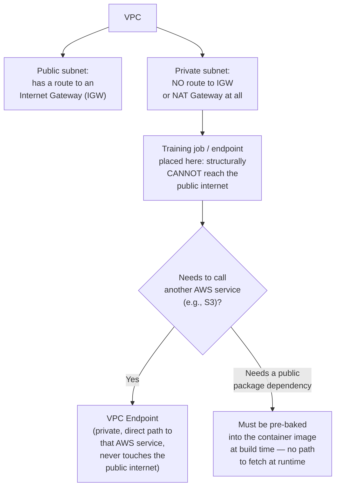


*Figure: AWS's own illustration of VPC's core structure — subnets, route tables, and gateways
inside one logically isolated network — the foundational building blocks the "no internet
route" isolation pattern above is built from. Source: AWS VPC User Guide, "How Amazon VPC works"
— docs.aws.amazon.com/vpc/latest/userguide/.*


*Figure: AWS's own PrivateLink/VPC-endpoints diagram showing the contrast between a request routed
through an internet gateway versus one routed privately through a VPC endpoint directly to an AWS
service — this is the mechanism that lets a fully isolated private-subnet training job still
legitimately reach S3 (or another supported AWS service) without ever needing a public internet
route at all. Source: AWS VPC PrivateLink Guide, "Access an AWS service using an interface VPC
endpoint" — docs.aws.amazon.com/vpc/latest/privatelink/.*

Step by step: a subnet is "private" (no public internet access) purely because its route table
has no entry pointing to an Internet Gateway (for subnets with public IPs) or NAT Gateway (for
outbound-only access) — not because of any firewall rule actively blocking traffic. This is the
exam-relevant structural distinction: there's no route *to* block, so the isolation is absolute
by construction, not a rule that could be accidentally misconfigured to allow something through.
Anything the training job inside that subnet needs from another AWS service must go through a
**VPC endpoint** — a private, direct network path to that specific service that never touches the
public internet at all — or must already be present in the container image at build time, since
there's no path to fetch anything externally at runtime.

### Key Features / Components

- **Subnets** — a subdivision of the VPC's IP range, each either "public" (route to an IGW) or
  "private" (no such route) based purely on its route table.
- **Route tables** — the actual mechanism determining what's reachable from a subnet; the
  presence or absence of an IGW/NAT route is what makes a subnet public or private.
- **Internet Gateway (IGW)** — the component providing two-way public internet access; its
  absence from a route table is what makes a subnet private.
- **NAT Gateway** — provides *outbound-only* internet access for a private subnet (useful for
  downloading updates without being directly reachable from the internet) — the exam-relevant
  nuance: a subnet with a NAT Gateway route is NOT the same as a fully isolated "no internet
  access at all" subnet, since outbound access still exists.
- **VPC Endpoints (Gateway and Interface types)** — private network paths to specific AWS services
  (S3/DynamoDB via Gateway endpoints; most other services via Interface endpoints/PrivateLink)
  without any internet gateway involvement at all.
- **Security Groups and Network ACLs** — stateful (security group) and stateless (NACL)
  traffic-filtering rules operating *within* whatever network paths the subnet/route table
  structure already allows — a second, finer-grained layer on top of the subnet-level isolation
  decision.

### Use Cases — Real Scenarios

1. A regulated financial institution runs all training jobs and the live endpoint inside private
   subnets with no NAT/IGW route, satisfying a "sensitive data must never transit the public
   internet, even transiently" compliance requirement structurally rather than by policy alone.
2. A training job inside a fully isolated private subnet reads its input data from S3 via a
   Gateway VPC endpoint, never touching the public internet despite needing to reach an AWS
   service outside the VPC's own address space.
3. A platform team pre-bakes every Python dependency into their training container images
   specifically because their standard private-subnet configuration has no route to fetch
   anything from a public package repository (PyPI) at runtime.
4. A company separates a public-facing API Gateway + Lambda layer (in public subnets) from an
   internal-only SageMaker endpoint (in private subnets, reachable only via internal VPC
   networking), limiting the endpoint's direct internet exposure to zero.
5. A security audit confirms a specific training job's isolation by checking its subnet's route
   table directly for the absence of any IGW/NAT Gateway entry, rather than relying solely on a
   security group rule that could in principle be misconfigured to allow more than intended.
6. A multi-account ML platform uses VPC peering (or Transit Gateway, for more than a couple of
   VPCs) to let a private, isolated training VPC communicate with a separate, equally private
   data-storage VPC, without either one gaining any path to the public internet.

### Why It's Important

Real-world: network-level isolation is one of the strongest, most structurally reliable controls
available — unlike an IAM policy or application logic (which can be misconfigured to allow
something unintended), a route that simply doesn't exist cannot be exploited to reach the public
internet, full stop. Exam weight: VPC isolation is named explicitly in Task Statement 4.3, and the
exam consistently tests the specific mechanic that "no internet access" is a route-table
construction detail, not a firewall-rule setting, plus the practical consequence (pre-baked
dependencies, VPC endpoints for AWS service access) that follows from genuine isolation.

### Exam Tips

- "A training job must have zero internet access due to data sensitivity" → a private subnet with
  NO route to an Internet Gateway or NAT Gateway — not merely a restrictive security group, which
  operates on top of whatever network path already exists rather than removing the path itself.
- A NAT Gateway provides outbound-only internet access — a subnet with a NAT Gateway route is NOT
  equivalent to "no internet access at all," a frequently tested distinction.
- "A fully isolated training job still needs to read from/write to S3" → a VPC Gateway endpoint,
  not an internet route — this is the standard answer whenever isolation and AWS-service access
  both need to be true simultaneously.
- A training job failing to download a package dependency inside a genuinely isolated VPC is
  expected behavior, not a bug — the fix is pre-baking dependencies into the container image or
  adding a VPC endpoint for the specific AWS service legitimately needed, never opening general
  internet access as a workaround.

---

## 8. SageMaker Deployment & Endpoints

### Definition

SageMaker's deployment layer is the set of options for serving a trained model's predictions in
production — **real-time endpoints** (always-on, low-latency), **serverless inference** (scales
to zero, pay-per-use), **asynchronous inference** (queued, for large payloads/long processing
times), and **batch transform** (offline, no persistent endpoint at all) — plus the operational
features layered on top: auto scaling, multi-model endpoints, and Inference Recommender's
instance-sizing guidance.

### Plain-English Analogy

Think of the four inference options as four different staffing models for a help desk. A
**real-time endpoint** is a staff member sitting at the desk every single hour the building is
open, ready to answer instantly — valuable for a constantly busy desk, wasteful if most hours see
nobody walk up. **Serverless inference** is an on-call staff member who's paged the moment someone
walks up and leaves right after — zero cost while nobody's there, a brief pause (cold start) while
they arrive. **Asynchronous inference** is a drop-box system: you leave your (large, complex)
request in a box, get a claim ticket, and come back later for the result, instead of waiting at
the counter. **Batch transform** is sending the help desk a giant stack of requests overnight to
process all at once with no counter staffed at all during the day — the most efficient option when
nothing needs a response *right now*.

### Purpose

Different ML use cases have fundamentally different latency, cost, and traffic-pattern
requirements, and forcing every one of them into a single inference option either overspends
(an always-on endpoint for rarely-used, bursty traffic) or under-serves (a batch-only approach
for a use case that genuinely needs sub-second responses). This layer exists to match the serving
mechanism to the actual usage pattern, which is also the direct foundation `ml-cost-optimization.md`
builds its purchasing-option guidance on top of.

### When to Use

- **Real-time endpoints** — consistent, predictable traffic needing low, consistent latency (a
  live product recommendation, a fraud-check on a transaction in progress).
- **Serverless inference** — bursty, intermittent, or unpredictable traffic where paying for idle
  always-on capacity would be wasteful, and a brief cold-start latency on the first request after
  idle is acceptable.
- **Asynchronous inference** — large payloads (e.g., high-resolution images, long documents) or
  processing times too long for a synchronous real-time request/response cycle, but still needing
  an eventual, trackable result (not a full offline batch run).
- **Batch transform** — no persistent endpoint needed at all; a known, finite dataset needs
  predictions generated in bulk on a schedule (nightly scoring of all customers), with no
  real-time response requirement.
- **Multi-model endpoints** — many distinct models (e.g., one per customer) each individually
  low-traffic, where running 40 separate always-on endpoints would be wasteful; a shared pool of
  instances loads each specific model into memory on demand.

### When NOT to Use It / Alternatives

- Don't use a real-time, always-on endpoint for genuinely sparse, bursty traffic — the idle-
  capacity cost is the exact anti-pattern `ml-cost-optimization.md` and
  `finops-for-ml-token-cost-tracking.md` both flag; Serverless Inference is the direct fix.
- Don't use Serverless Inference for an ultra-low-latency, consistently-high-traffic use case
  where even an occasional cold start is unacceptable — a provisioned, always-on real-time
  endpoint (or Serverless's provisioned-concurrency variant, if latency-sensitive but still
  bursty) is the better fit.
- Don't use batch transform for anything needing an immediate, synchronous response to an
  individual request — it's architecturally an offline, bulk mechanism with no live request/
  response path at all.

### How It Works — Serverless Inference

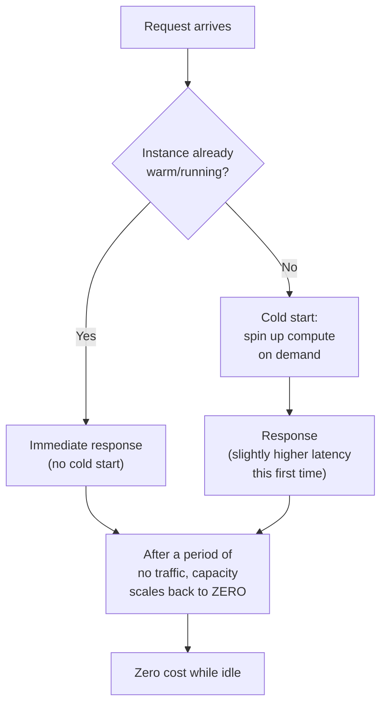


*Figure: AWS's own diagram of SageMaker Serverless Inference's request handling — compute capacity
provisioned automatically on demand and scaled back down to zero during idle periods, exactly the
"pay for nothing while idle, pay proportionally to actual request volume" behavior the Mermaid
flow above describes, and the direct inference-layer counterpart to Bedrock's zero-idle-cost,
per-token GenAI billing shape. Source: AWS SageMaker Developer Guide, "Deploy models with Amazon
SageMaker Serverless Inference" — docs.aws.amazon.com/sagemaker/latest/dg/serverless-endpoints.html.*

### How It Works — Choosing the Right Option

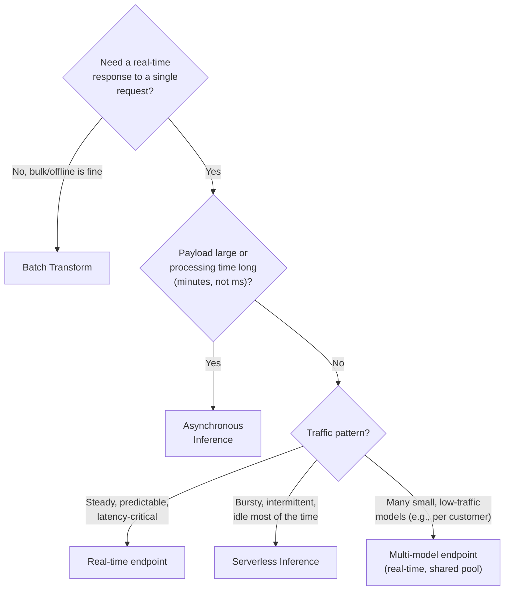

### Key Features / Components

- **Real-time endpoints** — persistent, always-on instances with auto scaling to adjust instance
  count (not to zero) based on traffic.
- **Serverless Inference** — automatic scale-to-zero compute, per-request-proportional billing,
  with a cold-start latency tradeoff on the first request after idle.
- **Asynchronous Inference** — queued requests with an S3-based output location and an SNS
  notification on completion, for large/slow workloads needing an eventual (not instant) result.
- **Batch Transform** — offline, no persistent endpoint, processes an entire dataset in one job.
- **Multi-model endpoints (MME)** — a shared instance pool loading individual models into memory
  on demand, consolidating many low-traffic models' cost.
- **Auto Scaling** — adjusts a real-time endpoint's instance count based on a target metric
  (commonly invocations-per-instance), scaling down during low traffic without reaching zero.
- **Inference Recommender** — load-tests candidate instance types/sizes against your actual
  model and sample payloads, producing a measured cost/latency/throughput comparison (full depth
  in `ml-cost-optimization.md`).

### Use Cases — Real Scenarios

1. A live fraud-detection check on in-progress transactions uses a real-time endpoint with Auto
   Scaling, since consistent low latency and the ability to handle traffic spikes are both
   required simultaneously.
2. A document-analysis feature accepting large PDF uploads uses Asynchronous Inference, since
   processing time (tens of seconds to minutes per document) is too long for a synchronous
   real-time request but the use case still needs an eventual, trackable result per upload.
3. A nightly churn-risk scoring job across the entire customer base uses Batch Transform, since
   there's no real-time response requirement at all and running a persistent endpoint 24/7 for a
   once-a-night job would be pure waste.
4. A SaaS company consolidates 40 separate, low-traffic, per-customer models onto a handful of
   multi-model endpoints, cutting both cost and operational overhead simultaneously.
5. A new product feature with completely unknown, likely-bursty early traffic launches on
   Serverless Inference first, deferring any Savings-Plan/Reserved-capacity commitment until
   usage patterns stabilize enough to justify one.
6. A platform team runs Inference Recommender's load test before committing to any purchasing
   option for a brand-new endpoint, basing the eventual real-time-vs-serverless and instance-size
   decision on measured data rather than a guess.

### Why It's Important

Real-world: the deployment-option decision is frequently the single largest lever on both cost and
user-facing latency for a production ML system — getting it wrong in either direction (over-
provisioned always-on capacity, or an architecturally mismatched option for the actual traffic
pattern) has real, compounding operational consequences. Exam weight: this topic sits at the
direct intersection of Domain 3 (deployment architecture) and Domain 4 (ongoing cost/operational
fit), and MLA-C02 scenario questions frequently test matching a described traffic pattern to the
correct one of these four-plus-MME options.

### Exam Tips

- "Bursty, unpredictable, mostly idle" → Serverless Inference. "Steady, predictable, always-on,
  latency-critical" → real-time endpoint with Auto Scaling — the most frequently tested pairing
  in this topic.
- "Large payload or long processing time, but still need an eventual tracked result" →
  Asynchronous Inference — distinct from both real-time (too slow for sync) and batch (which
  implies no per-request tracking/triggering at all).
- "No real-time requirement, bulk dataset, scheduled/offline" → Batch Transform, with zero
  persistent endpoint cost.
- "Many small, individually low-traffic models" → multi-model endpoints, the direct fix for the
  "40 separate always-on endpoints" anti-pattern this domain's cost-optimization content flags
  repeatedly.

---

## 9. SageMaker Model Monitor & Model Registry

### Definition

**SageMaker Model Monitor** continuously compares live inference data/predictions against a
training-time baseline to catch data drift (input statistics shifted) and concept drift (the
input-to-correct-output relationship shifted), plus bias drift and feature-attribution drift via
Clarify integration. **SageMaker Model Registry** is the companion cataloging service: a
versioned, approval-gated registry of trained model packages, organized into Model Groups, that
governs which model version is actually authorized for deployment.

### Plain-English Analogy

Model Monitor is a **smoke detector that's always listening**, comparing the current air (live
data) against what clean air smelled like when it was installed (the training baseline) — it
doesn't prevent a fire, but it reliably tells you the moment something's different enough to
investigate. Model Registry is the **pharmaceutical batch-approval log** — every batch (model
version) produced is logged with its exact formula (training job lineage) and test results
(evaluation metrics), and nothing ships to pharmacies (production deployment) without an explicit
"approved" stamp in that log, so you can always trace exactly which specific batch is on shelves
right now and roll back to a prior approved batch if something goes wrong.

### Purpose

A model that was accurate on launch day silently decays as the world around it changes — Model
Monitor exists to make that decay a detected, alertable event instead of a slow-burning,
undiscovered problem. Separately, as an ML team produces many model versions over time across
many experiments, Model Registry exists to prevent "which exact model is actually running in
production, and why was it approved" from ever becoming an undocumented mystery — a governance
gap that becomes a real liability the moment an incident investigation or audit needs that answer.

### When to Use

- **Model Monitor** — any model in continuous production for more than a few weeks; see
  `model-drift-deep-dive.md` for full mechanical depth on thresholds, scheduling, and a worked
  numeric drift example.
- **Model Registry** — any team with more than a handful of model versions in play, or any
  regulated context needing an explicit, auditable deployment-approval trail — effectively any
  real production ML team beyond a single-person, single-model prototype stage.

### When NOT to Use It / Scope Limits

- A one-off batch job run once and discarded has no ongoing production state for Model Monitor to
  watch, and little versioning need for Model Registry beyond basic artifact retention.
- A team with genuinely one single model and no retraining cadence at all has limited Model
  Registry value beyond a single entry — though this scope shrinks fast as soon as a second
  version or a retraining pipeline exists.

### How It Works — Model Monitor (summary; full mechanics in `model-drift-deep-dive.md`)

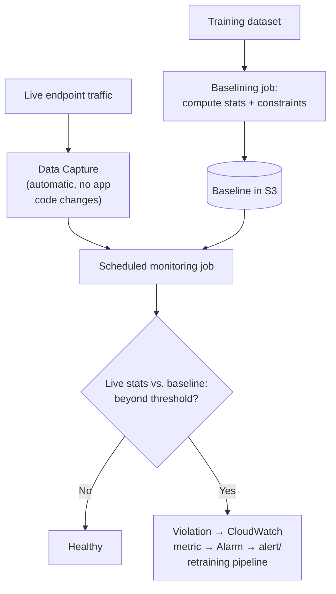


*Figure: AWS's own architecture diagram of Model Monitor watching a real-time endpoint —
captured data analyzed on a schedule against a saved baseline, violations surfaced as CloudWatch
metrics/alarms, exactly the flow traced above. Source: AWS SageMaker Developer Guide, "Monitor
models for data and model quality, bias, and explainability" —
docs.aws.amazon.com/sagemaker/latest/dg/model-monitor.html.*

### How It Works — Model Registry's Approval Gate

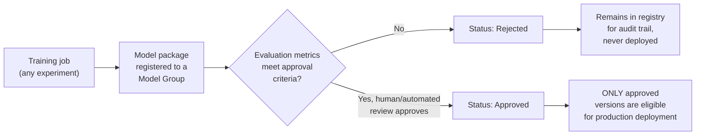

Step by step: every training run's output model is registered as a new **model version** within a
**Model Group** (a logical grouping of all versions of "the same" model over time, e.g., every
version of the fraud-detection model). Each version carries its evaluation metrics and lineage
(which training job, which data, which code version produced it) as metadata. A version's status
starts as `PendingManualApproval` (or is auto-evaluated against defined criteria) and only
transitions to `Approved` once that review passes — and critically, **only `Approved` versions
are eligible to actually be deployed**, making the registry a real deployment gate, not just a
passive catalog.

### Key Features / Components

- **Baselining jobs, Data Capture, monitoring schedules** — Model Monitor's core mechanics, full
  depth in `model-drift-deep-dive.md`.
- **Four monitor types** — Data Quality (data drift), Model Quality (concept drift), Bias Drift,
  Feature Attribution Drift.
- **Model Groups** — the Registry's logical container for every version of the same conceptual
  model over time.
- **Model package versions** — each individual registered model, carrying metrics, lineage, and
  approval status.
- **Approval status workflow** — `PendingManualApproval` / `Approved` / `Rejected`, the
  deployment-eligibility gate.
- **Model lineage tracking** — the ability to trace a specific deployed model version back to the
  exact training job, dataset, and code that produced it.
- **Integration with CI/CD pipelines (Domain 3)** — a pipeline stage can automatically register a
  newly trained model and halt for approval before any deployment stage runs.

### Use Cases — Real Scenarios

1. A lending company's Model Monitor flags data drift in applicant income distributions after a
   marketing campaign shift, triggering a review before accuracy actually degrades.
2. The same lending company's monthly concept-drift check (against real loan outcomes) catches an
   actual accuracy drop that the data-drift check alone would never have revealed, since inputs
   looked statistically unchanged.
3. A platform team requires every production deployment to reference an `Approved` Model
   Registry version explicitly — an auditor later traces exactly which training job, dataset, and
   reviewer approved the model currently serving live traffic.
4. A retraining pipeline automatically registers each new candidate model version to the Model
   Registry, halting for human review before any version reaches `Approved` status, directly
   implementing the approval-gate pattern as part of Domain 3's CI/CD automation.
5. An incident response team, investigating a sudden accuracy complaint, pulls the Model
   Registry's lineage metadata to confirm exactly which training data and code version produced
   the currently deployed model, cutting investigation time from days to minutes.
6. A platform engineer sets a loosened Model Monitor threshold specifically on a known-seasonal
   feature while keeping tight thresholds on every other feature, avoiding a predictable annual
   false-positive alert storm without weakening genuine drift detection elsewhere.

### Why It's Important

Real-world: undetected drift and undocumented model lineage are both top real-world causes of ML
production incidents and compliance failures — not because the model itself was poorly built, but
because operational discipline around an already-good model lapsed. Exam weight: Model Monitor's
data-drift-vs-concept-drift distinction is one of Domain 4's single most heavily tested facts
(full worked depth in `model-drift-deep-dive.md`), and Model Registry's approval-gate mechanic
is the direct governance counterpart tested alongside it.

### Exam Tips

- Data drift needs only input statistics; concept drift needs fresh ground-truth labels — this
  distinction (detailed with a full worked numeric example in `model-drift-deep-dive.md`) is
  tested more than any other fact in this pairing.
- "Which exact model version is deployed, and who approved it" → Model Registry's approval status
  and lineage tracking, not Model Monitor (which watches behavior, not governance/approval state).
- Only `Approved` Model Registry versions should be eligible for production deployment — a
  pipeline deploying a `PendingManualApproval` or `Rejected` version is a governance failure the
  exam may test as a scenario to recognize and flag.

---

## 10. SageMaker Training & Tuning

### Definition

SageMaker's training layer runs model training jobs on managed, ephemeral compute — provisioned
for the duration of the job and torn down afterward — with built-in support for distributed
training across multiple instances, automatic hyperparameter tuning, and, specifically relevant
to this domain, **Managed Spot Training** (using discounted, interruptible spare EC2 capacity
with automatic checkpoint/resume) as the primary training-side cost-optimization lever.

### Plain-English Analogy

A SageMaker training job is like **renting a fully-equipped workshop by the hour, exactly for the
duration of one project, then handing the keys back** — you don't own or maintain the workshop
between projects, and you only pay for the hours you actually used it. **Managed Spot Training**
is choosing the "off-peak, can-be-bumped" hourly rate at a shared workshop space: significantly
cheaper, with the understanding that if someone else urgently needs your exact bench at that exact
moment, you'll be asked to pause and resume later (automatically, picking up your project exactly
where you left it, assuming you've been saving your progress as you go — the checkpointing
discipline this mechanism depends on).

### Purpose

Training is temporary, bursty, and often the most expensive compute (GPU instances) an ML
pipeline uses — but it's also uniquely interruption-tolerant compared to a live inference endpoint,
since a training job that pauses and resumes later produces the same final result, just over a
longer wall-clock window. This layer exists to let training-specific characteristics (temporary,
resumable, GPU-hungry) be matched to training-specific purchasing/scaling options, rather than
treating training compute identically to always-on inference compute.

### When to Use

- Any model training job, by default — the question is less "whether" to use this layer and more
  "which specific configuration" (instance count/type, Spot vs. On-Demand, tuning strategy) fits
  the specific job.
- **Managed Spot Training** specifically — any training job whose code already checkpoints
  progress (or can be modified to) and has a flexible, non-hard deadline.
- **Distributed training** — any model/dataset large enough that single-instance training time is
  impractically long, splitting the work across multiple instances (data parallelism, splitting
  the dataset; or model parallelism, splitting the model itself for extremely large models).
- **Automatic hyperparameter tuning** — any scenario where the right hyperparameter values aren't
  already known and manual trial-and-error search would be slow and inefficient.

### When NOT to Use It / Alternatives

- **Don't use Spot for anything with a hard, inflexible completion deadline** — interruption risk
  (however statistically low at a given moment) is unacceptable when a job absolutely must
  complete by a specific time; pay On-Demand for that certainty instead.
- **Don't attempt Managed Spot Training without first confirming the training script actually
  checkpoints progress** — SageMaker provides the interruption/resume *infrastructure*, not
  automatic checkpointing of arbitrary code that was never written to save its own progress; a
  job that doesn't checkpoint will restart from zero on interruption, often negating the cost
  savings through repeated restarts.
- **Don't reach for distributed/multi-instance training for a small model/dataset that trains
  fine on one instance in a reasonable time** — the coordination overhead of distributed training
  isn't free, and applying it to a workload that doesn't need it adds complexity without a
  corresponding benefit.

### How It Works

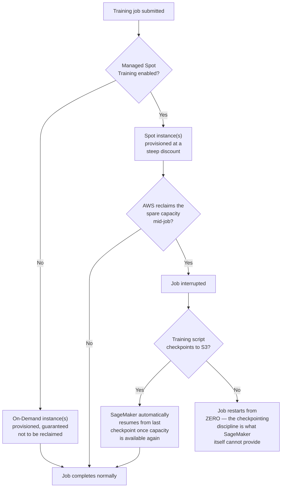


*Figure: AWS's own diagram of a SageMaker training job's architecture — input data pulled from S3,
training compute provisioned for the job's duration, and the resulting model artifact written
back to S3 once complete, the ephemeral, task-scoped shape described in the Definition above.
Source: AWS SageMaker Developer Guide, "Train a Model with Amazon SageMaker" —
docs.aws.amazon.com/sagemaker/latest/dg/how-it-works-training.html.*


*Figure: while Inference Recommender is primarily a deployment-sizing tool, this same
measured-comparison discipline (load-testing real candidate options rather than guessing) is the
exact mental model SageMaker's training-side instance-type selection should follow too — the
console view shown here compares candidates side by side on cost and performance, the same
evidence-based decision pattern covered for training in `ml-cost-optimization.md`. Source: AWS
SageMaker Developer Guide, "Recommendation jobs with Amazon SageMaker Inference Recommender" —
docs.aws.amazon.com/sagemaker/latest/dg/inference-recommender-recommendation-jobs.html.*

### Key Features / Components

- **Managed Spot Training** — automatic checkpointing-to-S3 support and automatic interruption/
  resume handling, up to roughly 90% discount versus On-Demand (check the current pricing page
  for the exact figure).
- **Distributed training** — SageMaker's built-in data-parallel and model-parallel libraries,
  splitting a training workload across multiple instances/GPUs without hand-building the
  coordination logic yourself.
- **Automatic Model Tuning (hyperparameter tuning)** — Bayesian search (and other strategies)
  across a defined hyperparameter space, running many training jobs automatically and converging
  on the best-performing combination faster than manual or exhaustive grid search.
- **Warm pools** — an option to keep training instances in a "warm" (already provisioned) state
  between consecutive training jobs for a short period, cutting the instance-provisioning latency
  for teams running many sequential short jobs/tuning iterations.
- **Training compiler / Debugger / Profiler** — supporting tools for accelerating training and
  diagnosing training-time bottlenecks (resource under/over-utilization, vanishing gradients)
  distinct from, but complementary to, the pure cost/scheduling concerns this section focuses on.

### Use Cases — Real Scenarios

1. A nightly churn-model retraining job with no hard deadline runs under Managed Spot Training,
   saving significantly versus On-Demand with no architectural risk, since the job's checkpointing
   was already in place.
2. A large language model's full fine-tuning run is distributed across multiple GPU instances
   using SageMaker's model-parallel library, since the model is too large to fit (or train in a
   reasonable time) on a single instance.
3. A team uses Automatic Model Tuning to search a defined hyperparameter space for a gradient-
   boosted tree model, converging on a materially better-performing configuration than their
   initial manual guesses in a fraction of the time manual search would have taken.
4. A data science team running many short, sequential tuning-iteration training jobs enables warm
   pools, cutting the cumulative instance-provisioning wait time across dozens of iterations.
5. A time-critical retraining job ahead of a product launch deliberately stays on On-Demand rather
   than Spot, since the team judges the (even if statistically low) interruption risk unacceptable
   given the hard launch deadline.
6. A platform team discovers a Managed Spot Training job has been silently restarting from scratch
   on every interruption and traces the root cause to the training script never having implemented
   checkpointing in the first place — fixing the script, not the SageMaker configuration, resolves
   the issue.

### Why It's Important

Real-world: training compute (especially GPU-backed) is among the most expensive compute an ML
team uses, and because training jobs are uniquely interruption-tolerant compared to live
inference, this is the single highest-leverage place to apply Spot-based savings in an ML
pipeline's whole cost profile. Exam weight: Managed Spot Training's checkpoint/resume mechanics
and the contrast with On-Demand's deadline-certainty tradeoff are tested directly and frequently,
typically via a scenario describing a job's deadline flexibility and checkpoint capability that
you must match to the correct purchasing option.

### Exam Tips

- "Can tolerate interruption and resume, no hard deadline" → Managed Spot Training. "Must
  complete by a specific time, cannot be interrupted" → On-Demand — the single most frequently
  tested purchasing-option pairing in this domain.
- Spot's automatic resume only works if the training script itself implements checkpointing —
  SageMaker provides interruption/resume *infrastructure*, never automatic checkpointing of code
  that was never written to save its own progress; a question describing repeated restarts from
  zero under Spot is testing recognition of this specific root cause.
- "Unsure what instance type a training job needs" is answered the same evidence-based way as the
  deployment-sizing question — measure with a load test/benchmark rather than guess, the same
  "measure, don't guess" discipline Inference Recommender applies on the deployment side.

---

## 11. Cross-Service Synthesis — How All Ten Fit Together

### 11.1 The Three Rings, Revisited with All Ten Services Placed

Every one of this domain's ten services/topics answers one of three continuously-running
questions about a live system. Placing all ten on one diagram makes the domain's internal
structure visible at a glance:

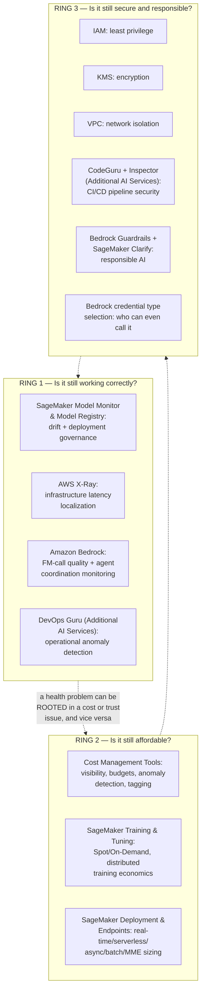

The exam's favorite cross-ring scenario is a problem that *looks* like it belongs to one ring but
is actually rooted in another: a cost spike (Ring 2) caused by a retry storm from an undetected
agent coordination failure (Ring 1); a security incident (Ring 3) enabled by an overly broad
Bedrock API key nobody scoped down (also Ring 3, but a different, less-obvious mechanism); or a
"model quality" complaint (looks like Ring 1) that's actually a Guardrails misconfiguration
(Ring 3) blocking legitimate responses rather than the model itself degrading.

### 11.2 Full Integrated Case Study — "Meridian Health Analytics"

**The business problem:** Meridian Health Analytics runs three live systems an auditor will
review in six weeks: (1) a **readmission-risk model** (classic ML, SageMaker-hosted real-time
endpoint) predicting which discharged patients are likely to be readmitted within 30 days, (2) a
**clinical-notes extraction pipeline** using Comprehend Medical to structure unstructured
discharge summaries, and (3) a newly launched **patient-facing GenAI assistant** (Bedrock-based)
answering general questions about discharge instructions. All patient data flows through
HealthLake for FHIR-standard storage. Leadership has asked for a full operational and security
review touching every one of this domain's ten services before the audit.

**Step 1 — Health (Ring 1):**
1. The readmission-risk model's **SageMaker Model Monitor** runs hourly data-quality checks
   comparing live patient feature distributions (age, prior admission count, diagnosis codes)
   against the training-time baseline — using the exact mechanics covered in
   `model-drift-deep-dive.md`. A separate, monthly **concept-drift check** scores the model
   against actual 30-day readmission outcomes once they've resolved.
2. The patient-facing GenAI assistant's model-call health is tracked via **CloudWatch generative
   AI observability** (token throughput, latency, Guardrails intervention rate), while its
   multi-step behavior (it looks up a patient's specific discharge instructions via a tool call
   before answering) is traced end to end by **AgentCore Observability**, directly implementing
   this domain's 4.1.5/4.1.6 split.
3. An **AWS X-Ray** trace across the assistant's full request path (API Gateway → Lambda →
   Bedrock Agent → discharge-instruction lookup tool) isolates a specific slow hop (the lookup
   tool's database query) that was initially misattributed to "the model being slow," a direct
   demonstration of X-Ray's complementary role alongside CloudWatch GenAI observability and
   AgentCore Observability.
4. **DevOps Guru**, enabled across the whole application's AWS resources, independently flags a
   gradually worsening Lambda duration trend two weeks before it would have crossed any manually
   set CloudWatch Alarm threshold — catching an unknown-unknown operational drift that none of
   the above tools, each scoped to a specific known failure surface, were watching for.
5. The readmission model's **Model Registry** entry carries full lineage (training job, dataset
   version, code commit) and an `Approved` status from a clinical data science lead — the exact
   artifact the audit will request first.

**Step 2 — Cost (Ring 2):**
1. **Cost Management Tools**: every resource across all three systems carries `project=meridian-
   readmission`, `project=meridian-notes-extraction`, or `project=meridian-assistant` cost
   allocation tags, letting Cost Explorer break total spend down by system rather than one opaque
   total — plus an **AWS Cost Anomaly Detection** monitor scoped to each project tag independently.
2. **SageMaker Training & Tuning**: the readmission model's weekly retraining job runs under
   **Managed Spot Training**, since the job already checkpoints and has no hard deadline —
   following the exact Pattern from `ml-cost-optimization.md`'s Scenario 1.
3. **SageMaker Deployment & Endpoints**: the readmission model, with steady, predictable clinical-
   hours traffic, runs on a real-time endpoint with a **SageMaker Savings Plan**; the GenAI
   assistant, used sporadically by patients at unpredictable hours, runs On-Demand per-token
   rather than committing to Bedrock Provisioned Throughput prematurely, following the discipline
   from `ml-cost-optimization.md`'s Scenario 4 in reverse (not yet justified).
4. A `finops-for-ml-token-cost-tracking.md`-style six-category breakdown of the assistant's
   Bedrock spend separates inference-token cost (tracking roughly with real patient usage) from
   embedding-computation cost (spiking once, tied to the one-time ingestion of the discharge-
   instruction knowledge base, not an ongoing usage pattern) — preventing a misdirected
   investigation into "patients are suddenly chatting much more."

**Step 3 — Trust and Safety (Ring 3):**
1. **IAM**: the readmission model's training job, the notes-extraction pipeline, and the
   assistant's Agent each run under a separate, narrowly scoped execution role — following
   `iam-least-privilege-ml-pipelines.md`'s Pattern 1 — rather than one shared "Meridian ML role,"
   specifically so a compromise in one system cannot reach either of the other two.
2. **KMS**: all patient data (training data, HealthLake-stored records, model artifacts) is
   encrypted with a **customer-managed KMS key**, giving Meridian — not AWS — the audit-logged,
   revocable control a healthcare compliance review requires.
3. **VPC**: the readmission model's training jobs and endpoint run inside private subnets with no
   internet gateway route, reaching S3 only via a VPC Gateway endpoint — satisfying a "patient
   data must never transit the public internet" requirement structurally.
4. **CodeGuru Reviewer + Amazon Inspector** (Additional AI Services): every code commit to the
   notes-extraction pipeline is scanned by CodeGuru Reviewer before merge, and every built
   container image is scanned by Inspector before deployment — catching a hardcoded test
   credential in a notes-extraction script before it ever reached a running job.
5. **Bedrock Guardrails**, configured on the patient-facing assistant following
   `bedrock-guardrails-deep-dive.md`'s patterns: a denied-topic policy blocking specific medical
   dosage advice (outside the assistant's licensed scope), PII anonymization for any patient
   identifiers a user might paste into a message, and a contextual grounding check ensuring the
   assistant's answers are actually supported by the retrieved discharge-instruction documents,
   not fabricated.
6. **Bedrock credential type**: the assistant's production Lambda function uses **IAM
   credentials** (an execution role with scoped `bedrock:InvokeModel` permission), not Bedrock API
   keys, satisfying the same audit-trail requirement the domain README's Task 4.3.8 content
   describes for regulated contexts.
7. **SageMaker Clarify**, run on the readmission model both pre-training (checking whether
   historical readmission labels correlate with a sensitive proxy attribute) and post-training
   (checking disparate readmission-risk-score rates across patient demographic groups), plus
   per-prediction SHAP explainability logged for every patient the model flags as high-risk — the
   direct artifact answering a patient's or auditor's "why was this patient flagged" question.

**Why this case study matters for the exam:** every one of the ten services in this MASTER-CHUNK
is represented in one coherent narrative, deliberately mirroring the density a real case-study-
style exam question uses — testing whether you can correctly route each distinct sub-requirement
(health, cost, trust/safety, for each of three different systems) to its specific AWS mechanism,
rather than reaching for one generic "use SageMaker" or "use Bedrock" answer across the board.

### 11.3 Scenario-to-Service Decision Matrix

A fast-lookup table mapping common exam scenario *phrasings* directly to the correct service —
useful as a last-pass review before the exam:

| Scenario phrase | Correct service/mechanism |
|---|---|
| "Input feature distributions have shifted" | SageMaker Model Monitor — Data Quality monitor (data drift) |
| "Accuracy against fresh labeled outcomes is falling" | SageMaker Model Monitor — Model Quality monitor (concept drift) |
| "Which specific hop in a multi-service pipeline is slow" | AWS X-Ray |
| "Did a multi-step agent's tool calls/coordination succeed" | Bedrock AgentCore Observability |
| "Is the foundation model call itself healthy (latency, throughput, errors)" | CloudWatch generative AI observability + Bedrock evaluations |
| "Detect an operational anomaly with no pre-set threshold" | Amazon DevOps Guru |
| "Alert on spend crossing a dollar figure I define" | AWS Budgets |
| "Alert on an unusual spend pattern automatically, no threshold" | AWS Cost Anomaly Detection |
| "Which team/project is driving this cost" | Cost allocation tags + Cost Explorer |
| "Training job, interruption-tolerant, flexible deadline" | Managed Spot Training |
| "Training job, hard deadline, cannot be interrupted" | On-Demand training |
| "Unsure what instance type an endpoint/training job needs" | SageMaker Inference Recommender (load-test, measure) |
| "Bursty, unpredictable, mostly idle inference traffic" | SageMaker Serverless Inference |
| "Steady, predictable, always-on inference traffic" | Real-time endpoint + SageMaker Savings Plan |
| "Many small, low-traffic models (one per customer)" | Multi-model endpoints |
| "GenAI cost rising with flat traffic" | Investigate tokens/prompt/context size, not purchasing options |
| "Even AWS must not be able to read this data" | KMS customer-managed key |
| "Training job must have zero internet access" | VPC private subnet, no IGW/NAT route |
| "Fully isolated job still needs to reach S3" | VPC Gateway endpoint |
| "Cap what a self-service role can ever grant itself" | IAM permissions boundary |
| "Cap what an entire account/OU can ever do" | Service Control Policy (SCP) |
| "Temporary, scoped cross-account access, no stored credential" | `sts:AssumeRole` with External ID |
| "Scan code for security/quality issues in CI/CD" | Amazon CodeGuru Reviewer |
| "Scan container images for known CVEs" | Amazon Inspector |
| "Block a topic regardless of how it's rephrased" | Bedrock Guardrails — denied topics |
| "Block an exact brand name/profane term" | Bedrock Guardrails — word filters |
| "RAG answer sounds right but isn't supported by retrieved docs" | Bedrock Guardrails — contextual grounding |
| "Guarantee a generated number never violates a defined rule" | Bedrock Guardrails — automated reasoning checks |
| "Why did the model make this ONE specific prediction" | SageMaker Clarify — SHAP explainability |
| "Is the model unfair to a specific group overall" | SageMaker Clarify — post-training bias metrics |
| "Which exact model version is in production, who approved it" | SageMaker Model Registry |
| "Structured conversation, defined intents/slots" | Amazon Lex |
| "Extract structured facts from clinical/medical text" | Amazon Comprehend Medical |
| "Healthcare data needing FHIR-standard interoperability" | Amazon HealthLake |
| "IAM credentials vs. Bedrock API keys — which for a Lambda already in AWS" | IAM credentials |
| "IAM credentials vs. Bedrock API keys — which for a weekend external prototype" | Bedrock API keys |

### 11.4 Troubleshooting Decision Tree — "Something's Wrong, Which Service Owns This?"

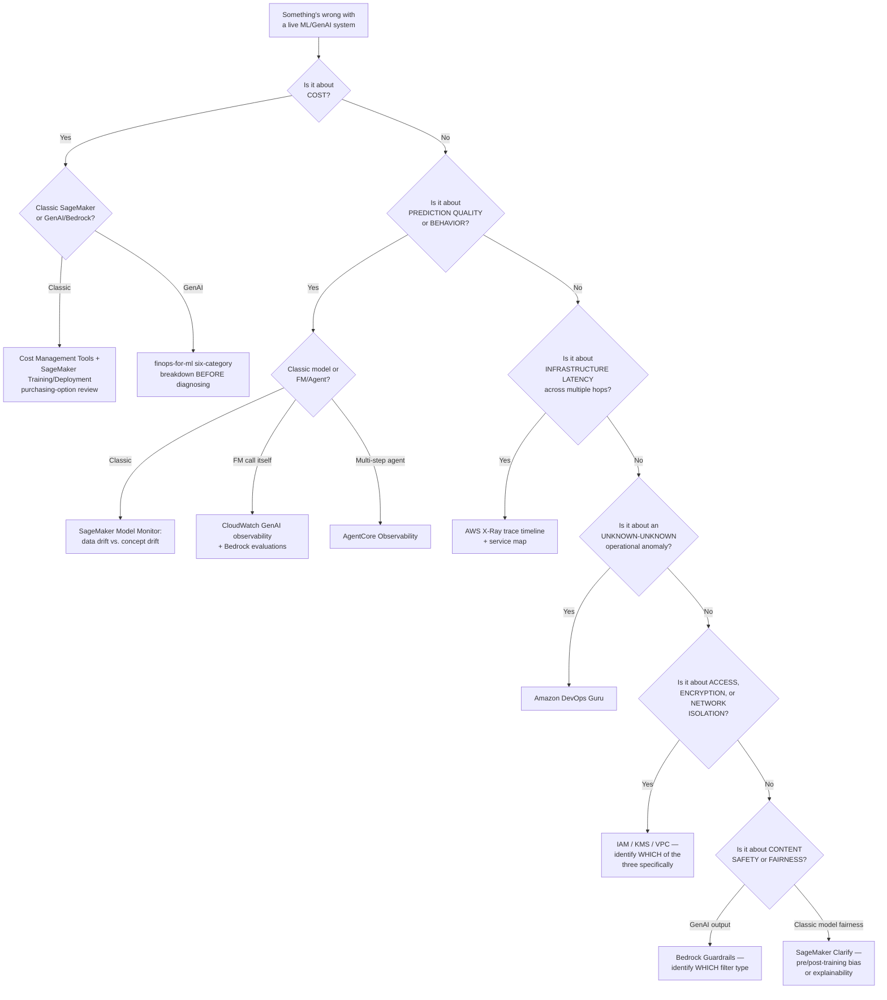

### 11.5 Twenty Additional Cross-Cutting Exam Scenarios, Worked

**Scenario 1:** "A live endpoint's CloudWatch invocation metrics look completely normal, but
customer complaints about wrong answers are rising." *Answer:* this is the classic Ring-1 trap —
check Model Monitor for concept drift first (accuracy against *fresh labels*, not just traffic
volume), since healthy traffic metrics say nothing about prediction correctness.

**Scenario 2:** "A Bedrock Agent's individual model calls all show healthy latency and 100%
success in CloudWatch, yet end users report consistently wrong final answers." *Answer:*
AgentCore Observability, investigating coordination failures or tool-call issues upstream of
generation — healthy individual model calls don't guarantee correct orchestration logic.

**Scenario 3:** "A company wants one unified view combining classic SageMaker Model Monitor drift
metrics with GenAI token/Guardrails metrics for leadership." *Answer:* a shared CloudWatch
dashboard combining both metric sources — they're different tools, but both emit to the same
underlying CloudWatch service, making a unified dashboard straightforward.

**Scenario 4:** "A training job's execution role was scoped down to exactly the S3 prefixes and
KMS key it needs, but the job now fails with AccessDenied on a logging action." *Answer:* the
tightened policy likely omitted the CloudWatch Logs actions (`logs:CreateLogGroup`, etc.) the job
needs for its own operational logging — a real, common tightening mistake; use the IAM policy
simulator or CloudTrail review to find every action the job legitimately performs before
re-tightening.

**Scenario 5:** "A fraud model's post-training Clarify bias report shows a disparity, but deeper
analysis shows it's fully explained by transaction amount, a legitimate risk factor." *Answer:*
document the legitimate-factor finding; this is not evidence of unfair bias once properly
conditioned, and "fixing" the model to force equal outcomes regardless of the legitimate factor
would be the wrong response.

**Scenario 6:** "A Guardrails-protected RAG chatbot blocks a correct answer that blends retrieved
context with general background knowledge." *Answer:* review the contextual grounding threshold —
it may be calibrated too strictly for answers that legitimately synthesize, not just quote,
retrieved content.

**Scenario 7:** "A company's vector database storage cost keeps rising while query volume stays
completely flat." *Answer:* investigate corpus growth/retention policy — vector storage cost
accrues independent of query volume, a distinct cost category from inference.

**Scenario 8:** "A team wants a Spot training job to resume exactly where it left off after an
interruption, but it keeps restarting from zero." *Answer:* the training script itself isn't
implementing checkpointing to S3 — SageMaker's Spot infrastructure provides the resume mechanism,
but only if the code saves its own progress in the first place.

**Scenario 9:** "An auditor asks which specific training job, dataset, and code version produced
the model currently running in production." *Answer:* SageMaker Model Registry's lineage
tracking on the `Approved` model package version — the direct, purpose-built artifact for this
exact question.

**Scenario 10:** "A customer-facing chatbot needs to refuse discussing a specific restricted topic
regardless of how creatively a user rephrases the question." *Answer:* Bedrock Guardrails denied
topics, using semantic matching via a clear definition and examples — not a literal keyword/word
filter, which would miss paraphrased attempts.

**Scenario 11:** "A platform team wants self-service IAM role creation for data scientists
without any individual being able to escalate beyond an org-defined ceiling." *Answer:* an IAM
permissions boundary attached to the data scientists' own identities.

**Scenario 12:** "A sensitive training job must run with zero public internet access, but still
needs to read training data from S3." *Answer:* a private subnet with no IGW/NAT route, reaching
S3 via a VPC Gateway endpoint — isolation and necessary AWS-service access aren't mutually
exclusive.

**Scenario 13:** "A GenAI feature's bill doubled while inference-token spend rose only slightly."
*Answer:* check embedding computation and vector storage cost categories before assuming anything
about conversation length or prompt size.

**Scenario 14:** "A regulated bank needs every production FM call to be covered by a fine-grained,
auditable, condition-key-based access policy." *Answer:* IAM credentials, not Bedrock API keys —
the credential type offering full IAM policy granularity.

**Scenario 15:** "A model's input feature statistics look completely stable, yet the business
insists real-world accuracy has quietly dropped." *Answer:* confirm a Model Quality (concept
drift) monitor, which needs fresh ground truth, is actually configured — a Data Quality (drift)
monitor alone can show "no drift" while concept drift occurs entirely independently.

**Scenario 16:** "A security review finds a shared IAM role attached to every training job across
five unrelated teams, with each individual job working correctly." *Answer:* split into per-team
or per-job scoped roles — "it works" doesn't resolve the least-privilege violation of unrelated
teams sharing reachable access to each other's resources.

**Scenario 17:** "A multi-step agent's per-interaction cost is several times a single model call's
list price." *Answer:* this is expected for agentic workflows (planning + tool calls + synthesis
each bill separately) unless AgentCore Observability traces reveal an excessive, unexpected
re-planning loop — check the trace before assuming either explanation.

**Scenario 18:** "An insurance chatbot must never state a payout exceeding what a policy actually
allows, with zero tolerance for edge-case violations." *Answer:* Bedrock Guardrails' automated
reasoning checks, the one filter type offering a mathematically verified, not probabilistic,
guarantee against a defined logical constraint.

**Scenario 19:** "A platform wants to catch a spend anomaly the same day it starts, without
presetting a dollar threshold." *Answer:* AWS Cost Anomaly Detection, scoped to the specific
service/tag of concern.

**Scenario 20:** "A company's CI/CD pipeline needs to catch both insecure code patterns and known
CVEs in built container images, at two different pipeline stages." *Answer:* Amazon CodeGuru
Reviewer (code, pre-build) and Amazon Inspector (built container images, pre-deployment) —
complementary tools at two distinct stages, not one tool covering both.

**Scenario 21:** "A data scientist's training job needs to read from a dataset stored in a
different AWS account, and security requires no long-lived credential ever be stored in the
training code." *Answer:* `sts:AssumeRole` with a cross-account trust policy and an `ExternalId`
condition, giving the job temporary, auditable, revocable credentials instead of a static key.

**Scenario 22:** "A team wants to know whether a recent spike in SageMaker cost is from more
training jobs running, or from an existing job suddenly taking much longer per run." *Answer:*
break the cost down by job count versus per-job duration using Cost Explorer's usage-type
granularity, rather than looking at total cost alone — the fix differs completely depending on
which of the two actually changed.

**Scenario 23:** "A Guardrail was edited mid-week for testing, and a separate production
application's behavior changed unexpectedly the same day." *Answer:* production was very likely
referencing the mutable working draft instead of a specific published version number — publish
versions deliberately and pin production to an exact version to prevent this exact failure mode.

**Scenario 24:** "An ML platform wants new SageMaker resources to be rejected at creation time if
they're missing a required cost-allocation tag." *Answer:* an IAM policy condition key
(`aws:RequestTag`) enforcing the tag's presence on the relevant create-resource API calls, closing
the tagging gap at the source rather than relying on a later manual audit.

**Scenario 25:** "A healthcare company wants both a managed, FHIR-standard store for patient
records AND automated extraction of structured facts from unstructured clinical notes within that
same records system." *Answer:* Amazon HealthLake, whose built-in NLP insight extraction (powered
by Comprehend Medical under the hood) is purpose-built for exactly this combination.

**Scenario 26:** "A team needs a chatbot to handle a fixed set of well-defined customer requests
(check balance, report lost card) predictably, but escalate anything else to a human." *Answer:*
Amazon Lex, with its defined intents covering the fixed request set and a fallback/escalation
path for anything that doesn't match a defined intent — not a foundation model, which is better
suited to genuinely open-ended requests.

**Scenario 27:** "A fraud model's Model Monitor shows healthy data-quality metrics, but a monthly
concept-drift check shows a real accuracy drop against fresh labeled fraud outcomes." *Answer:*
this is the expected, correctly-functioning behavior of two different monitor types — act on the
concept-drift finding (likely trigger retraining) without assuming the clean data-quality result
contradicts or invalidates it; they measure genuinely different things.

**Scenario 28:** "A Bedrock-based support agent's per-interaction cost is wildly inconsistent —
some interactions cost a fraction of a cent, others cost 10x more." *Answer:* investigate via
AgentCore Observability traces for the expensive interactions specifically, looking for excessive
tool-call retries or re-planning loops, rather than assuming a flat average cost model should
apply to every interaction uniformly.

**Scenario 29:** "A security team wants proof that a specific customer-managed KMS key's access
was never granted to any AWS account outside their own, satisfying a strict data-sovereignty
requirement." *Answer:* review the key policy's `Principal` elements directly (and confirm no
cross-account grant exists), the authoritative source of truth for exactly who/what can use a
specific KMS key.

**Scenario 30:** "A company's SageMaker training costs have grown even though the number of
training jobs run per month has stayed flat." *Answer:* check per-job duration and instance type/
size trends, not just job count — a growing dataset size or an upsized instance type per job can
raise total cost with zero change in job frequency.

---

## 12. Full Master Exam-Tip Index

A single compiled reference of every Exam Tip across all ten services/topics in this document,
organized by service, for rapid pre-exam review.

### Cost Management Tools
- "Alert on crossing a dollar figure I define" → AWS Budgets. "Alert on an unusual pattern, no
  pre-set threshold" → Cost Anomaly Detection.
- Tags must be **activated** in the Billing console before they're usable as a grouping dimension
  in Cost Explorer/Budgets.
- "Which team/project is driving this cost" is always a tagging question, not a tool-feature
  question — Explorer/Budgets/Anomaly Detection are lenses on top of whatever tags already exist.

### IAM
- Explicit DENY always wins across every applicable policy — check for one first on any IAM
  scenario question.
- Permissions boundary = cap on one self-service identity's maximum grantable permission. SCP =
  cap on an entire account/OU regardless of identity. Different scopes, frequently confused.
- A shared, overly broad role reused across unrelated jobs is the most common real-world and
  exam-tested least-privilege violation, even when every individual job "works."

### KMS
- "Even AWS itself must not read this without our authorization" → customer-managed key, never
  the AWS-managed default key.
- Envelope encryption means the master key (CMK) never directly encrypts bulk data — only small
  data keys; a scenario implying direct CMK-to-bulk-data encryption is describing it wrong.
- Disabling a customer-managed key is a fast, effective incident-response containment action,
  instantly affecting every dependent resource.

### X-Ray
- "Which specific hop in a multi-service pipeline is slow" → X-Ray. Don't substitute Model
  Monitor (prediction quality) or AgentCore Observability (agent coordination) for this question.
- X-Ray requires instrumentation — it cannot retroactively trace requests from before tracing was
  enabled.
- Sampling is a deliberate cost/visibility tradeoff, not a limitation requiring 100% tracing by
  default.

### Additional AI Services
- "Structured conversation, defined intents/slots" → Lex. "Open-ended conversation" → Bedrock —
  don't default to the newer-sounding option when the scenario is genuinely structured.
- "Scanning code" → CodeGuru Reviewer. "Scanning container images for CVEs" → Amazon Inspector —
  two complementary tools, not one.
- "Extracting structured facts from clinical/medical text" → Comprehend Medical specifically, not
  general Comprehend.
- "Detect an anomaly with no pre-defined threshold" → DevOps Guru. "Alert on a known metric
  crossing a defined number" → a standard CloudWatch Alarm.
- "Healthcare data needing FHIR-standard interoperability plus built-in ML extraction" →
  HealthLake, not a generic data lake.

### Amazon Bedrock
- Bedrock provides API access to FMs with zero infrastructure management — a need to provision/
  scale hosting compute yourself points toward SageMaker custom hosting instead.
- Switching FMs within Bedrock is a configuration change (model ID), not an architectural
  rewrite.
- Guardrails, Agents, Knowledge Bases, evaluations, and AgentCore Observability are five
  independently attachable capabilities, not one bundled feature — know which specific one
  answers which specific need.

### VPC
- "Zero internet access due to data sensitivity" → a private subnet with NO route to an IGW or
  NAT Gateway — not merely a restrictive security group.
- A NAT Gateway provides outbound-only access — NOT equivalent to "no internet access at all," a
  frequently tested distinction.
- "Fully isolated job still needs S3 access" → a VPC Gateway endpoint, not an internet route.

### SageMaker Deployment & Endpoints
- "Bursty, unpredictable, mostly idle" → Serverless Inference. "Steady, predictable, always-on" →
  real-time endpoint + Savings Plan.
- "Large payload or long processing time, still need an eventual tracked result" → Asynchronous
  Inference, distinct from both real-time and batch.
- "Many small, individually low-traffic models" → multi-model endpoints.

### SageMaker Model Monitor & Model Registry
- Data drift needs only input statistics; concept drift needs fresh ground-truth labels — the
  single most tested fact in this pairing.
- "Which exact model version is deployed, who approved it" → Model Registry, not Model Monitor.
- Only `Approved` Model Registry versions should be eligible for production deployment.

### SageMaker Training & Tuning
- "Can tolerate interruption, no hard deadline" → Managed Spot Training. "Must complete by a
  specific time" → On-Demand.
- Spot's automatic resume only works if the training script itself checkpoints — SageMaker
  provides infrastructure, not automatic checkpointing of arbitrary code.
- "Unsure what instance type a training job needs" → measure with a benchmark/load test, the same
  "measure, don't guess" discipline as Inference Recommender on the deployment side.

### Responsible AI / Guardrails (cross-referenced from `responsible-ai-and-guardrails.md` and `bedrock-guardrails-deep-dive.md`)
- "Checking training data itself for imbalance" → Clarify pre-training bias metrics. "Checking
  deployed model's actual outcomes across groups" → Clarify post-training bias metrics.
- "Why did the model predict this for this ONE case" → explainability/SHAP, not a bias metric
  (which is about groups, not individuals).
- A flagged disparity fully explained by a legitimate, job-relevant factor is not automatically
  bias — a frequently tested nuance.
- Guardrails wrap the entire Agent/Knowledge Base interaction, not one internal model call.
- Production should reference a specific published Guardrail version number, never the mutable
  working draft.

## 13. Glossary — Every Term Used in This Document

- **Agent (Bedrock Agent)** — a Bedrock orchestration layer enabling multi-step, tool-using
  behavior on top of a foundation model.
- **AgentCore Observability** — the managed service tracing an agent's full execution path,
  surfacing coordination failures, truncated streams, and tool failures.
- **Anomaly Detection (Cost)** — ML-based, threshold-free AWS spend anomaly detection.
- **Approval status (Model Registry)** — `PendingManualApproval` / `Approved` / `Rejected`; only
  `Approved` versions are eligible for deployment.
- **Asynchronous Inference** — a SageMaker inference option queuing large/slow requests for an
  eventual, trackable result.
- **Automated reasoning checks** — a Bedrock Guardrails filter type formally, mathematically
  verifying a response against a defined logical rule.
- **AWS Budgets** — a human-defined dollar/usage threshold with configurable alerts.
- **Baseline (Model Monitor)** — the fixed reference statistics computed from training data that
  all future live-data comparisons measure against.
- **Batch Transform** — offline, bulk inference with no persistent endpoint.
- **Bias (ML)** — a model systematically producing worse/different outcomes for one group versus
  another, not justified by a legitimate factor.
- **Bias drift** — a Model Monitor monitor type detecting a fairness metric crossing an
  unacceptable threshold in production.
- **Comprehend Medical** — a managed NLP service extracting structured medical entities from
  clinical text.
- **Concept drift** — the input-to-correct-output relationship has changed; requires fresh ground
  truth to detect.
- **Condition keys (IAM)** — policy elements narrowing an allow/deny beyond action+resource.
- **Content filters (Guardrails)** — tunable filters for hate/violence/sexual/insults/misconduct/
  prompt-attack categories.
- **Contextual grounding check** — a Guardrails filter type scoring whether a RAG answer is
  actually supported by retrieved context.
- **Cost allocation tags** — key-value tags enabling cost breakdown by project/team/feature/etc.
- **Cost and Usage Report (CUR)** — the most granular raw billing data export.
- **Data Capture (Model Monitor)** — automatic logging of live endpoint traffic to S3, no app
  code changes required.
- **Data drift** — input feature distributions have shifted from training-time baseline;
  detectable from input statistics alone.
- **DevOps Guru** — ML-powered operational anomaly detection across CloudWatch/Config data, no
  pre-set threshold required.
- **Embedding computation cost** — the token-processing cost of generating vector embeddings
  during RAG ingestion/re-indexing, tracked separately from inference cost.
- **Envelope encryption** — encrypting bulk data with a disposable data key, then encrypting only
  that small data key with the master KMS key.
- **Execution role (SageMaker)** — the IAM role a training job/endpoint/pipeline actually runs
  under.
- **Feature attribution drift** — a Model Monitor monitor type detecting a shift in which features
  most influence predictions, often an early-warning signal.
- **FHIR** — the healthcare data interoperability standard HealthLake stores data in.
- **Guardrail (Bedrock)** — a named, versioned configuration of filters inspecting GenAI input/
  output.
- **HealthLake** — a managed, FHIR-standard healthcare data store with built-in NLP extraction.
- **Inference Recommender** — load-tests candidate instance types against your model, producing a
  measured cost/latency/throughput comparison.
- **Internet Gateway (IGW)** — the VPC component providing two-way public internet access.
- **Key policy (KMS)** — the resource-based policy attached directly to a KMS key.
- **Knowledge Base (Bedrock)** — managed RAG ingestion/retrieval infrastructure.
- **Least privilege** — granting only the exact permissions/resources an identity needs, nothing
  broader.
- **Lex** — a managed service for building structured, intent-and-slot-based conversational
  interfaces.
- **Managed Spot Training** — SageMaker training using discounted, interruptible spare EC2
  capacity with automatic checkpoint/resume.
- **Model Group (Model Registry)** — the logical container for every version of the same
  conceptual model over time.
- **Model Monitor** — continuously compares live inference data/predictions against a baseline to
  catch drift.
- **Model Registry** — a versioned, approval-gated catalog of trained model packages.
- **Multi-model endpoint (MME)** — a shared instance pool loading individual models into memory on
  demand, consolidating many low-traffic models' cost.
- **NAT Gateway** — provides outbound-only internet access for a private subnet.
- **Permissions boundary** — a policy capping the maximum permission an identity can ever have or
  grant.
- **PII filters (Guardrails)** — detect and block/anonymize personally identifiable information.
- **Private subnet** — a subnet with no route to an Internet Gateway or NAT Gateway.
- **Provisioned Throughput (Bedrock)** — committed-capacity purchasing option for high-volume,
  predictable GenAI usage.
- **Real-time endpoint** — a persistent, always-on SageMaker inference deployment.
- **Resource-level permissions (IAM)** — scoping a policy's `Resource` to an exact ARN/prefix
  rather than a wildcard.
- **SageMaker Clarify** — the service computing pre-/post-training bias metrics and
  explainability (SHAP).
- **Serverless Inference** — SageMaker inference option that scales compute to zero during idle
  periods.
- **SHAP** — the explainability technique attributing a specific prediction's outcome to each
  input feature's contribution.
- **STS AssumeRole** — the mechanism for temporary, scoped cross-account/cross-role access.
- **Vector database storage cost** — ongoing storage (and sometimes compute) cost of a vector
  store, independent of query volume.
- **VPC Endpoint** — a private network path to a specific AWS service, bypassing the public
  internet entirely.
- **Word filters (Guardrails)** — literal string/phrase blocking, plus a managed profanity list.
- **X-Ray segment** — the basic traced unit of work for one service's portion of a multi-hop
  request.

## 14. Self-Check Questions — Test Yourself Before the Exam

Work through these without looking back at the sections above, then check your answer against the
cross-reference.

**Q1.** A model's live input feature statistics look completely stable month over month, but
accuracy against real outcomes has clearly fallen. Which specific monitor type would have caught
this, and why wouldn't the other type have?
*Answer:* the Model Quality (concept drift) monitor — it depends on fresh ground truth, not input
statistics, which is exactly why a Data Quality (data drift) monitor watching only input
distributions would show "no drift" here. See Section 9 / `model-drift-deep-dive.md`.

**Q2.** A scenario describes a training job that can tolerate interruption and has no hard
deadline, but the team is worried about losing progress if AWS reclaims the Spot capacity. What's
missing from their setup, and whose responsibility is it to fix?
*Answer:* checkpointing in the training script itself — SageMaker's Spot infrastructure handles
interruption/resume automatically, but only if the training code saves its own progress; this is
the training script author's responsibility, not a SageMaker configuration. See Section 10.

**Q3.** What's the structural (not policy-based) way to guarantee a training job has zero public
internet access, and what's the practical consequence for installing package dependencies?
*Answer:* place it in a private subnet with no route to an Internet Gateway or NAT Gateway — the
practical consequence is dependencies must be pre-baked into the container image, since there's
no runtime path to fetch anything externally. See Section 7.

**Q4.** Distinguish a permissions boundary from a Service Control Policy in one sentence each.
*Answer:* a permissions boundary caps the maximum permission one specific self-service identity
can ever have or grant; an SCP caps the maximum permission across an entire account/OU regardless
of which identity is acting. See Section 2.

**Q5.** A company needs proof that even AWS itself cannot decrypt a specific dataset without the
company's authorization. Which specific KMS key type satisfies this, and why doesn't the
alternative?
*Answer:* a customer-managed key — only a customer-managed key gives the organization its own key
policy, independent access logging, and revocation control; an AWS-managed default key doesn't
give the customer this level of independent control. See Section 3.

**Q6.** A Bedrock Agent's individual model calls all show healthy latency and success rates, but
the agent's final answers are frequently wrong. Which monitoring tool is most directly relevant,
and why don't healthy model-call metrics rule this out?
*Answer:* AgentCore Observability — it monitors multi-step coordination (planning, tool calls,
synthesis), a distinct failure surface from whether any individual model call succeeded quickly;
a coordination failure can still produce fluent, confident, wrong output even with every
individual call healthy. See Section 6 / the domain `README.md`'s 4.1.5 section.

**Q7.** What's the single biggest mental-model difference between a SageMaker real-time endpoint's
cost and a Bedrock On-Demand model call's cost?
*Answer:* the endpoint has a fixed idle cost (billed per instance-hour regardless of request
volume); the Bedrock call has zero idle cost and scales continuously and proportionally with
tokens processed. See Section 8 and `ml-cost-optimization.md`.

**Q8.** A RAG chatbot's answer sounds authoritative but isn't actually supported by any retrieved
document. Which specific Guardrails filter type catches this, and what's the key tradeoff in
calibrating its threshold?
*Answer:* the contextual grounding check; raising the threshold catches more borderline cases
(more true positives) but also risks flagging legitimate answers that synthesize retrieved
context with general knowledge (more false positives). See Section 6 / `bedrock-guardrails-deep-dive.md`.

**Q9.** A vector database's storage bill keeps climbing while query volume stays flat. What's the
likely root cause category, and why is it independent of query volume?
*Answer:* corpus growth/lack of pruning — vector database storage cost accrues continuously based
on the size of the stored corpus, independent of how many queries run against it, unlike
pure request-based inference billing. See Section 11.3's decision matrix and
`finops-for-ml-token-cost-tracking.md`.

**Q10.** Why is a shared, overly broad IAM role reused across many unrelated training jobs a
least-privilege violation even when every individual job "works fine"?
*Answer:* "works" only confirms the role has *enough* access, not that it's scoped to *only* what
each job needs — a compromise or bug in any one job under the shared role can reach every other
job's resources too, which is exactly the blast-radius problem least privilege exists to prevent.
See Section 2 / `iam-least-privilege-ml-pipelines.md`.

**Q11.** A company's total GenAI bill rose sharply while user-facing traffic (conversation count)
stayed flat. Name the discipline that should be applied before diagnosing a specific cause.
*Answer:* break total cost down into the six categories (training compute, inference compute,
inference tokens, embedding computation, vector storage, Guardrails filtering) *before*
investigating — treating "GenAI cost went up" as one undifferentiated problem risks a misdirected
investigation. See `finops-for-ml-token-cost-tracking.md`.

**Q12.** What's the practical difference between Amazon Inspector and Amazon CodeGuru Reviewer in
a CI/CD pipeline, and at which respective stages does each run?
*Answer:* CodeGuru Reviewer performs static analysis on source code (pre-build, catching security/
quality issues in training/inference scripts); Amazon Inspector scans built container images for
known CVEs in OS packages/dependencies (post-build, pre-deployment) — complementary tools at
different pipeline stages. See Section 5.

**Q13.** A post-training Clarify bias report flags a disparity between two groups. Under what
specific condition is this NOT evidence of unfair bias, and what's the correct next step?
*Answer:* when the disparity is fully explained by a legitimate, non-protected, job/task-relevant
factor (e.g., years of relevant experience); the correct next step is documenting that conditional
analysis, not forcing equal raw outcomes regardless of the legitimate underlying difference. See
`responsible-ai-and-guardrails.md`.

**Q14.** Why does Bedrock's credential-type decision (IAM credentials vs. Bedrock API keys) matter
for a regulated production application specifically?
*Answer:* IAM credentials provide full IAM policy granularity (resource-level permissions,
condition keys) and an auditable access trail, which a regulated/audited environment typically
requires; Bedrock API keys are simpler and more portable but offer less granular control, making
them better suited to prototyping or lightweight external integrations. See Section 6 / the
domain `README.md`'s 4.3.8 section.

**Q15.** What does it mean that only `Approved` SageMaker Model Registry versions should be
eligible for production deployment, and what real governance problem does this prevent?
*Answer:* it means a deployment pipeline should be configured to refuse deploying a version still
in `PendingManualApproval` or marked `Rejected` status; this prevents an unreviewed or explicitly
rejected model from ever silently reaching production traffic. See Section 9.

## 15. Pricing Model Quick Reference — All Ten Services Side by Side

Memorizing exact dollar figures is a losing strategy (prices change); knowing the *billing shape*
of each service is what the exam actually tests, and what lets you reason correctly about a cost
scenario regardless of the specific numbers involved.

| Service/Topic | Billing shape | Idle cost? | Exam-relevant nuance |
|---|---|---|---|
| **Cost Management Tools** | Free for Cost Explorer basic use and Budgets; Cost Anomaly Detection is free; CUR storage in S3 bills separately | N/A | The tools themselves are essentially free — the value is in what they reveal, not what they cost to run |
| **IAM** | Free — IAM itself has no direct charge | N/A | Never the right answer to "how do we reduce cost," since it's free; IAM questions are about access, not spend |
| **KMS** | Per-key monthly fee + per-API-call fee (encrypt/decrypt/GenerateDataKey) | Yes, a small flat per-key fee even with zero usage | Envelope encryption minimizes API-call cost by using the CMK only for small data keys, not bulk data directly |
| **X-Ray** | Per trace recorded, plus per trace retrieved/scanned | No idle cost — billed per trace | Sampling directly controls cost; tracing 100% of a very high-volume endpoint can meaningfully add up |
| **Lex** | Per text/speech request processed | No idle cost | Scales with conversation volume, not unlike token-based GenAI billing in spirit |
| **CodeGuru** | Reviewer: per line of code analyzed per review; Profiler: per-application-hour monitored | Profiler has a small ongoing cost while monitoring is active | A CI/CD gate's CodeGuru cost is proportional to review frequency/size, not infrastructure uptime |
| **Comprehend Medical** | Per unit of text processed | No idle cost | Scales with document volume processed, a batch-style cost shape |
| **DevOps Guru** | Per resource-hour analyzed | Small ongoing cost while enabled on a resource scope | Cost scales with how many resources are in scope, not with how many anomalies are found |
| **HealthLake** | Data storage + per-API-request + ML-insight-extraction processing | Yes, storage accrues even with zero query activity | The same "storage accrues independent of query volume" shape as vector database storage in GenAI cost tracking |
| **Bedrock** | Per-token (On-Demand) or committed-capacity (Provisioned Throughput); Guardrails per text unit filtered, separate from token cost | Zero idle cost on On-Demand; Provisioned Throughput bills for committed capacity whether used or not | The single most important GenAI cost mental model: On-Demand has no idle floor; a commitment (Provisioned Throughput) reintroduces one |
| **VPC** | VPC itself is free; NAT Gateway bills hourly + per-GB processed; VPC endpoints (Interface type) bill hourly + per-GB; Gateway endpoints (S3/DynamoDB) are free | NAT Gateway and Interface endpoints have an hourly cost even at zero traffic | A fully private subnet using only Gateway endpoints (S3) can be genuinely free of any new networking charge beyond the isolation itself |
| **SageMaker Deployment & Endpoints** | Real-time: per-instance-hour regardless of traffic; Serverless: per-request+duration, zero at idle; Async: per-instance-hour while processing; Batch: per-instance-hour for the job's duration only | Real-time has a full idle cost; Serverless and Batch have none | This is the exact instance-hour-vs-proportional-to-usage distinction tested throughout this domain |
| **SageMaker Model Monitor & Model Registry** | Model Monitor: standard SageMaker Processing per-instance-hour for each monitoring job run; Model Registry: no separate registry fee, artifacts billed as S3 storage | Model Monitor has a cost each time it runs, not a flat idle fee | Monitoring frequency is itself a cost lever — hourly monitoring costs more in aggregate than daily, a real tradeoff against detection speed |
| **SageMaker Training & Tuning** | Per-instance-hour for the training job's actual duration; Spot at a steep discount; Automatic Model Tuning bills for every underlying training job it runs | No idle cost — training compute only exists for the job's duration | A tuning job's total cost is the SUM of every trial it runs, not a flat fee — a wider search space costs proportionally more |

## 16. Troubleshooting Quick-Reference — All Ten Services Side by Side

A compact, per-service pass through the single most common real-world misconfiguration/symptom
and its fix — useful for rapid scenario-question pattern matching.

| Service/Topic | Most common symptom | Root cause | Fix |
|---|---|---|---|
| **Cost Management Tools** | A large "Untagged"/"Other" cost bucket that keeps growing | Resources created without the tagging convention applied | Enforce tags at creation time via IAM condition key/SCP, not a one-time manual backfill |
| **IAM** | A training job fails with AccessDenied right after a role was tightened | The tightened policy omitted an action the job legitimately performs (often logging) | Use the IAM policy simulator or review CloudTrail for every real action before re-tightening |
| **KMS** | A feature constantly shows as "drifted" or data looks corrupted after a key rotation | Confusing key rotation (same key ID, new material, transparent) with key deletion/disabling (breaks everything encrypted under it) | Rotation requires no re-encryption and should be transparent; a real access failure points to the key being disabled/deleted or a policy change, not rotation |
| **X-Ray** | A trace shows gaps or missing segments for part of a request's path | Not every hop in the chain has X-Ray instrumentation enabled | Confirm the X-Ray SDK/tracing flag is active on every service in the chain, not just the ones already instrumented |
| **Additional AI Services (Lex)** | A Lex bot keeps failing to understand clearly-phrased requests | The utterance doesn't map to any defined intent's sample utterances/slot structure | Expand the intent's sample utterances or recognize the request genuinely needs open-ended handling (Bedrock), not a Lex intent fix |
| **Additional AI Services (CodeGuru/Inspector)** | A known-vulnerable base image reaches production despite scanning being "enabled" | Inspector scan results weren't actually wired to block the pipeline on a critical finding | Confirm the pipeline has an explicit gate/condition failing the build on critical findings, not just a report nobody acts on |
| **Additional AI Services (DevOps Guru)** | DevOps Guru produces no insights despite a known recent issue | Insufficient historical data for the resource scope to have learned a baseline yet | This is a cold-start limitation, not a malfunction — allow more operating history to accumulate |
| **Bedrock** | Guardrails blocks a clearly legitimate request | An overly broad denied-topic definition or too-high content-filter strength for the use case | Pull the blocked response's trace/reasons field and tune that specific filter, never disable Guardrails outright |
| **VPC** | A training job inside an isolated VPC fails to download a package dependency | Expected behavior — no route to any public package repository exists | Pre-bake dependencies into the container image, or add a VPC endpoint for the specific AWS service actually needed |
| **SageMaker Deployment & Endpoints** | A multi-model endpoint shows a latency spike on a specific customer's first request | Expected "cold load" behavior — that model wasn't in memory and had to be loaded from S3 | Accept this for most customers, or give a specific high-value customer their own dedicated endpoint if this latency is unacceptable for them |
| **SageMaker Model Monitor & Model Registry** | A concept-drift monitor never produces a violation report, healthy or otherwise | The ground-truth label merge job isn't supplying fresh labels on the expected schedule | Confirm labels are actually being joined in; this monitor type structurally cannot run without them |
| **SageMaker Training & Tuning** | A Managed Spot Training job keeps restarting from scratch | The training script never implemented checkpointing to the configured S3 path | Fix the training code to checkpoint and reload its own progress; this is a code change, not a SageMaker configuration change |

## 17. A Second Worked Case Study — "Northbridge Insurance" (Fraud + Underwriting)

**The business problem:** Northbridge Insurance runs a real-time **claims-fraud scoring model**
(classic ML, high-traffic, latency-critical) and a separate, lower-traffic **underwriting-risk
model** retrained monthly, plus a GenAI-based **agent-facing claims assistant** (internal-only,
helping human claims adjusters draft summaries — not customer-facing).

**Why this case study is included as a second example:** the first case study (Meridian Health
Analytics) emphasized a customer-facing GenAI assistant and strict data-residency/HIPAA-style
controls; this one deliberately emphasizes a **high-traffic, latency-critical classic model** and
an **internal-only (not customer-facing) GenAI tool**, to show how the same ten services apply
with different emphasis depending on the shape of the actual workload.

1. **The fraud-scoring model** runs on a real-time endpoint with Auto Scaling (Section 8) and a
   SageMaker Savings Plan (steady, high, predictable traffic volume), with an **hourly** Model
   Monitor data-quality check (Section 9) — tight scheduling specifically because fraud patterns
   can shift fast and a slow detection cadence here has real financial exposure.
2. **The underwriting model**, retrained monthly, uses **Managed Spot Training** (Section 10),
   since the monthly cadence tolerates interruption easily, and its Model Monitor concept-drift
   check runs on the same monthly cadence as fresh underwriting-outcome labels actually become
   available — deliberately *not* hourly, since there's nothing new to compare more frequently
   than that (Section 9's scheduling-mismatch exam trap, applied correctly here).
3. **The internal claims-assistant**, being internal-only, still uses Bedrock Guardrails
   (Section 6 / `bedrock-guardrails-deep-dive.md`) — specifically PII anonymization (claims
   summaries reference real claimant names/addresses) and a denied-topic policy blocking the
   assistant from ever generating a final coverage-approval/denial decision itself (that decision
   must remain a human adjuster's, with the assistant limited to drafting support) — a reminder
   that "internal-only" reduces but doesn't eliminate the need for Guardrails.
4. **IAM**: the fraud model's execution role, the underwriting model's execution role, and the
   claims-assistant's Lambda execution role are three separate, narrowly scoped roles (Section 2),
   deliberately not shared even though all three are "the same team's" models — the blast-radius
   principle applies regardless of organizational proximity.
5. **Cost**: a Cost Anomaly Detection monitor (Section 1) scoped to the fraud model's project tag
   catches a real anomaly early — a sudden claims-volume spike following a regional weather event
   drove a legitimate, explainable traffic (and cost) increase, correctly distinguished from a
   misconfiguration by cross-referencing the spike against actual claims-volume data, not assumed
   to be a cost problem requiring a fix.
6. **X-Ray** traces the claims-assistant's full request path (internal tool → Lambda → Bedrock
   Agent → claims-database lookup tool → synthesis) after adjusters report occasional slow drafts,
   isolating the claims-database lookup (not the model call) as the actual bottleneck — directly
   paralleling the first case study's assistant-latency finding, now in a different, internal-tool
   context.

**Why this second case study matters for the exam:** it demonstrates the same ten-service toolkit
flexing to fit a different workload shape — a latency-critical, high-traffic classic model instead
of a patient-facing chatbot, and an internal-only GenAI tool instead of a customer-facing one —
reinforcing that the *mechanisms* are universal even as the *emphasis* (which specific service
matters most) shifts with the scenario.

## 18. Hands-On Command Reference

Real, runnable CLI snippets (AWS CLI, or Floci's `awslocal` equivalent where noted) for the most
exam-relevant action in each service — useful for building muscle memory for what each concept
actually looks like as an API call, not just a console click.

**Cost Management Tools:**
```bash
# Enable a cost allocation tag (must be done in the Billing console or via API; shown here conceptually)
aws ce get-cost-and-usage --time-period Start=2025-01-01,End=2025-02-01 \
  --granularity MONTHLY --metrics "UnblendedCost" \
  --group-by Type=TAG,Key=project
aws budgets create-budget --account-id 123456789012 --budget file://budget.json
```

**IAM:**
```bash
aws iam create-role --role-name SageMakerTrainingRole \
  --assume-role-policy-document file://trust-policy.json
aws iam put-role-policy --role-name SageMakerTrainingRole \
  --policy-name ScopedTrainingAccess --policy-document file://scoped-policy.json
aws iam simulate-principal-policy --policy-source-arn arn:aws:iam::123456789012:role/SageMakerTrainingRole \
  --action-names s3:GetObject --resource-arns arn:aws:s3:::fairlend-ml-data/training/*
```

**KMS:**
```bash
aws kms create-key --description "ML training data encryption key"
aws kms create-alias --alias-name alias/ml-training-key --target-key-id <key-id>
aws kms generate-data-key --key-id alias/ml-training-key --key-spec AES_256
```

**X-Ray:**
```bash
# Enable X-Ray tracing on a Lambda function
aws lambda update-function-configuration --function-name my-inference-preprocessor \
  --tracing-config Mode=Active
aws xray get-trace-summaries --time-range-type TraceId \
  --start-time $(date -d '1 hour ago' +%s) --end-time $(date +%s)
```

**Additional AI Services:**
```bash
# Comprehend Medical entity detection
aws comprehendmedical detect-entities-v2 --text "Patient prescribed 10mg lisinopril daily."
# CodeGuru Reviewer association
aws codeguru-reviewer associate-repository --repository '{"CodeCommit": {"Name": "ml-pipeline-repo"}}'
# DevOps Guru enablement
aws devops-guru update-resource-collection --action ADD \
  --resource-collection CloudFormation={StackNames=["ml-pipeline-stack"]}
```

**Bedrock:**
```bash
aws bedrock-runtime invoke-model --model-id anthropic.claude-3-sonnet \
  --body file://request.json --guardrail-identifier gr-abc123 --guardrail-version 3 output.json
aws bedrock create-guardrail --cli-input-json file://guardrail-config.json
aws bedrock-agent-runtime invoke-agent --agent-id ABC123 --agent-alias-id XYZ789 \
  --session-id session-001 --input-text "What's the status of claim 4821?"
```

**VPC:**
```bash
aws ec2 create-vpc --cidr-block 10.0.0.0/16
aws ec2 create-subnet --vpc-id vpc-abc123 --cidr-block 10.0.1.0/24
# Deliberately create NO internet gateway / NAT gateway for a fully isolated private subnet
aws ec2 create-vpc-endpoint --vpc-id vpc-abc123 --service-name com.amazonaws.us-east-1.s3 \
  --route-table-ids rtb-abc123
```

**SageMaker Deployment & Endpoints:**
```bash
aws sagemaker create-endpoint-config --endpoint-config-name my-serverless-config \
  --production-variants '[{"VariantName":"AllTraffic","ModelName":"my-model",
  "ServerlessConfig":{"MemorySizeInMB":2048,"MaxConcurrency":10}}]'
aws sagemaker create-endpoint --endpoint-name my-endpoint \
  --endpoint-config-name my-serverless-config
```

**SageMaker Model Monitor & Model Registry:**
```bash
aws sagemaker create-model-package-group --model-package-group-name fraud-detection-models
aws sagemaker create-model-package --model-package-group-name fraud-detection-models \
  --model-approval-status PendingManualApproval
aws sagemaker create-monitoring-schedule --monitoring-schedule-name hourly-drift-check \
  --monitoring-schedule-config file://monitor-config.json
```

**SageMaker Training & Tuning:**
```bash
aws sagemaker create-training-job --training-job-name churn-model-v12 \
  --enable-managed-spot-training \
  --stopping-condition MaxWaitTimeInSeconds=7200,MaxRuntimeInSeconds=3600 \
  --checkpoint-config S3Uri=s3://my-bucket/checkpoints/
aws sagemaker create-hyper-parameter-tuning-job --hyper-parameter-tuning-job-name tune-v3 \
  --hyper-parameter-tuning-job-config file://tuning-config.json
```

## 19. Final Review Checklist

Run through this checklist as a last pass before the exam — each line should feel immediately,
concretely answerable from the content above, not vague.

- [ ] I can state, without hesitating, the single distinguishing fact between data drift and
      concept drift, and which one needs fresh labels.
- [ ] I can state the difference between a permissions boundary and a Service Control Policy in
      one sentence each.
- [ ] I can explain envelope encryption well enough to say which part of it the master KMS key is
      actually used for.
- [ ] I know which specific tool (X-Ray, AgentCore Observability, CloudWatch GenAI observability,
      Model Monitor, DevOps Guru) answers which specific kind of "something's wrong" question.
- [ ] I know the difference between AWS Budgets and AWS Cost Anomaly Detection, and which one
      requires a human-defined dollar threshold.
- [ ] I can list all six Bedrock Guardrails filter types and name one scenario each is the correct
      fit for.
- [ ] I know why a private subnet with a NAT Gateway is NOT the same as "no internet access at
      all."
- [ ] I can state why a shared, overly broad IAM role is a violation even when every job attached
      to it "works."
- [ ] I know the six GenAI cost categories and can explain why lumping them together hides the
      real driver of a cost spike.
- [ ] I know which SageMaker deployment option (real-time, serverless, async, batch, multi-model)
      fits each of the four or five canonical traffic-pattern descriptions.
- [ ] I can explain why only `Approved` Model Registry versions should ever be deployed, and what
      governance gap that approval gate closes.
- [ ] I know when Managed Spot Training is the right choice and the one specific code-level
      prerequisite (checkpointing) that makes its resume behavior actually work.
- [ ] I can distinguish, for any flagged disparity in a Clarify bias report, when it's genuine
      bias versus a legitimate, explainable factor.
- [ ] I know which of the five Additional AI Services (Lex, CodeGuru, Comprehend Medical,
      DevOps Guru, HealthLake) fits each of their five distinct specialized niches.
- [ ] I can explain, in plain language, why IAM credentials and Bedrock API keys are different
      credential types with different best-fit scenarios, not interchangeable options.

---

## 20. Exam Blueprint Cross-Reference — Official Task Statements Mapped to This Document

A direct mapping from every official MLA-C02 Domain 4 task statement (including the new,
GenAI-era sub-tasks added in C02) to the specific section(s) of this document and the other
domain docs that cover it — useful for confirming full coverage task-by-task.

| Task Statement | What it covers | Covered in |
|---|---|---|
| **4.1.1** — Monitor model performance and data drift | Classic ML drift detection fundamentals | Section 9 (Model Monitor), full mechanics in `model-drift-deep-dive.md` |
| **4.1.2** — Monitor and optimize infrastructure performance | Latency/error monitoring, right-sizing | Section 4 (X-Ray), Section 8 (Deployment sizing) |
| **4.1.3** — Monitor infrastructure for security anomalies | Unusual access patterns, operational anomalies | Section 5 (DevOps Guru), Section 2 (IAM Access Analyzer) |
| **4.1.4** — Determine when to retrain a model | Drift threshold crossing as a retraining trigger | Section 9, `model-drift-deep-dive.md`'s thresholds section |
| **4.1.5 — NEW** — Monitor and automate agent performance/coordination | Coordination failures, truncated streaming, tool-call tracking | Section 6 (Bedrock/AgentCore), domain `README.md`'s 4.1.5 section |
| **4.1.6 — NEW** — Configure AI-specific FM performance monitoring | Bedrock evaluations, CloudWatch GenAI observability | Section 6, domain `README.md`'s 4.1.6 section |
| **4.2.1-4.2.6** — Select/optimize purchasing options, instance sizing | Spot, Savings Plans, Inference Recommender | Section 10 (Training), Section 8 (Deployment), `ml-cost-optimization.md` |
| **4.2.7 — NEW** — Evaluate cost implications of FM inference in production | Pre-launch projection, post-launch validation | `ml-cost-optimization.md`'s 4.2.7 section, `finops-for-ml-token-cost-tracking.md` |
| **4.2.8 — NEW** — Monitor agent resource consumption | Per-agent-run cost attribution across multiple calls | Section 11.2's case study, `finops-for-ml-token-cost-tracking.md`'s agent-cost section |
| **4.2.9 — NEW** — Manage FM inference costs with usage optimization | Prompt compression, context management, caching | `ml-cost-optimization.md`'s 4.2.9 section |
| **4.2.10 — NEW** — Monitor AI-specific cost patterns | Token/embedding/vector-storage cost categories, tracked separately | Section 1, `finops-for-ml-token-cost-tracking.md` (full depth) |
| **4.3.1 — NEW** — Secure ML/AI CI/CD pipelines | CodeGuru Reviewer, Amazon Inspector | Section 5 (Additional AI Services), domain `README.md`'s 4.3.1 section |
| **4.3.2-4.3.7** — IAM least privilege, VPC isolation, KMS encryption | Core Task 4.3 security triad | Sections 2, 3, 7; `iam-least-privilege-ml-pipelines.md` (full depth) |
| **4.3.8 — NEW** — Select appropriate FM credential type | IAM credentials vs. Bedrock API keys | Section 6, domain `README.md`'s 4.3.8 section |
| **4.3.9 — NEW** — Implement responsible-AI safeguards | Bedrock Guardrails for sensitive data protection | Section 6, `responsible-ai-and-guardrails.md`, `bedrock-guardrails-deep-dive.md` (full depth) |
| **4.4.x** — Responsible AI, bias, GenAI guardrails | Clarify bias/explainability, Guardrails content safety | `responsible-ai-and-guardrails.md` and `bedrock-guardrails-deep-dive.md` (both full depth), Section 9 (Clarify touchpoints) |

### 20.1 Why this mapping matters for exam prep specifically

The official exam guide's task statements are the actual blueprint the exam is built from — every
scenario question traces back to one of these specific lines, even when the question's surface
phrasing doesn't name the task statement explicitly. Working backward from a practice-exam
question you got wrong to *which specific task statement* it was testing, then re-reading that
row's linked section, is a more targeted review strategy than re-reading this entire document
front to back repeatedly. The **NEW** tags above mark every task statement that's genuinely new
content versus the prior MLA-C01 exam version — these are disproportionately likely to be
under-covered by older study material still circulating online, making them the highest-leverage
places to double-check your own understanding against this document specifically.

### 20.2 The Four Task-Statement Groups, One Sentence Each

- **4.1 (Monitor)** — is the deployed system still behaving the way it did when it launched,
  across three distinct failure surfaces (classic model drift, FM call health, agent coordination)?
- **4.2 (Cost)** — is the deployed system still affordable at current usage, and is spend broken
  down finely enough to actually diagnose a change when one happens?
- **4.3 (Secure)** — can only the right identities, over the right network paths, with the right
  encryption, touch this system and its data — and is the pipeline that built it itself free of
  known vulnerabilities?
- **4.4 (Responsible)** — is what the system produces fair (classic ML) and safe (GenAI), and can
  every individual decision be explained to the person it affected?

---

## 21. Quick-Fire Term Disambiguation Pairs

Thirty pairs of commonly confused terms from across this document, each with the one sentence
that reliably tells them apart — a fast final-review format for terms that look similar but are
tested as genuinely distinct.

1. **Data drift vs. concept drift** — data drift needs only input statistics; concept drift
   requires fresh ground-truth labels.
2. **Permissions boundary vs. Service Control Policy** — a boundary caps one specific self-service
   identity; an SCP caps an entire account/OU regardless of identity.
3. **AWS-managed key vs. customer-managed key (KMS)** — only a customer-managed key gives you an
   independent key policy, rotation schedule, and revocation control.
4. **AWS Budgets vs. Cost Anomaly Detection** — Budgets needs a human-defined dollar threshold;
   Anomaly Detection needs none, learning a baseline automatically.
5. **Real-time endpoint vs. Serverless Inference** — real-time bills per instance-hour regardless
   of traffic; Serverless scales to zero cost at idle.
6. **Asynchronous Inference vs. Batch Transform** — Async handles individual, trackable requests
   with large payloads/long processing times; Batch processes an entire dataset offline with no
   per-request tracking.
7. **CodeGuru Reviewer vs. Amazon Inspector** — Reviewer scans source code pre-build; Inspector
   scans built container images for known CVEs.
8. **DevOps Guru vs. a standard CloudWatch Alarm** — DevOps Guru needs no pre-defined threshold
   (unknown-unknown anomalies); a CloudWatch Alarm requires one (known-known thresholds).
9. **Amazon Lex vs. Bedrock** — Lex handles structured, intent-and-slot conversations; Bedrock
   handles open-ended, foundation-model-powered generation.
10. **Comprehend Medical vs. general Amazon Comprehend** — Comprehend Medical is specialized for
    clinical/medical text entities specifically.
11. **IAM credentials vs. Bedrock API keys** — IAM credentials give full policy granularity and
    audit trail; API keys are simpler/more portable, better for prototyping or external callers.
12. **Denied topics vs. word filters (Guardrails)** — denied topics use semantic matching
    (catches paraphrasing); word filters use literal string matching only.
13. **PII action `BLOCK` vs. `ANONYMIZE` (Guardrails)** — `BLOCK` stops the entire response;
    `ANONYMIZE` masks just the detected value and lets the rest through.
14. **Contextual grounding check vs. content filter (Guardrails)** — grounding checks factual
    support against retrieved context; content filters check for harmful/unsafe categories,
    unrelated to factual accuracy.
15. **Automated reasoning checks vs. every other Guardrails filter type** — reasoning checks give
    a mathematically verified guarantee against a defined rule; every other filter type is
    probabilistic/ML-based.
16. **Working draft vs. published version (Guardrails)** — production should always reference a
    specific published version number, never the mutable draft.
17. **VPC private subnet vs. a restrictive security group** — a private subnet with no IGW/NAT
    route has no internet path to block in the first place; a security group filters traffic on
    top of whatever path already exists.
18. **NAT Gateway vs. Internet Gateway** — NAT provides outbound-only access for a private subnet;
    an IGW provides full two-way public access.
19. **VPC Gateway endpoint vs. Interface endpoint (PrivateLink)** — Gateway endpoints (S3/
    DynamoDB only) are free; Interface endpoints (most other services) bill hourly + per-GB.
20. **Model Monitor vs. Model Registry** — Monitor watches live behavior for drift; Registry
    governs which model version is catalogued, approved, and eligible for deployment.
21. **Pre-training vs. post-training bias metrics (Clarify)** — pre-training examines the raw
    data itself; post-training examines the trained model's actual prediction outcomes.
22. **Bias metrics vs. explainability (Clarify)** — bias metrics are about group-level fairness;
    explainability (SHAP) is about one individual prediction's feature contributions.
23. **Managed Spot Training vs. On-Demand training** — Spot trades a discount for interruption
    risk (needs checkpointing); On-Demand trades a premium for guaranteed, uninterrupted
    completion.
24. **Inference Recommender vs. guessing an instance size** — Recommender runs a real, measured
    load test; guessing risks both overpaying and under-provisioning.
25. **Multi-model endpoint vs. many separate real-time endpoints** — MME shares a pool of
    instances across many low-traffic models; separate endpoints bill each one independently and
    continuously.
26. **X-Ray vs. Model Monitor** — X-Ray localizes infrastructure latency across hops; Model
    Monitor assesses prediction quality/drift — different failure surfaces entirely.
27. **AgentCore Observability vs. CloudWatch GenAI observability** — AgentCore traces multi-step
    agent coordination; CloudWatch GenAI observability tracks the individual FM call's own
    latency/throughput/quality.
28. **Embedding computation cost vs. inference token cost** — embedding cost ties to corpus
    ingestion/re-indexing size, not query volume; inference token cost ties to actual request
    traffic.
29. **Vector database storage cost vs. inference cost** — storage cost accrues continuously
    regardless of query volume; inference cost scales with actual requests.
30. **`sts:AssumeRole` with External ID vs. a long-lived shared access key** — AssumeRole grants
    temporary, revocable, auditable cross-account access; a shared static key has none of those
    properties and is the discouraged alternative this mechanism replaces.

---

## 22. Appendix — Acronym Expansion Table

A flat lookup of every acronym used in this document, for readers encountering MLA-C02
terminology for the first time.

| Acronym | Expansion |
|---|---|
| **AI** | Artificial Intelligence |
| **CMK** | Customer Master Key (KMS) |
| **CUR** | Cost and Usage Report |
| **CVE** | Common Vulnerabilities and Exposures |
| **FHIR** | Fast Healthcare Interoperability Resources |
| **FM** | Foundation Model |
| **GenAI** | Generative Artificial Intelligence |
| **IGW** | Internet Gateway |
| **KMS** | Key Management Service |
| **KS (test)** | Kolmogorov-Smirnov (statistical test) |
| **MME** | Multi-Model Endpoint |
| **NACL** | Network Access Control List |
| **NAT** | Network Address Translation |
| **NLP** | Natural Language Processing |
| **OU** | Organizational Unit |
| **PHI** | Protected Health Information |
| **PII** | Personally Identifiable Information |
| **RAG** | Retrieval-Augmented Generation |
| **SCP** | Service Control Policy |
| **SHAP** | SHapley Additive exPlanations |
| **SSE-KMS** | Server-Side Encryption with KMS |
| **STS** | Security Token Service |
| **VPC** | Virtual Private Cloud |

## 23. Appendix — Index of All Diagrams and Images in This Document

Every Mermaid diagram and every real AWS documentation image in this document, listed by section,
for quick navigation back to a specific visual when reviewing.

| Section | Diagram/Image | Type |
|---|---|---|
| 1. Cost Management Tools | Tag → CUR → Explorer/Budgets/Anomaly Detection flow | Mermaid |
| 1. Cost Management Tools | Cost Explorer interface | AWS image |
| 1. Cost Management Tools | AWS Budgets cost-budget setup | AWS image |
| 1. Cost Management Tools | Cost Anomaly Detection dashboard | AWS image |
| 2. IAM | Policy evaluation default-deny/explicit-deny flow | Mermaid |
| 2. IAM | Policy evaluation logic, single account | AWS image |
| 2. IAM | Permissions boundary diagram | AWS image |
| 3. KMS | Envelope encryption sequence | Mermaid |
| 3. KMS | Key hierarchy | AWS image |
| 3. KMS | SDK envelope encryption | AWS image |
| 4. X-Ray | Multi-hop trace assembly flow | Mermaid |
| 4. X-Ray | X-Ray how it works | AWS image |
| 4. X-Ray | Trace timeline segment view | AWS image |
| 4. X-Ray | Service map | AWS image |
| 5. Additional AI Services | CI/CD security gate (CodeGuru + Inspector) | Mermaid |
| 5. Additional AI Services | DevOps Guru anomaly detection flow | Mermaid |
| 5. Additional AI Services | CodeGuru Reviewer repository analysis | AWS image |
| 5. Additional AI Services | DevOps Guru enablement | AWS image |
| 5. Additional AI Services | Lex agent tutorial flow | AWS image |
| 5. Additional AI Services | Healthcare interoperability stack | AWS image |
| 6. Bedrock | Full GenAI request lifecycle | Mermaid |
| 6. Bedrock | Bedrock architecture diagram | AWS image |
| 6. Bedrock | AgentCore harness architecture | AWS image |
| 6. Bedrock | Agentic AI serverless reference pattern | AWS image |
| 7. VPC | Subnet/route-table isolation flow | Mermaid |
| 7. VPC | How a VPC works | AWS image |
| 7. VPC | VPC endpoint access pattern | AWS image |
| 8. SageMaker Deployment | Serverless Inference cold-start flow | Mermaid |
| 8. SageMaker Deployment | Deployment-option decision tree | Mermaid |
| 8. SageMaker Deployment | Serverless Inference how it works | AWS image |
| 9. Model Monitor & Registry | Model Monitor baseline/comparison flow | Mermaid |
| 9. Model Monitor & Registry | Model Registry approval-gate flow | Mermaid |
| 9. Model Monitor & Registry | Model Monitor architecture | AWS image |
| 10. Training & Tuning | Spot vs. On-Demand decision flow | Mermaid |
| 10. Training & Tuning | SageMaker training job architecture | AWS image |
| 10. Training & Tuning | Inference Recommender comparison | AWS image |
| 11. Cross-Service Synthesis | Three Rings diagram | Mermaid |
| 11. Cross-Service Synthesis | Troubleshooting decision tree | Mermaid |

## 24. Closing Note on How This Document Relates to the Rest of the Domain

This MASTER-CHUNK is intentionally self-contained — every definition, diagram, and image needed
to understand all ten Domain 4 services/topics is reproduced here directly rather than assumed
from another file. The other files in this folder exist for a different purpose: going deeper on
one specific sub-topic than a necessarily-summarized master reference can. If a specific scenario
here feels too compressed, the following are where the fuller depth lives:

- Drift mechanics, thresholds, and a full numeric worked example → `model-drift-deep-dive.md`
- IAM policy JSON for every pattern in Section 2 → `iam-least-privilege-ml-pipelines.md`
- Every Guardrails filter type's real configuration JSON → `bedrock-guardrails-deep-dive.md`
- The six-category GenAI cost taxonomy with a full numeric worked example →
  `finops-for-ml-token-cost-tracking.md`
- Purchasing-option decisions for training/inference in full depth → `ml-cost-optimization.md`
- Clarify and Guardrails at the conceptual/case-study level → `responsible-ai-and-guardrails.md`
- Every task-statement-level summary with its own case study and troubleshooting →
  this folder's `README.md`
- Runnable, free/local hands-on labs reproducing this domain's concepts → `labs.md`

---

*End of MASTER-CHUNK.md. This document is cross-referenced from, and cross-references, every other
file in `certifications/mla-c02/domain-4-monitoring-security/`: `README.md`,
`ml-cost-optimization.md`, `responsible-ai-and-guardrails.md`, `model-drift-deep-dive.md`,
`iam-least-privilege-ml-pipelines.md`, `bedrock-guardrails-deep-dive.md`,
`finops-for-ml-token-cost-tracking.md`, and `labs.md` — but is designed to be fully understood on
its own, without needing to open any of them.*
