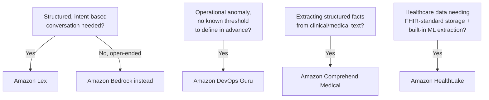
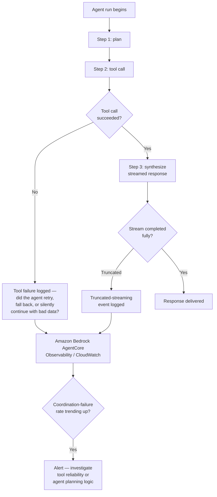
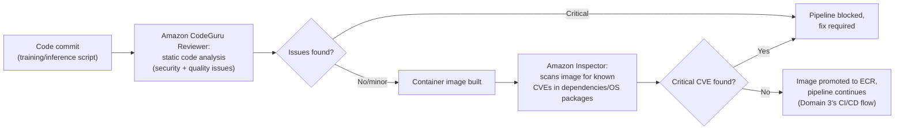
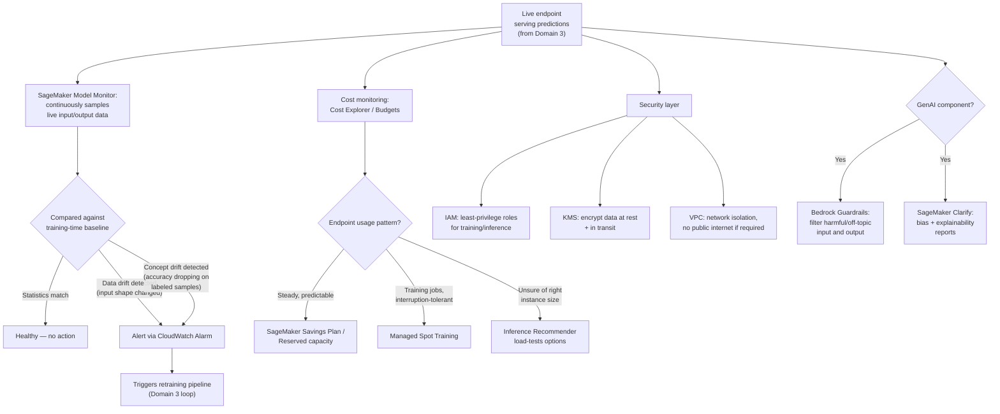
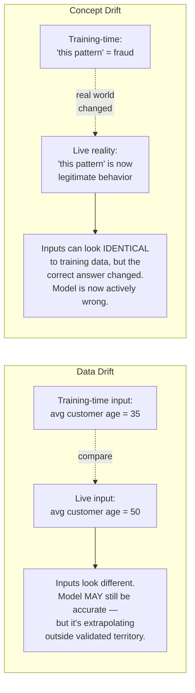
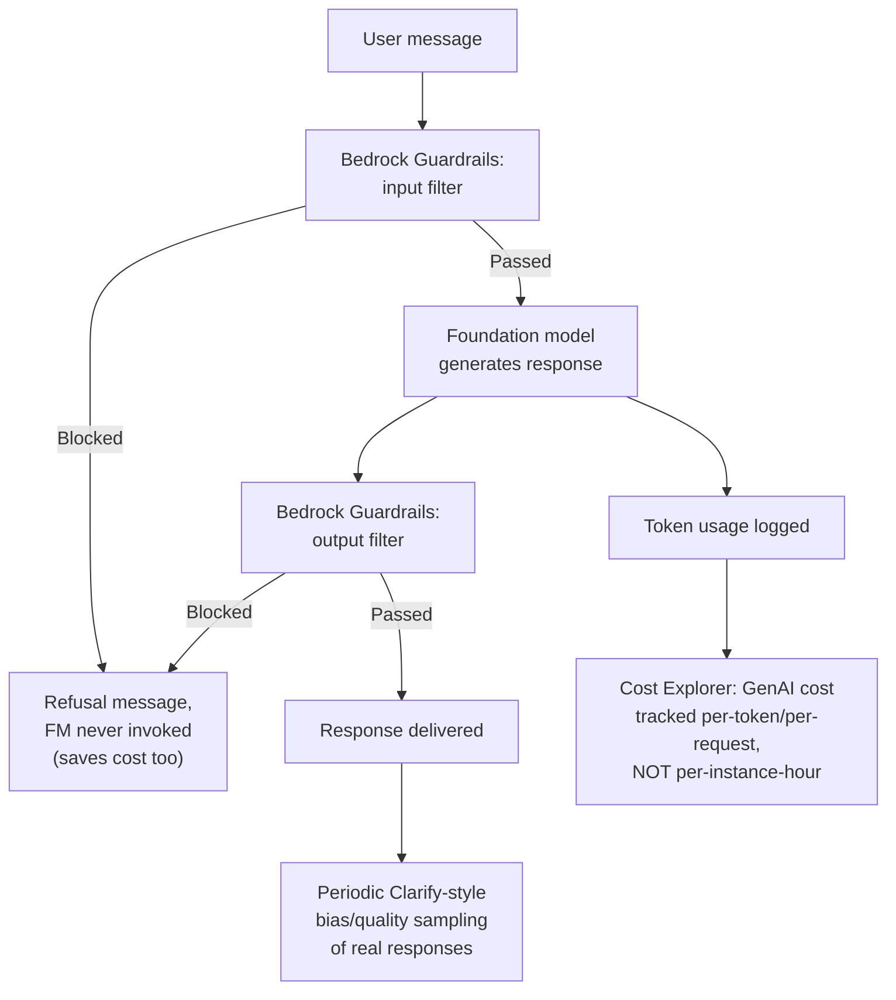
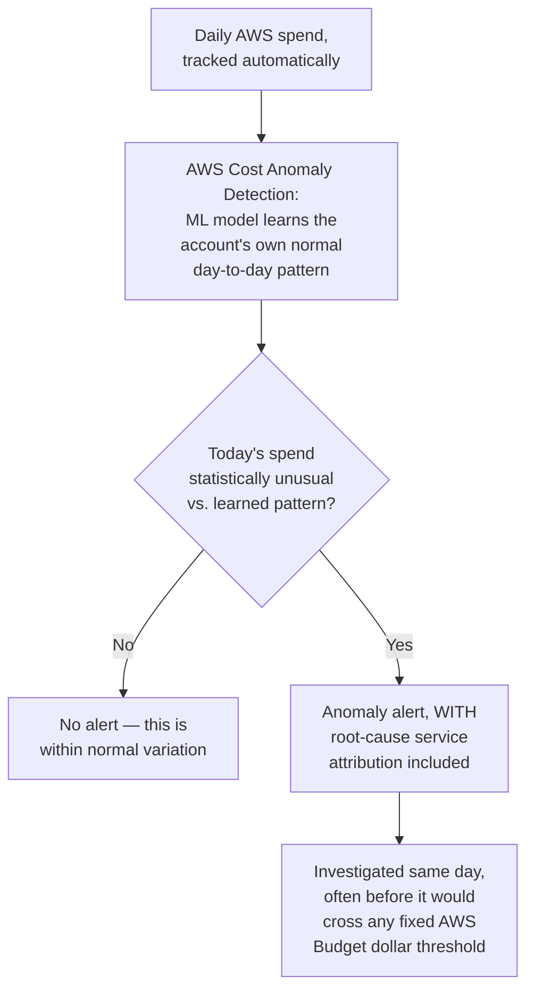

# Domain 4: Operating, Monitoring, and Securing ML and AI Solutions (24%)

*MLA-C02 · renamed from C01's "ML Solution Monitoring, Maintenance, and Security" to
"**Operating**, Monitoring, and Securing" — the extra verb signals more emphasis on day-2
operations (cost, scaling decisions) on top of pure monitoring/security. This is the domain
about what happens AFTER a model/GenAI workflow is live (Domain 3) and needs to stay healthy,
affordable, and safe.*

## Plain-English summary

A model that was accurate on launch day doesn't stay accurate forever — the real world changes,
and the model's understanding of it goes stale (**drift**). Meanwhile, the infrastructure
serving it costs money every hour, and it has access to data and systems that need to be locked
down correctly. Domain 4 is: watch the model and its infrastructure for problems, keep the bill
under control, and make sure only the right people/systems/outputs are allowed through — plus,
new in C02, applying all of that thinking to generative AI outputs specifically (bias in GenAI
responses, content filtering with Guardrails, tracking GenAI-specific costs which behave very
differently from traditional compute costs).

If Domains 1-3 are "build it right," Domain 4 is "keep it right, forever, without a human
babysitting it constantly" — and the exam treats this as a genuinely distinct skill set, worth
24% on its own, because a huge share of real-world ML failures are operational (a forgotten
endpoint quietly racking up cost, a model nobody noticed had gone stale for months) rather than
failures of the original model or deployment design.

## Task-statement-level content (from the official exam guide)

| Task statement | What it covers | Where it's covered |
|---|---|---|
| **4.1 — Monitor model and infrastructure health** | Data drift / concept drift detection, latency/error monitoring, right-sizing deployed infrastructure; distributed tracing to isolate which hop in a multi-service inference pipeline is actually slow | [`services/machine-learning-ai/sagemaker-model-monitor-and-registry.md`](../../../services/machine-learning-ai/sagemaker-model-monitor-and-registry.md), [`services/developer-tools/x-ray.md`](../../../services/developer-tools/x-ray.md) |
| **4.2 — Optimize cost** | Spot vs. On-Demand vs. Reserved, SageMaker Savings Plans, Inference Recommender, Cost Explorer/Budgets | [`ml-cost-optimization.md`](ml-cost-optimization.md) *(new doc, written for this domain)* |
| **4.3 — Secure ML/AI solutions** | IAM least privilege, VPC network isolation, KMS encryption at rest/in transit | [`services/security-identity-compliance/iam.md`](../../../services/security-identity-compliance/iam.md), [`services/security-identity-compliance/kms.md`](../../../services/security-identity-compliance/kms.md), [`services/networking-content-delivery/vpc.md`](../../../services/networking-content-delivery/vpc.md) |
| **4.4 — NEW: Responsible AI, bias, and GenAI guardrails** | Detecting bias in model/GenAI outputs, Bedrock Guardrails for content filtering, explainability | [`responsible-ai-and-guardrails.md`](responsible-ai-and-guardrails.md) *(new doc, written for this domain)* |
| **4.1.5 — NEW: Monitor/automate agent performance & coordination** | Coordination-failure detection, truncated streaming, tool-call failures in multi-step agents | this doc's ["Monitoring Agent Performance and Coordination"](#new-skill-415--monitoring-and-automating-agent-performance-and-coordination) section below |
| **4.1.6 — NEW: AI-specific FM performance monitoring** | Bedrock evaluations, CloudWatch generative AI observability dashboards | this doc's ["AI-Specific FM Performance Monitoring"](#new-skill-416--configuring-ai-specific-performance-monitoring-for-fms) section below |
| **4.2.7 — NEW: Evaluate cost implications of FM inference in production** | Projecting and validating real production FM cost before/after launch | [`ml-cost-optimization.md`](ml-cost-optimization.md#new-skill-427--evaluating-cost-implications-of-fm-inference-in-production) |
| **4.2.8 — NEW: Monitor agent resource consumption** | Tracking compute/token/tool-call cost per agent run, not just per model call | [`ml-cost-optimization.md`](ml-cost-optimization.md#new-skill-428--monitoring-agent-resource-consumption) |
| **4.2.9 — NEW: Manage FM inference costs with usage optimization** | Ongoing optimization levers beyond the initial purchasing-option decision | [`ml-cost-optimization.md`](ml-cost-optimization.md#new-skill-429--managing-fm-inference-costs-with-usage-optimization) |
| **4.2.10 — NEW: Monitor AI-specific cost patterns** | Token usage, embedding computation cost, vector database storage cost, tracked distinctly | [`ml-cost-optimization.md`](ml-cost-optimization.md#new-skill-4210--monitoring-ai-specific-cost-patterns) |
| **4.3.1 — NEW: Secure ML/AI CI/CD pipelines** | Scanning code and container images for vulnerabilities (CodeGuru, Inspector) | this doc's ["Securing ML/AI CI/CD Pipelines"](#new-skill-431--securing-mlai-cicd-pipelines-codeguru-amazon-inspector) section below, full service depth in [`services/machine-learning-ai/additional-ai-services-mla.md`](../../../services/machine-learning-ai/additional-ai-services-mla.md) (CodeGuru, DevOps Guru, plus Lex/Comprehend Medical/HealthLake as other MLA-C02-only managed AI services) |
| **4.3.8 — NEW: Select appropriate FM credential type** | Bedrock API keys vs. IAM credentials for accessing foundation models | this doc's ["Selecting FM Credential Types"](#new-skill-438--selecting-the-appropriate-credential-type-to-access-fms) section below |
| **4.3.9 — NEW: Implement responsible-AI safeguards** | Bedrock Guardrails for sensitive data protection per policy | [`responsible-ai-and-guardrails.md`](responsible-ai-and-guardrails.md) |

## Linked service docs — the deep dives

- **[`services/machine-learning-ai/sagemaker-model-monitor-and-registry.md`](../../../services/machine-learning-ai/sagemaker-model-monitor-and-registry.md)**
  — Model Monitor half: continuously compares live inference data/predictions against a
  training-time baseline to catch **data drift** (the input data's statistical shape changed)
  and **concept drift** (the relationship between inputs and the correct output changed, even if
  inputs look the same — e.g., customer behavior shifted after a pandemic).
- **[`services/security-identity-compliance/iam.md`](../../../services/security-identity-compliance/iam.md)**
  — least-privilege roles for training jobs, endpoints, and pipelines (each should only have
  permission to touch the exact S3 paths/resources it needs, nothing broader).
- **[`services/security-identity-compliance/kms.md`](../../../services/security-identity-compliance/kms.md)**
  — encrypting training data at rest in S3, model artifacts, and endpoint storage volumes.
- **[`services/networking-content-delivery/vpc.md`](../../../services/networking-content-delivery/vpc.md)**
  — running training jobs/endpoints inside a VPC with no internet access, when data sensitivity
  requires it (common ask: "the training job must not have internet access" → VPC with no NAT
  gateway / private subnet only).
- **[`services/management-governance/cost-management-tools.md`](../../../services/management-governance/cost-management-tools.md)**
  — the general AWS Cost Explorer/Budgets tooling that `ml-cost-optimization.md` builds on top of
  with ML-specific purchasing options.
- **[`services/developer-tools/x-ray.md`](../../../services/developer-tools/x-ray.md)** —
  distributed tracing for Task 4.1's "monitor infrastructure health" half specifically when the
  health question is *latency localization* across a multi-hop inference pipeline (API Gateway →
  Lambda → SageMaker endpoint, or a Bedrock-backed agent chaining several calls): X-Ray's trace
  timeline and service map answer "which specific hop is slow," complementing (not replacing)
  Model Monitor's drift detection and AgentCore Observability's agent-coordination monitoring
  covered elsewhere in this domain — see that doc's own MLA-C02 framing for the full depth.

## New topic docs for this domain

- **[`ml-cost-optimization.md`](ml-cost-optimization.md)** — Spot/Reserved/SageMaker Savings
  Plans and Inference Recommender. Cost optimization for ML has enough ML-specific nuance
  (ephemeral training jobs vs. always-on endpoints behave very differently cost-wise) that it
  deserves its own doc rather than being buried in a general AWS cost-management page.
- **[`responsible-ai-and-guardrails.md`](responsible-ai-and-guardrails.md)** — bias detection,
  Bedrock Guardrails, and explainability via SageMaker Clarify. This is the direct GenAI-era
  evolution of "model monitoring" into "is this model/GenAI output fair and safe," which spans
  both classic ML (Clarify) and GenAI (Guardrails) — new, dedicated territory in C02.
- **[`model-drift-deep-dive.md`](model-drift-deep-dive.md)** — the mechanical deep dive behind
  this README's drift coverage: how Model Monitor's baselining, data capture, and statistical
  comparison actually work, a fully worked numeric KS-test example you can reproduce by hand, and
  the threshold/scheduling tradeoffs the exam tests directly.
- **[`iam-least-privilege-ml-pipelines.md`](iam-least-privilege-ml-pipelines.md)** — real policy
  JSON for a scoped training-job role, the shared-role anti-pattern, permissions boundaries for
  self-service data scientists, and cross-account role assumption with External ID — the concrete
  pattern-level expansion of this README's IAM summary.
- **[`bedrock-guardrails-deep-dive.md`](bedrock-guardrails-deep-dive.md)** — real configuration
  JSON for all six Guardrails filter types (including automated reasoning checks), versioning
  discipline, and the three integration patterns (direct invocation, Agent/Knowledge Base,
  standalone `ApplyGuardrail`).
- **[`finops-for-ml-token-cost-tracking.md`](finops-for-ml-token-cost-tracking.md)** — the
  six-category GenAI cost taxonomy (training, inference compute, inference tokens, embedding,
  vector storage, Guardrails filtering), cost allocation tagging in practice, Cost Anomaly
  Detection, and a fully worked multi-stage cost-spike investigation.
- **[`MASTER-CHUNK.md`](MASTER-CHUNK.md)** — a single, standalone reference covering all ten of
  this domain's services/topics in full depth (Definition, Analogy, Purpose, When to Use/Not,
  Use Cases, Why Important, diagrams, real AWS images, Exam Tips), readable start to finish
  without needing any other file in this folder.

## Additional AI Services in This Domain — Lex, Comprehend Medical, DevOps Guru, HealthLake

Beyond CodeGuru/Inspector (covered under task 4.3.1 above), four more MLA-C02-specific managed AI
services round out this domain's "Additional AI Services" coverage — each solving a narrow,
specialized problem a general-purpose SageMaker/Bedrock approach would take real custom
engineering to replicate. Full depth on all five services in this cluster (including CodeGuru) is
in [`MASTER-CHUNK.md`](MASTER-CHUNK.md#5-additional-ai-services-lex-codeguru-comprehend-medical-devops-guru-healthlake);
this section gives the domain-level summary.

- **Amazon Lex** — builds structured, intent-and-slot conversational interfaces (a defined set of
  recognizable user goals, each with specific required information to collect) — the right choice
  when a conversation's shape is predictable and definable in advance, in direct contrast to an
  open-ended Bedrock-powered chatbot.
- **Amazon DevOps Guru** — ML-powered operational anomaly detection across CloudWatch metrics,
  logs, and AWS Config data, learning an application's own normal behavior automatically rather
  than requiring a human to pre-define every failure threshold — the answer whenever a scenario
  describes catching an *unknown-unknown* operational issue, as opposed to a known metric
  crossing a defined number (a standard CloudWatch Alarm's job).
- **Amazon Comprehend Medical** — specialized NLP entity extraction for clinical/medical text
  specifically (medications, dosages, conditions, procedures, PHI) — distinct from general
  Amazon Comprehend, which isn't tuned for clinical-language nuance.
- **Amazon HealthLake** — a managed, FHIR-standard-compliant healthcare data store with built-in
  ML-powered insight extraction (using Comprehend Medical internally) — the answer whenever a
  scenario needs both standards-based healthcare interoperability *and* automated structured-data
  extraction from clinical documents in the same system.

*Figure: the real DevOps Guru console enablement flow — once turned on for a defined resource
scope, it begins learning that scope's normal operational pattern with zero manual threshold
configuration, in direct contrast to a CloudWatch Alarm which always requires a human-defined
number. Source: AWS Aurora User Guide's DevOps Guru integration section —
docs.aws.amazon.com/AmazonRDS/latest/AuroraUserGuide/.*

## NEW skill 4.1.5 — Monitoring and automating agent performance and coordination

**Plain English:** a multi-step Bedrock Agent (Domain 3) can fail in ways a single model call
never could — it can call the wrong tool, get stuck re-planning in a loop, have a streamed
response cut off mid-sentence, or have one sub-step's failure silently corrupt the final answer
without an outright error anywhere. This task statement is specifically about monitoring *that*
agent-specific failure surface, distinct from classic drift/latency monitoring below.

- **Coordination-failure detection** — in a multi-agent or multi-tool system, tracking whether
  sub-components actually hand off correctly (did the planning step's output get consumed
  correctly by the execution step, or did a malformed intermediate result silently propagate) —
  a distinct monitoring surface from "did the model generate reasonable-looking text," since a
  coordination failure can still produce fluent, confident-sounding, wrong output.
- **Truncated streaming detection** — a streamed response that's cut off before completion (a
  network interruption, a timeout, a token limit hit mid-generation) looks to the user like a
  model that just stopped talking — monitoring for incomplete stream terminations directly,
  rather than only checking whether *a* response arrived at all, catches this specific failure
  mode.
- **Tool-call failure tracking** — logging every tool/API call an agent makes along with its
  success/failure and latency, the same operational discipline any microservice dependency gets,
  but specifically scoped to the *agent's* tool integrations rather than the agent's own compute.
- **Amazon Bedrock AgentCore Observability** — the managed service purpose-built for this
  surface: it traces an agent's full execution path (planning, tool calls, retrieval calls,
  final synthesis) and surfaces exactly these failure types (coordination failures, truncated
  streams, tool failures) as first-class, dashboarded metrics rather than requiring you to
  hand-instrument every agent framework's internals yourself.
- **Exam-relevant trap:** treating an agent's wrong answer as purely a "model quality" problem
  (routing straight to Domain 2's NLP eval metrics) when the actual root cause is a coordination
  or tool failure upstream of generation — this task statement exists specifically because that
  upstream failure surface needs its own dedicated monitoring, not just end-to-end output quality
  checks.

## NEW skill 4.1.6 — Configuring AI-specific performance monitoring for FMs

Distinct from agent-level monitoring above, this task statement covers monitoring the foundation
model *call* itself in production — latency, error rate, and quality, at the model-invocation
level:

- **Amazon Bedrock evaluations (production monitoring mode)** — beyond the one-time model-
  selection evaluation (Domain 2's task 2.1.1), Bedrock evaluations can run continuously against
  a sample of live production traffic, tracking the same NLP/LLM-as-a-judge metrics over time to
  catch a quality regression (e.g., after a provider-side base model update) the same way Model
  Monitor catches classic-ML drift.
- **Amazon CloudWatch generative AI observability** — purpose-built CloudWatch dashboards and
  metrics for GenAI workloads specifically: token throughput, invocation latency percentiles,
  throttling rate against a Provisioned Throughput commitment, and Guardrails intervention rate
  (how often input/output filtering actually blocks something) — the GenAI-era counterpart to
  classic CloudWatch metrics on a SageMaker endpoint (invocations, latency, errors), adapted to
  what's actually meaningful for a token-metered, filtered GenAI call.
- **The exam-relevant layering with 4.1.5 above:** 4.1.6 monitors the *model call* (is Bedrock
  itself responding correctly, quickly, within quota); 4.1.5 monitors the *agent* built on top of
  potentially many such calls (did the overall multi-step workflow coordinate correctly) — a
  scenario can have healthy 4.1.6 metrics (every individual model call succeeded, fast) while
  still failing on 4.1.5 (the agent's orchestration logic still produced a wrong end-to-end
  result) — recognizing these as two different, complementary monitoring layers is the specific
  skill being tested.

## NEW skill 4.3.1 — Securing ML/AI CI/CD pipelines (CodeGuru, Amazon Inspector)

**Plain English:** this task statement extends Domain 3's CI/CD automation with a security gate
specifically scanning the *pipeline's own artifacts* — training/inference code and container
images — for vulnerabilities, before they ever reach a running training job or endpoint.

- **Amazon CodeGuru Reviewer** — automated static analysis of the actual training/inference
  *code* (not the container), flagging security issues (e.g., hardcoded credentials, injection
  risks) and code-quality issues before merge — the ML-pipeline-specific application of a code
  review gate that any software CI/CD pipeline would want, now explicitly named as in-scope for
  this cert.
- **Amazon Inspector** — scans container images (and, more broadly, EC2/Lambda resources) for
  known vulnerabilities (CVEs) in OS packages and language dependencies — directly relevant to
  this domain because every SageMaker/Bedrock pipeline's training and inference containers are
  exactly the kind of image Inspector is built to scan, and a vulnerable base image reaching
  production is a real, exam-recognized risk distinct from the model/data security already
  covered under task 4.3's IAM/VPC/KMS content.
- **Why this is new, Domain-4-specific content, not just "general AWS security":** prior to C02,
  this domain's security content was about the *deployed resource's* access controls (who can
  call this endpoint, is this data encrypted); this task statement is about the *pipeline
  itself* — the code and images flowing through CI/CD before anything is even deployed — closing
  a gap the earlier exam guide left untested.

## NEW skill 4.3.8 — Selecting the appropriate credential type to access FMs

**Plain English:** calling a Bedrock foundation model needs credentials, and — new in C02 — there
are now two meaningfully different credential types to choose between, each with real tradeoffs:

| Credential type | What it is | Best fit | Tradeoff |
|---|---|---|---|
| **IAM credentials** (roles/users with an IAM policy granting `bedrock:InvokeModel` etc.) | The standard AWS identity/access mechanism used everywhere else in this repo | Server-side applications already running inside AWS with an execution role (a Lambda function, a SageMaker-hosted app, an EC2 instance) | Full AWS IAM policy granularity (resource-level permissions, condition keys) but requires the calling environment to already have an AWS identity context |
| **Amazon Bedrock API keys** | A simpler, portable credential specifically for accessing Bedrock, independent of a full IAM principal | Quick prototyping, third-party/external callers, or contexts where standing up a full IAM role is disproportionate overhead for the need | Less granular control than a full IAM policy; a leaked API key is a more direct exposure than a scoped IAM role, so rotation/handling discipline matters more |

- **The exam-relevant selection logic:** a scenario describing an application already running
  inside AWS infrastructure with an execution role naturally reaches for IAM credentials (reusing
  the exact least-privilege discipline this domain's security section already covers); a scenario
  describing rapid prototyping, an external partner integration, or a lightweight script that
  shouldn't need a full IAM setup is the signal for Bedrock API keys instead.
- **Security discipline applies to both, not just IAM** — "least privilege" and "credential
  rotation" aren't IAM-exclusive concepts; a Bedrock API key should be scoped as narrowly as
  possible and rotated on a schedule exactly like an IAM access key would be, the same underlying
  principle from task 4.3's IAM section, just applied to a different credential mechanism.

## How It Works — operate, monitor, secure loop for a live model

Step by step:
1. **Model Monitor samples live traffic** — a percentage of real production inputs and the
   model's predictions are captured automatically, without needing the application code to do
   anything special.
2. **Comparison against the training-time baseline** — Model Monitor computed statistics
   (distributions of each feature, prediction distribution) when the model was trained; it
   compares live data against those saved statistics on a schedule.
3. **Data drift** means the *inputs* look statistically different now than during training (e.g.,
   a new customer segment started using the product, shifting the age distribution) — the model
   may still be making reasonable predictions, but it's operating outside what it was validated
   on, so this needs attention before it causes real errors.
4. **Concept drift** means the actual relationship between input and correct output changed
   (e.g., what counted as "fraud" shifted after a new scam pattern emerged) — detected by
   periodically scoring the model against freshly labeled ground truth, not just watching input
   statistics.
5. **Either kind of drift triggers a CloudWatch Alarm**, which can feed straight back into the
   Domain 3 retraining pipeline — closing the loop so staleness gets fixed automatically rather
   than silently degrading service for months.
6. **Cost monitoring** runs in parallel via Cost Explorer/Budgets, and the right savings
   mechanism depends on the *usage pattern*: steady always-on usage favors Savings
   Plans/Reserved capacity; training jobs that can tolerate interruption favor Spot; uncertainty
   about the right instance size is what Inference Recommender exists to answer (see
   `ml-cost-optimization.md`).
7. **Security** runs continuously underneath everything — IAM scoping what each component can
   touch, KMS encrypting data wherever it's stored or moving, and VPC controlling what network
   paths exist at all.
8. **If the deployed system includes a GenAI component**, two more checks apply: **Bedrock
   Guardrails** filters both what goes into the model (blocking disallowed topics/PII) and what
   comes out (blocking harmful content before it reaches the user), and **SageMaker Clarify**
   produces bias and explainability reports so you can answer "why did the model make this
   decision" and "is this model systematically unfair to any group" — see
   `responsible-ai-and-guardrails.md` for full depth.

*Figure: AWS's own architecture diagram of Model Monitor watching a real-time endpoint — captured
request/response data is analyzed on a schedule against a saved baseline, with violations
surfaced as CloudWatch metrics/alarms. This is steps 1-5 above, in AWS's own diagram form.
Source: AWS SageMaker Developer Guide, "Monitor models for data and model quality, bias, and
explainability" — docs.aws.amazon.com/sagemaker/latest/dg/model-monitor.html.*

### A second diagram — data drift vs. concept drift, side by side

Because these two are so often confused, a direct visual contrast is worth having alongside the
prose definition:

The exam-relevant distinction in one sentence: data drift is detected by comparing input
*distributions* (no new labels needed); concept drift requires comparing the model's predictions
against *fresh, real, labeled outcomes* (new ground truth is required) — this is also why concept
drift is typically harder and slower to detect in practice than data drift.

### A third diagram — the GenAI-specific monitoring additions, isolated

Because the GenAI half of this domain (Guardrails, GenAI cost monitoring) is genuinely new
content, it's worth seeing it as its own focused diagram rather than only as two bullet points
inside the larger flow above:

The cost-tracking branch is worth calling out explicitly: unlike a SageMaker endpoint's
per-instance-hour billing, Bedrock's GenAI costs are billed per-token (input and output tokens
separately, often at different rates) and per-Guardrails-filtered-unit — a fundamentally
different cost shape that Cost Explorer surfaces differently and that `ml-cost-optimization.md`
treats as its own category, not just "more compute cost." The full six-category breakdown (adding
embedding computation and vector database storage as two further distinct categories beyond the
token/Guardrails split shown above) is covered in full, with a worked multi-stage cost-spike
investigation, in `finops-for-ml-token-cost-tracking.md`.

### A fourth diagram — catching a cost spike before it crosses any fixed threshold

*Figure: a real Cost Anomaly Detection-powered dashboard surfacing flagged spend anomalies with
root-cause service attribution — the practical mechanism behind the fourth diagram above, and the
direct complement to AWS Budgets: Budgets needs a human to have already guessed the right dollar
threshold, while Anomaly Detection needs no such guess, learning what "normal" looks like from the
account's own history instead. Source: AWS Cloud Intelligence Dashboards guidance, "Cost Anomaly
Dashboard" — docs.aws.amazon.com/guidance/latest/cloud-intelligence-dashboards/cost-anomaly-dashboard.html.*

## Full worked case study — operating a live lending-risk model under regulatory scrutiny

**The business problem:** "FairLend," a consumer lending company, has a live loan-approval model
serving real-time decisions, plus a newly added chatbot (Bedrock-based) that explains application
status to applicants. A regulator has just announced an upcoming audit of both systems.

**Monitoring (Task 4.1):**
1. Model Monitor runs continuously against the loan-approval endpoint, comparing live applicant
   feature distributions (income, credit history length, requested amount) against the
   training-time baseline — catching data drift if, say, a marketing campaign suddenly shifts the
   applicant population's typical income bracket.
2. Separately, a monthly batch job scores the model against a sample of *actual* loan outcomes
   (did the approved loans actually get repaid as expected) — this is the concept-drift check,
   requiring real labeled ground truth that simply watching input statistics can't substitute for.
3. Both checks feed CloudWatch Alarms wired to the same retraining pipeline from Domain 3 — if
   either kind of drift crosses a threshold, a human is alerted and a retraining pipeline run is
   queued for review, not silently auto-deployed given the regulated context.

**Cost (Task 4.2):** the loan-approval endpoint has steady, business-hours-concentrated traffic —
a SageMaker Savings Plan is the right lever (see `ml-cost-optimization.md`), not Spot (unsuitable
for a live endpoint) and not serverless (traffic isn't sparse/bursty enough to benefit).

**Security (Task 4.3):** because this is regulated financial data, training jobs and the endpoint
run entirely inside a VPC with no internet gateway, all data at rest (S3 training data, model
artifacts, endpoint storage) is encrypted with a customer-managed KMS key (not the AWS default
key, so the company retains full audit control over who can decrypt what), and every component's
IAM role is scoped to only the exact S3 paths and KMS key it needs.

**Responsible AI (Task 4.4):** before the audit, the team runs SageMaker Clarify's full suite —
pre-training bias metrics (was the training data itself skewed by a sensitive-attribute proxy
like zip code) and post-training bias metrics (does the live model approve applicants from
different groups at meaningfully different rates, controlling for legitimate creditworthiness
factors) — plus per-prediction SHAP explainability so that any individual denied applicant's
"why was I denied" question has a concrete, auditable answer. The chatbot is wrapped in Bedrock
Guardrails configured to refuse providing specific credit advice beyond its intended scope, redact
any PII it might otherwise echo back, and block attempts to extract the model's internal decision
logic through adversarial prompting.

**Why this case study matters for the exam:** it's deliberately built so every one of Domain 4's
four task statements is represented in one coherent, realistic scenario, which is exactly the
shape a case-study-style exam question uses — testing whether you can correctly route each
sub-requirement (monitoring, cost, security, responsible AI) to its specific AWS mechanism rather
than offering one vague "use SageMaker" answer for the whole thing.

## Use Cases — Real Scenarios

1. A travel-booking agent's wrong-answer complaints spike even though CloudWatch GenAI
   observability shows every individual Bedrock call succeeding quickly — the team correctly
   escalates to AgentCore Observability and finds a tool-call failure being silently swallowed
   mid-workflow, exactly the two-layer monitoring distinction this domain's 4.1.5/4.1.6 split
   tests.
2. A security team adds Amazon Inspector scanning to every SageMaker training container build,
   catching a known-vulnerable base-image OS package before it ever reaches a training job running
   against sensitive customer data.
3. A fast-moving startup uses Bedrock API keys for a weekend prototype integration with an
   external partner's system, deliberately avoiding the overhead of provisioning a full IAM role
   for a short-lived, low-stakes experiment, then migrates to IAM credentials once the
   integration becomes a permanent production dependency.
4. A regulated bank's compliance team requires IAM credentials (never Bedrock API keys) for every
   production FM call specifically because they need the fine-grained, auditable, condition-key-
   based access control IAM policies provide for a regulatory audit trail.
5. A media company's CloudWatch GenAI dashboard shows a rising Guardrails intervention rate week
   over week, prompting an investigation that finds a recent marketing campaign driving unusually
   adversarial user prompts, not a Guardrails misconfiguration.
6. A customer-service platform's AgentCore Observability trace reveals a specific recurring
   truncated-streaming pattern tied to one particular downstream API's slow p99 latency, leading
   the team to add a timeout/retry policy to that one tool rather than broadly tuning every agent
   parameter.
7. A fintech's CI/CD pipeline blocks a code commit after CodeGuru Reviewer flags a hardcoded
   credential accidentally left in an inference script, catching the issue before the container
   is ever built, let alone deployed.
8. A data science team runs a Bedrock evaluation continuously against 1% of live production
   traffic, catching a subtle quality regression within a day of a provider-side base model
   update, rather than discovering it weeks later from user complaints.
9. An e-commerce platform scoped its Bedrock API key to a single model ID and a strict request
   quota for a specific low-trust integration, applying the same least-privilege discipline this
   domain teaches for IAM to a non-IAM credential type.
10. A platform team builds a shared CloudWatch dashboard combining classic SageMaker Model Monitor
    drift metrics alongside GenAI observability metrics (token throughput, Guardrails rate), giving
    leadership one unified operational view across both the company's classic-ML and GenAI
    production systems rather than two disconnected dashboards.

## How This Domain's Services Work Together — The Big Picture

Domain 4's services form three concentric rings around every live model/agent, each answering a
different question continuously, for as long as the system stays in production. **The innermost
ring (health)** asks "is this still working correctly" — SageMaker Model Monitor watching for
data/concept drift on classic models, Bedrock evaluations and CloudWatch GenAI observability
watching FM call quality and latency, and AgentCore Observability watching whether multi-step
agent coordination is still succeeding — three different tools because three different failure
surfaces exist (a drifted classic model, a degraded FM response, and a broken agent handoff all
look completely different operationally, even though all three mean "something that used to work
no longer does"). **The middle ring (cost)** asks "is this still affordable at this usage level"
— purchasing-option decisions (Spot/Savings Plans/Provisioned Throughput) for predictable usage,
Inference Recommender for sizing uncertainty, and — new in C02 — token/embedding/vector-storage
cost tracking and agent-level resource consumption monitoring, since a GenAI system's cost scales
with usage in a way a fixed-instance classic endpoint's cost never did. **The outermost ring
(trust and safety)** asks "is this still secure and responsible" — IAM/VPC/KMS protecting the
underlying infrastructure and data, CodeGuru/Inspector protecting the CI/CD pipeline that builds
and ships it, Bedrock API-key-vs-IAM credential selection controlling who can even invoke it, and
SageMaker Clarify/Bedrock Guardrails ensuring what it produces is fair and safe. All three rings
run continuously and in parallel, not sequentially, and the exam's favorite cross-ring scenario
is a problem that looks like it belongs to one ring but is actually rooted in another — a cost
spike (middle ring) that's actually caused by a retry storm from an undetected tool failure
(inner ring), or a security incident (outer ring) that was actually enabled by an overly broad
Bedrock API key nobody thought to scope down (also outer ring, but the less-obvious half of it).

## Troubleshooting / Common Issues

- **Model Monitor reports no drift, but the business insists accuracy has dropped.** Confirm
  whether a model-quality (concept drift) monitor is actually configured, not just a data-quality
  (data drift) monitor — the latter can show "no drift" while the former, which needs fresh
  labeled ground truth to run at all, was never set up or is lagging.
- **A cost spike appears in Cost Explorer with no obvious cause.** Check for an idle endpoint or
  notebook instance left running first (the single most common root cause across this whole
  repo's ML cost troubleshooting), then check for an unexpectedly large Clarify/Model Monitor
  processing job running against a much bigger-than-usual dataset sample.
- **A training job inside a VPC with no internet access fails trying to download a package
  dependency.** This is expected behavior, not a bug — a genuinely isolated VPC configuration has
  no path to public package repositories; the fix is pre-baking dependencies into the training
  container image (so nothing needs to be fetched at runtime) or using a VPC endpoint for the
  specific AWS service (e.g., S3) the job legitimately needs, not opening general internet access.
- **Bedrock Guardrails blocks legitimate user questions too aggressively.** Review the configured
  denied-topics list and content filter strength thresholds — an overly broad denied-topic
  definition or a filter strength set too high for the use case produces exactly this symptom;
  tune incrementally and re-test rather than assuming Guardrails itself is the wrong tool.
- **Clarify's post-training bias report flags a disparity, but the team believes it's explained by
  a legitimate factor, not actual bias.** This is a genuine, common nuance — a raw disparity in
  outcomes isn't automatically unfair if it's fully explained by a legitimate, non-protected
  factor (e.g., income directly and legitimately predicts repayment ability); the correct next
  step is deeper analysis (e.g., conditioning the comparison on the legitimate factor), not
  dismissing the report outright, and definitely not blindly "fixing" the model to force equal
  outcomes regardless of legitimate differences.

## Common exam scenarios

1. **"A model's input feature distributions have shifted noticeably from training, but it's
   unclear if accuracy has actually dropped yet"** → data drift (detected by Model Monitor
   comparing input statistics), distinct from concept drift.
2. **"The relationship between inputs and the correct label has changed (same inputs, different
   correct answer now) and accuracy on fresh labeled samples is falling"** → concept drift.
3. **"Training jobs are frequent, run for a few hours, and can tolerate being interrupted and
   resumed"** → Managed Spot Training for the biggest discount.
4. **"An always-on, predictable-traffic endpoint needs the lowest sustained cost"** → SageMaker
   Savings Plan (commit to consistent usage, get a discount), not Spot (Spot capacity isn't
   reliable for an always-on endpoint).
5. **"Unsure what instance type/size an endpoint needs before launch"** → SageMaker Inference
   Recommender runs load tests across instance options and recommends the cheapest one meeting
   latency/throughput requirements.
6. **"A training job must have zero internet access due to data sensitivity rules"** → run it
   inside a VPC with private subnets and no NAT gateway/internet gateway route.
7. **"A chatbot built on a Bedrock foundation model needs to refuse to discuss certain topics and
   never leak PII in its responses"** → Bedrock Guardrails, configured with denied topics and PII
   filters.
8. **"Regulators are asking why a loan-approval model rejected a specific applicant"** →
   SageMaker Clarify's explainability reports (e.g., SHAP values) show each feature's
   contribution to that specific prediction.
9. **"A company wants to know, in dollar terms, whether this month's Bedrock spend is trending
   toward exceeding budget before the month ends"** → AWS Budgets with a Bedrock-service-scoped
   budget and forecasted spend alert, not a generic account-wide budget that mixes GenAI cost in
   with unrelated services.
10. **"A security team requires that even AWS itself cannot read certain training data without
    the company's explicit authorization"** → customer-managed KMS keys (not AWS-managed/default
    keys), where the company controls the key policy and can audit/revoke access independently.
11. **"An ML team wants to be alerted automatically the moment a live endpoint's data drift
    crosses a defined threshold, without a human checking a dashboard"** → a CloudWatch Alarm on
    the Model Monitor drift metric, wired to an SNS notification or directly to an EventBridge
    rule that triggers the retraining pipeline — not a manually-reviewed report alone.
12. **"A model is deployed across dev, staging, and production AWS accounts, and the security
    team wants every environment to enforce identical least-privilege IAM policies without manual
    recreation"** → define the IAM roles/policies as Infrastructure as Code (CloudFormation/CDK,
    see Domain 3) and deploy identically across accounts, rather than manually recreating
    policies per environment.
13. **"A post-training bias report shows a disparity between two groups' approval rates, and the
    team needs to determine if it's explainable by a legitimate factor before concluding the
    model is biased"** → deeper conditional analysis (e.g., comparing outcomes within the same
    income/credit-history bracket across groups) rather than either dismissing the finding or
    assuming bias without further investigation — a nuanced, frequently tested scenario shape.
16. **"GenAI token costs are rising month over month with no corresponding increase in user
    traffic"** → investigate prompt length/context growth (e.g., a RAG pipeline retrieving more
    or larger chunks than necessary, or a conversation history growing unbounded) as the likely
    cause, since GenAI cost scales with tokens processed, not simply request count.
17. **"A company needs proof, for an audit, of exactly which IAM principal accessed a specific
    piece of training data and when"** → AWS CloudTrail's access logging (not a Domain-4-specific
    tool, but the general AWS audit-trail mechanism), paired with S3 access logging/Macie for
    data-classification context — a reminder that Domain 4 security questions sometimes reach
    into general AWS security services covered more fully in SAA-C03/SCS-C02 territory.
18. **"A team wants to catch an unusual GenAI spend pattern the same day it starts, without
    presetting a dollar figure"** → AWS Cost Anomaly Detection, scoped to the Bedrock service or
    the specific project tag — not a Budget, which requires a human-defined threshold set in
    advance.
19. **"A chatbot's Guardrails configuration was edited for testing, and production behavior
    changed unexpectedly the same day"** → production was very likely pointed at the mutable
    working draft rather than a specific published Guardrail version number — see
    `bedrock-guardrails-deep-dive.md`'s versioning discipline.
20. **"A GenAI feature's bill spiked sharply while conversation volume stayed essentially flat,
    and the team's first instinct is to investigate prompt length"** → check embedding-computation
    and vector-storage cost categories first — a one-time re-indexing event or ongoing corpus
    growth, not conversation-level token usage, is a common and easily overlooked alternative
    cause; see `finops-for-ml-token-cost-tracking.md`'s worked example.
21. **"A security review finds one shared IAM execution role attached to every training job
    across five unrelated teams, and each individual job works correctly"** → this is the
    classic least-privilege violation the exam tests regardless of whether anything currently
    "works" — the fix is splitting into per-team or per-job scoped roles, detailed with real
    policy JSON in `iam-least-privilege-ml-pipelines.md`.

## Security in depth — the three controls, concretely applied to ML workloads

Task statement 4.3 names IAM, VPC, and KMS individually, but the exam tests them as they apply
*specifically* to ML/AI resources, not as generic AWS security trivia — worth seeing each one's
ML-specific wrinkle explicitly:

- **IAM least privilege for ML**: every Training Job, Processing Job, Pipeline, and endpoint runs
  under an **execution role** you specify — distinct from your own console/CLI user identity.
  That role should have permission to read only the exact S3 input path and write only the exact
  S3 output path the job actually needs, plus whatever specific KMS key it needs to
  encrypt/decrypt with — not broad `s3:*` or `kms:*` access. A common real misconfiguration this
  tests: a shared, overly broad execution role reused across many unrelated training jobs,
  violating least privilege even though each individual job "works."
- **VPC isolation for ML**: training jobs and endpoints can run with **no internet access at
  all** when configured inside private subnets with no NAT/internet gateway route — the standard
  answer whenever a scenario says sensitive data must never transit the public internet, even
  transiently. The practical cost of this choice: anything the container needs (package
  dependencies, calls to other AWS services like S3) must go through a **VPC endpoint** (a
  private network path to that AWS service) or be pre-baked into the container image, since
  there's no route to the public internet to fetch anything at runtime.
- **KMS encryption for ML**: S3 training data, EBS volumes backing training/endpoint instances,
  and data captured by Model Monitor can all be encrypted with a **customer-managed KMS key**
  rather than an AWS-managed default key — the distinction that matters for audits: a
  customer-managed key gives the organization its own key policy, access logging, and the
  ability to revoke/rotate independently of AWS, which a default key does not.

## Quick Decision Matrix — Domain 4's Most-Tested Phrase-to-Mechanism Pairings

| Scenario phrase | Mechanism |
|---|---|
| "Input distributions shifted, no mention of labels" | Data drift (Model Monitor Data Quality) |
| "Accuracy against fresh labels is falling" | Concept drift (Model Monitor Model Quality) |
| "Training job, flexible deadline, resumable" | Managed Spot Training |
| "Always-on, steady, predictable traffic" | Real-time endpoint + Savings Plan |
| "Bursty, mostly idle" | Serverless Inference |
| "Must never transit the public internet" | VPC private subnet, no IGW/NAT route |
| "Even AWS must not decrypt this" | KMS customer-managed key |
| "Cap what one self-service role can grant" | IAM permissions boundary |
| "Refuse a topic regardless of rephrasing" | Bedrock Guardrails denied topics |
| "Why was THIS prediction made" | SageMaker Clarify SHAP explainability |
| "Alert with no preset dollar threshold" | AWS Cost Anomaly Detection |
| "GenAI bill up, traffic flat" | Six-category cost breakdown before diagnosing |

*A much larger, 30-row version of this matrix plus a full troubleshooting decision tree live in
`MASTER-CHUNK.md`'s Sections 11.3-11.4.*

## Related Terms

- [`../domain-3-deployment-orchestration/README.md`](../domain-3-deployment-orchestration/README.md)
  — the deployed model this domain monitors/secures/retrains.
- [`../domain-2-model-development/ml-fundamentals-glossary.md`](../domain-2-model-development/ml-fundamentals-glossary.md)
  — the accuracy/precision/recall metrics drift monitoring watches for degradation in.
- [`../domain-1-data-preparation/README.md`](../domain-1-data-preparation/README.md) — drift
  detected here often traces back to an upstream change in that domain's pipelines.
- [`services/machine-learning-ai/bedrock.md`](../../../services/machine-learning-ai/bedrock.md)
  — Guardrails is one Bedrock feature; this domain covers its operational/responsible-AI role.
- [`ml-cost-optimization.md`](ml-cost-optimization.md),
  [`responsible-ai-and-guardrails.md`](responsible-ai-and-guardrails.md),
  [`model-drift-deep-dive.md`](model-drift-deep-dive.md),
  [`iam-least-privilege-ml-pipelines.md`](iam-least-privilege-ml-pipelines.md),
  [`bedrock-guardrails-deep-dive.md`](bedrock-guardrails-deep-dive.md), and
  [`finops-for-ml-token-cost-tracking.md`](finops-for-ml-token-cost-tracking.md) — this domain's
  dedicated topic docs, each going deeper on one specific sub-topic than this README's summary
  level.
- [`MASTER-CHUNK.md`](MASTER-CHUNK.md) — the standalone, full-depth reference covering all ten of
  this domain's services/topics in one file.
- [`labs.md`](labs.md) — hands-on exercises for this domain (Floci + real free-tier alternatives).
