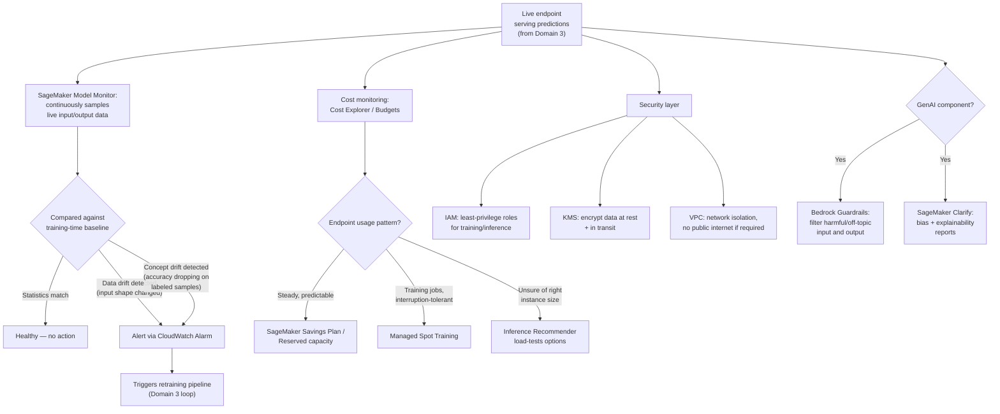
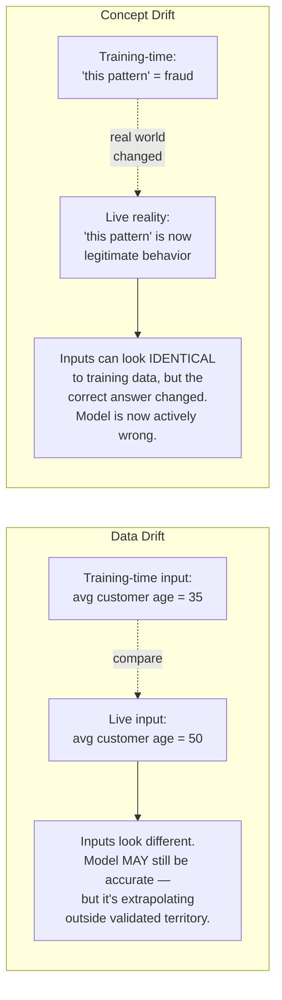
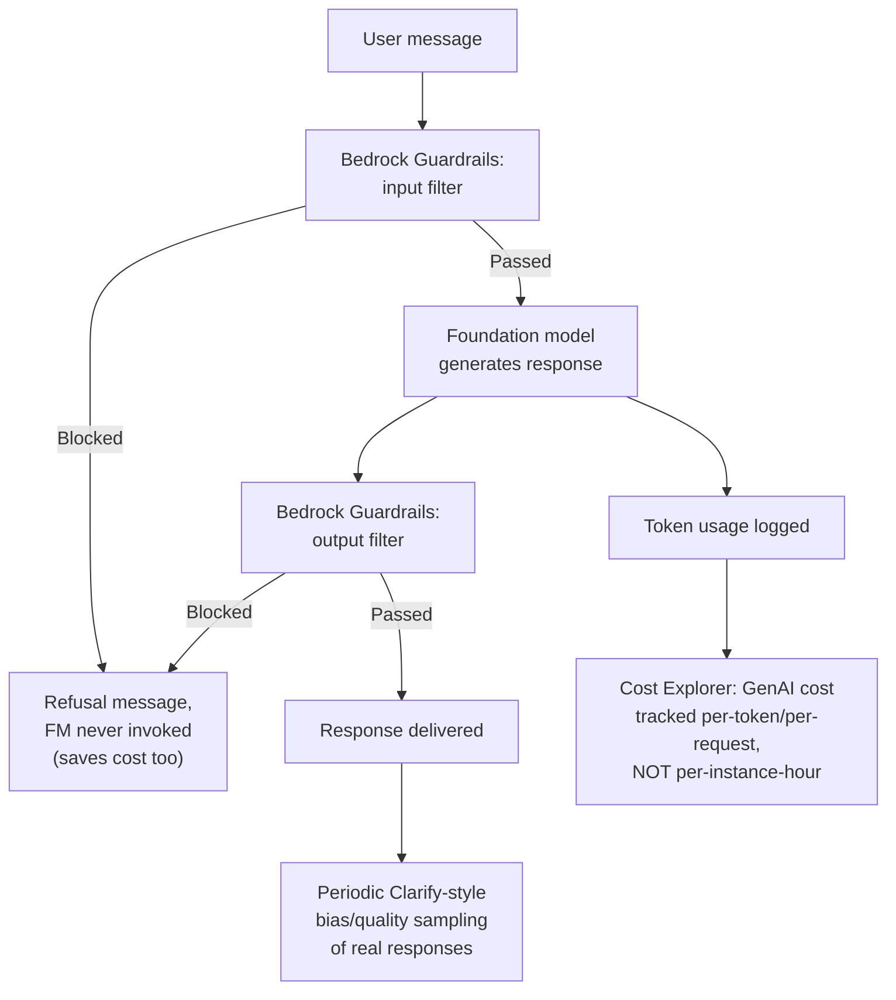

# Domain 4: Operating, Monitoring, and Securing ML and AI Solutions (24%)

*MLA-C02 · renamed from C01's "ML Solution Monitoring, Maintenance, and Security" to
"**Operating**, Monitoring, and Securing" — the extra verb signals more emphasis on day-2
operations (cost, scaling decisions) on top of pure monitoring/security. This is the domain
about what happens AFTER a model/GenAI workflow is live (Domain 3) and needs to stay healthy,
affordable, and safe.*

## Plain-English summary

A model that was accurate on launch day doesn't stay accurate forever — the real world changes,
and the model's understanding of it goes stale (**drift**). Meanwhile, the infrastructure
serving it costs money every hour, and it has access to data and systems that need to be locked
down correctly. Domain 4 is: watch the model and its infrastructure for problems, keep the bill
under control, and make sure only the right people/systems/outputs are allowed through — plus,
new in C02, applying all of that thinking to generative AI outputs specifically (bias in GenAI
responses, content filtering with Guardrails, tracking GenAI-specific costs which behave very
differently from traditional compute costs).

If Domains 1-3 are "build it right," Domain 4 is "keep it right, forever, without a human
babysitting it constantly" — and the exam treats this as a genuinely distinct skill set, worth
24% on its own, because a huge share of real-world ML failures are operational (a forgotten
endpoint quietly racking up cost, a model nobody noticed had gone stale for months) rather than
failures of the original model or deployment design.

## Task-statement-level content (from the official exam guide)

| Task statement | What it covers | Where it's covered |
|---|---|---|
| **4.1 — Monitor model and infrastructure health** | Data drift / concept drift detection, latency/error monitoring, right-sizing deployed infrastructure | [`services/machine-learning-ai/sagemaker-model-monitor-and-registry.md`](../../../services/machine-learning-ai/sagemaker-model-monitor-and-registry.md) |
| **4.2 — Optimize cost** | Spot vs. On-Demand vs. Reserved, SageMaker Savings Plans, Inference Recommender, Cost Explorer/Budgets | [`ml-cost-optimization.md`](ml-cost-optimization.md) *(new doc, written for this domain)* |
| **4.3 — Secure ML/AI solutions** | IAM least privilege, VPC network isolation, KMS encryption at rest/in transit | [`services/security-identity-compliance/iam.md`](../../../services/security-identity-compliance/iam.md), [`services/security-identity-compliance/kms.md`](../../../services/security-identity-compliance/kms.md), [`services/networking-content-delivery/vpc.md`](../../../services/networking-content-delivery/vpc.md) |
| **4.4 — NEW: Responsible AI, bias, and GenAI guardrails** | Detecting bias in model/GenAI outputs, Bedrock Guardrails for content filtering, explainability | [`responsible-ai-and-guardrails.md`](responsible-ai-and-guardrails.md) *(new doc, written for this domain)* |

## Linked service docs — the deep dives

- **[`services/machine-learning-ai/sagemaker-model-monitor-and-registry.md`](../../../services/machine-learning-ai/sagemaker-model-monitor-and-registry.md)**
  — Model Monitor half: continuously compares live inference data/predictions against a
  training-time baseline to catch **data drift** (the input data's statistical shape changed)
  and **concept drift** (the relationship between inputs and the correct output changed, even if
  inputs look the same — e.g., customer behavior shifted after a pandemic).
- **[`services/security-identity-compliance/iam.md`](../../../services/security-identity-compliance/iam.md)**
  — least-privilege roles for training jobs, endpoints, and pipelines (each should only have
  permission to touch the exact S3 paths/resources it needs, nothing broader).
- **[`services/security-identity-compliance/kms.md`](../../../services/security-identity-compliance/kms.md)**
  — encrypting training data at rest in S3, model artifacts, and endpoint storage volumes.
- **[`services/networking-content-delivery/vpc.md`](../../../services/networking-content-delivery/vpc.md)**
  — running training jobs/endpoints inside a VPC with no internet access, when data sensitivity
  requires it (common ask: "the training job must not have internet access" → VPC with no NAT
  gateway / private subnet only).
- **[`services/management-governance/cost-management-tools.md`](../../../services/management-governance/cost-management-tools.md)**
  — the general AWS Cost Explorer/Budgets tooling that `ml-cost-optimization.md` builds on top of
  with ML-specific purchasing options.

## New topic docs for this domain

- **[`ml-cost-optimization.md`](ml-cost-optimization.md)** — Spot/Reserved/SageMaker Savings
  Plans and Inference Recommender. Cost optimization for ML has enough ML-specific nuance
  (ephemeral training jobs vs. always-on endpoints behave very differently cost-wise) that it
  deserves its own doc rather than being buried in a general AWS cost-management page.
- **[`responsible-ai-and-guardrails.md`](responsible-ai-and-guardrails.md)** — bias detection,
  Bedrock Guardrails, and explainability via SageMaker Clarify. This is the direct GenAI-era
  evolution of "model monitoring" into "is this model/GenAI output fair and safe," which spans
  both classic ML (Clarify) and GenAI (Guardrails) — new, dedicated territory in C02.

## How It Works — operate, monitor, secure loop for a live model

Step by step:
1. **Model Monitor samples live traffic** — a percentage of real production inputs and the
   model's predictions are captured automatically, without needing the application code to do
   anything special.
2. **Comparison against the training-time baseline** — Model Monitor computed statistics
   (distributions of each feature, prediction distribution) when the model was trained; it
   compares live data against those saved statistics on a schedule.
3. **Data drift** means the *inputs* look statistically different now than during training (e.g.,
   a new customer segment started using the product, shifting the age distribution) — the model
   may still be making reasonable predictions, but it's operating outside what it was validated
   on, so this needs attention before it causes real errors.
4. **Concept drift** means the actual relationship between input and correct output changed
   (e.g., what counted as "fraud" shifted after a new scam pattern emerged) — detected by
   periodically scoring the model against freshly labeled ground truth, not just watching input
   statistics.
5. **Either kind of drift triggers a CloudWatch Alarm**, which can feed straight back into the
   Domain 3 retraining pipeline — closing the loop so staleness gets fixed automatically rather
   than silently degrading service for months.
6. **Cost monitoring** runs in parallel via Cost Explorer/Budgets, and the right savings
   mechanism depends on the *usage pattern*: steady always-on usage favors Savings
   Plans/Reserved capacity; training jobs that can tolerate interruption favor Spot; uncertainty
   about the right instance size is what Inference Recommender exists to answer (see
   `ml-cost-optimization.md`).
7. **Security** runs continuously underneath everything — IAM scoping what each component can
   touch, KMS encrypting data wherever it's stored or moving, and VPC controlling what network
   paths exist at all.
8. **If the deployed system includes a GenAI component**, two more checks apply: **Bedrock
   Guardrails** filters both what goes into the model (blocking disallowed topics/PII) and what
   comes out (blocking harmful content before it reaches the user), and **SageMaker Clarify**
   produces bias and explainability reports so you can answer "why did the model make this
   decision" and "is this model systematically unfair to any group" — see
   `responsible-ai-and-guardrails.md` for full depth.

*Figure: AWS's own architecture diagram of Model Monitor watching a real-time endpoint — captured
request/response data is analyzed on a schedule against a saved baseline, with violations
surfaced as CloudWatch metrics/alarms. This is steps 1-5 above, in AWS's own diagram form.
Source: AWS SageMaker Developer Guide, "Monitor models for data and model quality, bias, and
explainability" — docs.aws.amazon.com/sagemaker/latest/dg/model-monitor.html.*

### A second diagram — data drift vs. concept drift, side by side

Because these two are so often confused, a direct visual contrast is worth having alongside the
prose definition:

The exam-relevant distinction in one sentence: data drift is detected by comparing input
*distributions* (no new labels needed); concept drift requires comparing the model's predictions
against *fresh, real, labeled outcomes* (new ground truth is required) — this is also why concept
drift is typically harder and slower to detect in practice than data drift.

### A third diagram — the GenAI-specific monitoring additions, isolated

Because the GenAI half of this domain (Guardrails, GenAI cost monitoring) is genuinely new
content, it's worth seeing it as its own focused diagram rather than only as two bullet points
inside the larger flow above:

The cost-tracking branch is worth calling out explicitly: unlike a SageMaker endpoint's
per-instance-hour billing, Bedrock's GenAI costs are billed per-token (input and output tokens
separately, often at different rates) and per-Guardrails-filtered-unit — a fundamentally
different cost shape that Cost Explorer surfaces differently and that `ml-cost-optimization.md`
treats as its own category, not just "more compute cost."

## Full worked case study — operating a live lending-risk model under regulatory scrutiny

**The business problem:** "FairLend," a consumer lending company, has a live loan-approval model
serving real-time decisions, plus a newly added chatbot (Bedrock-based) that explains application
status to applicants. A regulator has just announced an upcoming audit of both systems.

**Monitoring (Task 4.1):**
1. Model Monitor runs continuously against the loan-approval endpoint, comparing live applicant
   feature distributions (income, credit history length, requested amount) against the
   training-time baseline — catching data drift if, say, a marketing campaign suddenly shifts the
   applicant population's typical income bracket.
2. Separately, a monthly batch job scores the model against a sample of *actual* loan outcomes
   (did the approved loans actually get repaid as expected) — this is the concept-drift check,
   requiring real labeled ground truth that simply watching input statistics can't substitute for.
3. Both checks feed CloudWatch Alarms wired to the same retraining pipeline from Domain 3 — if
   either kind of drift crosses a threshold, a human is alerted and a retraining pipeline run is
   queued for review, not silently auto-deployed given the regulated context.

**Cost (Task 4.2):** the loan-approval endpoint has steady, business-hours-concentrated traffic —
a SageMaker Savings Plan is the right lever (see `ml-cost-optimization.md`), not Spot (unsuitable
for a live endpoint) and not serverless (traffic isn't sparse/bursty enough to benefit).

**Security (Task 4.3):** because this is regulated financial data, training jobs and the endpoint
run entirely inside a VPC with no internet gateway, all data at rest (S3 training data, model
artifacts, endpoint storage) is encrypted with a customer-managed KMS key (not the AWS default
key, so the company retains full audit control over who can decrypt what), and every component's
IAM role is scoped to only the exact S3 paths and KMS key it needs.

**Responsible AI (Task 4.4):** before the audit, the team runs SageMaker Clarify's full suite —
pre-training bias metrics (was the training data itself skewed by a sensitive-attribute proxy
like zip code) and post-training bias metrics (does the live model approve applicants from
different groups at meaningfully different rates, controlling for legitimate creditworthiness
factors) — plus per-prediction SHAP explainability so that any individual denied applicant's
"why was I denied" question has a concrete, auditable answer. The chatbot is wrapped in Bedrock
Guardrails configured to refuse providing specific credit advice beyond its intended scope, redact
any PII it might otherwise echo back, and block attempts to extract the model's internal decision
logic through adversarial prompting.

**Why this case study matters for the exam:** it's deliberately built so every one of Domain 4's
four task statements is represented in one coherent, realistic scenario, which is exactly the
shape a case-study-style exam question uses — testing whether you can correctly route each
sub-requirement (monitoring, cost, security, responsible AI) to its specific AWS mechanism rather
than offering one vague "use SageMaker" answer for the whole thing.

## Troubleshooting / Common Issues

- **Model Monitor reports no drift, but the business insists accuracy has dropped.** Confirm
  whether a model-quality (concept drift) monitor is actually configured, not just a data-quality
  (data drift) monitor — the latter can show "no drift" while the former, which needs fresh
  labeled ground truth to run at all, was never set up or is lagging.
- **A cost spike appears in Cost Explorer with no obvious cause.** Check for an idle endpoint or
  notebook instance left running first (the single most common root cause across this whole
  repo's ML cost troubleshooting), then check for an unexpectedly large Clarify/Model Monitor
  processing job running against a much bigger-than-usual dataset sample.
- **A training job inside a VPC with no internet access fails trying to download a package
  dependency.** This is expected behavior, not a bug — a genuinely isolated VPC configuration has
  no path to public package repositories; the fix is pre-baking dependencies into the training
  container image (so nothing needs to be fetched at runtime) or using a VPC endpoint for the
  specific AWS service (e.g., S3) the job legitimately needs, not opening general internet access.
- **Bedrock Guardrails blocks legitimate user questions too aggressively.** Review the configured
  denied-topics list and content filter strength thresholds — an overly broad denied-topic
  definition or a filter strength set too high for the use case produces exactly this symptom;
  tune incrementally and re-test rather than assuming Guardrails itself is the wrong tool.
- **Clarify's post-training bias report flags a disparity, but the team believes it's explained by
  a legitimate factor, not actual bias.** This is a genuine, common nuance — a raw disparity in
  outcomes isn't automatically unfair if it's fully explained by a legitimate, non-protected
  factor (e.g., income directly and legitimately predicts repayment ability); the correct next
  step is deeper analysis (e.g., conditioning the comparison on the legitimate factor), not
  dismissing the report outright, and definitely not blindly "fixing" the model to force equal
  outcomes regardless of legitimate differences.

## Common exam scenarios

1. **"A model's input feature distributions have shifted noticeably from training, but it's
   unclear if accuracy has actually dropped yet"** → data drift (detected by Model Monitor
   comparing input statistics), distinct from concept drift.
2. **"The relationship between inputs and the correct label has changed (same inputs, different
   correct answer now) and accuracy on fresh labeled samples is falling"** → concept drift.
3. **"Training jobs are frequent, run for a few hours, and can tolerate being interrupted and
   resumed"** → Managed Spot Training for the biggest discount.
4. **"An always-on, predictable-traffic endpoint needs the lowest sustained cost"** → SageMaker
   Savings Plan (commit to consistent usage, get a discount), not Spot (Spot capacity isn't
   reliable for an always-on endpoint).
5. **"Unsure what instance type/size an endpoint needs before launch"** → SageMaker Inference
   Recommender runs load tests across instance options and recommends the cheapest one meeting
   latency/throughput requirements.
6. **"A training job must have zero internet access due to data sensitivity rules"** → run it
   inside a VPC with private subnets and no NAT gateway/internet gateway route.
7. **"A chatbot built on a Bedrock foundation model needs to refuse to discuss certain topics and
   never leak PII in its responses"** → Bedrock Guardrails, configured with denied topics and PII
   filters.
8. **"Regulators are asking why a loan-approval model rejected a specific applicant"** →
   SageMaker Clarify's explainability reports (e.g., SHAP values) show each feature's
   contribution to that specific prediction.
9. **"A company wants to know, in dollar terms, whether this month's Bedrock spend is trending
   toward exceeding budget before the month ends"** → AWS Budgets with a Bedrock-service-scoped
   budget and forecasted spend alert, not a generic account-wide budget that mixes GenAI cost in
   with unrelated services.
10. **"A security team requires that even AWS itself cannot read certain training data without
    the company's explicit authorization"** → customer-managed KMS keys (not AWS-managed/default
    keys), where the company controls the key policy and can audit/revoke access independently.
11. **"An ML team wants to be alerted automatically the moment a live endpoint's data drift
    crosses a defined threshold, without a human checking a dashboard"** → a CloudWatch Alarm on
    the Model Monitor drift metric, wired to an SNS notification or directly to an EventBridge
    rule that triggers the retraining pipeline — not a manually-reviewed report alone.
12. **"A model is deployed across dev, staging, and production AWS accounts, and the security
    team wants every environment to enforce identical least-privilege IAM policies without manual
    recreation"** → define the IAM roles/policies as Infrastructure as Code (CloudFormation/CDK,
    see Domain 3) and deploy identically across accounts, rather than manually recreating
    policies per environment.
13. **"A post-training bias report shows a disparity between two groups' approval rates, and the
    team needs to determine if it's explainable by a legitimate factor before concluding the
    model is biased"** → deeper conditional analysis (e.g., comparing outcomes within the same
    income/credit-history bracket across groups) rather than either dismissing the finding or
    assuming bias without further investigation — a nuanced, frequently tested scenario shape.
14. **"GenAI token costs are rising month over month with no corresponding increase in user
    traffic"** → investigate prompt length/context growth (e.g., a RAG pipeline retrieving more
    or larger chunks than necessary, or a conversation history growing unbounded) as the likely
    cause, since GenAI cost scales with tokens processed, not simply request count.
15. **"A company needs proof, for an audit, of exactly which IAM principal accessed a specific
    piece of training data and when"** → AWS CloudTrail's access logging (not a Domain-4-specific
    tool, but the general AWS audit-trail mechanism), paired with S3 access logging/Macie for
    data-classification context — a reminder that Domain 4 security questions sometimes reach
    into general AWS security services covered more fully in SAA-C03/SCS-C02 territory.

## Security in depth — the three controls, concretely applied to ML workloads

Task statement 4.3 names IAM, VPC, and KMS individually, but the exam tests them as they apply
*specifically* to ML/AI resources, not as generic AWS security trivia — worth seeing each one's
ML-specific wrinkle explicitly:

- **IAM least privilege for ML**: every Training Job, Processing Job, Pipeline, and endpoint runs
  under an **execution role** you specify — distinct from your own console/CLI user identity.
  That role should have permission to read only the exact S3 input path and write only the exact
  S3 output path the job actually needs, plus whatever specific KMS key it needs to
  encrypt/decrypt with — not broad `s3:*` or `kms:*` access. A common real misconfiguration this
  tests: a shared, overly broad execution role reused across many unrelated training jobs,
  violating least privilege even though each individual job "works."
- **VPC isolation for ML**: training jobs and endpoints can run with **no internet access at
  all** when configured inside private subnets with no NAT/internet gateway route — the standard
  answer whenever a scenario says sensitive data must never transit the public internet, even
  transiently. The practical cost of this choice: anything the container needs (package
  dependencies, calls to other AWS services like S3) must go through a **VPC endpoint** (a
  private network path to that AWS service) or be pre-baked into the container image, since
  there's no route to the public internet to fetch anything at runtime.
- **KMS encryption for ML**: S3 training data, EBS volumes backing training/endpoint instances,
  and data captured by Model Monitor can all be encrypted with a **customer-managed KMS key**
  rather than an AWS-managed default key — the distinction that matters for audits: a
  customer-managed key gives the organization its own key policy, access logging, and the
  ability to revoke/rotate independently of AWS, which a default key does not.

## Related Terms

- [`../domain-3-deployment-orchestration/README.md`](../domain-3-deployment-orchestration/README.md)
  — the deployed model this domain monitors/secures/retrains.
- [`../domain-2-model-development/ml-fundamentals-glossary.md`](../domain-2-model-development/ml-fundamentals-glossary.md)
  — the accuracy/precision/recall metrics drift monitoring watches for degradation in.
- [`../domain-1-data-preparation/README.md`](../domain-1-data-preparation/README.md) — drift
  detected here often traces back to an upstream change in that domain's pipelines.
- [`services/machine-learning-ai/bedrock.md`](../../../services/machine-learning-ai/bedrock.md)
  — Guardrails is one Bedrock feature; this domain covers its operational/responsible-AI role.
- [`ml-cost-optimization.md`](ml-cost-optimization.md) and
  [`responsible-ai-and-guardrails.md`](responsible-ai-and-guardrails.md) — this domain's two
  dedicated topic docs, full depth.
- [`labs.md`](labs.md) — hands-on exercises for this domain (Floci + real free-tier alternatives).
