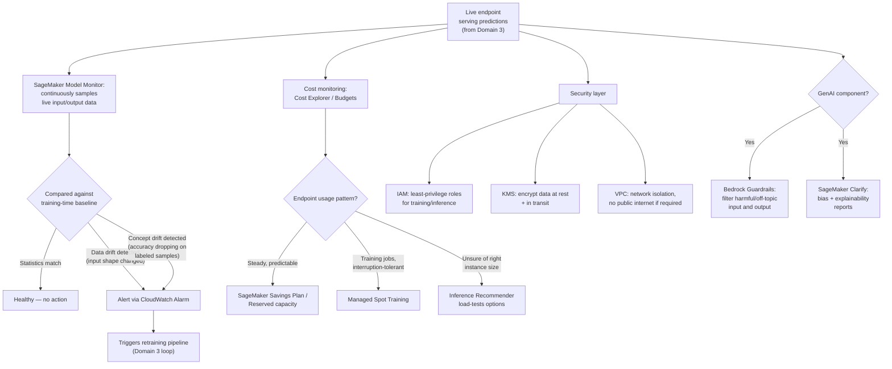

# Domain 4: Operating, Monitoring, and Securing ML and AI Solutions (24%)

*MLA-C02 · renamed from C01's "ML Solution Monitoring, Maintenance, and Security" to
"**Operating**, Monitoring, and Securing" — the extra verb signals more emphasis on day-2
operations (cost, scaling decisions) on top of pure monitoring/security. This is the domain
about what happens AFTER a model/GenAI workflow is live (Domain 3) and needs to stay healthy,
affordable, and safe.*

## Plain-English summary

A model that was accurate on launch day doesn't stay accurate forever — the real world changes,
and the model's understanding of it goes stale (**drift**). Meanwhile, the infrastructure
serving it costs money every hour, and it has access to data and systems that need to be locked
down correctly. Domain 4 is: watch the model and its infrastructure for problems, keep the bill
under control, and make sure only the right people/systems/outputs are allowed through — plus,
new in C02, applying all of that thinking to generative AI outputs specifically (bias in GenAI
responses, content filtering with Guardrails, tracking GenAI-specific costs which behave very
differently from traditional compute costs).

## Task-statement-level content (from the official exam guide)

| Task statement | What it covers | Where it's covered |
|---|---|---|
| **4.1 — Monitor model and infrastructure health** | Data drift / concept drift detection, latency/error monitoring, right-sizing deployed infrastructure | [`services/machine-learning-ai/sagemaker-model-monitor-and-registry.md`](../../../services/machine-learning-ai/sagemaker-model-monitor-and-registry.md) |
| **4.2 — Optimize cost** | Spot vs. On-Demand vs. Reserved, SageMaker Savings Plans, Inference Recommender, Cost Explorer/Budgets | [`ml-cost-optimization.md`](ml-cost-optimization.md) *(new doc, written for this domain)* |
| **4.3 — Secure ML/AI solutions** | IAM least privilege, VPC network isolation, KMS encryption at rest/in transit | [`services/security-identity-compliance/iam.md`](../../../services/security-identity-compliance/iam.md), [`services/security-identity-compliance/kms.md`](../../../services/security-identity-compliance/kms.md), [`services/networking-content-delivery/vpc.md`](../../../services/networking-content-delivery/vpc.md) |
| **4.4 — NEW: Responsible AI, bias, and GenAI guardrails** | Detecting bias in model/GenAI outputs, Bedrock Guardrails for content filtering, explainability | [`responsible-ai-and-guardrails.md`](responsible-ai-and-guardrails.md) *(new doc, written for this domain)* |

## Linked service docs — the deep dives

- **[`services/machine-learning-ai/sagemaker-model-monitor-and-registry.md`](../../../services/machine-learning-ai/sagemaker-model-monitor-and-registry.md)**
  — Model Monitor half: continuously compares live inference data/predictions against a
  training-time baseline to catch **data drift** (the input data's statistical shape changed)
  and **concept drift** (the relationship between inputs and the correct output changed, even if
  inputs look the same — e.g., customer behavior shifted after a pandemic).
- **[`services/security-identity-compliance/iam.md`](../../../services/security-identity-compliance/iam.md)**
  — least-privilege roles for training jobs, endpoints, and pipelines (each should only have
  permission to touch the exact S3 paths/resources it needs, nothing broader).
- **[`services/security-identity-compliance/kms.md`](../../../services/security-identity-compliance/kms.md)**
  — encrypting training data at rest in S3, model artifacts, and endpoint storage volumes.
- **[`services/networking-content-delivery/vpc.md`](../../../services/networking-content-delivery/vpc.md)**
  — running training jobs/endpoints inside a VPC with no internet access, when data sensitivity
  requires it (common ask: "the training job must not have internet access" → VPC with no NAT
  gateway / private subnet only).

## New topic docs for this domain

- **[`ml-cost-optimization.md`](ml-cost-optimization.md)** — Spot/Reserved/SageMaker Savings
  Plans and Inference Recommender. Cost optimization for ML has enough ML-specific nuance
  (ephemeral training jobs vs. always-on endpoints behave very differently cost-wise) that it
  deserves its own doc rather than being buried in a general AWS cost-management page.
- **[`responsible-ai-and-guardrails.md`](responsible-ai-and-guardrails.md)** — bias detection,
  Bedrock Guardrails, and explainability via SageMaker Clarify. This is the direct GenAI-era
  evolution of "model monitoring" into "is this model/GenAI output fair and safe," which spans
  both classic ML (Clarify) and GenAI (Guardrails) — new, dedicated territory in C02.

## How It Works — operate, monitor, secure loop for a live model

Step by step:
1. **Model Monitor samples live traffic** — a percentage of real production inputs and the
   model's predictions are captured automatically, without needing the application code to do
   anything special.
2. **Comparison against the training-time baseline** — Model Monitor computed statistics
   (distributions of each feature, prediction distribution) when the model was trained; it
   compares live data against those saved statistics on a schedule.
3. **Data drift** means the *inputs* look statistically different now than during training (e.g.,
   a new customer segment started using the product, shifting the age distribution) — the model
   may still be making reasonable predictions, but it's operating outside what it was validated
   on, so this needs attention before it causes real errors.
4. **Concept drift** means the actual relationship between input and correct output changed
   (e.g., what counted as "fraud" shifted after a new scam pattern emerged) — detected by
   periodically scoring the model against freshly labeled ground truth, not just watching input
   statistics.
5. **Either kind of drift triggers a CloudWatch Alarm**, which can feed straight back into the
   Domain 3 retraining pipeline — closing the loop so staleness gets fixed automatically rather
   than silently degrading service for months.
6. **Cost monitoring** runs in parallel via Cost Explorer/Budgets, and the right savings
   mechanism depends on the *usage pattern*: steady always-on usage favors Savings
   Plans/Reserved capacity; training jobs that can tolerate interruption favor Spot; uncertainty
   about the right instance size is what Inference Recommender exists to answer (see
   `ml-cost-optimization.md`).
7. **Security** runs continuously underneath everything — IAM scoping what each component can
   touch, KMS encrypting data wherever it's stored or moving, and VPC controlling what network
   paths exist at all.
8. **If the deployed system includes a GenAI component**, two more checks apply: **Bedrock
   Guardrails** filters both what goes into the model (blocking disallowed topics/PII) and what
   comes out (blocking harmful content before it reaches the user), and **SageMaker Clarify**
   produces bias and explainability reports so you can answer "why did the model make this
   decision" and "is this model systematically unfair to any group" — see
   `responsible-ai-and-guardrails.md` for full depth.

## Common exam scenarios

1. **"A model's input feature distributions have shifted noticeably from training, but it's
   unclear if accuracy has actually dropped yet"** → data drift (detected by Model Monitor
   comparing input statistics), distinct from concept drift.
2. **"The relationship between inputs and the correct label has changed (same inputs, different
   correct answer now) and accuracy on fresh labeled samples is falling"** → concept drift.
3. **"Training jobs are frequent, run for a few hours, and can tolerate being interrupted and
   resumed"** → Managed Spot Training for the biggest discount.
4. **"An always-on, predictable-traffic endpoint needs the lowest sustained cost"** → SageMaker
   Savings Plan (commit to consistent usage, get a discount), not Spot (Spot capacity isn't
   reliable for an always-on endpoint).
5. **"Unsure what instance type/size an endpoint needs before launch"** → SageMaker Inference
   Recommender runs load tests across instance options and recommends the cheapest one meeting
   latency/throughput requirements.
6. **"A training job must have zero internet access due to data sensitivity rules"** → run it
   inside a VPC with private subnets and no NAT gateway/internet gateway route.
7. **"A chatbot built on a Bedrock foundation model needs to refuse to discuss certain topics and
   never leak PII in its responses"** → Bedrock Guardrails, configured with denied topics and PII
   filters.
8. **"Regulators are asking why a loan-approval model rejected a specific applicant"** →
   SageMaker Clarify's explainability reports (e.g., SHAP values) show each feature's
   contribution to that specific prediction.

## Related Terms

- [`../domain-3-deployment-orchestration/README.md`](../domain-3-deployment-orchestration/README.md)
  — the deployed model this domain monitors/secures/retrains.
- [`../domain-2-model-development/ml-fundamentals-glossary.md`](../domain-2-model-development/ml-fundamentals-glossary.md)
  — the accuracy/precision/recall metrics drift monitoring watches for degradation in.
