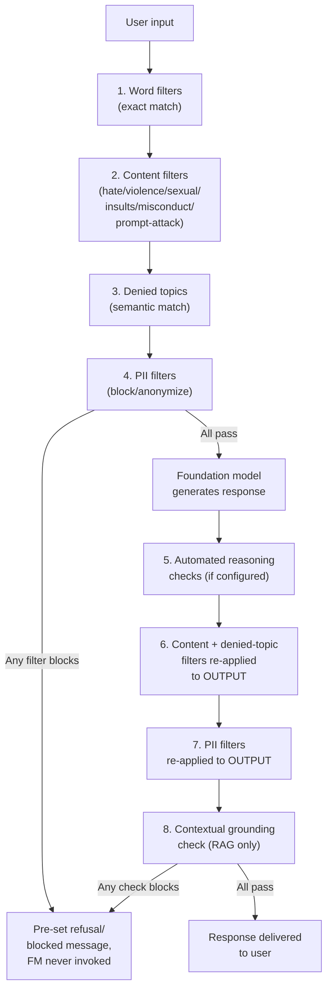
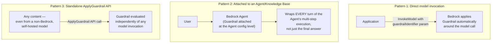

# Bedrock Guardrails — Configuration Deep Dive with Real Policy Examples


*New topic doc · MLA-C02 Domain 4, Task Statement 4.4 / 4.3.9. `responsible-ai-and-guardrails.md`
introduces Guardrails at the conceptual level (what it is, where it sits); this doc is the
hands-on configuration layer — actual policy JSON for each Guardrails filter type, how the pieces
combine into one guardrail, how versioning works, and the specific exam traps around tier
selection and where in a RAG/Agent pipeline Guardrails actually runs.*

## Definition

A **Bedrock Guardrail** is a named, versioned configuration object containing one or more of six
independent filter types (denied topics, content filters, word filters, PII redaction, contextual
grounding checks, and — the newest addition — automated reasoning checks), which can be attached
to a model invocation, an Agent, a Knowledge Base, or called standalone via the `ApplyGuardrail`
API, to inspect and potentially block both the input going into a foundation model and the output
coming out of it.

## Plain-English Analogy

A Guardrail is a **building's security checkpoint with multiple, independently-configurable
scanners** — one scanner for weapons (content filters), one for restricted-area badges (denied
topics), one that redacts visible ID numbers off anything printed before it leaves the building
(PII redaction), and a scanner that verifies any outgoing document's claims actually match what's
in the building's own official records (contextual grounding). You don't have to run every
scanner on every person — you configure which ones are active, how strict each one is, and
whether they run on the way in, the way out, or both — but once configured, the checkpoint runs
automatically, without the building's actual occupants (the foundation model) needing to know the
checkpoint exists at all.

## Purpose

A foundation model has no inherent concept of *your* company's policy — it will discuss anything
in its training distribution, in any tone, unless something external constrains it. Guardrails
exist to encode "what we, specifically, do and don't allow this system to say" as a reusable,
testable, versioned configuration that sits *outside* the model itself — meaning the same
guardrail can be attached to multiple different models, reused across environments, and updated
without retraining or re-prompting anything.

## When to Use

- Any customer-facing or externally-exposed GenAI application, as close to a hard requirement as
  this domain has — a chatbot with no Guardrails is exposed to prompt injection, PII leakage, and
  off-brand/harmful outputs with zero external defense.
- RAG-grounded applications specifically benefit from **contextual grounding checks**, a
  Guardrails feature that has no equivalent need in a non-RAG chatbot.
- Any application subject to regulatory content restrictions (no medical/legal/financial advice
  outside licensed scope) — denied topics are the direct configuration answer.
- Multi-model or multi-vendor GenAI estates (a Bedrock-native model plus a self-hosted
  open-source model) wanting *one* consistent safety policy — the standalone `ApplyGuardrail` API
  decouples the filter from any specific model invocation.

## When NOT to Use It / Limitations

- Guardrails are not a substitute for good prompt engineering or fine-tuning — they catch bad
  outputs reactively; they don't make a model inherently better at a task, and over-relying on
  Guardrails to "fix" a fundamentally poor prompt treats a symptom, not the cause.
- A fully internal, developer-facing debugging tool with no real end users and no sensitive data
  in play is a case where the overhead of configuring Guardrails may reasonably be deferred —
  though this is a narrow exception, not a general pattern.
- Guardrails cannot retroactively redact content already delivered to a user in a prior turn — the
  filtering is per-invocation; a leaked piece of PII from an earlier unfiltered turn in the same
  conversation isn't un-leaked by a Guardrail added afterward.

## The Six Filter Types, Each with Real Configuration Shape

### 1. Denied topics

```json
{
  "topicPolicyConfig": {
    "topicsConfig": [
      {
        "name": "SpecificMedicalDosageAdvice",
        "definition": "Providing specific medication dosage amounts, frequencies, or administration instructions for any named drug.",
        "examples": [
          "How many milligrams of ibuprofen should I take for a headache?",
          "What's the right dosage of amoxicillin for a 10-year-old?"
        ],
        "type": "DENY"
      },
      {
        "name": "CompetitorComparison",
        "definition": "Direct comparisons of this product against named competitor products, including pricing or feature comparisons.",
        "examples": ["How does this compare to [Competitor]'s plan?"],
        "type": "DENY"
      }
    ]
  }
}
```

A denied topic is defined by a **name**, a **natural-language definition** (the model used to
evaluate relevance reads this definition — precision here matters, a vague definition either
over-blocks or under-blocks), and a handful of **example phrasings** that help calibrate the
semantic match, not an exhaustive keyword list — Guardrails uses semantic similarity, not literal
string matching, which is exactly why a rephrased or paraphrased version of a denied question
still gets caught.

### 2. Content filters

```json
{
  "contentPolicyConfig": {
    "filtersConfig": [
      { "type": "HATE", "inputStrength": "HIGH", "outputStrength": "HIGH" },
      { "type": "VIOLENCE", "inputStrength": "MEDIUM", "outputStrength": "HIGH" },
      { "type": "SEXUAL", "inputStrength": "HIGH", "outputStrength": "HIGH" },
      { "type": "INSULTS", "inputStrength": "MEDIUM", "outputStrength": "MEDIUM" },
      { "type": "MISCONDUCT", "inputStrength": "HIGH", "outputStrength": "HIGH" },
      { "type": "PROMPT_ATTACK", "inputStrength": "HIGH", "outputStrength": "NONE" }
    ]
  }
}
```

Each category (hate, violence, sexual, insults, misconduct, and the dedicated `PROMPT_ATTACK`
category for jailbreak/injection attempts) is independently tunable, and — the exam-relevant
detail — **input and output strength are set separately per category**. `PROMPT_ATTACK` is a
useful worked example of why: a prompt-injection attempt is, by definition, something that
appears in the *input*, so its `outputStrength` is meaningfully set to `NONE` (there's nothing
equivalent to filter on the output side for this specific category) while its `inputStrength` is
set to `HIGH`.

### 3. Word filters

```json
{
  "wordPolicyConfig": {
    "wordsConfig": [
      { "text": "CompetitorBrandName" },
      { "text": "internal-codename-phoenix" }
    ],
    "managedWordListsConfig": [ { "type": "PROFANITY" } ]
  }
}
```

The simplest, most literal filter type — exact (or near-exact) string/phrase blocking, used for
things semantic topic-matching isn't well-suited for: brand names, internal codenames, or a
managed profanity list AWS maintains so you don't have to hand-curate one.

### 4. Sensitive information (PII) filters

```json
{
  "sensitiveInformationPolicyConfig": {
    "piiEntitiesConfig": [
      { "type": "US_SOCIAL_SECURITY_NUMBER", "action": "BLOCK" },
      { "type": "EMAIL", "action": "ANONYMIZE" },
      { "type": "PHONE", "action": "ANONYMIZE" },
      { "type": "NAME", "action": "ANONYMIZE" }
    ],
    "regexesConfig": [
      {
        "name": "InternalCaseID",
        "pattern": "CASE-\\d{6}",
        "action": "BLOCK"
      }
    ]
  }
}
```

Two distinct actions matter here: **`BLOCK`** stops the entire response/request outright when
that PII type is detected (appropriate for high-sensitivity types like SSNs, where even a masked
echo is too risky), while **`ANONYMIZE`** lets the response through but masks the specific
detected value (appropriate for lower-stakes types like a name or phone number where the
surrounding conversational content still has value to the user). A **custom regex entity**
(`InternalCaseID` above) lets you catch organization-specific sensitive identifiers that aren't
one of the built-in PII types at all.

### 5. Contextual grounding checks

```json
{
  "contextualGroundingPolicyConfig": {
    "filtersConfig": [
      { "type": "GROUNDING", "threshold": 0.75 },
      { "type": "RELEVANCE", "threshold": 0.6 }
    ]
  }
}
```

This filter type is specific to RAG-style applications: **grounding** scores whether the
generated answer is actually supported by the retrieved source documents passed in as context
(catching hallucination even when the answer sounds fluent and confident); **relevance** scores
whether the answer actually addresses the user's question at all (catching a technically-grounded
but off-point answer). Both are threshold-based (0-1 scale) — raising the threshold catches more
borderline cases as violations, at the cost of more false positives on legitimately correct
answers that happen to synthesize retrieved context with general knowledge.

### 6. Automated reasoning checks (the newest, most rigorous filter type)

Unlike the five filter types above (all probabilistic/ML-based), automated reasoning checks use
formal logic rules you define (e.g., "a refund amount can never exceed the original purchase
price") and mathematically verify a generated response doesn't violate them — the exam-relevant
distinction: this is the one Guardrails filter type that gives a **provable, not merely
probable**, guarantee for the specific logical constraints you define, at the cost of needing
those constraints to be formally specified up front (it can't catch anything you didn't encode as
a rule).

## How the Filters Combine — the Full Request Lifecycle



The exam-relevant structural point: **every filter type except contextual grounding runs on both
the input AND the output independently**, with separately configurable strengths/thresholds for
each direction — a Guardrail blocking an *input* doesn't guarantee anything about what it would
do to a *generated output* containing the same concept, and vice versa; both directions need to
be deliberately configured, not assumed to mirror each other automatically.

## Where Guardrails Actually Attaches — Three Integration Patterns



- **Pattern 1** is the simplest: a single `InvokeModel` or `Converse` API call carries a
  `guardrailIdentifier` and `guardrailVersion` parameter, and Bedrock applies the full configured
  Guardrail transparently around that one call.
- **Pattern 2** is the one Domain 1/3 content assumes implicitly: attaching a Guardrail to a
  Bedrock Agent or Knowledge Base means every turn of a potentially multi-step, tool-using
  interaction is wrapped — the user never interacts with the raw, unguarded model underneath, even
  though the Agent might internally make several model calls per turn.
- **Pattern 3** is the integration-flexibility answer: a company with a mixed estate (some Bedrock-
  native models, some self-hosted open-source models elsewhere in their stack) can apply the exact
  same Guardrail policy to both, since `ApplyGuardrail` takes raw text and returns a filtering
  verdict completely independent of how that text was generated.

## Versioning — Why It Exists and How to Use It Correctly

Every Guardrail has a mutable **working draft** plus any number of immutable, numbered
**published versions**. The exam-relevant discipline: **production traffic should always
reference a specific published version number, never the working draft** — because the working
draft can be edited at any time (e.g., mid-testing by another team member), and a production
application pointing at "whatever the draft currently says" has no stability guarantee at all. The
correct pattern is: edit the draft, test it, publish a new numbered version once satisfied, then
update production's `guardrailVersion` parameter to point at that specific new number — the same
discipline as pinning a software dependency to an exact version rather than tracking a branch's
latest commit.

## Tier Selection — Standard vs. a Narrower, Faster Configuration

Guardrails content filters support a **classification tier** choice affecting both latency/cost
and detection granularity — a more thorough tier catches more nuanced violations at added latency
cost, a faster tier trades some nuance for speed. The exam-relevant judgment: a latency-sensitive,
high-volume consumer chatbot may deliberately choose the faster tier and compensate with tighter
denied-topic/word-filter coverage for its specific known risks, while a lower-volume, high-stakes
application (legal/financial) more often justifies the slower, more thorough tier — this is a
real tradeoff decision, not a "always pick the most thorough option" default.

## Key Features / Components

- **Denied topics** — semantic, example-calibrated topic blocking.
- **Content filters** — six independently-tunable categories including the GenAI-specific
  `PROMPT_ATTACK` category.
- **Word filters** — literal string/phrase blocking plus a managed profanity list.
- **PII/sensitive-information filters** — built-in entity types plus custom regex entities, with
  `BLOCK` or `ANONYMIZE` action per type.
- **Contextual grounding checks** — RAG-specific hallucination and relevance scoring.
- **Automated reasoning checks** — formally-verified logical constraint checking.
- **Versioning (working draft + published versions)** — the stability mechanism for production use.
- **Standalone `ApplyGuardrail` API** — filter-only invocation decoupled from any model call.
- **Guardrails trace/reasons in the API response** — every blocked response includes which
  specific filter and category triggered the block, essential for debugging over-aggressive
  configurations (see Troubleshooting below).

## Use Cases — Real Scenarios

1. A healthcare information chatbot configures `SpecificMedicalDosageAdvice` as a denied topic
   with multiple rephrased examples, confirming through testing that paraphrased attempts
   ("what amount of X should I take") are still caught by the semantic match, not just the exact
   example phrasing.
2. A customer-support RAG chatbot sets a contextual grounding threshold of 0.8 (stricter than
   default) after discovering the default threshold let through a handful of plausible-sounding
   but ungrounded answers during pre-launch testing.
3. A financial-services firm configures `PROMPT_ATTACK` content filtering at `HIGH` input strength
   specifically after a red-team exercise found their chatbot could be tricked into revealing
   internal system-prompt instructions through a crafted injection attempt.
4. A multi-vendor AI platform applies one shared Guardrail configuration via the standalone
   `ApplyGuardrail` API to both a Bedrock-native model and a separately self-hosted open-source
   model, guaranteeing identical safety policy enforcement regardless of which model answered.
5. An insurance claims application uses automated reasoning checks to formally guarantee a
   generated settlement explanation never states a payout amount exceeding the policy's actual
   coverage limit — a constraint precise enough that a probabilistic content filter alone
   couldn't reliably enforce it.
6. A SaaS company publishes a new Guardrail version after tightening PII anonymization rules,
   tests it against a staging environment pointed at the new version number, and only then updates
   production's `guardrailVersion` parameter — never editing the working draft that production
   traffic references directly.
7. A retailer's chatbot sets `EMAIL` and `PHONE` PII types to `ANONYMIZE` (letting the
   conversation continue naturally with masked values) but `US_SOCIAL_SECURITY_NUMBER` to `BLOCK`
   outright, reflecting a deliberately different risk tolerance for each PII type rather than one
   blanket policy.

## Why It's Important

Real-world: an ungoverned foundation model in a customer-facing product is a direct, realistic
source of brand damage, legal exposure (unlicensed advice, leaked PII), and security incidents
(successful prompt injection extracting internal instructions or data) — Guardrails is the
single most directly actionable mitigation AWS provides for all three risk categories at once.
Exam weight: Guardrails configuration is one of the clearest net-new MLA-C02 topics versus the
prior exam version, and scenario questions frequently test matching a described risk (medical
advice, PII leakage, hallucination, prompt injection, jailbreak) to the *specific* filter type
that addresses it, not "just turn on Guardrails" as an undifferentiated answer.

## Troubleshooting / Common Issues

- **Guardrails blocks a clearly legitimate, in-scope user question.** Pull the blocked response's
  trace/reasons field first — it names the exact filter and category that fired; a denied-topic
  definition written too broadly, or a content-filter strength set too high for the use case, are
  the two most common root causes, and the fix is tuning that specific configuration, never
  disabling Guardrails outright.
- **A RAG chatbot's grounding check blocks a technically correct answer.** This happens when a
  correct answer legitimately blends retrieved context with general background knowledge not
  itself present in the retrieved documents — review whether the grounding threshold is
  calibrated too strictly for answers that are expected to synthesize, not just quote, retrieved
  content.
- **Production traffic behaves inconsistently after a teammate edited the Guardrail.** Confirm
  production is pointed at a specific published version number, not the mutable working draft —
  this is the exact failure mode versioning discipline exists to prevent.
- **A custom PII regex entity isn't catching the intended pattern.** Test the regex independently
  against real sample text first — a regex that's subtly wrong (unescaped special characters, an
  overly greedy quantifier) is a far more common cause than Guardrails itself malfunctioning.
- **Latency on every request increased noticeably after adding Guardrails.** This is expected —
  Guardrails evaluation adds real processing time on both input and output; if latency is
  unacceptable for the use case, consider the faster content-filter tier and/or reducing the
  number of simultaneously active filter types to only what's genuinely needed, rather than
  enabling every filter type by default.

## Exam Tips

- "Block a specific subject area regardless of how the question is phrased" → denied topics
  (semantic match), not word filters (literal match only).
- "Block an exact brand name, codename, or known profane term" → word filters, not denied topics
  (overkill/imprecise for exact-string matching).
- "Mask a detected PII value but let the rest of the response through" → PII filter action
  `ANONYMIZE`. "Stop the entire response when this PII type appears at all" → action `BLOCK`.
- "A RAG chatbot's answer sounds right but isn't actually supported by the retrieved documents" →
  contextual grounding check, not a content filter or denied topic (neither evaluates factual
  support).
- "Guarantee, with certainty, that a generated number/amount never violates a defined business
  rule" → automated reasoning checks — the one Guardrails filter type offering a provable, not
  probabilistic, guarantee.
- Production should always reference a specific published Guardrail **version number**, never the
  mutable working draft — a question describing inconsistent production behavior after an edit is
  testing this versioning discipline directly.
- Guardrails attached to an Agent/Knowledge Base wrap the *entire* multi-turn, multi-step
  interaction, not a single internal model call in isolation.

### More sample exam scenarios, worked

**Scenario 1:** "A chatbot needs to refuse discussing a specific restricted subject even when
users rephrase or paraphrase their question in creative ways." *Answer:* denied topics, configured
with a clear natural-language definition and several example phrasings — semantic matching, not
literal keyword blocking, is what catches paraphrased attempts.

**Scenario 2:** "An insurance chatbot must never state a payout figure that exceeds what the
customer's actual policy allows, with zero tolerance for even rare edge-case violations."
*Answer:* automated reasoning checks — the only Guardrails filter type that mathematically
verifies, rather than probabilistically estimates, adherence to a defined logical constraint.

**Scenario 3:** "After a Guardrail was edited by a teammate for testing purposes, a separate
production application's behavior changed unexpectedly the same day." *Answer:* production was
very likely pointed at the mutable working draft rather than a specific published version number
— the fix is publishing versions deliberately and pinning production to an exact version.

**Scenario 4:** "A company wants identical content-safety enforcement across a Bedrock-hosted
model and a separately self-hosted open-source model used elsewhere in the same application."
*Answer:* the standalone `ApplyGuardrail` API, which evaluates text independently of how or where
it was generated.

## Related Terms

- [`responsible-ai-and-guardrails.md`](responsible-ai-and-guardrails.md) — the conceptual
  introduction to Guardrails and Clarify this doc's configuration depth builds on.
- [`services/machine-learning-ai/bedrock.md`](../../../services/machine-learning-ai/bedrock.md) —
  the full Bedrock service reference, including the broader Agent/Knowledge Base context
  Guardrails attaches to.
- [`../domain-1-data-preparation/embeddings-and-rag-data-prep.md`](../domain-1-data-preparation/embeddings-and-rag-data-prep.md)
  — the RAG retrieval pipeline that contextual grounding checks evaluate against.
- [`iam-least-privilege-ml-pipelines.md`](iam-least-privilege-ml-pipelines.md) — the credential-
  type decision (IAM vs. Bedrock API keys) that governs who can even call `InvokeModel`/
  `ApplyGuardrail` in the first place.
- [`ml-cost-optimization.md`](ml-cost-optimization.md) — Guardrails filtering is billed per text
  unit, separately from the underlying foundation model's token cost.
- [`labs.md`](labs.md) — Lab 6's local keyword/toxicity-classifier stand-in reproduces this doc's
  input/output two-sided filtering architecture with free, local tooling.
