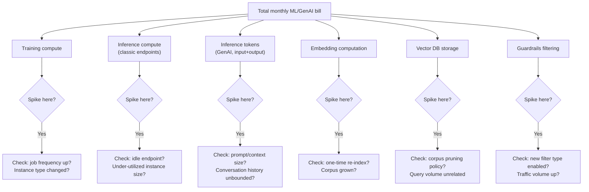
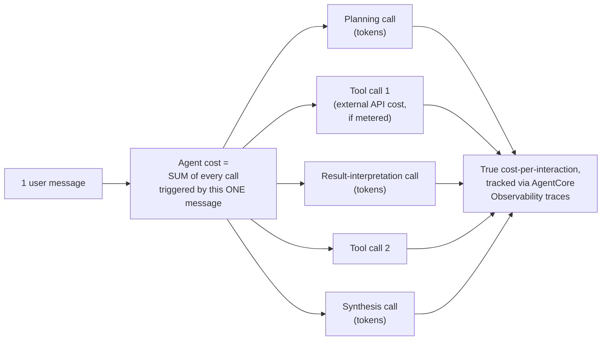

# FinOps for ML — Token-Based Cost Tracking Across the Whole Pipeline


*New topic doc · MLA-C02 Domain 4, Tasks 4.2.7-4.2.10. `ml-cost-optimization.md` covers
*purchasing options* (Spot/Savings Plans/Provisioned Throughput); this doc covers the
**measurement and attribution** layer underneath those decisions — how to actually build a cost
model that tracks spend end-to-end across a mixed classic-ML + GenAI pipeline, cost allocation
tagging in practice, anomaly detection, and a fully worked multi-stage cost breakdown.*

## Definition

**FinOps** (financial operations) applied to ML is the discipline of making cloud ML/GenAI
spend **visible, attributed, and accountable** at the same level of rigor engineering applies to
code — specifically: knowing which team/project/feature is driving which dollar, in near-real
time, broken down by the distinct cost *categories* a modern ML pipeline actually has (classic
compute instance-hours, GPU training time, inference tokens, embedding computation, vector
storage, Guardrails filtering units), rather than one undifferentiated monthly AWS bill line.

## Plain-English Analogy

Think of a restaurant's accounting before and after adopting FinOps discipline. **Before:** the
owner sees one number at the end of the month — "food costs were $40,000" — and has no idea if
that's driven by rising ingredient prices, a new expensive menu item, portion-size creep, or
spoilage/waste. **After:** the owner tracks cost *per dish*, *per ingredient category*, and *per
shift* — so when food costs rise, they can say "it's specifically the new salmon dish, specifically
because the fish supplier raised prices 15%, specifically affecting the dinner shift" instead of
guessing. ML FinOps is the exact same shift applied to a cloud bill: from "the AWS bill went up"
to "Bedrock output tokens for the RAG summarization feature rose 40% because average retrieved-
context size grew, specifically in the enterprise-tier customer segment."

## Purpose

A modern ML pipeline mixes fundamentally different billing shapes in one system — a SageMaker
endpoint's instance-hour billing accrues identically whether it serves 1 request or 100,000;
Bedrock's per-token billing accrues $0 at zero usage and scales continuously with real traffic;
embedding computation is a bursty, often one-time-per-ingestion cost; vector storage accrues
continuously regardless of query volume. Lumping all of this into one monthly total obscures
which lever actually moves the number — FinOps discipline exists specifically to keep these
categories separable so a cost spike investigation starts from "which category moved" rather than
re-deriving that breakdown from scratch every time.

## When to Use

- Any organization running more than a small handful of ML models or GenAI features
  simultaneously — the point where "eyeball the total bill" stops being a viable cost-management
  strategy.
- Any GenAI feature in production at all, even a single one — token-based billing's zero-idle-
  cost-but-unbounded-scaling-cost shape means cost visibility matters from day one, not just at
  scale.
- Finance/leadership asking "which initiative is actually driving this spend" — cost allocation
  tagging (below) is the direct mechanical answer to that exact question.
- Any regulated or budget-constrained environment where an unexpected cost spike needs same-day
  (not same-month) detection.

## When NOT to Use It / Pragmatic Scope

- A single, small-scale prototype with a hard spending cap already enforced (e.g., a free-tier
  sandbox account) has less urgent need for granular tagging — though establishing the tagging
  habit *before* the prototype graduates to production avoids a painful retrofit later.
- Extremely low, genuinely flat-rate costs (e.g., a single tiny always-on endpoint with no other
  ML spend in the account) may not justify building out a full cost-allocation-tag taxonomy —
  but this exception shrinks fast as any second model/feature gets added.

## The Cost Taxonomy — Six Categories That Must Stay Separable

| Category | Billing shape | What drives it |
|---|---|---|
| **Training compute** | Instance-hour, bursty/ephemeral | Job duration × instance type × job frequency |
| **Real-time/serverless inference compute** | Instance-hour (real-time) or per-invocation (serverless) | Endpoint uptime × instance size, or per-request compute for serverless |
| **Inference tokens (GenAI)** | Per-token, input/output priced separately | Prompt length + retrieved context + conversation history (input); response length (output) |
| **Embedding computation** | Per-token, typically bursty/batch | Corpus size at ingestion/re-indexing time — NOT correlated with query volume |
| **Vector database storage** | Ongoing storage (+ compute for some backends), accrues at $0 query volume | Corpus size, retention/pruning policy — NOT correlated with query volume |
| **Guardrails filtering** | Per text unit filtered | Number of filtered requests/responses × filter types active |

**The exam-relevant discipline named explicitly in Task 4.2.10:** a rising total bill with these
six lumped together hides the fix. A spike driven by embedding cost (a one-time full-corpus
re-index) needs a completely different response than a spike driven by inference-token growth
(prompt/context bloat) or vector-storage growth (an ever-expanding, never-pruned document corpus)
— breaking total cost into these categories *before* diagnosing the cause is the tested skill, not
treating "cost went up" as one undifferentiated problem.



## Cost Allocation Tagging in Practice — a Real Tagging Scheme

```json
{
  "Tags": [
    { "Key": "project", "Value": "fairlend-chatbot" },
    { "Key": "team", "Value": "conversational-ai" },
    { "Key": "environment", "Value": "production" },
    { "Key": "cost-category", "Value": "inference-tokens" },
    { "Key": "feature", "Value": "application-status-qa" }
  ]
}
```

- **`project`/`team`** answer "who owns this spend" — the tag Finance's "which initiative is
  driving this" question resolves against directly.
- **`environment`** separates dev/staging/prod spend — critical because a dev environment's
  experimental, inefficient usage shouldn't be mistaken for production's real, optimized cost
  profile when reviewing trends.
- **`cost-category`** is the taxonomy tag — explicitly encoding which of the six categories above
  a given resource/call belongs to, enabling Cost Explorer to group spend by category directly
  rather than requiring a manual breakdown every time.
- **`feature`** supports attributing cost to a specific product feature when one project has
  multiple distinct GenAI features (e.g., both a chatbot and a document-summarization feature
  under one "project" tag) — the finer-grained level most mature FinOps setups eventually need.
- **The exam-relevant principle:** tags must be applied *consistently and early* — a resource
  created without the tagging convention applied from day one creates a permanent blind spot in
  every future cost report until someone manually backfills it, which is often never done in
  practice; tagging is cheapest and most complete when it's a creation-time requirement, not a
  later cleanup task.

## Cost Anomaly Detection — Catching a Spike the Same Day, Not the Same Month

AWS Cost Anomaly Detection uses machine learning (trained on your account's own historical spend
patterns) to flag unusual spend automatically, without anyone configuring a fixed dollar
threshold in advance — it learns what "normal" day-to-day variation looks like for your specific
usage and flags statistically meaningful deviations from that learned pattern.


*Figure: a real AWS Cost Anomaly Detection-powered dashboard surfacing flagged spend anomalies
with their root-cause service attribution — this is the practical mechanism that turns "Finance
noticed the bill was high at month-end" into "an alert fired within roughly a day of the unusual
spend pattern starting," a materially faster detection loop than any fixed-threshold AWS Budget
alone provides, since a fixed threshold only fires once cumulative spend crosses a pre-set dollar
line, while anomaly detection can flag an unusual *daily rate* immediately. Source: AWS Cloud
Intelligence Dashboards guidance, "Cost Anomaly Dashboard" —
docs.aws.amazon.com/guidance/latest/cloud-intelligence-dashboards/cost-anomaly-dashboard.html.*

- **The exam-relevant distinction from AWS Budgets:** a **Budget** alerts when spend crosses a
  pre-defined dollar threshold (something a human has to set and periodically revisit as usage
  legitimately grows) — **Cost Anomaly Detection** alerts on a *statistically unusual pattern*
  relative to the account's own learned history, catching a spike *before* it accumulates enough
  to cross a fixed Budget threshold, and without requiring anyone to guess the right threshold
  number in the first place.
- **Monitor configuration** can be scoped by service (catch a Bedrock-specific anomaly separately
  from an EC2-specific one), by linked account, or by a specific cost allocation tag value — e.g.,
  a monitor scoped to `project=fairlend-chatbot` specifically, so a cost anomaly in one GenAI
  feature doesn't get buried inside a much larger account-wide total.

## A Fully Worked Example — Tracing a Cost Spike Through All Six Categories

**The scenario:** a RAG-based legal-document assistant's monthly Bedrock-related bill doubles
month over month, with user traffic (measured in conversations) up only 5%.

**Step 1 — don't start with "optimize the model" or "switch purchasing options."** Pull Cost
Explorer filtered to the `cost-category` tag, broken down by the six-category taxonomy above.

**Step 2 — the breakdown:**
- Training compute: flat, unchanged — not the cause.
- Inference compute (classic): N/A, this feature has no classic endpoint — not applicable.
- **Inference tokens: up 15%** — some increase, roughly proportional to the 5% traffic growth
  plus modest natural variance, not the dominant driver.
- **Embedding computation: up 1,400%** — the dominant signal.
- Vector DB storage: up 30%, consistent with a larger indexed corpus, a plausible downstream
  effect of whatever caused the embedding spike, not an independent cause.
- Guardrails filtering: flat — not the cause.

**Step 3 — root cause.** The embedding-computation spike, investigated directly, traces to a
one-time, full-corpus re-embedding triggered by a routine change: the legal document corpus was
migrated to a new, larger embedding model mid-month, and the migration script re-embedded the
*entire* historical document corpus rather than only newly added documents — a one-time ingestion
event, not a change in actual user-facing GenAI usage at all.

**Step 4 — the fix and the lesson.** The team confirms this was a deliberate, justified one-time
migration cost (not a bug), documents it as a known anomaly for next month's variance review, and
separately improves the migration tooling to support **incremental** re-embedding (only new/
changed documents) for any future embedding-model upgrade, avoiding an identical full-corpus
re-embed cost next time a similar migration is needed.

**Why this example matters for the exam:** the naive, wrong diagnostic path ("tokens doubled,
users must be having much longer conversations, let's investigate prompt engineering") would have
sent the team down an entirely unproductive investigation — the category-first breakdown is what
correctly isolated the real driver in one step, exactly the discipline Task 4.2.10 is testing.

## Agent-Level Cost Attribution — the Multi-Call Problem

A single user-facing interaction with an agentic system can trigger multiple separate billed
model calls (planning, tool-result interpretation, final synthesis) plus external tool costs — a
naive "cost per feature" model based on counting user interactions badly undercounts the real
spend per interaction.



- **Practical mechanism** — AgentCore Observability's traced execution path (see the domain
  README's 4.1.5 section) attributes cost to the specific step that drove it, which is what makes
  a per-agent-run cost figure *actionable* rather than just an aggregate surprise — a team can see
  exactly which step (not just that cost is "too high" overall) needs optimization.
- **A frequent real finding:** an agent stuck re-planning in a retry loop after a failing tool
  call multiplies cost for a single user interaction far beyond the expected 2-3 model calls —
  this is a coordination failure (Domain 4's 4.1.5 content) whose *cost* consequence is what
  FinOps tracking surfaces, even though the *root cause fix* belongs to agent reliability
  engineering, not a purchasing-option or token-trimming lever.

## Key Features / Components

- **Cost Explorer with cost allocation tags** — the primary interface for the six-category
  breakdown described above, filterable by any tag.
- **AWS Cost Anomaly Detection** — ML-based, threshold-free spike detection, scoped by service/
  account/tag.
- **AWS Budgets, including forecasted-spend alerts** — the complementary, fixed-threshold
  mechanism for "don't exceed $X this month," distinct from anomaly detection's pattern-based
  approach.
- **CloudWatch GenAI observability metrics** — token throughput and invocation counts at the
  individual-call level, the raw data cost-category tagging and Cost Explorer aggregate on top of.
- **AgentCore Observability traces** — the mechanism for attributing agent-level cost to specific
  execution steps, not just a total per run.
- **Service Control Policies / IAM condition keys requiring tags** — an enforcement mechanism
  (covered more fully in governance-focused service docs) ensuring resources can't even be
  created without the required cost-allocation tags attached, closing the "someone forgot to tag
  it" gap at the source rather than relying on after-the-fact cleanup.

## Use Cases — Real Scenarios

1. A platform team configures a Cost Anomaly Detection monitor scoped specifically to the
   `project=customer-support-bot` tag, catching a cost spike in that one feature within a day,
   well before it would have shown up in the account's much larger aggregate monthly total.
2. A healthcare startup's embedding-computation cost spikes 20x in a single day; the
   category-first breakdown immediately isolates it from inference-token cost, preventing a
   misdirected investigation into chatbot prompt length that wouldn't have found anything.
3. A SaaS company enforces a tagging policy requiring every new SageMaker/Bedrock resource to
   carry `project` and `cost-category` tags at creation time via an IAM condition key, closing the
   "someone forgot to tag it" gap that had been producing an unattributed "Untagged" cost bucket
   worth 15% of total spend before the policy was enforced.
4. A logistics company's vector database bill keeps climbing with flat query volume; the
   category-separated breakdown isolates pure storage growth from an ever-expanding, never-pruned
   shipment-document corpus, a fix (retention/pruning policy) completely unrelated to anything
   query-side.
5. A fintech's finance team requests a monthly report broken down by the six-category taxonomy
   per project, replacing a previous report that only showed one undifferentiated "AI/ML" line
   item, enabling budget conversations to reference specific, actionable cost drivers per
   category instead of a single opaque total.
6. An e-commerce platform's agent-level cost tracking reveals one specific customer-support
   workflow costs 5x more per interaction than a superficially similar workflow, traced via
   AgentCore Observability to an unnecessary extra planning call triggered by an ambiguous tool
   description — a fix to the tool description itself, not a purchasing-option change.

## Why It's Important

Real-world: without category-separated, tagged cost visibility, a GenAI cost spike investigation
can burn days chasing the wrong hypothesis (token/prompt-size theories when the real driver is a
one-time embedding re-index, or vice versa) — the taxonomy and tagging discipline in this doc is
what makes a spike investigation take minutes instead of days. Exam weight: Tasks 4.2.7 through
4.2.10 are a dense cluster of net-new C02 content specifically about this measurement/attribution
layer, distinct from (and prerequisite to) the purchasing-option decisions in
`ml-cost-optimization.md` — expect scenario questions that require correctly separating a cost
problem into its category before selecting any fix.

## Troubleshooting / Common Issues

- **A cost report shows a large "Untagged" or "Other" bucket that keeps growing.** This points
  directly at inconsistent tagging discipline at resource-creation time — the fix is enforcing
  tags via policy at creation (an IAM condition key or SCP requiring specific tags), not a
  one-time manual backfill that the same gap will just recreate next month.
- **Cost Anomaly Detection hasn't fired despite an apparent spend increase the team already
  noticed manually.** Anomaly Detection needs enough historical data to have learned a "normal"
  baseline for the specific scope (service/account/tag) it's monitoring — a brand-new feature with
  only days of history may not yet have a mature-enough baseline to detect deviations against;
  this isn't a malfunction, it's the mechanism's inherent cold-start limitation.
- **The six-category breakdown shows nothing unusual, but the total bill still rose
  unexpectedly.** Check for a new resource/feature entirely outside the existing six-category
  tagging scheme (e.g., a newly added service nobody updated the tagging convention to cover) —
  an incomplete taxonomy can hide a genuinely new cost source rather than attributing it to any
  of the six existing buckets.
- **Agent-level cost per interaction looks reasonable on average but Finance is still surprised by
  the total.** Check the distribution, not just the average — a small fraction of interactions
  stuck in expensive retry/re-planning loops (the 4.1.5 coordination-failure pattern) can skew the
  total far more than the typical-case average per-interaction cost suggests.

## Exam Tips

- A rising total GenAI bill is never, by itself, enough information to pick a fix — the tested
  discipline is breaking it into the six categories (training, inference compute, inference
  tokens, embedding, vector storage, Guardrails) *before* diagnosing, every time.
- "Catch a spend anomaly as it's happening, without a human pre-setting a dollar threshold" →
  AWS Cost Anomaly Detection. "Alert when cumulative spend crosses a dollar figure a human
  defined" → AWS Budgets — know which mechanism answers which phrasing.
- A one-time embedding re-index/re-ingestion cost spike with flat inference-token and flat query
  volume is a recurring exam scenario shape specifically designed to test whether you reach for
  the embedding-cost category rather than defaulting to "tokens/prompts must have grown."
- Vector database storage cost is NOT correlated with query volume — a question describing flat
  queries but rising vector-DB cost is pointing at corpus growth/retention policy, not anything
  request-side.
- Agent-level cost is the SUM of every model/tool call one user interaction triggers, not the
  price of a single model call — a question describing per-interaction cost several multiples
  above a single call's list price is describing expected multi-call agent behavior (or a
  coordination-failure retry loop), not a billing error.

### More sample exam scenarios, worked

**Scenario 1:** "A company's total Bedrock-related bill rose 60% in one month while the number of
user conversations rose only 5%, and inference-token spend specifically only rose 10%." *Answer:*
the dominant driver is elsewhere in the six-category taxonomy — check embedding computation and
vector storage specifically before concluding anything about conversation length or token usage.

**Scenario 2:** "Finance wants to know, broken down by individual GenAI feature within one large
product, exactly how much each feature costs per month." *Answer:* a consistent cost-allocation
tagging scheme applied at resource creation (project/team/feature/cost-category tags), queried
through Cost Explorer's tag-based filtering — not a manual, one-off cost-splitting exercise
reconstructed after the fact.

**Scenario 3:** "A team wants to be alerted to an unusual spend pattern as early as possible,
without having to guess and set a specific dollar threshold in advance." *Answer:* AWS Cost
Anomaly Detection, which learns the account's own normal spend pattern and flags statistically
unusual deviations from it automatically.

**Scenario 4:** "An agent-based customer service feature's average cost per interaction looks
acceptable, but the total monthly bill is far higher than (average cost) × (interaction count)
would predict." *Answer:* investigate the cost *distribution*, not the average — a subset of
interactions stuck in an expensive coordination-failure retry loop can dominate total spend while
barely moving the average.

## Related Terms

- [`ml-cost-optimization.md`](ml-cost-optimization.md) — the purchasing-option decisions (Spot,
  Savings Plans, Provisioned Throughput) that this doc's measurement/attribution layer feeds
  decisions into.
- [`services/management-governance/cost-management-tools.md`](../../../services/management-governance/cost-management-tools.md)
  — the full Cost Explorer/Budgets/Cost Anomaly Detection service reference.
- [`services/machine-learning-ai/bedrock.md`](../../../services/machine-learning-ai/bedrock.md) —
  the per-token billing mechanics this doc's token-tracking categories measure.
- [`README.md`](README.md) — the 4.1.5/4.1.6 agent and FM-call monitoring sections this doc's
  agent-cost-attribution section builds directly on.
- [`responsible-ai-and-guardrails.md`](responsible-ai-and-guardrails.md) and
  [`bedrock-guardrails-deep-dive.md`](bedrock-guardrails-deep-dive.md) — Guardrails filtering is
  one of the six cost categories this doc tracks separately.
- [`labs.md`](labs.md) — hands-on exercises for this domain.
