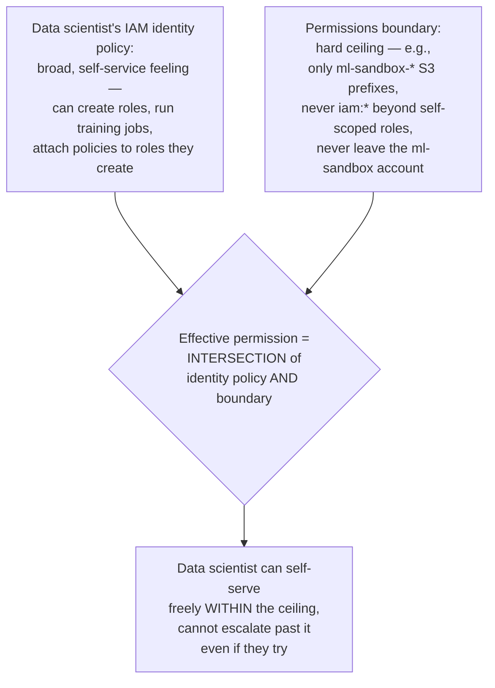
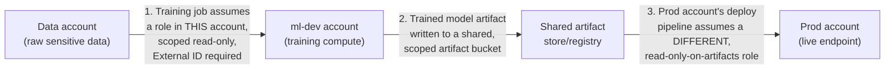

# IAM Least-Privilege Patterns for ML Pipelines


*New topic doc · MLA-C02 Domain 4, Task Statement 4.3. The domain README covers IAM least
privilege at a summary level ("each role should only touch what it needs"); this doc is the
concrete, pattern-by-pattern deep dive — actual policy JSON for a training job role, a
multi-account pipeline, permissions boundaries for self-service data scientists, and the specific
exam traps around wildcard resources and shared execution roles.*

## Definition

**Least privilege** means every IAM identity (user, role, or service) is granted *only* the
exact permissions it needs to do its job, on *only* the exact resources it needs to touch, for
*only* as long as it needs them — no broader. In an ML pipeline specifically, this means a
training job's execution role can read exactly one S3 prefix (not the whole bucket, not the whole
account), an endpoint's role can decrypt exactly one KMS key (not any KMS key in the account),
and a human data scientist's permissions boundary prevents them from ever granting themselves (or
any role they create) more access than the organization allows, even if they have IAM permissions
to create roles at all.

## Plain-English Analogy

Think of an ML pipeline's IAM roles like **hotel keycards**, not a master key. A master key
(an overly broad IAM policy, e.g., `s3:*` on `*`) opens every room in the building — convenient
for whoever holds it, catastrophic if it's lost or misused, since there's no way to limit the
blast radius of a mistake or a compromise. A keycard scoped to exactly the guest's room, the gym,
and the pool (a tightly-scoped IAM policy naming exact S3 prefixes, exact KMS key ARNs, exact
SageMaker resource ARNs) does everything the guest actually needs, and if it's lost, a thief can
only reach those three rooms — not the whole hotel. Least privilege is choosing to issue keycards,
even though cutting one master key for everyone would be less initial setup work.

## Purpose

An ML pipeline touches more distinct, high-value resources than almost any other kind of AWS
workload in one chain — raw training data (often sensitive: financial, health, biometric), model
artifacts (themselves valuable IP, sometimes extractable training data), KMS keys protecting both,
and live endpoints serving real decisions. A single overly broad role compromised anywhere in
that chain (a leaked credential, a vulnerable dependency in a training container) exposes
everything the role *could* touch, not just what it was *actually using* — least privilege exists
specifically to make that blast radius as small as the actual job requires, nothing more.

## When to Use

- Every SageMaker Training Job, Processing Job, Pipeline, and endpoint, without exception — each
  one runs under an explicit **execution role**, and that role's policy is a design decision, not
  an afterthought.
- Any pipeline touching regulated or sensitive data (financial, health, PII) — least privilege
  here is frequently a compliance *requirement*, not merely a best practice.
- Multi-account setups (a common enterprise pattern: separate dev/staging/prod AWS accounts) —
  cross-account role assumption needs explicit, scoped trust policies, not a shared static
  credential passed between accounts.
- Self-service data science platforms where many individual data scientists each need to run
  their own training jobs — permissions boundaries (below) let you grant broad *self-service*
  ability without letting any individual escalate beyond the organization's ceiling.

## When NOT to Use It / Pragmatic Exceptions

- **Never** — least privilege has no legitimate "skip it" exception in production, but it *does*
  have a legitimate **progressive-tightening** pattern: a brand-new pipeline in active early
  development might temporarily run under a slightly broader role while the exact resource list
  is still being finalized, with an explicit plan (and ticket/deadline) to tighten it before
  reaching production — the anti-pattern is never circling back to tighten it, not the temporary
  broader scope itself during active, pre-production iteration.
- Sandboxed, fully synthetic/public-dataset experimentation with no real business data in play at
  all is the one legitimate case where a broader, fully self-service role genuinely creates near-
  zero risk — still worth auditing periodically in case the sandbox silently starts touching real
  data later.

## Pattern 1 — the Scoped Training Job Execution Role

A training job's execution role should read from exactly the S3 prefixes it needs and write to
exactly the output prefix it needs — never the whole bucket.

```json
{
  "Version": "2012-10-17",
  "Statement": [
    {
      "Sid": "ReadOnlyTrainingInput",
      "Effect": "Allow",
      "Action": ["s3:GetObject", "s3:ListBucket"],
      "Resource": [
        "arn:aws:s3:::fairlend-ml-data",
        "arn:aws:s3:::fairlend-ml-data/training/loan-risk/*"
      ],
      "Condition": {
        "StringLike": { "s3:prefix": ["training/loan-risk/*"] }
      }
    },
    {
      "Sid": "WriteOnlyModelOutput",
      "Effect": "Allow",
      "Action": ["s3:PutObject"],
      "Resource": "arn:aws:s3:::fairlend-ml-artifacts/loan-risk/models/*"
    },
    {
      "Sid": "DecryptWithExactKeyOnly",
      "Effect": "Allow",
      "Action": ["kms:Decrypt", "kms:GenerateDataKey"],
      "Resource": "arn:aws:kms:us-east-1:123456789012:key/abcd1234-ef56-..."
    },
    {
      "Sid": "WriteTrainingLogs",
      "Effect": "Allow",
      "Action": ["logs:CreateLogGroup", "logs:CreateLogStream", "logs:PutLogEvents"],
      "Resource": "arn:aws:logs:us-east-1:123456789012:log-group:/aws/sagemaker/*"
    }
  ]
}
```

Notice every `Resource` is either a full ARN or a `StringLike` condition naming an exact prefix —
no bare `*` appears anywhere in this policy, and no action grants more than the specific verb the
job needs (`s3:GetObject`/`ListBucket` to read, `s3:PutObject` only on the output path, never
`s3:DeleteObject` since a training job never needs to delete anything).

## Pattern 2 — the Anti-Pattern: Shared, Overly Broad Role Reused Across Jobs

```json
{
  "Version": "2012-10-17",
  "Statement": [
    {
      "Effect": "Allow",
      "Action": ["s3:*", "kms:*", "sagemaker:*"],
      "Resource": "*"
    }
  ]
}
```

This is the single most common real-world misconfiguration the exam tests: a team stands up one
"SageMakerExecutionRole," attaches it to every training job, processing job, and endpoint across
every project to avoid the setup overhead of per-job roles, and each individual job technically
"works" — which is exactly why this anti-pattern survives in practice despite being a clear least-
privilege violation. **The fix is not one giant role tightened once** — it's splitting into
per-project (at minimum) or per-job (ideally) roles, each scoped like Pattern 1 above, because a
single compromised or buggy job under the shared role can touch every other project's data too.

## Pattern 3 — Permissions Boundaries for Self-Service Data Scientists

A permissions boundary is a *second*, independent policy attached to a user or role that caps the
*maximum* permissions that identity can ever have or grant, regardless of what their own
identity-based policy says. This is the mechanism that lets you give data scientists real,
broad-feeling self-service power (including the ability to create their own IAM roles for their
own training jobs) without letting them accidentally or deliberately create a role more powerful
than the organization allows.


*Figure: AWS's own illustration of how a permissions boundary intersects with an identity's own
policy — the **effective** permission is only ever what's allowed by *both* the identity policy
AND the boundary; the boundary can only take permissions away, never grant anything the identity
policy didn't already allow. Source: AWS IAM User Guide, "Permissions boundaries for IAM
identities" — docs.aws.amazon.com/IAM/latest/UserGuide/access_policies_boundaries.html.*



- **Why this pattern matters specifically for ML teams:** data science teams legitimately need
  more self-service IAM power than most other engineering teams (creating their own training job
  roles on demand, iterating fast) — a permissions boundary is how an organization grants that
  speed without a platform/security team having to manually review and approve every single new
  role before it's used.
- **The exam-relevant distinction:** a permissions boundary is *not* the same mechanism as a
  Service Control Policy (SCP, an AWS Organizations-level control covered more fully in
  SAA-C03/SCS-C02 territory) — a boundary applies to one specific IAM identity; an SCP applies
  account/OU-wide. A scenario describing one specific data-scientist role needing a capped ceiling
  is a permissions-boundary answer; a scenario describing an entire AWS account's maximum possible
  permissions regardless of any identity inside it is an SCP answer.

## Pattern 4 — Cross-Account Role Assumption for Multi-Account ML Pipelines

A common enterprise pattern: raw sensitive data lives in a locked-down "data" account; training
runs in an "ml-dev" account; the deployed endpoint serves from a "prod" account. Each hop needs an
explicit, scoped trust relationship — never a shared static access key copied between accounts.

```json
{
  "Version": "2012-10-17",
  "Statement": [
    {
      "Effect": "Allow",
      "Principal": { "AWS": "arn:aws:iam::222222222222:role/MLTrainingExecutionRole" },
      "Action": "sts:AssumeRole",
      "Condition": {
        "StringEquals": { "sts:ExternalId": "fairlend-ml-data-access-2024" }
      }
    }
  ]
}
```

This trust policy, attached to a role in the **data account** (111111111111), allows *only* the
named training execution role in the **ml-dev account** (222222222222) to assume it — and only
when the caller supplies the agreed `ExternalId` (a shared-secret-style defense against the
"confused deputy" problem, where a third party might otherwise be tricked into assuming a role on
your behalf). This is the same `sts:AssumeRole` mechanism covered in
`services/security-identity-compliance/sts-and-role-switching.md`, applied specifically to an
ML pipeline's cross-account data-access hop.



## Key Features / Components

- **Execution roles** — the role a SageMaker resource (training job, processing job, pipeline,
  endpoint) actually runs under; distinct from any human's console/CLI identity.
- **Resource-level permissions** — scoping an `Action` to an exact ARN or prefix pattern rather
  than `*`, the single most important lever in every pattern above.
- **Condition keys** — further narrowing an allow (e.g., `s3:prefix`, `aws:RequestedRegion`,
  `sts:ExternalId`) beyond what the action/resource alone can express.
- **Permissions boundaries** — the self-service ceiling pattern (Pattern 3).
- **Cross-account trust policies with External ID** — the multi-account pattern (Pattern 4).
- **IAM Access Analyzer** — a free, built-in tool that scans existing policies and actively flags
  overly permissive statements (including public/cross-account access you didn't intend) —
  the practical tool for *auditing* whether least privilege is actually being followed, not just
  designing it correctly up front.
- **IAM policy simulator** — lets you test, before attaching, exactly which actions a given
  policy would allow or deny against specific resources, without making a single real API call.


*Figure: the real IAM policy simulator console — you select an identity (or paste a draft custom
policy), choose the specific actions and resources to test, and the simulator returns a binary
allow/deny per action, showing exactly which attached policy produced that result. This is the
practical way to validate a Pattern 1-style scoped policy actually grants what you intended
(and nothing more) *before* attaching it to a real training job role. Source: AWS IAM User Guide,
"IAM policy testing with the IAM policy simulator" —
docs.aws.amazon.com/IAM/latest/UserGuide/access_policies_testing-policies.html.*

## Use Cases — Real Scenarios

1. A healthcare ML team gives each new research project its own training execution role, scoped
   to only that project's S3 prefix and its own dedicated KMS key — a security incident
   affecting one project's training job provably cannot reach any other project's data.
2. A platform team runs IAM Access Analyzer monthly across every ML-related role and finds a
   forgotten processing-job role still has `s3:*` on an entire bucket from an early prototyping
   phase, two years after that prototype was retired — flagged and remediated before anyone
   exploited the oversight.
3. A data science platform team configures a permissions boundary allowing data scientists to
   self-create training-job roles freely, but hard-capped to never touch any S3 bucket outside
   the `ml-sandbox-*` naming convention and never grant `iam:*` beyond managing their own
   self-created roles — fast self-service with a real ceiling.
4. A multinational retailer's ML pipeline spans a data-residency-restricted EU data account and
   a US-based ml-dev account, using cross-account role assumption with a `Condition` restricting
   the assumed role's resulting session to EU-Region API calls only, directly enforcing a
   data-residency requirement through IAM mechanics rather than process alone.
5. A fintech's compliance team requires every production training job's execution role to be
   defined as Infrastructure as Code (CloudFormation/CDK) and code-reviewed before merge,
   specifically because a hand-created-in-console role bypasses the same review rigor applied to
   every other piece of the pipeline.
6. A security engineer uses the IAM policy simulator to validate a newly drafted, tightened
   policy for an existing production endpoint role *before* attaching it, confirming the
   tightened version still allows every action the endpoint genuinely needs and denies everything
   it doesn't — catching an accidental over-tightening (that would have broken the endpoint) in
   simulation rather than in production.

## Why It's Important

Real-world: IAM misconfiguration (not a flaw in the model or the AWS platform itself) is
consistently one of the top real-world causes of data breaches across the cloud industry broadly,
and ML pipelines concentrate an unusually large amount of sensitive data and valuable IP behind a
single set of roles — making least-privilege discipline here higher-stakes than for a typical
stateless web service. Exam weight: IAM least privilege for ML/AI resources is explicitly named
in Task Statement 4.3, and the exam consistently tests recognizing a shared/overly-broad role as
the wrong answer even when each individual job "works," not just reciting what least privilege
means abstractly.

## Troubleshooting / Common Issues

- **A training job fails with an `AccessDenied` error after a role was just tightened.** Use the
  IAM policy simulator against the exact actions/resources CloudTrail shows the job attempting —
  tightening a role is iterative; the goal is the smallest policy that still passes every real
  action the job performs, found by testing, not by guessing.
- **A permissions boundary was attached but a data scientist's self-created role still can't do
  anything.** Remember the effective permission is the *intersection* of the identity policy and
  the boundary — if the data scientist's own identity policy doesn't already grant an action, the
  boundary allowing it doesn't matter; boundaries only ever remove permission, never add it.
- **Cross-account role assumption intermittently fails with an `AccessDenied` on `sts:AssumeRole`
  specifically.** Check the `ExternalId` is being passed correctly in the assume-role call and
  matches the trust policy's `Condition` exactly — a missing or mismatched `ExternalId` is the
  single most common cause of this specific failure mode, distinct from a plain resource-
  permission issue.
- **IAM Access Analyzer flags a role as "externally accessible" that the team believes is
  internal-only.** This is a legitimate, common finding — a resource-based policy (e.g., an S3
  bucket policy, not the IAM role itself) can grant broader access than anyone intended; the fix
  is reviewing and tightening the *resource-based* policy Access Analyzer points to, not
  assuming the finding is a false positive.

## Exam Tips

- A scenario where "every individual training job works fine" but roles are shared/broad across
  unrelated projects is the least-privilege violation trap — don't be satisfied by "it works,"
  look for whether access is scoped to exactly what's needed.
- "Cap the maximum permission a self-service role/user can ever have or grant" → permissions
  boundary. "Cap the maximum permission across an entire account/OU regardless of any identity" →
  Service Control Policy (SCP) — these are different mechanisms at different scopes, frequently
  confused on the exam.
- "A role in one account needs temporary, scoped access to a resource in another account" → cross-
  account `sts:AssumeRole` with a trust policy, ideally with an `ExternalId` condition — not a
  long-lived shared access key copied between accounts.
- "Test what a policy allows before attaching it" → IAM policy simulator. "Audit existing attached
  policies for unintended broad/external access" → IAM Access Analyzer — these are complementary,
  not interchangeable; know which one answers which question.
- Resource-level scoping (`Resource` naming an exact ARN/prefix, never a bare `*`) is the single
  most frequently tested concrete mechanic underlying "least privilege" as an abstract term — when
  a question's answer options include one with a specific ARN/prefix and one with `*`, the scoped
  one is almost always correct.

### More sample exam scenarios, worked

**Scenario 1:** "A security review finds one IAM role, created early in a project, attached to
every training job across five unrelated teams, each scoped with `s3:*` and `kms:*` on `*`."
*Answer:* split into per-team (at minimum) or per-job (ideally) roles, each scoped to the exact S3
prefixes and KMS keys that specific team/job needs — not simply tightening the one shared role's
wildcard, since that still leaves every team's data reachable by every other team's job.

**Scenario 2:** "A data science team wants individual scientists to self-create their own
training-job IAM roles on demand, without a security team manually reviewing every single one,
while guaranteeing no one can ever grant themselves account-wide access." *Answer:* a permissions
boundary attached to the data scientists' own identities, capping the maximum they can ever grant
to any role they create, regardless of what their self-service identity policy nominally allows.

**Scenario 3:** "A pipeline spans a locked-down data account and a separate compute account; the
team wants the compute account's training job to read specific S3 data in the data account without
any long-lived credential being stored or passed between accounts." *Answer:* cross-account
`sts:AssumeRole`, with the data account's role trust policy naming the specific compute-account
role as the only allowed principal, ideally with an `ExternalId` condition.

**Scenario 4:** "After tightening a production endpoint's execution role, the endpoint started
failing silently on a specific background task nobody remembered it performed." *Answer:* this is
the real risk of tightening without first testing — the policy simulator (or reviewing CloudTrail
for every action the role actually performs before tightening) is the correct discipline to avoid
this exact failure mode next time, and the immediate fix is restoring the specific missing
permission the simulator/CloudTrail review would have identified.

## Related Terms

- [`README.md`](README.md) — this domain's summary-level IAM coverage; this doc is the concrete
  pattern-level expansion.
- [`services/security-identity-compliance/iam.md`](../../../services/security-identity-compliance/iam.md)
  — the full general-purpose IAM service reference these patterns build on.
- [`services/security-identity-compliance/sts-and-role-switching.md`](../../../services/security-identity-compliance/sts-and-role-switching.md)
  — the `sts:AssumeRole` mechanism underlying Pattern 4.
- [`services/security-identity-compliance/kms.md`](../../../services/security-identity-compliance/kms.md)
  — the KMS key ARNs these policies grant scoped `Decrypt`/`GenerateDataKey` access to.
- [`services/networking-content-delivery/vpc.md`](../../../services/networking-content-delivery/vpc.md)
  — the network-isolation control that pairs with IAM scoping as this domain's other security
  layer.
- [`labs.md`](labs.md) — Lab 1 reproduces Pattern 1's scoped-role creation with real IAM API
  calls against Floci.
