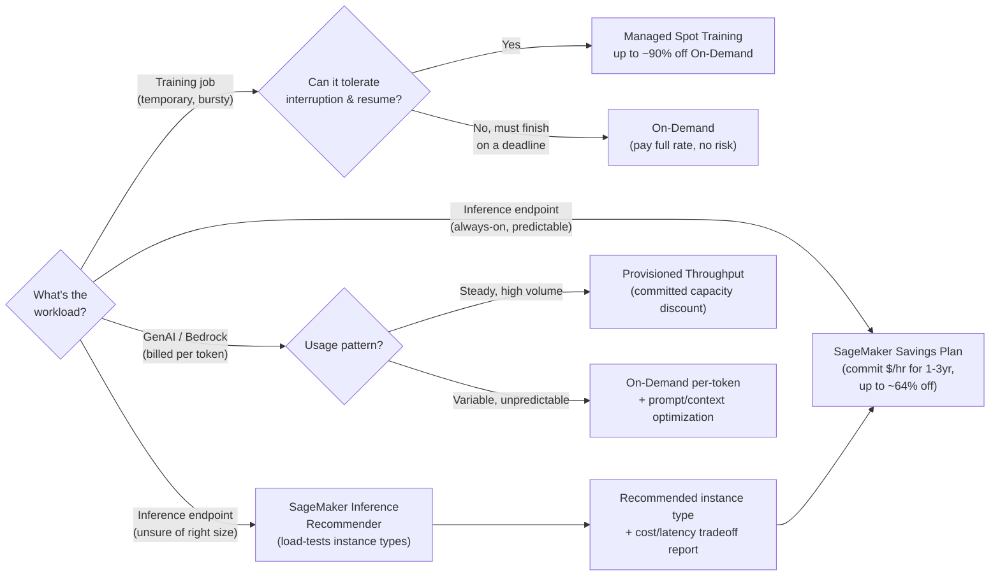
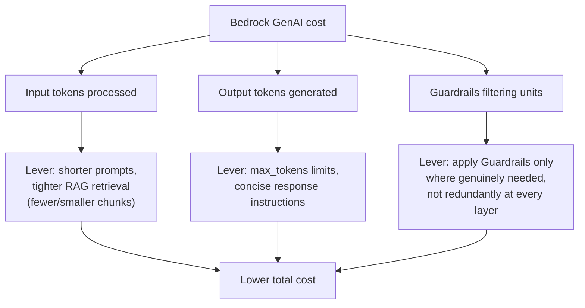
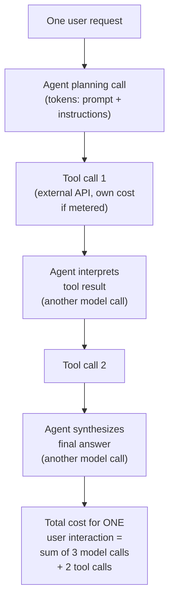

# ML Cost Optimization

*Operations concept · MLA-C02 Domain 4, Task Statement 4.2. ML workloads have a cost shape
unlike most other AWS services: training is short, bursty, and often GPU-hungry; inference can
be either always-on (expensive if idle) or spiky (wasteful if over-provisioned); and GenAI costs
behave differently from both, billed per-token rather than per-instance-hour. This doc covers
the ML-specific discount mechanisms and sizing tools, separate from general AWS cost tools
(Cost Explorer/Budgets), which are covered in `services/management-governance/`.*

## Definition

ML cost optimization is choosing the right **purchasing option** (how you pay for compute) and
the right **instance size** (how much compute you actually need) for each distinct phase of an
ML workload — because training, inference, and GenAI usage have very different usage patterns,
and using the wrong purchasing option for a given pattern either wastes money or risks job
failures.

## Purpose

SageMaker training jobs are temporary (minutes to days, then gone) and often need expensive GPU
instances; a real-time endpoint, by contrast, sits there 24/7 whether or not it's receiving
traffic; and a Bedrock foundation model call is billed per token processed, with no "instance" to
right-size at all. Treating all three the same way — e.g., paying full On-Demand rates for
everything, or trying to use interruptible Spot capacity for a customer-facing endpoint — either
overspends or breaks reliability. These purchasing options and sizing tools exist specifically so
ML workloads (unusually bursty on the training side, unusually idle-prone on the inference side,
and token-metered on the GenAI side) aren't forced into a one-size-fits-all AWS billing model.

## How It Works

Plain-English: match the payment plan to the predictability of usage — pay least when you commit
to steady usage ahead of time (Reserved/Savings Plans), pay least when you can tolerate
interruption (Spot), don't guess at instance sizing (measure it with Inference Recommender), and
for GenAI, manage cost by managing tokens, not instances.

Step by step:
1. **Classify the workload first** — training (temporary), inference (often persistent), and
   GenAI (token-metered) are charged and optimized completely differently; this is the first
   branch to get right before picking any specific discount.
2. **For training jobs that can tolerate interruption** (the job checkpoints its progress, so if
   AWS reclaims the spare capacity mid-run, it resumes from the last checkpoint instead of
   restarting) — **Managed Spot Training** uses AWS's spare, unused EC2 capacity at a steep
   discount (commonly cited up to ~90% off On-Demand), with SageMaker handling the
   checkpoint/resume automatically.
3. **For training jobs with a hard deadline** (interruption would be unacceptable, e.g., a
   time-critical retraining before a product launch) — pay **On-Demand**; the cost premium buys
   certainty that the job runs start to finish without being reclaimed.
4. **For an always-on inference endpoint with steady, predictable usage** — a **SageMaker Savings
   Plan** is a 1- or 3-year commitment to a consistent amount of compute usage (measured in $/hour)
   in exchange for a discount (AWS cites up to ~64% vs. On-Demand), similar in spirit to EC2
   Savings Plans but scoped to SageMaker usage.
5. **When you don't know what instance type/size an endpoint actually needs** — **SageMaker
   Inference Recommender** runs real load tests against your model across a range of candidate
   instance types and reports the cost/latency/throughput tradeoff for each, so the sizing
   decision is based on measured data rather than a guess (avoiding both overpaying for an
   oversized instance and under-provisioning into high latency/errors).
6. **The sizing result feeds back into the purchasing decision** — once you know the right
   instance type, that's what you commit to under a Savings Plan for steady workloads.
7. **For GenAI/Bedrock workloads**, cost doesn't scale with instance-hours at all — it scales
   with tokens processed (input and output, often billed at different per-token rates) and with
   any Guardrails filtering applied. High-volume, predictable GenAI usage can commit to
   **Provisioned Throughput** for a discount over On-Demand per-token pricing; low/variable usage
   stays On-Demand, with the real cost lever being *reducing tokens processed* (shorter, better-
   targeted prompts; tighter RAG retrieval limiting how much context gets sent per request) rather
   than any purchasing-option switch.

*Figure: a real SageMaker console screenshot of Inference Recommender's output — multiple
candidate instance types compared side by side on cost per hour, cost per inference, latency, and
invocations per minute, exactly the kind of measured comparison described in step 5 above. Source:
AWS SageMaker Developer Guide, "Recommendation jobs with Amazon SageMaker Inference Recommender" —
docs.aws.amazon.com/sagemaker/latest/dg/inference-recommender-recommendation-jobs.html.*

### A second diagram — GenAI cost levers, since they don't map to instance-hour thinking at all

Because GenAI cost optimization is genuinely new C02 content and behaves unlike every other cost
lever in this document, it deserves its own explicit breakdown:

The exam-relevant point: a question describing rising GenAI costs is very often testing whether
you reach for "reduce tokens processed" (the actual cost driver) rather than an instance-sizing
or Spot/Reserved answer that simply doesn't apply to token-metered billing.

## NEW skill 4.2.7 — Evaluating cost implications of FM inference in production

**Plain English:** before and after launching a GenAI feature, cost has to be actually projected
and then validated against reality, not assumed — FM inference cost scales with usage in a way
that's easy to underestimate during a demo (low traffic, short prompts) and then get surprised by
in production (real traffic, real-length conversations, real RAG context sizes).

- **Pre-launch projection** — estimate tokens per request (prompt + retrieved context + expected
  output length) × expected request volume × the specific model's per-token rate, for both input
  and output tokens separately (output is typically priced higher). A RAG-based feature's
  projection must include the retrieved-context tokens, not just the user's own message — a
  common underestimation source, since a 20-word user question can trigger a prompt carrying
  several thousand tokens of retrieved context.
- **Post-launch validation** — compare actual Cost Explorer/CloudWatch GenAI observability token
  metrics against the pre-launch projection within the first weeks of real traffic, specifically
  checking whether conversation length, RAG context size, or request volume diverged from what
  was assumed — the exact investigation `ml-cost-optimization.md`'s existing DataPulse case study
  (below) walks through in detail.
- **The exam-relevant discipline:** treating a GenAI cost projection as a one-time estimate that
  doesn't need revisiting after launch is the trap — production usage patterns (longer
  conversations than tested, more aggressive RAG retrieval than the demo used) routinely diverge
  from pre-launch assumptions, and this task statement expects ongoing validation, not a single
  upfront estimate.

## NEW skill 4.2.8 — Monitoring agent resource consumption

An agent's cost isn't one number — it's the sum of every model call, tool call, and retrieval
call it makes across a single run, and a multi-step agent can call the underlying foundation
model several times for one user-facing interaction (once to plan, once per tool result it needs
to interpret, once to synthesize the final answer).

- **Why per-agent-run cost can be a multiple of a single model call's cost** — a naive cost
  estimate based on "one Bedrock call's price" badly undercounts an agentic workflow where a
  single user question triggers three or more separate model invocations plus external tool
  costs, each billed independently.
- **Monitoring practice** — tag and track cost per agent run (not just per raw model invocation),
  using AgentCore Observability's traced execution path (Domain 4's 4.1.5 content) to attribute
  cost to the specific planning/tool/synthesis steps that drove it, so an optimization effort can
  target the actual expensive step rather than guessing.
- **A common real finding** — an agent re-planning in a loop (stuck re-attempting a failing tool
  call several times before giving up) silently multiplies cost for a single user interaction far
  beyond the expected 2-3 model calls — exactly the kind of coordination failure 4.1.5's
  monitoring is designed to catch, here viewed through its cost consequence rather than its
  correctness consequence.

## NEW skill 4.2.9 — Managing FM inference costs with usage optimization

Beyond the one-time purchasing-option decision (Spot/Savings Plan/Provisioned Throughput,
covered above), this task statement covers the *ongoing* optimization levers available once a
GenAI feature is live:

- **Prompt compression/trimming** — removing boilerplate, redundant instructions, or
  unnecessarily verbose system prompts without changing behavior — a direct token reduction with
  no quality cost when done carefully.
- **Context window management for conversations** — summarizing or truncating older conversation
  turns instead of resending the full growing history on every request (the exact "unbounded
  conversation history" cost driver named in this document's existing GenAI cost-lever diagram).
- **Caching repeated or near-identical requests** — if a meaningful fraction of requests are
  genuinely repeated (the same FAQ-style question asked by many users), caching the response
  avoids paying for the same generation twice — a lever classic instance-based cost optimization
  never needed, since a classic endpoint's cost doesn't scale per-request the way token billing
  does.
- **Model right-sizing as an ongoing practice, not a one-time choice** — periodically re-
  evaluating whether a smaller/cheaper model (possibly a distilled one, see Domain 1's task 1.2.9)
  can now handle a task a larger model was originally needed for, as usage patterns and available
  models both evolve over time.

## NEW skill 4.2.10 — Monitoring AI-specific cost patterns

This task statement names three AI-specific cost categories that need to be tracked *separately*
from each other and from classic compute cost, since conflating them hides exactly where money is
actually going:

| Cost category | What drives it | How to monitor it |
|---|---|---|
| **Token usage (inference)** | Input + output tokens processed per FM call | CloudWatch GenAI observability token-throughput metrics; Cost Explorer filtered to Bedrock |
| **Embedding computation cost** | Tokens processed during the embedding step of RAG ingestion/re-indexing (Domain 1) | Tracked separately from inference tokens — a large one-time corpus embedding run can spike cost in a way that looks like an inference-cost anomaly if not categorized correctly |
| **Vector database storage cost** | Ongoing storage (and, for OpenSearch, compute) cost of the vector store itself, independent of how many queries run against it | OpenSearch Service/Serverless OCU-hours or RDS instance cost; S3 Vector Buckets' storage + request pricing — a cost that accrues even with zero query traffic, unlike pure request-based inference billing |

**The exam-relevant discipline:** a rising total GenAI bill with all three categories lumped
together obscures the fix — a spike driven by embedding cost (a one-time re-indexing of a much
larger corpus) needs a completely different response than a spike driven by inference token
growth (prompt/context bloat) or vector storage growth (an ever-expanding, never-pruned
document corpus) — this task statement expects you to break total cost down into these three
categories *before* diagnosing the cause, not treat "GenAI cost went up" as one undifferentiated
problem.

## Key Features / Components

- **Managed Spot Training** — automatic checkpointing to S3 so a reclaimed/interrupted job
  resumes rather than restarts from zero; biggest discount, best for flexible-timeline training.
- **SageMaker Savings Plans** — 1-year or 3-year commitment, No Upfront/Partial Upfront/All
  Upfront payment options (more upfront payment = bigger discount), applies automatically to
  SageMaker ML instance usage up to the committed amount.
- **SageMaker Inference Recommender** — two modes: a fast "default" recommendation using
  pre-collected benchmark data, and a slower, more accurate "advanced" load test against your
  actual model and sample payloads.
- **Serverless Inference** (also covered in Domain 3's deployment doc) is itself a cost lever —
  pay per request/compute-time with zero cost while idle, trading away the lowest possible
  latency for drastically lower cost on spiky/low-traffic endpoints.
- **Auto Scaling on real-time endpoints** — scales instance count down during low traffic,
  avoiding paying for peak capacity around the clock.
- **Bedrock Provisioned Throughput** — a committed-capacity purchasing option for high-volume,
  predictable GenAI usage, trading commitment for a lower effective per-token rate than On-Demand.
- **Cost allocation tags** — tagging training jobs, endpoints, and Bedrock usage by project/team
  so Cost Explorer can break down "which ML initiative is actually driving this spend," essential
  once an organization runs more than a handful of models/GenAI apps simultaneously.
- **AWS Budgets with ML-specific alerts** — a budget scoped specifically to SageMaker or Bedrock
  service usage (rather than the whole account) with a forecasted-spend alert, catching a cost
  trend before it becomes a surprise bill rather than after.

## Use Cases — Real Scenarios

- Nightly batch retraining jobs with no hard deadline → Managed Spot Training.
- A production-critical endpoint with stable, forecastable daily traffic → SageMaker Savings Plan.
- Launching a brand-new endpoint and unsure what instance family fits the model's latency/cost
  target → Inference Recommender before committing to any purchasing plan.
- Traffic is near-zero most of the day with occasional bursts → Serverless Inference instead of
  an always-on Reserved/Savings-Plan-backed endpoint.
- A customer-facing GenAI chatbot has high, consistent daily call volume → Bedrock Provisioned
  Throughput, once usage is established enough to commit confidently.
- A new GenAI feature is still being validated with uncertain adoption → stay On-Demand per-token
  until usage patterns are predictable enough to justify a Provisioned Throughput commitment.
- A RAG-based legal assistant's bill unexpectedly doubles after a routine policy update → the
  team separates embedding-computation cost from inference-token cost in Cost Explorer and finds
  the culprit is a full corpus re-embed, not rising chatbot usage — exactly the category-first
  diagnosis task 4.2.10 names.
- A customer-support agent's per-interaction cost is 4x a single model call's list price → the
  team traces this through AgentCore Observability and finds a planning step re-invoking the
  model three extra times per request due to an ambiguous tool description, fixing the root
  coordination issue rather than only trying to negotiate a lower per-token rate.
- A healthcare documentation startup pre-launch-projects its new ambient-scribe feature's token
  cost using expected encounter length and retrieved-context size, then validates the projection
  against real usage in week one and discovers conversations run 3x longer than the demo data
  assumed, triggering an early context-summarization fix before the bill compounds further.
- A logistics company's vector database bill keeps climbing even though query volume is flat —
  investigation finds an ever-growing, never-pruned shipment-document corpus driving pure storage
  growth, a cost category completely independent of inference or embedding cost.

## When NOT to Use It / Alternatives

- **Don't use Spot for anything customer-facing/real-time** — interruption risk is unacceptable
  for a live endpoint; Spot is for training jobs only in practice.
- **Don't commit to a multi-year Savings Plan before traffic patterns are known** — run on
  On-Demand or Serverless first, measure actual usage, then commit once the pattern is stable.
- **Don't manually benchmark instance types by trial and error in production** — use Inference
  Recommender's load testing instead; it's purpose-built and produces a defensible report.
- **Don't commit to Bedrock Provisioned Throughput for an unvalidated, low-confidence usage
  forecast** — the commitment is a real financial risk if actual usage falls well short of the
  committed throughput; validate demand on On-Demand pricing first.

## Why It's Important

Real-world: ML/GenAI compute (especially GPU instances) is among the most expensive AWS compute,
so picking the wrong purchasing option can mean paying multiples of what's necessary, and a
poorly-sized endpoint either burns money on idle capacity or causes latency/errors under load.
Exam weight: cost optimization task statements appear across every AWS associate-level cert, but
MLA-C02 adds ML-specific mechanisms (Spot Training's checkpointing, SageMaker Savings Plans,
Inference Recommender) and, new in C02, GenAI-specific cost mechanics (per-token billing,
Provisioned Throughput) that don't exist in SAA-C03/DVA-C03 — expect scenario questions matching
a usage pattern to the correct purchasing option, and at least one question testing the
instance-hour-vs-per-token distinction directly.

## Pricing Model (summary)

Spot discount percentage and Savings Plan discount percentage both vary by instance type/region/
commitment term and change over time — check the official SageMaker pricing page for current
numbers rather than memorizing a fixed percentage. Inference Recommender itself has no extra
charge beyond the compute used during the load test it runs. Bedrock per-token rates vary
significantly by model (larger/more capable foundation models cost more per token than smaller
ones) and by input vs. output token (output tokens are typically priced higher than input
tokens, since generation is more compute-intensive than reading the prompt).

**Worked example — the instance-hour vs. token math side by side:** a real-time `ml.m5.xlarge`
endpoint running 24/7 bills for roughly 720 instance-hours a month *regardless of how many
requests it actually serves* — the cost is fixed once the instance type and uptime are chosen. A
Bedrock foundation model call, by contrast, has **zero idle cost** — a month with zero requests
costs exactly $0, and a month with heavy usage costs proportionally more, scaling continuously
with tokens processed rather than jumping in discrete instance-hour increments. This is the
single most important mental model shift for GenAI cost questions: stop thinking in "is the
meter always running" terms (true for SageMaker real-time endpoints) and start thinking in "cost
is proportional to usage, with no idle floor" terms (true for Bedrock On-Demand).

## Hands-on Lab (Floci)

See [`labs.md`](labs.md) — Floci doesn't emulate SageMaker billing/Spot/Savings Plans at all;
the lab instead demonstrates the *same decision framework* (steady vs. bursty vs.
interruption-tolerant) using free-tier EC2 Spot Instances directly, which Floci's compute
emulation does cover conceptually, plus real AWS Cost Explorer screenshots for context.

## Exam Tips

- Keyword "training job, can be interrupted, flexible deadline" → Spot. Keyword "must complete
  by a specific time, cannot be interrupted" → On-Demand.
- Keyword "steady, predictable, always-on" → Savings Plan. Keyword "bursty, unpredictable,
  mostly idle" → Serverless Inference, not a Savings Plan commitment.
- "Unsure what instance type to pick" is the explicit trigger phrase for Inference Recommender —
  don't guess an instance size as the answer when this phrase appears.
- For GenAI cost questions, the lever is almost always tokens processed (prompt length, context
  size, output length limits), not an instance-sizing decision — don't reach for Spot/Reserved/
  Savings Plan answers on a question that's actually about Bedrock token billing.
- "High, consistent, predictable GenAI call volume, want a lower effective rate than On-Demand" →
  Bedrock Provisioned Throughput — the direct GenAI analog of a Savings Plan commitment.

### More sample exam scenarios, worked

**Scenario 1:** "A company runs nightly retraining jobs that take 3-4 hours and have no strict
deadline — if interrupted, they can resume from where they left off the next available capacity
window." *Answer:* Managed Spot Training — the described checkpoint/resume tolerance and lack of
a hard deadline are exactly Spot's target use case, at up to ~90% savings over On-Demand.

**Scenario 2:** "A customer support chatbot built on Bedrock has grown increasingly expensive
month over month, while the number of user conversations has stayed roughly flat." *Answer:*
investigate prompt/context size growth (e.g., an unbounded conversation history being resent on
every turn, or a RAG pipeline retrieving more chunks than necessary) — flat conversation count
with rising cost points directly at tokens-per-conversation growing, not request volume.

**Scenario 3:** "A team is about to deploy a new real-time endpoint and has no prior data on what
traffic or latency to expect." *Answer:* SageMaker Inference Recommender's load test, run before
committing to any specific instance type or purchasing plan — guessing an instance size here risks
both overpaying (oversized) and poor latency (undersized).

**Scenario 4:** "A GenAI feature has been live for six months with steady, high daily call volume
that shows no sign of slowing." *Answer:* now is the appropriate time to evaluate Bedrock
Provisioned Throughput, since six months of steady, predictable usage is exactly the confidence
level needed to justify a throughput commitment — contrast with Scenario 3's brand-new, unvalidated
workload, where committing early would have been premature.

## Full worked case study — a SaaS analytics company right-sizing its ML spend

**The business problem:** "DataPulse," a B2B analytics SaaS company, runs (1) a nightly
batch-trained churn model, (2) 40 small, per-customer real-time endpoints (one model per
enterprise customer, each called only a few hundred times a day), and (3) a newly launched
GenAI insights-summary feature built on Bedrock. Finance has flagged ML/GenAI spend as the
fastest-growing line item and wants it brought under control without degrading any customer-
facing feature.

**Step 1 — classify each workload before touching any purchasing option:**
1. The nightly churn retraining job is temporary, interruption-tolerant (it simply reruns from
   the last checkpoint if interrupted) → **Managed Spot Training** candidate.
2. The 40 per-customer endpoints are each low-traffic but currently each billed as a separate,
   continuously-running real-time endpoint — exactly the "many small, mostly-idle endpoints"
   anti-pattern flagged in `services/machine-learning-ai/sagemaker-overview.md`'s Pattern 3.
3. The GenAI insights feature is billed per token, with highly variable per-customer usage.

**Step 2 — apply the matching lever to each:**
1. The churn job switches to Managed Spot Training — a straightforward configuration change with
   no architectural risk, since the job already tolerates interruption/resumption.
2. The 40 endpoints are consolidated onto a smaller number of **multi-model endpoints** — instead
   of 40 continuously-billed instances, a handful of shared instances load each customer's model
   into memory on demand, which is both the architectural fix *and* the cost fix simultaneously
   (this is the same multi-model endpoint pattern referenced in the SageMaker overview document,
   now applied as a Domain 4 cost-optimization lever rather than a Domain 3 architecture choice —
   deliberately showing how the same mechanism serves both domains).
3. The GenAI feature's cost driver is investigated first (not immediately committing to
   Provisioned Throughput) — the team discovers the insights-summary prompt includes the
   customer's full raw data table rather than a pre-aggregated summary, meaning token usage (and
   cost) scales with each customer's raw data size rather than with actual feature usage. Fixing
   the prompt to pre-aggregate data before sending it to the model cuts token volume dramatically
   — a prompt-engineering fix, not a purchasing-option fix, and one that purchasing-option
   thinking alone would never have surfaced.
4. Only after the prompt fix stabilizes usage does the team revisit whether Bedrock Provisioned
   Throughput is now justified by the (now lower, more predictable) steady-state token volume.

**Why this case study matters for the exam:** it's built specifically to show that "optimize ML
cost" is not always answered by picking a purchasing option from the table above — sometimes
(as with the endpoint consolidation and the prompt-engineering fix) the real lever is an
architectural or design change that happens to also be the cost fix, and recognizing *which*
category a given cost problem falls into is exactly the judgment this task statement is testing.

## Troubleshooting / Common Issues

- **A Managed Spot Training job keeps restarting from scratch instead of resuming from a
  checkpoint.** Confirm the training script is actually implementing checkpointing to the
  configured S3 checkpoint path — Spot's automatic resume only works if the job itself saves and
  reloads its own progress; SageMaker provides the interruption/resume *infrastructure*, not
  automatic checkpointing of arbitrary training code that was never written to checkpoint.
- **A SageMaker Savings Plan was purchased but the monthly bill doesn't show the expected
  discount.** Check that the actual instance family/Region usage matches what the Savings Plan
  was scoped to — a Savings Plan committed to one instance family only discounts usage of that
  family; traffic that shifted to a different instance type or Region won't automatically draw
  down the same plan.
- **Inference Recommender's recommendation doesn't match production behavior once deployed.**
  Confirm the load test used a genuinely representative sample payload and traffic pattern —
  a load test run against unrealistically small or uniform payloads can recommend an instance
  type that under-performs against real, more varied production traffic.
- **Bedrock Provisioned Throughput is committed, but actual usage consistently falls below the
  committed capacity.** This is a direct cost miscalculation — committed throughput is paid for
  whether used or not, so review actual usage trends and consider stepping down the commitment
  (or returning to On-Demand) rather than treating the shortfall as temporary without evidence.
- **Multi-model endpoint latency spikes on the first request for a given customer's model.** This
  is the expected "cold load" behavior — a model not currently in memory must be loaded from S3
  the first time it's invoked after being evicted; if this latency is unacceptable for a specific
  high-value customer, that customer may warrant its own dedicated endpoint despite the general
  cost-optimization pattern favoring consolidation — the right answer depends on which constraint
  (cost vs. guaranteed low latency) is more important for that specific case.

## Related Terms

- [`services/machine-learning-ai/sagemaker-training-and-tuning.md`](../../../services/machine-learning-ai/sagemaker-training-and-tuning.md)
  — where Managed Spot Training is configured.
- [`services/machine-learning-ai/sagemaker-deployment-endpoints.md`](../../../services/machine-learning-ai/sagemaker-deployment-endpoints.md)
  — the endpoint types these purchasing options apply to.
- [`services/machine-learning-ai/bedrock.md`](../../../services/machine-learning-ai/bedrock.md) —
  Provisioned Throughput and per-token pricing mechanics in full depth.
- [`services/management-governance/cost-management-tools.md`](../../../services/management-governance/cost-management-tools.md)
  — general AWS cost tracking (Cost Explorer, Budgets) underneath all of this.
- [`../domain-3-deployment-orchestration/README.md`](../domain-3-deployment-orchestration/README.md)
  — the inference-option decision that this document's cost levers attach to.
- [`labs.md`](labs.md) — the hands-on exercise reproducing this document's drift/cost decision
  logic with real, runnable code.
