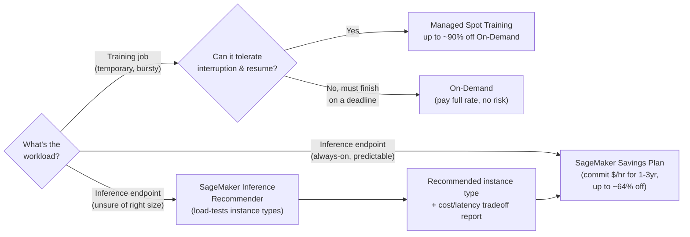

# ML Cost Optimization

*Operations concept · MLA-C02 Domain 4, Task Statement 4.2. ML workloads have a cost shape
unlike most other AWS services: training is short, bursty, and often GPU-hungry; inference can
be either always-on (expensive if idle) or spiky (wasteful if over-provisioned). This doc covers
the ML-specific discount mechanisms and sizing tools, separate from general AWS cost tools
(Cost Explorer/Budgets), which are covered in `services/management-governance/`.*

## Definition

ML cost optimization is choosing the right **purchasing option** (how you pay for compute) and
the right **instance size** (how much compute you actually need) for each distinct phase of an
ML workload — because training and inference have very different usage patterns, and using the
wrong purchasing option for a given pattern either wastes money or risks job failures.

## Purpose

SageMaker training jobs are temporary (minutes to days, then gone) and often need expensive GPU
instances; a real-time endpoint, by contrast, sits there 24/7 whether or not it's receiving
traffic. Treating both the same way — e.g., paying full On-Demand rates for everything, or trying
to use interruptible Spot capacity for a customer-facing endpoint — either overspends or breaks
reliability. These purchasing options and sizing tools exist specifically so ML workloads
(unusually bursty on the training side, unusually idle-prone on the inference side) aren't
forced into a one-size-fits-all AWS billing model.

## How It Works

Plain-English: match the payment plan to the predictability of usage — pay least when you commit
to steady usage ahead of time (Reserved/Savings Plans), pay least when you can tolerate
interruption (Spot), and don't guess at instance sizing — measure it (Inference Recommender).

Step by step:
1. **Classify the workload first** — training (temporary) vs. inference (often persistent) are
   charged and optimized completely differently; this is the first branch to get right before
   picking any specific discount.
2. **For training jobs that can tolerate interruption** (the job checkpoints its progress, so if
   AWS reclaims the spare capacity mid-run, it resumes from the last checkpoint instead of
   restarting) — **Managed Spot Training** uses AWS's spare, unused EC2 capacity at a steep
   discount (commonly cited up to ~90% off On-Demand), with SageMaker handling the
   checkpoint/resume automatically.
3. **For training jobs with a hard deadline** (interruption would be unacceptable, e.g., a
   time-critical retraining before a product launch) — pay **On-Demand**; the cost premium buys
   certainty that the job runs start to finish without being reclaimed.
4. **For an always-on inference endpoint with steady, predictable usage** — a **SageMaker Savings
   Plan** is a 1- or 3-year commitment to a consistent amount of compute usage (measured in $/hour)
   in exchange for a discount (AWS cites up to ~64% vs. On-Demand), similar in spirit to EC2
   Savings Plans but scoped to SageMaker usage.
5. **When you don't know what instance type/size an endpoint actually needs** — **SageMaker
   Inference Recommender** runs real load tests against your model across a range of candidate
   instance types and reports the cost/latency/throughput tradeoff for each, so the sizing
   decision is based on measured data rather than a guess (avoiding both overpaying for an
   oversized instance and under-provisioning into high latency/errors).
6. **The sizing result feeds back into the purchasing decision** — once you know the right
   instance type, that's what you commit to under a Savings Plan for steady workloads.

## Key Features / Components

- **Managed Spot Training** — automatic checkpointing to S3 so a reclaimed/interrupted job
  resumes rather than restarts from zero; biggest discount, best for flexible-timeline training.
- **SageMaker Savings Plans** — 1-year or 3-year commitment, No Upfront/Partial Upfront/All
  Upfront payment options (more upfront payment = bigger discount), applies automatically to
  SageMaker ML instance usage up to the committed amount.
- **SageMaker Inference Recommender** — two modes: a fast "default" recommendation using
  pre-collected benchmark data, and a slower, more accurate "advanced" load test against your
  actual model and sample payloads.
- **Serverless Inference** (also covered in Domain 3's deployment doc) is itself a cost lever —
  pay per request/compute-time with zero cost while idle, trading away the lowest possible
  latency for drastically lower cost on spiky/low-traffic endpoints.
- **Auto Scaling on real-time endpoints** — scales instance count down during low traffic,
  avoiding paying for peak capacity around the clock.

## Use Cases — When to Use It

- Nightly batch retraining jobs with no hard deadline → Managed Spot Training.
- A production-critical endpoint with stable, forecastable daily traffic → SageMaker Savings Plan.
- Launching a brand-new endpoint and unsure what instance family fits the model's latency/cost
  target → Inference Recommender before committing to any purchasing plan.
- Traffic is near-zero most of the day with occasional bursts → Serverless Inference instead of
  an always-on Reserved/Savings-Plan-backed endpoint.

## When NOT to Use It / Alternatives

- **Don't use Spot for anything customer-facing/real-time** — interruption risk is unacceptable
  for a live endpoint; Spot is for training jobs only in practice.
- **Don't commit to a multi-year Savings Plan before traffic patterns are known** — run on
  On-Demand or Serverless first, measure actual usage, then commit once the pattern is stable.
- **Don't manually benchmark instance types by trial and error in production** — use Inference
  Recommender's load testing instead; it's purpose-built and produces a defensible report.

## Why It's Important

Real-world: ML/GenAI compute (especially GPU instances) is among the most expensive AWS compute,
so picking the wrong purchasing option can mean paying multiples of what's necessary, and a
poorly-sized endpoint either burns money on idle capacity or causes latency/errors under load.
Exam weight: cost optimization task statements appear across every AWS associate-level cert, but
MLA-C02 adds ML-specific mechanisms (Spot Training's checkpointing, SageMaker Savings Plans,
Inference Recommender) that don't exist in SAA-C03/DVA-C03 — expect scenario questions matching
a usage pattern to the correct purchasing option.

## Pricing Model (summary)

Spot discount percentage and Savings Plan discount percentage both vary by instance type/region/
commitment term and change over time — check the official SageMaker pricing page for current
numbers rather than memorizing a fixed percentage. Inference Recommender itself has no extra
charge beyond the compute used during the load test it runs.

## Hands-on Lab (Floci)

See [`labs.md`](labs.md) — Floci doesn't emulate SageMaker billing/Spot/Savings Plans at all;
the lab instead demonstrates the *same decision framework* (steady vs. bursty vs.
interruption-tolerant) using free-tier EC2 Spot Instances directly, which Floci's compute
emulation does cover conceptually, plus real AWS Cost Explorer screenshots for context.

## Exam Tips

- Keyword "training job, can be interrupted, flexible deadline" → Spot. Keyword "must complete
  by a specific time, cannot be interrupted" → On-Demand.
- Keyword "steady, predictable, always-on" → Savings Plan. Keyword "bursty, unpredictable,
  mostly idle" → Serverless Inference, not a Savings Plan commitment.
- "Unsure what instance type to pick" is the explicit trigger phrase for Inference Recommender —
  don't guess an instance size as the answer when this phrase appears.

## Related Terms

- [`services/machine-learning-ai/sagemaker-training-and-tuning.md`](../../../services/machine-learning-ai/sagemaker-training-and-tuning.md)
  — where Managed Spot Training is configured.
- [`services/machine-learning-ai/sagemaker-deployment-endpoints.md`](../../../services/machine-learning-ai/sagemaker-deployment-endpoints.md)
  — the endpoint types these purchasing options apply to.
- [`services/management-governance/cost-management-tools.md`](../../../services/management-governance/cost-management-tools.md)
  — general AWS cost tracking (Cost Explorer, Budgets) underneath all of this.
