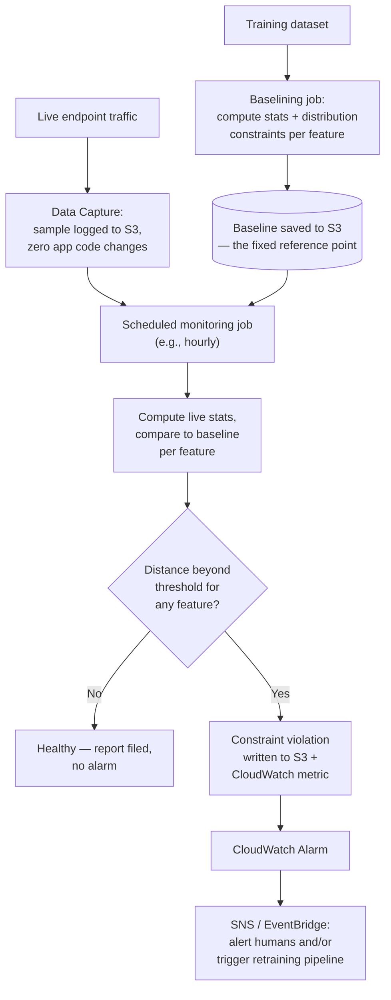
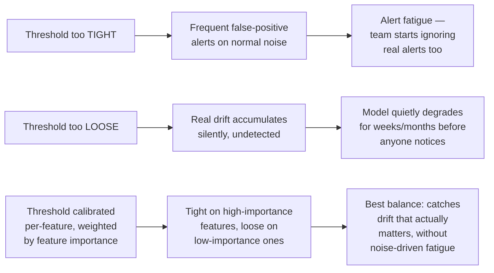

# Model Drift and Data Drift Detection — Deep Dive with SageMaker Model Monitor

*New topic doc · MLA-C02 Domain 4, Task Statement 4.1. The main `README.md` introduces data
drift vs. concept drift at a high level; this doc goes one level deeper — the actual statistical
mechanics Model Monitor runs, how to set numeric thresholds (not just "drift / no drift"), a
fully worked numeric example you can reproduce by hand, and the specific exam traps around
baseline construction and scheduling.*

## Definition

**Drift** is any change, over time, in the statistical relationship between a deployed model and
the real world it operates in. AWS (and the exam) splits it into two precise categories:

- **Data drift** (also called "data quality drift" in Model Monitor's own terminology) — the
  statistical distribution of the **input features** the model receives in production has
  shifted away from what it saw during training, independent of whether the model's predictions
  are still correct.
- **Concept drift** (also called "model quality drift") — the statistical relationship between
  inputs and the **correct label** has changed, meaning the model's *learned mapping* is now
  wrong for at least some inputs, even if those inputs look identical to training-time inputs.

**Bias drift** and **feature attribution drift** are two further Model Monitor categories worth
knowing exist (bias drift: a fairness metric, e.g., disparate impact, that was acceptable at
training time crosses an unacceptable threshold in production; feature attribution drift: the
*relative importance* of each feature to the model's predictions — measured via SHAP, called
NDCG distance in Model Monitor's own metric — shifts even if accuracy hasn't visibly dropped
yet, often an **early-warning signal** that precedes a visible concept-drift event).

## Plain-English Analogy

Think of a model as a tailor who made you a suit (trained) using your measurements from two years
ago.

- **Data drift** is: you've put on ten pounds since then. The tailor's "input" (your body) has
  changed shape. The suit might *still fit fine* — you won't know until you try it on — but the
  tailor is now working from stale measurements, operating outside the data they were calibrated
  against.
- **Concept drift** is subtler and worse: your body is *exactly the same* as two years ago, but
  fashion norms changed — what used to be "a well-fitted suit" is now considered "baggy" by
  current standards. The input (your measurements) hasn't moved at all, but the *correct answer*
  to "is this suit good" has changed underneath the tailor's feet. No amount of re-measuring you
  (checking input data) would ever reveal this — only asking people today "does this look good"
  (collecting fresh ground truth) would.

This is exactly why data drift is detected by comparing *input statistics alone*, and concept
drift requires *fresh labels* — the analogy maps one-to-one onto the real detection mechanics
below.

## Purpose

Catching drift automatically, on a schedule, is the only way a team running dozens of production
models avoids silently stale predictions. Without automated drift detection, the only way staleness
surfaces is through a lagging business signal (rising customer complaints, a slow accuracy audit
months later) — by which point real harm (bad loan decisions, missed fraud, poor recommendations)
has already compounded. Model Monitor exists to convert "is this model still good" from a
periodic manual audit into a continuous, automatic, alertable signal.

## When to Use

- Any model making decisions that affect real people or money in production, continuously, for
  more than a few weeks — data/concept drift is a *when*, not an *if*, for almost any real-world
  deployment, because the world keeps changing underneath the model.
- Especially critical for models trained on data from a specific time period or population that
  is known to be unstable (seasonal retail demand, fraud patterns, any consumer-behavior model
  following a major external event like a pandemic or interest-rate shift).
- Regulated contexts (lending, insurance, healthcare) where "we didn't know the model had gone
  stale" is not an acceptable answer to an auditor.

## When NOT to Use It

- A one-off batch scoring job that runs once and is discarded — there's no "production drift" to
  monitor because there's no ongoing production deployment.
- A model being actively re-trained on a tight, automated cadence (e.g., retrained nightly on
  the latest full dataset) *and* validated against a fresh held-out set every single run — in
  this specific case, drift monitoring is still good practice but provides much less incremental
  value, since the model essentially never has time to go stale between retrains. (This is a rare
  exam-scenario answer — most scenarios still expect Model Monitor even with frequent retraining,
  since the monitoring and retraining-cadence decisions are made independently.)
- Monitoring input data that the model doesn't actually depend on strongly (e.g., a feature with
  near-zero importance drifting wildly) — a secondary optimization, not a reason to skip Model
  Monitor, but worth knowing that not every drifted feature matters equally; see "Feature
  attribution drift" below.

## How Model Monitor Actually Computes Drift — the Real Mechanics

**Step 1 — Baseline creation.** Before monitoring can run at all, you run a **baselining job**
against your *training dataset* (not live data). This job computes, per feature: summary
statistics (mean, standard deviation, min, max, quantiles) and a full **distribution
constraint** — effectively a histogram/density estimate of that feature's values. This baseline
is saved and becomes the fixed reference point every future comparison is measured against.

**Step 2 — Data capture.** Once the baseline exists, you turn on **data capture** on the
endpoint — a configuration flag that tells SageMaker to transparently log a sample (or all) of
the real-time inference requests and responses to S3, with zero code changes required in your
serving application. This is what makes Model Monitor "automatic" — the application calling the
endpoint has no idea its traffic is being observed.

**Step 3 — Scheduled monitoring job.** On a schedule you define (commonly hourly), a **monitoring
job** runs: it reads the captured live traffic since the last run, computes the *same* statistics
on it that the baselining job computed on training data, and runs a statistical comparison between
live-statistics and baseline-statistics for every monitored feature.

**Step 4 — Constraint violation check.** Each feature's baseline constraint carries a tolerance —
by default, a feature "violates" its constraint if the live distribution differs from baseline
beyond a configurable threshold (Model Monitor uses distance metrics like **L-infinity distance**
between the two distributions' CDFs for numerical features, or chi-squared-style tests for
categorical features, depending on monitor type). Any violation is written to a **violations
report** in S3 and emitted as a **CloudWatch metric** per feature.

**Step 5 — Alerting.** A CloudWatch Alarm watches the violation-count metric; crossing a
configured threshold (e.g., "more than 2 features violated in this run," or "this one critical
feature violated at all") triggers an SNS notification or an EventBridge rule — which is the
mechanism that can kick off a retraining pipeline automatically.

Step by step, in plain language: the baseline is a photograph of "what training data looked
like." Every scheduled run takes a fresh photograph of "what live data looks like right now" and
measures how far apart the two photographs are. Crossing the distance threshold is the trigger —
not any difference at all, which is the single most commonly misunderstood point on the exam.

## A Fully Worked Numeric Example — Do This Math Yourself

Imagine a credit-scoring model's single feature, `monthly_income` (in thousands of dollars).

**Training-time baseline** (1,000 applicants): mean = $5.2k, standard deviation = $1.1k.

**Live sample, Week 1** (500 applicants): mean = $5.3k, standard deviation = $1.15k.
→ A two-sample Kolmogorov-Smirnov test (the real statistical test underlying this kind of
comparison — see `labs.md` Lab 2 for runnable code) on these two samples would almost certainly
return a **high p-value** (no statistically significant difference) — this tiny shift is well
within normal sampling noise. **Result: no drift flagged.** This is the expected, healthy case —
and the critical exam point: *any* difference between two samples is mathematically guaranteed
(no two finite samples are ever byte-for-byte identical); the test exists specifically to
distinguish *noise* from a *real* shift.

**Live sample, Month 6** (500 applicants, after a marketing campaign targeting a higher-income
segment): mean = $7.8k, standard deviation = $1.3k.
→ The same KS test now returns a **low p-value** (well below the standard 0.05 threshold) — the
live distribution has moved far enough, and with enough samples, that the difference is
statistically very unlikely to be noise. **Result: data drift flagged.**

Notice what this example does *not* tell you: whether the model's *predictions* are still
accurate. A higher-income applicant pool might still be scored perfectly correctly — the model
is just now operating on applicants whose income range it saw much less of during training,
which is exactly the "extrapolating outside validated territory" risk data drift represents, not
a guarantee of wrong answers.

**The concept-drift companion check**, run separately and monthly (since it needs real loan
outcomes to mature): of the 500 Month 6 applicants approved, what fraction actually repaid as
expected? If training-time approved applicants repaid at 94% and Month 6's approved applicants
are repaying at 81% once enough outcomes have resolved, *that* is concept drift — the actual
input→outcome relationship broke, a materially more serious and more urgent finding than the
data-drift flag above, because it means the model is **currently making worse decisions**, not
just operating in a less-validated region.

## Thresholds — How to Pick a Number, Not Just "Set Something"

The exam expects you to reason about threshold *tradeoffs*, not just that a threshold exists:

| Threshold choice | Effect | Risk |
|---|---|---|
| Very tight (small allowed distance) | Flags drift quickly, even on small shifts | High false-positive rate — frequent alerts on noise, causing alert fatigue and teams learning to ignore them |
| Very loose (large allowed distance) | Only flags large, obvious shifts | Real, meaningful drift can accumulate undetected for a long time before crossing the threshold |
| Per-feature, risk-weighted | Tight thresholds on features the model depends on heavily (high feature importance); loose thresholds on low-importance features | Requires knowing feature importance up front (from Clarify or the model's own importance scores) — more setup effort, but the most defensible, exam-favored answer for "how should thresholds be set" |

**Exam-relevant judgment call:** a scenario describing frequent, low-value drift alerts that the
team has started ignoring is testing whether you recognize an over-tight threshold (or
monitoring an unimportant feature too strictly) as the root cause — the fix is *recalibrating the
threshold*, not disabling monitoring altogether, and definitely not just raising every threshold
uniformly without considering feature importance first.

This threshold-calibration tradeoff diagram is worth internalizing visually alongside the table
above — the exam rewards recognizing *which side* of this tradeoff a described symptom (frequent
ignored alerts vs. a surprise accuracy drop nobody caught in time) points to, not just reciting
that a threshold exists.

## Scheduling — How Often Is "Often Enough"?

- **Hourly** is Model Monitor's most common default cadence for data-quality (data drift)
  monitoring on a continuously-trafficked endpoint — frequent enough to catch a sudden shift (a
  bad upstream data pipeline change, a bot-traffic spike) within the same business day.
- **Daily or weekly** is often sufficient for model-quality (concept drift) monitoring, since it
  depends on fresh ground truth that frequently doesn't arrive faster than that in the first
  place (e.g., loan outcomes resolve over weeks, not hours).
- **The exam trap:** picking an hourly cadence for a concept-drift check that depends on labels
  which only arrive monthly is nonsensical — the monitoring job would simply have nothing new to
  compare against most of the time. Match the monitoring cadence to the *cadence at which new
  ground truth is actually available*, not to an arbitrarily "frequent is always better" instinct.

*Figure: AWS's own diagram of Model Monitor's batch-transform-specific architecture — the same
baseline-vs-live comparison concept as the real-time architecture shown above, but applied to a
**batch transform job's** output rather than a persistent real-time endpoint's traffic. The
exam-relevant point this figure makes concrete: drift monitoring isn't exclusive to always-on
endpoints — a periodic batch scoring job (e.g., a nightly churn-scoring run) can and should be
monitored the same way, just triggered per-batch-run instead of on a fixed clock schedule. Source:
AWS SageMaker Developer Guide, "Monitor models for data and model quality, bias, and
explainability" — docs.aws.amazon.com/sagemaker/latest/dg/model-monitor.html.*

## Key Features / Components

- **Baselining job** — a one-time (or periodically re-run) SageMaker Processing job that computes
  the fixed reference statistics and constraints from training data.
- **Data Capture** — transparent logging of live endpoint request/response payloads to S3; zero
  client-side code changes.
- **Monitoring schedule** — the recurring job comparing live captured data against the baseline.
- **Model Monitor's four monitor types** — Data Quality (data drift), Model Quality (concept
  drift, needs ground truth merged in), Bias Drift (via Clarify integration), Feature Attribution
  Drift (via Clarify SHAP integration).
- **Constraints file (`constraints.json`)** — the explicit, editable JSON file listing each
  feature's allowed statistical bounds; you *can* hand-edit this after baselining to loosen or
  tighten a specific feature's tolerance without re-running the whole baselining job.
- **Violations report** — the per-run output listing exactly which features violated their
  constraint and by how much, the primary artifact a human reviews when triaging an alert.
- **CloudWatch integration** — every monitoring run emits metrics automatically, making alarm
  configuration a standard CloudWatch Alarm setup rather than a Model-Monitor-specific mechanism.

## Use Cases — Real Scenarios

1. An e-commerce recommendation model's data-quality monitor flags a sudden shift in the
   `session_duration` feature the same week a site redesign shipped — the drift is traced to the
   redesign changing user browsing behavior, not a data pipeline bug, and the team decides to
   accept the new normal and re-baseline rather than "fix" anything.
2. A fraud-detection model's concept-drift check (monthly, against confirmed fraud outcomes)
   shows accuracy holding steady even while a data-drift check shows noticeable shifts in
   transaction-amount distributions — correctly interpreted as "the world changed, but the model
   is still making correct calls on the new distribution," not a false alarm to dismiss.
3. A healthcare risk model's feature-attribution-drift monitor flags that a previously
   minor feature has become disproportionately influential in recent predictions, surfacing a
   likely upstream data-quality issue in that specific field weeks before it would have shown up
   as a visible accuracy drop.
4. A retail demand-forecasting team deliberately sets a loose data-drift threshold on a
   known-seasonal feature (e.g., month-of-year-correlated purchase volume) to avoid a predictable,
   expected annual alert storm, while keeping tight thresholds on features with no legitimate
   seasonal explanation.
5. A lending company's compliance team requires monthly concept-drift reports (not just data
   drift) specifically because regulators require proof the model's *actual decision accuracy* is
   being tracked against real outcomes, not just input-shape monitoring alone.
6. A platform team configures an EventBridge rule off a Model Monitor CloudWatch alarm that
   automatically opens a ticket and pages the on-call ML engineer, rather than relying on someone
   checking a dashboard — closing the loop from "detected" to "a human is notified" without a
   manual step.

## Why It's Important

Real-world: undetected drift is one of the most common causes of real production ML failure —
not because the original model was poorly built, but because nothing in the world stays static
forever, and without automated detection the only signal is a lagging, expensive business symptom.
Exam weight: drift detection is one of Domain 4's most heavily tested concepts, specifically the
data-drift-vs-concept-drift distinction and the "which needs fresh labels" mechanic — expect at
least one scenario question built entirely around distinguishing the two.

## Troubleshooting / Common Issues

- **The monitoring job reports "insufficient data" and never runs a comparison.** Data Capture
  may not actually be enabled on the endpoint, or traffic volume since the last scheduled run is
  too low to form a statistically meaningful sample — confirm Data Capture configuration first,
  then consider a longer monitoring interval if traffic is genuinely low-volume.
- **A feature constantly violates its constraint even though nothing seems wrong.** Check whether
  the baseline was computed from a *representative* training sample — a baseline accidentally
  computed from a skewed or too-small training subset will make almost all live traffic look like
  drift relative to that unrepresentative reference.
- **Concept-drift monitoring never produces a result.** This monitor type requires a merge job
  joining captured predictions with a ground-truth label source you provide separately — confirm
  the ground-truth labels are actually being supplied and merged on the expected schedule; without
  them, this monitor type has structurally nothing to compare.
- **Data drift is flagged, but the team can't tell if it matters.** Cross-reference against
  feature-attribution-drift / feature importance — a flagged low-importance feature matters far
  less than a flagged high-importance one; don't treat every violation as equally urgent.

## Exam Tips

- "Input feature distributions changed, no mention of accuracy or labels" → data drift (Data
  Quality monitor). "Accuracy against fresh labeled outcomes is falling" → concept drift (Model
  Quality monitor). This single distinction is tested more than any other drift-related fact.
- Data drift needs **no new labels** — only input statistics. Concept drift **requires** fresh
  ground truth. If a question's scenario has no mention of labels/outcomes at all, the answer is
  almost certainly data drift, not concept drift.
- A threshold that's "too tight" causes frequent false-positive alerts and alert fatigue; "too
  loose" lets real drift accumulate unnoticed — a question describing either symptom is testing
  threshold calibration, not "turn monitoring off."
- Match monitoring *schedule frequency* to the cadence fresh ground truth actually arrives at for
  concept drift specifically — an hourly concept-drift schedule against monthly-arriving labels is
  a mismatch the exam will test directly.
- Feature-attribution drift (SHAP-based) is a distinct, fourth monitor type from the two most
  commonly tested (data/concept) — know it exists as an early-warning signal that can precede a
  visible accuracy drop, even if it's less frequently the *correct* answer than the other two.

### More sample exam scenarios, worked

**Scenario 1:** "A model's live input feature statistics have shifted noticeably in the last
week, but nobody has checked whether predictions are still accurate." *Answer:* this describes
data drift being observed — it says nothing about accuracy/labels, so no conclusion about concept
drift can be drawn yet; the next correct step is running (or waiting for) the separate,
label-dependent concept-drift check, not assuming accuracy has or hasn't dropped from the data-drift
signal alone.

**Scenario 2:** "A team wants Model Monitor to alert them the instant feature drift crosses a
defined statistical threshold, without anyone needing to check a dashboard." *Answer:* a
CloudWatch Alarm on the Model Monitor violation metric, wired to SNS or EventBridge — Model
Monitor's own reports are passive artifacts in S3 until a CloudWatch Alarm is layered on top to
make detection active/push-based.

**Scenario 3:** "A concept-drift monitoring job has been configured and scheduled hourly, but it
has never once produced a violation report, healthy or otherwise." *Answer:* most likely the
ground-truth label merge job isn't actually supplying labels on that schedule (or at all) — concept
drift structurally cannot run without fresh labels, unlike data drift.

**Scenario 4:** "A data-drift monitor on a seasonal retail demand model fires the same
predictable alert every November." *Answer:* this is a known, legitimate, recurring pattern, not
a bug — the fix is a loosened threshold or a seasonally-aware baseline for that specific feature,
not disabling the monitor or treating every November alert as a new investigation.

## Related Terms

- [`README.md`](README.md) — the domain-level introduction to drift this doc expands on in full
  mechanical depth.
- [`services/machine-learning-ai/sagemaker-model-monitor-and-registry.md`](../../../services/machine-learning-ai/sagemaker-model-monitor-and-registry.md)
  — the full service reference for Model Monitor and the Model Registry it pairs with.
- [`responsible-ai-and-guardrails.md`](responsible-ai-and-guardrails.md) — bias drift and feature
  attribution drift lean on the same SageMaker Clarify engine covered there.
- [`labs.md`](labs.md) — Lab 2 and Lab 3 reproduce this doc's data-drift and concept-drift
  statistical tests with real, runnable code.
- [`../domain-3-deployment-orchestration/README.md`](../domain-3-deployment-orchestration/README.md)
  — the retraining pipeline a drift alert typically feeds into.
