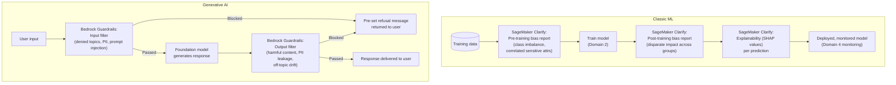

# Responsible AI and Guardrails

*Operations/Trust concept · MLA-C02 Domain 4, Task Statement 4.4 — one of the clearest net-new
additions going from C01 to C02. "Responsible AI" spans classic ML fairness (has existed since
C01, via SageMaker Clarify) and GenAI-specific safety (brand new, via Bedrock Guardrails). Both
live here because they answer the same operational question: "is this model/system's behavior
something we can stand behind, and can we prove it?"*

## Definition

**Bias** (in the ML sense) means a model systematically produces worse or different outcomes
for one group of people/cases than another, in a way that isn't justified by genuine,
legitimate differences in the underlying data — for example, a loan-approval model that rejects
qualified applicants from one zip code at a much higher rate than another, for reasons unrelated
to actual creditworthiness. **Explainability** is the ability to state, in human-understandable
terms, *why* a model made a specific prediction (not just *what* it predicted). **Guardrails**
(the GenAI-specific term, via Amazon Bedrock Guardrails) are configurable filters that sit
between a user and a foundation model, blocking disallowed input topics and unsafe/off-brand
output before either reaches the other party.

## Purpose

A model can be statistically accurate overall while still being unfair to a subgroup — accuracy
alone (see Domain 2's `ml-fundamentals-glossary.md`) doesn't measure fairness, so a separate set
of tools exists specifically to measure it. Explainability exists because regulators, auditors,
and the people affected by a model's decision (a loan applicant, a job candidate) are entitled in
many contexts to a reason, not just an outcome — and because developers themselves need to debug
*why* a model is behaving a certain way. Guardrails exist because foundation models are
general-purpose text generators with no inherent sense of your company's policies — without a
filtering layer, a customer-facing chatbot built on a raw foundation model can be tricked into
discussing banned topics, leaking training data patterns, or generating harmful content, none of
which a traditional ML classifier was ever capable of doing (a fraud classifier can't go off-
script and say something embarrassing; a chatbot can).

## How It Works

Plain-English: for classic ML, measure fairness and explainability with SageMaker Clarify both
before training (is the data itself biased?) and after deployment (is the model's behavior
biased?). For GenAI, wrap the foundation model with Bedrock Guardrails that inspect both what
goes in and what comes out.

Step by step (classic ML side):
1. **Pre-training bias report (SageMaker Clarify)** examines the *data itself* before any model
   is trained — checking things like class imbalance (one outcome massively over-represented)
   and whether a sensitive attribute (e.g., age, zip code as a proxy for race) is statistically
   correlated with the label in a way that could let the model learn an unfair shortcut.
2. **Training proceeds** as in Domain 2, using the (ideally now-corrected) data.
3. **Post-training bias report (SageMaker Clarify)** examines the *trained model's actual
   predictions* across different groups — computing metrics like **disparate impact** (does one
   group get a favorable outcome at a notably lower rate than another, even if inputs look
   similar?). This catches bias the model learned even from seemingly clean data.
4. **Explainability (SageMaker Clarify, SHAP values)** — for any individual prediction, Clarify
   can report how much each input feature contributed to that specific result ("income
   contributed +0.3 toward approval, zip code contributed -0.1"), which is what lets you answer a
   regulator's or applicant's "why was I rejected" question concretely.
5. **The model then goes to deployment/monitoring** as described in this domain's main README —
   bias and explainability aren't a one-time check, they're periodically re-run against live
   predictions too, since a model's fairness profile can drift just like its accuracy can.

Step by step (GenAI side):
6. **User input hits Bedrock Guardrails' input filter first** — before the foundation model ever
   sees it, Guardrails checks for denied topics (configured by you, e.g., "no medical advice"),
   PII the user may have accidentally included, and prompt injection attempts (a user trying to
   trick the model into ignoring its instructions).
7. **If blocked**, the user gets a pre-configured refusal/redirect message — the foundation model
   is never even invoked, saving cost and guaranteeing the bad input never reaches it.
8. **If passed**, the foundation model generates a response normally.
9. **The response goes through the output filter** before reaching the user — checking for
   harmful/unsafe content categories, PII that might have leaked into the generated text, and
   topic drift away from what's allowed — blocking it just as the input filter would if anything
   trips the configured rules.
10. **Only content that clears both filters** reaches the end user — this two-sided check (input
    AND output) is the key design point: filtering only the input wouldn't catch a model that
    generates something problematic on its own.

## Key Features / Components

- **SageMaker Clarify — Pre-training bias metrics**: class imbalance, difference in label rates
  between groups, and other statistical measures run directly on the dataset.
- **SageMaker Clarify — Post-training bias metrics**: disparate impact, difference in
  predicted-positive rates between groups, measured on the trained model's actual outputs.
- **SageMaker Clarify — Explainability (SHAP)**: per-prediction and global (whole-model) feature
  attribution reports.
- **Bedrock Guardrails — Denied topics**: configure specific subjects the model must refuse to
  discuss (e.g., competitor comparisons, medical/legal/financial advice if out of scope).
- **Bedrock Guardrails — Content filters**: configurable strength thresholds for categories like
  hate speech, violence, and sexual content, applied to both input and output.
- **Bedrock Guardrails — PII redaction**: automatically detect and mask/block personally
  identifiable information in either direction.
- **Bedrock Guardrails — Word filters**: simple blocklists for specific profanity or
  competitor/brand names.

## Use Cases — When to Use It

- A hiring/lending/insurance model (high-stakes, regulated decisions about people) → run
  SageMaker Clarify pre- and post-training bias checks as a mandatory step, not optional.
- Any customer-facing chatbot built on a foundation model → Bedrock Guardrails configured with at
  minimum content filters and PII redaction before launch.
- A regulator or internal audit asks "why did the model decide X for this specific case" →
  Clarify's per-prediction SHAP explainability.

## When NOT to Use It / Alternatives

- **A purely internal, low-stakes batch scoring job with no individual-level impact** (e.g.,
  aggregating anonymized sales trends) — full bias/explainability tooling may be overkill, though
  basic sanity checks are still good practice.
- **Guardrails are not a substitute for fine-tuning/prompt engineering done well** — Guardrails
  catch bad outputs after the fact; they don't make the model inherently better at the task.

## Why It's Important

Real-world: biased or unsafe model behavior creates real legal, reputational, and ethical harm,
and regulations in many jurisdictions increasingly require explainability for automated
decisions affecting people. Exam weight: this is explicitly flagged as new C02 content — expect
questions distinguishing *when* a bias/fairness tool (Clarify) applies vs. a GenAI safety tool
(Guardrails) applies, since both answer "is this trustworthy" but for different model types.

## Pricing Model (summary)

SageMaker Clarify processing jobs are billed as standard SageMaker Processing compute (per
instance-hour used to run the bias/explainability job). Bedrock Guardrails are billed per text
unit filtered, separate from the underlying foundation model's token cost — check the official
Bedrock pricing page for current per-unit rates.

## Hands-on Lab (Floci)

See [`labs.md`](labs.md) — Floci emulates neither Clarify nor Guardrails; the lab uses the free,
open-source **Fairlearn** and **AIF360** libraries locally for bias metrics, and a simple local
keyword/regex filter plus a local Hugging Face content-moderation model as a conceptual stand-in
for Guardrails' input/output filtering.

## Exam Tips

- "Checking the training data itself for imbalance/correlated sensitive attributes" → Clarify
  pre-training bias metrics. "Checking the deployed model's actual prediction outcomes across
  groups" → Clarify post-training bias metrics. Don't mix these two up.
- "Why did the model predict this for this one case" → explainability/SHAP, not a bias metric
  (bias metrics are about groups; explainability is about individual predictions).
- Any question mentioning a chatbot/foundation model needing to refuse topics or avoid harmful
  output → Bedrock Guardrails, not SageMaker Clarify (Clarify is for classic ML bias/
  explainability, not GenAI content safety).

## Related Terms

- [`../domain-2-model-development/ml-fundamentals-glossary.md`](../domain-2-model-development/ml-fundamentals-glossary.md)
  — accuracy/precision/recall are necessary but not sufficient for fairness; this doc is the
  "and also check fairness" companion.
- [`../domain-1-data-preparation/embeddings-and-rag-data-prep.md`](../domain-1-data-preparation/embeddings-and-rag-data-prep.md)
  — Guardrails commonly wrap a RAG-grounded chatbot built using that pipeline.
- [`services/machine-learning-ai/bedrock.md`](../../../services/machine-learning-ai/bedrock.md)
  — full Bedrock service doc, Guardrails is one feature within it.
