# MLA-C02 Exam Bank 1 — Study Mode (65 Questions)

Full-length, domain-mixed practice exam in **study mode**: the correct answer and a complete
explanation (including why each wrong option is wrong) appear immediately after every question.
See [`README.md`](README.md) for how this fits with `practice-questions/` and
`practice-questions/full-exams/`.

## Domain mix in this bank

| Domain | Questions | Target weight |
|---|---|---|
| 1 — Data Preparation for ML and AI | 18 | 28% |
| 2 — ML Model and Foundation Model Development | 16 | 24% |
| 3 — Deployment and Orchestration of ML Workflows | 16 | 24% |
| 4 — Operating, Monitoring, and Securing ML Solutions | 15 | 24% |
| **Total** | **65** | **100%** |

Domains are interleaved throughout (not grouped) to mirror real exam ordering.

---

## Q1 — Domain 1 (Data Preparation for ML and AI)

A gaming company receives 2 TB/day of player-event JSON from millions of concurrent sessions.
They don't need sub-second processing — they just want the raw stream durably delivered into
S3 as compressed, columnar Parquet files, partitioned by hour, with zero custom consumer code
to write or operate. Which service is the best fit?

A) Amazon Kinesis Data Streams with a custom Lambda consumer that batches and converts records
B) Amazon Data Firehose with a configured Parquet conversion and S3 destination
C) AWS Database Migration Service (DMS) configured for continuous replication
D) Amazon SageMaker Data Wrangler scheduled to run hourly

**Correct Answer: B**

**Explanation:** **Amazon Data Firehose** is purpose-built for exactly this: durable,
fully-managed delivery of streaming data into destinations like S3, with built-in format
conversion (JSON → Parquet/ORC), compression, and time-based partitioning — all configured
declaratively, with no consumer code to write or servers to run. This is the key
Firehose-vs-Kinesis-Data-Streams distinction tested on the exam: Streams gives you raw,
low-latency access to a shard-based stream that *you* must consume with custom code; Firehose
is the "point it at a destination and walk away" managed delivery layer. See
[`services/analytics/kinesis-family.md`](../../../services/analytics/kinesis-family.md) and the
[Domain 1 README](../domain-1-data-preparation/README.md#common-exam-scenarios).

**Why the others are wrong:**
- **A:** Kinesis Data Streams *can* get the data into S3, but only if you build and operate a
  custom consumer (Lambda, KCL app, or Kinesis Data Analytics) to batch, convert, and write the
  records — exactly the operational burden the question says to avoid. Streams is for when you
  need sub-second custom processing logic, not a simple land-in-S3 pipe.
- **C:** DMS is for replicating from relational/NoSQL *database* sources (e.g., migrating or
  continuously syncing an RDS table) — it is not an ingestion path for a high-volume streaming
  event firehose from application servers.
- **D:** Data Wrangler is an interactive, notebook-driven data exploration and transformation
  tool for preparing a dataset before modeling — it is not a streaming ingestion service and
  cannot "run hourly" against a live 2 TB/day event stream.

---

## Q2 — Domain 2 (ML Model and Foundation Model Development)

A bank's fraud team has two candidate thresholds for a transaction-fraud classifier. At the
stricter threshold, the model catches fewer fraud cases but almost never flags a legitimate
transaction as fraud (very few false positives). At the looser threshold, it catches nearly all
fraud but also blocks many legitimate customers' cards (many false positives), creating a costly
customer-service burden. The business says: "a blocked legitimate customer is expensive and
damages trust — we'd rather miss a few fraud cases than annoy many good customers." Which
metric should be prioritized when choosing the threshold?

A) Recall (sensitivity) — maximize the fraction of actual fraud cases caught
B) Precision — maximize the fraction of flagged transactions that are truly fraud
C) Overall accuracy across all transactions
D) Mean Squared Error (MSE)

**Correct Answer: B**

**Explanation:** **Precision** = TP / (TP + FP) — it answers "of everything I flagged, how much
was actually fraud?" When the cost of a **false positive** (wrongly blocking a good customer) is
the thing the business most wants to minimize, you optimize for high precision, accepting that
recall (catching every fraud case) may be lower. This is the mirror image of the classic
"missed disease case" recall-priority scenario — the exam tests that you can correctly identify
*which* side of the precision/recall tradeoff a given cost asymmetry points to. See
[`ml-fundamentals-glossary.md`](../domain-2-model-development/ml-fundamentals-glossary.md).

**Why the others are wrong:**
- **A:** Recall prioritizes catching every fraud case even at the cost of many false positives —
  exactly the opposite of what this business wants, since it explicitly says false positives
  (blocked good customers) are the expensive side of the tradeoff here.
- **C:** With likely heavy class imbalance (most transactions are legitimate), overall accuracy
  stays high regardless of threshold and doesn't reflect the specific false-positive-vs-false-
  negative cost tradeoff the business is asking to optimize.
- **D:** MSE is a regression-error metric (distance between predicted and actual *numeric*
  values); it has no meaning for a binary classification decision threshold problem.

---

## Q3 — Domain 3 (Deployment and Orchestration of ML Workflows)

A company hosts 300 small XGBoost models (one per retail store) behind a **SageMaker
multi-model endpoint (MME)**, with all model artifacts stored in S3. A store manager reports
that the very first prediction request after a long period of inactivity for their store's model
takes noticeably longer than subsequent requests for the same model. What explains this, and is
it expected MME behavior?

A) This indicates endpoint misconfiguration; all 300 models should always be pre-loaded in memory
B) This is expected: MME dynamically loads a model from S3 into the container's memory on first
   invocation (or after eviction from a full cache), so a "cold" model incurs a one-time load
   latency before being cached for fast subsequent calls
C) This indicates the endpoint has crashed and needs to be redeployed
D) This means the instance type is too small and must be upgraded to fix all latency

**Correct Answer: B**

**Explanation:** A **multi-model endpoint** doesn't keep every model resident in memory — it
keeps a working set of recently-used models cached on the instance and **lazily loads** a model
from S3 the first time it's invoked (or re-loads it if it was evicted to make room for others).
That first load is slower (download + deserialize); afterward, the cached model serves requests
at normal latency. This load-on-demand behavior is precisely what makes MMEs cost-efficient for
many sparsely-used models on shared instances, trading a small per-cold-model latency hit for
not needing hundreds of always-on endpoints. See
[`services/machine-learning-ai/sagemaker-deployment-endpoints.md`](../../../services/machine-learning-ai/sagemaker-deployment-endpoints.md).

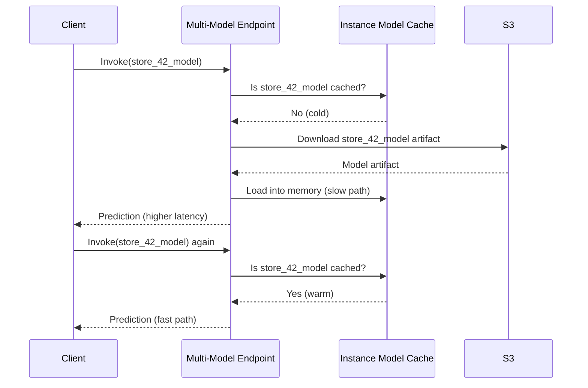

Step by step: (1) the first request for a given store's model misses the in-memory cache,
forcing a synchronous S3 download and deserialization — this is the latency spike the manager
observed; (2) once loaded, the model stays in the cache until evicted (usually LRU-based, when
memory fills up with other stores' models); (3) every subsequent request for that same model
hits the warm cache and returns at normal, fast latency — exactly the behavior MME is designed
to provide.

**Why the others are wrong:**
- **A:** Pre-loading all 300 models defeats the entire purpose of an MME (sharing limited
  instance memory across many lightly-used models) and isn't how the feature is designed or
  priced — it would require per-model dedicated capacity, which is what MME avoids.
- **C:** A crashed endpoint would return errors or timeouts consistently, not a one-time latency
  bump followed by normal responses — the pattern described is cold-load latency, not a failure.
- **D:** Instance sizing affects baseline compute/memory capacity and cache size, but it does not
  eliminate the fundamental cold-load-then-cache behavior inherent to how MME works; this isn't
  a sizing problem, it's expected dynamic loading behavior.

---

## Q4 — Domain 4 (Operating, Monitoring, and Securing ML Solutions)

A deployed model's SageMaker Model Monitor data quality job reports that the statistical
distribution of the `customer_age` input feature has shifted noticeably from its training
baseline. Separately, the team also notices that the *relationship* between `customer_age` and
the actual loan-default outcome has changed — older customers who used to default rarely are now
defaulting at a much higher rate than the training data ever showed, even though the age
distribution of applicants itself hasn't changed much. What are these two phenomena called,
respectively?

A) Both are the same phenomenon: data drift
B) The first is **data drift** (a shift in input feature distributions); the second is
   **concept drift** (a shift in the relationship between inputs and the true label/outcome)
C) The first is concept drift; the second is data drift
D) Both are examples of training/serving skew

**Correct Answer: B**

**Explanation:** **Data drift** (also called covariate shift) is when the *statistical
distribution of input features* changes over time — the shape of `customer_age` itself shifting
is a feature-distribution change, detectable purely from the inputs without needing any ground
truth labels. **Concept drift** is when the *underlying relationship between features and the
target* changes — here, the real-world mapping from age to default risk has shifted (e.g., due
to a macroeconomic change), which is a fundamentally different and often more dangerous problem
because the model's learned decision boundary is now wrong even if the inputs look familiar.
Distinguishing these is a recurring exam trap. See
[`certifications/mla-c02/domain-4-monitoring-security/README.md`](../domain-4-monitoring-security/README.md)
and [`services/machine-learning-ai/sagemaker-model-monitor-and-registry.md`](../../../services/machine-learning-ai/sagemaker-model-monitor-and-registry.md).

**Why the others are wrong:**
- **A:** Treating both as "data drift" misses that the second scenario is specifically about the
  input-output *relationship* changing, not the input distribution — the age distribution barely
  moved, but the label behavior for a given age did, which is the defining signature of concept
  drift, not data drift.
- **C:** This reverses the definitions: the feature-distribution shift (age values themselves
  changing) is data drift, and the relationship/label shift (same age, different outcome) is
  concept drift — not the other way around.
- **D:** Training/serving skew is a *data-pipeline bug* where training and inference compute a
  feature differently (e.g., different code paths) — it is a static implementation defect, not
  a phenomenon that emerges and evolves over time in production the way drift does.

---

## Q5 — Domain 1 (Data Preparation for ML and AI)

A company runs its order-management system on Amazon RDS for PostgreSQL. They want an ML
feature-engineering pipeline to always have a near-real-time copy of the `orders` and
`customers` tables mirrored into S3 as the source system changes (inserts, updates, deletes),
without writing custom change-data-capture code, and without impacting the production
database's performance. Which service should they use?

A) AWS Glue crawler scheduled to run every 5 minutes against the RDS database
B) AWS Database Migration Service (DMS) with ongoing replication (CDC) from RDS to an S3 target
C) Amazon Kinesis Data Streams reading directly from the RDS binary log
D) A nightly `pg_dump` export loaded into S3 via a cron job

**Correct Answer: B**

**Explanation:** **AWS DMS** is purpose-built for exactly this: an initial full load followed by
continuous **change data capture (CDC)** replication from a relational source (RDS, on-prem DB,
etc.) into a target like S3, capturing inserts/updates/deletes with minimal source-database
load, and without any custom CDC code. This is the core Domain 1 distinction between DMS
(database replication) and Firehose/Kinesis (event-stream ingestion). See
[`certifications/mla-c02/domain-1-data-preparation/README.md`](../domain-1-data-preparation/README.md#common-exam-scenarios).

Step by step: (1) DMS performs a one-time full load of existing `orders`/`customers` rows into
S3; (2) it then tails the database's transaction log to continuously capture new changes as CDC
events, applying them to the S3 target so it stays near-real-time in sync; (3) a Glue crawler can
catalog the resulting S3 data so Athena and SageMaker can query it with a consistent schema.

**Why the others are wrong:**
- **A:** A Glue crawler only discovers and catalogs *schema* (table/column metadata) for data
  already sitting in a target like S3 — it does not extract, replicate, or capture ongoing
  changes from a live RDS database; running it every 5 minutes wouldn't move any actual data.
- **C:** Kinesis Data Streams cannot read a relational database's binary/transaction log
  directly — you'd need DMS (or a custom connector) in front of it to turn CDC events into a
  stream; Streams itself has no native RDS-log-tailing capability.
- **D:** A nightly `pg_dump` is a slow, heavy, all-or-nothing batch export that locks/strains the
  source database and introduces up to 24 hours of staleness — incompatible with "near-real-time"
  and risky for a production system's performance.

---

## Q6 — Domain 2 (ML Model and Foundation Model Development)

A multi-class news-categorization model is evaluated on a test set with 10 roughly
equally-sized categories. The team wants one summary metric per class that balances both
"when I predict this category, am I right?" and "of all articles truly in this category, did I
find them?" — and then wants to average that metric across all 10 classes to get one overall
number for model comparison. Which metric and averaging approach fits this requirement?

A) Overall accuracy across all 10 classes
B) Macro-averaged F1 score (the harmonic mean of precision and recall, computed per class and
   averaged)
C) Mean Squared Error (MSE) per class
D) R² (coefficient of determination) averaged across classes

**Correct Answer: B**

**Explanation:** **F1 score** is specifically the harmonic mean of precision and recall for a
class, giving one number that penalizes a model which is lopsided toward only one of the two.
**Macro-averaging** across the 10 classes (compute F1 per class, then average the 10 F1 values
unweighted) gives equal importance to every category regardless of its size — the right choice
when categories are roughly balanced and you care about per-class fairness. See
[`ml-fundamentals-glossary.md`](../domain-2-model-development/ml-fundamentals-glossary.md).

**Why the others are wrong:**
- **A:** Plain accuracy is a single aggregate correctness rate across all predictions; it doesn't
  decompose into a per-class precision/recall balance, and can hide poor performance on
  individual categories even when categories are balanced in size.
- **C:** MSE measures distance between predicted and actual *numeric* values — it has no
  definition for a categorical/multi-class labeling problem.
- **D:** R² is a regression goodness-of-fit metric (variance explained by a numeric prediction);
  it is undefined for classification tasks and cannot be computed "per class" for categories.

---

## Q7 — Domain 3 (Deployment and Orchestration of ML Workflows)

A SageMaker Pipeline includes: (1) a Processing step that transforms 500 GB of raw data, (2) a
Training step, (3) an Evaluation step. The team re-runs the pipeline frequently while only
tweaking the Training step's hyperparameters — but the Processing step is deterministic and its
inputs never change between these re-runs, yet it still takes 25 minutes every time. What
SageMaker Pipelines feature should they enable to skip re-running unchanged steps?

A) SageMaker Pipelines does not support this; they must manually comment out the Processing step
B) **Step caching** — SageMaker Pipelines can cache a step's outputs and skip re-execution on a
   subsequent run if its inputs, code, and configuration haven't changed
C) Switch the Processing step to use Spot Instances to make it faster
D) Delete the Processing step and bake its logic directly into the Training step's container

**Correct Answer: B**

**Explanation:** **SageMaker Pipelines step caching** lets you mark a step as cacheable; when the
pipeline re-runs, it computes a hash of the step's inputs, source code, and configuration, and if
that hash matches a prior successful run within the configured cache expiration window, it
**reuses the previous output instead of re-executing the step** — exactly addressing the "same
inputs every time, but 25 minutes wasted" problem. See
[`services/machine-learning-ai/sagemaker-pipelines.md`](../../../services/machine-learning-ai/sagemaker-pipelines.md).

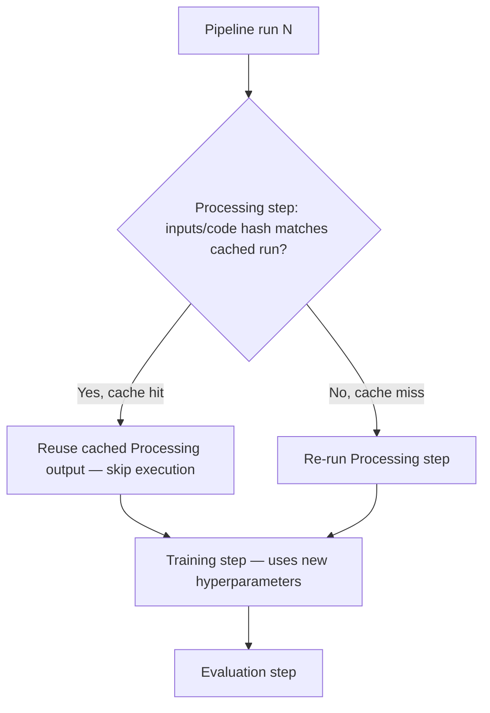

Step by step: (1) on every pipeline execution, SageMaker Pipelines checks whether a cacheable
step's inputs/code/config hash matches a previous successful execution's hash; (2) if it's a
cache hit (as in this scenario, where only Training's hyperparameters changed), the Processing
step is skipped entirely and its prior output is reused; (3) the Training step always re-runs
here since its configuration (hyperparameters) is deliberately changing each time.

**Why the others are wrong:**
- **A:** Pipelines does support this natively via step caching — manually commenting out steps
  would break the pipeline's reproducibility and versioning, and isn't how the feature is meant
  to be used.
- **C:** Spot Instances reduce the *cost* of compute, not the *need* to re-run an already-
  deterministic, unchanged step — it doesn't address the redundant-execution problem at all.
- **D:** Merging steps together loses the modularity, independent retry/caching, and lineage
  tracking that having separate pipeline steps provides, and doesn't actually solve the
  redundant-computation issue — it just hides it inside one bigger step.

---

## Q8 — Domain 4 (Operating, Monitoring, and Securing ML Solutions)

A lending company deployed a loan-approval model six months ago after SageMaker Clarify's
pre-training and post-training bias reports showed no concerning disparity at launch. A
compliance audit now asks: "how do you know the model's fairness hasn't degraded since launch,
as the applicant population and approval patterns have naturally shifted over time?" Which
capability directly answers this, going beyond a one-time pre-deployment Clarify check?

A) Re-running the exact same one-time Clarify report manually once a year
B) **SageMaker Model Monitor's bias drift monitoring**, which continuously evaluates a deployed
   model's live predictions for bias metrics on a schedule and alarms if they drift beyond a
   configured threshold
C) SageMaker Ground Truth, to re-label the original training dataset
D) AWS Config, to track changes to the endpoint's IAM role

**Correct Answer: B**

**Explanation:** A one-time Clarify bias check only reflects the model's fairness properties *at
that moment*, using the training-time data distribution. **Model Monitor's bias drift
monitoring capability** runs on a recurring schedule against live production inference traffic,
computing the same kinds of bias metrics (e.g., disparate impact) continuously and alarming via
CloudWatch if they drift outside the approved range — giving ongoing assurance as the real-world
population and outcomes evolve, which a single launch-time report cannot provide. See
[`certifications/mla-c02/domain-4-monitoring-security/responsible-ai-and-guardrails.md`](../domain-4-monitoring-security/responsible-ai-and-guardrails.md)
and [`services/machine-learning-ai/sagemaker-model-monitor-and-registry.md`](../../../services/machine-learning-ai/sagemaker-model-monitor-and-registry.md).

**Why the others are wrong:**
- **A:** An annual manual re-run is still a point-in-time snapshot with up to a year of blind
  spot in between — it is not continuous monitoring and wouldn't catch gradual drift as it
  happens, only long after the fact (if at all).
- **C:** Re-labeling the original *training* dataset doesn't tell you anything about how the
  deployed model's *live, post-launch* predictions are behaving with respect to fairness — it's
  backward-looking at stale data, not a production monitoring mechanism.
- **D:** AWS Config tracks *infrastructure configuration* changes (like IAM role attachments or
  instance types); it has no concept of statistical bias metrics on model predictions and cannot
  detect bias drift.

---

## Q9 — Domain 1 (Data Preparation for ML and AI)

(Choose TWO) A healthcare organization's data lake holds patient records in S3. Different ML
teams need different levels of access: the research team may query de-identified columns only
(no name, no SSN), while the clinical-operations team may query all columns, and both must only
ever see rows for patients who consented to data sharing. The company wants this enforced
centrally, on one shared table, without duplicating the data into separate restricted copies per
team. Which TWO AWS Lake Formation capabilities, used together, satisfy both the column-level
and row-level requirements?

A) **Column-level permissions** — granting each principal/role `SELECT` access to only the
   specific columns it's authorized to see (e.g., hiding `name`/`SSN` from the research role)
B) **Row-level security via Lake Formation data filters** — defining a filter expression (e.g.,
   `consent_flag = true`) so a principal's queries are transparently restricted to only the
   authorized rows, regardless of which columns they can see
C) S3 bucket policies restricting access by IAM principal at the whole-bucket level
D) Encrypting different columns with different KMS keys and only sharing the keys teams need
E) Creating a separate S3 bucket per team with a manual nightly copy job

**Correct Answer: A and B**

**Explanation:** **AWS Lake Formation** provides fine-grained, centrally-managed **column-level
and row-level security** on top of a single shared data lake table (backed by Glue Data Catalog
+ S3), so different principals querying the *same* underlying table (via Athena, Redshift
Spectrum, EMR, etc.) each see only the columns/rows they're authorized for — no data
duplication, and permissions managed in one place. See
[`services/analytics/data-lake-concepts.md`](../../../services/analytics/data-lake-concepts.md)
and the [Domain 1 README](../domain-1-data-preparation/README.md).

**Why the others are wrong:**
- **C:** S3 bucket policies can restrict access at the bucket/prefix/object level based on IAM
  principal, but they have no concept of column-level or row-level filtering within a shared
  table — you'd need to physically separate data into different objects to achieve that, which
  isn't fine-grained governance on the same table.
- **D:** Per-column KMS keys could coarsely gate "can decrypt this column or not," but it doesn't
  provide row-level filtering (e.g., only consented patients), and managing dozens of per-column
  keys and key-sharing policies is operationally far more complex than Lake Formation's native
  grants.
- **E:** Duplicating data into separate buckets per team is exactly the "duplicate copies"
  approach the question says to avoid — it multiplies storage cost, creates data-consistency
  risk between copies, and doesn't scale as access rules change.

---

## Q10 — Domain 2 (ML Model and Foundation Model Development)

A binary classifier's confusion matrix on a 1,000-sample test set is: True Positives = 150,
False Positives = 50, False Negatives = 30, True Negatives = 770. What is the model's recall?

A) 150 / (150 + 50) = 75%
B) 150 / (150 + 30) = 83.3%
C) (150 + 770) / 1000 = 92%
D) 150 / 1000 = 15%

**Correct Answer: B**

**Explanation:** **Recall (sensitivity)** = TP / (TP + FN) — of all the actual positive cases
(TP + FN = 150 + 30 = 180), how many did the model correctly identify? 150/180 = 83.3%. Being
able to correctly pick the right numerator/denominator out of a confusion matrix for precision
vs. recall vs. accuracy is a core, recurring exam skill. See
[`ml-fundamentals-glossary.md`](../domain-2-model-development/ml-fundamentals-glossary.md).

**Why the others are wrong:**
- **A:** 150/(150+50) is **precision** (TP / (TP+FP)) — of everything flagged positive, how much
  was truly positive — not recall. It answers a different question than "how much of the real
  positive class did we catch?"
- **C:** (TP+TN)/Total is **accuracy** — overall correctness across both classes — not a
  class-specific metric like recall, and it can look artificially high under class imbalance.
- **D:** TP/Total divides the true positives by the *entire* dataset (including true negatives
  that were never at risk of being "caught"), which isn't a standard metric and badly
  understates how well the model finds actual positives.

---

## Q11 — Domain 3 (Deployment and Orchestration of ML Workflows)

A team has a new fraud-model candidate they believe outperforms the current production model.
Unlike shadow testing (where the new model's predictions are never shown to users) or a
canary rollout (gradually shifting ALL traffic to the new version over time), they specifically
want to split live traffic so that, say, 80% of real requests are served by the current
production model and 20% by the new candidate **simultaneously and indefinitely**, comparing
real business outcomes (actual fraud losses) between the two groups before deciding whether to
fully promote the new model. Which SageMaker deployment capability is designed for this?

A) SageMaker Batch Transform run twice, once per model version
B) **Production variants** on a single SageMaker endpoint, with a configured traffic-weighting
   split (e.g., 80/20) across the two model variants, enabling live A/B testing
C) Bedrock Guardrails configured with two separate policies
D) AWS Step Functions with a random-number-based branch to two separate Lambda functions

**Correct Answer: B**

**Explanation:** **SageMaker production variants** let you host multiple model versions behind
**one endpoint**, each variant given a traffic-weight percentage; SageMaker routes that
percentage of real invocation traffic to each variant automatically, letting you run a true
**A/B test** — both models serving real users concurrently and indefinitely at a stable split —
and compare real-world business metrics side by side, distinct from canary (temporary, ramping
toward 100%) or shadow (invisible to users) patterns. See
[`services/machine-learning-ai/sagemaker-deployment-endpoints.md`](../../../services/machine-learning-ai/sagemaker-deployment-endpoints.md).

**Why the others are wrong:**
- **A:** Batch Transform is for offline, non-live scoring of a static dataset — it has no
  concept of splitting *live* request traffic between two concurrently-serving model versions.
- **C:** Bedrock Guardrails are safety/content-filtering policies for foundation model
  invocations; they have nothing to do with splitting traffic between two competing model
  versions for A/B comparison.
- **D:** A custom Lambda/Step Functions random-routing solution could theoretically be built,
  but it reinvents (with more operational overhead, no built-in CloudWatch per-variant metrics)
  something SageMaker production variants already provide natively and more simply.

---

## Q12 — Domain 4 (Operating, Monitoring, and Securing ML Solutions)

A team already runs SageMaker Model Monitor's **data quality** monitor (input feature
distribution shifts) and **model quality** monitor (accuracy vs. ground truth) on a deployed
credit-risk model. A regulator now specifically asks: "can you detect if the *relative
importance of each feature driving the model's decisions* has shifted over time, even if
overall accuracy looks stable?" Which additional Model Monitor capability answers this?

A) Re-running the data quality monitor more frequently
B) **Feature attribution drift monitoring**, which tracks changes in SHAP-value-based feature
   importance between training time and live production over time
C) Re-running the model quality monitor more frequently
D) Enabling SageMaker Debugger on the live endpoint

**Correct Answer: B**

**Explanation:** SageMaker Model Monitor supports four distinct monitor types: **data quality**
(input distribution shift), **model quality** (accuracy/label-based drift), **bias drift**
(fairness-metric drift), and **feature attribution drift** — which specifically tracks whether
the *relative contribution of each feature to predictions* (computed via SHAP values, the same
technique Clarify uses for explainability) has shifted from the training baseline, catching
cases where a feature that used to barely matter has quietly become dominant (or vice versa),
even while aggregate accuracy looks unchanged. See
[`services/machine-learning-ai/sagemaker-model-monitor-and-registry.md`](../../../services/machine-learning-ai/sagemaker-model-monitor-and-registry.md).

**Why the others are wrong:**
- **A:** Data quality monitoring tracks raw input feature *distributions*, not how much each
  feature *contributes* to the model's output decisions — increasing its frequency doesn't add
  feature-importance tracking.
- **C:** Model quality monitoring needs timely ground-truth labels and tracks aggregate
  accuracy-style metrics; it doesn't decompose predictions into per-feature attribution the way
  feature attribution drift monitoring does, so running it more often doesn't answer the
  regulator's specific question.
- **D:** SageMaker Debugger is a *training-time* tool for diagnosing issues like vanishing
  gradients or resource bottlenecks during a training job — it does not run against a live
  production endpoint for ongoing feature-attribution monitoring.

---

## Q13 — Domain 1 (Data Preparation for ML and AI)

A team stores 50 TB of training images in S3. Some images (recent uploads) are accessed
constantly by active training jobs; others (from completed projects) go untouched for months,
then are suddenly needed again for a re-training experiment, unpredictably. The team doesn't
want to manually classify or move objects between storage tiers, and wants cost automatically
optimized based on actual observed access patterns. Which S3 storage class fits best?

A) S3 Standard for everything, to guarantee the fastest possible access at all times
B) **S3 Intelligent-Tiering**, which automatically moves objects between access tiers based on
   changing access patterns, with no retrieval delay and no manual lifecycle management
C) S3 Glacier Deep Archive for everything, since it's the cheapest storage class
D) S3 One Zone-Infrequent Access for everything, to save on redundancy costs

**Correct Answer: B**

**Explanation:** **S3 Intelligent-Tiering** is designed exactly for **unknown or changing**
access patterns: it monitors each object's access frequency and automatically moves it between
frequent-access and infrequent-access tiers (and optionally archive tiers) without any manual
lifecycle rules, and critically, without the retrieval-time delay that Glacier tiers impose — a
good fit when you can't predict which images will suddenly become "hot" again. See
[`services/storage`](../../../services/storage) and the
[Domain 1 README](../domain-1-data-preparation/README.md#common-exam-scenarios).

**Why the others are wrong:**
- **A:** S3 Standard for everything guarantees fast access but pays the highest per-GB storage
  cost even for the months-untouched images — ignoring the cost-optimization opportunity the
  question asks for.
- **C:** Glacier Deep Archive has retrieval times measured in **hours**, which would badly break
  the "suddenly needed again" unpredictable-access requirement — fine for compliance archives
  nobody expects to touch, wrong for data that might need to be grabbed for an experiment at any
  time.
- **D:** One Zone-IA reduces cost by dropping multi-AZ redundancy, but it's a manually-selected
  *static* tier for data you already know is infrequently accessed — it does nothing for data
  whose access pattern is unpredictable and changing, and risks data loss if the single AZ fails.

---

## Q14 — Domain 2 (ML Model and Foundation Model Development)

A binary classifier outputs a probability score for each sample. Plotting the ROC curve (true
positive rate vs. false positive rate across all possible thresholds) shows a curve that bows
sharply toward the top-left corner. The team now needs to pick one specific operating threshold
for production use, knowing their business tolerates a false positive rate up to 10% but wants
the highest true positive rate achievable within that constraint. What should they do?

A) Pick the threshold that gives the single highest AUC value
B) Read the ROC curve to find the operating point near FPR = 0.10, and select the
   decision threshold that produces that point, maximizing TPR subject to the FPR constraint
C) Always use a threshold of exactly 0.5, since that is the only valid classification cutoff
D) Discard the model and retrain with a different algorithm, since ROC curves can't inform
   threshold selection

**Correct Answer: B**

**Explanation:** The **ROC curve** plots TPR vs. FPR as the decision threshold sweeps across
its full range — each point on the curve corresponds to a specific threshold. To operationalize
a business constraint like "FPR must not exceed 10%," you locate the point on the curve at
FPR ≈ 0.10, read off the threshold that produces it, and that's the production cutoff —
maximizing TPR within the stated FPR budget. AUC summarizes overall discriminative power across
*all* thresholds, but choosing a single operating point requires reading the curve itself. See
[`ml-fundamentals-glossary.md`](../domain-2-model-development/ml-fundamentals-glossary.md).

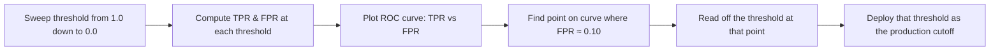

Step by step: (1) the ROC curve is generated by evaluating TPR/FPR at every possible threshold,
not just one; (2) AUC is a single scalar summarizing the whole curve's quality, independent of
any one threshold choice; (3) to pick an actual production threshold under a specific business
constraint (FPR ≤ 10%), you must trace the curve to the FPR = 0.10 point and read off the
threshold value that produced it — a step entirely separate from computing AUC.

**Why the others are wrong:**
- **A:** AUC is a single number summarizing performance across *all* thresholds combined — it
  has no "threshold" to pick at all; maximizing AUC describes overall model quality, not a
  specific operating point for production decisions.
- **C:** 0.5 is only a default/arbitrary cutoff with no inherent business meaning — the whole
  point of reading the ROC curve is to choose a threshold that matches the business's actual
  FPR/TPR tolerance, which may be far from 0.5.
- **D:** ROC curves are precisely the standard tool for informing threshold selection under a
  constraint like a maximum acceptable FPR — this option gets the purpose of ROC analysis
  backwards.

---

## Q15 — Domain 3 (Deployment and Orchestration of ML Workflows)

A manufacturer trains an object-detection model in SageMaker on GPU instances in the cloud, but
must run inference on an NVIDIA Jetson-based edge device on the factory floor with no cloud
connectivity at inference time, and needs the model optimized specifically for that device's
hardware (not a generic format) to hit the required frames-per-second. Which service compiles
the trained model for this specific target hardware?

A) AWS IoT Greengrass alone, without any model compilation step
B) **Amazon SageMaker Neo**, which compiles the trained model into an optimized form for a
   specific target hardware platform (e.g., the Jetson's GPU architecture), then the compiled
   artifact is deployed to the edge device (often via IoT Greengrass) for local inference
C) AWS Glue, to transform the model file format
D) Amazon SageMaker Ground Truth, to re-label the training data for the new hardware

**Correct Answer: B**

**Explanation:** **SageMaker Neo** takes a trained model and **compiles** it into an optimized
binary tuned for a specific target chip/hardware platform (e.g., ARM Cortex, NVIDIA Jetson, or
Inferentia), substantially improving inference speed and reducing memory footprint compared to
running the generic framework runtime — and the compiled artifact is typically then deployed and
managed on the physical device via **IoT Greengrass**, which handles the deployment, local
execution, and device management layer. See
[`services/machine-learning-ai/sagemaker-overview.md`](../../../services/machine-learning-ai/sagemaker-overview.md).

**Why the others are wrong:**
- **A:** IoT Greengrass manages deploying and running software (including ML models) on edge
  devices, but it does not itself perform hardware-specific model *compilation/optimization* —
  that's Neo's job; Greengrass alone wouldn't give the hardware-tuned performance boost needed.
- **C:** Glue is a data-integration/ETL service for transforming datasets, not a model
  compiler — it has no capability to optimize a trained model for specific inference hardware.
- **D:** Ground Truth is a data-labeling service; relabeling training data has no bearing on
  deploying an already-trained model to new hardware.

---

## Q16 — Domain 4 (Operating, Monitoring, and Securing ML Solutions)

A compliance team needs to run ad-hoc SQL-style queries directly against a full year of
CloudTrail event history across all AWS Regions and multiple accounts — for example, "find
every `CreateTrainingJob` call made by role X between two dates" — without first exporting logs
to Athena/S3 themselves or writing custom log-parsing scripts. Which capability fits?

A) Manually downloading each CloudTrail log file from S3 and grepping them locally
B) **CloudTrail Lake**, which lets you run SQL queries directly against ingested CloudTrail
   event data in a managed event data store, across accounts/Regions, without separate ETL
C) Amazon CloudWatch Logs Insights, pointed at the CloudTrail S3 bucket directly
D) AWS Config, since it already logs every API call made in the account

**Correct Answer: B**

**Explanation:** **CloudTrail Lake** ingests CloudTrail events into a managed, queryable **event
data store** and lets you run **SQL queries** directly against that history (including across
multiple accounts/Regions if configured as an organization trail), without needing to build your
own Athena-over-S3 pipeline or write custom parsing — purpose-built for exactly this kind of
ad-hoc compliance/audit querying. See
[`certifications/mla-c02/domain-4-monitoring-security/README.md`](../domain-4-monitoring-security/README.md).

**Why the others are wrong:**
- **A:** Manually downloading and grepping raw CloudTrail JSON log files across a full year and
  multiple accounts is exactly the slow, error-prone, unscalable approach the question asks to
  avoid — there's a managed capability that replaces this entirely.
- **C:** CloudWatch Logs Insights queries **CloudWatch Logs** groups (e.g., application or
  Lambda logs you've streamed there) — it does not natively query CloudTrail's S3-delivered
  files without first ingesting them into a log group, and isn't the purpose-built tool for
  CloudTrail-specific SQL querying the way CloudTrail Lake is.
- **D:** AWS Config tracks resource *configuration state and change history* (e.g., "what did
  this S3 bucket's settings look like last Tuesday"), not a complete queryable log of every API
  call made — that's CloudTrail's job, not Config's.

---

## Q17 — Domain 1 (Data Preparation for ML and AI)

A business analyst (not a data scientist) wants a visual, spreadsheet-like interface to clean
and normalize a marketing CSV dataset — fixing inconsistent date formats, trimming whitespace,
standardizing category labels — and export the cleaned result to S3, with no interest in
ML-specific operations like train/test splitting, bias reports, or feature-importance analysis.
A separate data science team instead needs those ML-specific capabilities. Which pairing of
services correctly matches each persona's need?

A) The analyst should use SageMaker Data Wrangler; the data science team should use Glue DataBrew
B) The analyst should use **AWS Glue DataBrew** (general-purpose visual data cleaning for
   business/analytics users); the data science team should use **SageMaker Data Wrangler**
   (ML-specific prep: bias/imbalance reports, feature importance, direct export to training)
C) Both personas should use Amazon Athena for all transformations
D) Both personas should use AWS Glue crawlers for all transformations

**Correct Answer: B**

**Explanation:** **AWS Glue DataBrew** is a general-purpose, no-code visual data-preparation
tool aimed at **analysts/business users** cleaning and normalizing data for BI/analytics use
cases. **SageMaker Data Wrangler** targets the same "no-code, visual" experience but is
purpose-built for **ML practitioners**, adding ML-specific capabilities DataBrew doesn't have:
built-in class-imbalance/bias quick-reports, feature-importance "Quick Model" previews, and
direct export into a SageMaker training pipeline or Feature Store. Matching persona to the right
tool is a recurring exam distinction. See
[`services/machine-learning-ai/sagemaker-data-wrangler-and-feature-store.md`](../../../services/machine-learning-ai/sagemaker-data-wrangler-and-feature-store.md).

**Why the others are wrong:**
- **A:** This swaps the two tools' intended personas backward — Data Wrangler is the
  ML-specialized one with modeling-aware features, DataBrew is the general-purpose
  business-analytics one; assigning them to the opposite users misses each tool's design intent.
- **C:** Athena is a SQL query engine for data already sitting in S3 — it's not a visual,
  no-code data-cleaning UI for either persona, and would require the analyst to write SQL,
  defeating the "no-code" requirement.
- **D:** Glue crawlers only discover and catalog schema metadata — they perform no data cleaning
  or transformation at all, for either persona.

---

## Q18 — Domain 2 (ML Model and Foundation Model Development)

Two binary classifiers both output calibrated probabilities. Classifier A is usually very
confident and right, but on the rare occasions it's wrong, it's wrong with very high confidence
(e.g., predicts 0.98 for a sample that is actually the negative class). Classifier B is also
usually right, but when wrong, it tends to be only moderately confident (e.g., 0.65). Even if
both have the same accuracy at the standard 0.5 threshold, which metric will most clearly
penalize Classifier A more heavily for its confident mistakes?

A) Accuracy
B) **Log loss (cross-entropy)**, which penalizes confident wrong predictions much more severely
   than accuracy does, since the penalty grows as the predicted probability diverges from the
   true label
C) The raw count of correct predictions
D) F1 score

**Correct Answer: B**

**Explanation:** **Log loss (cross-entropy)** evaluates the *quality of the predicted
probabilities themselves*, not just whether the final 0/1 decision was right. Because log loss
is `-[y*log(p) + (1-y)*log(1-p)]`, a confidently wrong prediction (p close to 0 or 1 but on the
wrong side) produces a very large penalty — far larger than a moderately-confident wrong
prediction — even though both would count as one "miss" under accuracy. This makes log loss the
right metric when the team cares about probability calibration, not just the binary decision.
See [`ml-fundamentals-glossary.md`](../domain-2-model-development/ml-fundamentals-glossary.md).

**Why the others are wrong:**
- **A:** Accuracy only looks at whether the thresholded decision (e.g., p > 0.5) was correct —
  it treats a 0.51 prediction and a 0.98 prediction as equally "right" or equally "wrong" and
  cannot distinguish confident mistakes from borderline ones.
- **C:** A raw correct-prediction count is just an unnormalized version of accuracy and has the
  same blindness to prediction confidence/calibration.
- **D:** F1 score is computed from the thresholded confusion matrix (precision/recall), which
  again discards the actual probability value once it's been converted to a 0/1 decision — it
  cannot reflect how confidently wrong a prediction was.

---

## Q19 — Domain 3 (Deployment and Orchestration of ML Workflows)

A data science team trains a custom PyTorch model using a research library with specific CUDA
and system-package dependencies that no SageMaker pre-built framework container satisfies. They
need to run this as a SageMaker **training job** (not just inference) with full control over the
environment. What must their custom Docker image include to be compatible with SageMaker
Training, and which approach is this called?

A) **Bring Your Own Container (BYOC)** for training — the image must implement SageMaker's
   expected training contract (reading hyperparameters/input data from the conventional
   SageMaker paths like `/opt/ml/input`, writing the model artifact to `/opt/ml/model`), and be
   pushed to Amazon ECR for SageMaker to pull
B) Any public Docker Hub image can be used directly, with no changes needed
C) The image must be converted to an AWS Lambda layer before it can be used
D) SageMaker Training only supports its own pre-built framework containers; custom containers
   are not possible

**Correct Answer: A**

**Explanation:** SageMaker's **Bring Your Own Container (BYOC)** pattern supports fully custom
training images: the image must follow SageMaker's conventions for where it reads input
data/hyperparameters (`/opt/ml/input/...`) and where it must write the resulting model artifact
(`/opt/ml/model`) so SageMaker can package and store it afterward, and the image is stored in
**Amazon ECR** so the SageMaker training job can pull and run it on managed infrastructure. See
[`services/machine-learning-ai/sagemaker-training-and-tuning.md`](../../../services/machine-learning-ai/sagemaker-training-and-tuning.md).

**Why the others are wrong:**
- **B:** An arbitrary Docker Hub image has no knowledge of SageMaker's expected input/output
  path conventions or how SageMaker invokes the container — it must be adapted (or wrapped) to
  follow the SageMaker training contract before it will work correctly.
- **C:** Lambda layers are a mechanism for sharing code/dependencies across Lambda functions;
  they are unrelated to SageMaker's container-based training execution model entirely.
- **D:** SageMaker explicitly supports BYOC for training (and inference) specifically to handle
  cases like custom dependencies that no pre-built framework container covers — this option
  misstates a core, long-standing SageMaker capability.

---

## Q20 — Domain 4 (Operating, Monitoring, and Securing ML Solutions)

A security team mandates that every S3 bucket storing ML training data must always have default
encryption enabled, and if any bucket is ever found without it (e.g., accidentally created or
modified without encryption), it must be **automatically remediated** — re-enabled — without
waiting for a human to notice and fix it manually. Which AWS capability provides this continuous
detect-and-auto-fix behavior?

A) Manually reviewing the S3 console once a week for any unencrypted buckets
B) **AWS Config rules with an attached automatic remediation action** (via Systems Manager
   Automation), which continuously evaluates resources against a desired-state rule (e.g.,
   "S3 bucket has default encryption") and triggers a remediation action automatically on
   non-compliance
C) Amazon Macie, configured to delete any unencrypted bucket it finds
D) AWS CloudTrail, configured to block any API call that disables bucket encryption

**Correct Answer: B**

**Explanation:** **AWS Config** continuously evaluates resource configurations against defined
rules (including managed rules like "S3 bucket server-side encryption enabled") and can be
paired with an **automatic remediation action** (typically a Systems Manager Automation document)
that fires the moment a resource is found non-compliant — re-enabling encryption without any
human intervention. This closed-loop "detect drift from desired state → auto-remediate" pattern
is Config's core value proposition for governance at scale. See
[`certifications/mla-c02/domain-4-monitoring-security/README.md`](../domain-4-monitoring-security/README.md).

**Why the others are wrong:**
- **A:** A weekly manual review is neither continuous nor automatic — it leaves a window of
  up to a week where sensitive training data could sit unencrypted, and depends on a human
  remembering to check.
- **C:** Macie's role is discovering **sensitive data** (like PII) within S3 objects, and it has
  no concept of evaluating or remediating bucket-level encryption *configuration*, nor would
  deleting a bucket be an appropriate "remediation" for a missing encryption setting.
- **D:** CloudTrail is a logging/audit service — it records that an API call happened, but it
  has no built-in capability to preemptively block API calls or enforce policy in real time;
  that kind of preventive control would need IAM policies or SCPs, and detect+remediate is
  Config's job, not CloudTrail's.

---

## Q21 — Domain 1 (Data Preparation for ML and AI)

A company needs 100,000 images labeled with object-detection bounding boxes. They have an
internal team of 15 trained employees who already understand the product domain and must be the
only ones with access to the (sensitive, unreleased) product images, and the company wants to
manage the labeling job and reviewers themselves rather than relying on an external crowd. Which
SageMaker Ground Truth workforce type fits?

A) Amazon Mechanical Turk (public crowd workforce)
B) A **private workforce**, made up of the company's own vetted employees, accessible only to
   people explicitly added to that private labeling workforce
C) A third-party vendor workforce sourced through the AWS Marketplace
D) No workforce is needed; Ground Truth always fully automates labeling with no humans involved

**Correct Answer: B**

**Explanation:** SageMaker Ground Truth supports three workforce types: **Amazon Mechanical
Turk** (public, anonymous crowd — fast and cheap but no control over who sees the data),
**vendor workforces** (pre-screened third-party labeling companies from the AWS Marketplace),
and **private workforces** (your own named individuals, e.g., employees, each requiring explicit
authorization to access the labeling job) — the only option giving the access control and
domain-specific trust this unreleased, sensitive-product scenario requires. See
[`certifications/mla-c02/domain-1-data-preparation/README.md`](../domain-1-data-preparation/README.md).

**Why the others are wrong:**
- **A:** Mechanical Turk exposes the images to an open, anonymous public crowd — completely
  incompatible with a requirement that only 15 specific, vetted internal employees can see
  sensitive, unreleased product images.
- **C:** A vendor workforce is still an **external** third-party company's staff, not the
  company's own internal, previously-vetted employees — it doesn't satisfy "the company wants to
  manage the labeling job and reviewers themselves" with their own trusted staff.
- **D:** Ground Truth supports fully-automated labeling as an *optional* efficiency feature once
  confidence is high enough, but it still requires an initial human-labeled bootstrap set and a
  configured workforce — it isn't a human-free service by default, and the question explicitly
  specifies using the company's own employees.

---

## Q22 — Domain 2 (ML Model and Foundation Model Development)

A regression model predicting house prices is evaluated two ways: Model A has an RMSE of
$15,000; Model B has an RMSE of $12,000 but has one extreme outlier prediction that's off by
$500,000 due to a single bad input row, while its MAE is actually *lower* than Model A's MAE.
Why might Model A's RMSE look relatively worse than Model B's despite Model B having that one
huge miss, and which metric better reflects "typical" prediction error unaffected by rare
extreme misses?

A) RMSE already ignores outliers by design, so this scenario is impossible
B) **RMSE squares each error before averaging**, so it's disproportionately sensitive to large
   individual misses (like Model B's $500,000 outlier inflates its RMSE far more than its MAE);
   **MAE** (mean absolute error) reflects typical error magnitude without that squared penalty
C) MAE is always a worse metric than RMSE and should never be used for comparison
D) Both metrics are mathematically identical and always produce the same ranking of models

**Correct Answer: B**

**Explanation:** **RMSE** squares each individual error before averaging and taking the square
root, so a single very large error contributes disproportionately to the final number — one
$500,000 miss can dominate RMSE even if every other prediction is excellent. **MAE** averages the
*absolute* (unsquared) errors, so it reflects "typical" error magnitude without letting rare
extreme misses dominate the metric. Choosing between RMSE and MAE based on whether you want to
penalize large errors heavily (RMSE) or get a robust sense of typical error (MAE) is a key exam
distinction. See [`ml-fundamentals-glossary.md`](../domain-2-model-development/ml-fundamentals-glossary.md).

**Why the others are wrong:**
- **A:** RMSE does not ignore outliers — the opposite is true: squaring makes it *more* sensitive
  to outliers than MAE, not immune to them; this option states the exact opposite of RMSE's
  actual behavior.
- **C:** Neither metric is universally "worse" — the correct choice depends on whether extreme
  errors should be heavily penalized (favoring RMSE) or whether a robust, outlier-resistant sense
  of typical error is wanted (favoring MAE); it's a tradeoff, not a strict ranking.
- **D:** RMSE and MAE are mathematically different formulas (squared vs. absolute error) and
  frequently disagree on which model looks better, exactly as illustrated in this scenario —
  they are not interchangeable.

---

## Q23 — Domain 3 (Deployment and Orchestration of ML Workflows)

A company wants its ML training/inference infrastructure (SageMaker domain, VPC, security
groups, IAM roles, S3 buckets) to be **version-controlled, code-reviewed, and reproducibly
deployed** to multiple environments (dev, staging, prod) identically, instead of engineers
manually clicking through the AWS console to create resources each time. Which approach fits?

A) Manually documenting the console steps in a shared wiki page for engineers to follow by hand
B) **Infrastructure as Code (IaC)**, using AWS CloudFormation or the AWS CDK to define the
   infrastructure declaratively in version-controlled templates/code, deployed consistently
   across environments via stacks
C) Taking an AMI snapshot of one environment and copying the snapshot's EC2 instances everywhere
D) Using SageMaker Autopilot to automatically generate the required infrastructure

**Correct Answer: B**

**Explanation:** **CloudFormation** (declarative YAML/JSON templates) and the **AWS CDK**
(infrastructure defined in a general-purpose programming language, synthesized to CloudFormation)
are AWS's **Infrastructure as Code** tools: the desired infrastructure state is defined in
version-controlled, code-reviewable files, and deploying/updating a "stack" reproducibly creates
or updates matching resources across dev/staging/prod — eliminating manual console
click-through and configuration drift between environments. See
[`certifications/mla-c02/domain-3-deployment-orchestration/README.md`](../domain-3-deployment-orchestration/README.md).

**Why the others are wrong:**
- **A:** A wiki page documenting manual steps is still a manual, error-prone, non-versioned
  process — exactly what IaC is meant to replace; it provides no automated reproducibility or
  drift detection.
- **C:** AMI snapshots capture a *compute instance's disk image*, not an entire environment's
  networking, IAM, and multi-service infrastructure graph — it's the wrong abstraction level for
  reproducing a full ML infrastructure stack.
- **D:** SageMaker Autopilot is an AutoML capability for automatically trying algorithms/
  hyperparameters on a *dataset* — it has nothing to do with provisioning cloud infrastructure
  resources.

---

## Q24 — Domain 4 (Operating, Monitoring, and Securing ML Solutions)

A company encrypts all its S3 training data objects using a KMS customer-managed key (CMK).
Security policy requires that the actual encryption key material be automatically rotated every
year without re-encrypting the underlying data objects, and that the service never exposes the
raw data encryption key to the requesting application in plaintext for longer than necessary.
Which KMS concepts/behaviors describe how this is achieved?

A) KMS re-encrypts every S3 object with a brand-new master key each year, requiring a full
   data migration
B) **Automatic annual key rotation** generates new cryptographic material under the hood for
   the same CMK (no object re-encryption needed, since only the data key wrapping changes), and
   **envelope encryption** means S3 only ever handles a short-lived plaintext data key in memory
   to encrypt/decrypt an object, never storing the CMK's key material itself
C) KMS keys cannot be rotated; a new CMK must be created and all data manually migrated every
   year for compliance
D) Envelope encryption means the entire S3 object is uploaded to KMS for processing on every
   read and write

**Correct Answer: B**

**Explanation:** KMS's **automatic key rotation** (when enabled on a CMK) rotates the underlying
cryptographic material yearly while the CMK's ID/ARN stays the same — old data remains
decryptable because KMS retains prior key versions internally, so **no bulk re-encryption of S3
objects is needed**. Separately, **envelope encryption** is how S3/KMS integration actually
works: for each object, KMS generates a unique **data key**, S3 uses that plaintext data key to
encrypt the object locally then immediately discards the plaintext copy (only the KMS-encrypted
version of the data key is stored alongside the object) — so the full CMK key material is never
exposed to S3 or the application. See
[`certifications/mla-c02/domain-4-monitoring-security/README.md`](../domain-4-monitoring-security/README.md).

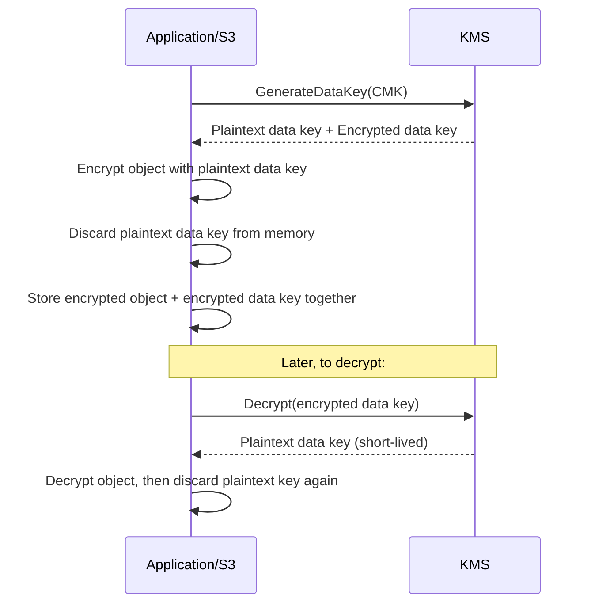

Step by step: (1) KMS never hands out the CMK itself — it issues a per-object data key instead;
(2) the plaintext data key exists in memory only briefly, long enough to encrypt/decrypt, then
is discarded; (3) only the encrypted form of the data key is persisted, so a stolen object plus
its encrypted data key is still useless without calling KMS to decrypt it, which is access-
controlled and logged via CloudTrail.

**Why the others are wrong:**
- **A:** Automatic rotation specifically avoids any need to re-encrypt or migrate existing data —
  this describes the opposite, much costlier approach of manually rotating a master key.
- **C:** KMS CMKs *do* support automatic rotation (for customer-managed keys, as an opt-in
  setting) without requiring a new key or data migration — this option misstates a basic,
  commonly-tested KMS feature.
- **D:** Uploading entire objects to KMS for every read/write would be wildly inefficient and is
  not how envelope encryption works — only small data keys (not full object payloads) are
  exchanged with KMS; bulk encryption/decryption happens locally using that data key.

---

## Q25 — Domain 1 (Data Preparation for ML and AI)

A dataset includes a categorical feature `t_shirt_size` with values Small, Medium, Large, and
X-Large — these categories have a clear, inherent rank order (Small < Medium < Large < X-Large).
A separate feature `payment_method` has values Credit Card, PayPal, Bank Transfer, and Gift
Card — with no inherent order among them. Which encoding approach correctly handles each
feature before training a tree-based or linear model?

A) One-hot encode both features, since one-hot encoding is always the universally correct choice
B) **Ordinal encoding** for `t_shirt_size` (mapping Small→1, Medium→2, Large→3, X-Large→4,
   preserving the real rank order as a single numeric feature); **one-hot encoding** for
   `payment_method` (creating independent binary columns, since no ordering should be implied)
C) Ordinal encode both features using alphabetical order of the category names
D) Leave both features as raw text strings; most algorithms can process text directly

**Correct Answer: B**

**Explanation:** When a categorical feature has a genuine **ordinal relationship** (sizes,
ratings, education levels), **ordinal encoding** preserves that order as a single numeric column
efficiently and lets the model learn a monotonic-like relationship. When categories are
**nominal** (no inherent order, like payment method), **one-hot encoding** avoids falsely
implying an order or magnitude relationship between arbitrary categories that a single ordinal
number would otherwise create. Picking the wrong encoding for the wrong feature type is a classic
exam trap. See [`ml-fundamentals-glossary.md`](../domain-2-model-development/ml-fundamentals-glossary.md)
and the [Domain 1 README](../domain-1-data-preparation/README.md).

**Why the others are wrong:**
- **A:** One-hot encoding an ordinal feature like size throws away the meaningful rank
  information (Small < Medium < Large), forcing the model to re-learn a relationship it could
  have gotten for free from a single ordered numeric column.
- **C:** Alphabetical order (Bank Transfer, Credit Card, Gift Card, PayPal) is an arbitrary
  artifact of spelling, not a real-world ordering — encoding nominal categories this way would
  inject a fake, misleading ordinal relationship that doesn't exist in reality.
- **D:** Most ML algorithms (linear models, gradient boosting, neural networks) require numeric
  input and cannot natively process raw category strings — some tree libraries have limited
  native categorical support, but that's an exception, not the general case assumed here.

---

## Q26 — Domain 2 (ML Model and Foundation Model Development)

A team plots model error against model complexity (e.g., polynomial degree, or neural network
depth). As complexity increases from very low to very high, they observe: error on the training
set keeps decreasing steadily, while error on a held-out validation set decreases at first, then
starts increasing again past a certain complexity point. What does this classic curve shape
illustrate, and what is the implication for model selection?

A) The validation error should always be ignored in favor of the lowest training error
B) **The bias-variance tradeoff**: low-complexity models have high bias (underfitting, poor on
   both sets); high-complexity models have high variance (overfitting — memorizing training
   noise while validation error rises); the best model complexity is the point where validation
   error is minimized, balancing bias and variance
C) This indicates a labeling error in the dataset that must be fixed before any model selection
D) This pattern only occurs with deep neural networks and never with simpler models like linear
   regression

**Correct Answer: B**

**Explanation:** This is the textbook **bias-variance tradeoff** curve. As complexity rises,
**bias** (the error from an overly simplistic model that can't capture true patterns) falls, but
**variance** (the error from a model so flexible it fits training-set noise/quirks instead of
the general signal) rises — producing training error that keeps falling (the model fits ever
more training detail) while validation error eventually turns upward (that extra detail doesn't
generalize). The ideal model complexity sits at the validation-error minimum, the sweet spot
balancing both sources of error. See
[`ml-fundamentals-glossary.md`](../domain-2-model-development/ml-fundamentals-glossary.md).

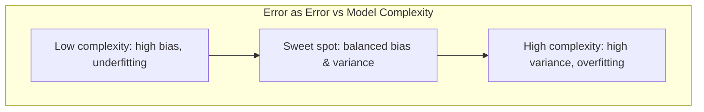

Step by step: (1) at low complexity, both training and validation error are high — the model is
too simple to capture real patterns (high bias/underfitting); (2) as complexity increases,
training error keeps falling because the model has more capacity to fit the data it sees; (3)
validation error falls too, up to a point, then **rises** as the model starts fitting noise
specific to the training set rather than generalizable signal (high variance/overfitting) — the
complexity level at the validation-error minimum is the target for model selection.

**Why the others are wrong:**
- **A:** Ignoring validation error and chasing ever-lower training error is precisely what leads
  to selecting an overfit, high-variance model that performs badly in production — the opposite
  of sound model-selection practice.
- **C:** This error-vs-complexity pattern is a fundamental statistical phenomenon of model
  fitting, not evidence of a labeling bug; label errors would show up differently (e.g.,
  inconsistent or noisy performance unrelated to a clean complexity sweep).
- **D:** The bias-variance tradeoff applies broadly across model families — linear regression
  with increasing polynomial degree, decision trees with increasing depth, and neural networks
  with increasing layers all exhibit this same underlying pattern, not just deep networks.

---

## Q27 — Domain 3 (Deployment and Orchestration of ML Workflows)

A SageMaker real-time endpoint needs to automatically add instances when the average number of
invocations per instance per minute exceeds 1,000 (regardless of what absolute instance count
that requires), and automatically remove instances as demand drops below that per-instance
threshold, without the team manually defining fixed step-based thresholds for every possible
traffic level. Which SageMaker auto-scaling configuration fits this requirement?

A) **Target tracking scaling policy**, set on the `SageMakerVariantInvocationsPerInstance`
   CloudWatch metric with a target value of 1,000, letting Application Auto Scaling
   automatically compute and adjust the needed instance count to hold that per-instance rate
B) Step scaling with five manually-defined thresholds at 1000, 2000, 3000, 4000, and 5000
   invocations, each triggering a different fixed instance-count change
C) A fixed instance count set once at deployment time and never changed afterward
D) Scheduled scaling that adds instances at 9 AM and removes them at 5 PM every day

**Correct Answer: A**

**Explanation:** **Target tracking scaling** lets you specify a target value for a metric (here,
`SageMakerVariantInvocationsPerInstance` = 1,000) and have **Application Auto Scaling**
automatically compute and continuously adjust the instance count needed to keep the metric near
that target — regardless of how traffic actually fluctuates — without the team hand-defining
step thresholds for every traffic level, which is exactly what's being asked for. See
[`services/machine-learning-ai/sagemaker-deployment-endpoints.md`](../../../services/machine-learning-ai/sagemaker-deployment-endpoints.md).

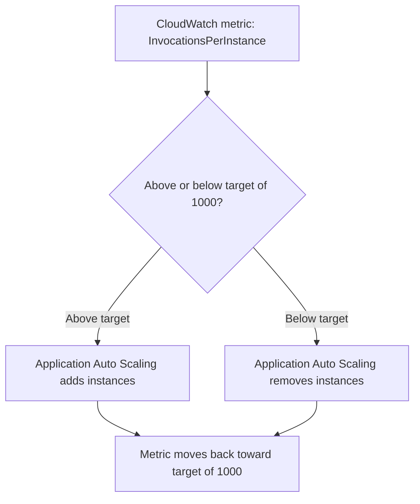

Step by step: (1) the endpoint continuously reports its per-instance invocation rate to
CloudWatch; (2) target tracking compares that rate to the configured target (1,000); (3) Auto
Scaling automatically computes how many instances are needed to bring the metric back to the
target, scaling out or in as needed — no manual step-threshold tuning required.

**Why the others are wrong:**
- **B:** Step scaling *can* work, but it requires manually defining a threshold/step-size pair for
  every traffic band you anticipate — brittle and labor-intensive compared to target tracking's
  single target-value configuration, and the question specifically asks to avoid manual
  threshold definitions.
- **C:** A fixed instance count provides no elasticity at all — it either wastes money during
  low traffic or risks being overwhelmed during spikes, the opposite of auto-scaling.
- **D:** Scheduled scaling only handles *predictable, time-of-day* patterns — it has no
  awareness of the actual real-time invocation rate and wouldn't respond to unpredictable spikes
  outside the 9-to-5 window or quiet periods within it.

---

## Q28 — Domain 4 (Operating, Monitoring, and Securing ML Solutions)

(Choose TWO) A SageMaker training job running inside a private VPC subnet (no NAT gateway, no
internet access) needs to read training data from S3. Separately, a different internal
application in the same VPC needs to privately invoke a Bedrock foundation model's
`InvokeModel` API without traffic ever traversing the public internet. Which TWO VPC endpoint
configurations correctly support these two needs?

A) A **Gateway VPC endpoint** for S3 (a route-table-based, no-additional-cost endpoint — the
   standard way to give private subnet resources access to S3 without a NAT gateway or internet
   path)
B) A **public NAT gateway** configured for both S3 and Bedrock access
C) An **Interface VPC endpoint (powered by AWS PrivateLink)** for the Bedrock Runtime service
   (Bedrock does not support Gateway endpoints; Interface endpoints create an ENI with a
   private IP that routes API calls over AWS's private network)
D) Internet Gateway with a restrictive security group as the only control
E) A Gateway VPC endpoint for Bedrock Runtime, mirroring the S3 configuration

**Correct Answer: A and C**

**Explanation:** **S3** supports **Gateway VPC endpoints** — a route-table entry (no ENI, no
hourly cost) that lets private-subnet resources reach S3 and DynamoDB without any internet path,
which is the standard, cost-efficient way to give an isolated SageMaker training job S3 access.
**Bedrock** (like most other AWS services) is accessed via an **Interface VPC endpoint**
(PrivateLink), which provisions an elastic network interface with a private IP in your VPC that
proxies API calls to the service privately — S3/DynamoDB are the main exceptions that use the
Gateway type instead of Interface. Knowing which services use which endpoint type is a specific,
testable distinction. See
[`certifications/mla-c02/domain-4-monitoring-security/README.md`](../domain-4-monitoring-security/README.md).

**Why the others are wrong:**
- **B:** A NAT gateway routes traffic out to the **public internet** (even if S3/Bedrock
  endpoints are technically public AWS endpoints) — it directly contradicts the "no internet
  access" requirement and the "traffic never traverses the public internet" requirement for
  Bedrock; VPC endpoints are specifically meant to avoid needing a NAT gateway at all.
- **D:** An Internet Gateway, regardless of security group restrictions, is by definition a path
  to/from the public internet — fundamentally incompatible with a no-internet-access
  architecture, no matter how tightly the security group is scoped.
- **E:** Gateway endpoints only exist for S3 and DynamoDB; Bedrock (like the vast majority of
  AWS services) is only reachable via an Interface VPC endpoint — there is no Gateway endpoint
  option for Bedrock to configure.

---

## Q29 — Domain 1 (Data Preparation for ML and AI)

A dataset has a continuous `customer_age` feature (18–95) and the team wants a linear model to
be able to capture distinctly different default-risk behavior for different life-stage age
ranges (e.g., 18–25, 26–40, 41–60, 61+) rather than assuming a single smooth linear
relationship between raw age and risk across the entire range. What data preparation technique
addresses this directly?

A) Standardizing the age feature (subtracting the mean, dividing by standard deviation)
B) **Binning (discretization)** — converting the continuous age value into discrete buckets
   (e.g., one-hot encoded age-range categories), letting a linear model assign an independent
   effect to each life-stage bucket instead of forcing one global linear slope
C) Removing the age feature entirely, since a linear model can't use continuous features
D) Applying PCA to the single age feature

**Correct Answer: B**

**Explanation:** **Binning/discretization** converts a continuous variable into categorical
ranges; once one-hot (or similarly) encoded, a linear model can learn a **separate coefficient
per bucket**, effectively letting it represent a non-linear, piecewise relationship between age
and risk without switching to a fundamentally non-linear algorithm — directly addressing the
"different behavior in different age ranges" requirement. See
[`ml-fundamentals-glossary.md`](../domain-2-model-development/ml-fundamentals-glossary.md) and
the [Domain 1 README](../domain-1-data-preparation/README.md).

**Why the others are wrong:**
- **A:** Standardization only rescales the feature's mean/variance — it preserves the same
  single linear relationship assumption across the whole range and does nothing to let
  different age ranges have independently different effects.
- **C:** Linear models absolutely can and do use continuous features directly — removing age
  entirely would throw away a clearly predictive signal rather than solving the "non-linear
  effect" problem.
- **D:** PCA is a dimensionality-reduction technique for combining **multiple correlated
  features** into fewer components — it's meaningless applied to a single standalone feature
  and does not create bucketed, piecewise effects.

---

## Q30 — Domain 2 (ML Model and Foundation Model Development)

A team is overfitting a linear regression model with many correlated input features. They want
a regularization approach that will **drive some feature coefficients exactly to zero**,
effectively performing automatic feature selection and producing a sparser, more interpretable
model — as opposed to simply shrinking all coefficients toward (but not exactly to) zero.
Which regularization technique should they use?

A) **L1 regularization (Lasso)**, which adds a penalty proportional to the absolute value of
   the coefficients, which — due to its geometry — can drive some coefficients exactly to zero,
   performing implicit feature selection
B) L2 regularization (Ridge), which adds a penalty proportional to the squared coefficients and
   typically shrinks all coefficients toward zero without eliminating any entirely
C) Dropout, a technique specific to neural network training that randomly disables neurons
D) Early stopping, which halts training based on validation performance rather than modifying
   the loss function's penalty terms

**Correct Answer: A**

**Explanation:** **L1 (Lasso) regularization** adds a penalty term proportional to the sum of
*absolute* coefficient values; geometrically, this penalty's shape makes it likely that the
optimal solution sets some coefficients to **exactly zero**, naturally performing feature
selection and yielding a sparser model. This is the key L1-vs-L2 distinction tested on the exam.
See [`ml-fundamentals-glossary.md`](../domain-2-model-development/ml-fundamentals-glossary.md).

**Why the others are wrong:**
- **B:** L2 (Ridge) penalizes *squared* coefficient magnitude, which shrinks all coefficients
  smoothly toward zero but almost never sets any exactly to zero — it reduces overfitting but
  does not perform the sparse feature-selection behavior the question asks for.
- **C:** Dropout is a regularization technique specific to **neural networks** (randomly zeroing
  activations during training to prevent co-adaptation) — it is unrelated to coefficient
  sparsity in a linear regression model and doesn't even apply to this algorithm family.
- **D:** Early stopping controls *when training halts* based on validation performance — it
  doesn't modify the loss function to penalize coefficient magnitude or induce sparsity at all.

---

## Q31 — Domain 3 (Deployment and Orchestration of ML Workflows)

A GenAI application calling a SageMaker Serverless Inference endpoint for an embedding model
needs to **eliminate cold-start latency** for its first request after idle periods, because the
application has strict, predictable low-latency requirements even though traffic is bursty —
while still not wanting to manage a fixed fleet of always-on instances. What SageMaker
Serverless Inference feature directly addresses this?

A) Increasing the endpoint's maximum concurrency setting alone, with no other changes
B) **Provisioned Concurrency for Serverless Inference**, which keeps a specified number of
   compute environments pre-initialized and ready at all times, eliminating cold starts for
   that reserved capacity while remaining serverless (auto-scaling beyond it as needed)
C) Switching to Batch Transform, which has no concept of "cold start" at all
D) Serverless Inference cannot avoid cold starts under any configuration; a real-time endpoint
   must be used instead

**Correct Answer: B**

**Explanation:** **Provisioned Concurrency** for SageMaker Serverless Inference lets you specify
a baseline number of compute environments to keep warm and ready, so requests served by that
provisioned capacity **never incur a cold start**, while the endpoint can still scale out
further (with normal cold-start behavior for the burst beyond provisioned capacity) and scale
back in during idle periods — the serverless cost model's elasticity combined with a guaranteed
warm floor. See
[`services/machine-learning-ai/sagemaker-deployment-endpoints.md`](../../../services/machine-learning-ai/sagemaker-deployment-endpoints.md).

**Why the others are wrong:**
- **A:** Maximum concurrency controls how many concurrent requests a single serverless instance
  can handle before scaling, but it does nothing to pre-warm environments ahead of a request
  arriving after idle time — it doesn't address cold start at all.
- **C:** Batch Transform runs offline, scheduled jobs against static datasets — it has no
  request/response latency model comparable to real-time or serverless inference, and isn't a
  substitute for a live, low-latency application endpoint.
- **D:** This overstates the limitation — Provisioned Concurrency specifically exists to let
  Serverless Inference avoid cold starts for a guaranteed baseline of capacity; switching to a
  fully real-time endpoint (losing serverless's bursty-traffic cost efficiency) isn't the only
  option.

---

## Q32 — Domain 4 (Operating, Monitoring, and Securing ML Solutions)

A company configures **Amazon Bedrock Guardrails** for a customer-facing chatbot and wants
three distinct protections: (1) completely block any discussion of named competitor products by
topic, (2) filter outputs containing hate speech, insults, or violent content above a chosen
severity level, and (3) block specific profane words and custom blocked phrases regardless of
context. Which three Guardrails capabilities correspond to these three requirements,
respectively?

A) **Denied topics** (define a topic like "competitor products" and the guardrail blocks any
   input/output related to it); **content filters** (configurable severity thresholds — low,
   medium, high — across categories like hate, insults, violence, sexual content); **word
   filters** (an explicit custom list of specific words/phrases to always block)
B) All three requirements are handled by a single capability called "PII redaction"
C) Contextual grounding checks handle all three, since grounding applies to any kind of content
D) Denied topics handle severity-based filtering, and content filters handle named-topic
   blocking — the two are interchangeable

**Correct Answer: A**

**Explanation:** Bedrock Guardrails provides several **distinct, independently configurable**
policy types: **denied topics** (describe a topic in natural language; the guardrail detects and
blocks related content regardless of exact wording), **content filters** (built-in categories —
hate, insults, sexual, violence, misconduct, prompt attacks — each with a configurable severity
threshold), and **word filters** (an exact custom list of specific words/phrases to always
block, plus built-in profanity filtering) — each engineered for a different kind of protection,
and commonly combined together in one guardrail configuration. See
[`certifications/mla-c02/domain-4-monitoring-security/responsible-ai-and-guardrails.md`](../domain-4-monitoring-security/responsible-ai-and-guardrails.md).

**Why the others are wrong:**
- **B:** PII redaction is yet another separate Guardrails capability (detecting and
  masking/blocking personal data like SSNs or emails) — it has nothing to do with topic blocking,
  severity-based content category filtering, or custom word lists.
- **C:** Contextual grounding checks specifically evaluate whether a model's response is
  factually supported by the provided reference/source documents (catching hallucination/
  ungrounded claims) — a different concern entirely from blocking named topics, filtering
  content categories, or blocking specific words.
- **D:** This swaps the two capabilities' actual purposes — denied topics block *named subject
  matter* regardless of severity, while content filters apply *severity-graded* filtering to
  built-in harm categories; they are not interchangeable, and conflating them would
  misconfigure the guardrail entirely.

---

## Q33 — Domain 1 (Data Preparation for ML and AI)

A subscription business's dataset has a `last_login_days_ago` feature that is missing for 18%
of rows — investigation shows these are all brand-new signups who have never logged in yet, so
the value is **structurally absent, not randomly missing**, and that absence itself is
predictive of churn risk. A separate `billing_zip` feature is missing for 0.4% of rows purely
due to sporadic data-entry mistakes. What is the most appropriate handling for each?

A) Drop all rows with any missing value in either column
B) For `last_login_days_ago`: **add a binary "has never logged in" indicator feature and impute
   a placeholder value** (preserving the meaningful missingness as a signal the model can use);
   for `billing_zip`: simple **median/mode imputation or row-level imputation**, since the 0.4%
   gap is random noise with no predictive meaning
C) Impute both columns with the column mean, treating all missingness identically
D) Replace all missing values in both columns with zero

**Correct Answer: B**

**Explanation:** When missingness itself is **informative** ("never logged in" directly signals
churn risk), the right move is to **preserve that signal** — commonly via a missing-indicator
flag feature plus a placeholder value — rather than erase it through naive imputation. When
missingness is just **random, non-informative noise** (a sporadic data-entry mistake), simple
imputation (mean/median/mode) is appropriate since there's no pattern to preserve. Treating both
cases identically throws away real predictive signal in the first case. See
[`certifications/mla-c02/domain-1-data-preparation/README.md`](../domain-1-data-preparation/README.md).

**Why the others are wrong:**
- **A:** Dropping all rows with any missing value would discard 18% of the dataset (all new
  signups) — a huge, non-random chunk of data whose absence pattern is itself valuable signal,
  badly biasing the remaining dataset against new customers.
- **C:** Treating both columns identically with mean imputation ignores that one case
  (`last_login_days_ago`) carries meaningful signal in its missingness that a flag feature would
  preserve, while the other (`billing_zip`) genuinely is just noise — a one-size-fits-all
  approach misses this distinction.
- **D:** Replacing with zero for `last_login_days_ago` could be actively misleading (zero could
  be misread as "logged in today," the opposite of the truth), and for `billing_zip`, zero isn't
  a valid or meaningful zip code value either.

---

## Q34 — Domain 2 (ML Model and Foundation Model Development)

A team is choosing a hyperparameter search strategy for a model with 6 hyperparameters, each
with a wide continuous or large discrete range, and training is extremely expensive (each run
takes 4 hours on expensive GPU instances). They specifically want to avoid a strategy whose
total number of required runs grows exponentially with the number of hyperparameters and their
ranges (an exhaustive sweep of every combination), and prefer one that gets smarter about which
combinations to try next based on prior results. Which SageMaker hyperparameter tuning strategy
fits, and which should they explicitly avoid?

A) They should use **grid search**, which exhaustively tries every combination and is the most
   efficient for expensive, high-dimensional searches
B) They should use **Bayesian optimization** (SageMaker's default Automatic Model Tuning
   strategy), which builds a probabilistic model of the hyperparameter-to-performance
   relationship and intelligently chooses the next configuration to try based on all previous
   results — and should avoid **grid search**, whose required run count explodes combinatorially
   as hyperparameters/ranges grow, wasting expensive compute on clearly poor regions
C) They should use random search exclusively, since it always finds the global optimum
   guaranteed, unlike Bayesian optimization
D) Hyperparameter tuning strategy makes no difference in total compute cost; any method will
   require the same number of training runs

**Correct Answer: B**

**Explanation:** **Grid search** evaluates every combination in a specified grid — with 6
hyperparameters each needing many values tested, the total combinations explode combinatorially,
making it prohibitively expensive for costly training runs. **Bayesian optimization** (SageMaker
Automatic Model Tuning's core strategy) instead builds a surrogate probabilistic model of how
hyperparameters affect the objective metric, using each completed run's result to intelligently
pick the next most-promising configuration to try — dramatically reducing the number of runs
needed to find a near-optimal configuration compared to exhaustive or purely random search. See
[`services/machine-learning-ai/sagemaker-training-and-tuning.md`](../../../services/machine-learning-ai/sagemaker-training-and-tuning.md).

**Why the others are wrong:**
- **A:** This gets grid search's trade-off backwards — it is the *least* efficient option for
  high-dimensional, expensive searches precisely because of its combinatorial explosion in run
  count, not the most efficient.
- **C:** Random search is a reasonable baseline (often beating grid search for high-dimensional
  spaces) but it samples configurations independently without learning from prior results — it
  has no guarantee of finding the global optimum, and Bayesian optimization typically needs fewer
  total runs to reach comparably good results by using past outcomes to guide future choices.
- **D:** Search strategy has a dramatic impact on the number of (expensive) training runs needed
  to reach a good result — this directly contradicts the entire premise of hyperparameter tuning
  strategy selection.

---

## Q35 — Domain 3 (Deployment and Orchestration of ML Workflows)

A company runs a customer-facing GenAI application on Bedrock with **consistently high,
predictable request volume around the clock** and needs **guaranteed, consistent low latency**
and throughput regardless of what other customers are doing on shared on-demand capacity. They
are willing to commit to a fixed term in exchange for that guarantee. Which Bedrock consumption
model fits, versus the default?

A) **On-Demand** throughput, which is the best fit since it requires no commitment and is
   always cheaper at high, steady volume
B) **Provisioned Throughput**, which reserves a dedicated amount of model capacity (measured in
   model units) for a committed term (e.g., 1 or 6 months), guaranteeing consistent throughput
   and latency independent of other tenants' on-demand traffic — the right fit for steady,
   high-volume, latency-sensitive workloads, as opposed to **On-Demand** (shared, pay-per-token,
   best for variable or lower-volume traffic)
C) AWS Lambda Provisioned Concurrency, which applies directly to Bedrock model invocations
D) Bedrock Agents, since agents automatically provide dedicated throughput guarantees

**Correct Answer: B**

**Explanation:** **Bedrock Provisioned Throughput** lets you purchase a reserved amount of
model capacity for a committed duration, guaranteeing a consistent level of throughput
independent of the variable, shared on-demand pool other customers draw from — exactly suited to
steady, high-volume, latency-sensitive production traffic. **On-Demand** remains the default,
pay-per-token model best suited to variable or lower/unpredictable volume where paying for a
dedicated reservation wouldn't be cost-justified. See
[`services/machine-learning-ai/bedrock.md`](../../../services/machine-learning-ai/bedrock.md).

**Why the others are wrong:**
- **A:** On-Demand draws from a shared capacity pool, so latency/throughput can vary with other
  tenants' concurrent load — it does not provide the *guaranteed, dedicated* consistency this
  steady, latency-sensitive workload specifically needs, which is what Provisioned Throughput is
  for.
- **C:** Lambda Provisioned Concurrency is a feature of AWS Lambda functions specifically — it
  has no applicability to Bedrock model invocation capacity, which is governed by Bedrock's own
  On-Demand/Provisioned Throughput models.
- **D:** Bedrock Agents is an orchestration capability for multi-step reasoning and tool-calling
  — it doesn't change or guarantee the underlying model's throughput/capacity tier at all; an
  agent still calls a model under whichever consumption model (On-Demand or Provisioned
  Throughput) is configured.

---

## Q36 — Domain 4 (Operating, Monitoring, and Securing ML Solutions)

A regulated company wants formal documentation accompanying every production ML model,
capturing: the model's intended use case and known limitations, the training data sources and
evaluation metrics achieved, details on bias/fairness assessments performed, and who approved it
for production — all in a structured, centrally stored, and shareable format for auditors and
new team members, separate from the raw training code or the Model Registry's version metadata
alone. Which SageMaker capability is purpose-built for this?

A) SageMaker Experiments, which tracks hyperparameters and metrics for individual training runs
B) **SageMaker Model Cards**, which provide a structured, centralized document capturing a
   model's intended use, risk rating, training/evaluation details, ethical considerations, and
   approval status — designed specifically for this kind of governance documentation
C) SageMaker Debugger, which analyzes training-time tensor data for issues like vanishing
   gradients
D) AWS Config, which tracks infrastructure configuration history

**Correct Answer: B**

**Explanation:** **SageMaker Model Cards** give teams a structured template for documenting a
model's purpose, intended/out-of-scope uses, training data and methodology, evaluation results,
ethical considerations, and limitations — plus an approval status workflow — creating a durable,
shareable governance artifact distinct from (and complementary to) the Model Registry's
version/lineage metadata or raw experiment logs. This is the exam's dedicated answer for
"structured model documentation for governance/audit." See
[`certifications/mla-c02/domain-4-monitoring-security/README.md`](../domain-4-monitoring-security/README.md)
and [`services/machine-learning-ai/sagemaker-model-monitor-and-registry.md`](../../../services/machine-learning-ai/sagemaker-model-monitor-and-registry.md).

**Why the others are wrong:**
- **A:** SageMaker Experiments tracks and compares *training run* metadata (hyperparameters,
  metrics, artifacts across many trials) for experimentation purposes — it is not structured as
  governance documentation covering intended use, risk, or ethical considerations.
- **C:** SageMaker Debugger inspects internal training dynamics (tensors, gradients) to catch
  issues like vanishing gradients or resource bottlenecks during training — it produces
  debugging diagnostics, not governance/compliance documentation.
- **D:** AWS Config tracks changes to AWS *resource configurations* (e.g., an endpoint's
  instance type over time) — it has no concept of model intended-use documentation, bias
  assessment narratives, or approval workflows the way Model Cards do.

---

## Q37 — Domain 1 (Data Preparation for ML and AI)

A real-estate pricing dataset has a `square_footage` feature where 99.7% of values fall between
400 and 6,000, but a handful of rows (data-entry typos, e.g., an extra digit) show values like
400,000 or 850,000. These extreme values are badly distorting a linear regression model's fitted
coefficients. Rather than deleting these rows entirely (which would lose the rest of those
rows' otherwise-valid data), which technique caps the extreme values at a reasonable boundary
while keeping the rows in the dataset?

A) One-hot encoding the square footage feature
B) **Winsorization (outlier capping)** — clipping values above a chosen upper percentile (e.g.,
   99th percentile) down to that percentile's value (and optionally the lower tail similarly),
   preserving the row while bounding the extreme value's influence
C) Applying PCA to the square footage feature alone
D) Converting square footage into a categorical "small/medium/large" bucket with only 3
   categories

**Correct Answer: B**

**Explanation:** **Winsorization** caps (clips) values beyond a chosen percentile threshold to
that threshold's value, directly neutralizing the distorting influence of extreme outliers while
keeping every row (and the rest of that row's valid feature values) in the dataset — a targeted
fix distinct from deleting rows or bucketing away the feature's granularity entirely. See
[`certifications/mla-c02/domain-1-data-preparation/README.md`](../domain-1-data-preparation/README.md).

**Why the others are wrong:**
- **A:** One-hot encoding is for *categorical* features with discrete, unordered values — it
  doesn't apply to capping extreme values in a continuous numeric feature.
- **C:** PCA combines multiple correlated features into components — it's not an outlier-
  treatment technique, and applying it to one standalone feature doesn't address extreme-value
  distortion.
- **D:** Bucketing into just 3 broad categories would solve the outlier problem but also throws
  away most of the feature's useful continuous granularity for the 99.7% of normal rows — a far
  blunter instrument than capping only the extreme tail while preserving full precision
  elsewhere.

---

## Q38 — Domain 2 (ML Model and Foundation Model Development)

A deep neural network's training loss oscillates wildly and occasionally diverges (jumps to a
much larger value) between epochs, never settling into a steady downward trend, even though the
architecture and data are confirmed correct. A teammate suggests the learning rate is the likely
culprit. Which learning rate adjustment is most likely to fix this, and what would the opposite
mistake (an overly conservative fix) risk instead?

A) The learning rate is likely **too high**, causing the optimizer to overshoot the loss
   surface's minimum repeatedly; lowering it should stabilize training — but setting it **far
   too low** instead risks extremely slow convergence or getting stuck in poor local regions
   within a practical training-time budget
B) The learning rate is irrelevant to training stability; only batch size affects convergence
   behavior
C) Wild oscillation always indicates a labeling error in the dataset, not an optimizer
   hyperparameter issue
D) The fix is to increase the learning rate further, since a higher learning rate always speeds
   up and stabilizes convergence

**Correct Answer: A**

**Explanation:** A **too-high learning rate** causes gradient-descent updates to repeatedly
overshoot past the loss surface's minimum, producing oscillation or divergence rather than
steady convergence — a classic, recognizable training-instability signature. The fix is
**lowering the learning rate** so updates take smaller, more controlled steps. The flip side risk
(a learning rate set **too low**) is real but different: training becomes painfully slow to
converge, or can get stuck making negligible progress within a realistic training budget — so
the fix needs the right balance, not an arbitrarily tiny value. See
[`ml-fundamentals-glossary.md`](../domain-2-model-development/ml-fundamentals-glossary.md).

**Why the others are wrong:**
- **B:** Batch size does influence training dynamics (gradient noise, generalization), but
  learning rate is a primary, well-documented driver of training stability and oscillation —
  dismissing it as irrelevant misdiagnoses a textbook optimizer-hyperparameter symptom.
- **C:** Label errors typically produce noisy but bounded loss behavior tied to specific
  mislabeled samples, not the systematic overshoot-and-diverge pattern across the whole training
  run that a too-high learning rate produces; architecture/data are stated as already confirmed
  correct here.
- **D:** Increasing an already-too-high learning rate would make overshoot and divergence worse,
  not better — this is the opposite of the correct fix.

---

## Q39 — Domain 3 (Deployment and Orchestration of ML Workflows)

A company is designing a RAG-based customer support assistant backed by product documentation.
A teammate who is new to RAG asks for a clear walkthrough of what actually happens, end to end,
from "documents get uploaded" to "the chatbot answers a live question," including where
embeddings and a vector store fit in. Which sequence correctly describes the full pipeline?

A) The documents are fed directly into the foundation model's fine-tuning process every time a
   user asks a new question, with no separate retrieval or storage step
B) **(Preprocessing time)** Documents are chunked into passages, each chunk is converted into a
   vector embedding (e.g., via Amazon Titan Embeddings), and those vectors are stored in a
   vector database/index; **(runtime)** a user's question is embedded with the same embedding
   model, the vector store performs a similarity search to retrieve the most relevant chunks,
   and those chunks are injected into the foundation model's prompt as context alongside the
   question, which the model uses to generate a grounded answer
C) The chatbot always uses the model's built-in training knowledge only; embeddings and vector
   stores are optional cosmetic features with no effect on the quality of the final answer
D) Vector embeddings are only used at the very end, to compress the model's final text output
   for storage

**Correct Answer: B**

**Explanation:** This is the standard **RAG (Retrieval-Augmented Generation)** architecture: a
one-time (or periodically re-run) **preprocessing/ingestion pipeline** chunks documents and
embeds each chunk into a vector store, and then at **runtime**, the user's query is embedded the
same way, the vector store finds the semantically closest chunks via similarity search, and
those chunks are injected into the prompt so the foundation model can ground its answer in
actual retrieved content instead of relying solely on its frozen training-time knowledge. See
[`certifications/mla-c02/domain-1-data-preparation/embeddings-and-rag-data-prep.md`](../domain-1-data-preparation/embeddings-and-rag-data-prep.md)
and [`services/machine-learning-ai/bedrock.md`](../../../services/machine-learning-ai/bedrock.md).

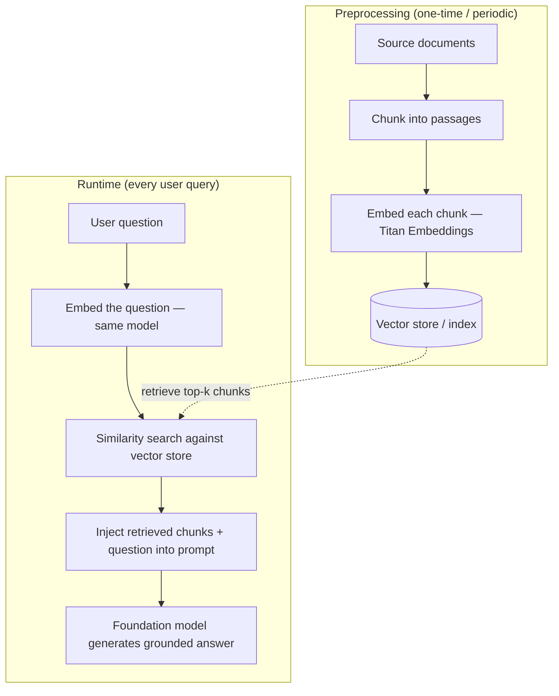

> **Real AWS doc reference:** this preprocessing/runtime split mirrors AWS's own
> ["How Amazon Bedrock knowledge bases work"](https://docs.aws.amazon.com/bedrock/latest/userguide/kb-how-it-works.html)
> documentation, which publishes separate diagrams for the preprocessing data flow
> (`rag-preprocess.png`, curl-verified HTTP 200) and the runtime query flow
> (`rag-runtime.png`, curl-verified HTTP 200) — the exact two phases shown above.

Step by step: (1) chunking and embedding happen ahead of time, independent of any specific user
question; (2) at query time, the question is embedded with the *same* embedding model used
during preprocessing, so the vectors are comparable; (3) similarity search (typically cosine
similarity or dot product) finds the top-k closest chunks; (4) those chunks are concatenated
into the prompt as grounding context, and the foundation model generates its answer conditioned
on that retrieved context rather than purely from its training data.

**Why the others are wrong:**
- **A:** Fine-tuning on every single question would be absurdly slow, costly, and is not how RAG
  works at all — RAG deliberately avoids retraining the model per query by instead retrieving
  relevant context at inference time.
- **C:** This describes using the foundation model with *no* RAG at all — embeddings and vector
  stores are the core mechanism that grounds answers in actual up-to-date source documents;
  skipping them reintroduces the hallucination and stale-knowledge risk RAG is built to reduce.
- **D:** Embeddings are used at the *start* of the pipeline (for chunk and query representation)
  to enable retrieval, not at the end to compress the model's generated text output — this
  misplaces where embeddings function in the architecture entirely.

---

## Q40 — Domain 4 (Operating, Monitoring, and Securing ML Solutions)

A team runs long SageMaker training jobs (8+ hours) on **Spot Instances** to save cost, and
accepts that Spot capacity can be interrupted with only a 2-minute warning. What must the
training job be configured to do so that an interruption doesn't force the entire job to
restart from scratch, wasting hours of already-completed progress?

A) Nothing — Spot interruptions always destroy all training progress regardless of
   configuration, so Spot should never be used for jobs longer than a few minutes
B) The training job must **periodically write checkpoints** (e.g., every N minutes or N epochs)
   to a persistent location like S3, and on restart, the job must **detect and resume from the
   most recent checkpoint** rather than starting over — SageMaker's managed Spot training
   natively supports this checkpoint-and-resume pattern
C) Switch to On-Demand Instances, since Spot cannot be used with SageMaker Training at all
D) Reduce the training job to under 2 minutes total so the Spot warning window always covers the
   full job

**Correct Answer: B**

**Explanation:** SageMaker's **managed Spot training** is specifically designed to work with
Spot's interruption model: the training script periodically saves **checkpoints** to a durable
location (commonly S3, via the managed checkpoint configuration), and if Spot capacity is
reclaimed, SageMaker automatically resumes the job on newly available Spot capacity, loading the
latest checkpoint — so only the progress *since the last checkpoint* is lost, not the whole job.
This checkpoint/resume pattern is what makes long Spot training jobs practical. See
[`certifications/mla-c02/domain-4-monitoring-security/ml-cost-optimization.md`](../domain-4-monitoring-security/ml-cost-optimization.md).

**Why the others are wrong:**
- **A:** This overstates the risk — SageMaker explicitly supports resumable Spot training via
  checkpointing precisely so that interruptions don't destroy all prior progress; the real
  requirement is configuring checkpointing correctly, not avoiding Spot altogether.
- **C:** SageMaker Training fully supports Spot Instances (as "managed Spot training") as a
  first-class, documented cost-optimization option — this option incorrectly claims
  incompatibility.
- **D:** Shrinking an 8+ hour training job down to under 2 minutes isn't a realistic or
  reasonable mitigation — the actual, intended solution is checkpointing and automatic resume,
  not artificially limiting job duration.

---

## Q41 — Domain 1 (Data Preparation for ML and AI)

A dataset has two numeric features: `transaction_amount` (ranging $0.01 to $50,000, right-
skewed with a long tail of large transactions) and `account_age_days` (ranging 0 to 3,650,
roughly uniformly distributed). The team is training a neural network via gradient descent and
wants both features rescaled so neither dominates the loss surface purely due to differing raw
magnitude, without assuming either feature follows a specific bounded range. Which scaling
approach is more broadly appropriate here, and when would the alternative be preferred instead?

A) **Standardization (Z-score scaling: subtract the mean, divide by standard deviation)** is
   generally preferable here since it doesn't assume a fixed bounded range and handles the
   skewed, differently-scaled features reasonably; **Min-Max normalization (scaling to a fixed
   [0,1] range)** is preferred instead when a bounded range is specifically required (e.g.,
   certain neural network input layers or image pixel-style features) and the data has no
   extreme outliers that would compress the rest of the range
B) Both techniques produce mathematically identical output and the choice never matters
C) Neither technique is necessary for neural networks; only tree-based models require scaling
D) Min-Max normalization should always be used regardless of outliers, since it guarantees a
   [0,1] range

**Correct Answer: A**

**Explanation:** **Standardization** centers data around a mean of 0 with unit variance and is
relatively more robust to differing feature scales and some skew, without hard-clipping to a
fixed range — a sensible general-purpose default for gradient-descent-trained models with mixed
feature distributions. **Min-Max normalization** compresses values into a fixed range like [0,1],
which is useful when a bounded range is specifically needed, but it is sensitive to outliers (a
single extreme value stretches the whole scale, compressing the rest of the data near 0). See
[`ml-fundamentals-glossary.md`](../domain-2-model-development/ml-fundamentals-glossary.md).

**Why the others are wrong:**
- **B:** The two formulas produce different numeric outputs and have different sensitivity to
  outliers and different resulting ranges — they are not interchangeable, and the choice
  materially affects training dynamics in some cases.
- **C:** Neural networks trained via gradient descent are *especially* sensitive to unscaled
  features (differently-scaled inputs distort the loss surface and slow/destabilize convergence)
  — scaling is broadly recommended for gradient-based models, not just tree-based ones (which
  are comparatively scale-insensitive, the opposite framing of this option).
- **D:** Min-Max normalization is specifically *vulnerable* to outliers (like the right-skewed
  `transaction_amount` feature's long tail) since one extreme value stretches the scale and
  compresses everything else — it is not universally preferable regardless of outliers.

---

## Q42 — Domain 2 (ML Model and Foundation Model Development)

A team trains a large transformer model where the model itself fits comfortably in a single
GPU's memory, but training is slow because of the massive dataset size. To speed up training,
they split the **training data** into shards distributed across 8 GPUs, each GPU holding a
*full copy of the model* and processing a different data shard in parallel, synchronizing
gradient updates between GPUs after each step. What is this distributed training technique
called, and how does it differ from the alternative used when the model itself is too large for
one GPU?

A) This is **data parallelism** — each GPU holds a full model replica and processes different
   data batches simultaneously, synchronizing gradients afterward; it differs from **model
   parallelism**, used when a single model is too large to fit on one GPU's memory, requiring the
   model's layers/parameters themselves to be split across multiple GPUs
B) This is model parallelism, since multiple GPUs are involved in any form of distributed
   training
C) This technique is called "ensemble training," identical to combining multiple separately
   trained models
D) There is no meaningful distinction; all multi-GPU training techniques are functionally
   identical regardless of what is split across GPUs

**Correct Answer: A**

**Explanation:** **Data parallelism** replicates the *entire model* onto each GPU and splits the
*dataset* across them — each GPU computes forward/backward passes on its own data shard, then
gradients are synchronized (e.g., via all-reduce) to keep model replicas in sync. This is the
right technique when the model fits in memory but the dataset is large. **Model parallelism**
(the alternative, used elsewhere in this exam) instead splits the *model's layers/parameters*
across GPUs when the model itself is too large for any single GPU's memory — a fundamentally
different kind of split (model vs. data). See
[`services/machine-learning-ai/sagemaker-training-and-tuning.md`](../../../services/machine-learning-ai/sagemaker-training-and-tuning.md).

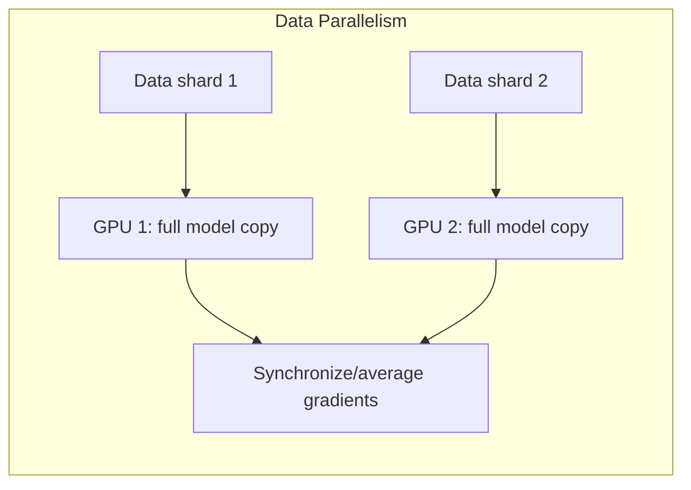

Step by step: (1) the full model is copied identically onto every participating GPU; (2) each
GPU independently processes a different slice of the training data through a forward/backward
pass; (3) the resulting gradients from all GPUs are synchronized (averaged) so every model
replica applies the same update, keeping them identical — this is what lets data parallelism
scale throughput roughly linearly with GPU count for data-bound (not memory-bound) training.

**Why the others are wrong:**
- **B:** Using multiple GPUs doesn't automatically mean model parallelism — the defining
  question is *what* gets split (the model's parameters vs. the dataset); here, the full model
  is replicated on each GPU and only the data is split, which is the definition of data
  parallelism, not model parallelism.
- **C:** Ensemble training combines predictions from multiple *independently and differently*
  trained models at inference time — data parallelism trains one single model (just with
  synchronized replicas across GPUs), not an ensemble of distinct models.
- **D:** The specific thing being split (model vs. data) has major practical implications
  (communication overhead patterns, memory requirements, scaling behavior) — conflating all
  multi-GPU approaches as identical ignores this fundamental architectural distinction.

---

## Q43 — Domain 3 (Deployment and Orchestration of ML Workflows)

A travel company builds a Bedrock Agent that must handle a request like "book me a flight to
Chicago and reserve a hotel if the flight is confirmed." The agent needs to: interpret the
request, decide it must first call a "search flights" action, evaluate the result, then
conditionally call a "book hotel" action only if the flight step succeeded — reasoning about
*which* action to invoke and in *what order*, which cannot be fully hard-coded in advance since
it depends on intermediate results. Which architectural pattern underlies Bedrock Agents'
runtime behavior that enables this?

A) A single, static prompt template with no intermediate reasoning steps, sent once to the model
B) **An iterative reasoning-and-acting loop (ReAct-style orchestration)**: the agent's
   foundation model reasons about the next step, selects an action group/API to invoke, observes
   the result, and repeats — reasoning, acting, and observing in a loop — until it determines the
   overall task is complete, rather than following one fixed, pre-written sequence
C) A simple if/else statement hard-coded entirely in the application layer outside of Bedrock
D) Bedrock Agents can only execute a single action per user request and cannot chain multiple
   conditional steps

**Correct Answer: B**

**Explanation:** Bedrock Agents orchestrate multi-step tasks through an **iterative reasoning
loop**: at each step, the underlying foundation model reasons about what to do next given the
user's goal and everything observed so far, selects an **action group** (an API/Lambda function
it has access to) to invoke, observes that action's result, and loops back to reason about the
*next* step — continuing until the model determines the task is complete. This "reason → act →
observe → repeat" pattern is exactly what lets the agent adapt its sequence of actions (flight
search, then conditionally hotel booking) based on real intermediate outcomes rather than a
fixed script. See
[`certifications/mla-c02/domain-3-deployment-orchestration/README.md`](../domain-3-deployment-orchestration/README.md)
and [`services/machine-learning-ai/bedrock.md`](../../../services/machine-learning-ai/bedrock.md).

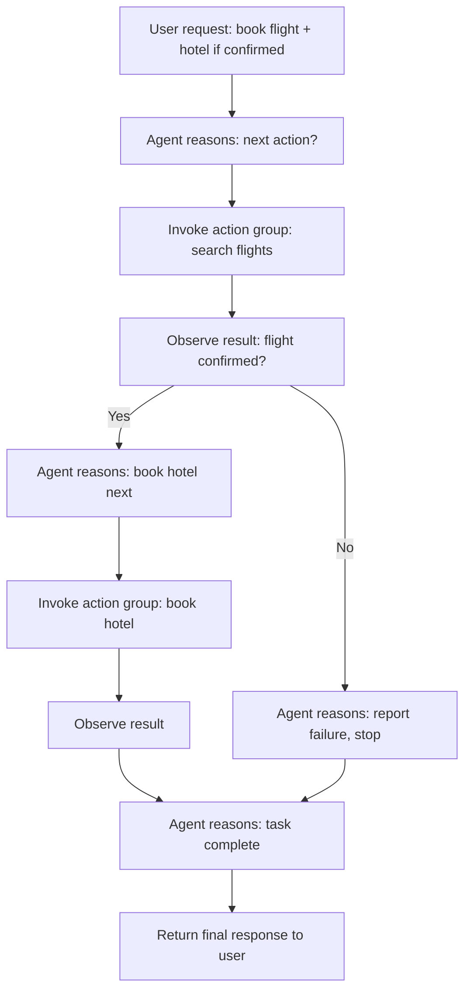

> **Real AWS doc reference:** this reason/act/observe loop matches AWS's own
> ["How Amazon Bedrock Agents work"](https://docs.aws.amazon.com/bedrock/latest/userguide/agents-how.html)
> documentation, which publishes a build-time diagram (`agents-buildtime.png`, curl-verified
> HTTP 200, showing how action groups/knowledge bases are configured) and a runtime diagram
> (`agents-runtime.png`, curl-verified HTTP 200, showing the live reasoning loop depicted above).

Step by step: (1) the agent interprets the overall goal and reasons about the very first action
needed (search flights); (2) it invokes the corresponding action group (an API call or Lambda
function it was configured with); (3) it observes the structured result of that call; (4) it
reasons again, *using that observation*, to decide the next step — conditionally booking the
hotel only if the flight result was a confirmation — repeating until the model determines the
full multi-step task is satisfied.

**Why the others are wrong:**
- **A:** A single static prompt with no intermediate reasoning couldn't conditionally branch
  based on a real-time flight-booking result it hasn't seen yet — the whole premise of agent
  orchestration is multiple reasoning passes informed by actual intermediate observations.
- **C:** While action groups are technically backed by Lambda functions, the *reasoning about
  which action to call and when* is driven by the foundation model inside the agent's
  orchestration loop, not a hard-coded if/else written entirely outside of Bedrock — that would
  defeat the purpose of using an agent at all.
- **D:** Bedrock Agents are specifically designed to chain multiple actions across multiple
  reasoning steps within a single user request/session — this option describes a severe,
  inaccurate limitation that isn't how the service works.

---

## Q44 — Domain 4 (Operating, Monitoring, and Securing ML Solutions)

A company runs SageMaker training jobs and real-time inference endpoints with **highly
predictable, steady usage for the next year** across their whole ML workload. They've heard of
both **generic AWS Compute Savings Plans** and **SageMaker Savings Plans** and want to know the
key practical difference before committing. Which statement correctly distinguishes them?

A) They are identical products with different names; either can be used interchangeably with no
   practical difference
B) **Compute Savings Plans** apply broadly across EC2, Fargate, and Lambda usage (not
   SageMaker-specific), while **SageMaker Savings Plans** apply a committed hourly spend
   specifically and flexibly across SageMaker usage (training, real-time inference, batch
   transform, etc., across instance families/sizes/Regions), making them the more targeted fit
   for an ML-specific committed-spend discount
C) SageMaker Savings Plans only apply to SageMaker Studio notebook usage, not training or
   inference
D) Compute Savings Plans provide a larger discount than SageMaker Savings Plans in every case

**Correct Answer: B**

**Explanation:** **Compute Savings Plans** are a general-purpose commitment that discounts
usage across EC2, Fargate, and Lambda (not ML-specific). **SageMaker Savings Plans** instead let
you commit to a consistent amount of **SageMaker-specific usage** (measured in $/hour) that
flexibly applies across SageMaker instance families, sizes, and Regions, and across SageMaker
components like Studio notebooks, training jobs, real-time endpoints, and batch transform — a
purpose-built discount mechanism for teams whose steady, predictable spend is concentrated in
SageMaker rather than general EC2 compute. See
[`certifications/mla-c02/domain-4-monitoring-security/ml-cost-optimization.md`](../domain-4-monitoring-security/ml-cost-optimization.md).

**Why the others are wrong:**
- **A:** They are distinct products with different scopes (general compute vs. SageMaker-
  specific usage) and different applicability — treating them as interchangeable ignores a
  real, testable distinction between the two commitment types.
- **C:** SageMaker Savings Plans apply broadly across multiple SageMaker components (training,
  inference, batch transform, Studio notebooks), not narrowly to just notebook usage — this
  understates their actual, broader scope.
- **D:** Which plan yields a larger discount depends on actual usage patterns and committed
  amounts — there's no universal rule that one plan type always discounts more than the other;
  the real distinguishing factor tested here is *scope* (general compute vs. SageMaker-specific),
  not a blanket discount-size comparison.

---

## Q45 — Domain 1 (Data Preparation for ML and AI)

A linear regression model for predicting house prices includes both `total_square_footage` and
`num_bedrooms × average_room_size` as separate features — the team discovers these two features
are extremely highly correlated (0.96) with each other, and the model's coefficients for these
two features are unstable, flipping sign and magnitude dramatically with small changes to the
training data. What statistical problem does this describe, and what diagnostic/technique
directly addresses it?

A) This is overfitting; the fix is to add more regularization to the loss function only
B) This is **multicollinearity** — highly correlated input features make individual coefficient
   estimates unstable and hard to interpret, even if overall model fit is fine; the **Variance
   Inflation Factor (VIF)** is the standard diagnostic to detect which features are
   problematically collinear, after which one of the redundant features can be dropped or
   combined via PCA
C) This is class imbalance; the fix is SMOTE oversampling
D) This is data drift; the fix is retraining on more recent data

**Correct Answer: B**

**Explanation:** **Multicollinearity** occurs when two or more input features are highly
linearly correlated with each other, making it statistically difficult for the model to
attribute effect to one feature versus the other — producing unstable, sign-flipping
coefficients even when the model's overall predictive fit looks reasonable. **VIF** quantifies
how much a feature's variance is inflated due to correlation with other features (a common rule
of thumb flags VIF > 5 or 10 as problematic), guiding which redundant feature to drop, or
whether to combine correlated features via PCA instead. See
[`ml-fundamentals-glossary.md`](../domain-2-model-development/ml-fundamentals-glossary.md) and the
[Domain 1 README](../domain-1-data-preparation/README.md).

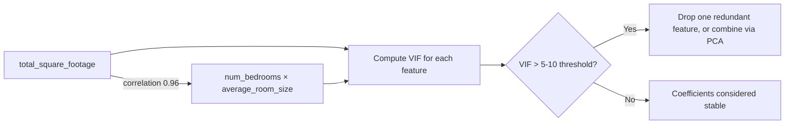

**Why the others are wrong:**
- **A:** Overfitting is about a model fitting training-set noise and generalizing poorly to new
  data — unstable *coefficient estimates due to correlated inputs* is a distinct phenomenon
  (multicollinearity) that can occur even in a model that isn't necessarily overfitting overall.
- **C:** Class imbalance concerns skewed label distribution in classification tasks — it's
  unrelated to correlation between numeric input features in a regression setting.
- **D:** Data drift is a post-deployment phenomenon involving input distributions shifting over
  time in production — it has nothing to do with static, training-time correlation between two
  engineered features.

---

## Q46 — Domain 2 (ML Model and Foundation Model Development)

A security team wants to flag anomalous login attempts (unusual time, location, device
combinations) without any labeled "fraudulent login" examples to train on — they only have
historical normal login data and want a model that learns what "normal" looks like and scores
new logins by how anomalous they appear. Which SageMaker built-in algorithm is purpose-built for
this unsupervised anomaly-detection use case?

A) XGBoost, since it is the best general-purpose algorithm for any tabular prediction task
B) **Random Cut Forest (RCF)**, a SageMaker built-in algorithm specifically designed for
   unsupervised anomaly detection — it assigns each data point an anomaly score based on how
   much it increases the complexity of a random forest of trees built over the data, without
   requiring any labeled anomaly examples
C) Linear Learner, configured for binary classification with fraud as the positive class
D) BlazingText, SageMaker's built-in algorithm for text classification and word embeddings

**Correct Answer: B**

**Explanation:** **Random Cut Forest (RCF)** is SageMaker's built-in algorithm purpose-built for
**unsupervised anomaly detection**: it builds an ensemble of random trees over the data and
scores each point by how much including it changes (complicates) the resulting tree structure —
points that are "hard to fit in" (anomalous) get higher scores — critically, requiring **no
labeled fraud/anomaly examples** at all, only historical normal data. This is the correct
algorithm choice whenever an exam scenario says "no labeled anomalies" + "detect unusual
behavior." See
[`services/machine-learning-ai/sagemaker-training-and-tuning.md`](../../../services/machine-learning-ai/sagemaker-training-and-tuning.md).

**Why the others are wrong:**
- **A:** XGBoost is a supervised, label-requiring gradient-boosting algorithm — without labeled
  fraud examples, there is no target variable for XGBoost to learn from in this scenario; "best
  general-purpose algorithm" also isn't a valid justification when the fundamental requirement
  (supervised vs. unsupervised) isn't met.
- **C:** Linear Learner's binary classification mode requires labeled positive/negative
  examples (fraud vs. not-fraud) to train on — this scenario explicitly has none, ruling out any
  supervised classification approach including Linear Learner.
- **D:** BlazingText is for text-based tasks (word embeddings, text classification on language
  data) — it has no relevance to structured login-metadata anomaly detection.

---

## Q47 — Domain 3 (Deployment and Orchestration of ML Workflows)

A company's internal application running inside a private VPC subnet needs to invoke a Bedrock
foundation model via the `bedrock-runtime` API, and security policy requires that this traffic
**never traverse the public internet**, even though the subnet has no NAT gateway or internet
gateway route at all. Which networking configuration enables this private connectivity to
Bedrock specifically?

A) Attaching an Elastic IP directly to the application's EC2 instance
B) Configuring an **Interface VPC Endpoint (AWS PrivateLink) for the `bedrock-runtime` service**,
   which creates an elastic network interface with a private IP inside the VPC subnet, letting
   the application call Bedrock entirely over AWS's private network backbone
C) Requesting Amazon to allowlist the application's IP address for direct Bedrock access,
   bypassing the VPC entirely
D) Creating a VPN tunnel from the VPC to the public internet specifically to reach Bedrock

**Correct Answer: B**

**Explanation:** Because Bedrock (like the large majority of AWS services other than S3/
DynamoDB) does not support Gateway VPC endpoints, private connectivity is achieved via an
**Interface VPC Endpoint backed by AWS PrivateLink** — this provisions an ENI with a private IP
address inside the subnet, and API calls to `bedrock-runtime` are routed over AWS's private
network rather than the public internet, satisfying the no-internet-traversal requirement
without needing a NAT gateway or internet gateway at all. See
[`certifications/mla-c02/domain-4-monitoring-security/README.md`](../domain-4-monitoring-security/README.md)
and [`services/machine-learning-ai/bedrock.md`](../../../services/machine-learning-ai/bedrock.md).

**Why the others are wrong:**
- **A:** An Elastic IP is a *public* IPv4 address meant for internet-facing resources — attaching
  one would move in the wrong direction entirely for a requirement to avoid the public internet,
  and doesn't by itself grant any API access to Bedrock.
- **C:** There is no such AWS mechanism as individually "allowlisting" an application's IP to
  bypass VPC networking for Bedrock access — API access control and network routing are handled
  through IAM policy and VPC endpoint configuration, not IP allowlisting of this kind.
- **D:** A VPN tunnel to the public internet is precisely the opposite of what's required — any
  path that routes through the public internet (even encrypted) fails the "never traverse the
  public internet" requirement; PrivateLink avoids the public internet entirely by design.

---

## Q48 — Domain 4 (Operating, Monitoring, and Securing ML Solutions)

A finance team wants to set a **hard monthly ceiling** on SageMaker training compute spend:
specifically, if projected spend for the month is forecasted to exceed $10,000, they want an
automated action (not just a notification) to **stop all currently running SageMaker training
jobs** to prevent further cost accumulation, in addition to being alerted. Which AWS capability
supports both the cost-threshold detection and the automated remediation action together?

A) AWS Cost Explorer alone, which only provides historical cost visualization with no
   alerting or automated actions
B) **AWS Budgets**, configured with a cost/usage threshold and an attached **budget action**
   (e.g., triggering an SNS notification that invokes a Lambda function, or applying an IAM
   policy/SCP) that can programmatically stop running SageMaker training jobs when the
   threshold is breached — combined with a budget alert for notification
C) Amazon CloudWatch billing alarms alone, which can only send a notification and have no
   mechanism to take an automated remediation action against running resources
D) AWS Trusted Advisor, which only provides periodic cost-optimization recommendations, not
   real-time threshold-triggered automated actions

**Correct Answer: B**

**Explanation:** **AWS Budgets** supports configuring a cost or usage threshold (including
*forecasted* spend, not just actual spend to date) and attaching **budget actions** — automated
responses like applying a restrictive IAM policy/SCP, or triggering an SNS topic that invokes a
Lambda function to call `StopTrainingJob` on running jobs — going beyond simple notification into
actual automated remediation when a spend ceiling is projected to be breached. See
[`certifications/mla-c02/domain-4-monitoring-security/ml-cost-optimization.md`](../domain-4-monitoring-security/ml-cost-optimization.md).

**Why the others are wrong:**
- **A:** Cost Explorer is a visualization/analysis tool for historical and forecasted cost data
  — it has no built-in alerting threshold mechanism or automated-action capability of its own.
- **C:** CloudWatch billing alarms can only trigger based on the `EstimatedCharges` metric and
  fire a notification (e.g., SNS) — they have no native "stop this resource" action attached;
  you'd still need custom Lambda/automation wired to that notification, which is exactly what
  Budget Actions already provides in a more purpose-built, cost-specific way.
- **D:** Trusted Advisor provides periodic, best-practice cost/security/performance
  recommendations — it is not a real-time threshold-triggered alerting or automated-remediation
  mechanism for an active budget ceiling.

---

## Q49 — Domain 1 (Data Preparation for ML and AI)

A dataset for a manufacturing-defect model has 200 numeric sensor-reading features, many of
which are highly correlated with each other (e.g., multiple temperature sensors in the same
physical zone tend to move together). The team wants to reduce the feature count to a much
smaller set of **uncorrelated** components that still capture most of the original variance,
primarily to speed up training and reduce multicollinearity — accepting that the resulting
components will no longer map to individually interpretable original sensors. Which technique
fits?

A) One-hot encoding all 200 features
B) **Principal Component Analysis (PCA)**, an unsupervised dimensionality-reduction technique
   that transforms correlated features into a smaller set of linearly uncorrelated principal
   components, ordered by how much variance each explains
C) SMOTE oversampling applied to the 200 features
D) Binning each of the 200 features into deciles individually

**Correct Answer: B**

**Explanation:** **PCA** is the standard technique for exactly this scenario: it finds linear
combinations of the original correlated features (principal components) that are themselves
uncorrelated with each other, ordered so the first few components capture most of the original
variance — letting the team drop from 200 features down to, say, 20 components while retaining
most of the information, directly solving both the dimensionality and multicollinearity
concerns, at the cost of losing per-sensor interpretability. See
[`ml-fundamentals-glossary.md`](../domain-2-model-development/ml-fundamentals-glossary.md) and the
[Domain 1 README](../domain-1-data-preparation/README.md).

**Why the others are wrong:**
- **A:** One-hot encoding is for categorical/nominal features, not for reducing or transforming
  a large set of correlated *numeric* sensor readings — it would multiply, not reduce, the
  feature count.
- **C:** SMOTE generates synthetic minority-class samples to address class imbalance in
  classification labels — it has nothing to do with reducing the dimensionality of a feature
  set.
- **D:** Binning each of the 200 features individually into deciles doesn't reduce the number of
  features at all (still 200 features, just discretized) and does nothing to address the
  correlation between them — it misses the "reduce feature count" and "uncorrelated" goals
  entirely.

---

## Q50 — Domain 2 (ML Model and Foundation Model Development)

A utility company wants to forecast daily electricity demand for the next 30 days for each of
500 different substations, using each substation's own multi-year history of daily demand plus
related time-varying covariates (temperature forecasts, day-of-week, holidays). They want a
single model that can learn shared seasonal patterns across all 500 related time series rather
than training 500 completely separate models from scratch. Which SageMaker built-in algorithm is
purpose-built for this multi-series time-series forecasting use case?

A) XGBoost, trained once per substation using only each substation's own lagged values as
   features
B) **DeepAR**, SageMaker's built-in algorithm specifically designed for probabilistic time-series
   forecasting across **multiple related time series simultaneously**, learning shared patterns
   (e.g., common seasonality) across the whole collection while still producing per-series
   forecasts with uncertainty estimates
C) Random Cut Forest, since it processes numeric time-ordered data
D) K-Nearest Neighbors (K-NN), applied independently per substation

**Correct Answer: B**

**Explanation:** **DeepAR** is SageMaker's built-in algorithm purpose-built for forecasting
**many related time series together** — it trains a single recurrent-neural-network-based model
across the whole collection of series (leveraging shared structure like common day-of-week or
holiday effects across substations) and produces **probabilistic forecasts** (with confidence
intervals), typically outperforming 500 independently-trained single-series models, especially
when some substations have limited history. See
[`services/machine-learning-ai/sagemaker-training-and-tuning.md`](../../../services/machine-learning-ai/sagemaker-training-and-tuning.md).

**Why the others are wrong:**
- **A:** Training 500 separate XGBoost models independently per substation is exactly the
  "completely separate models" approach the question says to avoid — it also forfeits the
  benefit of learning shared seasonal/holiday patterns that generalize across substations with
  less individual history.
- **C:** Random Cut Forest is an unsupervised *anomaly-detection* algorithm — it doesn't produce
  forward-looking demand forecasts at all, regardless of whether the input happens to be
  time-ordered.
- **D:** K-NN is a general-purpose similarity-based classification/regression method with no
  native time-series forecasting structure (seasonality, trend, multi-series sharing) — applying
  it independently per substation also reproduces the "separate models" problem being avoided.

---

## Q51 — Domain 3 (Deployment and Orchestration of ML Workflows)

A company deploys a SageMaker real-time endpoint and wants it to remain available even if an
entire Availability Zone in the Region experiences an outage, without the team manually
configuring failover logic themselves. What is the correct expectation about SageMaker
real-time endpoint resilience across AZs within a single Region?

A) SageMaker real-time endpoints are always confined to a single AZ, and multi-AZ resilience
   requires manually deploying separate endpoints in each AZ and load-balancing between them
B) When an endpoint is configured with **more than one instance**, SageMaker automatically
   distributes the underlying instances **across multiple Availability Zones** within the
   Region (for the subnets provided), so an AZ outage doesn't take down the whole endpoint — this
   multi-AZ placement is a built-in behavior, not something requiring custom load-balancer setup
C) Multi-AZ resilience for SageMaker endpoints requires switching to Batch Transform instead of
   real-time endpoints
D) SageMaker endpoints are resilient to Regional outages automatically, with zero configuration
   needed to also survive a full Region failure

**Correct Answer: B**

**Explanation:** When a SageMaker real-time endpoint is backed by **multiple instances** (and
deployed across multiple subnets spanning different AZs, if using a VPC configuration), SageMaker
automatically spreads those instances across **multiple Availability Zones** within the Region —
providing AZ-level resilience without the team building their own cross-AZ load balancing or
failover logic; a single-instance endpoint, by contrast, has no such redundancy. See
[`services/machine-learning-ai/sagemaker-deployment-endpoints.md`](../../../services/machine-learning-ai/sagemaker-deployment-endpoints.md).

**Why the others are wrong:**
- **A:** This understates SageMaker's native behavior — multi-instance endpoints automatically
  get spread across AZs by the service itself; manually standing up and load-balancing between
  separate endpoints per AZ is not required to get this baseline AZ resilience.
- **C:** Batch Transform is an offline scoring job type, not a real-time serving option at all,
  and switching to it doesn't address the live-endpoint-availability requirement described.
- **D:** AZ-level resilience (within one Region) is a different guarantee than full **Regional**
  disaster recovery — surviving an entire Region outage requires deliberate multi-Region
  deployment (e.g., with Route 53 or CloudFront failover), which is not automatic; this option
  conflates the two very different resilience scopes.

---

## Q52 — Domain 4 (Operating, Monitoring, and Securing ML Solutions)

A regulated lending company must be able to reconstruct, for any specific past loan decision,
the **exact input payload and model output** the SageMaker endpoint received and returned at
that moment in time — for dispute resolution and regulatory audit — not just high-level API-call
metadata like who invoked the endpoint and when. Which SageMaker feature captures the actual
inference request/response payloads themselves?

A) AWS CloudTrail, which records that an `InvokeEndpoint` API call was made, by whom, and when
B) **SageMaker endpoint Data Capture**, a feature that captures a configurable sample (or all)
   of the actual inference **input payloads and output predictions**, storing them in S3 for
   later retrieval, auditing, or feeding into Model Monitor
C) AWS Config, which tracks the endpoint's instance type and IAM role configuration over time
D) CloudWatch Logs, which by default captures the full input/output payload of every invocation
   automatically with no configuration needed

**Correct Answer: B**

**Explanation:** **SageMaker Data Capture** is specifically designed to log the **actual
inference request and response data** (the real payloads, not just metadata about the API call)
to an S3 location, at a configurable sampling rate — enabling exactly the kind of "reconstruct
what this specific request/response looked like" audit trail a regulated company needs, and this
captured data also feeds SageMaker Model Monitor's data-quality checks. See
[`services/machine-learning-ai/sagemaker-model-monitor-and-registry.md`](../../../services/machine-learning-ai/sagemaker-model-monitor-and-registry.md).

**Why the others are wrong:**
- **A:** CloudTrail logs that an API call (like `InvokeEndpoint`) happened, including the
  calling identity and timestamp — but it does **not** capture the actual request/response
  body/payload content by default, which is exactly what's needed here.
- **C:** AWS Config tracks the endpoint's *infrastructure configuration* (instance type, IAM
  role, etc.) over time — it has no visibility into individual inference payloads sent to or
  returned by the endpoint.
- **D:** CloudWatch Logs does not automatically capture full inference payloads without explicit
  application-level logging configured by the team — it isn't an out-of-the-box payload-capture
  mechanism the way Data Capture is purpose-built to be.

---

## Q53 — Domain 1 (Data Preparation for ML and AI)

A binary classification dataset for detecting rare equipment failures has 100,000 rows total,
with only 900 (0.9%) labeled as "failure." The team performs a simple random 80/20 train/test
split. What specific risk does a plain random split carry for this dataset, and what should be
done instead?

A) Random splitting carries no risk regardless of class balance; it should be used as-is
B) A plain random split risks producing a test set with an even more skewed (or, by chance,
   sparser) proportion of the rare "failure" class than the overall dataset, making evaluation
   noisy or unreliable; a **stratified split** should be used instead, preserving the same
   ~0.9% failure ratio in both the train and test sets
C) The fix is to always use a 50/50 train/test split instead of 80/20
D) The fix is to remove the "failure" class entirely so the dataset becomes single-class

**Correct Answer: B**

**Explanation:** With a rare minority class, a **plain random split** can by chance allocate a
very different proportion of the 900 failure examples between train and test (e.g., too few
ending up in the test set for a statistically meaningful evaluation of minority-class
performance, or an unrepresentative split). A **stratified train/test split** explicitly
preserves the original class ratio (~0.9% failure) in both subsets, ensuring the test set has
enough minority examples to reliably evaluate recall/precision on the class that matters most.
See [`certifications/mla-c02/domain-1-data-preparation/README.md`](../domain-1-data-preparation/README.md).

**Why the others are wrong:**
- **A:** Severe class imbalance is exactly the condition where plain random splitting is
  riskiest — small absolute minority-class counts mean random variation in the split can
  meaningfully distort evaluation reliability, so claiming "no risk" ignores this core concern.
- **C:** Changing the split ratio from 80/20 to 50/50 doesn't address the *stratification*
  problem at all — an unstratified 50/50 split can still randomly misallocate the rare failure
  examples between the two halves.
- **D:** Removing the minority class entirely would eliminate the very thing the model is
  supposed to predict — this isn't a fix, it's abandoning the modeling task altogether.

---

## Q54 — Domain 2 (ML Model and Foundation Model Development)

A company wants a Bedrock foundation model to deeply internalize their company's entire
internal style guide, specialized vocabulary, and domain jargon (e.g., legal/medical
terminology) well enough to use it fluently and accurately in free-form generation across many
different downstream tasks — not just one narrow task's input/output format, and not just a
need for up-to-date facts. Minimal reliance on retrieval at inference time is acceptable; deep,
broad domain fluency is the goal. Which customization approach fits best, and how does it differ
from fine-tuning for a single task?

A) Prompt engineering alone, since providing a longer system prompt is always sufficient to
   teach deep domain vocabulary and style across all future generations
B) **Continued pre-training (domain-adaptive pre-training)** on a large corpus of the company's
   unlabeled domain text, which adjusts the model's underlying weights to deeply internalize
   domain vocabulary/style broadly across many tasks — distinct from standard **fine-tuning**,
   which instead uses smaller labeled input/output example pairs to adapt a model's behavior to
   one specific task format
C) RAG, since any knowledge-related requirement should always be solved with retrieval rather
   than ever adjusting model weights
D) Model distillation, which compresses a large model into a smaller one with no training-data
   component at all

**Correct Answer: B**

**Explanation:** **Continued pre-training** (domain-adaptive pre-training) continues the
model's original self-supervised training objective on a large volume of **unlabeled** in-domain
text, broadly shifting the model's internal representations toward the domain's vocabulary,
style, and patterns across *many* downstream uses — distinct from standard **fine-tuning**,
which uses smaller sets of **labeled input/output pairs** to specialize a model's behavior for
one specific task (e.g., a particular classification or summarization format). This is a
higher-effort, broader customization than task-specific fine-tuning, matching a goal of deep,
general domain fluency rather than one narrow task. See
[`services/machine-learning-ai/bedrock.md`](../../../services/machine-learning-ai/bedrock.md) and
[`certifications/mla-c02/domain-2-model-development/README.md`](../domain-2-model-development/README.md).

**Why the others are wrong:**
- **A:** Prompt engineering can nudge style and provide some context within the prompt, but it
  doesn't change the model's underlying weights, so it can't produce the deep, broad vocabulary
  internalization described — and very long system prompts also add cost/latency per request and
  can be forgotten or diluted over a long generation.
- **C:** RAG is excellent for injecting current/specific facts at inference time, but it doesn't
  teach a model to *generate* fluently in a specialized style/vocabulary on its own — this
  scenario is about broad linguistic/domain fluency, not primarily about retrieving facts.
- **D:** Distillation is about transferring a large "teacher" model's behavior into a smaller
  "student" model for efficiency — it is a model-compression technique, not a domain-
  vocabulary-adaptation technique, and it absolutely does involve a training process (using the
  teacher's outputs as training signal), contradicting "no training-data component at all."

---

## Q55 — Domain 3 (Deployment and Orchestration of ML Workflows)

A team has a very lightweight scikit-learn logistic regression model (a few KB) that needs to
serve occasional, low-volume prediction requests (a few per hour) from a simple internal tool.
They're deciding between standing up a dedicated SageMaker endpoint versus packaging the model
directly inside an **AWS Lambda function** invoked via API Gateway. Which factor most strongly
favors the Lambda-based approach for this specific scenario?

A) Lambda provides GPU acceleration unavailable in any SageMaker option, which is required here
B) For an extremely lightweight model with low, infrequent request volume, a **Lambda function**
   avoids the baseline cost and operational overhead of a persistently-provisioned SageMaker
   endpoint (even serverless inference has more inherent complexity for this simple a case),
   while Lambda's pay-per-invocation pricing and simplicity fit a tiny, occasional workload well
C) Lambda functions have no maximum execution time limit, unlike SageMaker endpoints, making
   them strictly superior for all inference workloads regardless of size
D) SageMaker endpoints cannot serve scikit-learn models at all, forcing Lambda as the only option

**Correct Answer: B**

**Explanation:** For a **tiny model with low, infrequent traffic**, directly embedding inference
logic in a **Lambda function** (invoked via API Gateway) is often the simplest and most
cost-effective architecture — Lambda's pay-per-invocation model with no idle cost fits sporadic
traffic well, and the operational simplicity of "one function, no separate managed endpoint
resource" is attractive when the model is small enough to load quickly within Lambda's
memory/package-size limits. SageMaker endpoints (even serverless) add more infrastructure and
are generally reserved for larger models, more complex serving needs, or workloads that benefit
from SageMaker's deployment/monitoring/autoscaling tooling. See
[`services/machine-learning-ai/sagemaker-deployment-endpoints.md`](../../../services/machine-learning-ai/sagemaker-deployment-endpoints.md).

**Why the others are wrong:**
- **A:** Lambda does not provide GPU acceleration for general-purpose functions, and this tiny
  logistic regression model has no GPU requirement in the first place — this justification is
  both factually wrong about Lambda and irrelevant to the scenario.
- **C:** Lambda functions **do** have a maximum execution duration (15 minutes), so "no time
  limit" is simply false; and even if it were true, execution-time limits aren't the deciding
  factor for this scenario of a fast, lightweight model — "strictly superior for all inference
  workloads" is also an overreach, since large or complex models are usually better served by
  SageMaker.
- **D:** SageMaker endpoints fully support deploying scikit-learn models (via the scikit-learn
  framework container or a custom container) — this option states a false limitation that isn't
  the real reason Lambda might be chosen here.

---

## Q56 — Domain 4 (Operating, Monitoring, and Securing ML Solutions)

A team sets up **SageMaker Model Monitor** for a real-time endpoint and wants to understand, at
a high level, how the monitoring architecture actually works end to end: how captured inference
data becomes a scheduled evaluation against a baseline, and how violations surface to the team.
Which description, and accompanying diagram, correctly matches Model Monitor's real-time
architecture?

A) Model Monitor re-trains the deployed model automatically whenever it detects any violation,
   with no human review step
B) **Data Capture logs live inference traffic to S3 → a scheduled Monitoring Job (on a
   recurring cadence) compares captured data's statistics against a pre-computed baseline
   (constraints/statistics generated from training data) → violations are reported to
   CloudWatch metrics, which can trigger alarms/notifications** for the team to investigate and
   act on (e.g., trigger retraining manually or via an automated pipeline)
C) Model Monitor requires the endpoint to be stopped and restarted before each check
D) Model Monitor only works with SageMaker Batch Transform jobs, not real-time endpoints

**Correct Answer: B**

**Explanation:** SageMaker Model Monitor's real-time workflow: (1) **Data Capture** records a
sample of live inference request/response payloads to S3; (2) a **baseline** (statistics and
constraints) is computed once, typically from the training dataset, representing "expected"
behavior; (3) a **scheduled monitoring job** runs periodically (e.g., hourly), comparing newly
captured data against that baseline; (4) any detected violations are published as **CloudWatch
metrics**, which can trigger alarms/notifications — giving the team visibility without requiring
automatic, unreviewed retraining. See
[`services/machine-learning-ai/sagemaker-model-monitor-and-registry.md`](../../../services/machine-learning-ai/sagemaker-model-monitor-and-registry.md).

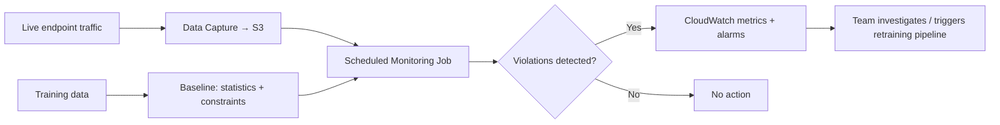

> **Real AWS doc reference:** this flow mirrors AWS's own
> ["Data and model quality monitoring with Amazon SageMaker Model Monitor"](https://docs.aws.amazon.com/sagemaker/latest/dg/model-monitor.html)
> documentation, which publishes a real-time monitoring architecture diagram
> (`mmv2-architecture.png`, curl-verified HTTP 200) showing this same Data Capture →
> scheduled job → CloudWatch pipeline.

Step by step: (1) nothing about this process modifies the live endpoint itself — capturing is
passive logging; (2) the baseline is a reference snapshot, computed once (and recomputable when
intentionally updated), not continuously regenerated; (3) the monitoring job is what actually
runs the statistical comparison on its own schedule, independent of individual inference
requests; (4) violations surfacing as CloudWatch metrics is what makes them actionable
(alarm-able, dashboard-able) rather than buried in a report nobody reads.

**Why the others are wrong:**
- **A:** Model Monitor only **detects and reports** violations — it does not automatically
  retrain or redeploy a model on its own; any retraining action requires a separate, deliberately
  configured pipeline (often human-gated) triggered off the CloudWatch alarm.
- **C:** Model Monitor runs its scheduled checks against *captured* data without requiring the
  live endpoint to be stopped or restarted — the endpoint keeps serving traffic uninterrupted
  throughout.
- **D:** Model Monitor supports both **real-time endpoints** (via Data Capture) and **batch
  transform jobs** (via a batch-specific data capture mechanism) — it is not limited to batch
  transform only; this option reverses which is the more commonly tested scenario.

---

## Q57 — Domain 1 (Data Preparation for ML and AI)

A retailer has 4 years of daily sales data and wants to evaluate a forecasting model's
real-world robustness by simulating how it would have performed if retrained and re-evaluated
repeatedly over time — training on an expanding window of past data and testing on the
immediately following period, then rolling the window forward and repeating — rather than a
single fixed train/test cutoff. What is this evaluation technique called, and why is it
preferred over a single static split for time-series data?

A) This is k-fold cross-validation with random shuffling of all days across the full 4 years
B) This is **walk-forward validation (rolling-origin evaluation)**: the training window expands
   (or slides) forward through time, each time testing on the period immediately following,
   which better simulates real deployment conditions (always training on the past, testing on
   the future) and gives a more robust, averaged estimate of forecasting performance than one
   single train/test cutoff
C) This is stratified sampling, since it preserves class balance within each fold
D) This technique is mathematically identical to a single random train/test split and provides
   no additional benefit

**Correct Answer: B**

**Explanation:** **Walk-forward validation** respects the temporal order of the data: each
evaluation "fold" trains only on data up to a point in time and tests on the period immediately
after it, then the window moves forward and repeats — avoiding the look-ahead data leakage that
random shuffling would introduce, and producing **multiple** performance estimates across
different time periods (more robust than trusting a single static split, which might happen to
land on an unusually easy or hard period). See
[`certifications/mla-c02/domain-1-data-preparation/README.md`](../domain-1-data-preparation/README.md).

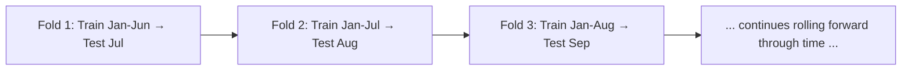

Step by step: (1) each fold's training window only contains data chronologically *before* its
test window, never after — preserving causality; (2) the window rolls forward one period at a
time, generating multiple train/test pairs across the full history instead of just one; (3) the
final reported performance is typically an average across all these rolling folds, smoothing out
the risk that a single arbitrary cutoff happened to land on an atypical period.

**Why the others are wrong:**
- **A:** Standard k-fold cross-validation with random shuffling would let **future** data train a
  model later tested on the **past**, introducing severe look-ahead leakage for time-series data
  — exactly why plain k-fold CV (without time-aware folds) is inappropriate here.
- **C:** Stratified sampling preserves *class label ratios* across folds for classification tasks
  — it has no inherent connection to preserving chronological order, which is the defining
  requirement for time-series evaluation here.
- **D:** Walk-forward validation specifically provides the benefit of multiple, chronologically-
  valid evaluation windows instead of trusting one fixed split — it is a materially different
  (and more robust) approach, not mathematically equivalent to a single random split.

---

## Q58 — Domain 2 (ML Model and Foundation Model Development)

A team evaluates a machine-translation model by comparing its generated translations against
human reference translations, using a metric based on counting matching contiguous sequences of
1, 2, 3, and 4 words (n-grams) between the generated text and the reference, with a penalty
applied if the generated translation is suspiciously shorter than the reference ("brevity
penalty"). Which standard NLP evaluation metric is being described?

A) **BLEU (Bilingual Evaluation Understudy)** — a precision-oriented, n-gram-overlap metric
   originally designed for machine translation, which compares matching n-grams (1-gram through
   4-gram, typically) between candidate and reference text, with a brevity penalty to discourage
   generating overly short outputs that could otherwise game pure n-gram precision
B) ROUGE, which is recall-oriented and was designed primarily for evaluating text summarization
C) BERTScore, which uses contextual embeddings rather than exact n-gram string matching
D) Perplexity, which measures how well a language model predicts a given sequence of tokens

**Correct Answer: A**

**Explanation:** **BLEU** is defined by exactly this combination: **n-gram precision** (what
fraction of the generated text's n-grams also appear in the reference, for n = 1 through 4,
combined via geometric mean) plus a **brevity penalty** to prevent a model from inflating its
precision score simply by outputting very short, "safe" text. BLEU remains the historically
standard automatic metric for machine translation quality. See
[`certifications/mla-c02/domain-2-model-development/README.md`](../domain-2-model-development/README.md).

**Why the others are wrong:**
- **B:** ROUGE is **recall-oriented** (what fraction of the *reference's* n-grams/longest-common-
  subsequence appear in the generated text) and is the standard metric for **summarization**
  evaluation, not the precision+brevity-penalty formulation described, which is specifically
  BLEU's definition.
- **C:** BERTScore evaluates similarity using **contextual embeddings** (comparing token
  embeddings via cosine similarity) rather than exact discrete n-gram string matching — the
  question's description of literal n-gram counting with a brevity penalty is BLEU's mechanism,
  not BERTScore's.
- **D:** Perplexity is an **intrinsic** language-model quality metric (how "surprised" a model is
  by a sequence of tokens, based on the model's own predicted probabilities) — it doesn't compare
  generated text against a reference translation at all, which is the defining feature of BLEU.

---

## Q59 — Domain 3 (Deployment and Orchestration of ML Workflows)

A company hosts several large deep learning models (each needing significant GPU memory) that
individually don't fully utilize a whole GPU's compute, and wants to run multiple of these
models on **shared GPU instances behind one endpoint**, with the ability to independently scale
each model's allocated compute/memory resources, monitor each one's metrics separately, and
load/unload specific models without affecting the others — a more granular level of control than
a traditional multi-model endpoint provides. Which newer SageMaker capability is designed for
this?

A) A traditional multi-model endpoint (MME), which already provides fully independent,
   separately-scalable resource allocation per model sharing one instance
B) **SageMaker Inference Components**, a newer feature that lets you deploy multiple models (or
   copies of a model) to a shared endpoint's instances with independently-configured compute/
   memory allocation, independent auto-scaling, and independent CloudWatch metrics per
   component, going beyond MME's simpler load-on-demand sharing model
C) SageMaker Ground Truth, configured in multi-model labeling mode
D) AWS Batch, which replaces the need for a SageMaker endpoint entirely in GPU-sharing scenarios

**Correct Answer: B**

**Explanation:** **SageMaker Inference Components** let you deploy multiple models onto shared
endpoint instances with **fine-grained, independent resource allocation** per model (specifying
how much CPU/GPU memory each component gets), **independent auto-scaling** per component (so a
busy model can scale without affecting others), and **separate CloudWatch metrics** per
component — a more granular, GPU-aware evolution beyond MME's simpler "models share an instance
and are loaded/evicted on demand, with less granular per-model resource control" model. See
[`services/machine-learning-ai/sagemaker-deployment-endpoints.md`](../../../services/machine-learning-ai/sagemaker-deployment-endpoints.md).

**Why the others are wrong:**
- **A:** Traditional MME shares an instance's resources across models more coarsely (models are
  dynamically loaded/evicted from a shared cache) and doesn't give each model independently
  configured compute/memory reservations or independent auto-scaling — Inference Components is
  the feature that adds that finer-grained control, which is exactly what's being asked for here.
- **C:** SageMaker Ground Truth is a data-labeling service — it has no relationship to GPU
  resource sharing or inference endpoint architecture at all.
- **D:** AWS Batch is a general-purpose batch computing job scheduler — it isn't a real-time
  model-serving endpoint technology and doesn't replace SageMaker's inference-hosting
  capabilities for a live, shared-GPU serving scenario like this.

---

## Q60 — Domain 4 (Operating, Monitoring, and Securing ML Solutions)

A training job processes extremely sensitive data (unreleased financial results) and the
security team requires that the training container have **absolutely no network access at all**
during training — not just restricted outbound internet access, but also no ability for the
training container to communicate with other containers in a distributed job over the network,
eliminating any data-exfiltration path through inter-container communication channels. Which
SageMaker training job configuration option provides this maximal isolation?

A) Placing the training job in a private VPC subnet with no NAT gateway — this alone eliminates
   all forms of network communication, including inter-container traffic
B) **Network Isolation mode** for the SageMaker training job — a specific configuration flag
   that, when enabled, prevents the training container from making **any** outbound network
   calls, including disabling inter-container communication between instances in a distributed
   training job, beyond what VPC subnet configuration alone restricts
C) Enabling inter-container traffic encryption, which restricts network access to encrypted
   channels only
D) Using Spot Instances instead of On-Demand Instances for the training job

**Correct Answer: B**

**Explanation:** SageMaker's **Network Isolation** setting is a distinct, explicit training-job
configuration that goes further than VPC subnet placement alone: when enabled, it prevents the
training container from making outbound network calls altogether, **including disabling
inter-container network communication** during distributed training — addressing the specific
requirement to eliminate inter-container channels as a potential exfiltration path, not just
internet egress. See
[`certifications/mla-c02/domain-4-monitoring-security/README.md`](../domain-4-monitoring-security/README.md).

**Why the others are wrong:**
- **A:** A private subnet with no NAT gateway blocks *internet* egress, but containers within the
  same distributed training job can still typically communicate with each other over the
  network unless Network Isolation is separately enabled — subnet configuration alone doesn't
  eliminate inter-container communication.
- **C:** Inter-container traffic **encryption** protects the *confidentiality* of data moving
  between containers (so it can't be eavesdropped on) — it does not prevent the communication
  channel from existing or being used at all, which is the stricter "no network access"
  requirement described here.
- **D:** Spot vs. On-Demand is a cost/availability purchasing decision for compute capacity — it
  has no bearing on network isolation or security configuration of the training containers.

---

## Q61 — Domain 2 (ML Model and Foundation Model Development)

A team evaluates a Bedrock model's generated summaries against human-written reference
summaries. They notice that a paraphrased summary with the same meaning but almost entirely
different vocabulary than the reference scores very poorly on n-gram-overlap metrics like
ROUGE, even though a human reviewer would judge it as an excellent summary. Which metric is
specifically designed to score semantic similarity using contextual word embeddings rather than
exact word/n-gram overlap, better handling this paraphrasing case?

A) BLEU, since it is more lenient toward paraphrased text than ROUGE
B) **BERTScore**, which computes similarity between generated and reference text using
   **contextual embeddings** (from a pretrained transformer model) rather than exact string/
   n-gram matching — token-level embedding similarity can recognize that paraphrased words are
   semantically close even when the literal surface wording is completely different
C) A simple word-count difference between the generated and reference summaries
D) Accuracy, treating each generated summary as either a correct or incorrect classification

**Correct Answer: B**

**Explanation:** **BERTScore** embeds both the generated and reference text using a pretrained
contextual embedding model, then computes similarity (e.g., cosine similarity) between matched
tokens based on their **semantic** embedding proximity rather than requiring exact lexical
overlap — meaning a well-paraphrased summary using entirely different words but equivalent
meaning can still score highly, directly solving the blind spot that purely n-gram-based metrics
like BLEU/ROUGE have with paraphrasing. See
[`certifications/mla-c02/domain-2-model-development/README.md`](../domain-2-model-development/README.md).

**Why the others are wrong:**
- **A:** BLEU, like ROUGE, is fundamentally an **n-gram overlap** metric — it has the same
  paraphrase blind spot ROUGE does (and is typically even stricter, being precision-oriented with
  a brevity penalty), not a more lenient alternative for semantic paraphrasing.
- **C:** A raw word-count difference says nothing about semantic content overlap at all — two
  summaries could have identical word counts and completely different (or completely matching)
  meaning; it isn't a meaningful quality metric.
- **D:** Summarization quality isn't a binary correct/incorrect classification decision — framing
  it as "accuracy" discards the continuous, nuanced notion of partial semantic similarity that
  BERTScore (and ROUGE/BLEU) are designed to capture.

---

## Q62 — Domain 1 (Data Preparation for ML and AI)

A team is training a customer-intent text classifier and has only 3,000 labeled training
examples per intent category — not enough for the model to generalize well to the many
different ways real customers phrase the same intent. They want to artificially expand their
labeled training set's diversity of phrasing without collecting or manually labeling new
examples, using a technique specific to text data rather than images. Which approach fits?

A) Random image rotation and color-jitter augmentation applied to the text dataset
B) **Text data augmentation techniques** such as synonym replacement (swapping words for
   contextually similar synonyms) and back-translation (translating text to another language and
   back to generate a paraphrased variant), creating additional training examples that preserve
   the original intent label while adding phrasing diversity
C) Removing all but the single shortest example per intent category to simplify training
D) Converting all text to a bag-of-words representation, which inherently increases dataset size

**Correct Answer: B**

**Explanation:** **Text-specific data augmentation** techniques — **synonym replacement**
(substituting words with near-synonyms using a thesaurus or embedding-based similarity) and
**back-translation** (translating a sentence into an intermediate language and back, which
often produces a naturally paraphrased variant) — generate new, label-preserving training
examples that expand phrasing diversity without new manual labeling, directly addressing limited
example-count and phrasing-coverage problems common in NLP tasks. See
[`certifications/mla-c02/domain-1-data-preparation/README.md`](../domain-1-data-preparation/README.md).

**Why the others are wrong:**
- **A:** Rotation and color-jitter are augmentation techniques for **image** data (pixel-level
  transformations) — they have no applicable meaning for text data at all.
- **C:** Discarding examples down to just the shortest one per category would drastically reduce,
  not expand, the training set's size and diversity — the opposite of the stated goal.
- **D:** Bag-of-words is a feature-representation technique (converting text into a vector of
  word counts/frequencies) — it does not create any new training examples or add phrasing
  diversity; it just changes how existing examples are numerically represented.

---

## Q63 — Domain 3 (Deployment and Orchestration of ML Workflows)

A team configuring a new SageMaker endpoint deployment is choosing between three traffic-
shifting configurations for rolling out a new model version: (1) shift all traffic to the new
version instantly, (2) shift traffic gradually in equal percentage increments on a fixed
schedule until reaching 100%, and (3) shift a small fixed percentage of traffic first, wait a
"bake time" to observe CloudWatch alarms, then shift the remainder only if no alarm triggered.
Which deployment configuration names correspond to these three options, respectively?

A) **All-at-once** (instant full cutover); **Linear** (equal-sized traffic increments on a fixed
   schedule, e.g., 10% every 5 minutes until 100%); **Canary** (a small initial percentage held
   for a bake-time window, with automatic rollback if CloudWatch alarms trigger during that
   window, before shifting the rest)
B) Blue/green; Shadow; A/B testing — these three terms describe the three options exactly
C) All three options are functionally identical; SageMaker only supports one traffic-shifting
   behavior regardless of configuration
D) Canary; Linear; All-at-once — in that same respective order as listed in the question

**Correct Answer: A**

**Explanation:** SageMaker endpoint deployment guardrails support exactly these three traffic-
shifting modes: **All-at-once** (fastest, riskiest — the entire traffic cutover happens
immediately), **Linear** (traffic shifts in equal steps on a defined schedule, giving incremental
visibility as it ramps), and **Canary** (a small initial slice of traffic is shifted first and
held for a configured bake time, with an attached CloudWatch alarm that triggers **automatic
rollback** to the previous version if a problem is detected before the rest of traffic ever
shifts) — each representing a different risk/speed tradeoff for rolling out a new model. See
[`services/machine-learning-ai/sagemaker-deployment-endpoints.md`](../../../services/machine-learning-ai/sagemaker-deployment-endpoints.md).

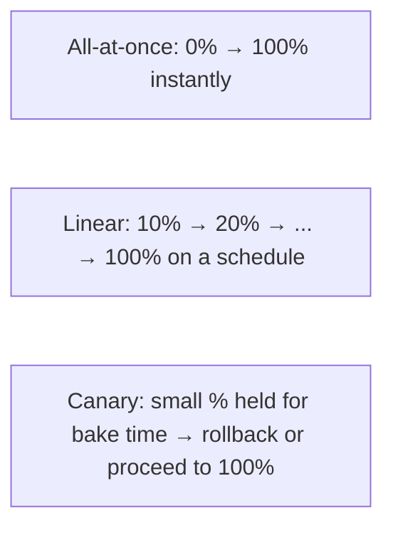

Step by step: (1) all-at-once offers zero gradual visibility but is fastest, appropriate for
low-risk changes or non-production environments; (2) linear gives incremental exposure and a
chance to catch issues partway through the rollout, proportional to how far traffic has shifted;
(3) canary deliberately limits initial exposure to a small percentage and pauses for a bake time
specifically to let an attached CloudWatch alarm fire and trigger an automatic rollback before
any further traffic is put at risk — the most cautious of the three.

**Why the others are wrong:**
- **B:** Blue/green, shadow, and A/B testing are different (and sometimes overlapping/different-
  axis) deployment concepts elsewhere in SageMaker/ML practice, but they are not the specific
  names SageMaker uses for its three built-in endpoint deployment **traffic-shifting
  configurations** — those are specifically all-at-once, linear, and canary.
- **C:** These are three distinct, separately configurable behaviors with materially different
  risk profiles and rollout speeds — SageMaker explicitly supports choosing between them, not a
  single fixed behavior.
- **D:** This reorders the three names relative to the three behaviors described in the
  question — canary (small-percentage-then-rollback-or-proceed) was listed third in the
  question's description, not first, and all-at-once (instant) was listed first, not third.

---

## Q64 — Domain 1 (Data Preparation for ML and AI)

A RAG pipeline chunks a 50-page technical manual into fixed 500-token chunks with **no overlap**
between consecutive chunks. During testing, the team notices that questions whose answers span
content right at a chunk boundary (e.g., a sentence that's split so its first half ends chunk 12
and its second half begins chunk 13) are frequently answered incorrectly or incompletely, since
retrieval often returns only one of the two chunks, missing the other half of the relevant
context. What change to the chunking configuration most directly addresses this?

A) Make the chunks much larger (e.g., 10,000 tokens each) so the entire document becomes one
   chunk, eliminating boundaries entirely
B) **Introduce chunk overlap** (e.g., a 50–100 token overlap between consecutive chunks), so
   content near a boundary appears in both neighboring chunks, making it much more likely that
   retrieval captures the full relevant context even when it spans a boundary
C) Switch the embedding model to a larger-dimensional model, since boundary issues are caused by
   insufficient embedding dimensionality
D) Remove chunking entirely and embed the raw manual as a single unchunked blob of text

**Correct Answer: B**

**Explanation:** **Chunk overlap** deliberately duplicates a small window of content (e.g., the
last 50–100 tokens of one chunk) at the start of the next chunk, so that content straddling a
hard boundary is still fully present within at least one retrievable chunk — directly addressing
the "split sentence/context across chunk boundary" retrieval-quality problem without requiring
drastically larger chunks (which would hurt retrieval precision by diluting each chunk's topical
focus) or abandoning chunking altogether. See
[`certifications/mla-c02/domain-1-data-preparation/embeddings-and-rag-data-prep.md`](../domain-1-data-preparation/embeddings-and-rag-data-prep.md).

**Why the others are wrong:**
- **A:** Making chunks enormous (or the whole document one chunk) would eliminate boundary
  issues but at the cost of retrieval precision and context-window efficiency — a nearly
  irrelevant chunk of thousands of tokens gets pulled in for every query, and most embedding
  models/foundation-model context windows are not well suited to extremely long, topically
  unfocused chunks.
- **C:** Embedding dimensionality affects how much semantic nuance a vector can represent — it
  has no bearing on whether a sentence is physically split across two separate text chunks at
  retrieval time; this misdiagnoses a chunking-strategy problem as an embedding-model problem.
- **D:** Removing chunking entirely reintroduces the original problem RAG chunking exists to
  solve (fitting relevant, focused context into a prompt without exceeding context-window limits
  or diluting retrieval precision with the entire document every time) — it doesn't target the
  boundary issue at all.

---

## Q65 — Domain 1 (Data Preparation for ML and AI)

A team is choosing a vector store for a new RAG application. Requirement A: they need the
simplest possible fully-managed experience with minimal infrastructure to operate, tightly
integrated with Bedrock Knowledge Bases, without first needing deep vector-database expertise.
Requirement B (a different, hypothetical team) is already heavily invested in Amazon Aurora
PostgreSQL for their relational data and wants to add vector similarity search without
introducing an entirely separate database technology to operate. Which vector store best fits
each team, respectively?

A) Team A should use **Amazon OpenSearch Serverless's vector engine** (a common default,
   fully-managed vector store tightly integrated as a Bedrock Knowledge Bases backend, requiring
   little upfront vector-database tuning); Team B should use **Aurora PostgreSQL with the
   `pgvector` extension** (adding vector columns/similarity search directly inside their existing
   relational database, avoiding a separate new data store)
B) Both teams should use Amazon Neptune, a graph database, since graph databases are the only
   valid vector store option for RAG
C) Team A should use DynamoDB as a vector store; Team B should use Amazon Kendra
D) Vector store choice has no effect on RAG retrieval quality or operational complexity; any
   database can be substituted for any other with identical results

**Correct Answer: A**

**Explanation:** **Amazon OpenSearch Serverless's vector engine** is a common, fully-managed
default vector store choice for Bedrock Knowledge Bases — minimal operational overhead, native
Bedrock integration, well suited to a team that doesn't want to hand-roll vector infrastructure.
**Aurora PostgreSQL with `pgvector`** instead lets a team already running Aurora add vector
columns and similarity-search queries (e.g., cosine distance operators) directly within their
existing relational database, avoiding standing up an entirely separate vector-specific system —
the right fit when minimizing *new* infrastructure/technology footprint matters more than using
a dedicated vector-search engine. See
[`services/analytics/opensearch.md`](../../../services/analytics/opensearch.md) and
[`certifications/mla-c02/domain-1-data-preparation/embeddings-and-rag-data-prep.md`](../domain-1-data-preparation/embeddings-and-rag-data-prep.md).

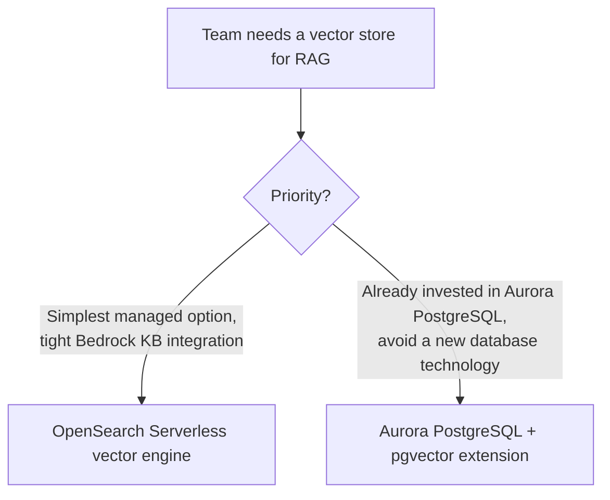

Step by step: (1) the decision hinges on each team's actual constraint — operational simplicity
and native Bedrock integration versus minimizing the number of distinct database technologies in
play; (2) OpenSearch Serverless's vector engine requires no manual cluster capacity planning and
plugs directly into Bedrock Knowledge Bases' data-source sync workflow; (3) `pgvector` instead
turns an existing relational database into a dual-purpose store, which is attractive
specifically *because* a team already operates and trusts Aurora, not because it's the most
feature-rich vector engine available.

**Why the others are wrong:**
- **B:** Neptune is a **graph** database (nodes/edges/relationships), not a vector similarity
  search engine by default — it is not "the only valid" option, and isn't the natural fit for
  either team's stated requirement here.
- **C:** DynamoDB is a key-value/document NoSQL database with no native vector similarity search
  capability suited to RAG retrieval at scale; Kendra is an intelligent **search** service with
  its own ranking model, a different tool than a general-purpose vector store a team would
  integrate directly for custom RAG pipelines.
- **D:** Vector store choice materially affects operational complexity (managed vs.
  self-operated), integration ease (native Bedrock Knowledge Bases support or not), and even
  retrieval quality/scalability characteristics — claiming no difference ignores the very
  tradeoffs this question is testing.

---
