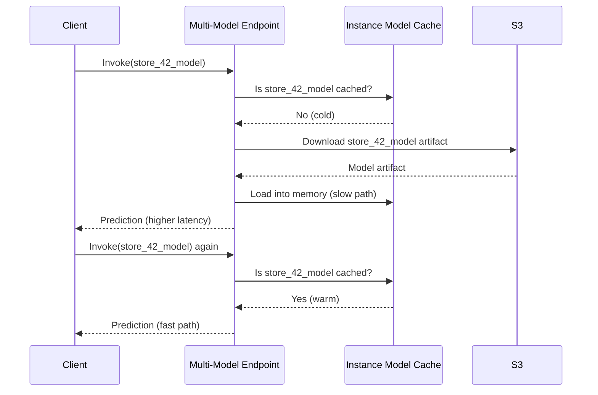
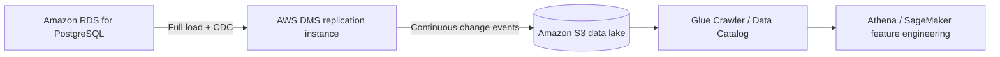
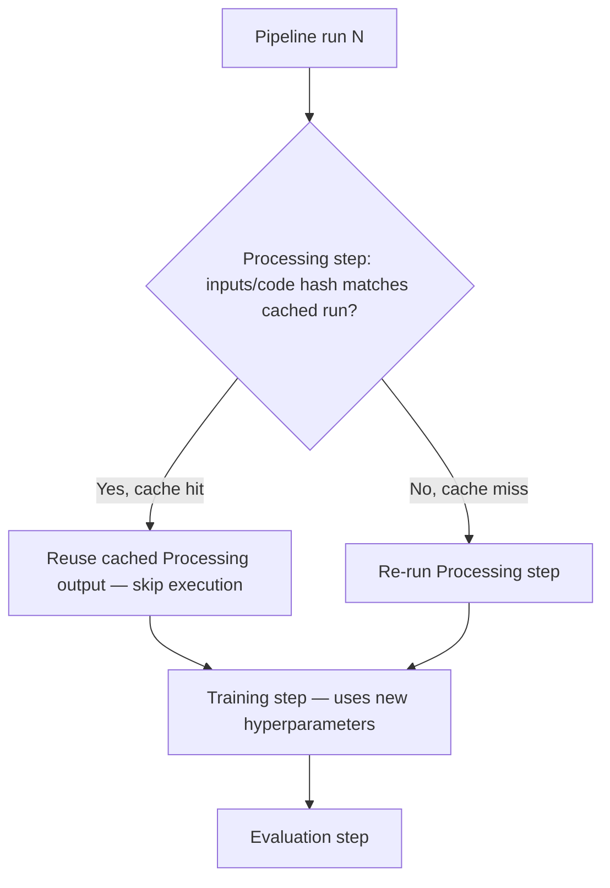
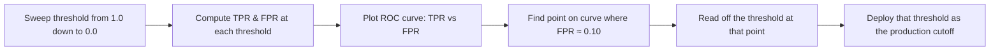

# MLA-C02 Exam Bank 1 — Study Mode (65 Questions)

Full-length, domain-mixed practice exam in **study mode**: the correct answer and a complete
explanation (including why each wrong option is wrong) appear immediately after every question.
See [`README.md`](README.md) for how this fits with `practice-questions/` and
`practice-questions/full-exams/`.

## Domain mix in this bank

| Domain | Questions | Target weight |
|---|---|---|
| 1 — Data Preparation for ML and AI | 18 | 28% |
| 2 — ML Model and Foundation Model Development | 16 | 24% |
| 3 — Deployment and Orchestration of ML Workflows | 16 | 24% |
| 4 — Operating, Monitoring, and Securing ML Solutions | 15 | 24% |
| **Total** | **65** | **100%** |

Domains are interleaved throughout (not grouped) to mirror real exam ordering.

---

## Q1 — Domain 1 (Data Preparation for ML and AI)

A gaming company receives 2 TB/day of player-event JSON from millions of concurrent sessions.
They don't need sub-second processing — they just want the raw stream durably delivered into
S3 as compressed, columnar Parquet files, partitioned by hour, with zero custom consumer code
to write or operate. Which service is the best fit?

A) Amazon Kinesis Data Streams with a custom Lambda consumer that batches and converts records
B) Amazon Data Firehose with a configured Parquet conversion and S3 destination
C) AWS Database Migration Service (DMS) configured for continuous replication
D) Amazon SageMaker Data Wrangler scheduled to run hourly

**Correct Answer: B**

**Explanation:** **Amazon Data Firehose** is purpose-built for exactly this: durable,
fully-managed delivery of streaming data into destinations like S3, with built-in format
conversion (JSON → Parquet/ORC), compression, and time-based partitioning — all configured
declaratively, with no consumer code to write or servers to run. This is the key
Firehose-vs-Kinesis-Data-Streams distinction tested on the exam: Streams gives you raw,
low-latency access to a shard-based stream that *you* must consume with custom code; Firehose
is the "point it at a destination and walk away" managed delivery layer. See
[`services/analytics/kinesis-family.md`](../../../services/analytics/kinesis-family.md) and the
[Domain 1 README](../domain-1-data-preparation/README.md#common-exam-scenarios).

**Why the others are wrong:**
- **A:** Kinesis Data Streams *can* get the data into S3, but only if you build and operate a
  custom consumer (Lambda, KCL app, or Kinesis Data Analytics) to batch, convert, and write the
  records — exactly the operational burden the question says to avoid. Streams is for when you
  need sub-second custom processing logic, not a simple land-in-S3 pipe.
- **C:** DMS is for replicating from relational/NoSQL *database* sources (e.g., migrating or
  continuously syncing an RDS table) — it is not an ingestion path for a high-volume streaming
  event firehose from application servers.
- **D:** Data Wrangler is an interactive, notebook-driven data exploration and transformation
  tool for preparing a dataset before modeling — it is not a streaming ingestion service and
  cannot "run hourly" against a live 2 TB/day event stream.

---

## Q2 — Domain 2 (ML Model and Foundation Model Development)

A bank's fraud team has two candidate thresholds for a transaction-fraud classifier. At the
stricter threshold, the model catches fewer fraud cases but almost never flags a legitimate
transaction as fraud (very few false positives). At the looser threshold, it catches nearly all
fraud but also blocks many legitimate customers' cards (many false positives), creating a costly
customer-service burden. The business says: "a blocked legitimate customer is expensive and
damages trust — we'd rather miss a few fraud cases than annoy many good customers." Which
metric should be prioritized when choosing the threshold?

A) Recall (sensitivity) — maximize the fraction of actual fraud cases caught
B) Precision — maximize the fraction of flagged transactions that are truly fraud
C) Overall accuracy across all transactions
D) Mean Squared Error (MSE)

**Correct Answer: B**

**Explanation:** **Precision** = TP / (TP + FP) — it answers "of everything I flagged, how much
was actually fraud?" When the cost of a **false positive** (wrongly blocking a good customer) is
the thing the business most wants to minimize, you optimize for high precision, accepting that
recall (catching every fraud case) may be lower. This is the mirror image of the classic
"missed disease case" recall-priority scenario — the exam tests that you can correctly identify
*which* side of the precision/recall tradeoff a given cost asymmetry points to. See
[`ml-fundamentals-glossary.md`](../domain-2-model-development/ml-fundamentals-glossary.md).

**Why the others are wrong:**
- **A:** Recall prioritizes catching every fraud case even at the cost of many false positives —
  exactly the opposite of what this business wants, since it explicitly says false positives
  (blocked good customers) are the expensive side of the tradeoff here.
- **C:** With likely heavy class imbalance (most transactions are legitimate), overall accuracy
  stays high regardless of threshold and doesn't reflect the specific false-positive-vs-false-
  negative cost tradeoff the business is asking to optimize.
- **D:** MSE is a regression-error metric (distance between predicted and actual *numeric*
  values); it has no meaning for a binary classification decision threshold problem.

---

## Q3 — Domain 3 (Deployment and Orchestration of ML Workflows)

A company hosts 300 small XGBoost models (one per retail store) behind a **SageMaker
multi-model endpoint (MME)**, with all model artifacts stored in S3. A store manager reports
that the very first prediction request after a long period of inactivity for their store's model
takes noticeably longer than subsequent requests for the same model. What explains this, and is
it expected MME behavior?

A) This indicates endpoint misconfiguration; all 300 models should always be pre-loaded in memory
B) This is expected: MME dynamically loads a model from S3 into the container's memory on first
   invocation (or after eviction from a full cache), so a "cold" model incurs a one-time load
   latency before being cached for fast subsequent calls
C) This indicates the endpoint has crashed and needs to be redeployed
D) This means the instance type is too small and must be upgraded to fix all latency

**Correct Answer: B**

**Explanation:** A **multi-model endpoint** doesn't keep every model resident in memory — it
keeps a working set of recently-used models cached on the instance and **lazily loads** a model
from S3 the first time it's invoked (or re-loads it if it was evicted to make room for others).
That first load is slower (download + deserialize); afterward, the cached model serves requests
at normal latency. This load-on-demand behavior is precisely what makes MMEs cost-efficient for
many sparsely-used models on shared instances, trading a small per-cold-model latency hit for
not needing hundreds of always-on endpoints. See
[`services/machine-learning-ai/sagemaker-deployment-endpoints.md`](../../../services/machine-learning-ai/sagemaker-deployment-endpoints.md).

Step by step: (1) the first request for a given store's model misses the in-memory cache,
forcing a synchronous S3 download and deserialization — this is the latency spike the manager
observed; (2) once loaded, the model stays in the cache until evicted (usually LRU-based, when
memory fills up with other stores' models); (3) every subsequent request for that same model
hits the warm cache and returns at normal, fast latency — exactly the behavior MME is designed
to provide.

**Why the others are wrong:**
- **A:** Pre-loading all 300 models defeats the entire purpose of an MME (sharing limited
  instance memory across many lightly-used models) and isn't how the feature is designed or
  priced — it would require per-model dedicated capacity, which is what MME avoids.
- **C:** A crashed endpoint would return errors or timeouts consistently, not a one-time latency
  bump followed by normal responses — the pattern described is cold-load latency, not a failure.
- **D:** Instance sizing affects baseline compute/memory capacity and cache size, but it does not
  eliminate the fundamental cold-load-then-cache behavior inherent to how MME works; this isn't
  a sizing problem, it's expected dynamic loading behavior.

---

## Q4 — Domain 4 (Operating, Monitoring, and Securing ML Solutions)

A deployed model's SageMaker Model Monitor data quality job reports that the statistical
distribution of the `customer_age` input feature has shifted noticeably from its training
baseline. Separately, the team also notices that the *relationship* between `customer_age` and
the actual loan-default outcome has changed — older customers who used to default rarely are now
defaulting at a much higher rate than the training data ever showed, even though the age
distribution of applicants itself hasn't changed much. What are these two phenomena called,
respectively?

A) Both are the same phenomenon: data drift
B) The first is **data drift** (a shift in input feature distributions); the second is
   **concept drift** (a shift in the relationship between inputs and the true label/outcome)
C) The first is concept drift; the second is data drift
D) Both are examples of training/serving skew

**Correct Answer: B**

**Explanation:** **Data drift** (also called covariate shift) is when the *statistical
distribution of input features* changes over time — the shape of `customer_age` itself shifting
is a feature-distribution change, detectable purely from the inputs without needing any ground
truth labels. **Concept drift** is when the *underlying relationship between features and the
target* changes — here, the real-world mapping from age to default risk has shifted (e.g., due
to a macroeconomic change), which is a fundamentally different and often more dangerous problem
because the model's learned decision boundary is now wrong even if the inputs look familiar.
Distinguishing these is a recurring exam trap. See
[`certifications/mla-c02/domain-4-monitoring-security/README.md`](../domain-4-monitoring-security/README.md)
and [`services/machine-learning-ai/sagemaker-model-monitor-and-registry.md`](../../../services/machine-learning-ai/sagemaker-model-monitor-and-registry.md).

**Why the others are wrong:**
- **A:** Treating both as "data drift" misses that the second scenario is specifically about the
  input-output *relationship* changing, not the input distribution — the age distribution barely
  moved, but the label behavior for a given age did, which is the defining signature of concept
  drift, not data drift.
- **C:** This reverses the definitions: the feature-distribution shift (age values themselves
  changing) is data drift, and the relationship/label shift (same age, different outcome) is
  concept drift — not the other way around.
- **D:** Training/serving skew is a *data-pipeline bug* where training and inference compute a
  feature differently (e.g., different code paths) — it is a static implementation defect, not
  a phenomenon that emerges and evolves over time in production the way drift does.

---

## Q5 — Domain 1 (Data Preparation for ML and AI)

A company runs its order-management system on Amazon RDS for PostgreSQL. They want an ML
feature-engineering pipeline to always have a near-real-time copy of the `orders` and
`customers` tables mirrored into S3 as the source system changes (inserts, updates, deletes),
without writing custom change-data-capture code, and without impacting the production
database's performance. Which service should they use?

A) AWS Glue crawler scheduled to run every 5 minutes against the RDS database
B) AWS Database Migration Service (DMS) with ongoing replication (CDC) from RDS to an S3 target
C) Amazon Kinesis Data Streams reading directly from the RDS binary log
D) A nightly `pg_dump` export loaded into S3 via a cron job

**Correct Answer: B**

**Explanation:** **AWS DMS** is purpose-built for exactly this: an initial full load followed by
continuous **change data capture (CDC)** replication from a relational source (RDS, on-prem DB,
etc.) into a target like S3, capturing inserts/updates/deletes with minimal source-database
load, and without any custom CDC code. This is the core Domain 1 distinction between DMS
(database replication) and Firehose/Kinesis (event-stream ingestion). See
[`certifications/mla-c02/domain-1-data-preparation/README.md`](../domain-1-data-preparation/README.md#common-exam-scenarios).

Step by step: (1) DMS performs a one-time full load of existing `orders`/`customers` rows into
S3; (2) it then tails the database's transaction log to continuously capture new changes as CDC
events, applying them to the S3 target so it stays near-real-time in sync; (3) a Glue crawler can
catalog the resulting S3 data so Athena and SageMaker can query it with a consistent schema.

**Why the others are wrong:**
- **A:** A Glue crawler only discovers and catalogs *schema* (table/column metadata) for data
  already sitting in a target like S3 — it does not extract, replicate, or capture ongoing
  changes from a live RDS database; running it every 5 minutes wouldn't move any actual data.
- **C:** Kinesis Data Streams cannot read a relational database's binary/transaction log
  directly — you'd need DMS (or a custom connector) in front of it to turn CDC events into a
  stream; Streams itself has no native RDS-log-tailing capability.
- **D:** A nightly `pg_dump` is a slow, heavy, all-or-nothing batch export that locks/strains the
  source database and introduces up to 24 hours of staleness — incompatible with "near-real-time"
  and risky for a production system's performance.

---

## Q6 — Domain 2 (ML Model and Foundation Model Development)

A multi-class news-categorization model is evaluated on a test set with 10 roughly
equally-sized categories. The team wants one summary metric per class that balances both
"when I predict this category, am I right?" and "of all articles truly in this category, did I
find them?" — and then wants to average that metric across all 10 classes to get one overall
number for model comparison. Which metric and averaging approach fits this requirement?

A) Overall accuracy across all 10 classes
B) Macro-averaged F1 score (the harmonic mean of precision and recall, computed per class and
   averaged)
C) Mean Squared Error (MSE) per class
D) R² (coefficient of determination) averaged across classes

**Correct Answer: B**

**Explanation:** **F1 score** is specifically the harmonic mean of precision and recall for a
class, giving one number that penalizes a model which is lopsided toward only one of the two.
**Macro-averaging** across the 10 classes (compute F1 per class, then average the 10 F1 values
unweighted) gives equal importance to every category regardless of its size — the right choice
when categories are roughly balanced and you care about per-class fairness. See
[`ml-fundamentals-glossary.md`](../domain-2-model-development/ml-fundamentals-glossary.md).

**Why the others are wrong:**
- **A:** Plain accuracy is a single aggregate correctness rate across all predictions; it doesn't
  decompose into a per-class precision/recall balance, and can hide poor performance on
  individual categories even when categories are balanced in size.
- **C:** MSE measures distance between predicted and actual *numeric* values — it has no
  definition for a categorical/multi-class labeling problem.
- **D:** R² is a regression goodness-of-fit metric (variance explained by a numeric prediction);
  it is undefined for classification tasks and cannot be computed "per class" for categories.

---

## Q7 — Domain 3 (Deployment and Orchestration of ML Workflows)

A SageMaker Pipeline includes: (1) a Processing step that transforms 500 GB of raw data, (2) a
Training step, (3) an Evaluation step. The team re-runs the pipeline frequently while only
tweaking the Training step's hyperparameters — but the Processing step is deterministic and its
inputs never change between these re-runs, yet it still takes 25 minutes every time. What
SageMaker Pipelines feature should they enable to skip re-running unchanged steps?

A) SageMaker Pipelines does not support this; they must manually comment out the Processing step
B) **Step caching** — SageMaker Pipelines can cache a step's outputs and skip re-execution on a
   subsequent run if its inputs, code, and configuration haven't changed
C) Switch the Processing step to use Spot Instances to make it faster
D) Delete the Processing step and bake its logic directly into the Training step's container

**Correct Answer: B**

**Explanation:** **SageMaker Pipelines step caching** lets you mark a step as cacheable; when the
pipeline re-runs, it computes a hash of the step's inputs, source code, and configuration, and if
that hash matches a prior successful run within the configured cache expiration window, it
**reuses the previous output instead of re-executing the step** — exactly addressing the "same
inputs every time, but 25 minutes wasted" problem. See
[`services/machine-learning-ai/sagemaker-pipelines.md`](../../../services/machine-learning-ai/sagemaker-pipelines.md).

Step by step: (1) on every pipeline execution, SageMaker Pipelines checks whether a cacheable
step's inputs/code/config hash matches a previous successful execution's hash; (2) if it's a
cache hit (as in this scenario, where only Training's hyperparameters changed), the Processing
step is skipped entirely and its prior output is reused; (3) the Training step always re-runs
here since its configuration (hyperparameters) is deliberately changing each time.

**Why the others are wrong:**
- **A:** Pipelines does support this natively via step caching — manually commenting out steps
  would break the pipeline's reproducibility and versioning, and isn't how the feature is meant
  to be used.
- **C:** Spot Instances reduce the *cost* of compute, not the *need* to re-run an already-
  deterministic, unchanged step — it doesn't address the redundant-execution problem at all.
- **D:** Merging steps together loses the modularity, independent retry/caching, and lineage
  tracking that having separate pipeline steps provides, and doesn't actually solve the
  redundant-computation issue — it just hides it inside one bigger step.

---

## Q8 — Domain 4 (Operating, Monitoring, and Securing ML Solutions)

A lending company deployed a loan-approval model six months ago after SageMaker Clarify's
pre-training and post-training bias reports showed no concerning disparity at launch. A
compliance audit now asks: "how do you know the model's fairness hasn't degraded since launch,
as the applicant population and approval patterns have naturally shifted over time?" Which
capability directly answers this, going beyond a one-time pre-deployment Clarify check?

A) Re-running the exact same one-time Clarify report manually once a year
B) **SageMaker Model Monitor's bias drift monitoring**, which continuously evaluates a deployed
   model's live predictions for bias metrics on a schedule and alarms if they drift beyond a
   configured threshold
C) SageMaker Ground Truth, to re-label the original training dataset
D) AWS Config, to track changes to the endpoint's IAM role

**Correct Answer: B**

**Explanation:** A one-time Clarify bias check only reflects the model's fairness properties *at
that moment*, using the training-time data distribution. **Model Monitor's bias drift
monitoring capability** runs on a recurring schedule against live production inference traffic,
computing the same kinds of bias metrics (e.g., disparate impact) continuously and alarming via
CloudWatch if they drift outside the approved range — giving ongoing assurance as the real-world
population and outcomes evolve, which a single launch-time report cannot provide. See
[`certifications/mla-c02/domain-4-monitoring-security/responsible-ai-and-guardrails.md`](../domain-4-monitoring-security/responsible-ai-and-guardrails.md)
and [`services/machine-learning-ai/sagemaker-model-monitor-and-registry.md`](../../../services/machine-learning-ai/sagemaker-model-monitor-and-registry.md).

**Why the others are wrong:**
- **A:** An annual manual re-run is still a point-in-time snapshot with up to a year of blind
  spot in between — it is not continuous monitoring and wouldn't catch gradual drift as it
  happens, only long after the fact (if at all).
- **C:** Re-labeling the original *training* dataset doesn't tell you anything about how the
  deployed model's *live, post-launch* predictions are behaving with respect to fairness — it's
  backward-looking at stale data, not a production monitoring mechanism.
- **D:** AWS Config tracks *infrastructure configuration* changes (like IAM role attachments or
  instance types); it has no concept of statistical bias metrics on model predictions and cannot
  detect bias drift.

---

## Q9 — Domain 1 (Data Preparation for ML and AI)

A healthcare organization's data lake holds patient records in S3. Different ML teams need
different levels of access: the research team may query de-identified columns only (no name,
no SSN), while the clinical-operations team may query all columns, and both must only ever see
rows for patients who consented to data sharing. The company wants this enforced centrally,
without duplicating the data into separate restricted copies per team. Which AWS capability
fits?

A) S3 bucket policies restricting access by IAM principal at the whole-bucket level
B) **AWS Lake Formation**, using column-level and row-level permissions grants on the same
   underlying table, enforced centrally per principal/role
C) Encrypting different columns with different KMS keys and only sharing the keys teams need
D) Creating a separate S3 bucket per team with a manual nightly copy job

**Correct Answer: B**

**Explanation:** **AWS Lake Formation** provides fine-grained, centrally-managed **column-level
and row-level security** on top of a single shared data lake table (backed by Glue Data Catalog
+ S3), so different principals querying the *same* underlying table (via Athena, Redshift
Spectrum, EMR, etc.) each see only the columns/rows they're authorized for — no data
duplication, and permissions managed in one place. See
[`services/analytics/data-lake-concepts.md`](../../../services/analytics/data-lake-concepts.md)
and the [Domain 1 README](../domain-1-data-preparation/README.md).

**Why the others are wrong:**
- **A:** S3 bucket policies can restrict access at the bucket/prefix/object level based on IAM
  principal, but they have no concept of column-level or row-level filtering within a shared
  table — you'd need to physically separate data into different objects to achieve that, which
  isn't fine-grained governance on the same table.
- **C:** Per-column KMS keys could coarsely gate "can decrypt this column or not," but it doesn't
  provide row-level filtering (e.g., only consented patients), and managing dozens of per-column
  keys and key-sharing policies is operationally far more complex than Lake Formation's native
  grants.
- **D:** Duplicating data into separate buckets per team is exactly the "duplicate copies"
  approach the question says to avoid — it multiplies storage cost, creates data-consistency
  risk between copies, and doesn't scale as access rules change.

---

## Q10 — Domain 2 (ML Model and Foundation Model Development)

A binary classifier's confusion matrix on a 1,000-sample test set is: True Positives = 150,
False Positives = 50, False Negatives = 30, True Negatives = 770. What is the model's recall?

A) 150 / (150 + 50) = 75%
B) 150 / (150 + 30) = 83.3%
C) (150 + 770) / 1000 = 92%
D) 150 / 1000 = 15%

**Correct Answer: B**

**Explanation:** **Recall (sensitivity)** = TP / (TP + FN) — of all the actual positive cases
(TP + FN = 150 + 30 = 180), how many did the model correctly identify? 150/180 = 83.3%. Being
able to correctly pick the right numerator/denominator out of a confusion matrix for precision
vs. recall vs. accuracy is a core, recurring exam skill. See
[`ml-fundamentals-glossary.md`](../domain-2-model-development/ml-fundamentals-glossary.md).

**Why the others are wrong:**
- **A:** 150/(150+50) is **precision** (TP / (TP+FP)) — of everything flagged positive, how much
  was truly positive — not recall. It answers a different question than "how much of the real
  positive class did we catch?"
- **C:** (TP+TN)/Total is **accuracy** — overall correctness across both classes — not a
  class-specific metric like recall, and it can look artificially high under class imbalance.
- **D:** TP/Total divides the true positives by the *entire* dataset (including true negatives
  that were never at risk of being "caught"), which isn't a standard metric and badly
  understates how well the model finds actual positives.

---

## Q11 — Domain 3 (Deployment and Orchestration of ML Workflows)

A team has a new fraud-model candidate they believe outperforms the current production model.
Unlike shadow testing (where the new model's predictions are never shown to users) or a
canary rollout (gradually shifting ALL traffic to the new version over time), they specifically
want to split live traffic so that, say, 80% of real requests are served by the current
production model and 20% by the new candidate **simultaneously and indefinitely**, comparing
real business outcomes (actual fraud losses) between the two groups before deciding whether to
fully promote the new model. Which SageMaker deployment capability is designed for this?

A) SageMaker Batch Transform run twice, once per model version
B) **Production variants** on a single SageMaker endpoint, with a configured traffic-weighting
   split (e.g., 80/20) across the two model variants, enabling live A/B testing
C) Bedrock Guardrails configured with two separate policies
D) AWS Step Functions with a random-number-based branch to two separate Lambda functions

**Correct Answer: B**

**Explanation:** **SageMaker production variants** let you host multiple model versions behind
**one endpoint**, each variant given a traffic-weight percentage; SageMaker routes that
percentage of real invocation traffic to each variant automatically, letting you run a true
**A/B test** — both models serving real users concurrently and indefinitely at a stable split —
and compare real-world business metrics side by side, distinct from canary (temporary, ramping
toward 100%) or shadow (invisible to users) patterns. See
[`services/machine-learning-ai/sagemaker-deployment-endpoints.md`](../../../services/machine-learning-ai/sagemaker-deployment-endpoints.md).

**Why the others are wrong:**
- **A:** Batch Transform is for offline, non-live scoring of a static dataset — it has no
  concept of splitting *live* request traffic between two concurrently-serving model versions.
- **C:** Bedrock Guardrails are safety/content-filtering policies for foundation model
  invocations; they have nothing to do with splitting traffic between two competing model
  versions for A/B comparison.
- **D:** A custom Lambda/Step Functions random-routing solution could theoretically be built,
  but it reinvents (with more operational overhead, no built-in CloudWatch per-variant metrics)
  something SageMaker production variants already provide natively and more simply.

---

## Q12 — Domain 4 (Operating, Monitoring, and Securing ML Solutions)

A team already runs SageMaker Model Monitor's **data quality** monitor (input feature
distribution shifts) and **model quality** monitor (accuracy vs. ground truth) on a deployed
credit-risk model. A regulator now specifically asks: "can you detect if the *relative
importance of each feature driving the model's decisions* has shifted over time, even if
overall accuracy looks stable?" Which additional Model Monitor capability answers this?

A) Re-running the data quality monitor more frequently
B) **Feature attribution drift monitoring**, which tracks changes in SHAP-value-based feature
   importance between training time and live production over time
C) Re-running the model quality monitor more frequently
D) Enabling SageMaker Debugger on the live endpoint

**Correct Answer: B**

**Explanation:** SageMaker Model Monitor supports four distinct monitor types: **data quality**
(input distribution shift), **model quality** (accuracy/label-based drift), **bias drift**
(fairness-metric drift), and **feature attribution drift** — which specifically tracks whether
the *relative contribution of each feature to predictions* (computed via SHAP values, the same
technique Clarify uses for explainability) has shifted from the training baseline, catching
cases where a feature that used to barely matter has quietly become dominant (or vice versa),
even while aggregate accuracy looks unchanged. See
[`services/machine-learning-ai/sagemaker-model-monitor-and-registry.md`](../../../services/machine-learning-ai/sagemaker-model-monitor-and-registry.md).

**Why the others are wrong:**
- **A:** Data quality monitoring tracks raw input feature *distributions*, not how much each
  feature *contributes* to the model's output decisions — increasing its frequency doesn't add
  feature-importance tracking.
- **C:** Model quality monitoring needs timely ground-truth labels and tracks aggregate
  accuracy-style metrics; it doesn't decompose predictions into per-feature attribution the way
  feature attribution drift monitoring does, so running it more often doesn't answer the
  regulator's specific question.
- **D:** SageMaker Debugger is a *training-time* tool for diagnosing issues like vanishing
  gradients or resource bottlenecks during a training job — it does not run against a live
  production endpoint for ongoing feature-attribution monitoring.

---

## Q13 — Domain 1 (Data Preparation for ML and AI)

A team stores 50 TB of training images in S3. Some images (recent uploads) are accessed
constantly by active training jobs; others (from completed projects) go untouched for months,
then are suddenly needed again for a re-training experiment, unpredictably. The team doesn't
want to manually classify or move objects between storage tiers, and wants cost automatically
optimized based on actual observed access patterns. Which S3 storage class fits best?

A) S3 Standard for everything, to guarantee the fastest possible access at all times
B) **S3 Intelligent-Tiering**, which automatically moves objects between access tiers based on
   changing access patterns, with no retrieval delay and no manual lifecycle management
C) S3 Glacier Deep Archive for everything, since it's the cheapest storage class
D) S3 One Zone-Infrequent Access for everything, to save on redundancy costs

**Correct Answer: B**

**Explanation:** **S3 Intelligent-Tiering** is designed exactly for **unknown or changing**
access patterns: it monitors each object's access frequency and automatically moves it between
frequent-access and infrequent-access tiers (and optionally archive tiers) without any manual
lifecycle rules, and critically, without the retrieval-time delay that Glacier tiers impose — a
good fit when you can't predict which images will suddenly become "hot" again. See
[`services/storage`](../../../services/storage) and the
[Domain 1 README](../domain-1-data-preparation/README.md#common-exam-scenarios).

**Why the others are wrong:**
- **A:** S3 Standard for everything guarantees fast access but pays the highest per-GB storage
  cost even for the months-untouched images — ignoring the cost-optimization opportunity the
  question asks for.
- **C:** Glacier Deep Archive has retrieval times measured in **hours**, which would badly break
  the "suddenly needed again" unpredictable-access requirement — fine for compliance archives
  nobody expects to touch, wrong for data that might need to be grabbed for an experiment at any
  time.
- **D:** One Zone-IA reduces cost by dropping multi-AZ redundancy, but it's a manually-selected
  *static* tier for data you already know is infrequently accessed — it does nothing for data
  whose access pattern is unpredictable and changing, and risks data loss if the single AZ fails.

---

## Q14 — Domain 2 (ML Model and Foundation Model Development)

A binary classifier outputs a probability score for each sample. Plotting the ROC curve (true
positive rate vs. false positive rate across all possible thresholds) shows a curve that bows
sharply toward the top-left corner. The team now needs to pick one specific operating threshold
for production use, knowing their business tolerates a false positive rate up to 10% but wants
the highest true positive rate achievable within that constraint. What should they do?

A) Pick the threshold that gives the single highest AUC value
B) Read the ROC curve to find the operating point near FPR = 0.10, and select the
   decision threshold that produces that point, maximizing TPR subject to the FPR constraint
C) Always use a threshold of exactly 0.5, since that is the only valid classification cutoff
D) Discard the model and retrain with a different algorithm, since ROC curves can't inform
   threshold selection

**Correct Answer: B**

**Explanation:** The **ROC curve** plots TPR vs. FPR as the decision threshold sweeps across
its full range — each point on the curve corresponds to a specific threshold. To operationalize
a business constraint like "FPR must not exceed 10%," you locate the point on the curve at
FPR ≈ 0.10, read off the threshold that produces it, and that's the production cutoff —
maximizing TPR within the stated FPR budget. AUC summarizes overall discriminative power across
*all* thresholds, but choosing a single operating point requires reading the curve itself. See
[`ml-fundamentals-glossary.md`](../domain-2-model-development/ml-fundamentals-glossary.md).

Step by step: (1) the ROC curve is generated by evaluating TPR/FPR at every possible threshold,
not just one; (2) AUC is a single scalar summarizing the whole curve's quality, independent of
any one threshold choice; (3) to pick an actual production threshold under a specific business
constraint (FPR ≤ 10%), you must trace the curve to the FPR = 0.10 point and read off the
threshold value that produced it — a step entirely separate from computing AUC.

**Why the others are wrong:**
- **A:** AUC is a single number summarizing performance across *all* thresholds combined — it
  has no "threshold" to pick at all; maximizing AUC describes overall model quality, not a
  specific operating point for production decisions.
- **C:** 0.5 is only a default/arbitrary cutoff with no inherent business meaning — the whole
  point of reading the ROC curve is to choose a threshold that matches the business's actual
  FPR/TPR tolerance, which may be far from 0.5.
- **D:** ROC curves are precisely the standard tool for informing threshold selection under a
  constraint like a maximum acceptable FPR — this option gets the purpose of ROC analysis
  backwards.

---

## Q15 — Domain 3 (Deployment and Orchestration of ML Workflows)

A manufacturer trains an object-detection model in SageMaker on GPU instances in the cloud, but
must run inference on an NVIDIA Jetson-based edge device on the factory floor with no cloud
connectivity at inference time, and needs the model optimized specifically for that device's
hardware (not a generic format) to hit the required frames-per-second. Which service compiles
the trained model for this specific target hardware?

A) AWS IoT Greengrass alone, without any model compilation step
B) **Amazon SageMaker Neo**, which compiles the trained model into an optimized form for a
   specific target hardware platform (e.g., the Jetson's GPU architecture), then the compiled
   artifact is deployed to the edge device (often via IoT Greengrass) for local inference
C) AWS Glue, to transform the model file format
D) Amazon SageMaker Ground Truth, to re-label the training data for the new hardware

**Correct Answer: B**

**Explanation:** **SageMaker Neo** takes a trained model and **compiles** it into an optimized
binary tuned for a specific target chip/hardware platform (e.g., ARM Cortex, NVIDIA Jetson, or
Inferentia), substantially improving inference speed and reducing memory footprint compared to
running the generic framework runtime — and the compiled artifact is typically then deployed and
managed on the physical device via **IoT Greengrass**, which handles the deployment, local
execution, and device management layer. See
[`services/machine-learning-ai/sagemaker-overview.md`](../../../services/machine-learning-ai/sagemaker-overview.md).

**Why the others are wrong:**
- **A:** IoT Greengrass manages deploying and running software (including ML models) on edge
  devices, but it does not itself perform hardware-specific model *compilation/optimization* —
  that's Neo's job; Greengrass alone wouldn't give the hardware-tuned performance boost needed.
- **C:** Glue is a data-integration/ETL service for transforming datasets, not a model
  compiler — it has no capability to optimize a trained model for specific inference hardware.
- **D:** Ground Truth is a data-labeling service; relabeling training data has no bearing on
  deploying an already-trained model to new hardware.

---

## Q16 — Domain 4 (Operating, Monitoring, and Securing ML Solutions)

A compliance team needs to run ad-hoc SQL-style queries directly against a full year of
CloudTrail event history across all AWS Regions and multiple accounts — for example, "find
every `CreateTrainingJob` call made by role X between two dates" — without first exporting logs
to Athena/S3 themselves or writing custom log-parsing scripts. Which capability fits?

A) Manually downloading each CloudTrail log file from S3 and grepping them locally
B) **CloudTrail Lake**, which lets you run SQL queries directly against ingested CloudTrail
   event data in a managed event data store, across accounts/Regions, without separate ETL
C) Amazon CloudWatch Logs Insights, pointed at the CloudTrail S3 bucket directly
D) AWS Config, since it already logs every API call made in the account

**Correct Answer: B**

**Explanation:** **CloudTrail Lake** ingests CloudTrail events into a managed, queryable **event
data store** and lets you run **SQL queries** directly against that history (including across
multiple accounts/Regions if configured as an organization trail), without needing to build your
own Athena-over-S3 pipeline or write custom parsing — purpose-built for exactly this kind of
ad-hoc compliance/audit querying. See
[`certifications/mla-c02/domain-4-monitoring-security/README.md`](../domain-4-monitoring-security/README.md).

**Why the others are wrong:**
- **A:** Manually downloading and grepping raw CloudTrail JSON log files across a full year and
  multiple accounts is exactly the slow, error-prone, unscalable approach the question asks to
  avoid — there's a managed capability that replaces this entirely.
- **C:** CloudWatch Logs Insights queries **CloudWatch Logs** groups (e.g., application or
  Lambda logs you've streamed there) — it does not natively query CloudTrail's S3-delivered
  files without first ingesting them into a log group, and isn't the purpose-built tool for
  CloudTrail-specific SQL querying the way CloudTrail Lake is.
- **D:** AWS Config tracks resource *configuration state and change history* (e.g., "what did
  this S3 bucket's settings look like last Tuesday"), not a complete queryable log of every API
  call made — that's CloudTrail's job, not Config's.

---

## Q17 — Domain 1 (Data Preparation for ML and AI)

A business analyst (not a data scientist) wants a visual, spreadsheet-like interface to clean
and normalize a marketing CSV dataset — fixing inconsistent date formats, trimming whitespace,
standardizing category labels — and export the cleaned result to S3, with no interest in
ML-specific operations like train/test splitting, bias reports, or feature-importance analysis.
A separate data science team instead needs those ML-specific capabilities. Which pairing of
services correctly matches each persona's need?

A) The analyst should use SageMaker Data Wrangler; the data science team should use Glue DataBrew
B) The analyst should use **AWS Glue DataBrew** (general-purpose visual data cleaning for
   business/analytics users); the data science team should use **SageMaker Data Wrangler**
   (ML-specific prep: bias/imbalance reports, feature importance, direct export to training)
C) Both personas should use Amazon Athena for all transformations
D) Both personas should use AWS Glue crawlers for all transformations

**Correct Answer: B**

**Explanation:** **AWS Glue DataBrew** is a general-purpose, no-code visual data-preparation
tool aimed at **analysts/business users** cleaning and normalizing data for BI/analytics use
cases. **SageMaker Data Wrangler** targets the same "no-code, visual" experience but is
purpose-built for **ML practitioners**, adding ML-specific capabilities DataBrew doesn't have:
built-in class-imbalance/bias quick-reports, feature-importance "Quick Model" previews, and
direct export into a SageMaker training pipeline or Feature Store. Matching persona to the right
tool is a recurring exam distinction. See
[`services/machine-learning-ai/sagemaker-data-wrangler-and-feature-store.md`](../../../services/machine-learning-ai/sagemaker-data-wrangler-and-feature-store.md).

**Why the others are wrong:**
- **A:** This swaps the two tools' intended personas backward — Data Wrangler is the
  ML-specialized one with modeling-aware features, DataBrew is the general-purpose
  business-analytics one; assigning them to the opposite users misses each tool's design intent.
- **C:** Athena is a SQL query engine for data already sitting in S3 — it's not a visual,
  no-code data-cleaning UI for either persona, and would require the analyst to write SQL,
  defeating the "no-code" requirement.
- **D:** Glue crawlers only discover and catalog schema metadata — they perform no data cleaning
  or transformation at all, for either persona.

---

## Q18 — Domain 2 (ML Model and Foundation Model Development)

Two binary classifiers both output calibrated probabilities. Classifier A is usually very
confident and right, but on the rare occasions it's wrong, it's wrong with very high confidence
(e.g., predicts 0.98 for a sample that is actually the negative class). Classifier B is also
usually right, but when wrong, it tends to be only moderately confident (e.g., 0.65). Even if
both have the same accuracy at the standard 0.5 threshold, which metric will most clearly
penalize Classifier A more heavily for its confident mistakes?

A) Accuracy
B) **Log loss (cross-entropy)**, which penalizes confident wrong predictions much more severely
   than accuracy does, since the penalty grows as the predicted probability diverges from the
   true label
C) The raw count of correct predictions
D) F1 score

**Correct Answer: B**

**Explanation:** **Log loss (cross-entropy)** evaluates the *quality of the predicted
probabilities themselves*, not just whether the final 0/1 decision was right. Because log loss
is `-[y*log(p) + (1-y)*log(1-p)]`, a confidently wrong prediction (p close to 0 or 1 but on the
wrong side) produces a very large penalty — far larger than a moderately-confident wrong
prediction — even though both would count as one "miss" under accuracy. This makes log loss the
right metric when the team cares about probability calibration, not just the binary decision.
See [`ml-fundamentals-glossary.md`](../domain-2-model-development/ml-fundamentals-glossary.md).

**Why the others are wrong:**
- **A:** Accuracy only looks at whether the thresholded decision (e.g., p > 0.5) was correct —
  it treats a 0.51 prediction and a 0.98 prediction as equally "right" or equally "wrong" and
  cannot distinguish confident mistakes from borderline ones.
- **C:** A raw correct-prediction count is just an unnormalized version of accuracy and has the
  same blindness to prediction confidence/calibration.
- **D:** F1 score is computed from the thresholded confusion matrix (precision/recall), which
  again discards the actual probability value once it's been converted to a 0/1 decision — it
  cannot reflect how confidently wrong a prediction was.

---

## Q19 — Domain 3 (Deployment and Orchestration of ML Workflows)

A data science team trains a custom PyTorch model using a research library with specific CUDA
and system-package dependencies that no SageMaker pre-built framework container satisfies. They
need to run this as a SageMaker **training job** (not just inference) with full control over the
environment. What must their custom Docker image include to be compatible with SageMaker
Training, and which approach is this called?

A) **Bring Your Own Container (BYOC)** for training — the image must implement SageMaker's
   expected training contract (reading hyperparameters/input data from the conventional
   SageMaker paths like `/opt/ml/input`, writing the model artifact to `/opt/ml/model`), and be
   pushed to Amazon ECR for SageMaker to pull
B) Any public Docker Hub image can be used directly, with no changes needed
C) The image must be converted to an AWS Lambda layer before it can be used
D) SageMaker Training only supports its own pre-built framework containers; custom containers
   are not possible

**Correct Answer: A**

**Explanation:** SageMaker's **Bring Your Own Container (BYOC)** pattern supports fully custom
training images: the image must follow SageMaker's conventions for where it reads input
data/hyperparameters (`/opt/ml/input/...`) and where it must write the resulting model artifact
(`/opt/ml/model`) so SageMaker can package and store it afterward, and the image is stored in
**Amazon ECR** so the SageMaker training job can pull and run it on managed infrastructure. See
[`services/machine-learning-ai/sagemaker-training-and-tuning.md`](../../../services/machine-learning-ai/sagemaker-training-and-tuning.md).

**Why the others are wrong:**
- **B:** An arbitrary Docker Hub image has no knowledge of SageMaker's expected input/output
  path conventions or how SageMaker invokes the container — it must be adapted (or wrapped) to
  follow the SageMaker training contract before it will work correctly.
- **C:** Lambda layers are a mechanism for sharing code/dependencies across Lambda functions;
  they are unrelated to SageMaker's container-based training execution model entirely.
- **D:** SageMaker explicitly supports BYOC for training (and inference) specifically to handle
  cases like custom dependencies that no pre-built framework container covers — this option
  misstates a core, long-standing SageMaker capability.

---

## Q20 — Domain 4 (Operating, Monitoring, and Securing ML Solutions)

A security team mandates that every S3 bucket storing ML training data must always have default
encryption enabled, and if any bucket is ever found without it (e.g., accidentally created or
modified without encryption), it must be **automatically remediated** — re-enabled — without
waiting for a human to notice and fix it manually. Which AWS capability provides this continuous
detect-and-auto-fix behavior?

A) Manually reviewing the S3 console once a week for any unencrypted buckets
B) **AWS Config rules with an attached automatic remediation action** (via Systems Manager
   Automation), which continuously evaluates resources against a desired-state rule (e.g.,
   "S3 bucket has default encryption") and triggers a remediation action automatically on
   non-compliance
C) Amazon Macie, configured to delete any unencrypted bucket it finds
D) AWS CloudTrail, configured to block any API call that disables bucket encryption

**Correct Answer: B**

**Explanation:** **AWS Config** continuously evaluates resource configurations against defined
rules (including managed rules like "S3 bucket server-side encryption enabled") and can be
paired with an **automatic remediation action** (typically a Systems Manager Automation document)
that fires the moment a resource is found non-compliant — re-enabling encryption without any
human intervention. This closed-loop "detect drift from desired state → auto-remediate" pattern
is Config's core value proposition for governance at scale. See
[`certifications/mla-c02/domain-4-monitoring-security/README.md`](../domain-4-monitoring-security/README.md).

**Why the others are wrong:**
- **A:** A weekly manual review is neither continuous nor automatic — it leaves a window of
  up to a week where sensitive training data could sit unencrypted, and depends on a human
  remembering to check.
- **C:** Macie's role is discovering **sensitive data** (like PII) within S3 objects, and it has
  no concept of evaluating or remediating bucket-level encryption *configuration*, nor would
  deleting a bucket be an appropriate "remediation" for a missing encryption setting.
- **D:** CloudTrail is a logging/audit service — it records that an API call happened, but it
  has no built-in capability to preemptively block API calls or enforce policy in real time;
  that kind of preventive control would need IAM policies or SCPs, and detect+remediate is
  Config's job, not CloudTrail's.

---
