# MLA-C02 Exam Bank 2 — Study Mode (65 Questions)

Full-length, domain-mixed practice exam in **study mode**: the correct answer and a complete
explanation (including why each wrong option is wrong) appear immediately after every question.
See [`README.md`](README.md) for how this fits with `practice-questions/` and
`practice-questions/full-exams/`. All 65 questions here are distinct from `bank-1.md`,
`bank-3.md`, and every file in `../practice-questions/`.

## Domain mix in this bank

| Domain | Questions | Target weight |
|---|---|---|
| 1 — Data Preparation for ML and AI | 18 | 28% |
| 2 — ML Model and Foundation Model Development | 16 | 24% |
| 3 — Deployment and Orchestration of ML Workflows | 16 | 24% |
| 4 — Operating, Monitoring, and Securing ML Solutions | 15 | 24% |
| **Total** | **65** | **100%** |

Domains are interleaved throughout, using a different interleaving offset than `bank-1.md`.

---

## Q1 — Domain 2 (ML Model and Foundation Model Development)

A model shows training accuracy of 68% and validation accuracy of 66% — both low, and close to
each other, with the gap essentially flat as training continues for many more epochs. The team
suspects the model is too simple to capture real patterns in the data. Which combination of
fixes most directly addresses this specific failure mode?

A) Apply stronger L2 regularization and add dropout to reduce the model's capacity further
B) **Increase model complexity** (e.g., deeper network, higher-degree polynomial features, or a
   more expressive algorithm), **add more informative features**, or **reduce regularization
   strength** — all of which increase the model's capacity to fit real patterns, addressing
   **underfitting** (both train and validation performance are poor and close together)
C) Collect a much larger volume of training data, since more data alone always fixes low
   training accuracy regardless of model capacity
D) Apply early stopping, since the issue is that training has continued for too many epochs

**Correct Answer: B**

**Explanation:** Low, closely-matched training and validation performance is the signature of
**underfitting** — the model's bias is too high; it lacks the capacity or the right features to
capture the real relationship in the data. Fixes that **increase capacity** (deeper/more
expressive models, more informative engineered features) or **reduce regularization** (if it was
too aggressive) directly counteract that. See
[`ml-fundamentals-glossary.md`](../domain-2-model-development/ml-fundamentals-glossary.md).

**Why the others are wrong:**
- **A:** Stronger regularization and dropout *reduce* model capacity — exactly the wrong
  direction for underfitting, where the model already lacks the capacity to fit the training
  data well; this would make underfitting worse, not better.
- **C:** More training data primarily helps an **overfitting** model generalize better by
  giving it more signal to learn from relative to its capacity — but if the model is too simple
  to represent the pattern at all (underfitting), more data of the same kind won't raise a flat,
  low training accuracy, since the ceiling is the model's own capacity, not data volume.
- **D:** Early stopping is a fix for **overfitting** (halting before validation performance
  starts degrading) — here training accuracy is already low and hasn't improved over many
  epochs, so there's no overfitting inflection point to stop early at; the issue is capacity, not
  training duration.

---

## Q2 — Domain 3 (Deployment and Orchestration of ML Workflows)

A fraud-scoring SageMaker real-time endpoint needs three steps per request: (1) a lightweight
custom feature-transformation step, (2) inference through a trained XGBoost model, (3) a custom
postprocessing step converting the raw score into a business risk category — and the team wants
the option to invoke an intermediate container directly (e.g., just the transformation step) for
debugging, in addition to normal end-to-end invocation. Which SageMaker capability fits, and
which specific feature enables targeting a single container within it?

A) Three completely separate SageMaker endpoints chained together by the calling application
B) A **SageMaker Inference Pipeline** (an ordered sequence of containers deployed behind one
   endpoint, where the output of each container feeds the next), with the
   **`TargetContainerHostname`** parameter on the `InvokeEndpoint` call used to route a request
   to one specific container in the pipeline instead of running the full sequence
C) AWS Step Functions, replacing the SageMaker endpoint entirely with a state machine
D) SageMaker Multi-Model Endpoints, since MME natively chains multiple containers in sequence

**Correct Answer: B**

**Explanation:** A **SageMaker Inference Pipeline** deploys an ordered sequence of up to 15
containers behind a single endpoint, with each container's output automatically passed as input
to the next — ideal for preprocessing → model → postprocessing chains with minimal latency
overhead between steps (all containers run on the same instance). The
**`TargetContainerHostname`** request parameter lets you bypass the full chain and invoke just
one specific container directly, exactly supporting the debugging use case described. See
[`services/machine-learning-ai/sagemaker-deployment-endpoints.md`](../../../services/machine-learning-ai/sagemaker-deployment-endpoints.md).

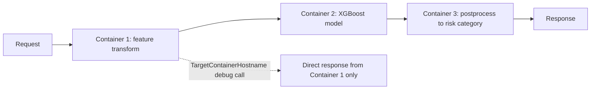

Step by step: (1) a normal `InvokeEndpoint` call flows through all three containers in order,
each one's output becoming the next one's input; (2) setting `TargetContainerHostname` to
Container 1's logical name short-circuits the chain, returning that single container's output
directly — useful for isolating exactly which stage is misbehaving during debugging.

**Why the others are wrong:**
- **A:** Three separate endpoints chained by the *calling application* adds extra network hops
  (and extra endpoints to manage/scale/pay for) compared to one Inference Pipeline endpoint
  running all steps co-located — it also doesn't natively provide the single-container targeting
  capability `TargetContainerHostname` gives.
- **C:** Step Functions orchestrates workflows across separate AWS resources/API calls with
  state-machine semantics — it's not a low-latency, single-endpoint, co-located container
  chaining mechanism designed for per-request inference pipelines like this.
- **D:** Multi-Model Endpoints host **many independent models that share an instance**, loaded
  on demand — it is not a sequential processing-chain mechanism where one container's output
  feeds the next; that's the Inference Pipeline's specific design, not MME's.

---

## Q3 — Domain 4 (Operating, Monitoring, and Securing ML Solutions)

A company deploys a customer-facing Bedrock chatbot behind Guardrails and wants sensitive data
like credit card numbers and email addresses that appear in retrieved document chunks to be
automatically **masked with placeholder text (e.g., `{EMAIL}`)** in the model's response, rather
than having the entire response **blocked outright** whenever PII is detected, since blocking
would make the chatbot unhelpfully refuse to answer many legitimate questions. Which Bedrock
Guardrails PII-handling configuration achieves this?

A) **PII redaction configured in "Mask" mode** for the relevant PII entity types (e.g., email,
   credit card number), which replaces detected PII with a placeholder in the output rather than
   blocking the entire response — as opposed to **"Block" mode**, which would refuse the whole
   response if PII is detected
B) Denied topics, configured with "PII" as the topic name
C) Content filters set to their highest severity threshold across all categories
D) Word filters, with every possible PII value added individually as a blocked word

**Correct Answer: A**

**Explanation:** Bedrock Guardrails' **PII/sensitive information filtering** supports two
distinct behaviors per entity type: **"Block"** (refuse the entire response if that PII type is
detected) and **"Mask"** (redact just the detected PII span with a placeholder, letting the rest
of the response through) — choosing **Mask mode** is exactly what lets the chatbot stay helpful
on the non-sensitive parts of its answer instead of refusing outright. See
[`certifications/mla-c02/domain-4-monitoring-security/responsible-ai-and-guardrails.md`](../domain-4-monitoring-security/responsible-ai-and-guardrails.md).

**Why the others are wrong:**
- **B:** Denied topics block content related to a described **subject matter** (like "discussing
  competitors") — PII detection/redaction is a separate, dedicated Guardrails capability with its
  own entity-type list and Block/Mask modes, not something configured as a "topic."
- **C:** Content filters target categories like hate, violence, insults, and sexual content with
  severity thresholds — they have no specific mechanism for detecting or masking structured PII
  entities like credit card numbers or emails.
- **D:** Enumerating every possible PII value as an individual blocked word is not feasible (PII
  values are effectively infinite — any email or card number) and isn't how Guardrails' built-in,
  pattern/entity-based PII detection is designed to work; word filters are for a finite, known
  list of specific terms/phrases.

---

## Q4 — Domain 1 (Data Preparation for ML and AI)

An analytics team has 200 TB of Parquet files in S3 and wants to run ad-hoc SQL joins against
this data lake alongside data already in their existing Amazon Redshift data warehouse — without
first loading (ETL'ing) the S3 data into Redshift's own managed storage, since the S3 data is
updated continuously by an upstream pipeline and duplicating it into Redshift would mean
constant re-loading. Which capability lets them query the S3 data directly from Redshift SQL,
joined with native Redshift tables, without an ETL copy step?

A) AWS Glue crawlers alone, which only catalog schema and cannot execute SQL joins themselves
B) **Amazon Redshift Spectrum**, which lets Redshift SQL queries directly reference external
   tables backed by data in S3 (via the Glue Data Catalog), joining that external data with
   native Redshift tables in a single query, with no ETL/copy step required
C) Amazon Kinesis Data Firehose, to stream the S3 data into Redshift continuously
D) AWS DMS, configured for one-time migration of all S3 Parquet files into Redshift

**Correct Answer: B**

**Explanation:** **Redshift Spectrum** extends Redshift SQL to query **external tables** whose
actual data lives in S3 (catalogued via Glue Data Catalog), letting a single query join
Spectrum-backed external tables with regular Redshift-native tables — exactly the "query S3 data
alongside warehouse data without duplicating/ETL'ing it in" capability this scenario needs. See
[`services/analytics/athena.md`](../../../services/analytics/athena.md) and
[`services/analytics/data-lake-concepts.md`](../../../services/analytics/data-lake-concepts.md).

**Why the others are wrong:**
- **A:** Glue crawlers only populate the Data Catalog with schema metadata — they don't execute
  queries or joins themselves; Spectrum is the query engine that then *uses* that catalog
  metadata to read S3 data.
- **C:** Firehose is a streaming-ingestion delivery service, not a query engine — it could move
  new data *into* S3 or (with some destinations) other stores, but it has no mechanism to let
  Redshift SQL directly query S3 data in place.
- **D:** DMS performs one-time or ongoing database replication — using it to migrate all 200 TB
  into Redshift is precisely the "duplicate everything, then keep re-loading as the source
  changes" approach the question explicitly wants to avoid.

---

## Q5 — Domain 2 (ML Model and Foundation Model Development)

A regression model trained via gradient descent on a small dataset updates its weights after
computing the gradient over the **entire** training set at once (one update per epoch), which is
extremely slow given the dataset size, while a teammate suggests updating weights after **every
single training example** instead, which trains fast but produces a very noisy, erratic loss
curve. A third option updates weights after small groups of, say, 64 examples at a time. Which
term describes this third, commonly-used middle-ground approach, and why is it generally
preferred in practice?

A) This is called "full-batch gradient descent," identical to using the entire dataset
B) **Mini-batch gradient descent** — updating weights using small batches (e.g., 32–256
   examples) rather than the full dataset (batch gradient descent, slow) or a single example
   (stochastic gradient descent, very noisy) — offering a practical balance between
   computational efficiency (good GPU utilization) and stable, less noisy convergence
C) This is called "stochastic gradient descent," exactly identical to the single-example approach
D) The batch size used has no effect on training speed, memory usage, or convergence stability

**Correct Answer: B**

**Explanation:** **Mini-batch gradient descent** computes gradients over a small subset of
examples per update — fast enough to leverage parallel hardware (GPUs) efficiently while
averaging over enough examples per step to smooth out the noise that pure per-example (SGD)
updates introduce, making it the standard default in modern deep learning training loops. See
[`ml-fundamentals-glossary.md`](../domain-2-model-development/ml-fundamentals-glossary.md).

**Why the others are wrong:**
- **A:** Full-batch gradient descent uses the *entire* dataset per update (what the question
  describes as the first, slow approach) — the third, 64-example approach is a different,
  smaller-batch technique, not identical to full-batch.
- **C:** Stochastic gradient descent (SGD), strictly defined, updates on **one** example at a
  time (the noisy second approach described) — a 64-example batch is a distinct, larger grouping
  than pure SGD, which is why it has its own name (mini-batch), not identical to SGD.
- **D:** Batch size has substantial, well-documented effects on training speed (hardware
  utilization), memory requirements (larger batches need more memory), and convergence
  behavior/noise (smaller batches are noisier but can help escape poor local minima) — claiming
  no effect ignores a core, frequently-tested training hyperparameter.

---

## Q6 — Domain 3 (Deployment and Orchestration of ML Workflows)

An ML team is orchestrating a workflow where one step is a quick (sub-1-second), high-frequency
event-driven data-validation check that should respond synchronously with very low latency and
run potentially millions of times per day, while a separate step in a different workflow is a
multi-hour SageMaker training job with conditional branches and a human-approval wait state.
Both need Step Functions-style orchestration, but with very different performance/cost profiles.
(Choose TWO) Which TWO Step Functions workflow types correctly fit these two scenarios, respectively?

A) **Express Workflows** — optimized for high-event-rate, short-duration (up to 5 minutes)
   workloads with pay-per-execution pricing, fitting the high-frequency, sub-second validation
   check
B) **Standard Workflows** — supporting long-running executions (up to one year), exactly-once
   execution semantics, full execution history, and durable wait states, fitting the multi-hour
   training job with a human-approval wait step
C) Only Standard Workflows exist; Step Functions has no separate workflow type for
   high-frequency, short-duration tasks
D) Only Express Workflows exist; all Step Functions executions are capped at 5 minutes
   regardless of configuration
E) Lambda functions alone, without Step Functions, are the only valid way to implement either of
   these two workflows

**Correct Answer: A and B**

**Explanation:** **Express Workflows** are built for high-volume, short-duration (≤5 minute)
event-processing workloads with at-least-once semantics and lower per-execution cost — a strong
fit for the millisecond-scale, millions-per-day validation check. **Standard Workflows** support
long-running executions (up to a year), exactly-once semantics, and durable state (including
`.waitForTaskToken` patterns for human-approval wait states) — the right fit for the multi-hour
training pipeline with conditional branching and an approval gate. Choosing the correct workflow
type for a given latency/duration/volume profile is a specific, testable Step Functions
distinction. See
[`certifications/mla-c02/domain-3-deployment-orchestration/README.md`](../domain-3-deployment-orchestration/README.md).

**Why the others are wrong:**
- **C:** Step Functions explicitly offers both Standard and Express workflow types specifically
  because a single type doesn't fit both profiles well — this option denies a real, documented
  distinction.
- **D:** Standard Workflows support executions up to one year, well beyond Express's 5-minute
  cap — claiming all executions are capped at 5 minutes misstates Standard Workflow's actual
  long-running capability.
- **E:** Plain Lambda functions have no built-in state-machine visualization, retry/branching
  orchestration, or durable wait-state support across multiple steps — Step Functions exists
  specifically to coordinate this kind of multi-step, stateful, cross-service orchestration that
  a single Lambda invocation cannot provide on its own.

---

## Q7 — Domain 4 (Operating, Monitoring, and Securing ML Solutions)

A regulator asks a lending company: "show me, for a specific rejected applicant, which features
most influenced *that individual's* decision — not just which features matter on average across
all applicants." The team has already run SageMaker Clarify's global feature-importance report,
which ranks features by their average impact across the whole dataset, but that doesn't answer
the regulator's per-individual question. Which SageMaker Clarify explainability output
specifically answers it?

A) Re-running the exact same global feature-importance report again produces per-individual
   explanations automatically
B) **Local (per-instance) SHAP values** — Clarify can compute SHAP-based feature attributions
   for one **specific prediction**, showing how much each feature contributed (positively or
   negatively) to that individual applicant's specific outcome, distinct from the dataset-wide
   average ranking a global report provides
C) SageMaker Model Monitor's data quality report, which tracks input feature distributions
D) The pre-training bias report, which only examines the raw training dataset before any model
   exists

**Correct Answer: B**

**Explanation:** SageMaker Clarify computes **SHAP (SHapley Additive exPlanations)** values that
can be reported either **globally** (average absolute SHAP contribution per feature across the
whole dataset — "which features matter most overall") or **locally**, for a **single specific
prediction** — showing exactly how much each feature pushed that one applicant's prediction up or
down relative to a baseline, which is precisely what answers "why was *this* applicant rejected."
See
[`certifications/mla-c02/domain-4-monitoring-security/responsible-ai-and-guardrails.md`](../domain-4-monitoring-security/responsible-ai-and-guardrails.md).

**Why the others are wrong:**
- **A:** A global feature-importance report is, by definition, an aggregate across many
  predictions — re-running it doesn't decompose down to one individual applicant's specific
  decision; local and global explanations are computed and reported differently.
- **C:** Model Monitor's data quality report tracks statistical properties of input *feature
  distributions* over time — it has no concept of per-prediction feature attribution or
  explaining an individual decision.
- **D:** The pre-training bias report examines the **raw training dataset** (e.g., label/feature
  correlation with a sensitive attribute) before any model is trained — it cannot explain a
  specific model's specific prediction, since at that stage there is no trained model making
  decisions yet.

---

## Q8 — Domain 1 (Data Preparation for ML and AI)

A data science team needs 20,000 images labeled with bounding boxes for an object-detection
project, but has no internal workforce and no interest in managing labeler recruitment, quality
assurance workflows, or labeling-instruction design themselves — they want to hand the entire
labeling operation to AWS and receive back a finished, quality-checked labeled dataset with
minimal day-to-day involvement. Which SageMaker Ground Truth offering fits this "fully
hands-off" need, as opposed to running a self-managed Ground Truth labeling job?

A) **Amazon SageMaker Ground Truth Plus**, a fully-managed, turnkey data-labeling service where
   AWS's expert workforce and tooling handle workforce management, quality control, and
   labeling-instruction design on the customer's behalf, delivering a finished labeled dataset
   with minimal customer operational involvement
B) A standard Ground Truth labeling job with a private workforce, which still requires the
   customer to recruit, manage, and train their own labelers
C) SageMaker Data Wrangler, configured for automated image labeling
D) AWS Rekognition Custom Labels, which performs labeling with zero human involvement whatsoever

**Correct Answer: A**

**Explanation:** **SageMaker Ground Truth Plus** is the fully-managed tier of Ground Truth:
rather than the customer configuring and overseeing a labeling workforce and quality pipeline
themselves, AWS's own expert workforce and managed tooling run the end-to-end labeling operation
and deliver a finished, quality-assured labeled dataset — minimizing the customer's day-to-day
labeling-operations burden, exactly the "hands-off, deliver the finished dataset" requirement
described. See
[`certifications/mla-c02/domain-1-data-preparation/README.md`](../domain-1-data-preparation/README.md).

**Why the others are wrong:**
- **B:** A standard Ground Truth job with a private workforce still requires the *customer* to
  recruit, manage, train, and quality-check their own labelers — the opposite of the hands-off
  delivery model the question asks for.
- **C:** Data Wrangler is a data-exploration/transformation tool for already-tabular or
  already-available data — it has no bounding-box image-labeling workforce or capability at all.
- **D:** Rekognition Custom Labels still requires an initial set of human-labeled example images
  to train its custom model, and isn't a general-purpose, large-scale, human-workforce-backed
  bounding-box labeling service for a fresh 20,000-image dataset — it's an image-classification/
  detection model-training feature, not a data-labeling operations service.

---

## Q9 — Domain 2 (ML Model and Foundation Model Development)

A data scientist fits a regression model predicting advertising campaign revenue from ad spend.
The model's R² on the test set is 0.82. A colleague adds 15 additional, mostly irrelevant random
features to the model, and R² rises slightly to 0.84 — even though those features have no real
predictive relationship with revenue. Which metric would have correctly signaled that this
"improvement" is illusory, and why?

A) Plain R² always increases (or stays the same) as more features are added, regardless of
   whether they're truly useful — **Adjusted R²**, which penalizes the metric for each added
   feature that doesn't meaningfully improve fit, would reveal that these irrelevant features
   don't actually help and may even show the adjusted value decreasing
B) Mean Absolute Error (MAE), since MAE always decreases when irrelevant features are added
C) Accuracy, since accuracy is the standard metric for all regression problems
D) There is no metric that can detect this; more features in a regression model always
   represent genuine improvement

**Correct Answer: A**

**Explanation:** **Plain R²** is mathematically guaranteed to never decrease when more features
are added (even purely random ones), because the model gains additional free parameters to
slightly fit noise in the training data. **Adjusted R²** corrects for this by penalizing the
score based on the number of predictors relative to sample size, so adding features that don't
truly improve the model's explanatory power will show adjusted R² staying flat or **decreasing**
— correctly flagging the "improvement" as an illusion of added model complexity, not real signal.
See [`ml-fundamentals-glossary.md`](../domain-2-model-development/ml-fundamentals-glossary.md).

**Why the others are wrong:**
- **B:** MAE is a regression error metric, but it has no built-in correction for the number of
  features used — it, like plain R², can also look artificially better with more features
  purely due to overfitting on the training set, without any adjustment for added complexity.
- **C:** Accuracy is a classification metric (fraction of correct categorical predictions) — it
  has no defined meaning for a continuous numeric regression target like revenue.
- **D:** This is factually wrong — Adjusted R² (among other techniques like cross-validation)
  exists specifically to detect and correct for this exact "more features always look better"
  illusion in plain R².

---

## Q10 — Domain 3 (Deployment and Orchestration of ML Workflows)

A company manages 40 related model versions across 3 different model families (fraud-v1
through fraud-v8, churn-v1 through churn-v12, pricing-v1 through pricing-v20). They want to
logically group all versions of the same model family together, track lineage/metadata
consistently within each group, and require a human approval step before any version can be
promoted from "staging" to "production" status — without manually tracking this promotion state
in a spreadsheet. Which SageMaker Model Registry concept organizes this?

A) SageMaker Experiments, which tracks training-run metadata but has no concept of model
   versions, families, or approval status
B) **Model package groups** — each model family (e.g., "fraud") is one model package group
   containing all its versions as individual model packages, with each version having an
   **approval status** (`PendingManualApproval`, `Approved`, `Rejected`) that gates promotion,
   replacing manual spreadsheet tracking
C) Separate, entirely independent SageMaker endpoints per model version, with no registry
   concept involved at all
D) AWS Config, tracking each model version as a tracked infrastructure resource configuration

**Correct Answer: B**

**Explanation:** SageMaker Model Registry organizes related model versions into **model package
groups** (one group per logical model family, like "fraud"), with each version registered as a
**model package** carrying metadata, lineage, and an **approval status** field — a built-in gate
that a release process can check before deployment, replacing ad hoc spreadsheet tracking of
"which version is approved for production." See
[`services/machine-learning-ai/sagemaker-model-monitor-and-registry.md`](../../../services/machine-learning-ai/sagemaker-model-monitor-and-registry.md).

**Why the others are wrong:**
- **A:** SageMaker Experiments is for comparing training *runs* (hyperparameters, metrics across
  trials) — it has no model package group, versioning, or approval-status concept, which is what
  this scenario specifically needs.
- **C:** Deploying each version to a fully separate endpoint with no registry would mean no
  centralized version tracking, lineage, or approval gating at all — exactly the unmanaged state
  the question is trying to move away from.
- **D:** AWS Config tracks infrastructure resource configuration history (e.g., an EC2 instance's
  settings over time) — it has no concept of ML model versions, families, or approval workflows.

---

## Q11 — Domain 4 (Operating, Monitoring, and Securing ML Solutions)

A SaaS company runs several internal applications that each need a few long-lived API keys and
database credentials, and separately needs those third-party API keys **automatically rotated
on a schedule** with zero manual intervention, including updating the credential everywhere it's
used. They are deciding between AWS Secrets Manager and Systems Manager Parameter Store
SecureString parameters for this. Which service is the better fit, and why?

A) **AWS Secrets Manager**, which provides built-in **automatic rotation** (including native
   rotation support for several AWS database services, and a customizable Lambda-based rotation
   mechanism for third-party credentials/API keys) — whereas Parameter Store SecureString
   stores encrypted values securely but has **no native automatic-rotation capability** built in
B) Systems Manager Parameter Store SecureString, since it natively rotates any stored credential
   automatically on a schedule with zero additional configuration
C) Both services are functionally identical with no difference in rotation capability or cost
D) Amazon S3 with KMS-encrypted objects, which is the standard AWS service for storing and
   rotating application credentials

**Correct Answer: A**

**Explanation:** **Secrets Manager** is purpose-built for secrets that need **automatic
rotation**: it has native rotation integrations for RDS/Redshift/DocumentDB-style credentials and
supports custom Lambda-based rotation functions for other secret types (like third-party API
keys), rotating the secret value and keeping dependents in sync on a schedule. **Parameter
Store SecureString** securely encrypts stored values (using KMS) but **does not provide built-in
automatic rotation** — rotation there must be built and scheduled manually outside the service
(though it remains a lower-cost option for static, less-frequently-rotated configuration values).
See
[`certifications/mla-c02/domain-4-monitoring-security/README.md`](../domain-4-monitoring-security/README.md).

**Why the others are wrong:**
- **B:** This reverses the actual capability — Parameter Store SecureString has no native,
  built-in automatic rotation mechanism; that capability is Secrets Manager's distinguishing
  feature.
- **C:** The two services differ meaningfully in rotation capability (native vs. none) and in
  pricing model (Secrets Manager charges per secret per month plus API calls; Parameter Store's
  standard tier is free with a paid advanced tier) — they are not interchangeable for this
  specific rotation requirement.
- **D:** S3 is an object storage service, not a secrets-management service with rotation
  workflows, access auditing tailored to credentials, or automatic credential-rotation
  integrations — it is not the standard mechanism AWS provides for this use case.

---

## Q12 — Domain 1 (Data Preparation for ML and AI)

A RAG application indexed 10,000 document chunks six months ago using embedding model version
"TitanEmbed-v1." The team now wants to switch to a newer, better-performing embedding model,
"TitanEmbed-v2," for improved retrieval quality going forward. After updating only the
*query-time* embedding call to use the new model while leaving the existing vector index
untouched, retrieval quality gets noticeably **worse**, not better. What is the most likely
cause, and what must be done to properly adopt the new embedding model?

A) The vector database itself is broken and must be replaced entirely
B) **Embedding vectors from different model versions are not directly comparable** — mixing a
   v2 query embedding against a vector index still built with v1 embeddings breaks the semantic
   similarity assumptions retrieval relies on; the fix is to **re-embed and re-index all 10,000
   existing chunks using the new model** before switching query-time embeddings over
C) The chunk size must be reduced to fix the problem, since embedding model version has no
   bearing on retrieval quality
D) Increasing the number of retrieved chunks (top-k) alone resolves any embedding-model mismatch

**Correct Answer: B**

**Explanation:** Two different embedding models (even versions of the "same" model family)
generally produce vectors in **different vector spaces** that are not meaningfully comparable via
cosine similarity or dot product — a v2 query embedding compared against v1-era stored chunk
embeddings is comparing apples to oranges, degrading retrieval relevance. Properly adopting a new
embedding model requires a **full re-embedding and re-indexing pass** over the existing document
corpus so that both the stored chunk vectors and query vectors come from the same model/version.
See
[`certifications/mla-c02/domain-1-data-preparation/embeddings-and-rag-data-prep.md`](../domain-1-data-preparation/embeddings-and-rag-data-prep.md).

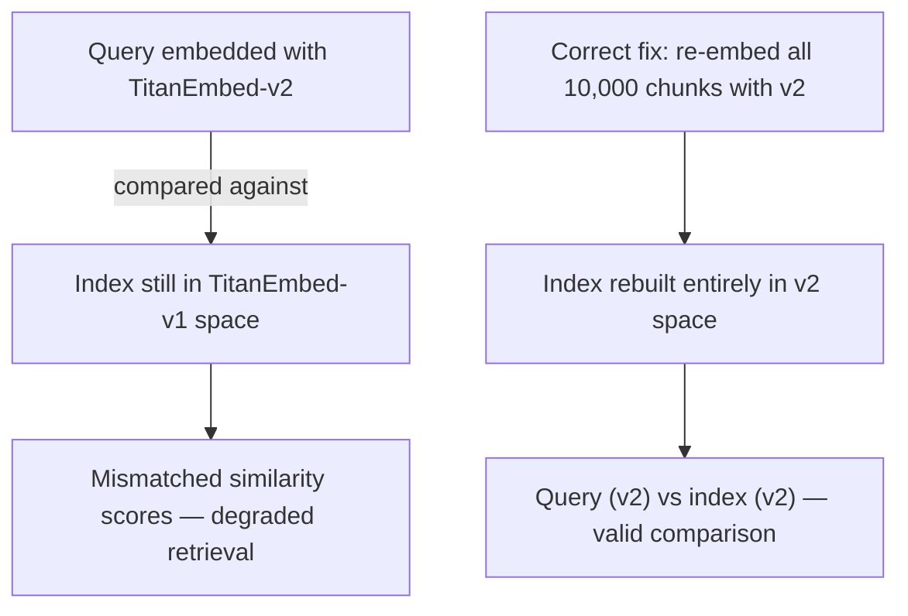

**Why the others are wrong:**
- **A:** The vector database infrastructure itself isn't malfunctioning — the problem is a
  semantic mismatch between two incompatible embedding spaces being compared, a data/pipeline
  issue, not a database defect.
- **C:** Chunk size affects what content ends up in each embedded unit, but it has no bearing on
  the fundamental incompatibility between two different embedding models' vector spaces — this
  option misdiagnoses the root cause.
- **D:** Retrieving more chunks (higher top-k) doesn't fix a broken similarity comparison — it
  would just return more irrelevant results drawn from the same mismatched comparison, not
  resolve the underlying embedding-space incompatibility.

---

## Q13 — Domain 2 (ML Model and Foundation Model Development)

A team has only 2,000 labeled examples for a specialized legal-document text-classification
task — far too few to train a transformer model from scratch. They choose to start from a
large, publicly pretrained language model and continue training just its final classification
layers (and lightly adjust the rest) using their 2,000 examples. What is this approach called,
and why does it work well with so little labeled data?

A) **Transfer learning (fine-tuning a pretrained model)** — the pretrained model has already
   learned general language structure and semantics from a massive unrelated corpus; adapting
   just the final layers (or lightly updating the whole network) to the narrow legal-
   classification task requires far less labeled data than training a comparable model from
   randomly-initialized weights
B) This is called "data augmentation," since it artificially expands the 2,000-example dataset
C) This is unsupervised learning, since no labels are used at any point in the described process
D) This approach cannot work; transformer models always require millions of labeled examples
   regardless of pretraining

**Correct Answer: A**

**Explanation:** **Transfer learning** leverages a model's previously-learned general-purpose
representations (grammar, semantics, world knowledge from large-scale pretraining) and adapts
them to a new, narrower task by fine-tuning on a comparatively small labeled dataset — because
the model isn't learning language "from scratch," far fewer task-specific examples are needed
than training an equivalent model from random initialization, making it the standard approach
for limited-labeled-data NLP tasks. See
[`ml-fundamentals-glossary.md`](../domain-2-model-development/ml-fundamentals-glossary.md).

**Why the others are wrong:**
- **B:** Data augmentation creates additional synthetic training examples from existing ones
  (e.g., via synonym replacement) — it's a different technique than starting from a pretrained
  model's weights, and this scenario doesn't describe generating new examples at all.
- **C:** The 2,000 examples are explicitly **labeled**, and the fine-tuning step uses those
  labels to adapt the classification layers — this is supervised fine-tuning on top of an
  unsupervised-pretrained base model, not an unsupervised process itself.
- **D:** This overstates the data requirement — the entire point of transfer learning/fine-tuning
  is that it dramatically reduces the labeled-data requirement for a pretrained model compared to
  training from scratch; many practical fine-tuning tasks succeed with just hundreds to a few
  thousand labeled examples.

---

## Q14 — Domain 3 (Deployment and Orchestration of ML Workflows)

A team needs to make their Amazon ECR-hosted custom training and inference container images
available only in approved, scanned versions, automatically deleting old, untagged image
versions after 30 days to control storage cost and reduce the attack surface of stale images,
without manual cleanup. Which ECR capability provides this automated image hygiene?

A) Manually reviewing the ECR console monthly and deleting old images by hand
B) **ECR lifecycle policies**, which define rules (e.g., "expire untagged images older than 30
   days," or "keep only the most recent N tagged images per prefix") that ECR automatically
   enforces, cleaning up images without manual intervention
C) AWS Config rules, which can track ECR image counts but have no mechanism to delete images
D) Amazon Macie, configured to scan and delete container images containing sensitive data

**Correct Answer: B**

**Explanation:** **ECR lifecycle policies** let you define automated image-expiration rules
(e.g., by age, tag status, or count per tag prefix) that ECR evaluates and enforces on a
schedule, automatically deleting images matching the rule — directly solving the "clean up old/
untagged images without manual effort" requirement. See
[`certifications/mla-c02/domain-3-deployment-orchestration/README.md`](../domain-3-deployment-orchestration/README.md).

**Why the others are wrong:**
- **A:** Manual monthly review is exactly the labor-intensive process lifecycle policies are
  meant to eliminate — it doesn't scale and depends on someone remembering to do it.
- **C:** AWS Config can track resource configuration/existence over time, but it has no native
  action to delete ECR images — that automated cleanup action is specifically what ECR lifecycle
  policies (not Config) provide.
- **D:** Macie discovers sensitive data within S3 objects (like documents containing PII) — it
  has no relationship to container image lifecycle management in ECR at all.

---

## Q15 — Domain 4 (Operating, Monitoring, and Securing ML Solutions)

A multinational company's ML governance policy requires that **no training data or inference
workload touching EU customer data** may ever be processed or stored outside EU AWS Regions, for
data-residency compliance — and this restriction must be **enforced preventively** at the
organization level (blocking any attempt to launch such resources outside approved Regions), not
just detected after the fact via logging or monitoring. Which AWS capability enforces this
preventively across all accounts in the organization?

A) AWS CloudTrail, configured to log any SageMaker API call made outside EU Regions
B) **AWS Organizations Service Control Policies (SCPs)**, which can deny API actions (e.g.,
   `sagemaker:CreateTrainingJob`, `sagemaker:CreateEndpoint`) outside an approved list of
   Regions across every account in the organization — a preventive guardrail, not just a
   detective/logging control
C) Amazon Macie, which only discovers sensitive data already stored in S3 after the fact
D) AWS Config rules alone, which can flag non-compliant resources but cannot by themselves block
   the API call that created them in the first place

**Correct Answer: B**

**Explanation:** **Service Control Policies (SCPs)** attached at the AWS Organizations level can
**explicitly deny** specific API actions (like creating a SageMaker training job or endpoint) in
Regions outside an approved list, for every account under that organizational unit — a true
**preventive** control that blocks the action from ever succeeding, rather than merely detecting
or logging it after the fact. See
[`certifications/mla-c02/domain-4-monitoring-security/README.md`](../domain-4-monitoring-security/README.md).

**Why the others are wrong:**
- **A:** CloudTrail is a **detective** control — it records that an out-of-Region API call
  happened, which is useful for audit, but it does not itself prevent the call from succeeding
  in the first place.
- **C:** Macie discovers sensitive data already present in S3 — it's a data-discovery/detective
  tool operating after data already exists in a location, not a preventive Region-restriction
  mechanism for API calls.
- **D:** Plain AWS Config rules (without an attached automated remediation that can reject in
  real time) are also fundamentally **detective** — they evaluate resources *after* they're
  created and flag non-compliance; they cannot themselves deny the originating API call the way
  an SCP's explicit `Deny` can.

---

## Q16 — Domain 1 (Data Preparation for ML and AI)

A RAG system over an internal HR policy wiki needs to ensure that a question from an engineering
employee only retrieves chunks from the "Engineering Policies" section, never chunks from
"Executive Compensation" or "Legal/HR-Confidential" sections, even though all sections are
embedded into the same shared vector index for operational simplicity. Which retrieval-time
capability enforces this kind of access-scoped filtering within a single shared vector index?

A) Increasing the embedding model's dimensionality, which automatically segments different
   document sections into logically separate, inaccessible regions of the vector space
B) **Metadata filtering** — tagging each chunk with metadata (e.g., `department: engineering`,
   `confidentiality: public`) at ingestion time, then applying a metadata filter alongside the
   similarity search at query time so only chunks matching the requesting user's authorized
   metadata values are eligible to be retrieved
C) Training a completely separate embedding model for each department's content
D) Reducing the chunk size to prevent any chunk from ever containing sensitive content

**Correct Answer: B**

**Explanation:** **Metadata filtering** lets each indexed chunk carry structured metadata
alongside its vector (e.g., department, confidentiality level, document owner), and a RAG
retrieval query can combine **vector similarity search with a metadata filter condition**, so the
search space is restricted to only chunks matching the requester's authorized scope — a standard
pattern for multi-tenant or access-scoped RAG over one shared index, avoiding the need to
maintain entirely separate indexes per access level. See
[`certifications/mla-c02/domain-1-data-preparation/embeddings-and-rag-data-prep.md`](../domain-1-data-preparation/embeddings-and-rag-data-prep.md).

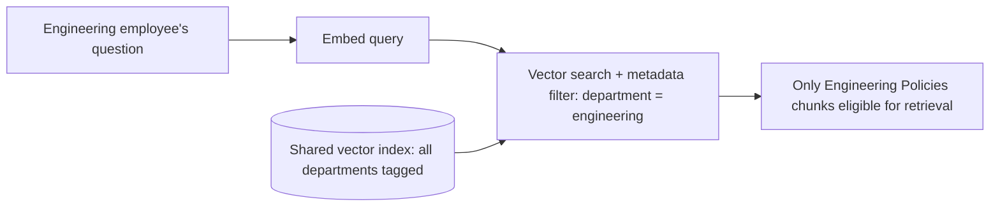

**Why the others are wrong:**
- **A:** Embedding dimensionality affects how much semantic information a vector can encode — it
  has no inherent access-control mechanism or automatic topic-based segmentation that enforces
  who can retrieve what; two chunks about completely different sensitive topics can still sit
  near each other in vector space regardless of dimensionality.
- **C:** Training separate embedding models per department would be a heavyweight, costly,
  operationally complex approach compared to simply tagging and filtering by metadata within one
  shared index — and it still wouldn't inherently enforce access control without an additional
  filtering mechanism on top.
- **D:** Reducing chunk size changes how finely content is divided, but it does nothing to
  control *who* can retrieve a given chunk — sensitive content in a small chunk is just as
  retrievable by an unauthorized query as in a large one without an access-control mechanism
  like metadata filtering.

---

## Q17 — Domain 2 (ML Model and Foundation Model Development)

A team compares two ensemble techniques on the same tabular churn-prediction dataset: Technique
A trains many decision trees **independently** on bootstrapped (randomly resampled) subsets of
the data and averages their predictions; Technique B trains decision trees **sequentially**,
where each new tree is built specifically to correct the errors of the ensemble so far. Which
names correctly identify these two techniques, and what's a key practical difference in how they
reduce error?

A) Technique A is **bagging** (e.g., Random Forest) — parallel, independent trees whose averaging
   primarily **reduces variance**; Technique B is **boosting** (e.g., Gradient Boosting/XGBoost)
   — sequential, error-correcting trees that primarily **reduce bias**, but can be more prone to
   overfitting if not carefully regularized/tuned
B) Both techniques are identical; "bagging" and "boosting" are simply two different marketing
   names for the exact same underlying algorithm
C) Technique A is boosting and Technique B is bagging — this option simply swaps the two
   definitions from option A
D) Neither technique is a valid ensemble method; only stacking (combining different model types)
   qualifies as true ensembling

**Correct Answer: A**

**Explanation:** **Bagging** (bootstrap aggregating, the basis of Random Forest) trains multiple
independent models on randomly resampled subsets of data and averages their predictions —
primarily reducing **variance** by smoothing out individual trees' idiosyncrasies. **Boosting**
(the basis of AdaBoost, Gradient Boosting, and XGBoost) instead builds trees **sequentially**,
each one specifically targeting the previous ensemble's errors — primarily reducing **bias**, at
the cost of potentially higher variance/overfitting risk if the number of boosting rounds or
learning rate isn't well-tuned. See
[`ml-fundamentals-glossary.md`](../domain-2-model-development/ml-fundamentals-glossary.md).

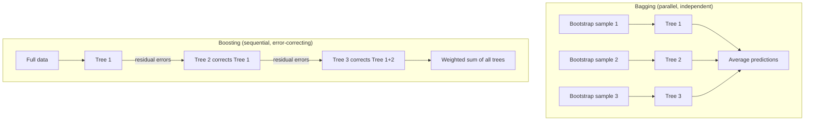

**Why the others are wrong:**
- **B:** Bagging and boosting are fundamentally different algorithmic approaches (parallel/
  independent vs. sequential/error-correcting) with different bias-variance effects and different
  overfitting risk profiles — they are not interchangeable names for the same technique.
- **C:** This exactly reverses the correct mapping — independent, parallel, randomly-resampled
  tree training is bagging's definition, and sequential, error-correcting tree training is
  boosting's definition, not the other way around.
- **D:** Both bagging and boosting are well-established, extensively-used ensemble methods
  (Random Forest and XGBoost are textbook examples of each) — stacking is a *third*, different
  ensemble technique (combining diverse model types' predictions via a meta-model), not the only
  valid form of ensembling.

---

## Q18 — Domain 3 (Deployment and Orchestration of ML Workflows)

A team wants a GenAI application that must, during development, be designed to: (1) accept a
document, (2) chunk it, (3) call an embedding model, and (4) write vectors to an index — with
step (2) needing to run in **parallel across potentially thousands of document pages** rather
than sequentially one page at a time, all coordinated as one auditable, retryable workflow.
Which AWS Step Functions feature specifically supports fanning this one step out across many
parallel, independent executions?

A) The `Map` state, which iterates over an array of inputs (e.g., one entry per page) and runs
   the specified set of steps for each array entry **concurrently** (with a configurable
   concurrency limit), rather than a single step processing all entries one at a time in sequence
B) The `Choice` state, which only supports conditional branching based on a single input value,
   not parallel iteration across an array
C) Step Functions only supports strictly sequential execution of each state, one at a time, with
   no mechanism for concurrent processing of multiple array items
D) AWS Lambda reserved concurrency settings alone, entirely independent of and unrelated to Step
   Functions state machine definitions

**Correct Answer: A**

**Explanation:** The **`Map` state** is Step Functions' built-in construct for iterating over an
array (e.g., one entry per document page) and executing a defined set of steps for **each item
in parallel**, up to a configurable max concurrency — exactly supporting a "chunk + embed
thousands of pages concurrently" requirement within a single, auditable, retryable state machine
execution, rather than looping through pages sequentially. See
[`certifications/mla-c02/domain-3-deployment-orchestration/README.md`](../domain-3-deployment-orchestration/README.md).

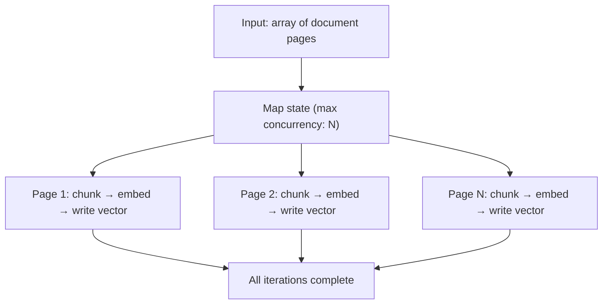

**Why the others are wrong:**
- **B:** `Choice` states implement conditional branching logic (if/else-style routing based on
  input values) — they have no iteration or parallel-fan-out capability over an array of items at
  all.
- **C:** Step Functions explicitly supports parallel execution via both the `Map` state (iterate
  an array concurrently) and the `Parallel` state (run a fixed set of different branches
  concurrently) — claiming only strictly sequential execution is possible misstates core Step
  Functions capability.
- **D:** Lambda's own reserved/provisioned concurrency settings control how many *Lambda*
  invocations can run simultaneously, but they are a Lambda-level configuration, not the Step
  Functions state-machine construct that defines "iterate this array of pages in parallel" at the
  workflow level — `Map` is the workflow-level mechanism being asked about.

---

## Q19 — Domain 4 (Operating, Monitoring, and Securing ML Solutions)

A company's data governance policy requires PII discovery scans to run automatically across
**newly uploaded S3 objects** in their ML training-data buckets, flagging any object containing
sensitive data types (SSNs, credit card numbers) so the data engineering team can review before
the object is used for training — operating on data already stored as files in S3, as opposed to
scanning free-form conversational text submitted through an application in real time. Which
service is purpose-built for this S3-object-level PII discovery?

A) **Amazon Macie**, a service purpose-built to continuously and automatically scan S3 buckets
   for sensitive data (PII, credentials, financial data) using machine learning and pattern
   matching, generating findings the team can review and act on
B) Amazon Comprehend's PII detection API, which is designed for scanning individual blocks of
   free-form text submitted synchronously through an API call, not for continuously scanning an
   entire S3 bucket's object inventory
C) AWS Config, which tracks resource configuration changes, not the sensitive-data content within
   S3 objects
D) Amazon GuardDuty, which detects account/network-level threat activity, not sensitive-data
   content within stored files

**Correct Answer: A**

**Explanation:** **Amazon Macie** is purpose-built for exactly this: continuously (or on-demand)
scanning S3 buckets' object contents to discover and classify sensitive data types like PII,
credentials, and financial information, generating actionable findings — the right fit for a
"scan stored files in S3 for sensitive data" governance requirement at the bucket/object level.
See
[`certifications/mla-c02/domain-4-monitoring-security/README.md`](../domain-4-monitoring-security/README.md).

**Why the others are wrong:**
- **B:** Comprehend's PII detection API is designed to analyze a **single passage of text**
  passed in an API call (e.g., scanning one chatbot message or one document's extracted text at
  a time) — it is not a bucket-wide, continuously-scanning S3 object-discovery service the way
  Macie is; it's the right tool for a different scenario (real-time text PII detection), not this
  one.
- **C:** AWS Config tracks *infrastructure configuration* history (e.g., bucket encryption
  settings) — it has no capability to inspect the actual sensitive-data content inside stored
  objects.
- **D:** GuardDuty detects threat-indicator activity (e.g., compromised credentials, anomalous
  API calls, malicious network traffic) — it does not scan file contents for PII/sensitive data
  classification, which is Macie's specific purpose.

---

## Q20 — Domain 1 (Data Preparation for ML and AI)

A streaming-sensor pipeline needs to compute a **5-minute sliding-window average** of each
machine's temperature readings, continuously, as new readings arrive every second, to feed a
real-time anomaly-detection model — without the team standing up and operating their own custom
stream-processing application code on EC2/containers to implement the windowing logic
themselves. Which AWS service lets them express this windowed aggregation using a managed,
SQL-like or Flink-based streaming application?

A) AWS Glue batch jobs, scheduled to run every 5 minutes
B) **Amazon Managed Service for Apache Flink** (formerly Kinesis Data Analytics), which lets
   teams define windowed aggregations (like a 5-minute sliding average) over a streaming source
   using SQL or Flink application code, as a fully-managed streaming compute service — without
   operating the underlying stream-processing infrastructure themselves
C) Amazon S3 Select, which queries static objects already stored in S3, not a live data stream
D) AWS Lambda alone, with no streaming-specific windowing construct, manually tracking a 5-minute
   buffer in function memory between invocations

**Correct Answer: B**

**Explanation:** **Amazon Managed Service for Apache Flink** is purpose-built for exactly this:
expressing windowed aggregations (tumbling, sliding, or session windows) over a live streaming
source (e.g., a Kinesis Data Stream) using SQL or Flink application logic, as a fully-managed
service — handling the underlying distributed stream-processing infrastructure so the team
doesn't have to build and operate it themselves. See
[`services/analytics/kinesis-family.md`](../../../services/analytics/kinesis-family.md).

**Why the others are wrong:**
- **A:** A Glue batch job running every 5 minutes is periodic batch processing, not continuous,
  sub-5-minute sliding-window computation over a live stream — it would introduce latency and
  isn't designed for continuous streaming windows.
- **C:** S3 Select queries data **already stored as static objects** in S3 — it has no concept of
  a live, continuously-arriving data stream or sliding time windows over it.
- **D:** Lambda has no native sliding-window construct; manually tracking a rolling 5-minute
  buffer across stateless Lambda invocations is a fragile, error-prone reinvention of
  functionality Managed Flink already provides natively and reliably as a managed streaming
  windowing engine.

---

## Q21 — Domain 2 (ML Model and Foundation Model Development)

A data scientist runs **leave-one-out cross-validation (LOOCV)** on a small 200-row medical
dataset, training 200 separate models (each leaving out exactly one sample as the test case).
A teammate suggests 5-fold cross-validation would be far more practical for a larger, 500,000-row
dataset. What is the key practical tradeoff that explains why LOOCV is reasonable for the small
dataset but impractical for the much larger one?

A) LOOCV always produces less reliable estimates than 5-fold CV regardless of dataset size,
   so it should never be used
B) **LOOCV requires training as many models as there are rows** (N models for N rows) — entirely
   reasonable computationally for 200 rows, but requiring 500,000 model-training runs is
   prohibitively expensive; **k-fold CV (e.g., 5-fold)** trains only k models regardless of
   dataset size, scaling far better to large datasets while still providing a robust performance
   estimate
C) 5-fold cross-validation cannot be used on datasets larger than 1,000 rows
D) Cross-validation technique choice has no effect on computational cost; all variants require
   the same number of training runs regardless of fold count

**Correct Answer: B**

**Explanation:** **LOOCV** trains **N** models for a dataset of N rows (each leaving out one
sample) — for 200 rows that's 200 training runs, feasible if each run is cheap; for 500,000 rows,
training 500,000 separate models would be computationally prohibitive for all but the cheapest
models. **K-fold CV** instead trains a **fixed, small number (k)** of models regardless of
dataset size (e.g., 5 or 10), making it far more scalable while still providing a solid
generalization estimate — the standard practical default for larger datasets. See
[`ml-fundamentals-glossary.md`](../domain-2-model-development/ml-fundamentals-glossary.md).

**Why the others are wrong:**
- **A:** LOOCV can actually provide a nearly-unbiased performance estimate (since it uses nearly
  all data for training each time) and is a reasonable, sometimes-preferred choice for very small
  datasets where you can't afford to leave out much data for testing — it isn't universally
  worse, the issue here is specifically computational scalability for large N.
- **C:** 5-fold cross-validation scales well to large datasets precisely because it only ever
  trains 5 models regardless of row count — this option states the opposite of 5-fold CV's
  actual scalability advantage.
- **D:** The number of required training runs scales directly with the chosen CV technique (N
  for LOOCV vs. a fixed k for k-fold) — this is precisely the computational-cost tradeoff the
  question is testing, not something irrelevant to the choice.

---

## Q22 — Domain 3 (Deployment and Orchestration of ML Workflows)

A company wants a public-facing REST API (`POST /predict`) that external partner applications
can call over HTTPS to get predictions from a SageMaker real-time endpoint, with the ability to
apply API key-based throttling/rate-limiting per partner and request/response transformation,
without exposing the SageMaker endpoint's internal invocation mechanism directly to external
callers. Which architecture fits?

A) Give every partner direct IAM credentials to call the SageMaker `InvokeEndpoint` API directly
   from their own external applications
B) **Amazon API Gateway** (handling HTTPS, API keys, throttling/usage plans, and request/response
   transformation) **integrated with an AWS Lambda function**, which in turn calls the SageMaker
   endpoint's `InvokeEndpoint` API and returns the formatted prediction back through API Gateway
   to the partner
C) Expose the SageMaker endpoint's internal VPC IP address directly to the public internet via a
   security group rule allowing `0.0.0.0/0`
D) AWS Direct Connect, establishing a dedicated physical network connection to every partner
   company's data center

**Correct Answer: B**

**Explanation:** **API Gateway in front of a Lambda function** is the standard pattern for
exposing a controlled, public-facing REST API to external partners: API Gateway handles
HTTPS termination, API-key issuance, per-key throttling/usage plans, and request/response
transformation, while the backing Lambda function (with appropriate IAM permissions) calls the
SageMaker endpoint's `InvokeEndpoint` API internally — partners never interact with SageMaker
directly, and all the partner-management features (keys, quotas) live in API Gateway. See
[`certifications/mla-c02/domain-3-deployment-orchestration/README.md`](../domain-3-deployment-orchestration/README.md).

**Why the others are wrong:**
- **A:** Handing out IAM credentials for direct `InvokeEndpoint` calls to external partners
  exposes internal AWS API mechanics directly, provides no built-in per-partner throttling/usage-
  plan layer, and is a much heavier IAM-management burden than issuing simple API keys through
  API Gateway.
- **C:** SageMaker endpoints are not designed to be exposed with a public, open-to-the-internet
  security group rule — this is both an architectural anti-pattern (bypassing any access control,
  throttling, or request validation layer) and a serious security risk.
- **D:** Direct Connect establishes private network connectivity between AWS and a specific
  customer's own data center — it is wildly disproportionate (and impractical to set up per
  partner) for exposing a simple public REST prediction API, and isn't designed for
  internet-facing partner access with API keys at all.

---

## Q23 — Domain 4 (Operating, Monitoring, and Securing ML Solutions)

A team wants new, interactive SHAP-based explanations for individual predictions (like
regulators requesting "why was this applicant rejected") to also be visualized alongside a
**global view of how a feature's value relates to the predicted outcome on average** — e.g.,
"as credit utilization increases from 0% to 100%, how does the model's predicted default
probability change, holding other features at typical values?" Which SageMaker Clarify
explainability output specifically shows this global input-value-to-outcome relationship,
distinct from local SHAP attributions for one prediction?

A) **Partial Dependence Plots (PDPs)**, which show how the model's average predicted outcome
   changes as one feature's value varies across its range, holding other features fixed —
   a global view of a feature's marginal effect, distinct from per-instance SHAP attribution
B) The pre-training bias report, which only examines label/feature correlation in the raw
   training dataset before any model exists
C) SageMaker Model Monitor's data quality report, which tracks input feature distributions over
   time in production
D) Local SHAP values for one specific prediction, which already show this global relationship
   without needing a separate visualization

**Correct Answer: A**

**Explanation:** **Partial Dependence Plots (PDPs)**, one of SageMaker Clarify's explainability
outputs, visualize the **average** relationship between a chosen feature's value and the model's
predicted outcome across the dataset, holding other features at representative values — directly
answering "how does the prediction trend change as this feature varies," a **global**,
feature-level view distinct from a local SHAP explanation of one individual's specific
prediction. See
[`certifications/mla-c02/domain-4-monitoring-security/responsible-ai-and-guardrails.md`](../domain-4-monitoring-security/responsible-ai-and-guardrails.md).

**Why the others are wrong:**
- **B:** The pre-training bias report examines the raw training dataset's label/feature
  correlations before any model exists — it cannot show how a *trained model's* predictions
  change as a feature varies, since no model prediction is involved at that stage.
- **C:** Model Monitor's data quality report tracks statistical drift in input feature
  distributions over time in production — it doesn't visualize the relationship between a
  feature's value and the model's predicted outcome at all.
- **D:** Local SHAP values explain **one specific prediction's** feature contributions — they do
  not, by themselves, show the averaged, global trend of how predictions change as a feature
  varies across its whole range; that global view is specifically what PDPs provide.

---

## Q24 — Domain 1 (Data Preparation for ML and AI)

A data engineering team manages a Glue Data Catalog table whose upstream source occasionally
adds new columns (e.g., a new `promo_code` field appears in the JSON one day) without any
announcement. Athena queries against the table currently fail or silently ignore the new column
until someone manually updates the table's schema. The team wants the catalog's schema to
**automatically evolve** to include new columns as they appear in new data, without manual DDL
updates each time. Which capability addresses this?

A) A Glue crawler run **on a recurring schedule**, configured to update the Data Catalog table's
   schema when it detects new columns in newly-arrived data, keeping the schema in sync without
   manual DDL edits
B) Amazon Athena automatically rewrites the Glue Data Catalog's schema on every query, with no
   crawler involvement needed
C) AWS DMS, which only replicates data from relational database sources, not schema evolution
   for existing Data Catalog tables sourced from S3
D) This cannot be automated; a human must always manually run `ALTER TABLE ADD COLUMNS`
   whenever upstream data changes

**Correct Answer: A**

**Explanation:** A **Glue crawler**, run on a recurring schedule against the data source,
re-infers the schema from newly-arrived data and updates the Glue Data Catalog table definition
accordingly (including adding newly-detected columns), keeping the catalog's schema in sync with
evolving upstream data without requiring manual `ALTER TABLE` statements each time a new field
appears. See
[`services/analytics/glue.md`](../../../services/analytics/glue.md) and the
[Domain 1 README](../domain-1-data-preparation/README.md).

**Why the others are wrong:**
- **B:** Athena is a query engine that reads the catalog's existing schema definition — it does
  not itself crawl underlying data or automatically update the Glue Data Catalog's schema; that
  schema-discovery/update role belongs to a crawler.
- **C:** DMS replicates data from relational/NoSQL database sources with change data capture —
  it has no role in Glue Data Catalog schema management for S3-based data lake tables, which is a
  separate, unrelated capability.
- **D:** This overstates the limitation — scheduled Glue crawlers are specifically designed to
  automate exactly this kind of schema-evolution detection and update, removing the need for a
  human to manually alter the table definition every time.

---

## Q25 — Domain 2 (ML Model and Foundation Model Development)

A gradient boosting model (e.g., XGBoost) is being tuned with two closely related
hyperparameters: `learning_rate` (shrinks each tree's contribution) and `n_estimators` (the
number of sequential trees added). A teammate sets `learning_rate` very high (close to 1.0) and
`n_estimators` very low (e.g., 5 trees), and observes poor, unstable performance; another
configuration uses a very low `learning_rate` (0.01) with a very high `n_estimators` (5,000) and
gets much better, more stable results but takes far longer to train. What is the practical
relationship between these two hyperparameters?

A) They are completely independent hyperparameters with no practical relationship; adjusting one
   never requires reconsidering the other
B) There is a classic **tradeoff**: a **lower learning rate** requires **more trees
   (n_estimators)** to reach comparable predictive performance, since each tree contributes a
   smaller correction — lower learning rate + more trees generally gives smoother, more
   reliable convergence (less likely to overshoot) at the cost of longer training time, while a
   high learning rate with too few trees risks the model being undertrained and unstable
C) Learning rate and n_estimators always have exactly the same numeric optimal value regardless
   of dataset
D) Increasing n_estimators always causes overfitting regardless of learning rate, so it should
   always be kept as low as possible

**Correct Answer: B**

**Explanation:** In gradient boosting, **learning rate** scales down how much each new tree's
predictions are added to the running ensemble; a **smaller learning rate** means each tree
contributes a smaller correction, so **more trees (`n_estimators`)** are needed to reach a
similarly well-fit model — this combination (low learning rate, high tree count) typically
produces smoother, more stable convergence and often better generalization, at the cost of more
computation/training time, versus a high learning rate with too few trees, which can
undertrain and converge unstably. See
[`ml-fundamentals-glossary.md`](../domain-2-model-development/ml-fundamentals-glossary.md).

**Why the others are wrong:**
- **A:** These two hyperparameters have a well-documented, practically important interaction
  (described above) — tuning one without considering the other is a common mistake, not a
  non-issue.
- **C:** There's no universal "same optimal value" rule between these two hyperparameters across
  datasets — appropriate values depend heavily on the specific dataset, problem, and available
  compute budget, and are typically found via hyperparameter search, not a fixed constant.
- **D:** More trees don't *automatically* cause overfitting regardless of learning rate — with a
  sufficiently small learning rate, many trees can still generalize well; overfitting risk from
  tree count interacts with learning rate (and other regularization), not a standalone rule that
  more trees are always bad.

---

## Q26 — Domain 3 (Deployment and Orchestration of ML Workflows)

A company runs a custom-built GenAI inference workload on self-managed EC2 GPU instances (not
Bedrock) and wants to reduce the per-token inference cost of running their custom fine-tuned
model, which they've optimized to run efficiently on AWS's custom AI accelerator chip rather than
general-purpose NVIDIA GPU instances, for a steady, high-volume production workload. Which AWS
compute option is purpose-built for this cost-efficient custom-accelerator inference, and how
does it differ from a standard GPU instance family?

A) **Amazon EC2 Inf2 instances (powered by AWS Inferentia2)** — AWS's custom-designed chip
   purpose-built for high-throughput, cost-efficient deep learning **inference** (requiring
   models to be compiled for the Inferentia architecture, e.g., via the AWS Neuron SDK),
   typically offering a better cost-per-inference than general-purpose GPU instances for
   well-optimized models at steady, high volume
B) Amazon EC2 T3 instances, general burstable instances with no specialized AI accelerator at all
C) AWS Lambda, which provides the same custom AI accelerator hardware as Inferentia2 by default
D) Amazon EC2 Trn1 instances (powered by Trainium), which are purpose-built for inference
   workloads rather than training

**Correct Answer: A**

**Explanation:** **Inferentia2-powered Inf2 instances** are AWS's custom silicon specifically
designed for cost- and power-efficient deep learning **inference** at scale, requiring the model
to be compiled for the Inferentia architecture (e.g., via AWS Neuron), and generally delivering
better inference cost-efficiency than general-purpose GPU instances for well-matched, high-
throughput production workloads. See
[`certifications/mla-c02/domain-3-deployment-orchestration/README.md`](../domain-3-deployment-orchestration/README.md).

**Why the others are wrong:**
- **B:** T3 instances are general-purpose, burstable-performance CPU instances with no
  specialized AI accelerator at all — entirely unsuited to efficient deep learning inference at
  the scale/throughput described.
- **C:** Lambda is a general-purpose serverless compute service without access to Inferentia
  silicon by default — it does not provide this specialized accelerator hardware.
- **D:** This reverses the chip-to-workload mapping: **Trainium (Trn1)** is AWS's custom chip
  purpose-built for **training** large models cost-efficiently, while **Inferentia (Inf2)** is
  the chip purpose-built for **inference** — the option's framing swaps which chip targets which
  workload type.

---

## Q27 — Domain 4 (Operating, Monitoring, and Securing ML Solutions)

A company deploys a content-moderation application built on a Bedrock foundation model. For
borderline moderation calls where the model's confidence is low, the company wants a **human
moderator** to review and confirm the decision before any content is actually published or
removed — but this isn't Bedrock-specific; they want a general, reusable AWS capability for
building this kind of human-review workflow that could apply equally to other ML applications
beyond GenAI, such as routing low-confidence predictions from a classic SageMaker classifier for
human review too. Which AWS capability is purpose-built for this general human-in-the-loop
workflow?

A) **Amazon Augmented AI (Amazon A2I)**, a standalone service for building human-review workflows
   that route low-confidence (or otherwise flagged) predictions from any ML system — SageMaker
   models, Bedrock-based applications, or custom ML pipelines — to human reviewers before a final
   action is taken
B) SageMaker Ground Truth, which is exclusively for labeling brand-new training datasets, not
   reviewing live production model predictions
C) Bedrock Guardrails, which is a GenAI-specific content-safety filter, not a general-purpose,
   reusable human-review-workflow builder applicable beyond Bedrock
D) AWS Step Functions alone, with no purpose-built human-review UI/workflow components at all

**Correct Answer: A**

**Explanation:** **Amazon A2I (Augmented AI)** is specifically designed as a general-purpose
human-review-workflow builder: it lets teams define conditions (e.g., confidence below a
threshold) that route a prediction to a human reviewer UI for confirmation/correction before a
downstream action proceeds — and it is not tied to any one source model type, working equally
well for SageMaker classifiers, Bedrock-based GenAI applications, or Rekognition/Textract
results. See
[`certifications/mla-c02/domain-4-monitoring-security/README.md`](../domain-4-monitoring-security/README.md).

**Why the others are wrong:**
- **B:** Ground Truth is for labeling **training datasets** before a model exists — it's a
  different lifecycle stage than reviewing a **live, already-deployed model's low-confidence
  production predictions**, which is A2I's specific purpose.
- **C:** Guardrails is specifically a Bedrock/GenAI content-safety filtering mechanism (denied
  topics, content filters, PII redaction) — it is not a general, reusable human-review-workflow
  service applicable to non-GenAI ML predictions the way A2I is.
- **D:** Step Functions can orchestrate a workflow that *includes* a human-approval wait state,
  but it has no purpose-built reviewer UI or prediction-routing-by-confidence components out of
  the box the way A2I provides specifically for ML review use cases.

---

## Q28 — Domain 1 (Data Preparation for ML and AI)

A team embeds both document chunks and user queries using Amazon Titan Text Embeddings, and
performs similarity search using **cosine similarity**. A teammate asks whether it would matter
if they instead used raw **dot product** similarity without first normalizing the embedding
vectors to unit length. What is the correct relationship between cosine similarity and dot
product in this context?

A) Cosine similarity and dot product always produce identical rankings regardless of whether
   vectors are normalized, so normalization never matters
B) **Cosine similarity is mathematically equivalent to the dot product of two vectors after each
   has been normalized to unit length** — so if the embedding vectors are already (or are
   explicitly) normalized, dot product search and cosine similarity search produce the same
   ranking; if vectors are **not** normalized, raw dot product can be skewed by differences in
   vector magnitude, which cosine similarity is specifically designed to ignore
C) Dot product can only be computed on text data, while cosine similarity only works on image
   embeddings
D) Normalizing vectors to unit length destroys all the semantic information embeddings capture

**Correct Answer: B**

**Explanation:** **Cosine similarity** = dot product of two vectors divided by the product of
their magnitudes — equivalently, the dot product of the two vectors **after normalizing both to
unit length**. If embeddings are pre-normalized (many embedding models' outputs are, or can be
explicitly normalized before indexing), searching by raw dot product gives the same ranking as
cosine similarity. If vectors are **not** normalized, raw dot product conflates "how aligned in
direction" with "how large in magnitude" — two factors cosine similarity deliberately separates
by focusing purely on angular/directional similarity, which is usually what's wanted for semantic
relevance. See
[`certifications/mla-c02/domain-1-data-preparation/embeddings-and-rag-data-prep.md`](../domain-1-data-preparation/embeddings-and-rag-data-prep.md).

**Why the others are wrong:**
- **A:** Whether the two measures produce identical rankings specifically **depends on whether
  vectors are normalized** — this is exactly the nuance the question is testing, not a
  universal equivalence regardless of normalization.
- **C:** Both cosine similarity and dot product are general vector-math operations applicable to
  embeddings from any modality (text, image, multimodal) — neither is restricted to one data
  type.
- **D:** Normalizing a vector to unit length preserves its **direction** (which is what encodes
  semantic relationships in most embedding spaces) while only discarding its magnitude — it does
  not destroy the semantic information embeddings capture; in fact, many retrieval systems
  normalize embeddings specifically because direction, not magnitude, carries the meaningful
  semantic signal.

---

## Q29 — Domain 2 (ML Model and Foundation Model Development)

A team is building a few-shot prompt for a Bedrock foundation model to classify customer support
tickets into one of five categories. They include 5 example tickets with their correct category
labels directly in the prompt before the real ticket to classify. The model's accuracy varies
significantly depending on **which** 5 examples are chosen and in **what order** they appear in
the prompt, even though all examples are technically valid and correctly labeled. What does this
sensitivity illustrate about few-shot prompting, and what should the team do about it?

A) Few-shot prompting is completely deterministic and immune to example selection/order effects;
   this observed variance must indicate a bug in the model itself
B) **Few-shot prompt performance is sensitive to example selection and ordering** — the team
   should deliberately choose representative, diverse examples covering edge cases across all
   categories, and empirically test different example sets/orderings (e.g., via systematic
   prompt evaluation) rather than assuming any valid labeled example works equally well
C) The fix is to always use zero-shot prompting instead, since zero-shot prompting is always
   superior to few-shot prompting for every classification task
D) Example order never has any measurable effect on a foundation model's output; only the content
   of the examples matters

**Correct Answer: B**

**Explanation:** Foundation models are well-documented to be sensitive to **which few-shot
examples are chosen and their ordering** in the prompt — unrepresentative, unbalanced, or poorly-
ordered examples can bias the model's responses even when every individual example is valid and
correctly labeled. Best practice is to deliberately curate a **diverse, representative** example
set (covering edge cases and all target categories) and **empirically evaluate** different
example sets/orderings rather than assuming any arbitrary valid set performs equivalently. See
[`certifications/mla-c02/domain-2-model-development/README.md`](../domain-2-model-development/README.md).

**Why the others are wrong:**
- **A:** This sensitivity to example selection/ordering is a well-known, expected characteristic
  of few-shot prompting with foundation models, not evidence of a model bug — treating it as a
  defect misunderstands normal prompting behavior.
- **C:** Zero-shot prompting isn't universally superior — it removes the example-selection
  sensitivity issue but also removes the helpful task-specific guidance examples provide, which
  can hurt accuracy on tasks that benefit from concrete demonstrations; the fix for example-
  order sensitivity is better example curation/testing, not blanket abandonment of few-shot
  prompting.
- **D:** Example order has been empirically shown (and is observed directly in this scenario) to
  measurably affect output in many foundation models — claiming no effect contradicts the
  premise of the question itself.

---

## Q30 — Domain 3 (Deployment and Orchestration of ML Workflows)

A team trains a PyTorch model and wants to deploy it for inference in an environment that
doesn't have PyTorch installed at all, using a **different** runtime (e.g., an ONNX Runtime-based
serving stack, or a mobile/edge inference engine), without retraining the model in a different
framework from scratch. Which approach lets a trained model move across frameworks/runtimes like
this?

A) Converting the trained model to the **ONNX (Open Neural Network Exchange)** format — a
   framework-agnostic model representation that many different runtimes (ONNX Runtime, certain
   mobile/edge engines, and other frameworks with ONNX import support) can load and execute,
   without needing the original training framework installed
B) Re-running the exact same training job, just pointing it at a different framework's training
   API, to produce an equivalent model
C) This is not possible; a model trained in one framework can only ever be deployed using that
   exact same framework at inference time
D) Compressing the model file with a general-purpose ZIP utility, which automatically makes it
   framework-agnostic

**Correct Answer: A**

**Explanation:** **ONNX** defines a standard, framework-agnostic representation for a trained
model's architecture and weights; converting a PyTorch (or TensorFlow, scikit-learn, etc.) model
to ONNX lets it be loaded and run by any ONNX-compatible runtime (like ONNX Runtime, or certain
edge/mobile inference engines), decoupling the model from its original training framework at
deployment time — without retraining from scratch. See
[`services/machine-learning-ai/sagemaker-deployment-endpoints.md`](../../../services/machine-learning-ai/sagemaker-deployment-endpoints.md).

**Why the others are wrong:**
- **B:** Retraining in a different framework from scratch is a far heavier (and often
  impractical, especially for large models) approach than converting the already-trained model's
  weights/architecture into a portable format like ONNX — it also risks producing a
  non-identical model due to differences in training implementation.
- **C:** This overstates the limitation — model portability across frameworks is precisely what
  formats like ONNX (and SageMaker Neo's compilation) are designed to enable; it is not true that
  a trained model is permanently locked to its original training framework.
- **D:** A general-purpose ZIP archive only compresses file size — it does nothing to change the
  model's internal representation or make it loadable by a different framework's runtime; that
  requires an actual format conversion like ONNX export, not file compression.

---

## Q31 — Domain 4 (Operating, Monitoring, and Securing ML Solutions)

A company wants a managed service to continuously assess their AI applications (including
Bedrock-based generative AI systems) for responsible-AI risks — bias, toxicity, and factual
accuracy concerns — with built-in, prebuilt evaluation workflows specifically designed for
generative AI outputs, distinct from the general infrastructure security findings GuardDuty or
Security Hub would surface. Which combination of Bedrock-native capabilities is the correct fit
for this generative-AI-specific evaluation need, versus general account security tooling?

A) **Bedrock Model Evaluation jobs** (automatic metric-based and human-evaluation-based scoring
   of model outputs across dimensions like accuracy, robustness, and toxicity) combined with
   **Bedrock Guardrails** (real-time content/topic/PII safeguards) are the GenAI-specific
   responsible-AI tools — distinct from **GuardDuty/Security Hub**, which focus on account-level
   threat detection and security-posture findings, not generative-model output quality/safety
B) GuardDuty alone fully covers generative AI output quality, toxicity, and factual-accuracy
   evaluation with no additional Bedrock-specific tooling needed
C) AWS Config is the correct tool for evaluating generative AI output quality and bias
D) Security Hub automatically generates toxicity and bias scores for any Bedrock model's text
   outputs with zero additional configuration

**Correct Answer: A**

**Explanation:** **Bedrock Model Evaluation** jobs let teams run structured evaluations of a
foundation model's outputs (automatic metrics and/or human evaluation workflows) across
dimensions relevant to GenAI quality and safety, while **Bedrock Guardrails** provides real-time
safeguards (content filters, denied topics, PII redaction, grounding checks) during live
inference — together forming the GenAI-specific responsible-AI toolchain. **GuardDuty** and
**Security Hub**, by contrast, are focused on **account/infrastructure-level threat detection and
security posture** (e.g., compromised credentials, anomalous API activity, misconfigurations) and
have no built-in capability to assess a generative model's output bias, toxicity, or factual
accuracy. See
[`certifications/mla-c02/domain-4-monitoring-security/responsible-ai-and-guardrails.md`](../domain-4-monitoring-security/responsible-ai-and-guardrails.md).

**Why the others are wrong:**
- **B:** GuardDuty detects threat-indicator activity (e.g., compromised instance credentials,
  unusual API calls) — it has no model-output evaluation capability for bias, toxicity, or
  factual accuracy at all.
- **C:** AWS Config tracks infrastructure configuration state and compliance against resource-
  level rules — it has no concept of evaluating generative model output content quality.
- **D:** Security Hub aggregates security findings from services like GuardDuty, Macie, and
  Config into one dashboard — it does not itself generate toxicity/bias scores for model text
  output, and has no native generative-AI evaluation capability.

---

## Q32 — Domain 1 (Data Preparation for ML and AI)

A compliance team requires that the exact feature values used to train a specific deployed
model version be **reconstructable months later** for an audit — including being able to answer
"what was the value of `customer_risk_score` for customer #4821 at the moment this model was
trained," even if that feature's value has since changed many times for that customer. Which
SageMaker Feature Store capability directly supports this kind of point-in-time feature
reconstruction?

A) The Online Store alone, which only ever holds the **current**, most recent feature value for
   low-latency serving, with no historical record of past values
B) **The Offline Store's time-travel / point-in-time query capability**, which retains a
   full history of feature values with event timestamps, letting the team query "what was this
   feature's value as of a specific past point in time" for audit and reproducibility — exactly
   the capability training-time feature reconstruction requires
C) AWS CloudTrail, which only logs that an API call was made, not the historical values of
   specific feature-store records over time
D) SageMaker Debugger, which inspects training-time tensors and gradients, not historical feature
   values in a feature store

**Correct Answer: B**

**Explanation:** SageMaker Feature Store's **Offline Store** retains a full historical record of
feature values along with event timestamps, enabling **point-in-time ("time travel") queries**
that reconstruct exactly what a feature's value was at a specific past moment — precisely the
capability needed to audit or reproduce the exact feature values used when a specific model
version was trained, even if the feature has since been updated many times. See
[`services/machine-learning-ai/sagemaker-data-wrangler-and-feature-store.md`](../../../services/machine-learning-ai/sagemaker-data-wrangler-and-feature-store.md).

**Why the others are wrong:**
- **A:** The Online Store is specifically designed for **low-latency current-value lookups**
  for live inference — it deliberately does not retain historical values, so it cannot answer a
  "what was the value months ago" audit question.
- **C:** CloudTrail records that API calls happened (e.g., who called `PutRecord`), but it does
  not store or let you query the historical feature *values* themselves at a point in time — that
  specific capability belongs to the Feature Store's own time-travel querying, not CloudTrail.
- **D:** SageMaker Debugger analyzes training-time internals (tensors, gradients) for a specific
  training job run — it has no relationship to historical feature-value storage or retrieval in
  a feature store.

---

## Q33 — Domain 2 (ML Model and Foundation Model Development)

A team wants to adapt a large foundation model to a new internal task, but full fine-tuning
(updating all of the model's billions of parameters) is prohibitively expensive in both compute
and storage (a full new copy of all weights per task). They instead want to update only a small
number of additional, lightweight parameters while leaving the original model's weights frozen,
achieving task adaptation at a fraction of the cost and storage footprint, with the ability to
swap in different small adapter sets for different tasks. Which approach fits?

A) **Parameter-efficient fine-tuning (e.g., LoRA — Low-Rank Adaptation)**, which freezes the
   original model's weights and introduces small, trainable low-rank update matrices, achieving
   task adaptation while training and storing only a small fraction of the parameters a full
   fine-tune would require, with different lightweight adapters swappable per task
B) Full fine-tuning is the only method that can adapt a foundation model; there is no
   lighter-weight alternative
C) Prompt engineering alone is mathematically identical to parameter-efficient fine-tuning in
   terms of what gets updated in the model's weights
D) Model distillation, which trains an entirely new, smaller model from scratch using the large
   model's outputs as training signal

**Correct Answer: A**

**Explanation:** **Parameter-efficient fine-tuning (PEFT)** techniques like **LoRA** freeze the
original large model's weights and introduce small, trainable low-rank matrices that get added
into the network's layers — adapting the model's behavior for a new task while training (and
storing) only a tiny fraction of the full parameter count, and letting different lightweight
adapter sets be swapped in for different tasks without needing separate full copies of the whole
model per task. See
[`services/machine-learning-ai/bedrock.md`](../../../services/machine-learning-ai/bedrock.md) and
[`certifications/mla-c02/domain-2-model-development/README.md`](../domain-2-model-development/README.md).

**Why the others are wrong:**
- **B:** This directly contradicts the premise of the question — PEFT techniques like LoRA exist
  specifically as lighter-weight alternatives to full fine-tuning, which is a well-established,
  widely-used approach, not a nonexistent option.
- **C:** Prompt engineering doesn't update any model weights at all — it only changes the input
  text given to a frozen model at inference time, which is a fundamentally different mechanism
  than PEFT's small trainable weight updates; they are not mathematically identical.
- **D:** Distillation trains a **separate, smaller model from scratch**, using a larger teacher
  model's outputs as training signal — it produces an entirely different (smaller) model
  architecture, not a lightweight adaptation layered onto the original large model's frozen
  weights the way LoRA does.

---

## Q34 — Domain 3 (Deployment and Orchestration of ML Workflows)

A team's SageMaker Model Registry requires every model version to go through a **manual approval
step** before being deployable to production, but they also want this approval requirement
enforced so that even a well-meaning engineer **cannot accidentally** deploy an unapproved model
version directly to the production endpoint by bypassing the registry's approval field. Which
architectural practice ensures this approval gate can't be bypassed?

A) Relying solely on team process documentation telling engineers "please don't deploy
   unapproved models," with no technical enforcement
B) **IAM policy conditions restricting the deployment pipeline's role** so it can only create/
   update the production endpoint using a model package whose registry `ModelApprovalStatus` is
   `Approved` (enforced via the pipeline's own gating logic or an IAM condition/service control
   referencing the model package's approval status), making the approval field a technically
   enforced gate rather than a purely informational one
C) Model Registry approval status is purely cosmetic metadata with no way to technically enforce
   it in any deployment pipeline
D) Deleting the Model Registry entirely and deploying model artifacts directly from S3 without
   any registry involved

**Correct Answer: B**

**Explanation:** To make the registry's approval status a **real, enforced gate** rather than
just documentation, the deployment pipeline (e.g., a CodePipeline/SageMaker Pipelines stage) must
be built to explicitly check a model package's `ModelApprovalStatus` before proceeding to deploy
it — commonly implemented as pipeline logic that only continues for `Approved` packages, combined
with IAM scoping so the deployment role has no independent path to deploy an arbitrary,
non-registry-sourced artifact. This turns "approval" from a social convention into a technically
enforced control. See
[`services/machine-learning-ai/sagemaker-model-monitor-and-registry.md`](../../../services/machine-learning-ai/sagemaker-model-monitor-and-registry.md).

**Why the others are wrong:**
- **A:** Pure process documentation with no technical enforcement is exactly the weak, bypassable
  control the question asks to avoid — a well-meaning but rushed engineer could still deploy an
  unapproved version by mistake.
- **C:** This understates the registry's actual capability — approval status absolutely can (and
  should) be checked and gated on programmatically within a deployment pipeline; it is not
  "purely cosmetic" when the pipeline is built to enforce it.
- **D:** Removing the Model Registry entirely eliminates any centralized approval-status
  tracking at all — it moves in the opposite direction of enforcing an approval gate, not toward
  it.

---

## Q35 — Domain 4 (Operating, Monitoring, and Securing ML Solutions)

A team configures SageMaker Model Monitor's **data quality** check for a batch-transform
workload (not a real-time endpoint), scoring 5 million records once per night. They need the
same kind of "compare captured inference data against a training baseline" monitoring, but
applied to this scheduled batch workload's inputs rather than continuous real-time traffic. Which
Model Monitor capability supports this batch-specific monitoring pattern?

A) Model Monitor only supports real-time endpoints; batch transform jobs cannot be monitored for
   data quality at all
B) **Model Monitor's batch transform monitoring support**, which captures the batch job's input
   data (via Batch Transform's own data capture configuration) and runs the same kind of
   statistics-vs-baseline comparison used for real-time endpoints, adapted to the batch job's
   execution pattern rather than continuous live traffic
C) SageMaker Ground Truth, re-labeling a sample of the batch job's output records each night
D) AWS Config, tracking the batch transform job's instance type configuration over time

**Correct Answer: B**

**Explanation:** SageMaker Model Monitor explicitly supports a **batch transform monitoring**
architecture: Batch Transform jobs can be configured to capture their input/output data, and a
monitoring job then runs the same statistics-vs-baseline comparison logic used for real-time
endpoints, just triggered around each batch execution rather than continuously — giving the team
the same "detect data quality violations early" capability for scheduled, non-real-time workloads.
See
[`services/machine-learning-ai/sagemaker-model-monitor-and-registry.md`](../../../services/machine-learning-ai/sagemaker-model-monitor-and-registry.md).

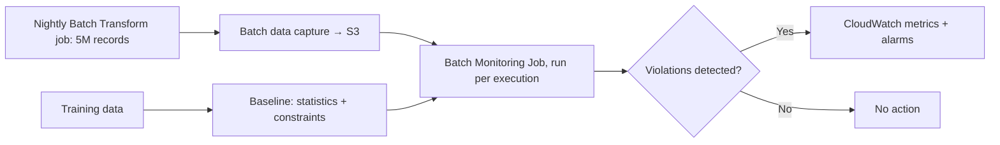

> **Real AWS doc reference:** AWS's own
> ["Data and model quality monitoring with Amazon SageMaker Model Monitor"](https://docs.aws.amazon.com/sagemaker/latest/dg/model-monitor.html)
> documentation publishes a dedicated **batch transform monitoring architecture diagram**
> (`mmv2-architecture-batch.png`, curl-verified HTTP 200), distinct from its real-time-endpoint
> architecture diagram, showing this same per-execution capture-and-compare pattern.

Step by step: (1) unlike a real-time endpoint's continuous Data Capture, batch transform capture
is tied to each scheduled job's execution; (2) the same training-time baseline (statistics/
constraints) is reused as the comparison reference; (3) a monitoring job runs once per batch
execution (or on a related schedule) rather than continuously, and surfaces violations to
CloudWatch the same way real-time monitoring does — the underlying comparison logic is shared,
only the triggering/capture mechanism differs between real-time and batch.

**Why the others are wrong:**
- **A:** This understates Model Monitor's actual scope — batch transform monitoring is an
  explicitly supported capability, not an unsupported gap.
- **C:** Ground Truth re-labeling a sample of output records could support a **model quality**
  (accuracy-vs-ground-truth) style check eventually, but it doesn't address **data quality**
  (input feature distribution) monitoring, which is what this question specifically asks about.
- **D:** AWS Config tracks infrastructure configuration (like instance type) — it has no
  statistical data-quality comparison capability for batch job inputs.

---

## Q36 — Domain 1 (Data Preparation for ML and AI)

A manufacturing company's dataset has thousands of **exact duplicate rows** for certain sensor
readings, caused by a bug in an upstream retry mechanism that occasionally resubmitted the same
reading multiple times. These duplicates are artificially inflating how common certain sensor-
value patterns appear, skewing what the model learns to treat as "typical." What data preparation
step should be applied, and at what stage, to fix this?

A) Apply SMOTE oversampling to further duplicate the already-duplicated rows, balancing all
   patterns equally
B) **Deduplicate the dataset** (remove exact duplicate rows) as an **early data-cleaning step**,
   before any feature engineering, splitting, or training — ensuring the model learns from the
   true underlying frequency of patterns in the data rather than an inflated count caused by a
   pipeline bug
C) Leave the duplicates in place, since more rows always improve model performance regardless of
   whether they represent genuinely distinct observations
D) Apply PCA to the dataset, which inherently removes duplicate rows as part of its
   dimensionality-reduction process

**Correct Answer: B**

**Explanation:** **Exact duplicate rows caused by a pipeline bug** (not genuine repeated real-
world observations) should be identified and **removed early**, during data cleaning, since
training on them would let the model over-weight those duplicated patterns as if they were more
common/important than they truly are in reality — directly distorting what the model learns as
"typical." This is a foundational, early-stage data-quality fix, done before feature engineering
or splitting. See
[`certifications/mla-c02/domain-1-data-preparation/README.md`](../domain-1-data-preparation/README.md).

**Why the others are wrong:**
- **A:** SMOTE further oversamples **minority-class** examples to address class imbalance — it
  has nothing to do with removing artificial, bug-induced duplicate rows; applying it here would
  compound the existing inflation problem rather than fix it.
- **C:** More rows only help when they represent genuinely distinct, informative observations —
  rows duplicated purely due to a retry bug add no new information and actively distort the
  learned data distribution; "more rows always help" is a false generalization here.
- **D:** PCA transforms/reduces the feature space — it has no deduplication mechanism and does
  not detect or remove identical rows as part of its mathematical operation.

---

## Q37 — Domain 2 (ML Model and Foundation Model Development)

A team is choosing between SageMaker built-in algorithms for two different tasks: Task 1 needs
to predict a numeric "preference score" for a user-item pair in a recommendation system with
extremely **sparse, high-cardinality categorical features** (millions of unique user IDs and
item IDs); Task 2 needs to classify short product-review sentences into positive/negative
sentiment categories using the raw text. Which SageMaker built-in algorithms fit each task,
respectively?

A) **Factorization Machines** for Task 1 — specifically designed for high-dimensional sparse
   datasets like user-item interaction data common in recommendation systems, efficiently
   modeling pairwise feature interactions; **BlazingText** for Task 2 — SageMaker's built-in
   algorithm for text classification (and word embeddings) operating directly on raw text
B) XGBoost for Task 1 and Random Cut Forest for Task 2 — both are the universally best choice for
   any tabular or text-based task, respectively
C) DeepAR for Task 1 and K-Nearest Neighbors for Task 2 — DeepAR is designed for sparse
   recommendation data and K-NN is designed for raw text classification
D) Both tasks should use the same single algorithm, Linear Learner, since it can handle sparse
   recommendation features and raw text classification equally well out of the box

**Correct Answer: A**

**Explanation:** **Factorization Machines** are purpose-built for datasets with **extremely
sparse, high-cardinality categorical features** (like user/item IDs in recommendation systems),
efficiently learning low-rank factorized representations of pairwise feature interactions without
needing to explicitly one-hot-encode millions of combinations. **BlazingText** is SageMaker's
built-in algorithm for **text classification and word embeddings**, operating directly on raw
text input for tasks like sentiment classification. Matching the right built-in algorithm to each
data shape/task type is a core exam skill. See
[`services/machine-learning-ai/sagemaker-training-and-tuning.md`](../../../services/machine-learning-ai/sagemaker-training-and-tuning.md).

**Why the others are wrong:**
- **B:** XGBoost is a strong general tabular-data algorithm but isn't specifically optimized for
  extremely sparse, high-cardinality recommendation-style features the way Factorization Machines
  is; Random Cut Forest is an **unsupervised anomaly-detection** algorithm, not a supervised text-
  sentiment classifier — neither claim of "universally best" nor the specific pairing is correct.
- **C:** This reverses the actual algorithm purposes: **DeepAR** is designed for **time-series
  forecasting**, not sparse recommendation data, and **K-NN** is a general similarity-based
  method with no native text-processing/embedding capability the way BlazingText has.
- **D:** Linear Learner expects a reasonably-prepared numeric feature matrix — it has no native
  mechanism for efficiently handling millions of sparse categorical IDs (without Factorization
  Machines-style interaction modeling) nor for processing raw text directly; it is not a drop-in
  solution for either specialized task as described.

---

## Q38 — Domain 3 (Deployment and Orchestration of ML Workflows)

A team builds a custom SageMaker inference container (BYOC) for a computer-vision model and
needs to understand the minimal serving-stack components their container must implement to
correctly respond to SageMaker's expected inference request pattern — specifically, which two
HTTP endpoints SageMaker's hosting service requires the container to expose. (Choose TWO) Which TWO endpoints
must a custom SageMaker inference container implement?

A) A **`/ping`** endpoint — used by SageMaker to perform health checks, returning HTTP 200 when
   the container is healthy and ready to serve traffic
B) A **`/invocations`** endpoint — the endpoint SageMaker routes actual inference requests to,
   where the container receives the request payload and returns the prediction response
C) A `/train` endpoint, which SageMaker calls to initiate training requests against a hosted
   inference container
D) A `/admin` endpoint, required for SageMaker to perform administrative configuration changes
   on a running endpoint
E) A `/metrics` endpoint, which is the only interface SageMaker uses to retrieve predictions
   from the container

**Correct Answer: A and B**

**Explanation:** SageMaker's hosting service expects any custom inference container to implement
exactly two HTTP endpoints: **`/ping`** (periodically polled for health checks — the container
must respond with HTTP 200 to signal it's alive and ready) and **`/invocations`** (where actual
prediction requests are sent, with the container responsible for parsing the payload, running
inference, and returning a formatted response). This is the minimal "serving contract" BYOC
containers must satisfy. See
[`services/machine-learning-ai/sagemaker-deployment-endpoints.md`](../../../services/machine-learning-ai/sagemaker-deployment-endpoints.md).

**Why the others are wrong:**
- **C:** Training and inference are handled by separate SageMaker container contracts — a
  **hosting/inference** container (serving an already-trained model) does not implement a
  `/train` endpoint; training containers instead follow a different convention (reading from
  `/opt/ml/input`, writing to `/opt/ml/model`) entirely separate from the live serving endpoints.
- **D:** There is no `/admin` endpoint in SageMaker's inference container contract — endpoint-
  level configuration changes (instance type, scaling, etc.) are managed through the SageMaker
  API/console, not a container-exposed admin HTTP route.
- **E:** Inference requests and responses flow through `/invocations`, not a `/metrics`
  endpoint — `/metrics`-style monitoring (if present at all) would be a supplementary,
  non-standard addition, not the mechanism SageMaker itself uses to retrieve predictions.

---

## Q39 — Domain 4 (Operating, Monitoring, and Securing ML Solutions)

A team manages dozens of data science notebook instances (SageMaker Studio and classic notebook
instances) and finds that many are left running overnight and over weekends by engineers who
forget to stop them, accumulating significant unnecessary compute cost. They want an automated
way to **detect idle notebook instances and automatically stop them** after a period of
inactivity, without manually auditing usage logs by hand. Which approach addresses this?

A) Manually checking the SageMaker console every Monday morning for instances that have been
   running all weekend, and stopping them by hand
B) **A lifecycle configuration script attached to the notebook instance** (or an automated
   solution like the open-source "notebook auto-stop" pattern commonly deployed via a scheduled
   Lambda function checking CloudWatch idle-time metrics) that detects a configurable period of
   inactivity and automatically stops the instance, eliminating unnecessary overnight/weekend
   compute cost
C) SageMaker notebook instances cannot be automatically stopped under any circumstances; they
   must always run continuously once created
D) Switching all notebooks to SageMaker Studio automatically eliminates all idle compute cost
   with zero additional configuration

**Correct Answer: B**

**Explanation:** A common, well-documented cost-optimization pattern is attaching a **lifecycle
configuration** script to each notebook instance (run at notebook start) that installs a small
monitor checking for a configurable period of CPU/kernel inactivity, and automatically calling
`StopNotebookInstance` once that idle threshold is crossed — removing the need for manual,
after-the-fact auditing and directly preventing the "left running all weekend" cost waste. See
[`certifications/mla-c02/domain-4-monitoring-security/ml-cost-optimization.md`](../domain-4-monitoring-security/ml-cost-optimization.md).

**Why the others are wrong:**
- **A:** Manual weekly checks are reactive (cost has already been incurred by the time someone
  notices) and depend on a human remembering to look — exactly the error-prone, non-automated
  process the question wants replaced.
- **C:** SageMaker notebook instances absolutely can be stopped (manually or programmatically via
  the API) when not in active use — this option misstates a basic, commonly-used capability.
- **D:** Switching to SageMaker Studio changes the development environment's architecture, but it
  does not automatically eliminate idle compute cost on its own — Studio still incurs cost for
  running kernel/app instances, and idle-shutdown behavior still needs to be explicitly
  configured (e.g., Studio's own idle-shutdown lifecycle configuration), not something that
  happens for free with zero setup.

---

## Q40 — Domain 1 (Data Preparation for ML and AI)

A RAG system over a long corpus of insurance policy PDFs needs to preserve **tables** (e.g.,
coverage limit tables with rows and columns) intact within a single chunk, since splitting a
table mid-row or mid-column across two chunks destroys its meaning and makes it useless for
retrieval and answer generation. A naive fixed-character-count chunking strategy frequently
splits tables apart. What chunking approach better handles this structured content?

A) Increase the fixed chunk size slightly (e.g., from 500 to 600 characters), which guarantees no
   table is ever split regardless of the table's actual size
B) **Structure-aware chunking** — using document structure (e.g., detected table boundaries,
   section headers, or a document-parsing step that identifies table regions) to ensure each
   chunk boundary falls between structural elements rather than through the middle of a table,
   keeping each table intact within one chunk (or a dedicated table-specific chunk)
C) Remove all tables from the source documents before chunking, since tables cannot be processed
   by any embedding model
D) Switch to character-level chunking (one character per chunk), which structurally cannot ever
   split a table incorrectly

**Correct Answer: B**

**Explanation:** **Structure-aware (or layout-aware) chunking** uses the document's actual
structure — section/paragraph/table boundaries, often detected via a document-parsing step (e.g.,
Textract's table-extraction capability, or structure-aware document loaders) — to decide where
chunk boundaries fall, specifically avoiding splitting coherent structural units like tables
across chunks; this preserves each table's full meaning within a single retrievable unit, unlike
a naive fixed-character-count split that's blind to document structure. See
[`certifications/mla-c02/domain-1-data-preparation/embeddings-and-rag-data-prep.md`](../domain-1-data-preparation/embeddings-and-rag-data-prep.md).

**Why the others are wrong:**
- **A:** A slightly larger fixed chunk size doesn't guarantee anything about table boundaries —
  it's still blind to document structure, and a modestly larger character limit could still split
  a sufficiently large table (or needlessly inflate chunks for tables much smaller than the new
  limit); it's not a structural fix.
- **C:** Removing tables entirely would discard genuinely useful, often highly specific
  information (like coverage limits) that users likely want retrieved — embedding models can
  process extracted table text (e.g., converted to a structured text representation); the real
  fix is handling tables properly during chunking, not deleting them.
- **D:** Character-level (single-character) chunking would make every chunk meaningless on its
  own and completely destroys retrieval usefulness for everything, not just tables — this is an
  absurd, impractical overcorrection, not a real chunking strategy.

---

## Q41 — Domain 2 (ML Model and Foundation Model Development)

A language model's quality is measured by computing, for a held-out test set of real sentences,
how "surprised" the model is by each actual next word given the preceding context — formally, an
exponentiated average of the negative log-likelihood the model assigns to the true next tokens.
A **lower** value indicates the model assigns higher probability to the actual observed text
(better predictive fit). Which metric is being described, and is it computed by comparing against
a human reference text the way BLEU/ROUGE are?

A) **Perplexity** — an intrinsic language-model quality metric computed purely from the model's
   own predicted token probabilities on a sequence, with **no comparison to a human reference
   translation/summary** required, unlike BLEU/ROUGE/BERTScore which compare generated text
   against reference text
B) BLEU, which also requires no reference text and is computed purely from the model's internal
   token probabilities
C) ROUGE, which is identical in definition and computation to perplexity
D) Accuracy, treating each next-word prediction as a classification decision scored right/wrong

**Correct Answer: A**

**Explanation:** **Perplexity** is an **intrinsic** metric: it only needs the model's own
predicted probability distribution over tokens and the actual sequence of tokens in a held-out
test set — it directly measures how well-calibrated/confident the model's own language modeling
is, with **no external reference text needed** at all. This is fundamentally different from
**extrinsic** metrics like BLEU, ROUGE, or BERTScore, which specifically compare a model's
*generated output* against a separate human-written reference. See
[`certifications/mla-c02/domain-2-model-development/README.md`](../domain-2-model-development/README.md).

**Why the others are wrong:**
- **B:** BLEU is explicitly defined as a **reference-comparison** metric (n-gram overlap between
  generated text and a human reference) — it requires a reference text and is not computed purely
  from a model's internal token probabilities the way perplexity is.
- **C:** ROUGE, like BLEU, is a **reference-comparison** metric (overlap/recall against human-
  written reference summaries) — it is a fundamentally different computation than perplexity's
  purely-internal, reference-free probability measure; the two are not identical.
- **D:** Framing next-word prediction as binary right/wrong classification discards the
  continuous, probabilistic nature of language modeling that perplexity is specifically designed
  to capture (how *confidently* correct, not just whether the top prediction matched).

---

## Q42 — Domain 3 (Deployment and Orchestration of ML Workflows)

A GenAI document-processing pipeline needs to run as a sequence of stages — ingest a document,
extract text, chunk it, embed each chunk (potentially hundreds per document, processed in
parallel), write to a vector index, and finally send a completion notification — with built-in
retry handling for transient failures at each stage, visual tracking of exactly which stage a
given document is in, and the ability to process many documents concurrently as they arrive.
Which AWS orchestration service is the natural fit for coordinating this entire multi-stage,
partially-parallel pipeline?

A) A single, very long Lambda function containing all the pipeline logic sequentially, with no
   external orchestration layer at all
B) **AWS Step Functions**, using a state machine that sequences the ingest/extract/chunk stages,
   a **`Map` state** to fan the embedding step out in parallel across a document's chunks, and
   built-in retry/catch error handling at each state, with visual execution tracking per document
   via the Step Functions console
C) Amazon CloudWatch Events (EventBridge) alone, with no state machine or step sequencing
   capability
D) AWS Glue, since Glue is designed specifically for multi-stage GenAI document pipelines rather
   than general ETL

**Correct Answer: B**

**Explanation:** **Step Functions** is purpose-built for exactly this kind of multi-stage,
partially-parallel workflow: a state machine sequences each processing stage, a **`Map` state**
fans the embedding step out across a document's many chunks concurrently, and Step Functions
natively provides per-state **retry/catch** error handling plus a visual execution graph showing
exactly which stage any given document's processing is currently in — all without the team
hand-building this orchestration, retry, and visibility logic themselves. See
[`certifications/mla-c02/domain-3-deployment-orchestration/README.md`](../domain-3-deployment-orchestration/README.md).

**Why the others are wrong:**
- **A:** A single monolithic Lambda function has no built-in per-stage retry isolation, no
  visual per-document stage tracking, and Lambda's execution time limit (15 minutes) could be a
  poor fit for a pipeline with many large documents — it reinvents orchestration logic Step
  Functions already provides.
- **C:** EventBridge is an event bus/router for triggering targets based on events — it has no
  state-machine sequencing, retry/catch semantics, or Map-style parallel fan-out capability of
  its own; it could trigger the *start* of a Step Functions execution, but doesn't replace the
  orchestration layer itself.
- **D:** Glue is a data-integration/ETL service (primarily Spark-based transformations of
  structured/semi-structured data) — it is not designed as a general multi-stage workflow
  orchestrator with retry/branching/parallel-fan-out semantics for an arbitrary GenAI pipeline.

---

## Q43 — Domain 4 (Operating, Monitoring, and Securing ML Solutions)

A SageMaker Studio administrator wants data scientists to be able to freely create, train, and
tune models within a sandbox environment, but wants to prevent any single data scientist's IAM
permissions from ever being escalated (even accidentally, by that data scientist creating an
overly-permissive IAM role for a training job) beyond a defined maximum set of allowed actions —
regardless of what the data scientist's own assigned policies might otherwise allow them to
attach. Which IAM capability enforces this hard ceiling?

A) A **permissions boundary** attached to the data scientist's IAM role/user — a managed policy
   that defines the **maximum** permissions that role/user (or any role it creates) can ever have,
   acting as an outer limit that even an otherwise-permissive identity-based policy cannot exceed
B) A resource-based policy attached only to the S3 buckets the data scientist's training jobs
   read from, with no bearing on what IAM actions the data scientist's own role can perform
C) Enabling MFA (multi-factor authentication) on the data scientist's IAM user, which has no
   effect on the maximum scope of permissions that identity can exercise
D) Tagging the data scientist's IAM role with a "sandbox" tag, which AWS automatically interprets
   as an enforced permissions ceiling with no further policy configuration required

**Correct Answer: A**

**Explanation:** An IAM **permissions boundary** is a managed policy attached to a role or user
that defines the **maximum permissions** that identity (and, critically, any role it creates or
passes) can ever be granted — even if an identity-based policy attached later would otherwise
allow more, the permissions boundary acts as a hard outer ceiling, exactly preventing the
"accidentally created an overly-permissive training-job role" escalation scenario described. See
[`certifications/mla-c02/domain-4-monitoring-security/README.md`](../domain-4-monitoring-security/README.md).

**Why the others are wrong:**
- **B:** A resource-based policy on an S3 bucket controls access **to that specific bucket** — it
  has no effect on limiting the broader set of IAM actions the data scientist's own role or any
  role they create could otherwise perform elsewhere.
- **C:** MFA strengthens **authentication** (proving who is making the request) — it has no
  bearing on **authorization** scope/ceiling; a fully-authenticated, MFA-verified identity could
  still exceed intended permissions without a permissions boundary in place.
- **D:** Resource tags are metadata labels; AWS does not automatically interpret any specific tag
  value as an enforced permissions ceiling — actual enforcement requires an explicit policy
  mechanism like a permissions boundary (tags *can* be referenced inside IAM policy conditions,
  but the tag itself does nothing without that policy logic).

---

## Q44 — Domain 1 (Data Preparation for ML and AI)

A RAG system embeds document chunks using **Amazon Titan Text Embeddings**, which can be
configured to output vectors at **256, 512, or 1024 dimensions**. The team is deciding which
dimensionality to use, aware that higher dimensions can capture more semantic nuance but also
increase storage footprint and search latency. Which factor should most directly drive this
dimensionality choice?

A) Always choose the lowest available dimensionality (256), since dimensionality has no effect on
   retrieval quality whatsoever
B) **The tradeoff between retrieval quality and operational cost/latency** — higher dimensions
   (1024) can capture finer-grained semantic distinctions, improving retrieval accuracy for
   nuanced queries, at the cost of greater storage per vector and typically higher similarity-
   search latency at large index scale; the team should benchmark retrieval quality at each
   dimensionality against their actual document corpus and query patterns, choosing the smallest
   dimensionality that meets their required retrieval quality bar
C) Always choose the highest available dimensionality (1024), since higher dimensionality always
   guarantees better retrieval quality with zero cost tradeoff
D) Dimensionality must always match the exact number of tokens in the longest document chunk

**Correct Answer: B**

**Explanation:** Embedding dimensionality is a genuine **tradeoff**: higher-dimensional vectors
can encode more nuanced semantic distinctions (potentially improving retrieval relevance,
especially for complex or ambiguous queries), but they also mean more storage per vector and
generally slower similarity-search computation at scale, particularly across millions of vectors.
The right choice depends on **empirically benchmarking retrieval quality** at each candidate
dimensionality against the actual corpus and realistic queries, then picking the smallest
dimensionality that still meets the quality bar — not defaulting blindly to either extreme. See
[`certifications/mla-c02/domain-1-data-preparation/embeddings-and-rag-data-prep.md`](../domain-1-data-preparation/embeddings-and-rag-data-prep.md).

**Why the others are wrong:**
- **A:** Dimensionality does affect how much semantic nuance a vector can represent — claiming
  "no effect whatsoever" ignores a well-documented, real tradeoff between dimensionality and
  retrieval granularity.
- **C:** Higher dimensionality does **not** come with zero cost — it increases storage footprint
  and typically search latency at scale; "always choose the highest, zero tradeoff" misstates the
  actual tradeoff this question is testing.
- **D:** Embedding dimensionality is an independent configuration choice of the embedding model
  itself — it has no requirement to match or relate numerically to a chunk's token count, which
  is a separate, unrelated parameter (chunk size).

---

## Q45 — Domain 2 (ML Model and Foundation Model Development)

A business analyst with no coding or ML background wants to quickly try several algorithms on a
new tabular sales dataset, get a ranked leaderboard of candidate models by performance, and
deploy the best one — all through a visual, point-and-click interface, without ever writing
Python, SageMaker SDK calls, or Jupyter notebook code. Which SageMaker capability specifically
targets this no-code business-analyst persona, as opposed to the notebook-based Autopilot
experience a data scientist would typically use directly?

A) **Amazon SageMaker Canvas**, a no-code, visual ML tool built specifically for business
   analysts — point-and-click dataset import, automated model building/leaderboard (built on the
   same AutoML technology as Autopilot under the hood), and one-click deployment, with no Python
   or notebook interaction required at any point
B) SageMaker Studio notebooks, which require writing Python code using the SageMaker SDK
C) AWS Glue DataBrew, which focuses on visual data cleaning/transformation, not automated model
   training or a leaderboard of candidate ML models
D) SageMaker Debugger, a tool for inspecting training-time tensors and gradients via code

**Correct Answer: A**

**Explanation:** **SageMaker Canvas** is purpose-built for exactly this persona: a no-code,
visual interface where a business analyst imports a dataset, lets Canvas automatically try
multiple algorithms and generate a ranked leaderboard of candidate models (leveraging the same
underlying AutoML technology as SageMaker Autopilot), and deploys the chosen model — all without
writing any code or touching a notebook, distinct from the data-scientist-facing Autopilot/
Studio-notebook workflow. See
[`services/machine-learning-ai/jumpstart.md`](../../../services/machine-learning-ai/jumpstart.md)
and [`certifications/mla-c02/domain-2-model-development/README.md`](../domain-2-model-development/README.md).

**Why the others are wrong:**
- **B:** SageMaker Studio notebooks are a code-first, Python/SDK-based development environment —
  directly contradicting the "no coding" requirement specified in the question.
- **C:** Glue DataBrew is a visual *data-cleaning/transformation* tool, not an automated model
  training or leaderboard-generation tool — it has no built-in ML-model-leaderboard or
  one-click-deployment capability the way Canvas does.
- **D:** SageMaker Debugger is a code-driven, training-diagnostics tool aimed at data scientists/
  ML engineers inspecting internal training dynamics — it has nothing to do with a no-code,
  business-analyst-facing modeling workflow.

---

## Q46 — Domain 3 (Deployment and Orchestration of ML Workflows)

A team has a working SageMaker Pipeline that trains and conditionally registers a model, but they
currently trigger it **manually** by running a script whenever new labeled data happens to land
in an S3 prefix — an engineer has to remember to check and kick it off. They want the pipeline to
start **automatically** the moment a new object lands in that S3 prefix, with no human-initiated
trigger step at all. Which combination of services achieves this fully event-driven trigger?

A) A cron job running `aws s3 ls` every minute on an engineer's own laptop to detect new files
   and manually run the pipeline script
B) **Amazon EventBridge**, configured with an **S3 Event Notification** (via EventBridge's S3
   event integration, or S3's native event notifications forwarded to EventBridge) that matches
   "new object created" events on the target prefix, with a **rule** routing that event to
   **trigger the SageMaker Pipeline execution** (e.g., via a Lambda function or a direct
   EventBridge-to-SageMaker-Pipelines target) — fully automated, no manual or scheduled polling
   involved
C) AWS Config, which detects S3 object uploads as a configuration-compliance event and can
   trigger SageMaker Pipelines directly with no additional Lambda or EventBridge rule needed
D) SageMaker Pipelines has no event-driven trigger mechanism at all; manual or script-based
   triggering is the only supported option

**Correct Answer: B**

**Explanation:** **S3 Event Notifications** (forwarded to or natively integrated with
**EventBridge**) let you react to specific object-creation events in a given prefix; an
EventBridge **rule** matching that event pattern can then target a Lambda function (or other
supported target) that calls the SageMaker Pipelines `StartPipelineExecution` API — creating a
fully event-driven trigger with zero manual intervention or periodic polling needed, as soon as
new data actually lands in S3. See
[`certifications/mla-c02/domain-3-deployment-orchestration/README.md`](../domain-3-deployment-orchestration/README.md).

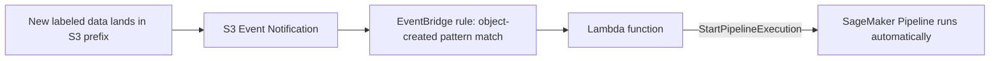

**Why the others are wrong:**
- **A:** A laptop-based cron job is manual, fragile (depends on the laptop being on and the
  script not failing silently), and not centrally managed infrastructure at all — exactly the
  ad hoc approach the question wants replaced with a real event-driven trigger.
- **C:** AWS Config evaluates resource *configuration compliance* against rules — it has no
  native mechanism to detect "a new S3 object was created" as a triggerable event or to directly
  invoke a SageMaker Pipeline execution; that's EventBridge's role, not Config's.
- **D:** SageMaker Pipelines absolutely can be triggered by external events through EventBridge
  integration — this option misstates a real, commonly-used event-driven automation pattern as
  unsupported.

---

## Q47 — Domain 4 (Operating, Monitoring, and Securing ML Solutions)

A company's disaster-recovery policy requires that if their primary AWS Region hosting SageMaker
Model Registry and trained model artifacts experiences a full outage, they must be able to
quickly resume deploying models from a secondary Region, with model artifacts and registry
metadata already available there rather than needing to be recreated or re-trained from scratch
after the outage begins. Which practice supports this cross-Region resilience for ML assets?

A) Relying solely on the primary Region's standard durability guarantees, since S3 and SageMaker
   services never require any additional cross-Region configuration for disaster recovery
B) **Cross-Region replication of the S3 bucket(s) storing model artifacts** (via S3 Cross-Region
   Replication) combined with a **process to register replicated model packages in a secondary
   Region's Model Registry** (or otherwise re-establish the needed registry metadata there) —
   proactively maintained ahead of any outage, not created reactively after one begins
C) AWS CloudTrail, configured to automatically recreate deleted or inaccessible model artifacts
   in a secondary Region during an outage
D) Increasing the primary Region's SageMaker endpoint instance count, which inherently also
   protects against a full Regional outage

**Correct Answer: B**

**Explanation:** True cross-Region disaster recovery for ML assets requires **proactively**
replicating model artifacts (e.g., via **S3 Cross-Region Replication** of the artifact bucket)
and maintaining a corresponding **Model Registry presence in the secondary Region** (since
Registry resources are Region-scoped), so that if the primary Region becomes unavailable, the
team can deploy already-available, already-registered model versions in the secondary Region
without needing to re-train or manually reconstruct registry metadata under outage pressure. See
[`certifications/mla-c02/domain-4-monitoring-security/README.md`](../domain-4-monitoring-security/README.md).

**Why the others are wrong:**
- **A:** Standard S3/SageMaker durability protects against data loss **within** a Region (e.g.,
  multi-AZ redundancy) — it does not automatically replicate data or registry metadata to a
  separate Region for DR purposes; that requires explicit configuration like Cross-Region
  Replication.
- **C:** CloudTrail is a logging/audit service — it has no capability to recreate or restore
  model artifacts in another Region; it can only tell you what happened, not reconstruct lost
  resources.
- **D:** Adding more instances to an endpoint **within the primary Region** improves capacity/
  AZ-level resilience there, but does nothing to protect against that entire Region becoming
  unavailable — Regional-outage resilience specifically requires a presence in another Region.

---

## Q48 — Domain 1 (Data Preparation for ML and AI)

A retailer's product-categorization dataset has 30 categories; the top 3 categories make up 85%
of all records, while the remaining 27 categories share the other 15%, and several of those rarer
categories have fewer than 20 labeled examples each. The team wants to directly address this
severe multi-class imbalance before training. (Choose TWO) Which TWO actions are appropriate, specific
responses to this scenario?

A) **Oversample the severely under-represented categories** (e.g., via SMOTE adapted for
   multi-class settings, or simple duplication/targeted data collection for categories with
   fewer than 20 examples) to raise their representation in the training set
B) **Use a stratified train/validation/test split** that preserves each category's (however
   small) proportion across all splits, and evaluate using **per-class metrics** (e.g., macro-
   averaged F1 or per-class recall) rather than overall accuracy, which would be dominated by
   the 3 majority categories
C) Discard all 27 minority categories entirely, reducing the problem to a simpler 3-class
   classification task
D) Train using a 50/50 random split with no stratification, since random splitting always
   handles any class distribution correctly regardless of imbalance severity
E) Replace overall accuracy with the raw count of correctly classified majority-category examples
   as the sole evaluation metric

**Correct Answer: A and B**

**Explanation:** For **severe, multi-class imbalance** with some categories having fewer than
20 examples, the standard combination of fixes is: (1) **oversampling the rare classes** (SMOTE-
style synthetic generation or targeted real-data collection) to give the model more signal to
learn those categories from, and (2) **stratified splitting plus per-class evaluation metrics**
(macro F1, per-class recall), ensuring both that every split retains a representative slice of
even the rarest categories, and that evaluation doesn't let the 3 dominant categories mask poor
performance on the other 27. See
[`certifications/mla-c02/domain-1-data-preparation/README.md`](../domain-1-data-preparation/README.md).

**Why the others are wrong:**
- **C:** Discarding the 27 minority categories entirely would eliminate the very classes the
  business presumably needs classified — abandoning the task for 90% of the category space isn't
  a legitimate fix, just a scope reduction that avoids the actual problem.
- **D:** A non-stratified 50/50 random split is specifically risky for severely imbalanced,
  low-count categories — with fewer than 20 examples in some categories, random splitting could
  easily place zero examples of a rare category into a given split by chance, breaking evaluation
  for that class entirely.
- **E:** Using only the majority-category correct count as the sole metric would completely hide
  how the model performs on the 27 minority categories — the opposite of the per-class visibility
  the scenario needs.

---

## Q49 — Domain 2 (ML Model and Foundation Model Development)

A team notices their deep neural network's loss stops improving early in training, and
inspecting the network's internal layers shows that the gradients flowing backward through the
earliest layers during backpropagation become vanishingly small, meaning those early layers'
weights barely update at all. Which specific SageMaker capability is designed to help diagnose
this exact internal-training-dynamics problem by inspecting tensors during training, and what
does it surface?

A) **SageMaker Debugger**, which captures and analyzes internal tensors (including gradients)
   during a training job in near real time, with built-in rules that can automatically detect
   patterns like **vanishing gradients** (or exploding gradients, overfitting signatures, etc.)
   and alert the team without manually instrumenting the training code to log every tensor
B) SageMaker Ground Truth, which is designed to re-label training data when gradients appear
   abnormal
C) SageMaker Model Monitor, which inspects live production inference traffic, not internal
   training-time tensor/gradient values
D) AWS Config, which tracks training-job instance type configuration, not internal training
   dynamics like gradient magnitudes

**Correct Answer: A**

**Explanation:** **SageMaker Debugger** is purpose-built to capture and analyze a training job's
internal state (tensors, gradients, weights, activations) during training, with **built-in rules**
(like a vanishing/exploding gradient detector) that can automatically flag exactly this kind of
problem — gradients becoming vanishingly small in early layers — without the team needing to
hand-instrument their training script with custom logging for every tensor of interest. See
[`services/machine-learning-ai/sagemaker-training-and-tuning.md`](../../../services/machine-learning-ai/sagemaker-training-and-tuning.md).

**Why the others are wrong:**
- **B:** Ground Truth is a data-labeling service — it has no relationship to training-time
  gradient/tensor diagnostics at all.
- **C:** Model Monitor inspects **already-deployed, production** inference traffic for data/model
  quality drift — it operates post-deployment, not during the training job itself, and has no
  visibility into internal training tensors/gradients.
- **D:** AWS Config tracks infrastructure configuration (instance types, security settings) —
  it has no capability to inspect a training job's internal gradient values or detect vanishing-
  gradient patterns.

---

## Q50 — Domain 3 (Deployment and Orchestration of ML Workflows)

A team runs a SageMaker endpoint deployment using the **canary** traffic-shifting configuration:
10% of traffic is routed to the new model version, held for a 10-minute bake time with a
CloudWatch alarm watching the new version's error rate. Partway through the bake time, the alarm
fires because the new version's error rate has spiked well above the old version's. What should
happen next, and is this an automatic or manual response?

A) The deployment should continue shifting the remaining 90% of traffic to the new version
   anyway, since 10% has already been committed and reversing now would waste that effort
B) **The deployment should automatically roll back** to the previous (known-good) model version —
   this automatic rollback-on-alarm behavior is exactly the safety mechanism the canary
   configuration with an attached CloudWatch alarm is designed to trigger, requiring no manual
   intervention to initiate the rollback
C) The team must manually and urgently log into the console to stop the deployment; SageMaker
   has no automatic rollback capability tied to CloudWatch alarms
D) The alarm firing has no effect on the deployment process at all; alarms are purely
   informational notifications with no tie to deployment behavior

**Correct Answer: B**

**Explanation:** SageMaker's deployment guardrails, when configured with a **canary** (or linear)
traffic-shifting strategy and an **attached CloudWatch alarm**, are specifically designed to
**automatically roll back** to the previous model version the moment that alarm enters an ALARM
state during the bake/monitoring window — this is the entire point of attaching an alarm to a
guarded deployment: catching a bad new version's impact early (while only a small percentage of
traffic was exposed) and reverting automatically, without needing a human to notice and manually
intervene. See
[`services/machine-learning-ai/sagemaker-deployment-endpoints.md`](../../../services/machine-learning-ai/sagemaker-deployment-endpoints.md).

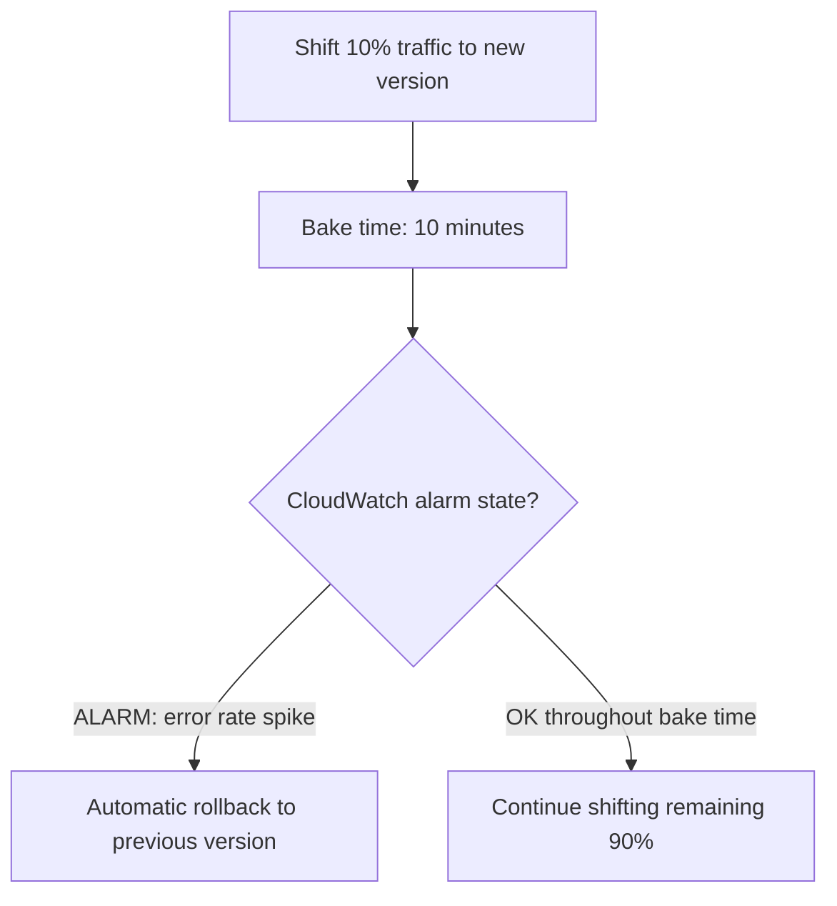

**Why the others are wrong:**
- **A:** Continuing to shift more traffic to a version already shown to have a spiking error rate
  would make the problem worse, exposing more users to a confirmed-bad version — exactly the
  outcome the canary-with-alarm pattern is designed to prevent by rolling back early instead.
- **C:** This understates SageMaker's actual built-in capability — automatic rollback tied to a
  CloudWatch alarm during a guarded deployment is a native, documented feature, not something
  requiring manual emergency intervention to achieve.
- **D:** When an alarm is explicitly **attached to a deployment's rollback configuration** (as
  opposed to a standalone, unconnected alarm elsewhere), it is directly wired into the deployment
  process's automatic rollback logic — it is not merely informational in this configuration.

---

## Q51 — Domain 4 (Operating, Monitoring, and Securing ML Solutions)

A security team wants a single, centralized dashboard that aggregates and prioritizes findings
from multiple AWS security services — GuardDuty's threat detections, Macie's sensitive-data
discoveries, and AWS Config's compliance findings — across all accounts in their AWS
Organization, rather than needing to check each service's own separate console per account.
Which service is designed for this kind of aggregated, cross-service, cross-account security
visibility?

A) **AWS Security Hub**, which aggregates, normalizes, and prioritizes findings from GuardDuty,
   Macie, Config, Inspector, and other integrated security services into one centralized,
   organization-wide dashboard
B) Amazon CloudWatch, which only displays operational metrics and logs, not aggregated
   cross-service security findings from GuardDuty/Macie/Config
C) AWS Trusted Advisor, which provides general best-practice recommendations, not a
   findings-aggregation dashboard for GuardDuty/Macie/Config specifically
D) Amazon Inspector alone, which only scans for vulnerabilities in EC2/container/Lambda
   workloads, with no aggregation of GuardDuty or Macie findings

**Correct Answer: A**

**Explanation:** **AWS Security Hub** is purpose-built as the **aggregation layer** across
multiple AWS security services — pulling in GuardDuty threat findings, Macie sensitive-data
findings, Config compliance findings, Inspector vulnerability findings, and more, normalizing
them into a consistent format and surfacing a prioritized, centralized dashboard across all
accounts in an organization — exactly the "one place to see everything" capability described.
See
[`certifications/mla-c02/domain-4-monitoring-security/README.md`](../domain-4-monitoring-security/README.md).

**Why the others are wrong:**
- **B:** CloudWatch handles operational metrics, logs, and alarms — it has no built-in
  understanding of or integration specifically aggregating GuardDuty/Macie/Config security
  findings into a unified security dashboard.
- **C:** Trusted Advisor gives general account best-practice checks (cost, performance, security
  basics, fault tolerance) — it is not the aggregation point for detailed GuardDuty/Macie/Config
  findings the way Security Hub is.
- **D:** Inspector is itself just one of the services *feeding into* Security Hub (vulnerability
  scanning for compute workloads) — it has no native capability to aggregate GuardDuty or Macie
  findings; that aggregation role belongs to Security Hub, not Inspector.

---

## Q52 — Domain 1 (Data Preparation for ML and AI)

A RAG system is designed to answer questions using both **text and product images** from a
retail catalog — for example, "find products that look similar to this uploaded photo" or
"describe what's shown in this product image in the context of our catalog description." A
standard text-only embedding model (like Titan Text Embeddings) cannot represent image content
at all. Which type of embedding model is needed to represent both text and images in a shared
vector space for this kind of cross-modal retrieval?

A) A **multimodal embedding model** (e.g., Amazon Titan Multimodal Embeddings), which can embed
   both images and text into the **same shared vector space**, enabling similarity search across
   modalities — a text query can retrieve relevant images, and an image query can retrieve
   relevant text or other images
B) Two completely separate, independently-trained text and image embedding models whose vectors
   are directly compatible with each other with no special training required
C) BLEU, since it is specifically designed to score similarity between text and images
D) A standard text-only embedding model is already fully capable of representing image content
   without any modification

**Correct Answer: A**

**Explanation:** A **multimodal embedding model** (such as Amazon Titan Multimodal Embeddings) is
specifically trained so that **both images and text** map into one shared, comparable vector
space — meaning a text query embedding and a product-image embedding can be meaningfully compared
via similarity search, enabling cross-modal retrieval (text→image, image→text, or image→image)
that a text-only embedding model simply has no mechanism to support. See
[`certifications/mla-c02/domain-1-data-preparation/embeddings-and-rag-data-prep.md`](../domain-1-data-preparation/embeddings-and-rag-data-prep.md).

**Why the others are wrong:**
- **B:** Two independently-trained, separate embedding models (one for text, one for images) are
  **not** guaranteed to produce vectors in a comparable or shared space unless they were
  specifically trained together (or aligned) for that purpose — simply having two separate models
  does not automatically make their outputs cross-comparable.
- **C:** BLEU is an n-gram-overlap text-to-text comparison metric for evaluating generated text
  against a reference — it has no mechanism for processing or comparing image content at all.
- **D:** A text-only embedding model has no architecture or training signal for processing pixel/
  image input whatsoever — it fundamentally cannot represent image content without being a
  different, multimodal model.

---

## Q53 — Domain 2 (ML Model and Foundation Model Development)

A team has a 50,000-row labeled tabular dataset and wants to track and compare dozens of
training runs across different algorithms, hyperparameter settings, and feature sets — including
each run's metrics, input dataset version, and resulting model artifact — so they can later
answer "which exact configuration produced our best validation F1 score, and what were all its
settings?" without relying on manually kept spreadsheets. Which SageMaker capability is designed
for this experiment tracking and comparison?

A) **SageMaker Experiments**, which automatically tracks metadata (hyperparameters, metrics,
   input datasets, output artifacts) for each training run (trial), organizing related trials
   under one experiment and letting the team compare and sort trials by any tracked metric
   through the Studio UI or SDK, with no manual spreadsheet tracking needed
B) SageMaker Ground Truth, which is designed to label new data, not track metadata about
   training runs/trials
C) AWS Config, which tracks infrastructure resource configuration history, not ML experiment
   metrics or hyperparameters
D) Amazon CloudWatch billing alarms, which only track account spending, not training-run
   hyperparameters or metrics

**Correct Answer: A**

**Explanation:** **SageMaker Experiments** is purpose-built to automatically capture and organize
metadata for every training run as a "trial" within an "experiment" — hyperparameters, tracked
metrics, dataset/version lineage, and output artifact references — letting the team sort/filter/
compare trials (e.g., "show me all trials sorted by validation F1 descending") directly, instead
of manually logging this information in a spreadsheet. See
[`services/machine-learning-ai/sagemaker-training-and-tuning.md`](../../../services/machine-learning-ai/sagemaker-training-and-tuning.md).

**Why the others are wrong:**
- **B:** Ground Truth is a data-labeling service for producing labeled training data — it has no
  training-run tracking or experiment-comparison capability.
- **C:** AWS Config tracks AWS *infrastructure resource* configuration changes over time (e.g.,
  security group rules) — it has no concept of ML-specific training metrics, hyperparameters, or
  experiment organization.
- **D:** CloudWatch billing alarms monitor account-level cost thresholds — they have no
  relationship to tracking or comparing training-run hyperparameters/metrics.

---

## Q54 — Domain 3 (Deployment and Orchestration of ML Workflows)

A team's SageMaker Pipeline includes a Processing step that performs a data-quality check,
comparing a newly trained model's evaluation metric against a required minimum threshold (e.g.,
F1 ≥ 0.85) before deciding whether the pipeline should proceed to register the model in the Model
Registry, or instead branch to send a failure notification without registering anything. Which
SageMaker Pipelines construct enables this evaluation-metric-based conditional branching within
the pipeline definition itself?

A) A **`ConditionStep`**, which evaluates a condition (e.g., comparing a property from a prior
   step's output, like the evaluation metric, against a threshold) and routes pipeline execution
   down one of two branches accordingly — e.g., a "register model" branch if the condition
   passes, or a "notify failure" branch if it does not
B) SageMaker Pipelines has no conditional branching construct; all steps always execute
   unconditionally in a fixed linear sequence
C) An IAM policy condition key, which is used for access-control decisions, not pipeline
   execution branching based on model evaluation metrics
D) A CloudWatch alarm attached directly to the pipeline, which can only send notifications and
   has no mechanism to alter which pipeline steps execute

**Correct Answer: A**

**Explanation:** SageMaker Pipelines' **`ConditionStep`** evaluates one or more conditions
(commonly comparing a numeric property, like an evaluation metric extracted from a prior
Processing/Evaluation step's output, against a threshold) and then executes a different set of
subsequent steps depending on whether the condition is true or false — exactly the mechanism
needed to gate "only register the model if its F1 score clears the bar, otherwise branch to a
failure-notification path." See
[`services/machine-learning-ai/sagemaker-pipelines.md`](../../../services/machine-learning-ai/sagemaker-pipelines.md).

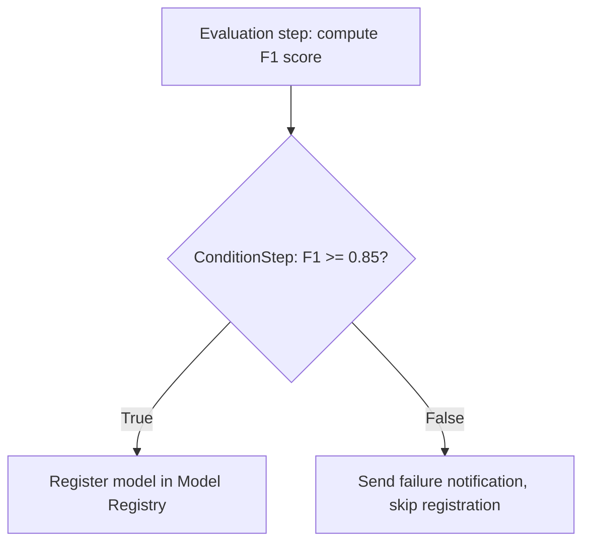

**Why the others are wrong:**
- **B:** This directly contradicts SageMaker Pipelines' actual capability — `ConditionStep` is a
  first-class, well-documented construct specifically for conditional branching; claiming no such
  construct exists misstates the service.
- **C:** IAM policy condition keys govern access-control decisions (who can call which API under
  what circumstances) — they have no role in determining which steps of a pipeline's DAG execute
  based on a model's evaluation metric.
- **D:** A CloudWatch alarm can notify about a metric crossing a threshold, but it has no native
  mechanism to branch *which pipeline steps run next* within a SageMaker Pipeline's own
  definition — that branching logic is `ConditionStep`'s specific job.

---

## Q55 — Domain 4 (Operating, Monitoring, and Securing ML Solutions)

A regulated company's compliance team wants documented proof that **every change to Bedrock
Guardrails configurations** (e.g., who modified a denied-topics list, when, and what the prior
configuration looked like) is tracked for audit purposes, alongside **every prompt and model
response** passing through their production GenAI application, for a full post-incident
investigation capability if a harmful output is ever reported. (Choose TWO) Which TWO AWS capabilities
together cover these two distinct audit needs?

A) **AWS CloudTrail** — records management-plane API calls like `UpdateGuardrail`, capturing
   who changed a Guardrails configuration, when, and from where, satisfying the configuration-
   change audit requirement
B) **Bedrock model invocation logging** (configurable to deliver invocation logs — including
   prompts and model responses — to S3 and/or CloudWatch Logs) satisfying the full prompt/
   response audit-trail requirement
C) Amazon Macie alone, which can fully satisfy both the configuration-change audit requirement
   and the prompt/response logging requirement with no other service needed
D) AWS Budgets, which tracks Guardrails configuration changes as a side effect of cost-threshold
   monitoring
E) SageMaker Ground Truth, which automatically logs every GenAI prompt/response pair as part of
   its default behavior

**Correct Answer: A and B**

**Explanation:** **CloudTrail** captures **management-plane API activity** — including calls like
`UpdateGuardrail`/`CreateGuardrail` — giving a complete history of who changed a Guardrails
configuration and when. Separately, **Bedrock model invocation logging** must be explicitly
enabled to capture the actual **data-plane content** — the prompts sent and responses received —
delivering that log data to S3 and/or CloudWatch Logs for later investigation. These are two
distinct logging layers (configuration-change audit vs. content audit) that together satisfy both
stated requirements. See
[`certifications/mla-c02/domain-4-monitoring-security/README.md`](../domain-4-monitoring-security/README.md)
and [`services/machine-learning-ai/bedrock.md`](../../../services/machine-learning-ai/bedrock.md).

**Why the others are wrong:**
- **C:** Macie discovers sensitive data within stored S3 objects — it has no capability to track
  API configuration changes (that's CloudTrail's role) or to capture live prompt/response content
  as it flows through Bedrock (that's invocation logging's role); it satisfies neither requirement
  on its own.
- **D:** AWS Budgets tracks cost/usage thresholds and triggers budget actions — it has no
  relationship to logging Guardrails configuration changes or GenAI prompt/response content.
- **E:** SageMaker Ground Truth is a data-labeling service — it has no default (or any) behavior
  that logs GenAI prompts and responses from a Bedrock application.

---

## Q56 — Domain 1 (Data Preparation for ML and AI)

A data engineering team runs a Glue ETL job that joins three large datasets and wants automated,
rule-based **data quality validation** built directly into the job — checking things like "the
`order_total` column must never be negative," "the `customer_id` column must never be null," and
"at least 95% of rows must have a valid `email` format" — failing the job (or flagging specific
records) if these rules are violated, rather than relying on ad hoc downstream notebook checks.
Which AWS Glue capability is purpose-built for this?

A) **AWS Glue Data Quality**, which lets teams define declarative data-quality rules (using the
   **DQDL — Data Quality Definition Language**) directly within a Glue job or as a standalone
   ruleset, automatically evaluating each rule against the dataset and producing a pass/fail
   quality report (or failing the job) without needing custom validation code
B) AWS Glue DataBrew, which only supports interactive, manual visual data cleaning with no
   declarative, automated rule-based validation language
C) SageMaker Clarify, which is designed to detect bias/fairness issues in ML datasets and models,
   not general-purpose data-quality rule validation like null checks or range checks
D) Amazon Athena, which can run ad hoc SQL queries but has no built-in declarative data-quality
   rule engine or automated pass/fail quality reporting

**Correct Answer: A**

**Explanation:** **AWS Glue Data Quality** lets teams express data-quality expectations as
declarative rules using **DQDL** (e.g., `ColumnValues "order_total" >= 0`, `IsComplete
"customer_id"`, `ColumnValues "email" matches "<regex>" with threshold >= 0.95`), which Glue
automatically evaluates against the dataset, producing a quality score/report and optionally
failing the job on rule violations — purpose-built for exactly this kind of automated,
rule-based validation without hand-writing custom checking code. See
[`services/analytics/glue.md`](../../../services/analytics/glue.md).

**Why the others are wrong:**
- **B:** DataBrew is an interactive, visual data-cleaning tool — it has no declarative rule
  language (like DQDL) or automated pass/fail quality-gate mechanism built into a running ETL
  job the way Glue Data Quality does.
- **C:** SageMaker Clarify targets **bias and fairness** analysis for ML datasets/models (e.g.,
  disparate impact across demographic groups) — it is not a general-purpose data-quality rule
  engine for checks like null/range/format validation.
- **D:** Athena is a SQL query engine — you could manually write SQL to approximate some quality
  checks, but it has no built-in, declarative quality-rule language or automated pass/fail
  reporting mechanism the way Glue Data Quality's DQDL does.

---

## Q57 — Domain 2 (ML Model and Foundation Model Development)

A customer-segmentation project runs k-means clustering on purchase-behavior data but has no
labeled ground truth to validate against, and must choose the number of clusters, **k**, purely
from the data's own structure. A teammate suggests plotting the within-cluster sum of squared
distances (inertia) against different values of k and looking for the point where adding more
clusters stops producing a meaningfully large reduction in inertia. What is this technique
called?

A) **The elbow method** — plotting inertia (within-cluster sum of squares) against candidate
   values of k and visually identifying the "elbow" point where the rate of inertia reduction
   sharply levels off, suggesting that point is a reasonable, data-driven choice for k
B) Cross-validation, since any unsupervised clustering choice should be validated using labeled
   folds
C) The confusion matrix method, since confusion matrices are the standard way to choose k for
   k-means
D) Grid search, identical in definition and purpose to hyperparameter tuning for a supervised
   model's loss function

**Correct Answer: A**

**Explanation:** The **elbow method** is the standard, simple heuristic for choosing k in
k-means without labeled ground truth: as k increases, inertia (within-cluster sum of squared
distances) always decreases, but typically with diminishing returns — the "elbow" where the
curve's rate of decrease sharply flattens is taken as a reasonable balance between
model complexity (more clusters) and explanatory benefit. See
[`ml-fundamentals-glossary.md`](../domain-2-model-development/ml-fundamentals-glossary.md).

**Why the others are wrong:**
- **B:** Cross-validation fundamentally relies on held-out **labeled** data to estimate
  generalization performance — it has no direct application to choosing k in an unsupervised
  clustering task with no labels at all.
- **C:** A confusion matrix compares predicted vs. **true labels** for a classification task — it
  is undefined for unsupervised clustering, where there's no ground-truth label to compare
  cluster assignments against.
- **D:** Grid search is a general hyperparameter-search *strategy* (trying combinations of
  values), not a specific diagnostic technique for interpreting an inertia-vs-k curve — the elbow
  method is the specific named technique being described here, not a generic search strategy.

---

## Q58 — Domain 3 (Deployment and Orchestration of ML Workflows)

A company runs a Bedrock-based GenAI application serving users across the US and parts of Asia.
They notice that routing all requests to a single Bedrock-supported Region sometimes produces
inconsistent latency and occasional throttling during peak load, since demand on that one
Region's on-demand capacity pool varies. They want Bedrock requests to be able to draw from
multiple Regions' underlying capacity transparently, improving both latency consistency and
effective throughput, without the application itself implementing custom multi-Region failover
logic. Which Bedrock capability fits?

A) **Cross-Region inference (inference profiles)**, which let a single Bedrock API call
   transparently route to and draw capacity from multiple supported AWS Regions behind the
   scenes, improving throughput availability and helping smooth out Region-specific demand
   spikes, without the calling application managing multi-Region routing logic itself
B) Amazon CloudFront, which is a content-delivery network for static web assets, with no
   awareness of or integration with Bedrock's model-invocation capacity pools
C) AWS Global Accelerator, which improves network path routing for TCP/UDP traffic but has no
   Bedrock-specific capacity-pooling or inference-profile capability
D) Bedrock Guardrails, which filters content safety but has no bearing on multi-Region request
   routing or capacity pooling

**Correct Answer: A**

**Explanation:** **Cross-Region inference** (using Bedrock **inference profiles**) lets a single
logical model invocation draw on capacity across multiple supported Regions transparently,
smoothing out demand spikes concentrated in any one Region and improving overall throughput
availability and latency consistency — all without the calling application writing its own
multi-Region failover or load-balancing logic. See
[`services/machine-learning-ai/bedrock.md`](../../../services/machine-learning-ai/bedrock.md).

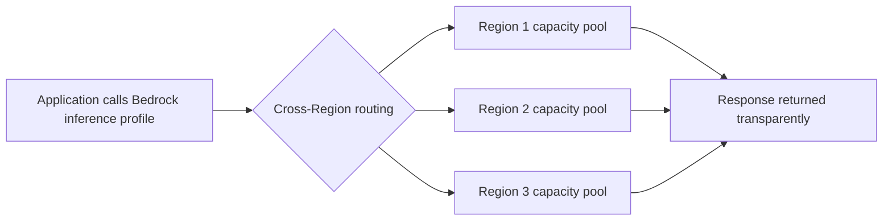

**Why the others are wrong:**
- **B:** CloudFront caches and accelerates delivery of **static or cacheable content** at edge
  locations — it has no model-invocation capacity-pooling relationship with Bedrock's backend
  inference infrastructure.
- **C:** Global Accelerator optimizes network-layer routing paths to an application's endpoints —
  it operates at the networking layer and has no Bedrock-specific concept of inference capacity
  pooling across Regions the way inference profiles do.
- **D:** Guardrails addresses content safety (denied topics, PII, toxicity) — it has nothing to
  do with how or where a request's underlying model-invocation capacity is sourced from.

---

## Q59 — Domain 4 (Operating, Monitoring, and Securing ML Solutions)

A SageMaker endpoint serving a latency-sensitive application needs a single CloudWatch alarm
that fires only when **both** p99 latency exceeds 500ms **and** the error rate exceeds 1%
**simultaneously** for 3 consecutive data points — rather than firing separately (and noisily)
whenever either metric alone briefly crosses its individual threshold. Which CloudWatch
capability combines multiple underlying metric alarms into a single, combined alarm condition
like this?

A) **CloudWatch composite alarms**, which combine the states of multiple existing metric alarms
   using logical operators (AND/OR/NOT) into one higher-level alarm that only triggers when the
   specified combined condition is met — reducing noisy, single-metric alarm firing in favor of
   a more meaningful combined signal
B) A single standard metric alarm can natively monitor two independent metrics (latency and
   error rate) simultaneously with no composite-alarm construct needed
C) AWS Config rules, which are designed for infrastructure configuration compliance, not
   real-time combined-metric alerting
D) Amazon SNS alone, which can only deliver notifications and has no alarm-condition-combining
   logic of its own

**Correct Answer: A**

**Explanation:** **CloudWatch composite alarms** let you define a Boolean expression combining
the ALARM/OK states of multiple existing standard metric alarms (e.g., "latency alarm is in
ALARM state AND error-rate alarm is in ALARM state") into a single composite alarm that only
fires when the full combined condition holds — exactly the mechanism for avoiding noisy, single-
metric-only alerts in favor of a meaningful, jointly-triggered alert. See
[`certifications/mla-c02/domain-4-monitoring-security/README.md`](../domain-4-monitoring-security/README.md).

**Why the others are wrong:**
- **B:** A standard CloudWatch metric alarm is defined against exactly **one** metric — it has no
  native way to require two independent metrics to both breach their thresholds simultaneously;
  that cross-metric combination is specifically what composite alarms add on top of standard
  alarms.
- **C:** AWS Config rules evaluate resource configuration compliance (e.g., "is encryption
  enabled") on its own schedule — it is not a real-time metric-alerting mechanism and has no
  composite-alarm-style Boolean combination capability for CloudWatch metrics.
- **D:** SNS is a notification-delivery mechanism (fan-out to email, SMS, Lambda, etc.) — it has
  no logic of its own for evaluating or combining alarm conditions; it only delivers messages
  that something else (like a composite alarm) decides to publish.

---

## Q60 — Domain 1 (Data Preparation for ML and AI)

A retail analytics team wants business users in QuickSight to explore sales data and
automatically surface statistically significant trends, anomalies, and natural-language
narrative summaries (e.g., "Sales in the Northeast region were unusually high this month,
driven primarily by product category X") **without** a data scientist first building and
deploying a custom anomaly-detection or trend-analysis model. Which QuickSight capability
provides this built-in, no-custom-model analytical narrative generation?

A) **Amazon QuickSight ML Insights**, a built-in capability that automatically applies ML-based
   anomaly detection and forecasting to dashboard data, and generates **natural-language
   narratives** highlighting significant trends/outliers — without the team building or
   deploying a separate custom ML model themselves
B) AWS Glue DataBrew, which focuses on data cleaning and transformation, not dashboard-level
   anomaly detection or narrative generation
C) SageMaker Ground Truth, which is a data-labeling service unrelated to BI dashboard analytics
   or natural-language narrative summaries
D) Amazon Comprehend, called manually against raw sales numbers to generate insights, which is
   not how Comprehend (a text-analysis service) processes numeric sales data at all

**Correct Answer: A**

**Explanation:** **QuickSight ML Insights** is a built-in BI-layer capability that automatically
applies machine learning (anomaly detection, forecasting) to the data already powering a
QuickSight dashboard, and generates human-readable **natural-language narratives** describing
significant trends and anomalies — all without the business/analytics team needing to build,
train, or deploy any custom SageMaker model themselves. See
[`services/analytics/quicksight.md`](../../../services/analytics/quicksight.md).

**Why the others are wrong:**
- **B:** Glue DataBrew is a pre-analysis data-cleaning/transformation tool — it has no dashboard-
  level anomaly-detection or narrative-generation capability at all.
- **C:** Ground Truth is a data-labeling service for creating training datasets for custom
  models — it has no relationship to BI dashboard insight generation.
- **D:** Comprehend analyzes **unstructured text** (sentiment, entities, key phrases) — it is not
  designed to process structured numeric sales data or generate dashboard-level trend/anomaly
  narratives the way QuickSight ML Insights does; using it this way misapplies the service
  entirely.

---

## Q61 — Domain 1 (Data Preparation for ML and AI)

A company's RAG application searches internal wiki pages that mention specific product model
numbers (e.g., "X200-Pro") very precisely, but pure vector/semantic search occasionally misses
the exact right document because other semantically similar wiki pages about related products
score nearly as high in cosine similarity, diluting precision for these exact-identifier
lookups. A teammate suggests combining vector similarity search with a traditional exact/
keyword-match search (e.g., BM25) so documents matching the literal model number are boosted
alongside semantic relevance. What is this combined retrieval approach called?

A) **Hybrid search** — combining vector (semantic) similarity search with traditional lexical/
   keyword search (e.g., BM25), then merging or re-ranking results from both so that an exact
   identifier match or important literal keyword can be surfaced even when pure vector similarity
   alone doesn't rank it highest
B) Fine-tuning, since retraining the foundation model is the only way to improve retrieval
   precision for exact identifier matches
C) Chunking, since adjusting chunk size is the only lever available for improving retrieval
   relevance
D) Guardrails, since content filtering directly improves retrieval ranking quality for exact
   keyword matches

**Correct Answer: A**

**Explanation:** **Hybrid search** combines the strengths of **vector/semantic search** (good at
capturing conceptual/meaning-based relevance) and **traditional keyword/lexical search** like
**BM25** (good at precise exact-term/identifier matching) — results from both approaches are
merged or re-ranked together, so an exact model-number match gets appropriately boosted even in
cases where pure semantic similarity alone might rank a different, merely-related document
higher. This is a standard, commonly-tested pattern for improving RAG retrieval precision on
exact-match-sensitive content (like product codes, legal citation numbers, or part IDs). See
[`certifications/mla-c02/domain-1-data-preparation/embeddings-and-rag-data-prep.md`](../domain-1-data-preparation/embeddings-and-rag-data-prep.md)
and [`services/analytics/opensearch.md`](../../../services/analytics/opensearch.md).

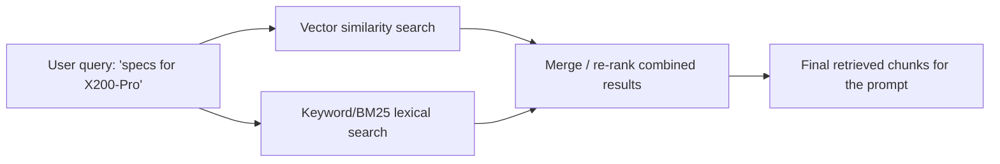

Step by step: (1) the same query is run through both a semantic vector search and a literal
keyword search in parallel; (2) the vector search surfaces conceptually related content even if
wording differs, while the keyword search reliably surfaces the exact "X200-Pro" match; (3) a
merging/re-ranking step (sometimes a weighted score combination, sometimes reciprocal rank
fusion) combines both result sets into one final ranked list, capturing the precision benefit of
exact matching alongside the recall benefit of semantic search.

**Why the others are wrong:**
- **B:** Fine-tuning the foundation model adjusts how it *generates* text based on given context —
  it has no bearing on the *retrieval* step's exact-match precision, which is what's failing
  here; the fix is a retrieval-architecture change (hybrid search), not model fine-tuning.
- **C:** Chunk size affects what content is grouped together for embedding, but it doesn't add
  any exact-keyword-matching capability to a retrieval process that is purely vector-similarity-
  based — the missing capability is lexical matching, not chunk granularity.
- **D:** Guardrails filters/blocks unsafe content categories — it has no role in or effect on
  retrieval ranking or search relevance at all.

---

## Q62 — Domain 3 (Deployment and Orchestration of ML Workflows)

A company wants its SageMaker training/inference Docker images, once built and tested, to only
ever be deployable after passing an automated vulnerability scan with zero critical findings —
and wants any image failing that scan to be automatically blocked from being pulled for a
production training job or endpoint deployment. Which combination of services enforces this
scan-then-gate requirement for container images?

A) **Amazon ECR image scanning** (basic or enhanced, the latter powered by Amazon Inspector),
   which automatically scans pushed images for known vulnerabilities, combined with a **CI/CD
   pipeline gate** (e.g., a CodePipeline/CodeBuild stage) that checks the scan findings and only
   proceeds to deploy the image if it has zero critical vulnerabilities, blocking the pipeline
   otherwise
B) AWS Glue, which performs container vulnerability scanning as a built-in capability of its ETL
   job execution environment
C) SageMaker Ground Truth, which scans container images for vulnerabilities as part of its data-
   labeling workflow
D) Container images cannot be automatically scanned for vulnerabilities on AWS under any
   circumstances; this always requires a third-party tool entirely outside the AWS ecosystem

**Correct Answer: A**

**Explanation:** **ECR image scanning** (basic scanning using the open-source Clair database, or
enhanced scanning powered by **Amazon Inspector** for deeper, continuous vulnerability detection)
automatically evaluates pushed container images for known CVEs; a **CI/CD pipeline** (e.g.,
CodePipeline with a CodeBuild stage) can be built to query those scan findings and explicitly gate
progression — only continuing to deploy the image if it has zero critical vulnerabilities,
failing the pipeline otherwise — giving the full automated scan-then-gate enforcement described.
See
[`certifications/mla-c02/domain-3-deployment-orchestration/README.md`](../domain-3-deployment-orchestration/README.md).

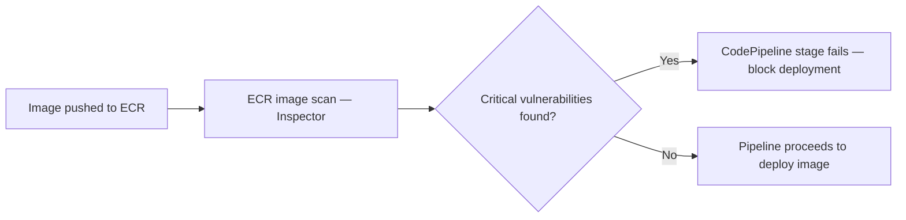

**Why the others are wrong:**
- **B:** Glue is a data-integration/ETL service with no container-image vulnerability-scanning
  capability of any kind.
- **C:** Ground Truth is a data-labeling service — it has no relationship to container image
  security scanning.
- **D:** This overstates the limitation — ECR's native image scanning (and its Inspector-powered
  enhanced scanning) is a built-in, AWS-native capability; a third-party tool is not strictly
  required to achieve automated container vulnerability scanning on AWS.

---

## Q63 — Domain 2 (ML Model and Foundation Model Development)

A team evaluates two candidate Bedrock foundation models for a customer-support summarization
task and wants a structured, repeatable comparison that includes both **automatic metrics**
(like ROUGE scores against reference summaries) and an **optional human-evaluation** workflow
where human reviewers rate/compare outputs on criteria like helpfulness and correctness — all
run against the same held-out set of prompts for a fair side-by-side comparison. Which Bedrock
capability is purpose-built for this?

A) **Bedrock Model Evaluation jobs**, which support both **automatic evaluation** (computing
   metrics like ROUGE/BLEU/accuracy against a reference dataset) and **human evaluation**
   workflows (routing model outputs to human reviewers for rating/comparison), run consistently
   against the same prompt dataset for structured, repeatable model comparison
B) Bedrock Guardrails, which filters unsafe content and has no model-comparison or evaluation-
   metric computation capability
C) SageMaker Ground Truth, which labels new training datasets, not evaluates and compares two
   already-existing foundation models' outputs
D) Bedrock Agents, which orchestrate multi-step tool-calling tasks, with no built-in model-
   comparison or evaluation-metric functionality

**Correct Answer: A**

**Explanation:** **Bedrock Model Evaluation** jobs are purpose-built for structured, repeatable
comparison of foundation models: they support **automatic metrics** (computed against a provided
reference/held-out dataset, including metrics like ROUGE, BLEU, accuracy, robustness, toxicity)
and **human evaluation** workflows (routing outputs to human reviewers for rating or pairwise
comparison) — run consistently against the same prompt set for a fair side-by-side comparison
between candidate models. See
[`services/machine-learning-ai/bedrock.md`](../../../services/machine-learning-ai/bedrock.md).

**Why the others are wrong:**
- **B:** Guardrails is a real-time content-safety filtering mechanism (denied topics, content
  filters, PII redaction) — it has no model-evaluation-metric or human-review-comparison workflow
  capability at all.
- **C:** Ground Truth produces labeled data for **training new models** — it is not designed to
  evaluate and compare the outputs of two already-existing foundation models on a held-out prompt
  set.
- **D:** Bedrock Agents orchestrate multi-step reasoning/tool-calling tasks — this is an
  application-architecture capability, unrelated to formally evaluating and comparing model
  output quality via metrics or human review.

---

## Q64 — Domain 1 (Data Preparation for ML and AI)

A team's SageMaker Feature Store setup stores the same logical feature (e.g.,
`customer_lifetime_value`) in both the **Online Store** (for real-time inference lookups) and
the **Offline Store** (for bulk training data generation). A teammate asks: if the feature's
computation logic is updated, does the team need to maintain two separate computation
implementations — one feeding each store — risking exactly the kind of training/serving skew
Feature Store exists to prevent? What is the correct understanding of how Feature Store avoids
this?

A) Yes, two entirely separate computation pipelines must always be built and maintained, one
   per store, and keeping them in sync is the team's manual responsibility with no Feature
   Store-native safeguard
B) **No** — a single feature-computation/ingestion pipeline writes a record to a **feature
   group**, and Feature Store **automatically propagates** that single computed value to both
   the Online and Offline Store simultaneously, so there is only **one** source of truth for how
   a feature is computed, eliminating the two-separate-pipelines risk entirely
C) Only the Online Store needs feature values; the Offline Store is entirely optional and
   unrelated to the Online Store's data
D) Only the Offline Store needs feature values; the Online Store simply mirrors whatever is in
   S3 with no real-time write path of its own

**Correct Answer: B**

**Explanation:** SageMaker Feature Store's core design principle is a **single ingestion path**:
when a feature value is written to a **feature group**, Feature Store automatically keeps both
the **Online Store** (low-latency, current-value lookups for inference) and the **Offline Store**
(full historical record for training/batch use) in sync with that one computed value — meaning
the team maintains exactly **one** feature-computation implementation, and Feature Store itself
handles propagating it to both destinations, which is precisely the mechanism that prevents
training/serving skew. See
[`services/machine-learning-ai/sagemaker-data-wrangler-and-feature-store.md`](../../../services/machine-learning-ai/sagemaker-data-wrangler-and-feature-store.md).

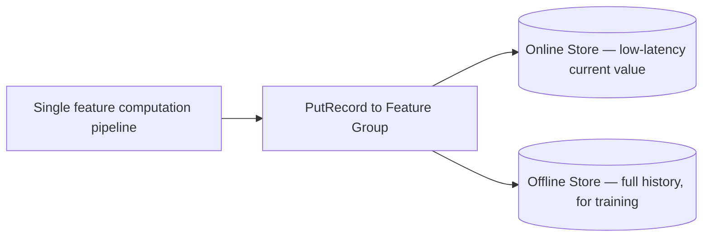

**Why the others are wrong:**
- **A:** This describes the exact training/serving-skew risk Feature Store is designed to
  eliminate — maintaining two separate pipelines manually is what teams had to do *before* (or
  without) Feature Store; its entire value proposition is removing that duplicated-logic risk.
- **C:** Both stores serve real, distinct, commonly-used purposes (low-latency serving vs. bulk
  historical training data) — the Offline Store isn't "optional and unrelated"; it's the other
  half of Feature Store's dual-store design, fed by the same single ingestion path.
- **D:** The Online Store has its own real-time write/read path (optimized for low-latency
  lookups) — it isn't simply a passive mirror of whatever happens to be in the Offline Store's S3
  location; both stores are written to through the same ingestion API, each serving its own
  access pattern.

---

## Q65 — Domain 1 (Data Preparation for ML and AI)

A company ingests clickstream events into S3 via Kinesis Data Firehose and wants newly-arriving
data automatically discoverable with up-to-date schema in the Glue Data Catalog, so that Athena
and SageMaker Processing jobs can immediately query it with a consistent, shared table
definition — without any team member manually running `CREATE TABLE` or `ALTER TABLE` statements
whenever the clickstream event schema changes (e.g., a new `session_duration_ms` field is added
upstream). Walk through the correct, fully end-to-end pipeline that achieves this with minimal
manual schema maintenance.

A) **Kinesis Data Firehose delivers events to S3** (as Parquet, partitioned by date/hour) →
   a **Glue crawler**, run on a schedule, **re-infers and updates the Data Catalog table schema**
   from the latest data, detecting new columns like `session_duration_ms` automatically →
   **Athena and SageMaker Processing** query the Data Catalog table, always reflecting the
   latest known schema without manual DDL
B) Firehose writes directly into Athena's internal storage, bypassing S3 and the Glue Data
   Catalog entirely, with schema management handled entirely inside Athena
C) SageMaker Ground Truth labels each new clickstream event's schema manually before it becomes
   queryable
D) The Glue Data Catalog updates its own schema automatically with no crawler or any other
   process involved, purely by being pointed at an S3 bucket once

**Correct Answer: A**

**Explanation:** This is the standard low-maintenance, end-to-end ingestion-to-query pipeline:
**Firehose** handles durable delivery and format conversion into S3; a **scheduled Glue crawler**
periodically re-scans the data and updates the **Glue Data Catalog** table definition to reflect
any newly-detected columns, keeping the schema current automatically; and because **Athena** and
**SageMaker Processing** both read schema from the same shared Data Catalog, every consumer sees
the same, up-to-date table definition without anyone manually running DDL. See
[`services/analytics/glue.md`](../../../services/analytics/glue.md),
[`services/analytics/kinesis-family.md`](../../../services/analytics/kinesis-family.md), and the
[Domain 1 README](../domain-1-data-preparation/README.md).

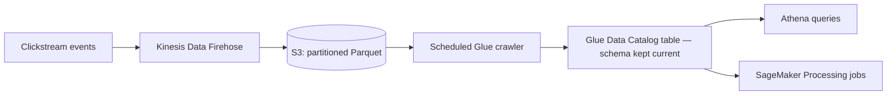

Step by step: (1) Firehose is the managed delivery layer, requiring no custom consumer code; (2)
the Glue crawler is what actually keeps the catalog's schema in sync with reality, re-running on
a schedule to catch newly-appeared fields; (3) both Athena and SageMaker Processing consume the
*same* catalog table definition, so there's exactly one schema source of truth that every
downstream consumer automatically benefits from as it's kept current.

**Why the others are wrong:**
- **B:** Athena has no "internal storage" that Firehose writes into directly — Athena is a
  serverless query engine that reads data sitting in S3 via the Glue Data Catalog; this option
  misstates Athena's basic architecture.
- **C:** Ground Truth is a human/ML-assisted data-*labeling* service for creating training labels
  — it has no role in discovering or maintaining a table's structural schema.
- **D:** The Glue Data Catalog does not automatically re-infer schema on its own with zero
  process — a **crawler** (or an explicit schema update via Glue job/API) is required to actually
  scan the data and update the catalog; simply "pointing" the catalog at a bucket once does not
  keep it current as new fields appear.

---
