# MLA-C02 Exam Bank 3 — Study Mode (65 Questions)

Full-length, domain-mixed practice exam in **study mode**: the correct answer and a complete
explanation (including why each wrong option is wrong) appear immediately after every question.
See [`README.md`](README.md) for how this fits with `practice-questions/` and
`practice-questions/full-exams/`. All 65 questions here are distinct from `bank-1.md`,
`bank-2.md`, and every file in `../practice-questions/`.

## Domain mix in this bank

| Domain | Questions | Target weight |
|---|---|---|
| 1 — Data Preparation for ML and AI | 18 | 28% |
| 2 — ML Model and Foundation Model Development | 16 | 24% |
| 3 — Deployment and Orchestration of ML Workflows | 16 | 24% |
| 4 — Operating, Monitoring, and Securing ML Solutions | 15 | 24% |
| **Total** | **65** | **100%** |

Domains are interleaved throughout, using a third, different interleaving offset than `bank-1.md`
and `bank-2.md`.

---

## Q1 — Domain 3 (Deployment and Orchestration of ML Workflows)

A SageMaker Pipeline already trains and evaluates a model. The team wants to add a step that
runs **SageMaker Clarify's post-training bias check** against the trained model's predictions as
a formal, versioned part of the pipeline — not a separate, manually-run notebook step — so every
pipeline execution automatically produces a bias report alongside the trained model, and a later
`ConditionStep` can gate registration on both the accuracy metric and the bias report passing.
Which SageMaker Pipelines step type is used to run this kind of analysis job as part of the
pipeline?

A) A **`ProcessingStep`**, configured to run a SageMaker Clarify processing job (Clarify runs as
   a specialized Processing job under the hood), producing a bias report artifact that a later
   `ConditionStep` can reference alongside the evaluation metric
B) A `TrainingStep`, since any job that analyzes a trained model's predictions must itself be
   classified as a training job
C) A `TransformStep`, which is exclusively for running SageMaker Batch Transform jobs, with no
   support for running a Clarify bias-analysis job
D) SageMaker Pipelines cannot incorporate a Clarify bias check; it must always remain a
   separate, manually-triggered notebook step outside the pipeline

**Correct Answer: A**

**Explanation:** SageMaker Clarify's bias and explainability analyses run as **SageMaker
Processing jobs** under the hood; within SageMaker Pipelines, you incorporate this via a
**`ProcessingStep`** configured with the Clarify processor, producing a report artifact in S3
that downstream pipeline steps (like a `ConditionStep`) can reference — making the bias check a
first-class, versioned, automatically-run part of every pipeline execution rather than a manual,
easy-to-forget side task. See
[`services/machine-learning-ai/sagemaker-pipelines.md`](../../../services/machine-learning-ai/sagemaker-pipelines.md)
and
[`certifications/mla-c02/domain-4-monitoring-security/responsible-ai-and-guardrails.md`](../domain-4-monitoring-security/responsible-ai-and-guardrails.md).

**Why the others are wrong:**
- **B:** A `TrainingStep` is specifically for running a model-training job (producing model
  artifacts) — a bias-analysis job over an already-trained model's predictions is fundamentally
  a data/results-processing task, which is exactly what `ProcessingStep` (and Clarify's
  Processing-job-based implementation) is designed for.
- **C:** `TransformStep` wraps a SageMaker Batch Transform job (bulk offline inference) — it has
  no built-in support for running a Clarify bias analysis, which is a different kind of job
  entirely.
- **D:** This understates Pipelines' actual capability — incorporating a Clarify check as a
  `ProcessingStep` is a standard, well-supported pattern specifically so bias checking becomes
  automated and repeatable, not something that must stay manual and separate.

---

## Q2 — Domain 4 (Operating, Monitoring, and Securing ML Solutions)

A company wants to cite, in their internal model documentation, the **official AWS-published**
risk and usage information for a specific Amazon Titan foundation model available through
Bedrock (e.g., intended use cases, limitations, and training data characteristics as AWS itself
describes them) — separate from and in addition to documentation their own team writes about
*their own* fine-tuned or RAG-augmented application built on top of that model. Which AWS
artifact provides AWS's own official documentation for a given Bedrock foundation model?

A) **AWS Service Cards (AI Service Cards)**, AWS-published documentation for its own foundation
   models and AI services, describing intended use cases, limitations, and design considerations
   from AWS's perspective — distinct from a **SageMaker Model Card**, which a *customer* creates
   to document their own model/application built using that foundation model
B) A SageMaker Model Card automatically generates AWS's own official Titan model documentation
   with zero customer input required
C) Bedrock Guardrails configuration documents serve as AWS's official per-model risk
   documentation
D) There is no AWS-published documentation of this kind for any Bedrock foundation model

**Correct Answer: A**

**Explanation:** **AI Service Cards** are AWS's own published documentation for its AI
services/foundation models, describing intended use cases, performance expectations, limitations,
and responsible-AI design considerations from AWS's perspective as the model provider. This is
distinct from a **SageMaker Model Card**, which a *customer* authors to document their own
specific model or application (including ones built on top of a Bedrock foundation model) for
their own internal governance. See
[`certifications/mla-c02/domain-4-monitoring-security/responsible-ai-and-guardrails.md`](../domain-4-monitoring-security/responsible-ai-and-guardrails.md).

**Why the others are wrong:**
- **B:** A SageMaker Model Card is authored by the **customer** about their own model/application
  — it does not automatically generate AWS's own official provider-level documentation about the
  underlying foundation model itself.
- **C:** Guardrails configuration is an operational safety-filter setup a customer builds — it is
  not AWS's published documentation describing the foundation model's own characteristics and
  limitations.
- **D:** This is factually incorrect — AWS does publish this kind of provider-level documentation
  for its AI services and foundation models via AI Service Cards.

---

## Q3 — Domain 1 (Data Preparation for ML and AI)

A fraud-detection feature pipeline computes a `total_chargebacks_last_90_days` feature for each
transaction at **training time** using the full 90-day window **including days after the
transaction being scored**, but at real-time **inference** time, only chargebacks that occurred
*before* the transaction being scored are actually knowable. The model performs suspiciously
well offline but noticeably worse in production. What problem does this illustrate, and what
should be done?

A) This is overfitting; the fix is to add L2 regularization to the model's loss function
B) This is **target/label leakage** — the training-time feature computation had access to
   future information (chargebacks that would only be known after the fact) that would not be
   available at real inference time; the fix is to **recompute the feature using only data
   available strictly before the prediction timestamp**, matching exactly what inference-time
   data will actually look like
C) This is data drift; the fix is to retrain the model more frequently on recent data
D) This is a hyperparameter tuning issue; the fix is to run a more extensive hyperparameter
   search

**Correct Answer: B**

**Explanation:** **Target/label leakage** occurs when a feature used at training time contains
information that would not actually be available at the moment a real prediction is made —
here, a 90-day chargeback window that extends *past* the transaction being scored lets the
model implicitly "see the future" during training, producing deceptively strong offline metrics
that collapse once deployed, since real inference-time data can never include that future
information. The fix is to strictly recompute any time-windowed feature using only data that
would genuinely be available **as of** the prediction timestamp. See
[`certifications/mla-c02/domain-1-data-preparation/README.md`](../domain-1-data-preparation/README.md).

**Why the others are wrong:**
- **A:** Overfitting is about a model fitting training-set noise and generalizing poorly — this
  scenario's root cause is a feature-computation bug that leaks future information, a data
  pipeline defect, not a model-capacity/regularization issue; regularization wouldn't fix a
  structurally leaky feature.
- **C:** Data drift is a post-deployment phenomenon where input distributions shift over time —
  it doesn't describe a training-time feature containing future information not available at
  inference, which is a feature-engineering bug present from the start, not something that
  "drifted."
- **D:** Hyperparameter tuning addresses model configuration quality — it cannot fix a
  fundamentally leaky feature definition; no amount of tuning changes what information a feature
  actually encodes.

---

## Q4 — Domain 2 (ML Model and Foundation Model Development)

A team evaluates a rare-disease classifier (1% positive prevalence) using a **Precision-Recall
curve** rather than a ROC curve, since a teammate points out that ROC curves can look
deceptively good under severe class imbalance (the large number of true negatives inflates the
false-positive-rate denominator). What does the **Precision-Recall curve**, and the **area under
it**, more directly emphasize for this imbalanced scenario?

A) The PR curve plots **precision vs. recall** across thresholds, directly emphasizing how well
   the model performs specifically on the **minority (positive) class** — since precision and
   recall both ignore true negatives entirely, PR-AUC avoids the "inflated by a huge true-negative
   count" distortion that ROC-AUC can exhibit under severe imbalance, making it a more informative
   summary metric for this scenario
B) The PR curve is mathematically identical to the ROC curve and will always rank models
   identically regardless of class imbalance
C) The PR curve plots accuracy vs. F1 score, which has no connection to precision or recall at
   all
D) The PR curve is only applicable to regression tasks, not classification tasks

**Correct Answer: A**

**Explanation:** The **Precision-Recall curve** plots precision against recall across decision
thresholds; because neither precision nor recall references the (very large, under severe
imbalance) true-negative count, **PR-AUC** more directly reflects how well a model identifies
and correctly flags the **rare positive class**, without the "looks great because true negatives
are easy and plentiful" inflation that can make ROC-AUC appear misleadingly strong under heavy
imbalance. See [`ml-fundamentals-glossary.md`](../domain-2-model-development/ml-fundamentals-glossary.md).

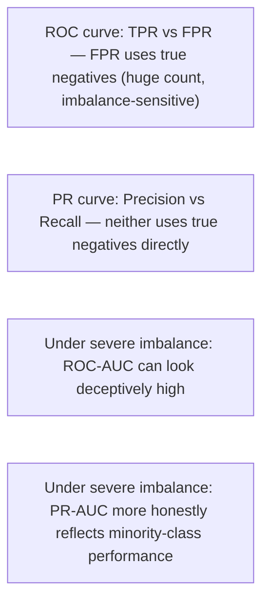

**Why the others are wrong:**
- **B:** ROC and PR curves are built from different metric pairs (TPR/FPR vs. precision/recall)
  and can rank models **differently**, especially under class imbalance — they are not
  mathematically identical, which is exactly why the choice between them matters here.
- **C:** This misstates the PR curve's actual axes entirely — it plots precision against recall,
  not accuracy against F1; F1 is itself typically *derived from* precision and recall, not an
  independent axis of this specific curve.
- **D:** Precision and recall (and therefore the PR curve) are classification-specific concepts
  with no defined meaning for a continuous regression target — but this doesn't make the PR
  curve "only for regression"; it's the opposite, it's a classification-only tool.

---

## Q5 — Domain 3 (Deployment and Orchestration of ML Workflows)

A SageMaker real-time endpoint's auto-scaling policy occasionally "flaps" — rapidly adding and
then removing instances repeatedly within a short window — as traffic briefly fluctuates around
the target threshold, causing unnecessary instance churn and brief periods of under-capacity
right after a scale-in. Which auto-scaling configuration parameter directly addresses this
flapping behavior?

A) **Cooldown periods** — configuring a scale-out cooldown (time to wait after adding capacity
   before scaling out again) and a scale-in cooldown (time to wait after removing capacity before
   scaling in again), giving the metric time to stabilize after each scaling action before
   another one is considered, directly reducing rapid, repeated flapping
B) Increasing the endpoint's instance count permanently to the maximum needed at peak traffic,
   eliminating the need for auto-scaling altogether
C) Switching from target tracking to step scaling, which inherently eliminates all possibility
   of flapping regardless of cooldown configuration
D) Auto-scaling flapping cannot be mitigated through any configuration; it is an unavoidable
   characteristic of all elastic scaling systems

**Correct Answer: A**

**Explanation:** **Cooldown periods** are specifically designed to prevent flapping: after a
scale-out event, a cooldown window pauses further scale-out actions to let the newly-added
capacity actually take effect and the metric stabilize; similarly, a scale-in cooldown prevents
removing capacity again too soon after a prior scale-in, giving the system time to settle
before reacting to the next metric reading — directly addressing rapid, repeated add/remove
cycling. See
[`services/machine-learning-ai/sagemaker-deployment-endpoints.md`](../../../services/machine-learning-ai/sagemaker-deployment-endpoints.md).

**Why the others are wrong:**
- **B:** Permanently provisioning for peak traffic eliminates the *need* for auto-scaling but
  reintroduces the cost inefficiency (paying for peak capacity at all times) that auto-scaling
  exists to avoid — it sidesteps the flapping problem rather than solving it while preserving
  elasticity's cost benefits.
- **C:** Step scaling is a different scaling-policy type, but it is not inherently immune to
  flapping — poorly-configured step thresholds (too close together, no cooldown) can flap under
  either target tracking or step scaling; cooldown configuration is what directly addresses
  flapping, regardless of policy type chosen.
- **D:** This overstates the limitation — cooldown periods are a standard, well-documented,
  effective mechanism specifically built to mitigate scaling flapping; it is not an unsolvable
  problem.

---

## Q6 — Domain 4 (Operating, Monitoring, and Securing ML Solutions)

A company's Bedrock-based content-moderation application needs the content-safety category
filters (hate speech, violence, insults, sexual content) to be **more aggressive** (flagging even
mildly borderline content) for a children's education product, but **less aggressive** (only
flagging clearly severe content) for an adult discussion-forum moderation product — using the
same underlying filter categories in both cases. Which Guardrails configuration achieves this
difference between the two products?

A) **Content filter severity thresholds**, configured per category (e.g., hate, violence,
   insults, sexual) as **low / medium / high** — setting a **lower** severity threshold for the
   children's product (flagging content at lower severity levels, i.e., more aggressive
   filtering) and a **higher** threshold for the adult forum product (only flagging clearly
   severe content), using two separate Guardrails configurations tailored to each product's needs
B) Denied topics, since severity-level tuning is only possible through the denied-topics
   mechanism, not content filters
C) Word filters, which only support exact-match blocked words with no concept of a severity
   threshold or category-based filtering at all
D) A single, fixed Guardrails configuration is shared globally across all Bedrock applications
   in an account with no ability to customize severity per application

**Correct Answer: A**

**Explanation:** Bedrock Guardrails' **content filters** let you set a **severity threshold**
(low/medium/high) independently **per harm category** (hate, insults, sexual, violence,
misconduct, prompt attacks) — and critically, different Guardrails configurations (each with its
own threshold settings) can be created and attached to different applications/use cases, letting
the children's product use a stricter (lower) threshold and the adult forum use a more permissive
(higher) threshold for the exact same underlying categories. See
[`certifications/mla-c02/domain-4-monitoring-security/responsible-ai-and-guardrails.md`](../domain-4-monitoring-security/responsible-ai-and-guardrails.md).

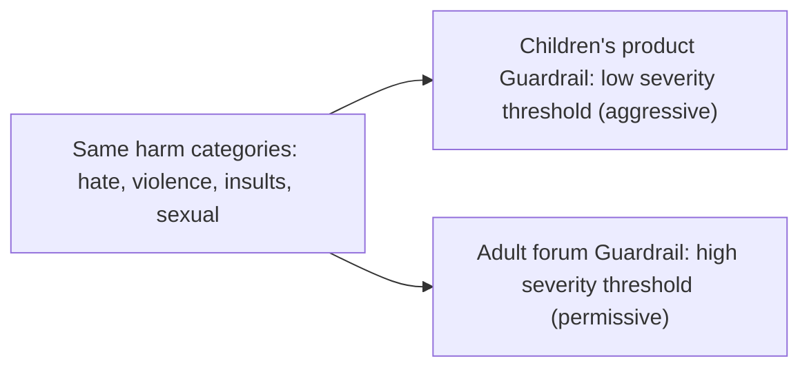

**Why the others are wrong:**
- **B:** Denied topics block content related to a **named subject matter** entirely, regardless
  of severity level — they don't have a graduated severity-threshold mechanism; that specific
  capability belongs to content filters.
- **C:** Word filters match a fixed list of specific words/phrases exactly — they have no
  severity-threshold or harm-category concept at all, which is what this scenario specifically
  needs.
- **D:** Guardrails configurations are created and attached **per use case/application** — a
  company can (and routinely does) maintain multiple distinct Guardrails configurations with
  different settings for different products, not one single global, uncustomizable configuration.

---

## Q7 — Domain 1 (Data Preparation for ML and AI)

A team's dataset has a `signup_timestamp` field they want to turn into useful model features
capturing **cyclical** time patterns — e.g., that 11 PM and 1 AM are "close" in terms of
time-of-day behavior, and that December and January are "close" in terms of time-of-year
seasonality — which a simple linear encoding of "hour of day as 0–23" or "month as 1–12" fails to
capture (since it treats 23 and 0 as maximally far apart numerically, when they're actually
adjacent in real time). Which feature engineering technique correctly captures this cyclical
relationship?

A) One-hot encoding the raw hour-of-day and month values, since one-hot encoding always
   preserves cyclical adjacency relationships automatically
B) **Cyclical (sine/cosine) encoding** — transforming a cyclical value like hour-of-day into two
   features, `sin(2π × hour/24)` and `cos(2π × hour/24)` (and similarly for month), so that
   values which are cyclically adjacent (like 23 and 0) end up numerically close in this
   transformed 2D representation, correctly capturing the wraparound relationship
C) Standardizing the raw hour-of-day value (Z-score scaling), which inherently resolves the
   wraparound discontinuity between 23 and 0
D) Removing the time-of-day and time-of-year information entirely, since cyclical features
   cannot be represented numerically in any way

**Correct Answer: B**

**Explanation:** **Sine/cosine (cyclical) encoding** maps a periodic value onto a 2D representation
(sine and cosine components) that naturally "wraps around," so that values at the boundary of the
cycle (like 23:00 and 00:00, or December and January) end up close together in this encoded
space — directly solving the discontinuity problem that a plain integer or one-hot encoding of
hour/month cannot represent. See
[`ml-fundamentals-glossary.md`](../domain-2-model-development/ml-fundamentals-glossary.md) and
the [Domain 1 README](../domain-1-data-preparation/README.md).

**Why the others are wrong:**
- **A:** One-hot encoding treats each hour/month as a completely independent, unrelated category
  — it has no inherent notion of adjacency or cyclical closeness between category 23 and category
  0 at all; it doesn't solve the problem, it just sidesteps ordinality entirely without capturing
  cyclical structure.
- **C:** Standardization only rescales the value's mean and variance — it preserves the same
  linear number line (23 is still numerically far from 0 after standardization) and does nothing
  to address the wraparound discontinuity.
- **D:** Cyclical time features absolutely can be (and routinely are) represented numerically via
  sine/cosine encoding — discarding this genuinely useful, often predictive information entirely
  is an unnecessary overcorrection, not a real solution.

---

## Q8 — Domain 2 (ML Model and Foundation Model Development)

A team wants to combine predictions from several **different types** of models — a gradient-
boosted tree, a neural network, and a linear model — not by simply averaging their raw outputs,
but by training a separate, lightweight **meta-model** that learns the best way to weight and
combine each base model's predictions, using those predictions as the meta-model's own input
features. What is this ensembling technique called, and how does it differ from simple
averaging?

A) **Stacking (stacked generalization)** — base models' predictions become input features to a
   second-level **meta-model**, which learns an optimized (often non-uniform, non-linear)
   combination of the base models' outputs, rather than a simple fixed average that treats every
   base model's contribution as equally weighted regardless of its individual reliability
B) This is identical to bagging, since both techniques combine multiple models' predictions into
   one final prediction
C) This is identical to boosting, since both techniques involve training more than one model
D) This technique has no established name and is never used in practice

**Correct Answer: A**

**Explanation:** **Stacking** trains a **meta-model** (often a simple model like logistic/linear
regression) on top of the base models' predictions — treating each base model's output as an
input feature to the meta-model — letting the meta-model learn an optimized combination (which
base models to trust more, and in what combinations) rather than assuming a simple unweighted
average is optimal. This is a third distinct ensembling technique alongside bagging and boosting.
See [`ml-fundamentals-glossary.md`](../domain-2-model-development/ml-fundamentals-glossary.md).

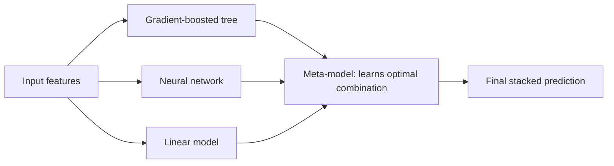

**Why the others are wrong:**
- **B:** Bagging trains multiple **independent instances of the same base algorithm** on
  bootstrapped samples and averages them with equal weight — it has no second-level meta-model
  learning a combination, which is stacking's distinguishing feature.
- **C:** Boosting trains models **sequentially**, each correcting the prior ensemble's errors —
  it also has no separate meta-model layer combining already-trained, diverse base models'
  outputs the way stacking does; "training more than one model" alone doesn't make two techniques
  identical.
- **D:** Stacking is a well-established, widely-used ensembling technique (notably used in many
  winning Kaggle competition solutions) — this option is simply factually incorrect.

---

## Q9 — Domain 3 (Deployment and Orchestration of ML Workflows)

A team runs frequent iterative SageMaker training jobs during active model development — each
job takes 2 minutes to actually train, but the underlying EC2 instance takes an additional 4–5
minutes to provision and bootstrap every single time, dominating the iteration loop. Training
jobs are frequent and close together in time (many per hour) during this active development
phase. Which SageMaker Training feature reduces this repeated instance-provisioning overhead
between consecutive jobs?

A) **Managed warm pools** — keeping a training instance in a "warm," already-initialized state
   for a configurable retention period after a job finishes, so a subsequent training job
   launched within that window can reuse the already-provisioned instance instead of
   provisioning a brand-new one from scratch, cutting out the repeated bootstrap overhead
B) Switching to Spot Instances, which inherently eliminates all instance-provisioning time for
   every training job
C) SageMaker Debugger, which analyzes training-time tensors but has no effect on instance
   provisioning time between jobs
D) SageMaker Pipelines step caching, which skips re-running unchanged steps but has no bearing on
   reducing a changed, newly-run training job's instance-provisioning time

**Correct Answer: A**

**Explanation:** **Managed warm pools** let a training instance remain allocated and "warm" for
a configurable period after a job completes; if another training job starts within that window
(common during rapid iterative development), SageMaker reuses the already-bootstrapped instance
instead of provisioning a new one from scratch — directly cutting the repeated provisioning
overhead that dominates short, frequent training iterations. See
[`services/machine-learning-ai/sagemaker-training-and-tuning.md`](../../../services/machine-learning-ai/sagemaker-training-and-tuning.md).

**Why the others are wrong:**
- **B:** Spot Instances reduce **cost**, not provisioning time — a Spot-backed training job still
  needs to provision and bootstrap a fresh instance unless warm pools (or a similar mechanism)
  are separately configured; the two concerns (cost vs. provisioning latency) are independent.
- **C:** SageMaker Debugger inspects a training job's internal tensors/gradients for diagnostic
  purposes — it has no relationship to instance provisioning speed between jobs.
- **D:** Pipelines step caching skips **re-executing an already-run, unchanged step** entirely —
  it doesn't address the provisioning overhead of a training step that genuinely needs to run
  again (with new code/hyperparameters) each iteration, which is exactly this scenario's
  bottleneck.

---

## Q10 — Domain 4 (Operating, Monitoring, and Securing ML Solutions)

A company wants to ensure that any attempt to read an S3 object containing sensitive training
data over a **plaintext (non-HTTPS) connection** is explicitly **denied**, rather than merely
logged or detected after the fact. Which S3 bucket policy configuration enforces this
preventively?

A) **A bucket policy statement that denies `s3:GetObject`/`s3:PutObject` (and related actions)
   when the request's `aws:SecureTransport` condition key evaluates to `false`** — explicitly
   rejecting any non-HTTPS request to the bucket at the policy-evaluation level, before the
   object is ever served
B) Enabling S3 server-side encryption (SSE) alone, with no bucket policy condition, which
   inherently also blocks all non-HTTPS access attempts
C) AWS Config, configured to flag non-HTTPS access attempts after they have already occurred
D) Amazon Macie, configured to automatically block non-HTTPS S3 requests to buckets containing
   sensitive data

**Correct Answer: A**

**Explanation:** A bucket policy with an explicit **`Deny`** statement conditioned on
**`aws:SecureTransport: false`** rejects any request to the bucket that isn't made over HTTPS,
enforced at the moment the request is evaluated — a true preventive control, not a detective one.
This is a standard, specific, testable IAM/S3 policy pattern for enforcing encryption in transit.
See
[`certifications/mla-c02/domain-4-monitoring-security/README.md`](../domain-4-monitoring-security/README.md).

**Why the others are wrong:**
- **B:** Server-side encryption (SSE) protects data **at rest** once stored — it has no bearing
  on whether the **transport** (network connection) used to read/write the object is encrypted;
  conflating at-rest and in-transit encryption is a common, specifically-tested exam trap.
- **C:** AWS Config evaluating this after the fact is a **detective** control — it can flag that
  a non-HTTPS request happened, but it cannot itself have prevented the request from succeeding
  in the first place, which is the preventive behavior the question asks for.
- **D:** Macie discovers sensitive data content within objects — it has no mechanism to inspect
  or block the transport protocol used for individual S3 requests; that's a bucket-policy-level
  concern, not Macie's function.

---

## Q11 — Domain 1 (Data Preparation for ML and AI)

A RAG system over a customer-support knowledge base needs to improve answer relevance: the
initial vector similarity search retrieves the top 50 candidate chunks reasonably well for
*recall* (the right chunk is almost always somewhere in those 50), but the top 3 chunks actually
passed into the prompt (for context-window and cost reasons) aren't always the most relevant of
those 50 — pure vector-similarity ranking sometimes under-ranks the truly best chunk. Which
technique improves final ranking **precision** among an already-retrieved candidate set, before
truncating down to the final top-k sent to the model?

A) **Reranking** — passing the initial candidate set (e.g., the top 50 vector-search results)
   through a separate, more computationally expensive but more accurate **reranking model**
   (e.g., a cross-encoder or a dedicated reranking service) that re-scores each candidate's
   relevance to the specific query more precisely than the initial fast vector-similarity pass,
   then truncating to the final top-k based on this improved ranking
B) Increasing the chunk size, which automatically reorders already-retrieved candidates by true
   relevance
C) Switching the embedding model's dimensionality to a lower value, which directly improves
   ranking precision among already-retrieved candidates
D) Running the initial vector search a second time with identical parameters, which
   automatically produces a more accurate ranking the second time

**Correct Answer: A**

**Explanation:** **Reranking** is a standard two-stage retrieval pattern: a fast, broad initial
retrieval (vector similarity search) casts a wide net optimized for **recall** (don't miss the
right chunk), and then a more computationally expensive but more accurate **reranking model**
re-scores that smaller candidate set specifically for **precision** (correctly order the
genuinely most relevant ones at the top), before truncating to the final top-k actually sent to
the foundation model's prompt — directly addressing "the right chunk is in there somewhere, but
isn't always ranked first." See
[`certifications/mla-c02/domain-1-data-preparation/embeddings-and-rag-data-prep.md`](../domain-1-data-preparation/embeddings-and-rag-data-prep.md).

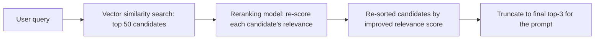

Step by step: (1) the initial vector search is optimized for speed across potentially millions of
chunks, prioritizing recall over perfect precision; (2) the reranker only needs to evaluate the
much smaller candidate set (50, not millions), so it can afford a more expensive, more accurate
relevance computation per candidate; (3) only after reranking is the set truncated to the final,
small top-k that actually gets sent into the prompt — maximizing the chance the best chunks make
the cut.

**Why the others are wrong:**
- **B:** Chunk size affects what content is grouped into each embeddable unit — it has no
  mechanism for re-scoring or reordering an already-retrieved set of candidates by relevance.
- **C:** Embedding dimensionality is a property of the initial embedding/retrieval step, not a
  post-retrieval reranking mechanism — changing it doesn't re-evaluate or reorder a fixed,
  already-retrieved candidate list.
- **D:** Re-running the identical vector search again with the same parameters would simply
  reproduce the same scores and the same ranking — it introduces no new information or more
  precise relevance signal the way a dedicated reranking model does.

---

## Q12 — Domain 2 (ML Model and Foundation Model Development)

A team fine-tunes a foundation model on a narrow internal-support-ticket task and later notices
it has become excellent at that task but has measurably degraded on general conversational
ability it previously had (catastrophic forgetting). Before deciding on a mitigation, they want
a reliable way to **detect** whether and how much general-capability degradation has actually
occurred, rather than relying on anecdotal impressions. Which practice correctly detects this?

A) Only ever evaluate the fine-tuned model on the narrow support-ticket task's own test set,
   since general-capability degradation cannot be measured in any other way
B) **Maintain and periodically re-run a held-out "general capability" benchmark/evaluation set**
   (unrelated to the narrow fine-tuning task) **before and after fine-tuning**, comparing scores
   to quantify any degradation in general-purpose performance, rather than relying only on the
   narrow task's own metrics or subjective impressions
C) Catastrophic forgetting cannot be measured or detected in any systematic way; it can only be
   anecdotally observed by end users after deployment
D) Re-running the narrow task's fine-tuning a second time automatically detects and quantifies
   general-capability degradation

**Correct Answer: B**

**Explanation:** Detecting **catastrophic forgetting** requires evaluating the model on a
**held-out general-capability benchmark** that is independent of the narrow fine-tuning task —
run **before** fine-tuning (baseline) and **after** fine-tuning (post-adaptation), then comparing
scores to quantify any degradation. Relying solely on the narrow task's own metrics would show
nothing but improvement (since that's exactly what was optimized for) and would completely miss
degradation elsewhere. See
[`certifications/mla-c02/domain-2-model-development/README.md`](../domain-2-model-development/README.md).

**Why the others are wrong:**
- **A:** Evaluating only on the narrow task's own test set, by construction, cannot reveal
  degradation on *other* capabilities — fine-tuning is specifically optimizing for that narrow
  task, so its own metrics will look good or improve even as broader ability erodes.
- **C:** This overstates the difficulty — catastrophic forgetting is a well-studied, measurable
  phenomenon precisely because teams maintain separate general-capability benchmarks for before/
  after comparison; it is not purely anecdotal or unmeasurable.
- **D:** Re-running the same narrow fine-tuning again doesn't introduce any new evaluation signal
  about general capability — it would likely further specialize the model, not measure a
  capability it isn't testing for at all.

---

## Q13 — Domain 3 (Deployment and Orchestration of ML Workflows)

A company wants to validate a new model version against a small slice of real production traffic
**without the new model's predictions ever being returned to real users or affecting any business
outcome** — the new model should simply receive a copy of live requests and have its predictions
logged for offline comparison against the current production model's actual results. Which
SageMaker endpoint configuration achieves this safely?

A) **Configuring the new model as a production variant with an `InitialVariantWeight` of `0`**
   (so it receives zero *real* traffic) combined with **shadow testing**, where a copy of
   incoming requests is additionally sent to the shadow variant for inference, with its
   predictions logged but never returned to the actual caller — risk-free evaluation against real
   traffic patterns
B) Setting the new model's production variant weight to 50%, splitting real traffic evenly and
   returning the new model's predictions to half of all real users
C) Deploying the new model to a completely separate endpoint with no connection to live traffic
   at all, relying purely on offline batch evaluation instead
D) SageMaker has no mechanism for testing a new model against real traffic without affecting
   users; only fully offline evaluation is possible

**Correct Answer: A**

**Explanation:** **Shadow testing** (via SageMaker's shadow variant / shadow testing capability)
sends a **copy** of live inference traffic to the shadow (new) model variant, logging its
predictions for later comparison — while the actual response returned to the real caller always
comes from the production variant, meaning the shadow variant's output can never affect a real
user or business outcome, even as it's evaluated against genuine, realistic production traffic
patterns. This differs from an A/B test (which *does* return the new model's predictions to a
real slice of users) precisely in that shadow results are never actually served. See
[`services/machine-learning-ai/sagemaker-deployment-endpoints.md`](../../../services/machine-learning-ai/sagemaker-deployment-endpoints.md).

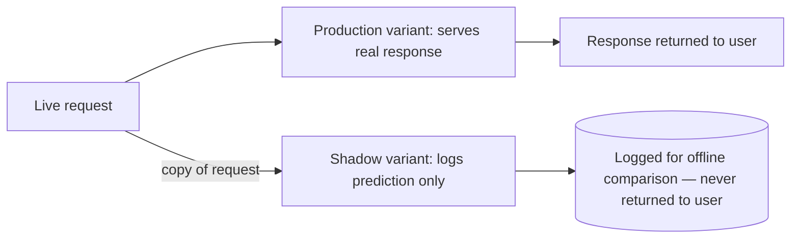

**Why the others are wrong:**
- **B:** A 50% weight split is a genuine **A/B test** — the new model's predictions *would* be
  returned to real users and could affect real business outcomes, directly contradicting the
  "never returned to real users" requirement.
- **C:** A fully separate endpoint with no connection to live traffic can only be evaluated
  against whatever offline/synthetic data you feed it — it cannot be validated against **actual,
  realistic production traffic patterns** the way shadow testing (which does receive real traffic
  copies) can.
- **D:** This understates SageMaker's actual capability — shadow testing against real traffic
  copies while keeping outcomes risk-free is a specifically supported, named deployment
  evaluation pattern, not something unsupported.

---

## Q14 — Domain 4 (Operating, Monitoring, and Securing ML Solutions)

A security team wants to detect if any malware has been uploaded into an S3 bucket that receives
raw training-data file uploads from multiple external data-provider partners, before that data
is ever used in a training job — distinct from detecting sensitive PII content or anomalous API/
account-level threat activity, which are different concerns already covered by other tools.
Which specific AWS capability addresses this malware-scanning need for S3 object uploads?

A) **Amazon GuardDuty Malware Protection for S3**, which scans newly uploaded S3 objects for
   malware, generating findings if malicious content is detected — distinct from GuardDuty's
   broader account/network-level threat detection and from Macie's sensitive-data discovery
B) Amazon Macie, since Macie's sensitive-data discovery capability also includes built-in malware
   scanning of S3 object contents
C) AWS Config, since configuration-compliance rules inherently include malware detection
   capability for S3 object contents
D) AWS GuardDuty's standard (non-Malware-Protection) threat detection already scans every S3
   object's file content for malware by default with no separate feature needed

**Correct Answer: A**

**Explanation:** **GuardDuty Malware Protection for S3** is a specific, dedicated capability
(distinct from GuardDuty's core account/network threat-detection findings) that scans newly
uploaded S3 objects for malware signatures, generating findings so a team can quarantine or
review suspicious uploads before they're used downstream (like being ingested into a training
pipeline) — exactly the targeted capability this scenario needs, separate from PII discovery
(Macie) or general anomalous-activity detection (GuardDuty's broader findings). See
[`certifications/mla-c02/domain-4-monitoring-security/README.md`](../domain-4-monitoring-security/README.md).

**Why the others are wrong:**
- **B:** Macie's capability is specifically **sensitive-data discovery and classification**
  (PII, credentials, financial data) within S3 objects — it has no malware-scanning capability of
  its own; that's a distinct, separate GuardDuty feature.
- **C:** AWS Config evaluates **resource configuration compliance** (e.g., encryption settings,
  tagging) — it has no file-content malware-scanning capability at all.
- **D:** GuardDuty's core/standard findings focus on account and network-level threat indicators
  (e.g., anomalous API calls, compromised credentials) — scanning S3 object file content for
  malware specifically requires enabling the dedicated **Malware Protection for S3** feature, not
  something standard GuardDuty threat detection does automatically by default.

---

## Q15 — Domain 1 (Data Preparation for ML and AI)

A RAG pipeline over legal case law documents currently uses fixed-size chunking (500 tokens per
chunk, no awareness of content meaning), and the team notices retrieval sometimes splits a single
coherent legal argument across two chunks purely because it happened to cross the 500-token
mark, even though sections elsewhere in the document naturally vary a lot in length based on
their actual topical content. Which more advanced chunking strategy adapts chunk boundaries to
the content's **semantic** structure rather than a fixed token count?

A) **Semantic chunking** — using sentence/paragraph embedding similarity to detect natural
   topic-shift boundaries in the text, and placing chunk breaks at those semantically meaningful
   transition points rather than at an arbitrary fixed token count, so a chunk's boundaries align
   with where the actual topic/argument naturally changes
B) Fixed-size chunking with no overlap, which is already optimally adapted to semantic structure
   by design
C) Character-level chunking (one character per chunk), which structurally cannot ever separate
   a coherent argument incorrectly
D) Removing all chunking and chunk-size configuration entirely, treating semantic structure as an
   unsolvable problem

**Correct Answer: A**

**Explanation:** **Semantic chunking** computes embeddings at a fine granularity (e.g., per
sentence), measures similarity between adjacent segments, and places chunk boundaries where
similarity drops significantly (indicating a genuine topic/argument shift) — rather than at an
arbitrary fixed token count blind to content meaning. This better preserves each chunk as a
coherent semantic unit, directly addressing the "splits a coherent legal argument purely because
of token count" problem. See
[`certifications/mla-c02/domain-1-data-preparation/embeddings-and-rag-data-prep.md`](../domain-1-data-preparation/embeddings-and-rag-data-prep.md).

**Why the others are wrong:**
- **B:** Fixed-size chunking is, by definition, blind to semantic content — it is precisely the
  approach causing the problem described, not a solution already optimally adapted to meaning.
- **C:** Character-level chunking would make every chunk meaningless in isolation, destroying
  retrieval usefulness across the board — an absurd overcorrection, not a genuine semantic-
  awareness technique.
- **D:** Semantic chunking is a well-established, practical technique specifically designed to
  solve this exact problem — declaring it "unsolvable" and abandoning chunking configuration
  entirely ignores a real, available solution.

---

## Q16 — Domain 2 (ML Model and Foundation Model Development)

A team notices that a deep neural network initialized with all weights set to the **same
constant value** (e.g., all zeros) fails to learn effectively — every neuron in a given layer
ends up computing the exact same gradient update throughout training, making the network behave
as if it has far fewer effective parameters than it actually does. Which practice avoids this
specific failure mode, and why does it work?

A) **Random weight initialization** (e.g., Xavier/Glorot or He initialization, which additionally
   scale the random values based on layer size to help maintain stable gradient magnitudes) —
   breaking the symmetry between neurons in the same layer so each one computes a different
   gradient and can learn a distinct feature, rather than all neurons in a layer updating
   identically when started from identical weights
B) Setting all weights to a very large constant positive value instead of zero, which also
   breaks symmetry between neurons in the same layer
C) Weight initialization has no effect on training dynamics; any starting values converge equally
   well given enough training epochs
D) Using a smaller learning rate exclusively fixes the symmetry problem caused by identical
   initial weights

**Correct Answer: A**

**Explanation:** If every weight in a layer starts **identical**, every neuron in that layer
computes the exact same function of the input and receives the exact same gradient during
backpropagation — they never differentiate from each other no matter how long training runs,
effectively wasting most of the layer's capacity (the **symmetry problem**). **Random
initialization** (and schemes like Xavier/He that additionally scale the randomness based on
layer fan-in/fan-out to help avoid vanishing/exploding gradients) breaks this symmetry so
different neurons can specialize and learn different features. See
[`ml-fundamentals-glossary.md`](../domain-2-model-development/ml-fundamentals-glossary.md).

**Why the others are wrong:**
- **B:** Setting every weight to the same large constant value is still **identical across
  neurons in a layer** — it does not break symmetry at all; the problem isn't the specific
  numeric value chosen, it's that every neuron starts identically.
- **C:** This directly contradicts the described failure mode — identical initialization
  demonstrably fails to learn effectively regardless of how many epochs are run, since the
  symmetry is never broken by training itself; initialization strategy is a well-documented,
  consequential choice.
- **D:** Learning rate controls the step size of gradient updates — it has no mechanism to make
  neurons that started with identical weights (and therefore receive identical gradients)
  suddenly diverge from each other; only differing initial values (randomization) can break that
  symmetry.

---

## Q17 — Domain 3 (Deployment and Orchestration of ML Workflows)

A company wants to deploy a new SageMaker endpoint entirely **separate** from their current
production endpoint, fully validate it against synthetic and smoke-test traffic in isolation,
and only then **cut over DNS** (via a weighted Route 53 routing policy) from the old endpoint to
the new one — keeping the old endpoint fully intact and instantly reversible by shifting DNS
weight back, as opposed to using SageMaker's own in-place production-variant traffic shifting on
a single endpoint. What is this infrastructure-level deployment pattern commonly called?

A) **Blue/green deployment** — standing up a complete, independent "green" environment (the new
   endpoint) alongside the existing "blue" environment (the current endpoint), validating the
   green environment in isolation, then cutting traffic over at the DNS/routing layer (e.g.,
   Route 53 weighted records), with the old "blue" environment left running and instantly
   available as a rollback target
B) Canary deployment, which is defined as always occurring within a single endpoint's production
   variants, never across two separate endpoints
C) Multi-model endpoint deployment, since hosting two endpoints is definitionally the same thing
   as a multi-model endpoint
D) Shadow testing, since both approaches involve having two versions of a model running
   simultaneously

**Correct Answer: A**

**Explanation:** **Blue/green deployment** is the pattern of maintaining two **fully separate**
environments (blue = current, green = new) and cutting traffic over between them at the
infrastructure/routing layer (commonly DNS, like Route 53 weighted or failover routing) — rather
than shifting traffic *within* a single endpoint's production variants the way SageMaker's native
canary/linear/all-at-once deployment guardrails do. The key distinguishing feature is that blue
and green are **two independent resources**, making rollback as simple as re-weighting DNS back
to blue, with zero need to touch the (still fully intact) old endpoint. See
[`certifications/mla-c02/domain-3-deployment-orchestration/README.md`](../domain-3-deployment-orchestration/README.md).

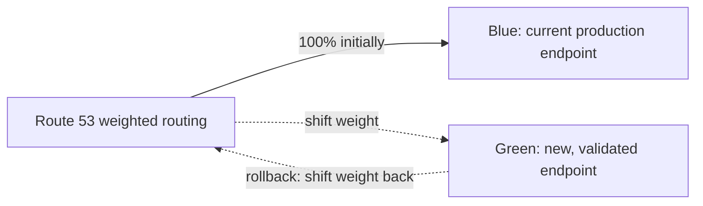

**Why the others are wrong:**
- **B:** Canary deployment, as SageMaker implements it, specifically shifts traffic **between
  production variants within one endpoint** — it's a different mechanism than the two-separate-
  endpoints-plus-DNS-cutover pattern that defines blue/green, even though both are gradual/
  risk-managed rollout strategies.
- **C:** A multi-model endpoint is about hosting **many independent models sharing one
  endpoint's instances** for cost efficiency — it is an entirely different concept from
  maintaining two full, separate environments for a staged cutover.
- **D:** Shadow testing specifically keeps the shadow model's output **hidden from real users**
  while only the production model's response is ever returned — blue/green, by contrast,
  eventually *does* serve real traffic from the green environment once cut over; the two patterns
  solve different problems and aren't interchangeable despite both involving two model versions.

---

## Q18 — Domain 4 (Operating, Monitoring, and Securing ML Solutions)

A company's ML platform team wants data scientists across the organization to authenticate to
SageMaker Studio using the same corporate single sign-on (SSO) credentials and groups they
already use for every other internal application, rather than managing separate IAM users/
passwords specifically for SageMaker Studio access. Which AWS capability enables this centralized
identity integration for Studio domain access?

A) **AWS IAM Identity Center** (successor to AWS SSO), integrated with the SageMaker Studio
   domain's authentication mode, letting users sign in with their existing corporate identity
   provider (IdP) credentials and have their IdP group memberships mapped to Studio user profiles
   and permissions, rather than maintaining separate IAM users per data scientist
B) Amazon Cognito User Pools, which is the only supported authentication mechanism for SageMaker
   Studio domains, with IAM Identity Center unsupported entirely
C) AWS Secrets Manager, which is designed to store and rotate secrets, not to serve as an
   identity provider or SSO integration point for SageMaker Studio
D) SageMaker Studio does not support any form of centralized corporate SSO integration; IAM
   users must always be created and managed individually per data scientist

**Correct Answer: A**

**Explanation:** **AWS IAM Identity Center** (formerly AWS SSO) can be configured as a SageMaker
Studio domain's authentication mode, letting data scientists sign in with their existing
corporate identity provider credentials (via Identity Center's own IdP federation), with the
platform team managing access through Identity Center's user/group assignments rather than
maintaining per-person IAM users specifically for Studio. See
[`certifications/mla-c02/domain-4-monitoring-security/README.md`](../domain-4-monitoring-security/README.md).

**Why the others are wrong:**
- **B:** SageMaker Studio domains support **multiple** authentication modes, including IAM
  Identity Center and direct IAM — Cognito User Pools is not the exclusive mechanism, and
  Identity Center integration is in fact a commonly used, supported option.
- **C:** Secrets Manager is for storing/rotating application secrets (API keys, database
  credentials) — it has no identity-federation or SSO capability and is not involved in Studio
  domain authentication at all.
- **D:** This understates Studio's actual supported authentication options — centralized SSO via
  IAM Identity Center is a specifically supported, documented integration, not something
  unavailable.

---

## Q19 — Domain 1 (Data Preparation for ML and AI)

A company's dataset for a loan-approval model has a categorical `applicant_zip_code` feature
with over 40,000 unique values (effectively one per US ZIP code) — one-hot encoding this feature
directly would create 40,000+ sparse binary columns, dramatically bloating the feature matrix
and memory footprint. Which encoding technique maps this extremely high-cardinality categorical
feature into a small, fixed number of columns using a deterministic hash function, accepting a
small risk of hash collisions between different ZIP codes as a tradeoff for compactness?

A) **Feature hashing (the "hashing trick")** — applying a hash function to each category value
   and mapping the result into a small, fixed-size set of output columns (e.g., 256 or 1,024
   columns regardless of how many unique ZIP codes exist), trading a small, generally tolerable
   risk of two different categories hashing to the same column (collision) for dramatically
   reduced dimensionality compared to full one-hot encoding
B) Ordinal encoding, mapping each ZIP code to a single sequential integer based on alphabetical
   sort order, which has no implied ordering issues for a purely nominal feature like ZIP code
C) Removing the applicant_zip_code feature entirely, since high-cardinality categorical features
   can never be used in any ML model under any circumstances
D) Standard one-hot encoding, since it is always the correct choice for every categorical
   feature regardless of cardinality

**Correct Answer: A**

**Explanation:** **Feature hashing** addresses extremely high-cardinality categorical features by
hashing each category into one of a small, fixed number of output buckets/columns — avoiding the
need for a column-per-unique-value (which would be impractical at 40,000+ categories) at the cost
of occasional hash collisions, which in practice are usually a tolerable tradeoff for the
dimensionality reduction achieved, especially for tree-based or linear models that can still
extract useful signal from the hashed representation. See
[`ml-fundamentals-glossary.md`](../domain-2-model-development/ml-fundamentals-glossary.md) and the
[Domain 1 README](../domain-1-data-preparation/README.md).

**Why the others are wrong:**
- **B:** ZIP codes have **no inherent order** (alphabetical or otherwise) that's meaningful to a
  model — ordinal encoding would falsely imply a rank relationship between unrelated ZIP codes,
  exactly the nominal-vs-ordinal encoding mismatch problem tested elsewhere in this exam; it also
  doesn't reduce dimensionality concerns the way the question is asking about (it does produce a
  single column, but at the cost of injecting a fake ordering).
- **C:** High-cardinality categorical features are routinely used in production ML (via
  techniques like feature hashing, target encoding, or embeddings) — discarding a potentially
  predictive feature (location can correlate with real credit-risk patterns) entirely overreacts
  to a dimensionality problem with real, available solutions.
- **D:** Standard one-hot encoding is specifically impractical here — creating 40,000+ sparse
  columns for one feature would be a severe memory and computational burden; it is not the
  "always correct" choice regardless of cardinality, which is exactly the nuance this question
  tests.

---

## Q20 — Domain 2 (ML Model and Foundation Model Development)

A team working with a foundation model that has a 4,000-token context window needs to summarize
an internal report that, once tokenized, comes to roughly 9,000 tokens — exceeding the model's
context window in a single pass. Simply truncating the document to the first 4,000 tokens would
lose the later sections entirely. Which approach addresses summarizing content that exceeds a
single context window?

A) **A map-reduce (or iterative "refine") summarization strategy** — splitting the long document
   into chunks that each individually fit within the context window, summarizing each chunk
   separately ("map"), then combining/summarizing those intermediate summaries together into one
   final summary ("reduce"), so the full document's content is represented without requiring it
   to fit in a single pass
B) Simply truncating the document to the first 4,000 tokens and summarizing only that portion,
   which is always an acceptable substitute for summarizing the complete document
C) Increasing the model's temperature parameter, which directly expands its underlying context
   window size
D) This cannot be solved in any way; documents longer than a model's context window can never be
   summarized using that model

**Correct Answer: A**

**Explanation:** A **map-reduce (or iterative refine) summarization** approach splits a long
document into context-window-sized chunks, summarizes each chunk independently (the "map" step),
then feeds those intermediate summaries (now much shorter in aggregate) back into the model to
produce one final, coherent summary (the "reduce" step) — letting a model with a limited context
window still represent and summarize a document far longer than it could process in one pass.
See
[`certifications/mla-c02/domain-2-model-development/README.md`](../domain-2-model-development/README.md).

**Why the others are wrong:**
- **B:** Truncating to the first 4,000 tokens silently discards roughly half the document's
  content (everything past that point), producing an incomplete summary that misses potentially
  important later sections — not a genuinely acceptable substitute for summarizing the whole
  document.
- **C:** Temperature controls the randomness/creativity of sampled outputs during generation —
  it has no effect whatsoever on a model's underlying context-window size, which is a fixed
  architectural property of the model, not a runtime sampling parameter.
- **D:** This overstates the limitation — map-reduce/refine summarization strategies (and
  retrieval-based approaches) are standard, practical, widely-used techniques specifically for
  summarizing content that exceeds a single context window.

---

## Q21 — Domain 3 (Deployment and Orchestration of ML Workflows)

A GenAI application needs a **visual, low-code way** for a non-engineer solution architect to
wire together a sequence of GenAI steps — "retrieve from a Knowledge Base, then pass results to
a prompt template, then conditionally invoke an Agent" — without writing custom orchestration
code (like Step Functions state machine JSON or application-layer Python) to chain these Bedrock
components together. Which Bedrock capability is purpose-built for this visual orchestration?

A) **Amazon Bedrock Flows**, a visual, low-code builder for chaining together Bedrock components
   (prompts, Knowledge Bases, Agents, Lambda functions, conditional logic) into an orchestrated
   workflow, without hand-writing custom application code or a separate state-machine definition
B) AWS Step Functions is the only way to orchestrate multiple Bedrock components together, with
   no lower-code, Bedrock-native alternative available
C) SageMaker Canvas, which is designed for building traditional ML models visually, not for
   orchestrating GenAI component chains like Knowledge Bases and Agents
D) Bedrock Guardrails, which filters content safety but has no workflow-orchestration or
   component-chaining capability

**Correct Answer: A**

**Explanation:** **Bedrock Flows** provides a visual, low-code canvas specifically for composing
GenAI application logic out of Bedrock-native building blocks — prompts, Knowledge Bases, Agents,
Lambda-based custom logic, and conditional branches — letting a non-engineer (or an engineer
wanting faster iteration) wire together a multi-step GenAI workflow without writing a custom
state machine or application code from scratch. See
[`services/machine-learning-ai/bedrock.md`](../../../services/machine-learning-ai/bedrock.md).

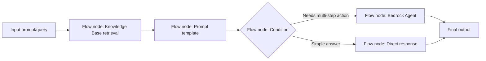

**Why the others are wrong:**
- **B:** This overstates Step Functions as the *only* option — Bedrock Flows is specifically a
  Bedrock-native, lower-code alternative purpose-built for this GenAI-component-chaining use case,
  distinct from (and often simpler than) hand-building a general-purpose Step Functions state
  machine for the same purpose.
- **C:** SageMaker Canvas targets traditional ML model building (classification/regression/time-
  series) via a no-code interface — it has no concept of chaining Bedrock Knowledge Bases, Agents,
  or prompt templates into a GenAI workflow.
- **D:** Guardrails is a content-safety filtering mechanism — it has no workflow-composition or
  component-orchestration capability at all.

---

## Q22 — Domain 4 (Operating, Monitoring, and Securing ML Solutions)

A compliance team needs a complete record of every **individual inference request** (not just
management-plane API activity like "who created this endpoint") made against a specific SageMaker
endpoint handling regulated financial predictions — including who/what invoked it and when —
distinct from SageMaker's Data Capture feature (which logs the actual payload content). Which
CloudTrail configuration specifically provides this **data-plane** API-call-level audit trail?

A) **CloudTrail data events**, which must be explicitly enabled (unlike CloudTrail's default
   management events) to log data-plane API activity such as `InvokeEndpoint` calls — recording
   that a specific invocation occurred, by which principal, and when, as a distinct logging
   configuration from both default CloudTrail management events and SageMaker Data Capture's
   payload logging
B) CloudTrail's default configuration already logs every `InvokeEndpoint` call automatically with
   no additional configuration needed
C) AWS Config, which tracks resource configuration state, not individual data-plane API
   invocation events like `InvokeEndpoint` calls
D) SageMaker Data Capture, which already fully satisfies this requirement with no CloudTrail
   configuration needed at all

**Correct Answer: A**

**Explanation:** CloudTrail distinguishes between **management events** (control-plane actions
like creating/updating resources, logged by default) and **data events** (data-plane actions like
S3 object-level access or SageMaker `InvokeEndpoint` calls), which must be **explicitly enabled**
due to their much higher volume and associated cost — enabling data events for a specific
endpoint gives the "who invoked it and when" audit trail distinct from both default management-
event logging and from Data Capture (which logs actual payload *content*, not the
authenticated-caller API-call record). See
[`certifications/mla-c02/domain-4-monitoring-security/README.md`](../domain-4-monitoring-security/README.md).

**Why the others are wrong:**
- **B:** CloudTrail's **default** configuration only captures management events — data events
  (like `InvokeEndpoint` calls) are opt-in and must be explicitly configured, due to their much
  higher volume; assuming they're logged by default is a common, specifically-tested
  misconception.
- **C:** AWS Config tracks **resource configuration state over time** (e.g., an endpoint's
  instance type) — it has no concept of logging individual data-plane API invocations like
  `InvokeEndpoint` calls.
- **D:** Data Capture logs the actual **request/response payload content** — it does not capture
  the same kind of authenticated-caller, API-call-level audit record (who/when, via IAM identity)
  that CloudTrail data events specifically provide; the two serve complementary, not redundant,
  purposes.

---

## Q23 — Domain 1 (Data Preparation for ML and AI)

A company wants to use SageMaker Ground Truth for an image classification task, but instead of
sending every image to a human labeler, they want the system to **automatically label** images
the model is already highly confident about, reserving human review specifically for genuinely
ambiguous, low-confidence cases — reducing labeling cost and turnaround time as the underlying
labeling model's confidence improves over the course of the job. Which Ground Truth capability
provides this confidence-based automated/human split?

A) **Automated data labeling**, a Ground Truth feature that trains an internal model on the
   human-labeled examples collected so far, then uses that model to automatically label new
   examples above a confidence threshold — routing only lower-confidence examples to human
   labelers, with the automated share typically growing as the internal model improves over the
   job's duration
B) Private workforce configuration, which only determines who the human labelers are and has no
   mechanism for automatically labeling any examples without human involvement
C) SageMaker Model Monitor, which evaluates already-deployed models' production predictions, not
   in-progress data-labeling job confidence during a Ground Truth job
D) Ground Truth always requires 100% human labeling with no automated-labeling option available
   under any configuration

**Correct Answer: A**

**Explanation:** Ground Truth's **automated data labeling** capability periodically trains an
internal model on the labels collected so far, uses it to predict labels for remaining
unlabeled examples, and **automatically accepts** labels above a confidence threshold while
routing only the lower-confidence, harder examples to human labelers — directly reducing cost
and turnaround time, with the automated fraction typically increasing as the job progresses and
the internal model improves. See
[`certifications/mla-c02/domain-1-data-preparation/README.md`](../domain-1-data-preparation/README.md).

**Why the others are wrong:**
- **B:** Workforce configuration determines *who* performs human labeling tasks (private,
  vendor, or Mechanical Turk) — it has no bearing on whether some examples can skip human review
  entirely via automated labeling; that's a separate, distinct Ground Truth feature.
- **C:** Model Monitor evaluates **already-deployed production models'** live inference traffic —
  it has nothing to do with in-progress labeling-job confidence scoring during data annotation.
- **D:** This misstates Ground Truth's actual capability — automated data labeling is a
  specifically supported, documented feature precisely to avoid requiring 100% human labeling for
  every example.

---

## Q24 — Domain 2 (ML Model and Foundation Model Development)

A company fine-tunes a Bedrock foundation model on their own labeled examples, formatted as a
dataset of input prompts paired with desired output completions, uploaded as a file to S3 before
starting the fine-tuning job. Which file format and structural convention does Bedrock's model
customization (fine-tuning) typically expect for this kind of supervised training dataset?

A) **JSONL (JSON Lines)** format, where each line is a separate JSON object typically containing
   a `prompt` field and a `completion` (or equivalent response) field, representing one
   training example per line — a lightweight, streamable structure well suited to large training
   datasets
B) A single, monolithic XML file containing every training example nested inside one root
   element, which is Bedrock's only supported fine-tuning data format
C) A relational database export (e.g., a `.sql` dump file), since Bedrock fine-tuning jobs read
   training data directly from a connected RDS instance rather than from S3
D) Training data format is irrelevant to Bedrock fine-tuning; any arbitrary binary file works
   without any structural convention

**Correct Answer: A**

**Explanation:** Bedrock model customization (fine-tuning) jobs typically expect training data as
**JSONL**, with each line representing one independent training example (commonly a `prompt`/
`completion` pair, or similarly structured fields depending on the specific customization type) —
a simple, line-delimited format that's easy to validate, stream, and scale to large datasets
without needing to parse one giant nested structure. See
[`services/machine-learning-ai/bedrock.md`](../../../services/machine-learning-ai/bedrock.md).

**Why the others are wrong:**
- **B:** Bedrock fine-tuning does not use XML as its training data format — JSONL's simpler,
  line-per-example structure is the expected convention, not a single large nested XML document.
- **C:** Bedrock fine-tuning jobs read training data from **S3** (as files, commonly JSONL), not
  by connecting directly to a relational database — this option misstates the actual data-source
  mechanism entirely.
- **D:** Fine-tuning jobs do require training data to follow a specific, documented structural
  convention (JSONL with expected fields) so the service can correctly parse and use each
  training example — "any arbitrary binary file" would simply fail to be processed correctly.

---

## Q25 — Domain 3 (Deployment and Orchestration of ML Workflows)

A team runs the same SageMaker Pipeline definition across three environments — dev, staging, and
production — where each run should use a different training instance type (small/cheap for dev,
larger for staging, largest for production) and a different S3 input data path per environment,
without maintaining three separate, mostly-duplicated pipeline definition files. Which SageMaker
Pipelines feature allows one pipeline definition to be reused across environments with different
runtime values substituted in?

A) **Pipeline Parameters** — defining typed parameters (e.g., `TrainingInstanceType`,
   `InputDataUri`) directly in the pipeline definition, with actual values supplied at each
   **execution** time rather than hard-coded into the pipeline's static structure, letting one
   single pipeline definition be reused across dev/staging/production by simply passing different
   parameter values per execution
B) Creating three entirely separate, independently maintained pipeline definitions, one
   hard-coded per environment, since Pipelines does not support any form of runtime
   parameterization
C) SageMaker Experiments, which tracks training metrics across runs but has no mechanism for
   parameterizing a pipeline's instance type or input data path per execution
D) AWS Config, which tracks infrastructure configuration drift but has no pipeline-parameter
   substitution capability

**Correct Answer: A**

**Explanation:** SageMaker **Pipeline Parameters** let a pipeline definition declare named,
typed placeholders (strings, integers, etc.) for values like instance type or S3 input path,
which are resolved to actual values only when a specific **execution** is started — meaning the
underlying pipeline *definition* itself stays identical across dev/staging/production, and only
the per-execution parameter values differ, eliminating the need to maintain near-duplicate
pipeline definitions per environment. See
[`services/machine-learning-ai/sagemaker-pipelines.md`](../../../services/machine-learning-ai/sagemaker-pipelines.md).

**Why the others are wrong:**
- **B:** This directly contradicts Pipelines' actual, well-documented parameterization
  capability — maintaining three hard-coded, duplicated definitions is exactly the maintenance
  burden Pipeline Parameters exists to eliminate.
- **C:** SageMaker Experiments tracks and compares training run metadata/metrics — it has no
  mechanism for defining or substituting runtime parameters into a pipeline's step configuration.
- **D:** AWS Config tracks infrastructure resource configuration state/compliance — it has no
  relationship to SageMaker Pipelines' own parameterization mechanism for instance types or data
  paths.

---

## Q26 — Domain 4 (Operating, Monitoring, and Securing ML Solutions)

A data science team's training datasets live partly in SageMaker Feature Store's Offline Store
(backed by S3) and partly as EFS volumes attached to active SageMaker Studio environments. The
company's disaster-recovery policy requires a centralized, automated backup strategy for these
and other supported AWS storage resources, with defined retention schedules and the ability to
restore to a point in time, **without** building separate custom backup scripts per storage
service. Which AWS service centralizes this backup management?

A) **AWS Backup**, a centralized backup management service that can create and enforce backup
   policies (schedules, retention rules) across multiple supported AWS resource types — including
   S3, EFS, and other storage services — from one place, rather than requiring separate custom
   backup automation per service
B) Amazon CloudWatch, which monitors operational metrics and logs, with no backup-scheduling or
   point-in-time-restore capability for storage resources
C) AWS Config, which tracks resource configuration compliance, not data backup/restore
   functionality for S3 or EFS content
D) There is no AWS service that centralizes backup policy management across multiple storage
   services; a separate custom backup script must be written per service

**Correct Answer: A**

**Explanation:** **AWS Backup** is purpose-built as a centralized backup orchestration service:
teams define backup plans (schedule, retention, lifecycle rules) once and apply them across
multiple supported resource types — including S3 buckets and EFS file systems — rather than
hand-building and maintaining separate backup automation scripts per individual storage service.
See
[`certifications/mla-c02/domain-4-monitoring-security/README.md`](../domain-4-monitoring-security/README.md).

**Why the others are wrong:**
- **B:** CloudWatch handles metrics, logs, and alarms for operational monitoring — it has no
  backup-scheduling, retention-policy, or restore capability for storage resources.
- **C:** AWS Config evaluates and tracks resource **configuration** compliance over time (e.g.,
  is encryption enabled) — it is not a data backup/restore service and has no mechanism to back
  up or restore the actual content of S3 objects or EFS files.
- **D:** This understates AWS's actual tooling — AWS Backup exists specifically to centralize and
  automate this cross-service backup policy management, eliminating the need for custom,
  per-service backup scripts.

---

## Q27 — Domain 1 (Data Preparation for ML and AI)

A team building a Bedrock Knowledge Base wants to measure, **before fully launching** their RAG
chatbot, how well the retrieval step alone performs — specifically, "for a set of test questions
with known correct source documents, what fraction of the time does the top-k retrieved chunks
actually include the correct document?" Which standard information-retrieval evaluation metric
directly measures this?

A) **Recall@k** — for each test query with a known relevant/correct document, checking whether
   that correct document appears anywhere within the top-k retrieved results, then averaging
   across all test queries — directly measuring retrieval-step effectiveness independent of
   the foundation model's eventual generation quality
B) BLEU score, since BLEU is the standard metric for evaluating a retrieval system's top-k
   document accuracy
C) Perplexity, since perplexity directly measures whether the correct document was retrieved
   within the top-k results
D) Accuracy, treating the entire RAG pipeline's final generated answer as right or wrong, with
   no way to isolate the retrieval step specifically

**Correct Answer: A**

**Explanation:** **Recall@k** is the standard retrieval-evaluation metric for exactly this
question: given a test set of queries each paired with a known relevant document, Recall@k
measures the fraction of queries for which that relevant document appears somewhere in the
top-k retrieved results — isolating and quantifying the **retrieval step's** effectiveness,
separate from and before evaluating the foundation model's downstream generation quality. See
[`certifications/mla-c02/domain-1-data-preparation/embeddings-and-rag-data-prep.md`](../domain-1-data-preparation/embeddings-and-rag-data-prep.md).

**Why the others are wrong:**
- **B:** BLEU is an n-gram-overlap metric for comparing **generated text** against a reference
  translation/summary — it has no defined meaning for evaluating whether a retrieval system
  found the right source document among its top-k results.
- **C:** Perplexity is an intrinsic language-model metric based on predicted token probabilities
  — it has no relationship to measuring document-retrieval accuracy at all.
- **D:** Evaluating only the final end-to-end generated answer conflates retrieval quality and
  generation quality into one number — it cannot isolate whether a *specific* failure was due to
  poor retrieval (wrong chunks found) versus poor generation (right chunks found, but poorly
  used), which Recall@k specifically lets you measure separately.

---

## Q28 — Domain 2 (ML Model and Foundation Model Development)

A team compares two candidate production models: Model A (quantized to INT8 precision after
training) and Model B (full FP32 precision, unquantized). Model A shows a measurable (but small)
drop in accuracy compared to Model B, but runs inference noticeably faster and at lower memory
footprint. What technique produces this tradeoff, and when is it an appropriate choice?

A) **Quantization** — reducing the numeric precision used to represent a model's weights/
   activations (e.g., from 32-bit floating point down to 8-bit integers), shrinking memory
   footprint and often substantially speeding up inference, at the cost of a typically small
   (but sometimes non-negligible, depending on the model and task) accuracy degradation —
   generally an appropriate choice when inference cost/latency savings outweigh a small accuracy
   cost for the specific production use case
B) This describes model distillation, which is identical in definition and mechanism to
   quantization
C) This describes dropout, a technique applied only during training with no relationship to
   post-training inference precision or speed
D) Quantization always improves a model's accuracy while simultaneously reducing memory
   footprint, with no tradeoff whatsoever

**Correct Answer: A**

**Explanation:** **Quantization** reduces the numeric precision used to store and compute a
model's weights/activations (commonly from 32-bit floating point to 16-bit or 8-bit
representations), directly shrinking memory footprint and often substantially speeding up
inference (especially on hardware with optimized low-precision compute paths) — typically at the
cost of some accuracy degradation, since lower-precision numbers can less exactly represent the
original trained weights. Whether this tradeoff is worthwhile depends on the specific
application's sensitivity to that accuracy loss versus its need for faster, cheaper inference.
See [`ml-fundamentals-glossary.md`](../domain-2-model-development/ml-fundamentals-glossary.md).

**Why the others are wrong:**
- **B:** Distillation trains an entirely **separate, smaller model** using a larger teacher
  model's outputs as training signal — it is a fundamentally different technique than reducing
  numeric precision of an already-trained model's existing weights, which is what quantization
  does; the two are not identical, though both can reduce inference cost.
- **C:** Dropout randomly disables neurons **during training** as a regularization technique
  to reduce overfitting — it has no relationship to post-training numeric precision or inference
  speed, which is what this scenario describes.
- **D:** This directly contradicts the premise of the question — quantization's defining
  tradeoff is precisely that it usually introduces *some* accuracy cost in exchange for
  efficiency gains; claiming no tradeoff at all misstates the technique entirely.

---

## Q29 — Domain 3 (Deployment and Orchestration of ML Workflows)

A company runs multiple isolated data science teams (fraud, marketing, pricing), each needing
their own separate SageMaker Studio environment with distinct IAM permissions, separate default
S3 locations, separate VPC configurations, and no visibility into each other's notebooks,
experiments, or endpoints — while still being managed under the same AWS account by a central
platform team. Which SageMaker organizational construct provides this per-team isolation?

A) **Separate SageMaker Domains**, one per team — each domain has its own isolated configuration
   (IAM execution roles, default storage, VPC/subnet settings, user profiles) and user profiles
   within one domain cannot see or access resources in a different domain, giving each team its
   own walled-off Studio environment under central platform-team governance
B) A single shared SageMaker Domain with one shared user profile used by all three teams
   simultaneously, relying on manual convention to avoid teams seeing each other's work
C) Three completely separate AWS accounts are the only way to achieve this kind of team-level
   isolation; SageMaker Studio has no within-account multi-tenancy construct at all
D) SageMaker Experiments, which organizes training-run metadata but has no mechanism for
   isolating entire Studio environments, IAM configurations, or VPC settings between teams

**Correct Answer: A**

**Explanation:** **SageMaker Domains** are the top-level organizational/isolation construct for
Studio: each domain has its own settings (execution roles, default storage locations, VPC/
network configuration) and contains its own set of **user profiles**; resources and visibility
are scoped to a domain, so separate domains per team provide genuine isolation (different IAM
permissions, different defaults, no cross-team visibility) while still living under one AWS
account that a central platform team can manage and govern. See
[`services/machine-learning-ai/sagemaker-overview.md`](../../../services/machine-learning-ai/sagemaker-overview.md).

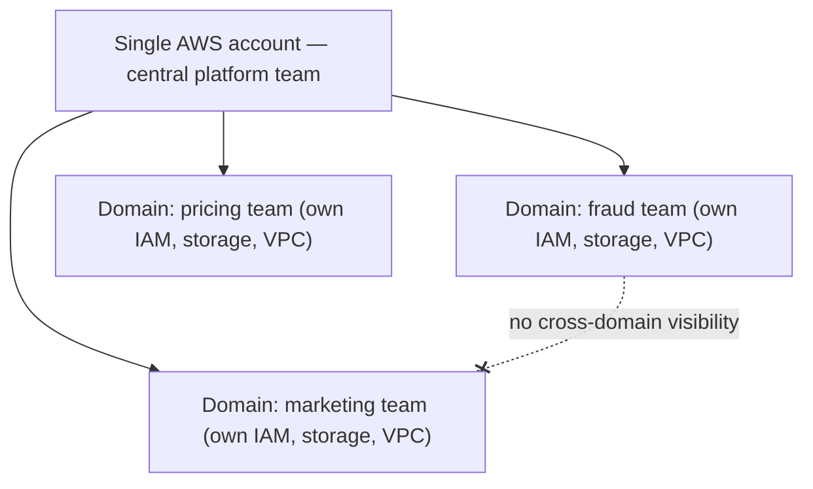

**Why the others are wrong:**
- **B:** A single shared domain and user profile used by all three teams provides **no real
  isolation** at all — it relies entirely on informal convention, with no IAM, storage, or
  visibility separation enforced by the platform, exactly the opposite of what's required.
- **C:** While separate AWS accounts are one valid way to achieve strong isolation (and are
  sometimes used for other reasons), they are not the *only* mechanism — separate SageMaker
  Domains within a single account already provide meaningful, enforced per-team isolation without
  needing fully separate accounts.
- **D:** SageMaker Experiments organizes training-run comparison metadata — it has no role in or
  capability for isolating entire Studio environments, IAM roles, or networking configuration
  between different teams.

---

## Q30 — Domain 4 (Operating, Monitoring, and Securing ML Solutions)

A company's compliance team wants to validate that SageMaker Clarify's **post-training bias
report** on their loan-approval model's predictions is interpreted correctly. The report shows
that the approval rate for Group A is 70% and for Group B is 50%, and flags a **Disparate
Impact (DI)** ratio of 0.71 (50% / 70%), below the commonly-cited "four-fifths rule" threshold of
0.8. What does this specific metric and threshold indicate, and what should the team do next?

A) A **Disparate Impact ratio below 0.8** is a widely-used (though not absolute/legally
   dispositive on its own) **flag for potential adverse impact** against Group B's approval rate
   relative to Group A — the team's next step should be deeper investigation (e.g., checking
   whether a legitimate, non-discriminatory business justification explains the gap, examining
   feature-level contributions via SHAP, and consulting legal/compliance expertise) rather than
   either ignoring the flag or assuming it alone proves illegal discrimination
B) A Disparate Impact ratio of 0.71 indicates the model is performing excellently with no
   fairness concerns whatsoever, since any ratio above 0.5 is considered fully acceptable
C) Disparate Impact is a measure of the model's overall accuracy, unrelated to fairness between
   demographic groups
D) The 0.8 threshold is a hard, universally legally binding cutoff that automatically determines
   whether the model is illegal to deploy, with no further investigation ever required

**Correct Answer: A**

**Explanation:** **Disparate Impact (DI)** compares a favorable outcome rate (here, loan
approval) between two groups; a ratio below the commonly-referenced **four-fifths (0.8)
threshold** (a guideline originating from U.S. EEOC guidance, not Clarify-specific) is treated as
a **flag warranting further investigation** — not automatic proof of illegal discrimination, nor
something to dismiss. The appropriate next step is deeper analysis (feature-level attribution,
business-justification review, legal consultation) to understand *why* the gap exists and whether
it's defensible or must be remediated. See
[`certifications/mla-c02/domain-4-monitoring-security/responsible-ai-and-guardrails.md`](../domain-4-monitoring-security/responsible-ai-and-guardrails.md).

**Why the others are wrong:**
- **B:** 0.71 is explicitly **below** the commonly-cited 0.8 flagging threshold — treating it as
  "fully acceptable" misreads the metric and the threshold it's being compared against entirely.
- **C:** Disparate Impact specifically compares a favorable-outcome **rate between demographic
  groups** — it is a fairness/bias metric, not a measure of the model's overall predictive
  accuracy, which is an entirely separate concept.
- **D:** The four-fifths rule is a **guideline/heuristic**, not an automatically legally
  dispositive, hard-coded cutoff that by itself determines legality — real-world compliance
  decisions require further investigation and legal expertise, not a purely mechanical pass/fail
  reading of one ratio.

---

## Q31 — Domain 1 (Data Preparation for ML and AI)

A manufacturing-defect image classifier is trained on photos of metal parts where a defect's
exact pixel-level orientation (rotation angle) in the photo is irrelevant to whether it's truly
defective, but the part's actual **color** (which can indicate overheating/discoloration — a
real defect signal) must be preserved exactly as photographed, not altered. Which combination of
image data augmentation choices is appropriate for this specific scenario?

A) **Geometric augmentations like random rotation and flipping** are appropriate (since
   orientation carries no defect-relevant meaning here), while **color-altering augmentations
   like color jitter or hue shifting should be avoided or used very conservatively** (since color
   itself may be a genuine defect signal that must not be artificially distorted)
B) Color jitter and hue-shifting augmentations should be applied aggressively, since color is
   always irrelevant to any image classification task regardless of domain
C) Random rotation and flipping should never be used for any image classification task under any
   circumstances
D) All augmentation techniques are always either universally helpful or universally harmful,
   regardless of what the image content or task actually represents

**Correct Answer: A**

**Explanation:** Choosing augmentation techniques requires understanding **which properties of
the image actually carry task-relevant meaning** — here, rotation/orientation doesn't matter to
whether a defect is present, so **geometric augmentations** (rotation, flipping) safely expand
training diversity without corrupting the label's meaning; but **color** may be a genuine,
meaningful defect indicator (e.g., heat discoloration), so aggressively jittering hue/color could
actively destroy the very signal the model needs to learn, and should be avoided or applied only
very conservatively. See
[`certifications/mla-c02/domain-1-data-preparation/README.md`](../domain-1-data-preparation/README.md).

**Why the others are wrong:**
- **B:** This is the opposite of correct here — color is specifically described as a genuine
  defect signal in this scenario, so aggressively distorting it (hue shifting, strong color
  jitter) would actively corrupt meaningful training signal, not safely add diversity; whether
  color matters is task-dependent, not "always irrelevant."
- **C:** Rotation/flipping are broadly useful and commonly-used augmentations for many image
  tasks where orientation doesn't carry meaning — banning them universally ignores that
  appropriateness is scenario-dependent, and in this specific scenario they're explicitly stated
  to be safe.
- **D:** This is the core misconception the question is testing against — augmentation
  appropriateness depends specifically on which image properties are and aren't meaningful for
  the task at hand, not a blanket universal rule; the correct approach evaluates each
  augmentation type against what it would (or wouldn't) corrupt for this specific defect-
  detection use case.

---

## Q32 — Domain 2 (ML Model and Foundation Model Development)

A team wants a SageMaker built-in algorithm to detect anomalous network connections (potential
cybersecurity threats) based on pairs of entities — specifically, flagging **unusual pairings**
of source IP address and destination resource that rarely or never co-occur in historical
"normal" traffic, distinct from a general numeric-feature anomaly-detection approach. Which
SageMaker built-in algorithm is specifically designed around learning relationships between
**pairs of entities** for this kind of use case?

A) **IP Insights**, a SageMaker built-in algorithm specifically designed to learn the usage
   patterns of (IPv4 address, entity) pairs — such as (user ID, IP address) or (IP address,
   resource accessed) — and flag pairings that are anomalous relative to historically observed
   normal co-occurrence patterns, purpose-built for this kind of pairwise relationship anomaly
   detection
B) Random Cut Forest, which is designed for general numeric-feature anomaly detection without any
   specific focus on entity-pair relationship modeling
C) DeepAR, which is designed for time-series forecasting of continuous numeric sequences, not
   entity-pair relationship anomaly detection
D) BlazingText, which is designed for text classification and word embeddings, not network
   entity-pair relationship modeling

**Correct Answer: A**

**Explanation:** **IP Insights** is SageMaker's built-in algorithm specifically purpose-built for
learning usage patterns between **pairs of entities** (classically IP addresses and an associated
entity like a user ID or resource), flagging pairings that deviate significantly from
historically normal co-occurrence patterns — directly matching the "unusual source-IP-to-
destination-resource pairing" cybersecurity anomaly-detection use case described, distinct from
general single-record numeric-feature anomaly detection. See
[`services/machine-learning-ai/sagemaker-training-and-tuning.md`](../../../services/machine-learning-ai/sagemaker-training-and-tuning.md).

**Why the others are wrong:**
- **B:** Random Cut Forest detects anomalies in **general numeric feature vectors** (each
  record scored independently based on how much it "complicates" a forest of random trees) — it
  has no specific architecture for modeling and learning **pairwise entity relationships** the
  way IP Insights does.
- **C:** DeepAR forecasts future values of **numeric time series** — it has no relevance to
  detecting anomalous pairings between two categorical entities like IPs and resources.
- **D:** BlazingText processes **text data** (classification, word embeddings) — it has no
  built-in mechanism for modeling IP-address/entity pairwise relationships at all.

---

## Q33 — Domain 3 (Deployment and Orchestration of ML Workflows)

A team wants to deploy a Bedrock Agent in production that calls an internal "check order status"
REST API and a "process refund" Lambda function, and needs to formally **define** these callable
actions — their input parameters, expected response schema, and descriptions the agent's
underlying foundation model uses to decide when and how to invoke them — as part of configuring
the agent **before** it ever runs. Which Bedrock Agents concept and artifact is used for this
build-time action definition?

A) **Action groups**, defined using an **OpenAPI schema** (describing each action's available
   operations, parameters, and expected request/response structure) paired with the actual
   backend implementation (a Lambda function or API endpoint) — together telling the agent's
   underlying model what actions exist, what inputs each needs, and what to expect back
B) Guardrails, which define content-safety filtering policies, not callable action definitions
   or Lambda/API function wiring
C) Knowledge Bases, which connect an agent to a vector-indexed document store for retrieval, not
   to callable REST APIs or Lambda functions for taking actions
D) Bedrock Agents can only ever answer questions using the model's own internal knowledge, with
   no mechanism to call external APIs or Lambda functions at all

**Correct Answer: A**

**Explanation:** **Action groups** are how a Bedrock Agent's available actions are formally
defined at build time: an **OpenAPI schema** describes each operation's parameters and expected
request/response shape, and that schema is paired with the actual backend (a Lambda function, or
a REST API) that executes the action when the agent's reasoning loop decides to invoke it —
giving the underlying foundation model the structured information it needs to know what actions
exist and how to call them correctly. See
[`services/machine-learning-ai/bedrock.md`](../../../services/machine-learning-ai/bedrock.md).

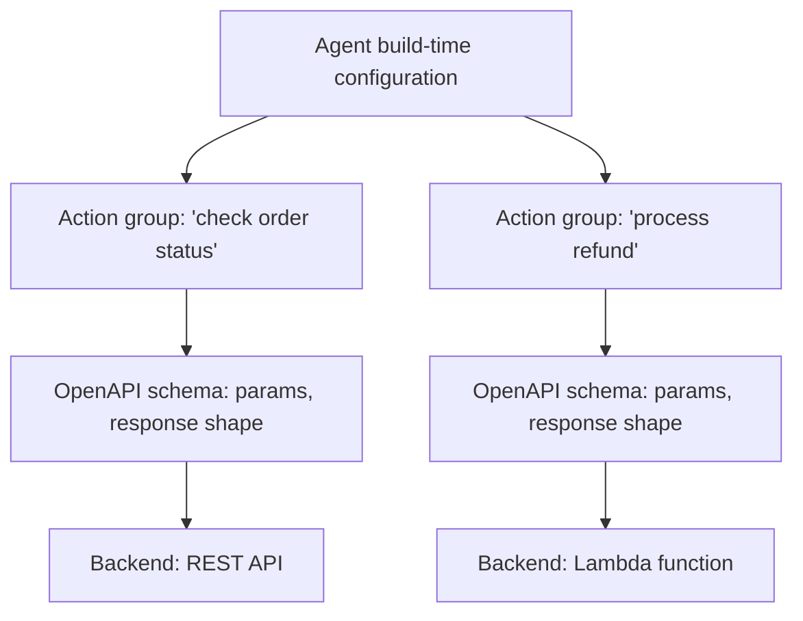

> **Real AWS doc reference:** this build-time wiring of action groups to backends matches AWS's
> own ["How Amazon Bedrock Agents work"](https://docs.aws.amazon.com/bedrock/latest/userguide/agents-how.html)
> documentation, which publishes a dedicated build-time configuration diagram
> (`agents-buildtime.png`, curl-verified HTTP 200) showing exactly this relationship between
> action groups, their OpenAPI schemas, and the underlying Lambda/API implementations — distinct
> from the agent's separate runtime reasoning-loop diagram.

Step by step: (1) at build time, each action group is given a human-readable description and an
OpenAPI schema so the model understands what the action does and what inputs/outputs look like;
(2) the action group is linked to its actual backend implementation (Lambda function or API);
(3) only once this build-time wiring is complete can the agent's runtime reasoning loop
(reason → act → observe) actually invoke these actions during a live conversation.

**Why the others are wrong:**
- **B:** Guardrails configure content-safety filtering (denied topics, content filters, PII
  redaction) applied to the agent's inputs/outputs — they have no role in defining what actions
  an agent can take or how to call them.
- **C:** Knowledge Bases connect an agent to a vector-indexed **document retrieval** source for
  RAG-style grounding — a separate concept from action groups, which wire the agent to
  **callable, state-changing actions** like APIs/Lambda functions, not passive document lookup.
- **D:** This directly contradicts action groups' entire purpose — Bedrock Agents are
  specifically designed to call external APIs/Lambda functions as part of their reasoning loop,
  not limited to the model's own internal knowledge.

---

## Q34 — Domain 4 (Operating, Monitoring, and Securing ML Solutions)

A company processes highly sensitive health records and wants a security architecture where, in
response to a confirmed security incident, they can **immediately and centrally revoke all
future access** to encrypted S3 training data (including blocking any newly-requested
decryption, even for principals who previously had valid permissions) — without needing to
re-encrypt or move the underlying S3 objects themselves. Which encryption approach best supports
this kind of centralized, instant access revocation?

A) **SSE-KMS with a customer-managed KMS key (CMK)**, where access is governed by the key's KMS
   key policy/grants rather than the S3 object itself — revoking or disabling the CMK (or
   removing specific principals' permissions in the key policy) immediately blocks all **future**
   decrypt requests for every object encrypted under that key, without needing to touch or
   re-encrypt the S3 objects themselves
B) SSE-S3 (Amazon S3-managed keys), where AWS fully manages the encryption keys with no
   customer-configurable key policy, grants, or ability to centrally revoke access via key
   management
C) Client-side encryption performed entirely outside of AWS, with encryption keys stored only on
   individual employees' personal laptops with no centralized management
D) No form of S3 encryption provides any mechanism for centrally revoking future decrypt access
   without re-encrypting the underlying objects

**Correct Answer: A**

**Explanation:** **SSE-KMS with a customer-managed key** ties decryption access to the **KMS key
policy and grants**, not the S3 object itself — since every decrypt operation requires calling
KMS (not just reading the S3 object), **disabling the CMK or revoking specific principals' key
permissions immediately blocks all future decrypt calls** against every object ever encrypted
under that key, providing centralized, instant access revocation without touching or
re-encrypting any of the underlying S3 data. See
[`certifications/mla-c02/domain-4-monitoring-security/README.md`](../domain-4-monitoring-security/README.md).

**Why the others are wrong:**
- **B:** SSE-S3 keys are fully managed by AWS with **no customer-configurable key policy or
  grants** — there's no customer-controlled lever to centrally revoke decrypt access the way a
  customer-managed KMS key provides.
- **C:** Storing keys only on individual personal laptops is the opposite of **centralized**
  access management — there's no single point from which to instantly revoke access across all
  copies, and it introduces serious, uncontrolled key-custody risk.
- **D:** This understates real AWS capability — SSE-KMS with a customer-managed key specifically
  enables exactly this kind of centralized, instant, re-encryption-free access revocation via key
  policy/grant changes.

---

## Q35 — Domain 1 (Data Preparation for ML and AI)

A team's dataset for an industrial equipment-failure model has a `sensor_reading` feature with
occasional extreme values that are physically impossible given the sensor's known measurement
range (e.g., a temperature sensor rated for -40°C to 150°C reporting a reading of 50,000°C) —
clearly a transmission/data-corruption error, not a genuine extreme measurement. Before deciding
how to treat these values (cap, impute, or remove), which simple statistical technique helps
systematically identify which specific values should be flagged as outliers in the first place?

A) **The Interquartile Range (IQR) method** — computing the 25th and 75th percentiles (Q1 and
   Q3) of the feature's distribution, then flagging any value falling below `Q1 - 1.5×IQR` or
   above `Q3 + 1.5×IQR` (where IQR = Q3 - Q1) as a statistical outlier, providing a systematic,
   data-driven threshold rather than guessing cutoffs by eye
B) One-hot encoding the sensor_reading feature, which has no relationship to statistically
   identifying outlier values in a continuous numeric feature
C) Computing the feature's R² value, a regression-specific goodness-of-fit metric with no
   relationship to identifying individual outlier data points
D) Applying PCA to the single sensor_reading feature, which has no outlier-detection function and
   is meaningless applied to just one standalone feature

**Correct Answer: A**

**Explanation:** The **IQR method** is a standard, simple, systematic outlier-detection
technique: it computes the spread of the "middle 50%" of the data (Q3 - Q1) and flags any value
falling substantially beyond that typical range (commonly 1.5×IQR beyond Q1 or Q3) as a
statistical outlier — giving an objective, data-driven way to identify which specific values
(like a physically-impossible 50,000°C reading) warrant further treatment (capping, imputation,
or removal), rather than relying on ad hoc visual inspection. See
[`certifications/mla-c02/domain-1-data-preparation/README.md`](../domain-1-data-preparation/README.md).

```mermaid
flowchart LR
    A[Compute Q1 (25th percentile) and Q3 (75th percentile)] --> B[IQR = Q3 - Q1]
    B --> C["Lower bound = Q1 - 1.5×IQR"]
    B --> D["Upper bound = Q3 + 1.5×IQR"]
    C --> E{Value outside bounds?}
    D --> E
    E -->|Yes| F[Flag as statistical outlier]
    E -->|No| G[Treat as normal value]
```

**Why the others are wrong:**
- **B:** One-hot encoding is for categorical/nominal features — it has no application to
  statistically identifying extreme values within a continuous numeric sensor reading feature.
- **C:** R² evaluates how well a regression model's predictions explain variance in a target
  variable — it's a model-evaluation metric, not an outlier-detection technique for a raw input
  feature's individual values.
- **D:** PCA combines multiple correlated features into components for dimensionality
  reduction — it has no defined, meaningful outlier-flagging function when applied to a single
  standalone feature.

---

## Q36 — Domain 2 (ML Model and Foundation Model Development)

A generative text application needs to control how deterministic versus creative/varied its
outputs are: for a customer-support FAQ-answering use case, the team wants highly consistent,
predictable responses to the same question; for a creative marketing-copy generation use case,
the team wants more varied, less predictable phrasing across multiple generations of the same
prompt. Which Bedrock inference parameter directly controls this randomness/determinism
tradeoff, and how should it be set differently for each use case?

A) **Temperature** — a sampling parameter controlling how much randomness is introduced when the
   model selects its next token; a **low temperature** (e.g., close to 0) produces more
   deterministic, consistent outputs (appropriate for the FAQ use case), while a **higher
   temperature** produces more varied, creative outputs (appropriate for the marketing-copy use
   case)
B) Context window size, which is a fixed architectural property of the model and has no runtime
   effect on output randomness/determinism
C) Embedding dimensionality, a property of a separate embedding model with no relationship to a
   generative model's output sampling randomness
D) Chunk size, a RAG-specific data-preparation parameter with no relationship to a foundation
   model's text-generation sampling behavior

**Correct Answer: A**

**Explanation:** **Temperature** directly controls the randomness of next-token sampling during
generation: a **low temperature** sharpens the probability distribution toward the most likely
token(s), producing more consistent, deterministic-feeling outputs across repeated calls with
the same prompt — ideal for a consistency-sensitive FAQ use case; a **higher temperature**
flattens the distribution, letting less-likely tokens be sampled more often, producing more
varied, creative phrasing — appropriate for marketing copy where variety across generations is
desired. See
[`services/machine-learning-ai/bedrock.md`](../../../services/machine-learning-ai/bedrock.md).

**Why the others are wrong:**
- **B:** Context window size determines how much input text a model can process in one call — it
  is a fixed architectural property, not a runtime sampling parameter, and has no relationship to
  output randomness/determinism.
- **C:** Embedding dimensionality is a property of a separate embedding model used for retrieval/
  similarity search — it has no bearing on a *generative* model's own text-sampling randomness.
- **D:** Chunk size governs how source documents are split for a RAG pipeline's retrieval step —
  it is a data-preparation concern, unrelated to the foundation model's own generation-time
  sampling behavior.

---

## Q37 — Domain 3 (Deployment and Orchestration of ML Workflows)

A team's GenAI application serves a small internal tool used sporadically by employees (a few
requests per hour, sometimes none for hours at a stretch) calling a self-hosted fine-tuned model
on a SageMaker endpoint, and they want to avoid paying for continuously-running instances during
long idle stretches, while tolerating a few seconds of added latency on the first request after
an idle period. Separately, a different, customer-facing chat application on the same team needs
consistent sub-200ms latency on every single request, 24/7, with no tolerance for cold-start
delay. Which SageMaker inference option fits each application, respectively?

A) **SageMaker Serverless Inference** for the sporadic internal tool (pay only for actual usage,
   scales to zero during idle periods, tolerating occasional cold-start latency) and a
   **SageMaker real-time endpoint** (with sufficient always-on instance capacity, and optionally
   auto-scaling for traffic growth) for the latency-critical, 24/7 customer-facing chat
   application
B) SageMaker Batch Transform for both applications, since Batch Transform is designed for any
   workload regardless of latency sensitivity or request pattern
C) SageMaker Asynchronous Inference for both applications, since async inference is designed for
   simple synchronous low-latency chat-style traffic
D) A real-time endpoint for the sporadic internal tool and Serverless Inference for the
   latency-critical chat application — the reverse pairing of option A

**Correct Answer: A**

**Explanation:** **Serverless Inference** fits the sporadic internal tool well: it scales down to
zero cost during idle periods and only charges for actual invocations, with the tradeoff being
cold-start latency on the first request after idling — acceptable here since the tool is
internal and latency-tolerant. The customer-facing chat application's strict, consistent
sub-200ms-every-request requirement needs a **real-time endpoint** with provisioned (always-on)
capacity, which has no cold-start behavior since instances are continuously running and ready.
See
[`services/machine-learning-ai/sagemaker-deployment-endpoints.md`](../../../services/machine-learning-ai/sagemaker-deployment-endpoints.md).

**Why the others are wrong:**
- **B:** Batch Transform is for offline, non-interactive bulk scoring jobs — it has no
  request/response latency model suitable for either a sporadic interactive tool or a real-time
  chat application at all.
- **C:** Asynchronous Inference is designed for long-running or large-payload requests queued
  one at a time with eventual (not immediate synchronous) results — it is not suited to
  simple, fast, synchronous chat-style request/response traffic.
- **D:** This exactly reverses the correct pairing — putting the latency-critical, 24/7 chat
  application on Serverless Inference would expose it to unacceptable cold-start delays, while
  running the sporadic internal tool on a continuously-provisioned real-time endpoint would waste
  money paying for capacity sitting idle most of the time.

---

## Q38 — Domain 4 (Operating, Monitoring, and Securing ML Solutions)

A compliance team wants a report, using SageMaker Clarify, showing **toxicity scores** for a
Bedrock-based chatbot's generated text outputs over a held-out set of adversarial test prompts,
to validate the model's responses stay within acceptable bounds before launch — distinct from
real-time Guardrails filtering applied to live production traffic. Which capability provides this
structured, pre-launch toxicity evaluation over a test prompt set?

A) **Bedrock Model Evaluation**, which supports automatic evaluation metrics including
   **toxicity scoring** over a provided test dataset of prompts, letting the team validate a
   model's output safety characteristics in a structured, repeatable way before launch — distinct
   from Guardrails, which applies real-time filtering to live production traffic rather than
   batch-evaluating a held-out test set
B) Guardrails alone fully replaces the need for any pre-launch evaluation, since Guardrails
   inherently produces structured toxicity evaluation reports over held-out test datasets
C) SageMaker Ground Truth, which labels new training datasets rather than evaluating an
   already-existing foundation model's toxicity on a held-out test prompt set
D) AWS Config, which tracks infrastructure configuration compliance, not generative-model output
   toxicity evaluation

**Correct Answer: A**

**Explanation:** **Bedrock Model Evaluation** jobs support automatic metrics — including
**toxicity** — computed over a provided held-out dataset of test prompts, producing a structured,
repeatable pre-launch evaluation report distinct from Guardrails' role, which is **real-time
filtering/blocking** applied to live production inference traffic rather than structured batch
evaluation against a curated test set. See
[`services/machine-learning-ai/bedrock.md`](../../../services/machine-learning-ai/bedrock.md) and
[`certifications/mla-c02/domain-4-monitoring-security/responsible-ai-and-guardrails.md`](../domain-4-monitoring-security/responsible-ai-and-guardrails.md).

**Why the others are wrong:**
- **B:** Guardrails operates at **inference time** on live traffic (filtering/blocking in real
  time) — it does not itself generate a structured, held-out-test-set toxicity evaluation report
  the way Model Evaluation does; the two serve different, complementary purposes.
- **C:** Ground Truth produces labeled data for **training new models** — it has no
  toxicity-scoring or model-output-evaluation capability for an already-existing foundation
  model's generated text.
- **D:** AWS Config evaluates infrastructure **configuration** compliance (e.g., encryption
  settings) — it has no concept of evaluating generative-model output content for toxicity.

---

## Q39 — Domain 1 (Data Preparation for ML and AI)

A team's clickstream data lake table in the Glue Data Catalog is queried by Athena, Redshift
Spectrum, and SageMaker Processing jobs across three different teams. The compliance team wants
a way to trace **data lineage**: given a specific trained model, determine exactly which Glue
Data Catalog table version, S3 partition, and query/transformation steps produced the training
data ultimately used — for audit and reproducibility, beyond just the Feature Store's point-in-
time feature queries already in use for individual engineered features. Which AWS capability
provides broader, end-to-end data/processing lineage tracking across services like Glue,
Athena, and SageMaker Processing?

A) **Amazon SageMaker ML Lineage Tracking** (and related lineage capabilities integrated across
   SageMaker and the broader Glue/data-catalog ecosystem), which captures and visualizes the
   relationships between datasets, processing steps, training jobs, and resulting models — giving
   an end-to-end trace from raw data source through to a specific trained model artifact
B) AWS Config, which tracks infrastructure resource configuration history, not data/processing
   lineage relationships between datasets, transformations, and trained models
C) Amazon CloudWatch Logs, which stores application log output, with no structured
   dataset-to-model lineage graph capability
D) There is no AWS capability for tracing lineage from raw data through processing steps to a
   specific trained model; this must be tracked entirely manually in a spreadsheet

**Correct Answer: A**

**Explanation:** **SageMaker ML Lineage Tracking** automatically (and additionally,
supplementally) captures the relationships between entities in an ML workflow — datasets,
processing jobs, training jobs, and model artifacts — letting a team trace backward from a
specific trained model to exactly which data sources, processing steps, and transformations
produced it, satisfying exactly this kind of audit/reproducibility requirement across the broader
pipeline, not just within Feature Store's own point-in-time feature queries. See
[`services/machine-learning-ai/sagemaker-pipelines.md`](../../../services/machine-learning-ai/sagemaker-pipelines.md).

**Why the others are wrong:**
- **B:** AWS Config tracks **infrastructure resource configuration** state over time (e.g.,
  security group rules) — it has no concept of dataset-to-model data lineage relationships.
- **C:** CloudWatch Logs stores raw application/operational log text — it has no structured
  lineage-graph capability connecting datasets, processing steps, and trained models.
- **D:** This understates real AWS capability — SageMaker's lineage tracking is specifically
  designed to automate this kind of end-to-end traceability, rather than requiring an entirely
  manual, spreadsheet-based process.

---

## Q40 — Domain 2 (ML Model and Foundation Model Development)

A team is deciding between a **multi-class** classification setup (where each support ticket is
assigned to exactly one of 10 categories) and a **multi-label** classification setup (where a
single support ticket can simultaneously belong to multiple categories — e.g., both "billing
issue" and "account access issue" at once) for their ticket-tagging model. A ticket in their real
data frequently genuinely spans more than one category at once. Which setup correctly matches
this requirement, and what does it imply about the model's output layer/loss function?

A) **Multi-label classification** is the correct setup — since a single ticket can genuinely
   belong to multiple categories simultaneously, the model should use an output layer with an
   **independent sigmoid activation per category** (rather than a single softmax across all
   categories) and a loss function (like binary cross-entropy per label) that doesn't force the
   predicted probabilities across categories to sum to 1
B) Multi-class classification is the correct setup, since softmax's probabilities summing to 1
   across all 10 categories correctly allows a ticket to be confidently assigned to several
   categories simultaneously
C) Multi-class and multi-label classification are identical concepts with no practical difference
   in output layer design or loss function
D) Regression is the correct setup, since assigning categorical tags to tickets is best modeled
   as predicting a single continuous numeric value

**Correct Answer: A**

**Explanation:** **Multi-class** classification assumes each example belongs to **exactly one**
category (modeled with a **softmax** output, whose probabilities sum to 1 — mutually exclusive by
construction) — the wrong assumption here, since a ticket can genuinely belong to multiple
categories at once. **Multi-label** classification instead uses an **independent sigmoid
activation per category** (each category's probability computed independently, not forced to sum
to 1 across categories) with a per-label loss (like binary cross-entropy), correctly allowing
several categories to simultaneously have high predicted probability for the same ticket. See
[`ml-fundamentals-glossary.md`](../domain-2-model-development/ml-fundamentals-glossary.md).

**Why the others are wrong:**
- **B:** Softmax's defining property is that its output probabilities across all categories sum
  to exactly 1, encouraging the model to push probability mass toward just **one** winning
  category — this structurally fights against a ticket genuinely belonging to multiple
  categories at once, which is exactly the opposite of what's needed here.
- **C:** Multi-class and multi-label classification differ specifically in their output-layer
  activation (softmax vs. independent sigmoids) and loss function design, precisely because they
  encode different real-world assumptions (mutually exclusive vs. simultaneously co-occurring
  categories) — they are not interchangeable concepts.
- **D:** Regression predicts a continuous numeric target — assigning categorical tags to tickets
  is fundamentally a classification problem (even in its multi-label form), not a numeric
  value-prediction problem.

---

## Q41 — Domain 3 (Deployment and Orchestration of ML Workflows)

A team is unsure which SageMaker instance type and size would deliver the best cost/latency
tradeoff for a new model, and wants to compare multiple candidate instance types' actual
latency, throughput, and cost side by side — first with a **quick, low-effort estimate** based
on model/framework characteristics, and later (if needed) with a **more rigorous, real load
test** against actual traffic patterns before committing to a production configuration. Which
SageMaker Inference Recommender capability provides each of these two levels of analysis,
respectively?

A) **Instant recommendations** — a fast, low-effort recommendation generated from the model's
   metadata/framework without running a full custom load test, useful for quick, early-stage
   guidance; **Advanced recommendations (load testing jobs)** — custom load tests run against
   actual candidate instance types using realistic traffic patterns/payloads, providing more
   rigorous, production-grade latency/throughput/cost data before final commitment
B) Both "Instant" and "Advanced" recommendations are identical in methodology and effort,
   differing only in the report's visual formatting
C) SageMaker Inference Recommender only supports one single mode of analysis, with no distinction
   between a fast estimate and a more rigorous load test
D) SageMaker Debugger provides both the instant and advanced instance-recommendation
   capabilities described, not Inference Recommender

**Correct Answer: A**

**Explanation:** **SageMaker Inference Recommender** offers two distinct tiers: **Instant
recommendations** quickly suggest candidate instance types based on the model's framework/
metadata with minimal setup (useful for an early, low-effort first pass), while **Advanced
recommendations** run actual **custom load-testing jobs** against real candidate instance
configurations using representative sample payloads/traffic, producing more rigorous,
production-grade latency/throughput/cost benchmarks before a final instance-type decision. See
[`certifications/mla-c02/domain-4-monitoring-security/README.md`](../domain-4-monitoring-security/README.md)
and [`services/machine-learning-ai/sagemaker-deployment-endpoints.md`](../../../services/machine-learning-ai/sagemaker-deployment-endpoints.md).

**Why the others are wrong:**
- **B:** These two modes differ in actual **methodology and effort**, not just visual
  presentation — Instant is a quick metadata-based estimate, while Advanced actually runs real
  load tests against live instance configurations, a substantively different and more rigorous
  process.
- **C:** This directly contradicts Inference Recommender's documented two-tier design (Instant
  vs. Advanced), which exists specifically to offer both a fast first pass and a more rigorous
  deeper analysis.
- **D:** SageMaker Debugger analyzes **training-time** internal tensors/gradients for diagnostic
  purposes — it has no instance-type recommendation or load-testing capability at all; that is
  Inference Recommender's distinct role.

---

## Q42 — Domain 4 (Operating, Monitoring, and Securing ML Solutions)

A company wants fine-grained control over which specific Bedrock foundation models and API
actions are reachable through their VPC's Interface Endpoint for `bedrock-runtime` — for
example, allowing `InvokeModel` calls only to a specific approved list of foundation models,
while blocking calls to any other model, all enforced at the network/endpoint level rather than
relying solely on IAM policy. Which VPC Interface Endpoint feature supports this kind of
fine-grained, endpoint-level access restriction?

A) **VPC endpoint policies** — a resource policy attached directly to the Interface VPC Endpoint
   itself, which can restrict which API actions and which specific resources (e.g., specific
   model ARNs) are allowed through that endpoint, functioning as an additional network-level
   control layered on top of (not a replacement for) IAM identity-based policies
B) Security groups attached to the endpoint's elastic network interface, which can only filter
   by IP/port/protocol and have no awareness of Bedrock API actions or specific model ARNs
C) VPC endpoints have no resource-policy or access-restriction capability of their own; all
   access control for traffic through an endpoint must rely exclusively on IAM identity-based
   policies with no endpoint-level control layer available
D) AWS Config rules, which track endpoint configuration compliance but have no mechanism to
   actively restrict which API actions or model ARNs are reachable through the endpoint at
   request time

**Correct Answer: A**

**Explanation:** **VPC endpoint policies** are resource-based policies attached directly to an
Interface (or Gateway) VPC Endpoint, letting you restrict which API actions and which specific
resource ARNs (e.g., approved Bedrock model ARNs) are permitted to pass through that specific
network path — functioning as an additional, network-level enforcement layer that works
alongside (not instead of) IAM identity-based policies, giving defense-in-depth fine-grained
control over exactly what's reachable via the endpoint. See
[`certifications/mla-c02/domain-4-monitoring-security/README.md`](../domain-4-monitoring-security/README.md).

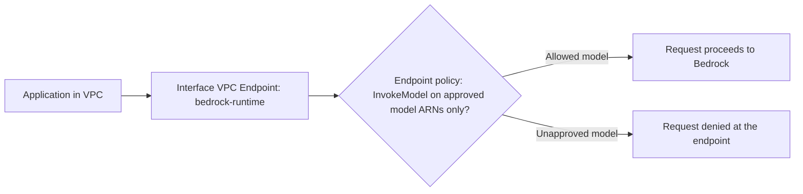

**Why the others are wrong:**
- **B:** Security groups filter network traffic by IP address, port, and protocol — they have no
  awareness of application-layer concepts like specific API actions or model ARNs, which is
  exactly the fine-grained restriction VPC endpoint policies (not security groups) provide.
- **C:** This understates actual VPC endpoint capability — endpoint policies are a real,
  documented resource-policy mechanism specifically designed to add this kind of network-level
  restriction layer, complementing (not replaced entirely by) IAM.
- **D:** AWS Config evaluates configuration state for compliance reporting — it does not actively
  enforce or block API calls in real time the way an endpoint policy does at request-evaluation
  time.

---

## Q43 — Domain 1 (Data Preparation for ML and AI)

A company discovers that their S3-based raw clickstream data lake occasionally contains
proprietary internal employee ID numbers embedded in free-text log fields, following a specific
custom format (e.g., `EMP-` followed by exactly 6 digits) that is unique to their organization
and would never be recognized by Macie's built-in, generic sensitive-data detection types (like
standard SSN or credit card patterns). Which Macie capability lets them detect this
organization-specific sensitive-data pattern?

A) **Macie custom data identifiers** — letting the team define their own regular-expression-
   based (or keyword-proximity-based) detection pattern (e.g., matching `EMP-\d{6}`) so Macie can
   scan S3 objects for this organization-specific sensitive-data format, in addition to its
   built-in, generic managed data identifiers (SSNs, credit cards, etc.)
B) Macie only supports its built-in, generic managed data identifiers, with no mechanism to
   define custom organization-specific detection patterns
C) AWS Config, which can define custom infrastructure-configuration rules but has no capability
   to scan S3 object content for custom sensitive-data text patterns
D) Amazon Comprehend's built-in entity types, which are a fixed, non-extensible list with no
   mechanism for scanning S3 buckets for custom-format proprietary identifiers

**Correct Answer: A**

**Explanation:** **Macie custom data identifiers** let a team define their own detection logic —
typically a regular expression, optionally combined with proximity keywords to reduce false
positives — for sensitive-data patterns specific to their organization (like a proprietary
`EMP-######` employee ID format) that Macie's built-in **managed data identifiers** (SSNs, credit
cards, standard PII types) wouldn't recognize on their own, extending Macie's S3 scanning to
cover organization-specific sensitive formats. See
[`certifications/mla-c02/domain-4-monitoring-security/README.md`](../domain-4-monitoring-security/README.md).

**Why the others are wrong:**
- **B:** This understates Macie's actual capability — custom data identifiers are a specifically
  supported, documented feature precisely for organization-specific formats beyond the built-in
  managed identifiers.
- **C:** AWS Config evaluates infrastructure **resource configuration** — it has no capability to
  scan S3 object **content** for custom text patterns at all; that's Macie's domain, not Config's.
- **D:** Comprehend's entity-recognition types are oriented toward general NLP entity extraction
  from text passed via API calls — defining a fully custom regex-based detection pattern for
  bucket-wide S3 scanning specifically describes Macie's custom data identifier feature, not
  Comprehend's fixed entity list.

---

## Q44 — Domain 2 (ML Model and Foundation Model Development)

A team compares two candidate SageMaker built-in algorithms for a task involving classifying
support tickets by sentiment ("positive"/"neutral"/"negative") using the raw ticket text as
input, with no pre-engineered numeric features — just the free-form text itself. Which SageMaker
built-in algorithm is specifically designed to work directly on raw text for this kind of task,
and what capability does it additionally provide beyond just classification?

A) **BlazingText**, SageMaker's built-in algorithm supporting both **text classification** (e.g.,
   sentiment categories directly from raw text) and, in its unsupervised mode, training **word
   embeddings** (e.g., Word2Vec-style representations) — operating directly on raw text without
   requiring hand-engineered numeric features first
B) Random Cut Forest, which requires pre-engineered numeric feature vectors and has no native
   capability to process raw free-form text or produce word embeddings
C) Factorization Machines, which is designed for sparse user-item interaction data in
   recommendation systems, not raw free-form text classification or word embedding training
D) K-Nearest Neighbors, which requires numeric feature vectors with a defined distance metric and
   has no native text-processing or word-embedding capability

**Correct Answer: A**

**Explanation:** **BlazingText** is SageMaker's built-in algorithm purpose-built for text: in
supervised mode it performs **text classification** directly on raw text (like sentiment
categorization), and in unsupervised mode it can train **word embeddings** (Word2Vec-style),
operating natively on text without requiring the team to hand-engineer numeric features first —
matching both the raw-text-input requirement and highlighting its dual classification/embedding
capability. See
[`services/machine-learning-ai/sagemaker-training-and-tuning.md`](../../../services/machine-learning-ai/sagemaker-training-and-tuning.md).

**Why the others are wrong:**
- **B:** Random Cut Forest expects numeric feature vectors for its tree-based anomaly scoring —
  it has no native text-tokenization or text-classification capability, and no word-embedding
  training mode.
- **C:** Factorization Machines is specifically designed for sparse, high-cardinality interaction
  data (like user-item pairs in recommendation systems) — it is not built for free-form text
  classification or word-embedding training.
- **D:** K-NN requires a defined distance metric over numeric feature vectors — it has no native
  mechanism for processing raw text or producing word embeddings without an upstream text-to-
  vector conversion step, which BlazingText provides natively as part of its own design.

---

## Q45 — Domain 3 (Deployment and Orchestration of ML Workflows)

A platform team wants to adopt SageMaker's built-in **deployment guardrails** (canary/linear
traffic shifting with automatic CloudWatch-alarm-triggered rollback) for their production
endpoint rollouts, but another team suggests building the same capability themselves using AWS
CodeDeploy's traffic-shifting and rollback features pointed at the SageMaker endpoint instead.
What is the key practical consideration in choosing between these two approaches?

A) **SageMaker's native deployment guardrails** are purpose-built specifically for SageMaker
   endpoint updates (production variant traffic shifting, tightly integrated with SageMaker-
   specific CloudWatch metrics) and require less custom integration work; **CodeDeploy** is a
   more general-purpose deployment service that *can* be adapted to many compute targets (EC2,
   Lambda, ECS, and with custom integration, other targets) but would require more custom glue
   logic to drive SageMaker-specific traffic shifting and rollback behavior that SageMaker's
   native guardrails already provide out of the box
B) CodeDeploy and SageMaker's native deployment guardrails are functionally and operationally
   identical in every respect, with no meaningful difference in integration effort for a
   SageMaker endpoint specifically
C) SageMaker endpoints cannot be targeted by CodeDeploy under any circumstances, making this
   entire comparison moot
D) SageMaker's native deployment guardrails do not support automatic rollback; only a
   custom CodeDeploy-based solution can provide automatic rollback for SageMaker endpoints

**Correct Answer: A**

**Explanation:** SageMaker's **native deployment guardrails** (canary/linear traffic shifting
with alarm-triggered auto-rollback) are purpose-built directly for SageMaker endpoint production
variants, requiring minimal additional integration since the traffic-shifting and alarm-
monitoring logic is already SageMaker-aware out of the box. **CodeDeploy** is a general-purpose
deployment orchestration service that supports many compute targets, but using it for a
SageMaker endpoint specifically would require more custom work to replicate what SageMaker's own
guardrails already provide natively — making native guardrails generally the lower-effort choice
for this specific use case, unless an organization has other reasons to standardize tooling
around CodeDeploy across all deployment types. See
[`certifications/mla-c02/domain-3-deployment-orchestration/README.md`](../domain-3-deployment-orchestration/README.md).

**Why the others are wrong:**
- **B:** The two approaches differ meaningfully in how much custom integration work is needed
  for this specific target (SageMaker endpoints) — claiming they're identical in every respect
  ignores the practical effort tradeoff the question is testing.
- **C:** This overstates a limitation; the real distinction is about integration effort and
  built-in SageMaker-awareness, not a flat impossibility of ever combining the two services.
- **D:** This directly contradicts documented SageMaker behavior — native deployment guardrails
  specifically support automatic rollback tied to CloudWatch alarms, as covered elsewhere in this
  exam bank; it is not a capability exclusive to a custom CodeDeploy-based solution.

---

## Q46 — Domain 4 (Operating, Monitoring, and Securing ML Solutions)

A company wants to control CloudWatch Logs storage costs for high-volume SageMaker endpoint
application logs, which are currently retained **indefinitely** by default, accumulating
significant storage cost over years even though the team only ever needs to reference logs from
the last 90 days in practice. Which simple CloudWatch configuration directly addresses this cost
concern?

A) **CloudWatch Logs retention policy**, configured per log group to automatically **expire and
   delete** log events older than a chosen period (e.g., 90 days), rather than retaining every
   log event indefinitely by default at ongoing storage cost
B) AWS Backup, which is designed for backing up resources like S3/EFS, not for configuring
   automatic expiration of CloudWatch Logs data
C) Amazon S3 Lifecycle policies, which apply to S3 object storage and have no direct mechanism
   for expiring CloudWatch Logs log groups that haven't been exported to S3
D) CloudWatch Logs has no retention or expiration configuration option; all log data must always
   be retained indefinitely with no way to reduce associated storage cost

**Correct Answer: A**

**Explanation:** Each CloudWatch Logs **log group** has a configurable **retention policy**
(e.g., 1 day up to 10 years, or "Never expire," which is the default) — setting it to something
like 90 days automatically expires and deletes older log events, directly reducing long-term
storage cost without the team needing to manually prune logs or build a custom cleanup process.
See
[`certifications/mla-c02/domain-4-monitoring-security/ml-cost-optimization.md`](../domain-4-monitoring-security/ml-cost-optimization.md).

**Why the others are wrong:**
- **B:** AWS Backup handles backup/restore for resources like S3, EFS, and databases — it has no
  role in configuring automatic expiration of CloudWatch Logs data.
- **C:** S3 Lifecycle policies apply specifically to objects stored in **S3** — CloudWatch Logs
  data lives in its own managed log-group storage, not S3, unless explicitly exported; S3
  lifecycle rules don't directly govern CloudWatch Logs retention.
- **D:** This misstates CloudWatch Logs' actual, commonly-used retention-configuration
  capability — per-log-group retention settings are a standard, simple, directly available cost
  control.

---

## Q47 — Domain 1 (Data Preparation for ML and AI)

A company ingests third-party vendor data feeds into their data lake, and occasionally a vendor
silently changes their feed's column names or data types without notice, breaking downstream
Athena queries and SageMaker Processing jobs that assume a fixed schema. The team wants
**automated validation** that catches a schema mismatch (e.g., an expected `order_total` numeric
column suddenly containing non-numeric text, or a column disappearing entirely) immediately when
new data lands, rather than discovering it only when a downstream job fails. Which AWS Glue
capability, beyond basic schema crawling, proactively validates incoming data against expected
rules?

A) **AWS Glue Data Quality**, with rules (defined in DQDL) that explicitly check things like
   expected column data types, column presence/completeness, and value-format constraints —
   automatically evaluating newly-arrived data against these expectations and flagging/failing
   when a vendor's feed silently breaks an assumed contract, rather than waiting for a downstream
   job to fail
B) A Glue crawler alone, which only infers and updates schema metadata and has no concept of
   validating data against an expected, predefined set of quality rules
C) Amazon Athena, which can query the data but has no proactive, automated schema-validation or
   rule-checking mechanism triggered automatically as new data arrives
D) SageMaker Ground Truth, which labels training datasets and has no schema-validation or
   data-quality-rule-checking capability for a data lake feed

**Correct Answer: A**

**Explanation:** **AWS Glue Data Quality** rules (via DQDL) can explicitly encode expectations
like "column `order_total` must be numeric," "column `order_total` must always be present," or
"values must match an expected format" — automatically evaluating each new batch of incoming
vendor data against these rules and flagging (or failing the job on) violations immediately,
catching a silently-broken vendor feed schema change proactively rather than only discovering it
when a downstream Athena query or SageMaker Processing job later breaks. See
[`services/analytics/glue.md`](../../../services/analytics/glue.md).

**Why the others are wrong:**
- **B:** A crawler only **infers and records** the schema it observes (and can silently adapt to
  a changed schema without flagging it as a problem) — it has no concept of checking data against
  a predefined set of *expected* quality rules the way Glue Data Quality does.
- **C:** Athena is a query engine that reads whatever schema/data currently exists — it has no
  proactive, automated rule-validation mechanism that runs the moment new data lands, independent
  of someone manually running (and reviewing) a query.
- **D:** Ground Truth is a human/ML-assisted data-**labeling** service for creating training
  labels — it has no schema-validation or data-quality-rule-checking capability relevant to this
  scenario.

---

## Q48 — Domain 2 (ML Model and Foundation Model Development)

A team notices that a deep neural network using the **sigmoid** activation function in many
hidden layers trains extremely slowly, with gradients becoming vanishingly small in the earliest
layers during backpropagation — a problem that largely disappears when they switch those hidden
layers to use the **ReLU (Rectified Linear Unit)** activation function instead. What property of
sigmoid (versus ReLU) explains this specific vanishing-gradient difference?

A) **Sigmoid's derivative is bounded within a small range (at most 0.25) and approaches zero for
   both very large and very small inputs**, so repeatedly multiplying many such small derivatives
   together during backpropagation through many layers causes the gradient to shrink
   exponentially toward zero; **ReLU's derivative is either 0 or exactly 1** for its active
   region, avoiding this repeated-multiplication-of-small-numbers shrinkage for inputs where the
   neuron is active
B) Sigmoid and ReLU have mathematically identical derivatives across their entire input range,
   so this difference cannot be explained by their derivative properties at all
C) ReLU is slower than sigmoid in every practical deep learning scenario, which contradicts the
   premise of the question entirely
D) The vanishing gradient problem is caused exclusively by learning rate choice and has no
   relationship to which activation function is used in hidden layers

**Correct Answer: A**

**Explanation:** **Sigmoid's derivative** is at most 0.25 (at input 0) and shrinks toward 0 as
the input moves toward either extreme — during backpropagation through many layers, the chain
rule multiplies many of these small derivative values together, causing the gradient reaching
early layers to shrink exponentially (vanishing gradient). **ReLU's derivative** is a constant 1
for positive inputs (and 0 for negative inputs) — for active neurons, this avoids the repeated
multiplication of small fractional derivatives, letting gradients propagate back through many
layers without the same exponential shrinkage, which is why switching to ReLU often resolves this
specific training-speed/vanishing-gradient issue. See
[`ml-fundamentals-glossary.md`](../domain-2-model-development/ml-fundamentals-glossary.md).

**Why the others are wrong:**
- **B:** Sigmoid and ReLU have clearly **different** derivative shapes (sigmoid's bounded,
  bell-shaped derivative that shrinks at the extremes, vs. ReLU's simple 0-or-1 step) — this
  difference is precisely what explains their different vanishing-gradient behavior, not evidence
  that they're identical.
- **C:** This contradicts the question's own stated premise (switching to ReLU resolved the
  slow-training/vanishing-gradient problem) and is also not a generally true statement about
  ReLU vs. sigmoid training speed in deep networks.
- **D:** While learning rate does affect training dynamics, the vanishing-gradient phenomenon
  specifically tied to activation-function derivative shape (as described) is a well-documented,
  distinct cause — dismissing activation function choice entirely misses a primary, commonly-
  tested root cause of this exact symptom.

---

## Q49 — Domain 3 (Deployment and Orchestration of ML Workflows)

A team wants to quickly test code changes to their SageMaker training script — debugging data
loading, checking for syntax errors, and verifying the training loop runs correctly — without
waiting several minutes for a real, billed SageMaker-managed training instance to provision
each time they make a small code tweak. Which SageMaker capability lets them run and iterate on
this training code **locally** (e.g., on their own notebook instance or laptop, using Docker),
before submitting a real managed training job?

A) **SageMaker local mode**, which runs the same training container image used for a managed
   SageMaker training job **locally** (e.g., via Docker on a notebook instance or developer
   machine) instead of provisioning real managed training infrastructure — letting the team
   quickly iterate on code correctness before committing to a slower, billed, fully-managed
   training job run
B) SageMaker Debugger, which analyzes tensors/gradients during an already-running, fully
   provisioned managed training job, rather than providing a fast local-iteration development mode
C) SageMaker Autopilot, which automates algorithm/hyperparameter selection for AutoML, not local
   code-iteration testing before a managed training job
D) SageMaker has no local-execution option; every training code change must always go through a
   full managed training job provisioning cycle, regardless of how minor the change

**Correct Answer: A**

**Explanation:** **SageMaker local mode** runs the exact same training (or inference) container
image a managed job would use, but **locally** — typically via Docker on the development
machine or notebook instance — letting a team rapidly catch bugs (data loading issues, syntax
errors, broken training loops) without the multi-minute provisioning delay and billed cost of a
real managed training job for every small iteration, before finally submitting to managed
training once the code is verified working. See
[`services/machine-learning-ai/sagemaker-training-and-tuning.md`](../../../services/machine-learning-ai/sagemaker-training-and-tuning.md).

**Why the others are wrong:**
- **B:** SageMaker Debugger analyzes internal training dynamics (tensors/gradients) **during** an
  already-running, fully managed training job — it doesn't provide a faster, local-iteration
  development loop that avoids managed-infrastructure provisioning delay in the first place.
- **C:** Autopilot automates algorithm selection and hyperparameter search for a dataset (AutoML)
  — it has no relationship to rapidly iterating on custom training script code locally before a
  managed job run.
- **D:** This misstates SageMaker's actual capability — local mode is a specifically supported,
  documented feature precisely to avoid the full managed-job provisioning cycle for every minor
  code iteration during development.

---

## Q50 — Domain 4 (Operating, Monitoring, and Securing ML Solutions)

A finance team manages a portfolio of ML workloads: some SageMaker training jobs run on a
predictable, steady schedule year-round (good Savings Plan candidates), others are interruptible,
fault-tolerant experimental training runs that can use Spot capacity, and still others are
unpredictable, occasional ad hoc jobs that don't justify any commitment at all. Which combined
cost-optimization strategy correctly matches each workload type to its most appropriate
purchasing option?

A) **SageMaker Savings Plans** for the steady, predictable year-round training workload
   (committed-spend discount in exchange for consistent usage); **Spot Instances** for the
   interruptible, fault-tolerant experimental training runs (steep discount, accepting
   interruption risk, using checkpointing to resume); **On-Demand** pricing for the unpredictable,
   occasional ad hoc jobs (no commitment, pay only when actually used, appropriate since usage is
   too irregular to justify a Savings Plan commitment)
B) On-Demand pricing should be used exclusively for all three workload types, since Savings Plans
   and Spot Instances provide no meaningful cost benefit for any kind of SageMaker workload
C) Spot Instances should be used for the steady, predictable year-round workload, since Spot
   always provides the deepest possible discount regardless of a workload's interruption
   tolerance or predictability
D) A single purchasing option must be chosen for the entire ML workload portfolio; AWS does not
   allow combining Savings Plans, Spot Instances, and On-Demand pricing within the same account

**Correct Answer: A**

**Explanation:** Effective ML cost optimization typically **combines multiple purchasing
options**, each matched to a workload's actual characteristics: **Savings Plans** reward
committed, predictable, steady usage with a discount; **Spot Instances** offer the deepest
discount for workloads that can tolerate interruption (with checkpointing to resume cleanly);
and **On-Demand** remains appropriate for genuinely unpredictable, infrequent usage where no
commitment is justified. Matching workload characteristics to the right purchasing option (rather
than picking one option for everything) is the core cost-optimization skill being tested. See
[`certifications/mla-c02/domain-4-monitoring-security/ml-cost-optimization.md`](../domain-4-monitoring-security/ml-cost-optimization.md).

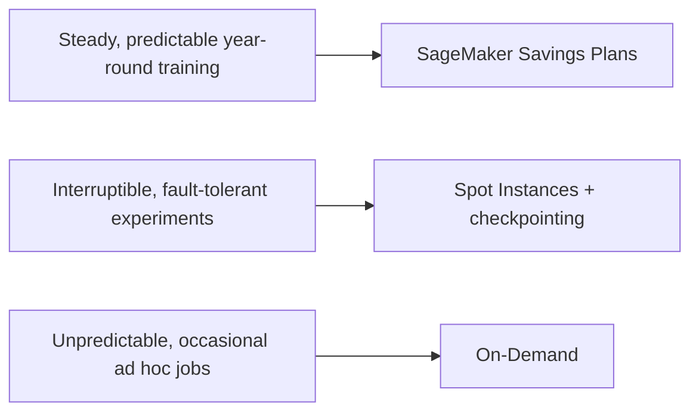

**Why the others are wrong:**
- **B:** This ignores the real, substantial discounts Savings Plans and Spot Instances can
  provide for workloads matching their respective use cases — defaulting to On-Demand for
  everything leaves significant cost savings unrealized for the steady and interruption-tolerant
  workloads specifically.
- **C:** Spot Instances carry **interruption risk** — using them for a steady, predictable,
  presumably less interruption-tolerant year-round workload risks unplanned disruptions that a
  committed Savings Plan (which guarantees uninterrupted capacity at a discount) would avoid;
  Spot's discount comes specifically in exchange for accepting that interruption risk, which
  isn't automatically the best fit for every workload type.
- **D:** AWS fully supports combining Savings Plans, Spot Instances, and On-Demand usage within
  the same account simultaneously across different workloads — this option misstates a basic,
  commonly-used cost-optimization practice.

---

## Q51 — Domain 1 (Data Preparation for ML and AI)

A company's RAG system over internal engineering runbooks occasionally returns outdated
procedures because the underlying Bedrock Knowledge Base's vector index wasn't re-synced after
the source runbook documents in S3 were updated last week. The team wants the Knowledge Base's
vector index to automatically stay current with the latest version of documents in S3, without
manually triggering a re-ingestion each time a document changes. Which Bedrock Knowledge Bases
capability addresses this?

A) **Data source sync jobs**, which can be triggered automatically (e.g., on a schedule, or via
   an event-driven trigger when S3 objects change) to re-ingest and re-embed updated/new
   documents from the configured S3 data source, keeping the Knowledge Base's vector index
   current with the latest document versions, rather than requiring someone to remember to
   manually start a sync after every content update
B) Bedrock Guardrails, which filters unsafe content in model outputs and has no role in
   triggering or managing Knowledge Base document re-ingestion from S3
C) SageMaker Ground Truth, which labels training datasets and has no relationship to keeping a
   Bedrock Knowledge Base's vector index synchronized with updated source documents
D) Knowledge Bases automatically detect and re-embed any S3 document change in real time by
   default, with no sync job or configuration required at all

**Correct Answer: A**

**Explanation:** A Bedrock Knowledge Base's vector index doesn't automatically stay in sync with
its S3 data source purely by the source objects changing — a **data source sync job** must run
(manually, on a schedule, or via an event-driven trigger reacting to S3 changes) to re-crawl,
re-chunk, re-embed, and re-index updated/new documents, which is exactly the missing step causing
the stale-runbook problem described; automating that sync trigger (rather than relying on someone
remembering to manually start it) solves the issue. See
[`certifications/mla-c02/domain-1-data-preparation/embeddings-and-rag-data-prep.md`](../domain-1-data-preparation/embeddings-and-rag-data-prep.md)
and [`services/machine-learning-ai/bedrock.md`](../../../services/machine-learning-ai/bedrock.md).

**Why the others are wrong:**
- **B:** Guardrails filters content safety at inference time — it has no involvement in
  triggering or managing document ingestion/re-syncing for a Knowledge Base's vector index.
- **C:** Ground Truth is a data-labeling service for creating training datasets — it has no
  relationship to Knowledge Bases' document-sync mechanism at all.
- **D:** This directly contradicts the scenario's actual root cause and standard Knowledge Bases
  behavior — a sync job is specifically required to propagate S3 source changes into the vector
  index; it is not automatic in real time with zero configuration, which is exactly why the
  outdated-procedure problem occurred in the first place.

---

## Q52 — Domain 2 (ML Model and Foundation Model Development)

A team evaluating two candidate forecasting models for store-level weekly sales wants a metric
expressed as a **percentage error relative to the actual value**, so stakeholders across stores
of very different sales volume (a small store doing $10,000/week vs. a large store doing
$1,000,000/week) can compare forecast accuracy on a common, scale-independent basis, rather than
an absolute dollar error that would naturally look larger for high-volume stores regardless of
relative accuracy. Which metric fits this requirement?

A) **Mean Absolute Percentage Error (MAPE)** — expressing the average forecast error as a
   percentage of the actual value for each observation, making error magnitudes comparable
   across stores of very different absolute sales volume, unlike RMSE or MAE, which are expressed
   in the same absolute units as the target variable (dollars) and would naturally look larger
   for high-volume stores even at equivalent relative accuracy
B) RMSE, since RMSE is always expressed as a scale-independent percentage regardless of the
   target variable's absolute units
C) R², since R² is defined specifically as a percentage-error metric scaled relative to each
   individual observation's actual value
D) Accuracy, since accuracy is a standard metric for comparing numeric sales-forecasting error
   magnitudes across stores of different size

**Correct Answer: A**

**Explanation:** **MAPE** expresses each observation's error as `|actual - predicted| / actual`,
averaged across all observations and expressed as a percentage — making it **scale-independent**:
a $500 error on a $10,000/week store (5% error) and a $50,000 error on a $1,000,000/week store
(also 5% error) are directly comparable on the same percentage basis, unlike RMSE/MAE, which stay
in the target's original units (dollars) and would naturally report larger absolute error numbers
for high-volume stores even at equivalent *relative* accuracy. See
[`ml-fundamentals-glossary.md`](../domain-2-model-development/ml-fundamentals-glossary.md).

**Why the others are wrong:**
- **B:** RMSE is expressed in the **same units as the target variable** (dollars, in this case),
  not as a percentage — it does not inherently normalize for the target's absolute scale across
  stores of different sales volume, which is exactly MAPE's distinguishing advantage here.
- **C:** R² measures the proportion of variance in the target explained by the model's
  predictions across the whole dataset — it is not a per-observation percentage-error metric, and
  doesn't function the way this option describes.
- **D:** Accuracy is a classification metric (fraction of correct categorical predictions) — it
  has no defined meaning for a continuous numeric sales-forecasting error magnitude.

---

## Q53 — Domain 3 (Deployment and Orchestration of ML Workflows)

(Choose TWO) A team runs a SageMaker Pipeline that includes an expensive, 3-hour distributed
training step. They want this step to use **Spot Instances** for cost savings, but are concerned
about losing all 3 hours of progress if Spot capacity is interrupted partway through, especially
since the pipeline might retry the step automatically. Which TWO configuration choices together
let a Pipelines training step safely use Spot capacity with minimal lost progress on
interruption?

A) **Enable managed Spot training** on the training step, allowing SageMaker to use discounted
   Spot capacity and automatically attempt to resume the job on interruption rather than failing
   outright
B) **Configure periodic checkpointing** to a durable location like S3 within the training
   script, so that whenever the step is resumed (by SageMaker's managed Spot handling or the
   pipeline's own retry policy), training picks up from the last checkpoint rather than starting
   over from scratch
C) Disable all retry behavior on the training step entirely, since retries are never compatible
   with Spot-based training steps
D) Switch the training step to use SageMaker Batch Transform instead, since Batch Transform is
   immune to Spot interruption regardless of configuration
E) Simply retry the entire pipeline from the very first step whenever the training step is
   interrupted, with no checkpointing involved

**Correct Answer: A and B**

**Explanation:** Within a SageMaker Pipeline, a `TrainingStep` can be configured to use
**managed Spot training**, and — just as with a standalone training job — the training script
should **periodically checkpoint** its progress to a durable location (commonly S3); if Spot
capacity is interrupted, SageMaker's managed handling (or the pipeline's own configured retry
behavior) can resume the job from the last checkpoint rather than restarting the full 3 hours
from scratch, combining Spot's cost savings with minimal lost progress on interruption. See
[`services/machine-learning-ai/sagemaker-pipelines.md`](../../../services/machine-learning-ai/sagemaker-pipelines.md)
and
[`certifications/mla-c02/domain-4-monitoring-security/ml-cost-optimization.md`](../domain-4-monitoring-security/ml-cost-optimization.md).

**Why the others are wrong:**
- **C:** Disabling retries doesn't make Spot usage safer — retries and managed Spot resume are
  compatible and complementary; the real safeguard against lost progress is checkpointing, not
  turning off retries.
- **D:** Batch Transform is an entirely different inference-time capability (bulk offline
  scoring) — it is not a substitute for a Spot-interruption-resilient *training* step, and
  switching to it doesn't address training-step interruption handling at all.
- **E:** Re-running the **entire pipeline from the first step** with no checkpointing is far more
  wasteful than resuming just the interrupted training step from its last checkpoint — it
  discards not just training progress but potentially re-runs earlier, already-successful
  preprocessing/data steps unnecessarily too.

---

## Q54 — Domain 4 (Operating, Monitoring, and Securing ML Solutions)

A company's Bedrock-based GenAI application sometimes needs to run a **standalone content-safety
check** on arbitrary text — for example, validating a piece of user-generated content that was
never actually sent to or generated by a foundation model at all (e.g., text uploaded directly
by a user into a separate workflow) — using the exact same denied-topics/content-filter/PII
rules already configured in their production Guardrails configuration, without needing to
actually invoke a foundation model just to run the safety check. Which Bedrock capability
supports this decoupled, standalone safety-check use case?

A) **The `ApplyGuardrail` API**, which lets you run a Guardrails configuration's content-safety
   checks (denied topics, content filters, PII detection, etc.) directly against a piece of text,
   **independent of any specific model invocation** — useful for validating arbitrary text (not
   necessarily tied to a live model call) against the same safety rules
B) Guardrails can only ever be applied as a side effect of an actual `InvokeModel` call; there is
   no way to run a standalone safety check against arbitrary text without invoking a foundation
   model
C) Bedrock Agents, which orchestrate multi-step tool-calling tasks, not standalone content-safety
   checking independent of model invocation
D) Bedrock Knowledge Bases, which retrieve documents for RAG grounding, with no content-safety
   checking capability of any kind

**Correct Answer: A**

**Explanation:** The **`ApplyGuardrail` API** lets a team invoke a configured Guardrails
policy's safety checks (denied topics, content filters, PII detection/redaction, etc.) directly
against a piece of text, **decoupled from any specific foundation model invocation** — useful for
scenarios like checking arbitrary user-submitted content, or validating text from any source,
using the exact same safety rules already defined for production model traffic, without needing
to route that check through an actual `InvokeModel` call. See
[`certifications/mla-c02/domain-4-monitoring-security/responsible-ai-and-guardrails.md`](../domain-4-monitoring-security/responsible-ai-and-guardrails.md).

**Why the others are wrong:**
- **B:** This understates Guardrails' actual capability — the standalone `ApplyGuardrail` API
  exists specifically to decouple safety checking from model invocation, directly contradicting
  this option's claim.
- **C:** Bedrock Agents orchestrate multi-step reasoning and tool-calling — this is an
  application-architecture capability unrelated to running a standalone content-safety check
  independent of model invocation.
- **D:** Knowledge Bases provide document retrieval for RAG grounding — they have no content-
  safety-checking function of any kind, standalone or otherwise.

---

## Q55 — Domain 1 (Data Preparation for ML and AI)

A company's dataset for an employee-attrition prediction model includes a `years_at_company`
feature with occasional negative values (e.g., -2) due to a date-calculation bug in the upstream
HR system, which are logically impossible (an employee cannot have negative tenure). Separately,
the same dataset has some rows where `years_at_company` is a very large but **logically
plausible** value (e.g., 45 years, for a genuinely long-tenured employee). How should the team
correctly distinguish and treat these two different cases?

A) **The negative values are logically impossible data-entry/calculation errors** and should be
   treated as **invalid data requiring correction or removal** (not simply "low outliers"), while
   the **large-but-plausible 45-year values are genuine, valid extreme observations** that
   should generally be retained (and only capped/treated as statistical outliers if they're
   shown to disproportionately and unduly influence the model, using a technique like
   winsorization) — the two require different handling because one reflects a data **error**, the
   other reflects **genuine** variation
B) Both the negative values and the large 45-year values should be treated identically as
   statistical outliers and both automatically capped at the same percentile threshold
C) Both the negative values and the large 45-year values are equally valid and should be left
   completely unmodified in the dataset
D) The large 45-year values should be deleted as impossible, while the negative values should be
   retained as valid genuine variation

**Correct Answer: A**

**Explanation:** This tests the important distinction between a **data-validity error**
(negative tenure is logically impossible regardless of distribution — this is a bug, not a rare
but real observation, and should be corrected/removed rather than merely "capped" as if it were a
legitimate extreme value) and a **genuine, valid extreme observation** (a 45-year tenure is
unusual but entirely plausible, and blanket-outlier-style capping should only be applied if it's
shown to be statistically problematic, not simply because the value is large). Treating both
cases with the same blind statistical-outlier-capping technique would wrongly validate the
negative-value bug as if it were just an extreme (but real) data point. See
[`certifications/mla-c02/domain-1-data-preparation/README.md`](../domain-1-data-preparation/README.md).

**Why the others are wrong:**
- **B:** Applying the same outlier-capping treatment to both cases incorrectly treats a logically
  **impossible, erroneous** value as if it were just a legitimate extreme observation that merely
  needs capping — the negative values need correction/removal as invalid data, not statistical
  capping alongside genuinely valid large values.
- **C:** Leaving the negative values unmodified would let a clear data-entry/calculation bug
  directly corrupt the model's training data — this isn't "equally valid variation," it's an
  acknowledged system error that should be fixed or removed.
- **D:** This exactly reverses the correct handling — the negative values are the ones that are
  logically impossible and need correction, while the large 45-year values are the plausible,
  generally valid ones that should typically be retained.

---

## Q56 — Domain 2 (ML Model and Foundation Model Development)

A team is comparing SageMaker JumpStart against building a model completely from scratch for a
new image-classification task where only moderate amounts of labeled data are available, and
they want to leverage pretrained models and avoid lengthy setup/training infrastructure work.
What does SageMaker JumpStart specifically provide that addresses this need?

A) **A hub of pretrained, publicly available foundation and task-specific models** (including
   vision models) that can be quickly deployed as-is or fine-tuned on a team's own data with
   minimal setup — directly supporting a "leverage existing pretrained models rather than build
   from scratch" workflow, through a largely UI/SDK-driven experience rather than hand-building
   training infrastructure from the ground up
B) JumpStart is exclusively a hyperparameter-tuning service with no pretrained model catalog or
   model-hub functionality of any kind
C) JumpStart only supports text-based language models, with no vision/image-classification models
   available in its catalog at all
D) JumpStart requires building and uploading a completely custom-trained model before it can be
   used; it has no pretrained models readily available out of the box

**Correct Answer: A**

**Explanation:** **SageMaker JumpStart** provides a curated hub of **pretrained models**
(including many vision/image models alongside text and other modalities) that can be deployed
directly for inference or fine-tuned on a team's own labeled data with comparatively minimal
setup — directly supporting a transfer-learning-style workflow (leveraging existing pretrained
weights rather than training entirely from scratch) through a largely point-and-click/SDK-driven
experience. See
[`services/machine-learning-ai/jumpstart.md`](../../../services/machine-learning-ai/jumpstart.md).

**Why the others are wrong:**
- **B:** This misstates JumpStart's core purpose — it is specifically known as SageMaker's model
  hub/catalog of pretrained models, not a hyperparameter-tuning-only service (hyperparameter
  tuning is a separate SageMaker Automatic Model Tuning capability).
- **C:** JumpStart's catalog includes models across multiple modalities, including vision/image
  models — this option incorrectly restricts its scope to text-only models.
- **D:** JumpStart's entire value proposition is providing **ready-to-use pretrained models**
  out of the box — requiring a fully custom-trained upload first would defeat its purpose
  entirely.

---

## Q57 — Domain 3 (Deployment and Orchestration of ML Workflows)

A company trains a model using distributed data-parallel training across 8 GPU instances, and
wants the gradient-synchronization communication between instances to be **encrypted** while in
transit, as a security requirement for their regulated industry, in addition to (not instead of)
placing the training job inside a private VPC subnet. Which SageMaker training job configuration
option specifically encrypts this inter-instance communication traffic?

A) **Inter-container traffic encryption**, a SageMaker training job configuration option that
   encrypts the network traffic exchanged **between the containers/instances** of a distributed
   training job (e.g., gradient synchronization traffic), addressing confidentiality of this
   specific communication channel as a layer distinct from (and in addition to) VPC-level network
   isolation
B) Network Isolation mode, which blocks all outbound network communication (including
   inter-container communication) entirely, rather than encrypting it while still allowing it
C) S3 server-side encryption (SSE), which encrypts data at rest in S3 and has no effect on
   live network traffic exchanged between training instances during a distributed job
D) KMS key rotation, which rotates the cryptographic material behind a customer-managed key over
   time and has no direct effect on whether inter-instance network traffic itself is encrypted

**Correct Answer: A**

**Explanation:** **Inter-container traffic encryption** is a specific SageMaker training job
setting that encrypts the network communication occurring **between the instances/containers**
participating in a distributed training job (such as gradient-synchronization traffic in
data-parallel training) — a distinct capability from VPC-level network isolation (which controls
*what* can reach the training job over the network) or Network Isolation mode (which blocks
inter-container communication outright rather than encrypting it). See
[`certifications/mla-c02/domain-4-monitoring-security/README.md`](../domain-4-monitoring-security/README.md).

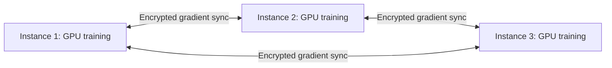

**Why the others are wrong:**
- **B:** Network Isolation mode **blocks** inter-container communication (and all outbound
  network calls) entirely — the scenario here specifically wants the communication to continue
  happening (since distributed data-parallel training requires inter-instance gradient sync) but
  with that traffic **encrypted**, which is a different requirement than cutting off the
  communication altogether.
- **C:** S3 SSE protects data stored **at rest** in S3 — it has no bearing on live network traffic
  exchanged directly between training instances during a running job, which is a separate,
  in-transit concern.
- **D:** KMS key rotation manages the lifecycle of cryptographic key material used for other
  encryption purposes (like S3 object encryption) — it does not itself encrypt network traffic
  between training instances, which is what inter-container traffic encryption specifically
  addresses.

---

## Q58 — Domain 4 (Operating, Monitoring, and Securing ML Solutions)

(Choose TWO) A company wants to understand, for cost-allocation purposes, exactly how much of
their monthly AWS bill is attributable to each of three ML projects (`fraud-detection`,
`demand-forecasting`, `chatbot`), across all the varied AWS services each project uses
(SageMaker, S3, Bedrock, Glue), broken down in AWS Cost Explorer. Which TWO practices must be in
place for this kind of per-project cost breakdown to be possible?

A) **Consistently tag every resource** created by each project (training jobs, endpoints, S3
   buckets, Glue jobs, etc.) with a common key (e.g., `project: fraud-detection`), applied across
   every service the project touches
B) **Activate that tag key as a cost allocation tag** in the Billing and Cost Management console,
   which is required before Cost Explorer can filter/group reported spend by that tag at all
C) Rely on Cost Explorer to automatically infer which AWS project a given resource belongs to
   based on its resource name alone, with no tagging configuration required
D) Deploy each project into a completely separate AWS account, since that is the only way any
   form of per-project cost breakdown is possible within Cost Explorer
E) Configure AWS Budgets, since Budgets — not Cost Explorer — is the only service capable of
   producing a per-project cost breakdown

**Correct Answer: A and B**

**Explanation:** Per-project (or per-team) cost breakdown in **Cost Explorer** fundamentally
depends on **consistent resource tagging**: every resource across every service a project touches
must carry a common tag (e.g., a `project` key with a consistent value per project), and that tag
key must be **activated as a cost allocation tag** in the Billing and Cost Management console —
only then can Cost Explorer group and filter spend by that tag across SageMaker, S3, Bedrock,
Glue, and any other service the project uses. See
[`certifications/mla-c02/domain-4-monitoring-security/ml-cost-optimization.md`](../domain-4-monitoring-security/ml-cost-optimization.md).

**Why the others are wrong:**
- **C:** Cost Explorer has no automatic ability to infer project ownership purely from resource
  naming conventions — reliable, queryable attribution specifically requires activated cost
  allocation tags, not name-based guessing.
- **D:** Separate AWS accounts per project is *one* valid cost-isolation strategy (and simplifies
  some aspects of billing separation), but it is not the *only* way to achieve per-project cost
  visibility — consistent tagging within a shared account, combined with Cost Explorer's
  tag-based grouping, is a widely-used alternative that doesn't require full account separation.
- **E:** Cost Explorer explicitly supports filtering and grouping cost/usage data by activated
  cost allocation tags — this option misstates its actual, core tag-based reporting capability;
  AWS Budgets is a separate tool for setting thresholds/alerts, not the only source of
  per-project cost breakdowns.

---

## Q59 — Domain 1 (Data Preparation for ML and AI)

A team building a customer-service chatbot's RAG knowledge base wants to measure retrieval
quality on a held-out test set **before** committing to a specific chunk size and overlap
configuration — specifically wanting to compare Recall@5 across three candidate configurations
(300-token chunks/no overlap, 500-token chunks/50-token overlap, 800-token chunks/100-token
overlap) using the same fixed set of test questions and known-correct source documents for each
configuration. What does systematically running this comparison, rather than picking one
configuration by intuition alone, allow the team to do?

A) **Empirically select the chunking configuration that maximizes measured retrieval quality**
   (Recall@5) for their specific document corpus and query patterns, rather than assuming any
   particular chunk size/overlap combination is universally best — since the "right" chunking
   configuration is corpus- and query-pattern-dependent, not a single fixed answer for every RAG
   application
B) Guarantee that the largest chunk size (800 tokens) will always produce the highest Recall@5
   for every possible RAG application, making further testing of the other configurations
   unnecessary
C) Automatically fine-tune the underlying foundation model's weights based on which chunking
   configuration scored highest
D) Determine the correct Bedrock Guardrails content-filter severity threshold to use, since
   chunking configuration and Guardrails severity are evaluated by the same test

**Correct Answer: A**

**Explanation:** Systematically measuring **Recall@k** across multiple candidate chunking
configurations against the same held-out test set lets a team make an **empirical, data-driven
choice** of chunk size/overlap specifically tuned to their own document corpus and realistic
query patterns — since there is no single universally-optimal chunk size across all RAG
applications (it depends heavily on document structure, typical question complexity, and
embedding-model characteristics), rather than relying on intuition or defaulting to someone
else's configuration. See
[`certifications/mla-c02/domain-1-data-preparation/embeddings-and-rag-data-prep.md`](../domain-1-data-preparation/embeddings-and-rag-data-prep.md).

**Why the others are wrong:**
- **B:** There's no universal guarantee that larger chunks always perform best — larger chunks
  can dilute topical focus and hurt retrieval precision in some corpora, which is exactly why
  empirical testing (rather than assuming a fixed rule) is the right approach; the result is
  genuinely corpus- and query-dependent.
- **C:** Evaluating chunking configurations via Recall@5 is a data-preparation/retrieval-
  evaluation exercise — it has no mechanism for automatically adjusting the foundation model's
  own trained weights.
- **D:** Chunking-configuration evaluation (Recall@k on retrieval) and Guardrails content-filter
  severity tuning are two entirely separate concerns (retrieval quality vs. content-safety
  policy) — they are not determined by the same test or evaluation process.

---

## Q60 — Domain 2 (ML Model and Foundation Model Development)

A data scientist is evaluating a tabular classifier on a mid-sized (20,000-row), reasonably
balanced dataset and is choosing the number of folds, **k**, for standard k-fold cross-
validation. A teammate suggests k=3 (fast, but each fold trains on only 67% of the data and
leaves a large, possibly less-representative 33% held out), while another suggests k=10 (each
fold trains on 90% of the data, closer to the full dataset, but requires training 10 separate
models instead of 3). What is the practical tradeoff being weighed in this choice of k?

A) **Larger k values** (e.g., k=10) train each fold's model on a **larger fraction** of the
   available data (closer to the full dataset), generally giving a less biased estimate of
   performance on the full dataset, at the cost of **more total training runs** (and thus more
   compute time); **smaller k values** (e.g., k=3) are faster (fewer training runs) but each
   fold's model sees less data and the held-out test portion is larger, which can increase the
   variance of the performance estimate across folds — the right choice balances this
   bias/variance-of-the-estimate tradeoff against available compute budget
B) The value of k has no effect on either the number of training runs performed or how much data
   each fold's model is trained on
C) Smaller values of k (e.g., k=3) always produce a strictly more accurate and less variable
   performance estimate than larger values of k (e.g., k=10), regardless of dataset size
D) K-fold cross-validation requires k to always equal exactly the number of rows in the dataset,
   making any choice of k other than the dataset's row count invalid

**Correct Answer: A**

**Explanation:** The choice of **k** in k-fold cross-validation is a genuine tradeoff: larger k
means each fold trains on a larger share of the data (more representative of training on the
full dataset, generally reducing estimate bias) but requires more total training runs (more
compute); smaller k is cheaper computationally but each fold sees less training data and a
larger, potentially less representative held-out portion, which can make the resulting
performance estimate more variable across different fold splits. Common practical choices (like
k=5 or k=10) balance this tradeoff reasonably for typical dataset sizes and compute budgets. See
[`ml-fundamentals-glossary.md`](../domain-2-model-development/ml-fundamentals-glossary.md).

**Why the others are wrong:**
- **B:** The value of k directly determines both quantities — the number of training runs
  performed (exactly k) and the fraction of data available to each fold's training set
  ((k-1)/k) — claiming no effect on either ignores the core mechanics of k-fold cross-validation.
- **C:** There's no universal rule that smaller k always produces a *more accurate and less
  variable* estimate — smaller k typically means *more* variability across folds (since each
  fold trains on less data and tests on a larger held-out share), not less; this option states
  essentially the opposite of the general tradeoff.
- **D:** Setting k equal to the number of rows describes **leave-one-out cross-validation**, a
  specific extreme case of k-fold CV (k = N) — it is not a requirement for k-fold CV in general,
  which commonly uses much smaller, fixed values of k like 5 or 10.

---

## Q61 — Domain 1 (Data Preparation for ML and AI)

A team is debating whether to apply **class weighting** (adjusting the loss function to penalize
mistakes on the minority class more heavily) or **SMOTE-style oversampling** (generating
synthetic minority-class examples) for a 99%/1% imbalanced fraud dataset. A teammate asks: what
does class weighting actually change about the training process, compared to oversampling, which
changes the data itself?

A) **Class weighting modifies the loss function** so that errors on minority-class examples
   contribute a larger penalty to the total loss than errors on majority-class examples — without
   changing the actual training data or dataset size at all — whereas **oversampling (e.g.,
   SMOTE)** instead changes the training data itself by adding new (synthetic or duplicated)
   minority-class examples, increasing the minority class's effective representation in the
   dataset directly
B) Class weighting and oversampling are mathematically and operationally identical techniques
   with no meaningful difference in what they change about training
C) Class weighting physically duplicates minority-class rows in the dataset, identical to simple
   oversampling without SMOTE's interpolation step
D) Class weighting removes majority-class examples from the dataset until the classes are
   perfectly balanced, which is a different name for random undersampling

**Correct Answer: A**

**Explanation:** **Class weighting** operates purely at the **loss-function level** — during
training, the loss contribution of a minority-class error is multiplied by a larger weight than
a majority-class error, incentivizing the model to pay more attention to the minority class,
**without altering the dataset itself** in any way. **Oversampling** techniques like SMOTE
instead modify the **training data directly**, adding synthetic (interpolated) or duplicated
minority-class examples so the minority class is more numerically represented in what the model
actually sees during training. These are two different levers (algorithm-level vs. data-level)
for addressing the same underlying imbalance problem. See
[`ml-fundamentals-glossary.md`](../domain-2-model-development/ml-fundamentals-glossary.md) and the
[Domain 1 README](../domain-1-data-preparation/README.md).

**Why the others are wrong:**
- **B:** The two techniques operate at fundamentally different levels (loss function vs. actual
  training data) and have different practical tradeoffs (e.g., oversampling increases dataset
  size and training time; class weighting does not) — they are not identical.
- **C:** Class weighting does not touch the dataset's rows at all — it only changes how errors
  are weighted in the loss calculation; physically duplicating rows is a data-level technique
  (simple oversampling without SMOTE's synthetic interpolation), not what class weighting does.
- **D:** Class weighting does not remove any examples from the dataset — undersampling the
  majority class is yet a third, distinct technique (reducing the majority class's
  representation), different from both class weighting (loss-level) and oversampling (adding
  minority examples).

---

## Q62 — Domain 1 (Data Preparation for ML and AI)

A compliance team requires that a specific snapshot of a training dataset in S3 — exactly the
version of the data used to train a particular production model — remain **retrievable and
unmodifiable** indefinitely for audit purposes, even though the same S3 bucket/prefix continues
to receive new, updated data for future model versions on an ongoing basis. Which S3 capability
supports preserving this specific historical snapshot without needing a separate, manually-
managed copy of the data elsewhere?

A) **S3 Versioning**, which preserves every previous version of an object whenever it's
   overwritten or deleted, letting the team reference the exact object version (via its unique
   version ID) that was used to train a specific model — satisfying the "retrievable,
   unmodifiable historical snapshot" requirement using the same bucket/prefix, without manually
   copying data elsewhere
B) S3 Intelligent-Tiering, which optimizes storage cost based on access patterns but has no
   mechanism for preserving a specific historical object version for audit retrieval
C) AWS Config, which tracks infrastructure resource configuration history, not individual S3
   object content versions over time
D) Glue Data Quality, which validates data against quality rules but has no object-versioning or
   historical-snapshot-preservation capability

**Correct Answer: A**

**Explanation:** **S3 Versioning**, once enabled on a bucket, preserves every prior version of an
object whenever it's modified or deleted (rather than overwriting it in place) — assigning each
version a unique version ID that can be referenced indefinitely, letting the team point to and
retrieve the **exact dataset version** used to train a specific past model, even as the same
bucket/prefix continues receiving new data for future versions, without needing a separate,
manually-maintained archival copy. See
[`certifications/mla-c02/domain-1-data-preparation/README.md`](../domain-1-data-preparation/README.md).

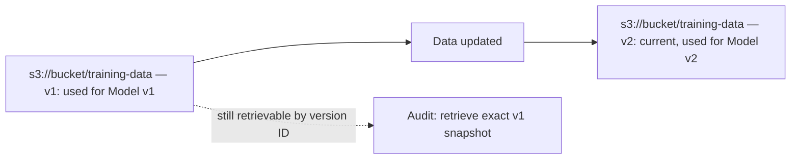

**Why the others are wrong:**
- **B:** Intelligent-Tiering manages storage **cost** based on access-frequency patterns — it has
  no mechanism for preserving distinct historical versions of an object as it's overwritten over
  time.
- **C:** AWS Config tracks **infrastructure resource configuration** (e.g., a bucket's encryption
  settings over time) — it does not version or preserve the actual **content** of individual S3
  objects as they're updated.
- **D:** Glue Data Quality validates data against defined quality rules at ingestion/processing
  time — it has no object-versioning or historical-snapshot-retrieval capability for S3 content.

---

## Q63 — Domain 3 (Deployment and Orchestration of ML Workflows)

A team's new SageMaker endpoint deployment uses the **linear** traffic-shifting configuration:
10% of traffic shifts to the new version every 2 minutes until reaching 100%. Partway through —
at the 40% traffic mark — a CloudWatch alarm attached to the deployment enters the ALARM state
due to elevated latency on the new version. What happens next under this configuration, assuming
automatic rollback is configured?

A) **The deployment automatically rolls back** all traffic to the previous (known-good) version
   the moment the attached alarm enters ALARM state, regardless of which specific traffic
   percentage had been reached at that point in the linear schedule — the same automatic-
   rollback-on-alarm safety mechanism applies to linear traffic shifting just as it does to canary
B) Linear traffic shifting has no concept of an attached rollback alarm at all; only canary
   deployments support alarm-triggered automatic rollback
C) The deployment continues shifting the remaining 60% of traffic on schedule regardless of the
   alarm's state, since linear shifting cannot be interrupted once started
D) The alarm firing pauses the deployment at 40% indefinitely, neither rolling back nor
   continuing, requiring a human to manually choose the next action

**Correct Answer: A**

**Explanation:** SageMaker's deployment guardrails attach the same **CloudWatch-alarm-triggered
automatic rollback** safety mechanism to **both canary and linear** traffic-shifting
configurations — when the attached alarm enters ALARM state at any point during the shift
(whether at 10%, 40%, or any other increment), the deployment automatically rolls back to the
previous known-good version, rather than continuing to expose more traffic to a version already
showing a problem. See
[`services/machine-learning-ai/sagemaker-deployment-endpoints.md`](../../../services/machine-learning-ai/sagemaker-deployment-endpoints.md).

**Why the others are wrong:**
- **B:** This misstates deployment guardrails' actual scope — alarm-triggered automatic rollback
  is supported for **both** canary and linear configurations, not canary exclusively.
- **C:** Continuing to shift more traffic to a version already flagged by an attached alarm as
  problematic defeats the entire purpose of attaching a rollback alarm to the deployment in the
  first place — the configured behavior is to stop and roll back, not to press on regardless.
- **D:** With automatic rollback explicitly configured, the response to an ALARM state is a fully
  automated rollback, not an indefinite pause awaiting manual human intervention — a pause-only
  behavior would describe a deployment configured *without* an automatic rollback action attached.

---

## Q64 — Domain 2 (ML Model and Foundation Model Development)

A team notices a deep neural network's internal layer activations shift significantly in
distribution as training progresses (even for the same input, as earlier layers' weights update),
forcing later layers to constantly re-adapt to a "moving target" input distribution and slowing
convergence. Which technique, applied between layers during training, normalizes each layer's
activations to have a more stable distribution (e.g., roughly zero mean and unit variance,
subject to learned scale/shift parameters), helping address this specific training-stability
issue?

A) **Batch normalization** — normalizing the activations of a layer (using statistics computed
   across the current mini-batch) toward a more stable distribution, then applying learned scale
   and shift parameters, reducing the "internal covariate shift" problem where later layers must
   constantly re-adapt to earlier layers' shifting output distributions, generally speeding up
   and stabilizing training
B) Dropout, which randomly disables neurons during training but has no activation-distribution-
   normalization mechanism of its own
C) Early stopping, which halts training based on validation performance and has no effect on the
   internal activation distribution of any layer during training
D) L2 regularization, which penalizes large weight magnitudes in the loss function but does not
   directly normalize a layer's activation distribution during the forward pass

**Correct Answer: A**

**Explanation:** **Batch normalization** normalizes each layer's activations (using the current
mini-batch's mean/variance) toward a more stable, consistent distribution before applying learned
scale and shift parameters — directly addressing the problem where earlier layers' changing
weights cause later layers to see a constantly shifting input distribution ("internal covariate
shift"), which can slow and destabilize training; batch norm generally speeds up convergence and
allows higher learning rates to be used safely. See
[`ml-fundamentals-glossary.md`](../domain-2-model-development/ml-fundamentals-glossary.md).

**Why the others are wrong:**
- **B:** Dropout randomly zeroes out neuron activations as a regularization technique to reduce
  overfitting — it has no mechanism for normalizing the distribution of the remaining active
  neurons' outputs the way batch normalization does.
- **C:** Early stopping is a training-duration control based on validation performance — it has
  no effect on a layer's internal activation distribution during the forward pass at all.
- **D:** L2 regularization penalizes large weight values in the loss function (encouraging
  smaller weights overall) — it does not directly normalize the actual activation values flowing
  through the network during the forward pass, which is batch normalization's specific mechanism.

---

## Q65 — Domain 1 (Data Preparation for ML and AI)

A team is finalizing their RAG data-preparation pipeline for a large document corpus and wants a
single, end-to-end mental model of every stage: how a raw PDF becomes a retrievable, grounded
answer. Walk through this complete pipeline, including the roles of chunking, embeddings, the
vector store, and the foundation model.

A) **(1) Document ingestion & chunking**: raw documents are parsed and split into semantically
   coherent chunks (with appropriate overlap/structure-awareness as covered elsewhere); **(2)
   embedding**: each chunk is converted into a vector representation using an embedding model;
   **(3) indexing**: those vectors (plus metadata) are written into a vector store; **(4) query
   embedding**: at runtime, a user's question is embedded with the same model; **(5)
   retrieval**: the vector store performs a similarity search (optionally combined with metadata
   filtering, hybrid keyword search, and/or reranking) to find the most relevant chunks; **(6)
   augmented generation**: the retrieved chunks are injected into the foundation model's prompt
   as grounding context, and the model generates a final answer conditioned on that retrieved,
   real content rather than relying solely on its frozen training-time knowledge
B) The foundation model is fine-tuned on the raw documents directly, with no separate chunking,
   embedding, or vector-store step involved at any point
C) Chunking and embedding occur only once, at query time, computed fresh for the entire document
   corpus for every single user question
D) The vector store generates the final answer directly, with the foundation model used only to
   format the vector store's raw output into readable sentences

**Correct Answer: A**

**Explanation:** This full pipeline — ingest/chunk, embed, index, embed the query, retrieve
(optionally reranked/hybrid/filtered), then augment the prompt for generation — is the complete,
end-to-end RAG architecture, tying together every concept covered individually elsewhere in this
exam bank (chunk overlap, chunking strategy, embedding models, vector stores, hybrid search,
reranking, and prompt augmentation) into one coherent mental model of how a raw document
ultimately becomes a grounded, retrieval-informed answer. See
[`certifications/mla-c02/domain-1-data-preparation/embeddings-and-rag-data-prep.md`](../domain-1-data-preparation/embeddings-and-rag-data-prep.md).

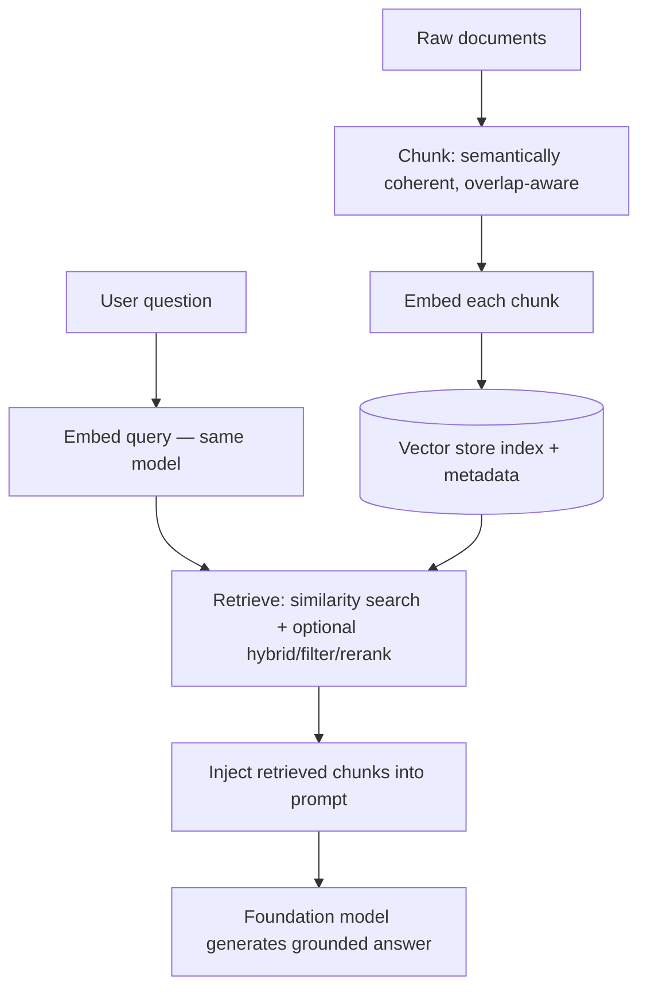

**Why the others are wrong:**
- **B:** Fine-tuning directly on raw documents (continued pre-training) is a different
  customization approach entirely — RAG specifically avoids needing to retrain the model's
  weights every time source documents change, relying instead on retrieval at inference time.
- **C:** Chunking and embedding the entire corpus **fresh for every single question** would be
  wildly inefficient and defeats the purpose of pre-building a reusable vector index — ingestion/
  chunking/embedding of the document corpus happens upfront (or on a sync schedule), not
  recomputed per query; only the *query itself* is embedded at query time.
- **D:** A vector store performs similarity search and returns ranked chunks — it has no
  text-generation capability of its own; generating the final natural-language answer is
  specifically the foundation model's role, conditioned on the retrieved context, not a
  formatting pass over the vector store's raw output.

---
