# SAA-C03 — Complete Study Guide

> **One file, every domain, every service, every concept.** This is the single-file version of this repo's entire SAA-C03 coverage — every service tagged to this cert, with its definition, a plain-English analogy, when to use it / when NOT to, concrete use cases, diagrams explained, real AWS screenshots discussed, and exam tips, all in reading order by domain weight. Built by merging each domain's `MASTER-CHUNK.md`.

> **This file is long on purpose.** It exists so you never have to jump between files to remember what something does — read top to bottom once, then use it as a flip-reference. For even MORE depth on any single service (full pricing tables, troubleshooting runbooks, limits/quotas), the `services/` doc linked at the top of each entry goes deeper still.

> ⚠️ Internal `#anchor` links (same-page jump links) may occasionally point to the wrong section if two domains share an identical heading name — a known tradeoff of merging 4 large standalone files into one. File-to-file links (to `services/`, other domain docs, etc.) are all verified correct.

## Table of Contents

1. [Domain 1: Design Secure Architectures (30%)](#part-1--domain-1-secure-architectures)
2. [Domain 2: Design Resilient Architectures (26%)](#part-2--domain-2-resilient-architectures)
3. [Domain 3: Design High-Performing Architectures (24%)](#part-3--domain-3-high-performing-architectures)
4. [Domain 4: Design Cost-Optimized Architectures (20%)](#part-4--domain-4-cost-optimized-architectures)

Plus: [Full Exam-Readiness Checklist](#full-exam-readiness-checklist) at the end.

---

# Part 1 — Domain 1: Design Secure Architectures (30%)

*Full domain guide with task-statement mapping: [`domain-1-secure-architectures/README.md`](domain-1-secure-architectures/README.md). This section is domain-1-secure-architectures's MASTER-CHUNK, reproduced in full below.*

This is a **self-contained** reference covering all 26 services/topics in SAA-C03 Domain 1
("Design Secure Architectures," ~30% of the exam, the single largest domain). Read this file
top to bottom and you should understand the whole domain without needing to open another file.
Each service section links to its full `services/` doc at the end for "go even deeper" detail —
but you should never *need* that link to pass a Domain 1 question; everything required is here.

**How to use this file:** it's long on purpose (the goal is depth, not brevity) — treat it like a
textbook chapter, not a cheat sheet. Read it once start-to-finish, then come back to individual
sections before the exam. Every section follows the same shape: **Definition → Analogy → Purpose
→ When to Use → When NOT to Use → Use Cases → Why It's Important → Diagram → Image → Exam Tips.**

## Table of Contents

**Task 1.1 — Design secure access to AWS resources**
1. [IAM](#1-aws-identity-and-access-management-iam)
2. [IAM Identity Center (SSO)](#2-iam-identity-center-sso)
3. [STS & Role Switching](#3-sts--role-switching-assumerole)
4. [Organizations & SCPs](#4-aws-organizations--service-control-policies-scps)
5. [Additional Governance Services (Control Tower etc.)](#5-additional-governance-services-control-tower-etc)

**Task 1.2 — Design secure workloads and applications**
6. [VPC](#6-amazon-vpc)
7. [Security Groups vs. NACLs](#7-security-groups-vs-nacls)
8. [Subnets, Route Tables, IGW, NAT Gateway](#8-subnets-route-tables-internet-gateway-nat-gateway)
9. [VPC Endpoints & PrivateLink](#9-vpc-endpoints--privatelink)
10. [Direct Connect](#10-aws-direct-connect)
11. [Site-to-Site VPN & Client VPN](#11-site-to-site-vpn--client-vpn)
12. [Shield](#12-aws-shield)
13. [WAF](#13-aws-waf)
14. [Cognito](#14-amazon-cognito)
15. [GuardDuty](#15-amazon-guardduty)
16. [Macie](#16-amazon-macie)
17. [Security Hub & Inspector](#17-security-hub--inspector)
18. [Additional Security Services (CloudHSM etc.)](#18-additional-security-services-cloudhsm-etc)
19. [Systems Manager](#19-aws-systems-manager)

**Task 1.3 — Determine appropriate data security controls**
20. [KMS](#20-aws-kms-key-management-service)
21. [ACM & Private CA](#21-acm--private-ca)
22. [Secrets Manager vs. Parameter Store](#22-secrets-manager-vs-parameter-store)
23. [Lake Formation](#23-aws-lake-formation)
24. [AWS Backup](#24-aws-backup)
25. [S3](#25-amazon-s3)
26. [S3 Storage Classes](#26-s3-storage-classes)

## The One-Paragraph Mental Model

Every Domain 1 question is secretly asking "is this an **identity** problem, a **network**
problem, or a **data** problem?" — Task 1.1 is identity (who can do what), Task 1.2 is network
and workload isolation (where can traffic go, what's internet-facing), and Task 1.3 is data
protection (is it encrypted at rest, encrypted in transit, backed up, and correctly classified).
Nearly every wrong exam answer either reaches for a heavier tool than needed, a lighter tool than
needed, or the right *category* of tool but the wrong specific service (WAF instead of Shield,
Secrets Manager instead of Parameter Store). Keep asking "identity, network, or data?" before you
even look at the answer choices, then pick the right-sized tool within that category.


*Source: [AWS WAF Developer Guide — Shared Responsibility Model](https://docs.aws.amazon.com/waf/latest/developerguide/)*

**Discussion.** Read this image literally as a legal contract, not decoration. Below the line,
AWS is responsible for the physical security of data centers, the hypervisor, and the hardware
running every managed service — you can never be tested on "did AWS patch the hypervisor
correctly," because that's not your lever to pull. Above the line is everything in this master
chunk: your IAM policies, your guest OS patching (if you're running EC2 rather than something
fully managed like Lambda), your network ACLs and security groups, and your encryption key
choices. The amount you're responsible for *shrinks* as you move up the abstraction stack — S3 and
DynamoDB push almost everything below the line because AWS manages the servers entirely, while a
self-managed EC2 fleet pushes the OS, patching, and firewall configuration above the line onto
you. Every one of the 26 sections below is a different brick in the wall on *your* side of this
line.

---
## 1. AWS Identity and Access Management (IAM)

### Definition
IAM is the service that decides **who (or what) can do what, to which AWS resource, under which
conditions.** Every single API call — console click, CLI command, SDK call, one AWS service
acting on your behalf — is checked against IAM before it's allowed to happen. If IAM has no rule
allowing a call, the call is denied, full stop.

### Analogy
Think of IAM as the building's entire security system, not just the front-door lock. A **user**
is an employee's personal badge (permanent, tied to one person). A **role** is a visitor badge at
the front desk — you check it out for a visit, it works for a while, and it auto-expires; nobody
carries it home. A **policy** is the actual rule printed on a laminated card taped to each door
("badge holders from Accounting may enter, 9am–6pm only"). A **resource-based policy** is a
*second* rule taped to that specific door, independent of what any badge says, because the door's
owner wants their own say over who may enter it ("this door also admits the cleaning crew's
badge, even though Accounting's card doesn't mention them"). You only get through a given door if
the badge's own rule allows it (or that door's own separate rule allows it) — and if a big red
sign at the building entrance says "no badge may ever use the loading dock after 9pm" (an SCP),
that sign overrides every laminated card inside, even the CEO's.

### Purpose
Before IAM-style systems existed, the common failure mode was "one shared root login, full
access, hope nothing goes wrong" — a single leaked credential meant total account compromise.
IAM exists to make **least privilege** the default: every identity gets exactly the access it's
proven to need and nothing more. It is also structurally **global** — an IAM user, role, or
policy exists identically in every Region at once; there is no "replicate IAM to eu-west-1" step.

### When to Use
Use IAM for every access-control decision *inside one AWS account*: granting a human console
access, granting an application (EC2/Lambda/ECS) access to other AWS services, and granting a
narrowly-scoped cross-account role to a trusted partner. If the question is "can this identity
touch this AWS resource," the answer lives in IAM.

### When NOT to Use (be honest about the alternative)
- **Your app's own end-user login (millions of customers).** Don't build this on IAM users —
  use **Cognito**. IAM users are billed, quota-limited, and never designed for that scale or for
  self-service sign-up flows.
- **SSO across 10+ AWS accounts for your workforce.** Raw per-account IAM users don't scale and
  create an offboarding nightmare — use **IAM Identity Center**.
- **A guardrail that not even an account admin should be able to remove.** A plain IAM policy
  can always be edited by an account admin — that's not a ceiling, that's just another knob they
  control. Use an **SCP** instead, which sits structurally above any single account's admin.
- **Fine-grained, app-level business logic** ("can user X edit document Y they don't own") — this
  is application authorization, not infrastructure access; IAM policies model infrastructure
  permissions, not arbitrary business rules. Consider Amazon Verified Permissions instead.

### Use Cases
- **EC2 instance reading from one S3 bucket** via an instance profile role — zero hardcoded keys,
  auto-rotating credentials scoped to exactly that bucket.
- **Lambda execution role** scoped to only the DynamoDB table and SNS topic the function actually
  touches — Lambda assumes it automatically on every invocation.
- **Third-party vendor read access to CloudWatch metrics** via a cross-account role with an
  `ExternalId` condition — revocable instantly by deleting the trust statement, no shared secret.
- **MFA required before deleting a KMS key or editing an IAM policy** — a `Condition` requiring
  `aws:MultiFactorAuthPresent` adds a second factor exactly where blast radius is highest.
- **Multi-tenant SaaS data isolation via ABAC** — one shared role, tag-matched against the
  resource's tag at evaluation time, scales to thousands of tenants without a role-per-tenant
  explosion.
- **CI/CD pipeline credentials via OIDC-federated execution roles**, never static access keys
  pasted into build config — the #1 real-world source of leaked long-term AWS credentials.

### Why It's Important
IAM misconfiguration is consistently the #1 root cause cited in cloud security incident reports —
nearly every public "S3 bucket leaked millions of records" postmortem traces back to an
over-broad IAM policy or resource policy. There is no AWS skill more load-bearing than correctly
reading and writing a least-privilege policy.

### Diagram: The Policy Evaluation Chain (the exam's favorite mental model)

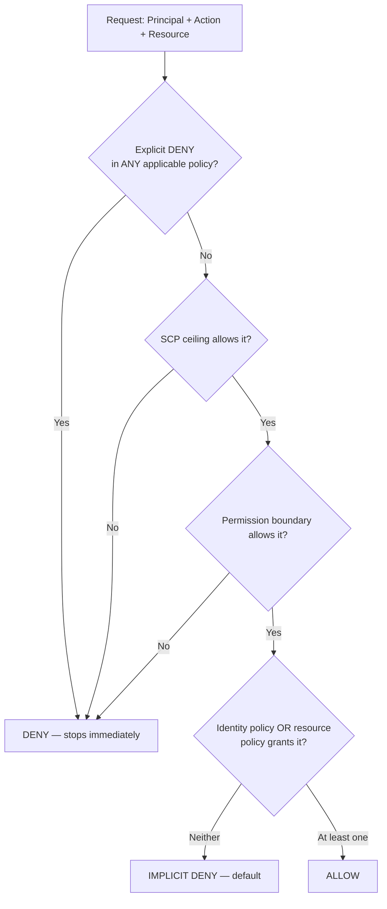

**Step by step:** (1) An explicit `Deny` anywhere in the chain wins immediately, no exceptions —
check this first when debugging. (2) Every containing *ceiling* must say yes: the SCP (org-wide),
the permission boundary (per-identity), the session policy (if assumed via STS) — these only ever
subtract, never grant. (3) Only after every ceiling passes does AWS check whether an identity
policy *or* a resource policy actually grants the action — either one is enough for most services
(S3, KMS, SQS support resource policies this way), but IAM/EC2 only support identity policies.
(4) If nothing explicitly allows it, the default is **implicit deny** — AWS denies by default,
always.

### Image: the official evaluation flowchart


*Source: [AWS IAM User Guide — Policy evaluation logic](https://docs.aws.amazon.com/IAM/latest/UserGuide/reference_policies_evaluation-logic_policy-eval-basics.html)*

**Discussion.** This is AWS's own canonical diagram, and it's worth tracing with a real example:
an IAM role in Account A with an identity policy allowing `s3:GetObject` on `*`, no SCP, no
boundary, calling a bucket in the *same* account with no bucket policy at all. Walk the chart: no
Deny anywhere → no SCP in play (single account) → no boundary → identity policy allows it → ALLOW.
Now change one fact: the bucket lives in a *different* account. The identity policy alone is no
longer sufficient — the diagram's "identity OR resource policy" box, in the cross-account case,
actually requires **both** sides to independently agree (this nuance is the single most tested
trap in this whole section: same-account identity+resource policies are a *union*, cross-account
is **both required, separately**).

### Exam Tips
- **Explicit Deny beats everything** — if a question shows one Allow and one Deny on the same
  action, the answer is always Deny, however deeply that Deny is buried (identity policy, SCP, or
  permission boundary).
- **Cross-account S3/KMS/SQS access needs BOTH** the identity policy (caller's account) and the
  resource policy (resource's account) to independently allow it — "just add an identity policy"
  is always the wrong, incomplete answer for a cross-account scenario.
- **A permission boundary that doesn't explicitly grant an action behaves like a Deny** for the
  intersection calculation — this produces an AccessDenied that looks identical to "no policy at
  all," a classic hard-mode exam trap.

**Go even deeper:** [`services/security-identity-compliance/iam.md`](../../services/security-identity-compliance/iam.md) (942 lines — full policy JSON examples, ABAC, troubleshooting playbook, quotas)

---

## 2. IAM Identity Center (SSO)

### Definition
IAM Identity Center (formerly AWS SSO) lets **one human login** grant access to **many AWS
accounts and business applications**, with the level of access in each account decided centrally
through reusable **Permission Sets** instead of hand-creating an IAM user in every account.

### Analogy
Picture a company badge that works at every building the company owns, instead of a different
key for each building's front door. You swipe once at the main lobby (Identity Center), and the
turnstile at each building (each AWS account) reads from the same central access list to decide
which floors (Permission Sets → IAM roles) you're allowed onto. Fire someone from the company
database once, and every turnstile in every building instantly stops recognizing their badge —
compare that to the old way of physically re-keying every single building's lock when someone
leaves, which is what hand-managing IAM users per account amounts to.

### Purpose
A company with 50 AWS accounts and 30 engineers faces a scaling wall if access is managed by
hand-creating IAM users per account — potentially 1,500 credentials to rotate, offboard, and
audit. Identity Center makes identity a single central thing (one login) and permission a
separately assigned per-account thing (Permission Sets), so a person logs in once and sees every
account/role combination they're allowed to use.

### When to Use
Any organization with more than a handful of AWS accounts and a workforce needing varying access
levels across them. It's also the default "right answer" whenever a scenario says "federate with
our existing corporate directory" or "centralize employee AWS access."

### When NOT to Use (be honest about the alternative)
- **A single AWS account with a handful of people** — the setup overhead isn't worth it; a few
  directly-managed IAM roles (ideally still federated) are simpler. Identity Center's value curve
  only kicks in once you have multiple accounts.
- **Your product's own customers logging into your app** — this is strictly workforce access, not
  end-user application login. Use **Cognito** for that; mixing these two up is one of the most
  common exam traps in this whole domain.
- **Machine-to-machine access** (a Lambda in Account A calling a service in Account B) — Identity
  Center is a human-facing SSO portal. Non-human workload access still goes through a direct
  `AssumeRole`, not Identity Center, regardless of how many accounts are involved.

### Use Cases
- **Workforce access across dozens of accounts** without IAM user sprawl — one login, Permission
  Set assignments replace rotating per-account credentials entirely.
- **Instant, org-wide offboarding** — disabling someone in the corporate IdP (synced via SCIM)
  revokes Identity Center access everywhere in one action, instead of chasing IAM users account
  by account.
- **Auditor/finance read-only access across the whole Organization** for a compliance cycle, with
  zero IAM users created anywhere, cleanly removable when the audit ends.
- **Consolidating AWS and non-AWS SaaS SSO** (Salesforce, Slack, Box) into one employee portal,
  reducing password fatigue and the number of places offboarding has to happen.
- **M&A integration** — a newly acquired team gets fast, scoped access via a temporary external
  IdP connection, migrated later into the unified corporate directory.
- **Break-glass design** — even a full Identity Center rollout keeps one or two tightly monitored
  IAM emergency-access users per critical account, specifically for the scenario where the
  identity source itself is down.

### Why It's Important
Centralized identity is a near-universal compliance requirement (SOC 2, ISO 27001, PCI-DSS all
expect a documented, centrally revocable access model with MFA) — and it's how virtually every
mature AWS organization manages workforce access in practice.

### Diagram: Permission Set Lifecycle

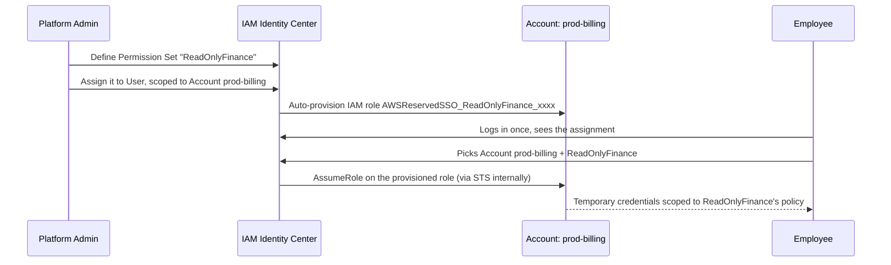

**Step by step:** an admin defines the Permission Set's policy **once**, centrally. Assigning it
to a user for a specific account causes Identity Center to silently provision (or update) a
matching IAM role in that account — you never hand-create this role yourself. When the user picks
that account+Permission Set combination in the portal, Identity Center performs a normal
`AssumeRole` call behind the scenes and hands back ordinary STS temporary credentials — nothing
about the final authorization step bypasses the IAM evaluation chain from Section 1; Identity
Center is the *provisioning and portal* layer on top of the exact same IAM/STS mechanics.

### Image: connecting an on-premises identity source without caching user data in the cloud


*Source: [AWS Prescriptive Guidance — Security Reference Architecture, IAM Identity Center](https://docs.aws.amazon.com/prescriptive-guidance/latest/security-reference-architecture-identity-management/workforce-iam-identity-center.html)*

**Discussion.** This diagram matters because it answers a very specific, recurring exam question:
a company with an existing on-premises Active Directory wants Identity Center integration but
explicitly does **not** want its employee directory data replicated or cached in the cloud. AD
Connector is the answer precisely because of what it *doesn't* do — rather than syncing a copy of
every user/group into the cloud (which is what SCIM-based sync against a SaaS IdP does), AD
Connector forwards each authentication request back to the real, on-premises directory in real
time, establishing a two-way trust without a cloud-side cache of identity data ever existing.

### Exam Tips
- **Identity Center vs. Cognito**: Identity Center is for *your own employees* accessing AWS/
  internal tools; Cognito is for *your product's customers*. This single distinction is tested
  constantly and is the fastest way to eliminate half the answer choices on a federation question.
- **SAML vs. SCIM**: SAML proves who's logging in *right now*; SCIM keeps the user/group list in
  sync so an offboarded employee actually loses access. "Access wasn't revoked when someone left"
  always points to a broken/missing SCIM sync, never a SAML problem.
- **Permission Sets are not IAM policies** — they're Identity Center's own assignment unit, which
  gets *rendered into* an actual IAM role per account; know the distinction when a question asks
  what object type actually lives in the target account.

**Go even deeper:** [`services/security-identity-compliance/iam-identity-center-sso.md`](../../services/security-identity-compliance/iam-identity-center-sso.md) (477 lines — migration playbook, SCIM/SAML detail, break-glass design)

---

## 3. STS & Role Switching (AssumeRole)

### Definition
AWS Security Token Service (STS) **issues short-lived, temporary credentials** instead of
permanent ones. "Role switching" is the act of a principal temporarily becoming a different IAM
role by calling STS and receiving a fresh access key, secret key, and session token that expire
automatically.

### Analogy
A static IAM access key is like a house key that works forever and that you can't easily track
copies of — if someone copies it once, they have access *indefinitely*, and the only fix is
changing the lock entirely. A temporary STS credential is like a hotel key card programmed to stop
working at checkout time automatically, no front-desk action required. If a copy of today's key
card leaks, it's useless tomorrow regardless of whether anyone ever "revokes" it — the leak's
blast radius is capped by the clock, not by someone noticing and reacting in time.

### Purpose
Long-term credentials are a liability: if leaked, they work forever until someone manually
revokes them, and they're easy to accidentally commit to a public repo or bake into an AMI. STS
exists so that almost nothing in AWS ever needs a long-term secret — EC2, Lambda, federated users,
and cross-account access all get credentials that expire automatically, usually within an hour.

### When to Use
Any time a principal needs to act as a different identity, temporarily: cross-account access,
every EC2 instance profile and Lambda execution role (both use `AssumeRole` automatically under
the hood), third-party vendor access via `ExternalId`, and federated logins via SAML or OIDC.

### When NOT to Use (be honest about the alternative)
- **A long-running on-premises server with no way to periodically re-authenticate** — fighting
  STS's short-lived-by-design nature with manual hourly credential refresh is painful; **IAM
  Roles Anywhere** (still STS-based, but designed for certificate-based, longer-lived trust) is
  the better fit.
- **Simple, low-stakes single-account CLI access** — plain IAM user credentials are at least
  simpler to reason about than a full AssumeRole chain, though in practice AWS steers even this
  case toward `aws sso login` (Identity Center), which issues STS credentials transparently anyway.

### Use Cases
- **EC2 instance profile** — the single most common AssumeRole flow of all, happening completely
  automatically via the Instance Metadata Service, with zero application code calling STS directly.
- **Central security account auditing 50 member accounts** via one identical `ReadOnlyAuditRole`
  per account, each trusting only the security account — no standing credentials anywhere.
- **Third-party SaaS vendor access via `ExternalId`**, not a shared key — revocable instantly by
  deleting the trust statement, and defended against the "confused deputy" problem.
- **MFA-gated sensitive action without switching identity** — `GetSessionToken` with an MFA code
  satisfies an `aws:MultiFactorAuthPresent` condition while the caller stays the *same* identity.
- **Mobile app uploading directly to a per-user S3 prefix** via `AssumeRoleWithWebIdentity`
  through a Cognito Identity Pool, scoped using `${cognito-identity.amazonaws.com:sub}`.
- **EKS IRSA (IAM Roles for Service Accounts)** — each Kubernetes service account maps to its own
  IAM role via the cluster's OIDC provider, instead of sharing one broad node-level role.

### Why It's Important
Virtually every "serverless app got hacked because of a leaked static key" postmortem would have
been a non-issue had the workload used a role instead. STS-backed temporary credentials are the
backbone of how AWS expects every non-human workload to authenticate.

### Diagram: Trust Policy vs. Permissions Policy — the #1 confused pair

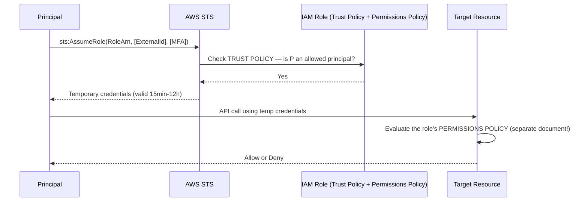

**Step by step:** the **trust policy** lives on the role and answers only "who may call
AssumeRole on me" — it's a resource-based policy, distinct from the role's **permissions policy**,
which answers "what can a session that successfully assumed this role actually do." A role can
have a wide-open trust policy and an empty permissions policy (assumption succeeds, the session
can do nothing) or the reverse (a locked-down trust policy nobody can satisfy, paired with a
permissions policy that never gets exercised). Debugging "AccessDenied" after a role assumption:
if the *assumption itself* failed, it's a trust-policy problem; if assumption succeeded but the
*next API call* failed, it's a permissions-policy problem — these are different documents, fixed
in different places.

### Image: the general trust-token exchange pattern behind every federated AssumeRole variant


*Source: [AWS IAM User Guide — Federating AWS identities across AWS partitions](https://docs.aws.amazon.com/IAM/latest/UserGuide/id_roles_providers_outbound_cross_partition.html)*

**Discussion.** Although this specific diagram illustrates a cross-partition flow, the pattern it
shows generalizes to *every* `AssumeRoleWith*` call: a token is minted by one trust anchor
(an OIDC issuer, a SAML IdP, a source account's STS), presented to the destination STS, validated
against the issuer's public signing keys, and exchanged for scoped temporary credentials. Whether
the "trust anchor" in your scenario is Okta (SAML), a Cognito Identity Pool (OIDC/web identity),
or an EKS cluster's own OIDC provider (IRSA), the shape of the exchange — present a token, get
validated, receive temporary AWS credentials — never changes.

### Exam Tips
- **ExternalId is specifically for third-party cross-account access**, defending against the
  "confused deputy" problem — a question mentioning "a vendor/partner needs access to our
  resources" almost always wants `ExternalId` in the trust policy as part of the answer.
- **Chained AssumeRole hard-caps at 1 hour**, regardless of either role's own `MaxSessionDuration`
  — a classic "why did my long session expire early" trap when a scenario involves multiple
  account hops.
- **Session policies only ever restrict, never expand** what a role's own policies already allow
  — an answer choice proposing a session policy to *grant more* access is always wrong.

**Go even deeper:** [`services/security-identity-compliance/sts-and-role-switching.md`](../../services/security-identity-compliance/sts-and-role-switching.md) (605 lines — full API comparison table, multi-hop debugging scenario)

---

## 4. AWS Organizations & Service Control Policies (SCPs)

### Definition
AWS Organizations groups multiple AWS accounts into one managed structure (a hierarchy of
Organizational Units) for shared billing and governance. Service Control Policies (SCPs) are the
tool Organizations uses to set a **maximum permission ceiling** on everything underneath — no
identity in an affected account, including that account's own root user, can ever exceed it.

### Analogy
If IAM policies are laminated rules taped to individual doors inside a building, an SCP is a
structural decision made by the building's architect *before any door existed* — "this entire
wing of the building physically has no door leading outside." No matter what any room's manager
decides to print on their own door's sign, they cannot create a door where the architect decided
there would be a wall. SCPs don't compete with IAM's door signs; they define which walls can never
have doors in them, period, regardless of who manages which room.

### Purpose
A company running hundreds of AWS accounts needs company-wide rules individual account admins
cannot override — "no account may ever disable CloudTrail," "no account outside approved regions
may create resources." IAM policies can't do this because they're managed *within* each account
by that account's own admins. SCPs sit one level above IAM, with no opt-out.

### When to Use
Whenever a requirement explicitly needs to bind **even an account administrator** — region
restrictions, un-disablable security logging, blocking standing IAM user creation org-wide, or any
"nobody, anywhere in this org, may ever do X" requirement.

### When NOT to Use (be honest about the alternative)
- **Per-user/per-role fine-grained permissions within one account** — that's IAM's job, not SCPs;
  SCPs are deliberately coarse, account/OU-level ceilings.
- **A single standalone account with no Organization** — SCPs require AWS Organizations; use an
  **IAM permission boundary** for a similar ceiling effect scoped to one account instead.
- **Granting access** — never reach for an SCP when the goal is to give someone a *new*
  capability; SCPs are restriction-only. A question implying "the SCP is why this now works" is
  conceptually broken.

### Use Cases
- **Org-wide region restriction** for cost control or data residency — an SCP denies everything
  outside an approved region list, with no per-account opt-out.
- **Tamper-proof security logging** — an SCP denying `cloudtrail:StopLogging`/`DeleteTrail`
  applies to the account's own root user too; no in-account admin can disable it.
- **Cost-capped sandbox OU** — restricting instance types/services for experimentation accounts
  without manually policing every sandbox.
- **Forcing all human access through federated identity** — an SCP denying `iam:CreateUser`/
  `CreateAccessKey` org-wide makes "no standing IAM users" a structural guarantee, not a policy.
- **Data residency enforcement for GDPR/PCI-DSS** — the one control a malicious or careless
  account-level admin genuinely cannot bypass, which is exactly what regulators expect.
- **Preventing accidental Organization departure** — an unconditional SCP denying
  `organizations:LeaveOrganization` removes a surprisingly easy way to strand an account.

### Why It's Important
Multi-account governance at scale is unmanageable without SCPs — it's the mechanism letting a
central platform team guarantee baseline protections hold everywhere, regardless of what
individual account owners configure or how senior they are.

### Diagram: SCP + IAM policy intersection — effective permission is always the narrower of the two

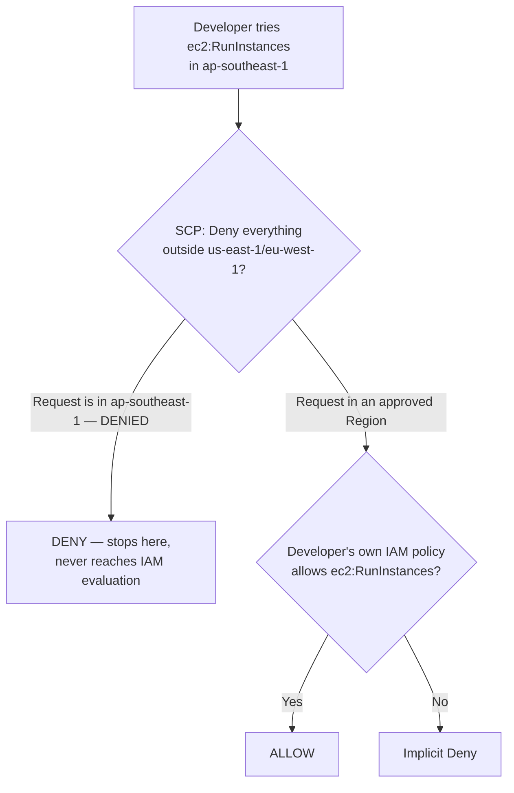

**Step by step:** the developer's own IAM policy might say "full EC2 access, everywhere" — but if
the SCP attached at the account's OU denies any non-essential action outside two approved Regions,
attempting to launch in a third Region is denied **before the identity policy is ever consulted.**
This is the clearest illustration of "SCPs are a ceiling, never a grant": removing the SCP
wouldn't need to add anything to make the call succeed in the approved Regions — the identity
policy already allows it there. The SCP only ever subtracts a possibility, never adds one.

### Image: the official Org Management account architecture


*Source: [AWS Prescriptive Guidance — Security Reference Architecture, Org Management account](https://docs.aws.amazon.com/prescriptive-guidance/latest/security-reference-architecture/org-management.html)*

**Discussion.** This diagram places Organizations/Control Tower/SCP enforcement literally at the
*top* of the account hierarchy for a reason: everything below inherits from it, and nothing below
can edit it. The management account pictured at the top is intentionally drawn running no
workloads of its own — a recurring exam fact. A scenario describing production resources running
*in* the management account is describing an anti-pattern to flag, not a design to emulate,
because SCPs attached at the Root structurally do not apply to the management account itself —
running anything sensitive there removes the one protection layer this whole diagram exists to
provide.

### Exam Tips
- **SCPs never grant, only restrict** — if an answer choice implies an SCP "enables" new access
  on its own, it's wrong; IAM must still separately allow the action underneath.
- **Effective permission = intersection, never union** — one denying SCP anywhere in the account's
  OU ancestry chain overrides an otherwise-permissive IAM policy, every time.
- **Deny-list SCPs (keep the default `FullAWSAccess`, add targeted Deny statements) are the
  AWS-recommended, lower-risk authoring style** — an allow-list SCP is powerful but every omission
  is a potential outage; a question describing an SCP accidentally breaking unrelated services
  points to an incomplete allow-list.

**Go even deeper:** [`services/security-identity-compliance/organizations-and-scps.md`](../../services/security-identity-compliance/organizations-and-scps.md) (619 lines — RCPs, tag/backup policies, full SCP JSON bundle)

---

## 5. Additional Governance Services (Control Tower etc.)

### Definition
**AWS Control Tower** automates setting up a secure, multi-account AWS "landing zone" following
AWS best practices — provisioning the OU structure, baseline guardrails (SCPs + Config rules),
centralized logging, and a self-service **Account Factory**, all in one guided setup instead of
hand-building the equivalent with raw Organizations, Config, and CloudTrail. (This section also
briefly covers **Service Catalog**, a sibling governance service frequently paired with it.)

### Analogy
Building a secure multi-account environment from raw Organizations/SCPs/Config/CloudTrail is like
being handed a pile of lumber, wiring, and plumbing and told "build a code-compliant house."
Control Tower is the pre-fabricated house kit: the walls, wiring, and plumbing are already
correctly assembled according to a known-good blueprint (AWS's own best-practice landing zone),
and you're mainly deciding which rooms (OUs) to add on top, rather than wiring the breaker box
from scratch yourself.

### Purpose
A well-structured multi-account environment is widely recognized as the right pattern — but
building it entirely by hand is a substantial, easy-to-get-wrong, multi-week project. Control
Tower turns that into an automated, opinionated setup using the exact same underlying services
(Organizations, Config, CloudTrail) it doesn't replace them, it orchestrates them.

### When to Use
Any organization standing up a *new* multi-account AWS environment, or migrating from a tangled
single-account setup, that wants a known-good baseline (logging, guardrails, account provisioning)
without hand-assembling every piece — and especially whenever a scenario says "self-service,
pre-governed new account creation."

### When NOT to Use (be honest about the alternative)
- **An organization with deeply customized existing Organizations/SCP tooling already in place**
  — forcing a retrofit onto Control Tower's opinionated structure can be more disruptive than
  incremental hardening of what already exists.
- **A single account, or a handful of accounts with no growth plan** — the guided landing-zone
  setup is overhead you don't need yet; plain Organizations (or nothing at all) is simpler.
- **Needing a specific product catalog for end users to self-service launch** (an approved RDS
  config, an approved AMI) — that's **Service Catalog**'s job specifically, not Control Tower's.

### Use Cases
- **First-time multi-account adoption** — Control Tower provisions the Security OU (Log Archive +
  Audit accounts), baseline guardrails, and Account Factory in one guided setup.
- **Self-service, pre-governed new account creation** for a new team or project, without a manual,
  error-prone multi-step account setup process repeated every time.
- **Org-wide detective guardrails** (Config rules flagging a violation after the fact) layered
  alongside preventive guardrails (SCPs blocking it outright) — Control Tower ships both types.
- **Service Catalog: developer self-service for a pre-approved RDS configuration** — without
  granting the developer direct IAM permissions to create arbitrary RDS resources themselves.
- **Service Catalog: enforcing consistent, tagged, compliant infrastructure** across many teams
  from one curated product menu, instead of a central IT bottleneck or ungoverned sprawl.
- **Account Factory vending a new, pre-logged, pre-guardrailed account** the moment a new research
  grant or business unit is approved, instead of IT manually provisioning over days.

### Why It's Important
Control Tower is frequently the *practical* way large organizations actually adopt the SCP/
Organizations pattern from Section 4, rather than writing every guardrail from scratch — know it
as the automation layer, not a separate concept from Organizations.

### Diagram: What Control Tower Sets Up Automatically

```mermaid
flowchart TD
    Setup[Control Tower setup] --> Root[Organization Root]
    Root --> SecOU[Security OU]
    SecOU --> LogAcct[Log Archive account\ncentralized CloudTrail/Config logs]
    SecOU --> AuditAcct[Audit account\nread access for security review]
    Root --> SandboxOU[Sandbox OU]
    Root --> WorkloadsOU[Workloads OU — your app accounts]
    Setup -->|applies automatically| Guardrails[Preventive (SCP) + detective (Config)\nguardrails across all accounts]
    Setup --> AF[Account Factory:\nself-service pre-configured\nnew account creation]
```

**Step by step:** enrolling in Control Tower automatically creates a **Security OU** holding a
**Log Archive account** (every account's CloudTrail/Config logs land here, write-only) and an
**Audit account** (read access for security review without needing standing admin rights in every
account). Guardrails — **preventive** (an SCP blocking an action outright) or **detective** (a
Config rule flagging a violation after the fact) — apply automatically across every in-scope
account. **Account Factory** then lets anyone authorized self-service-create a new account that's
*already* inside an OU, with baseline guardrails and logging wired up from the moment it exists —
nobody is hand-building a new account's security posture from scratch, ever again, after this
initial setup.

### Image: Control Tower governing controls across every account in an OU


*Source: [AWS Prescriptive Guidance — Deploy and manage AWS Control Tower controls using Terraform](https://docs.aws.amazon.com/prescriptive-guidance/latest/patterns/deploy-and-manage-aws-control-tower-controls-by-using-terraform.html)*

**Discussion.** This image illustrates a fact worth internalizing: a Control Tower "control" isn't
a single, special new object type — it's a packaged bundle that ultimately resolves down into the
same SCPs and Config rules you could write by hand, applied consistently across every account in
an OU at once. The diagram's point is scope — a control is attached once, at the OU level, and
every account inside that OU (present and future) inherits it automatically, which is exactly the
mechanism behind "a new account joins the Workloads OU and immediately has the same baseline
guardrails as every sibling account," with zero manual per-account setup.

### Exam Tips
- **"Set up a multi-account landing zone" / "automate account governance" / "self-service account
  provisioning that's already compliant"** → Control Tower, not raw Organizations/SCPs alone —
  know it's built *on top of* Organizations/Config/CloudTrail, not a replacement for them.
- **Service Catalog vs. Control Tower** — Service Catalog curates a menu of *products* (an AMI, an
  RDS config, a full stack) end users self-service launch; Control Tower governs the *accounts*
  themselves. A question about "a pre-approved product catalog" wants Service Catalog, not
  Control Tower.
- **Preventive vs. detective guardrails** — a question asking "stop this from ever being
  possible" wants a preventive (SCP-based) guardrail; "alert us after it happens" wants a
  detective (Config-based) guardrail. Control Tower ships both, bundled as "controls."

**Go even deeper:** [`services/management-governance/additional-governance-services.md`](../../services/management-governance/additional-governance-services.md) (292 lines — Health Dashboard, License Manager, Managed Grafana/Prometheus, Proton, Compute Optimizer)

---
## 6. Amazon VPC

### Definition
A Virtual Private Cloud (VPC) is your own private, logically isolated slice of the AWS network —
you pick the IP address range, carve it into sub-networks, and decide what can talk to what.
Nothing inside is reachable from outside unless you explicitly open a door.

### Analogy
A VPC is an empty plot of land you've bought inside a huge, AWS-run city. The city gives you the
plot's exact boundaries (your CIDR block) but builds nothing on it for you — no roads, no fences,
no utility hookups. You decide where the internal roads go (route tables), you build the fence
and gates (security groups/NACLs), and you decide whether there's a driveway connecting to the
city's public street grid at all (Internet Gateway) or whether your plot is only reachable by a
private road from a neighboring plot (VPC peering/Transit Gateway). Without you doing any of this
work, the plot is just... land. It does nothing until you design and build on it.

### Purpose
Before VPC existed, every EC2 instance landed on a single flat, shared network alongside every
other AWS customer — almost no control over IP addressing, isolation, or topology. VPC gives each
customer the networking experience of running their own private data center without owning a
single router or cable. It's the foundational layer every other networking service in this
domain (subnets, security groups, VPN, Direct Connect) sits on top of.

### When to Use
Essentially every non-trivial AWS workload needs a VPC — you cannot run most compute/database
resources without landing them in one. The real decision is *custom* VPC (deliberate CIDR
planning, purpose-built subnets) vs. the auto-created *default* VPC (fine for a 5-minute test,
wrong for production).

### When NOT to Use (be honest about the alternative)
- **A quick throwaway Lambda with no VPC-only resource to reach** — don't put Lambda in a VPC
  unless it must reach something VPC-only (RDS, ElastiCache); a VPC-attached Lambda needs a NAT
  Gateway for internet access and carries ENI cold-start overhead a non-VPC Lambda doesn't.
- **Static website hosting** — S3 + CloudFront needs no VPC at all; adding one is pure
  over-engineering.
- **You genuinely don't care about topology** — the auto-created default VPC exists exactly for
  this, though anything beyond a demo should move to a custom VPC quickly.

### Use Cases
- **Multi-tier web application** — public subnet for the load balancer, private subnets for app
  and database tiers, isolating a compromised web server from direct database access.
- **Hybrid cloud connectivity** — a deliberately non-overlapping CIDR plus VPN/Direct Connect lets
  on-prem and AWS resources address each other by private IP directly.
- **Multi-Region disaster recovery** — a second VPC in a DR Region, CIDR-planned not to collide
  with the primary, ready for Route 53 failover or cross-Region replication.
- **Microservices/container platform networking** — secondary CIDR blocks (often from
  `100.64.0.0/16`) solve the IP-per-pod exhaustion a dense EKS cluster's CNI creates.
- **Regulatory network isolation** — an isolated subnet with no IGW/NAT route at all, reachable
  only via VPC endpoints, gives an architecturally enforced (not just policy-written) boundary.
- **Centralized shared-services VPC** via AWS Resource Access Manager — one team owns IP
  planning/routing while application teams self-serve compute into shared subnets.

### Why It's Important
VPC design mistakes are the single most common source of both security incidents (an overly
permissive default VPC, a misconfigured public subnet exposing a database) and outages (CIDR
overlap blocking a merger's VPN, running out of IP space in an undersized subnet).

### Diagram: Is This Subnet Public or Private? (the single most exam-tested VPC fact)

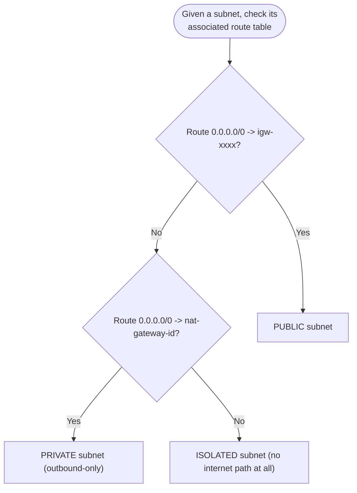

**Step by step:** "public" and "private" are never a label on the subnet itself — they're purely
a function of what its **route table** says. A subnet becomes public the instant its route table
sends `0.0.0.0/0` to an Internet Gateway. If instead it routes `0.0.0.0/0` to a NAT Gateway, it's
private (outbound allowed, inbound-initiated connections impossible). If it has no default route
at all — just the implicit `local` route plus maybe some VPC endpoint routes — it's fully
isolated. A subnet named "private-subnet-1" in the console can still be functionally public if
someone added an IGW route to it; never trust the name, always check the route table.

### Image: the reference VPC topology


*Source: [AWS Documentation — What is Amazon VPC?](https://docs.aws.amazon.com/vpc/latest/userguide/what-is-amazon-vpc.html)*

**Discussion.** This image illustrates the core structural rule that trips up almost everyone new
to VPC: the VPC itself spans every Availability Zone in its Region (it is a Regional construct),
but each individual **subnet** is pinned to exactly one AZ. You cannot create a subnet that spans
two AZs — if you want high availability, you create *multiple* subnets, one per AZ, and spread
your resources (or your Auto Scaling Group, or your RDS Multi-AZ standby) across them. The single
Internet Gateway pictured is also worth noting: there's only ever one IGW per VPC, attached once,
servicing every public subnet in every AZ simultaneously — it's horizontally scaled and redundant
by AWS, with no bandwidth limit or hourly charge of its own.

### Exam Tips
- **"Public" vs "private" is a route-table fact, not a subnet property** — don't trust a
  scenario's subnet name; trace the actual route table.
- **A VPC never spans Regions but always spans every AZ in its Region** — the subnet is what's
  AZ-pinned, not the VPC.
- **Secondary CIDR blocks** are the standard "we're running out of IP space in an existing,
  populated VPC" answer — know this exists as an alternative to recreating the whole VPC.

**Go even deeper:** [`services/networking-content-delivery/vpc.md`](../../services/networking-content-delivery/vpc.md) (774 lines — CIDR math, IPv6, shared VPC via RAM, Reachability Analyzer)

---

## 7. Security Groups vs. NACLs

### Definition
**Security Groups** are stateful, instance-level firewalls controlling traffic to/from individual
resources. **NACLs** are stateless, subnet-level firewalls evaluated for everything crossing a
subnet boundary. They stack: a packet must pass the NACL first, then the security group.

### Analogy
A NACL is the security checkpoint at a building's main entrance — it checks everyone entering or
leaving the building, using a numbered list of posted rules, and it has no memory of who it let in
five minutes ago (every single person, in or out, gets checked fresh, every time). A security
group is a smart keycard reader on one specific office door — it remembers that *you* just badged
in, so when you leave moments later, it doesn't re-check your badge, it just lets you out because
it recognizes you're already "in conversation" with that room. This is exactly why forgetting a
NACL's outbound rule is such a common mistake: the building checkpoint has no memory, so it needs
an explicit rule for people leaving, even though the smart office door never needed one for the
same person.

### Purpose
AWS gives two layers deliberately, mirroring defense-in-depth in physical data centers: NACLs are
a perimeter fence around a subnet (coarse, blanket deny-lists), while security groups are a lock
on each individual door (fine-grained, per-resource). Relying on only one layer leaves a gap
either too coarse (can't say "only this one instance") or too narrow (can't instantly block an
entire bad IP range account-wide in one rule).

### When to Use
Security groups should carry almost all of your real, day-to-day access logic (which tier talks
to which tier, on which port). NACLs should be reserved for coarse, subnet-wide deny rules —
blocking a known-bad CIDR instantly across every instance in a subnet, or as a compliance backstop
independent of what any individual instance's security group says.

### When NOT to Use (be honest about the alternative)
- **Don't use NACLs as your primary access control** — they're coarse, stateless, and the return-
  traffic rule is easy to forget, causing a confusing "half-working" outage.
- **Don't try to make a security group "deny" something** — it structurally can't; reach for a
  NACL (or Network Firewall/WAF for sophisticated inspection) when you need an explicit block.
- **For application-layer filtering** (blocking SQL injection, rate-limiting by URL path) — SGs
  and NACLs only operate at L3/L4 (IP/port); use **WAF** in front of your ALB/CloudFront instead.

### Use Cases
- **Multi-tier access control via SG chaining** — `alb-sg → app-sg → db-sg`, each tier referencing
  the *security group ID* of the tier in front of it, not a CIDR, so the rule survives autoscaling.
- **Instant subnet-wide blocking of a known-bad IP range** — one low-numbered NACL deny rule
  covers every instance in the subnet immediately, faster than editing dozens of security groups.
- **Origin protection behind CloudFront** — a security group referencing the AWS-managed
  CloudFront prefix list ensures the origin only accepts traffic that actually came through CDN.
- **Compliance defense-in-depth for a database tier** — a NACL backstop that only allows the app
  tier's CIDR on the DB port protects against a developer accidentally attaching a broad SG.
- **Egress-lockdown for data-exfiltration compliance** — removing a security group's default
  outbound-allow-all rule and adding back only narrow, specific destinations.
- **Bastion-host administrative access** — the bastion's SG allows SSH only from a known office
  CIDR; every other instance's SG allows SSH only from the bastion's SG.

### Why It's Important
An overly permissive security group (`0.0.0.0/0` on a database port) is one of the single most
common root causes found by automated cloud security scanners and real breach post-mortems — it
is the #1 thing a security audit checks first.

### Diagram: Stateful (SG) vs. Stateless (NACL) Connection Handling

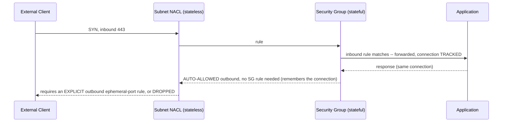

**Step by step:** the request crosses the NACL first — evaluated fresh against numbered rules,
first match wins, with zero memory of anything that happened before. It then hits the security
group, which checks its inbound rules, allows it, and — critically — **records the connection** in
a tracking table. When the application sends its response, the security group recognizes it
belongs to an already-allowed connection and auto-permits it outbound with no outbound rule
needed at all. But that response still has to cross the subnet boundary again, and the NACL has
no memory of the original request — without an explicit outbound rule covering the client's
ephemeral port range (typically 1024-65535), the response is silently dropped even though the
original inbound request was perfectly allowed.

### Image: Security Groups and NACLs together, the official diagram


*Source: [AWS Documentation — Infrastructure security in Amazon VPC](https://docs.aws.amazon.com/vpc/latest/userguide/infrastructure-security.html)*

**Discussion.** The picture is deceptively simple but encodes an ordering fact that's worth
stating explicitly: traffic *always* passes the subnet's NACL before it ever reaches an
instance's security group, in both directions. This means a security review that only audits
security groups and ignores NACLs is incomplete — a wide-open security group is still protected
if the subnet's NACL independently blocks the same traffic, and conversely, a perfectly
locked-down security group means nothing if the NACL never let the traffic through to be checked
in the first place. Treat them as two independent, serial gates, not two redundant copies of the
same rule.

### Exam Tips
- **The #1 trap**: traffic allowed inbound, but the response never arrives — this is almost always
  a missing NACL outbound rule for the ephemeral port range, since NACLs don't auto-allow return
  traffic the way security groups do.
- **Security groups cannot deny**, period — only allow rules exist; any "block this specifically"
  requirement needs a NACL (or WAF/Network Firewall).
- **NACL rules evaluate in numeric order, first match wins** — don't assume "more specific beats
  less specific" the way route tables work; it's purely about which numbered rule comes first.

**Go even deeper:** [`services/networking-content-delivery/security-groups-vs-nacls.md`](../../services/networking-content-delivery/security-groups-vs-nacls.md) (718 lines — cross-VPC SG references, connection tracking detail, 7 worked scenarios)

---

## 8. Subnets, Route Tables, Internet Gateway, NAT Gateway

### Definition
Four building blocks that turn a VPC's empty address range into a working network: **subnets**
divide the VPC by AZ, **route tables** decide where traffic goes, the **Internet Gateway**
lets public resources reach the internet directly, and the **NAT Gateway** lets private resources
reach *out* without being reachable *from* the internet.

### Analogy
Think of a gated community. The **Internet Gateway** is the community's single main gate, open in
both directions — anyone with the gate code (a public IP) can drive straight in or out. A
**NAT Gateway** is more like a concierge desk at a different, service-only exit: residents in the
"private" homes (private subnets) can hand the concierge a package to send out to the world, and
the concierge sends it under the concierge desk's own return address — but nobody from the
outside world can use that same desk to find out which specific house sent the package, and
nobody outside can walk *in* through that exit at all. The **route table** is the community's
internal street map telling every house which exit to use for outbound mail; without an entry on
that map pointing to the main gate or the concierge desk, a house's mail simply goes nowhere.

### Purpose
A VPC alone is just an IP range with no AZ placement, no traffic rules, and no internet
connectivity. AWS split these into separate, composable objects so you can mix and match: many
subnets can share one route table, one VPC can have many route tables, and NAT/IGW are optional
layers you add deliberately.

### When to Use
Every real VPC design uses subnets and route tables. Add an Internet Gateway only to the VPC that
needs *any* public-facing resource at all. Add a NAT Gateway (one per AZ, for resiliency) whenever
private-subnet resources need outbound-only internet reachability (patches, third-party API
calls) without being directly reachable.

### When NOT to Use (be honest about the alternative)
- **Don't put a NAT Gateway where a VPC endpoint would do** — if private instances only need to
  reach S3/DynamoDB, a free Gateway Endpoint beats paying NAT Gateway's per-GB processing fee for
  that same traffic. This exact substitution is one of the most common SAA-C03 cost answers.
- **Don't use a self-managed NAT Instance in production at real scale** — it's a single EC2
  instance you must patch, size for bandwidth, and manually fail over; the managed NAT Gateway
  removes that burden for a modest cost premium. NAT Instances remain valid for genuinely
  low-traffic, cost-sensitive, or schedulable (stop/start) workloads only.
- **If everything is meant to be internet-reachable anyway** (a single-tier static site) — skip
  private subnets/NAT entirely; use a public subnet, or better, S3 + CloudFront with no EC2 at all.

### Use Cases
- **Multi-tier subnet layout** — public subnet holds only the ALB/NAT Gateway; private app and
  data subnets hold everything else, segmented purely by route-table membership.
- **One NAT Gateway per AZ** — the resiliency-correct default; a single shared NAT Gateway is
  cheaper but means one AZ's failure takes down every other AZ's outbound internet access too.
- **Fully isolated, compliance-driven subnet** — route table carries only the `local` route plus
  VPC endpoint routes, no IGW or NAT route at all, proving zero internet path, even outbound.
- **Cost-optimized retrofit** — replacing NAT-Gateway-routed S3 traffic with a free Gateway VPC
  Endpoint, often the single highest-leverage, lowest-effort cost fix in a VPC's design.
- **Centralized NAT via Transit Gateway hub VPC** — many spoke VPCs route outbound traffic through
  one central "egress VPC's" NAT Gateways instead of running NAT Gateways in every spoke.
- **IPv6 dual-stack outbound-only access** — IPv4 traffic routes through a NAT Gateway; IPv6
  traffic (which has no private-address concept) routes through an Egress-Only Internet Gateway.

### Why It's Important
NAT Gateway cost surprises are one of the most common "why is my AWS bill high" support tickets —
a forgotten NAT Gateway processing large data volumes can rack up hundreds of dollars a month in
per-GB charges alone, on top of its hourly fee.

### Diagram: Address Translation — How a NAT Gateway Hides a Private IP

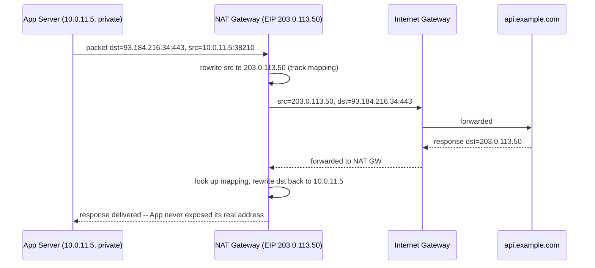

**Step by step:** the private app server's packet reaches the NAT Gateway, which rewrites the
source address from the server's private IP to its own Elastic IP and **remembers the mapping**
in an internal translation table. Only because of that remembered mapping can the response —
addressed to the NAT Gateway's single public IP — be correctly routed back to the *one* private
instance (among potentially thousands) that actually sent the original request. This translation
table is finite: a NAT Gateway caps out at 55,000 simultaneous connections *per unique
destination*, a specific number worth remembering for troubleshooting scenarios about a NAT
Gateway silently dropping new connections to one heavily-used external endpoint.

### Image: the public/private subnet + NAT Gateway reference layout


*Source: [AWS Documentation — NAT gateway use cases](https://docs.aws.amazon.com/vpc/latest/userguide/nat-gateway-scenarios.html)*

**Discussion.** Note where the NAT Gateway physically sits in this diagram: inside a **public**
subnet, not the private one it's serving. This is a frequently tested gotcha — a NAT Gateway
placed in a private subnet has no route of its own to the internet and simply cannot work; it
must live in a subnet that itself has a route to the Internet Gateway, so it can forward the
private subnet's traffic onward. The diagram's two-AZ layout is also the resiliency-correct
pattern: each AZ gets its own public subnet, its own NAT Gateway, and its own private subnet
routed only to that same AZ's NAT Gateway — avoiding both a single point of failure and avoiding
cross-AZ data transfer charges for NAT-bound traffic.

### Exam Tips
- **Memorize**: public subnet = route table has `0.0.0.0/0 → igw-xxxx`. Private subnet routes
  `0.0.0.0/0` to a NAT Gateway instead (or has no default route at all = fully isolated).
- **NAT Gateway is AZ-scoped** — one shared NAT Gateway across AZs is a cost-vs-resiliency
  tradeoff the exam tests directly; one-per-AZ is the resiliency-correct, slightly costlier design.
- **VPC endpoint beats NAT Gateway for AWS-service-only traffic** — the recurring, near-guaranteed
  cost-optimization substitution for S3/DynamoDB-bound traffic specifically.

**Go even deeper:** [`services/networking-content-delivery/subnets-route-tables-igw-natgw.md`](../../services/networking-content-delivery/subnets-route-tables-igw-natgw.md) (535 lines — longest-prefix-match detail, NAT Instance tradeoffs, egress-only IGW)

---

## 9. VPC Endpoints & PrivateLink

### Definition
A VPC Endpoint lets resources inside a VPC reach an AWS service (or another VPC's application)
**without that traffic ever leaving the AWS network or touching the public internet** — no NAT
Gateway, no Internet Gateway, no public IP required. **AWS PrivateLink** is the technology
powering interface endpoints, and also lets you expose your *own* application privately to other
VPCs/accounts the same way AWS exposes S3 or DynamoDB.

### Analogy
Reaching an AWS service through a NAT Gateway and Internet Gateway is like mailing a letter to
your neighbor by routing it through the city's central post office, even though your neighbor
lives two doors down — technically it arrives, but you paid postage and took a longer, more
exposed path for something that never needed to leave the block. A VPC Endpoint is a direct
private pass-through fence gate between your yard and your neighbor's — the letter never enters
the public postal system at all, it's faster, and (for the Gateway Endpoint flavor, S3/DynamoDB)
it doesn't even cost you a stamp.

### Purpose
By default, reaching an AWS service's public API endpoint from a private subnet requires routing
out through a NAT Gateway and Internet Gateway even though the destination is still inside AWS —
wasteful (NAT Gateway per-GB cost for traffic that never needed the internet) and a larger attack
surface than necessary. VPC Endpoints exist so that AWS-service traffic — and even traffic to
other companies' privately-hosted services — stays entirely within AWS's private network.

### When to Use
Always add a free **Gateway Endpoint** for S3/DynamoDB traffic from private subnets — there's
close to no downside. Add **Interface Endpoints** for any other AWS service a private, NAT-
Gateway-free subnet needs to reach, and especially whenever a compliance requirement says AWS API
traffic must never cross the public internet.

### When NOT to Use (be honest about the alternative)
- **Public-facing resources meant to be reached over the internet anyway** — an endpoint adds
  nothing if the resource is supposed to be internet-reachable in the first place.
- **Occasional, low-volume AWS API calls from a subnet that already has a NAT Gateway for other
  reasons** — the marginal savings of an interface endpoint (which itself has an hourly charge)
  may not be worth the overhead; Gateway Endpoints (free) remain worth adding regardless of volume.
- **Connecting whole VPC networks to each other** — that's VPC Peering or Transit Gateway's job,
  not VPC Endpoints, which are scoped to individual services, never general network connectivity.

### Use Cases
- **Removing NAT Gateway from the critical path** — a private subnet's app tier calls S3 and
  Secrets Manager with no other internet dependency; a Gateway Endpoint + Interface Endpoint cover
  both with no NAT Gateway needed at all.
- **Lambda-in-VPC reaching other AWS services** — a function placed in a VPC for RDS access also
  needs Secrets Manager; an interface endpoint handles it directly instead of adding a NAT Gateway
  purely for that one call.
- **Cost optimization retrofit on an existing, running VPC** — adding a free S3 Gateway Endpoint
  to remove S3-bound traffic from an existing NAT Gateway bill, with zero application changes.
- **SaaS vendor exposing a product privately to hundreds of customer VPCs** — PrivateLink's
  Endpoint Service model avoids unmanageable VPC-peering sprawl as the customer base grows.
- **Private API Gateway enforcement** — an internal REST API reachable only through its
  associated interface endpoint, enforced at the API Gateway configuration level, not just by
  firewall rules.
- **Compliance requirement: AWS API traffic must never cross the public internet** — comprehensive
  Gateway + Interface Endpoint coverage for every AWS service the workload touches.

### Why It's Important
VPC Endpoints are one of the highest-value, lowest-effort cost-optimization levers in real AWS
bills — teams running S3-heavy workloads from private subnets routinely cut meaningful NAT
Gateway cost by adding a free Gateway Endpoint, often with zero application changes.

### Diagram: Interface Endpoint — Why Application Code Never Changes

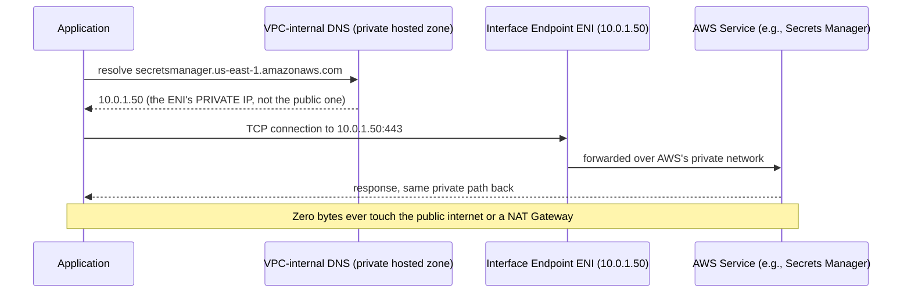

**Step by step:** the interface endpoint automatically associates a **private hosted zone** with
your VPC that intercepts the exact DNS name your application already calls — no SDK
reconfiguration, no endpoint URL change. The application thinks it's resolving the normal public
hostname; the VPC's internal DNS silently answers with the endpoint's private IP instead, and the
connection goes straight to an ENI sitting in your own subnet, never touching the internet. This
invisibility is precisely why "no code changes were needed but traffic now stays private" in an
exam scenario always points to an interface endpoint with private DNS enabled.

### Image: the default (less efficient) path this service displaces


*Source: [AWS Documentation — Access AWS services through AWS PrivateLink](https://docs.aws.amazon.com/vpc/latest/privatelink/privatelink-access-aws-services.html)*

**Discussion.** This diagram is worth reading for what it implies rather than what it shows: even
though the caption notes the traffic "stays in the AWS network," it still requires a public-IP
path and an Internet Gateway/NAT Gateway hop to get there — which is exactly the inefficiency VPC
Endpoints remove. The distinction matters for the exam: "stays within AWS's network" is not the
same claim as "never left the VPC via a NAT/IGW hop." A question emphasizing *cost* (NAT Gateway
per-GB charges) or *the strongest possible network isolation* (no IGW/NAT route of any kind) is
asking you to recognize that this default path, while not literally traversing the public
internet, still isn't good enough — the endpoint-based path pictured in Section 9's main diagram
is the actual fix.

### Exam Tips
- **"Private subnet needs S3/DynamoDB access, minimize cost" = Gateway Endpoint** — an instant,
  near-guaranteed answer pattern; Gateway Endpoints only cover S3 and DynamoDB, nothing else.
- **Interface Endpoints are billed (hourly + per-GB), Gateway Endpoints are free** — a direct
  cost-comparison trap the exam likes to set up between the two endpoint types.
- **Endpoint policies are a separate, additive access-control layer from IAM** — a scenario where
  access is blocked through an endpoint despite correct IAM permissions points to a restrictive
  endpoint policy, not an IAM misconfiguration.

**Go even deeper:** [`services/networking-content-delivery/vpc-endpoints-privatelink.md`](../../services/networking-content-delivery/vpc-endpoints-privatelink.md) (494 lines — PrivateLink-as-provider architecture, multi-AZ endpoint design, 5 worked scenarios)

---
## 10. AWS Direct Connect

### Definition
A dedicated, private **physical network connection** between your own data center and AWS — real
fiber, never touching the public internet at all.

### Analogy
The public internet is a shared highway — fast most of the time, but you share lanes with
everyone else, and traffic (congestion, variable latency) is outside your control. Direct Connect
is a privately-built, dedicated road built just for your trucks, running straight from your
warehouse to AWS's loading dock. Building that private road takes real construction time (weeks
to months) and a fixed cost even on days you don't ship much — but once it's built, your trucks
never sit in anyone else's traffic, and hauling large, steady volumes on it is cheaper per load
than paying tolls on the public highway every single time.

### Purpose
Connecting to AWS over the public internet works but gives no guarantees — variable latency,
variable bandwidth, exposure to public-network congestion. For workloads needing consistent,
high-bandwidth, low-latency, private connectivity, Direct Connect gives a dedicated physical link
with predictable performance and a smaller attack surface.

### When to Use
Large, steady, high-volume data transfer between on-prem and AWS; latency-sensitive hybrid
applications (trading systems, real-time manufacturing); strict compliance requirements that
forbid traversing the public internet, even encrypted.

### When NOT to Use (be honest about the alternative)
- **Quick setup, low/variable bandwidth, or temporary connectivity needs** — Direct Connect
  provisioning takes weeks to months; a **Site-to-Site VPN** stands up in minutes and is the right
  choice whenever the scenario needs connectivity "now."
- **Small/startup workloads without the budget for dedicated circuits** — a VPN over the
  internet, or no hybrid connectivity at all, is usually more appropriate.
- **A temporary bandwidth spike** — provisioning a bigger dedicated connection has real lead time;
  it's not an elastic, instantly-scalable resource the way most AWS services are.

### Use Cases
- **Hybrid connectivity for large, steady data volumes** — predictable bandwidth and lower
  per-GB rates at scale beat VPN's internet-dependent, pay-per-GB-at-internet-rates model.
- **Latency-sensitive hybrid applications** — a trading system or real-time analytics pipeline
  with components on both sides of the hybrid boundary that can't tolerate internet jitter.
- **Direct Connect Gateway reaching multiple Regions** from a single physical connection, instead
  of a separate physical circuit per Region.
- **Public VIF for AWS-public-service traffic** — reaching S3/DynamoDB over the dedicated link
  without a VPC in the picture at all, and without touching the internet.
- **Compliance-driven no-internet-traversal requirement** — the only connectivity option that
  satisfies "never touches the internet" literally, since VPN tunnels *over* the internet by
  definition even when encrypted.
- **Direct Connect + VPN backup** — the standard enterprise HA pattern: Direct Connect carries
  normal traffic, a parallel VPN automatically takes over via BGP if the dedicated link fails.

### Why It's Important
Direct Connect is a cornerstone of serious enterprise hybrid-cloud architecture — migrations
measured in petabytes, or latency-sensitive hybrid trading/manufacturing systems, are simply
impractical over the public internet.

### Diagram: Direct Connect Resiliency Models (not redundant by default)

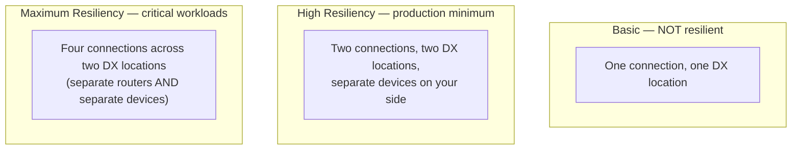

**Step by step:** a single dedicated connection, however fast, remains a single point of failure
at the physical layer — a fiber cut, a router failure, or a facility power event takes the whole
connection down, with nothing automatic to fall back to. AWS's named resiliency tiers exist
precisely because "add a Direct Connect connection" is not the same claim as "now I have a
redundant hybrid link." Only the **Maximum Resiliency** model, which mandates multiple
*physically separate* Direct Connect locations, actually eliminates facility-level single points
of failure — a question emphasizing "no single point of failure, anywhere, including the
facility" wants this specific tier, not just "two connections."

### Image: Virtual Interface types riding one physical connection


*Source: [AWS Documentation — What is Direct Connect?](https://docs.aws.amazon.com/directconnect/latest/UserGuide/Welcome.html)*

**Discussion.** One physical Direct Connect connection can carry multiple logical Virtual
Interfaces simultaneously — a **private VIF** for VPC access, a **public VIF** for reaching AWS's
public service endpoints without a VPC, and a **transit VIF** for reaching a Transit Gateway. This
is worth internalizing because it means "we have a Direct Connect connection" doesn't by itself
tell you what it's *for* — a scenario mentioning a company calling S3 directly from on-prem with
no VPC involved is describing a public VIF specifically, distinct from the private VIF most
VPC-connectivity scenarios assume.

### Exam Tips
- **Direct Connect is not redundant or encrypted by default** — two of the most common traps; a
  fault-tolerance requirement needs a second connection at a *different* location, and an
  encryption requirement needs MACsec or a VPN layered on top.
- **Provisioning lead time (weeks to months) is Direct Connect's biggest practical weakness** —
  "connectivity needed today/this week" is a VPN question in disguise.
- **Direct Connect Gateway lets one connection reach multiple VPCs/Regions** — don't confuse it
  with Transit Gateway, which interconnects many VPCs/VPNs generally; they're often used together.

**Go even deeper:** [`services/networking-content-delivery/direct-connect.md`](../../services/networking-content-delivery/direct-connect.md) (498 lines — LAG bundling, BGP failover detail, worked cost comparison)

---

## 11. Site-to-Site VPN & Client VPN

### Definition
Encrypted, private connectivity over the **public internet** between your network and AWS —
**Site-to-Site VPN** connects an entire on-prem network to a VPC; **Client VPN** connects
individual remote users' devices directly into a VPC, both using IPsec/OpenVPN-based encryption.

### Analogy
If Direct Connect is a privately-built dedicated road, a Site-to-Site VPN is an armored,
windowless truck driving on the same public highway everyone else uses — the *path* is shared and
its traffic conditions are outside your control, but the *cargo* (your data) is completely sealed
and unreadable to anyone else on the road. It's dramatically cheaper and faster to put an armored
truck into service than to build a private road, which is exactly why VPN is the right tool when
you need secure connectivity *now* rather than the best possible connectivity *eventually*.

### Purpose
Not every organization can wait weeks for a Direct Connect cross-connect, or needs that level of
dedicated bandwidth — but plenty still need encrypted, private-feeling connectivity into AWS right
now. VPN layers strong IPsec encryption over the existing public internet, giving most of the
security benefit of a private link without the physical provisioning lead time or cost.

### When to Use
Fast-to-provision hybrid connectivity for low-to-moderate, often bursty bandwidth needs; an
automatic failover path alongside a primary Direct Connect connection; individual remote
employees needing scoped access to specific internal resources (Client VPN specifically).

### When NOT to Use (be honest about the alternative)
- **Large, sustained, high-bandwidth transfer where internet variability genuinely matters** —
  **Direct Connect** gives more predictable throughput/latency and typically cheaper per-GB rates
  at real scale.
- **Strict regulatory requirement to never traverse the public internet, even encrypted** — Direct
  Connect is the only option satisfying "never touches the internet," since VPN tunnels over it by
  definition regardless of encryption.
- **Very large numbers of remote users needing high-throughput access** — Client VPN scales, but
  for a genuinely massive remote workforce, consider whether a more targeted, zero-trust
  application-level access model fits better than full network-level VPN access to everyone.

### Use Cases
- **Fast-to-provision hybrid connectivity** — stood up in minutes to hours versus Direct
  Connect's weeks-to-months, ideal for a startup or new project needing connectivity now.
- **Direct Connect automatic backup** — a parallel BGP-based VPN with lower route preference
  takes over automatically if the dedicated connection's BGP session drops.
- **Transit Gateway VPN attachment** — one VPN connection reaches every VPC already attached to
  the Transit Gateway, so adding a new VPC needs no new VPN connection at all.
- **Remote workforce access to private resources** — Client VPN with authorization rules scoping
  each user/group to only the specific subnet/CIDR they're permitted to reach.
- **Low-to-moderate, non-steady bandwidth hybrid workloads** — pay-as-you-go, no fixed circuit
  cost, better suited to bursty traffic that doesn't justify Direct Connect's fixed port-hour fee.
- **VPN CloudHub** — several branch offices, each with their own Customer Gateway, reach each
  other through AWS as the hub, without direct site-to-site circuits between the branches.

### Why It's Important
VPN is usually the first hybrid-connectivity step any organization takes toward AWS — it's quick,
cheap, and "good enough" for a huge range of real workloads, making it one of the most commonly
deployed networking services in practice, not just an exam topic.

### Diagram: Two Tunnels, Built-In Redundancy, Per VPN Connection

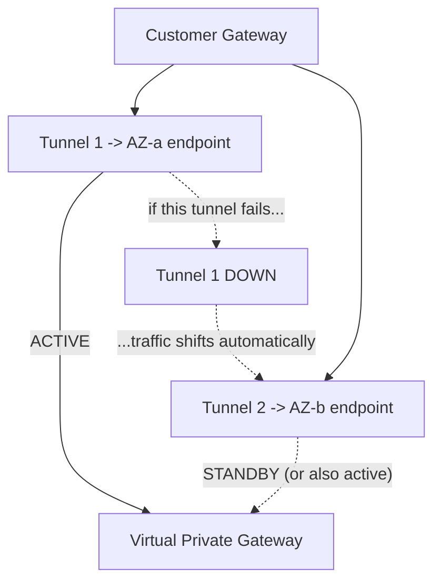

**Step by step:** every Site-to-Site VPN connection provisions **two separate encrypted tunnels**,
each terminating in a **different Availability Zone** on the AWS side — seeing two distinct public
IP addresses for one VPN connection is completely normal, not a misconfiguration. If a problem
hits Tunnel 1's path, traffic automatically shifts to Tunnel 2. A frequent real-world mistake
undermines this redundancy, though: teams configure the Customer Gateway device with only Tunnel
1's parameters (copy-pasted from a config file) and never actually test that Tunnel 2 works — so
the "built-in" redundancy turns out to be untested and sometimes non-functional exactly when it's
needed.

### Image: the reference Site-to-Site VPN topology


*Source: [AWS Documentation — How AWS Site-to-Site VPN works](https://docs.aws.amazon.com/vpn/latest/s2svpn/how_it_works.html)*

**Discussion.** The two endpoints pictured — your on-prem **Customer Gateway** and AWS's **Virtual
Private Gateway** — establish the encrypted tunnel over the ordinary public internet connection
each side already has, which is exactly why a VPN can be live in minutes: there's no physical
infrastructure to build, only configuration on two existing devices. Worth noting what this
diagram doesn't show: BGP (or static routing) must *separately* advertise which networks are
reachable over the tunnel — a tunnel showing "UP" only confirms the encryption layer is
established, and says nothing about whether any actual routes are being exchanged, which is the
single most common real-world "my VPN is up but I can't reach anything" support case.

### Exam Tips
- **Two tunnels per VPN connection, always** — built-in redundancy; seeing two IPs is expected
  behavior, not a sign of misconfiguration.
- **Client VPN vs. Site-to-Site VPN**: "individual remote employees need access" → Client VPN.
  "Two entire networks need to talk to each other" → Site-to-Site VPN.
- **1.25 Gbps is a hard, non-raisable per-tunnel ceiling** — a scenario needing more throughput
  points to ECMP across multiple tunnels/connections on a Transit Gateway, not a quota-increase
  request.

**Go even deeper:** [`services/networking-content-delivery/vpn.md`](../../services/networking-content-delivery/vpn.md) (510 lines — IPsec encapsulation detail, split vs. full tunnel, VPN CloudHub)

---

## 12. AWS Shield

### Definition
AWS's managed **Distributed Denial of Service (DDoS) protection** service — continuously monitors
traffic to detect and automatically mitigate attacks aimed at overwhelming your application with
traffic volume or exhausting its resources.

### Analogy
Shield Standard is like a building's automatic fire-suppression sprinkler system — installed in
every building by code, triggers automatically, costs nothing extra, and handles the common case
(a small fire) without anyone needing to call the fire department. Shield Advanced is the paid
upgrade to a 24/7 on-call fire brigade with direct hotline access, specialized equipment for
larger fires (sophisticated, large-scale attacks), and an insurance policy that reimburses you for
water damage (scaling cost spikes) the sprinklers caused while putting the fire out.

### Purpose
A DDoS attack doesn't try to breach your data — it tries to make your service unusable by
flooding it with more traffic than it can handle. Defending against this at AWS's network scale
is something individual customers can't replicate themselves; Shield exists because AWS's global
network capacity and automated mitigation can absorb attack traffic that would overwhelm almost
anyone's own infrastructure.

### When to Use
Shield Standard is already protecting every AWS account automatically — there's no "should I turn
on basic DDoS protection" decision. Upgrade to Shield Advanced when the workload is revenue-
critical, a known/frequent attack target (gaming, financial services), or needs enhanced
application-layer detection, 24/7 expert response, and cost protection for attack-driven scaling.

### When NOT to Use (be honest about the alternative)
- **Protecting against application-logic exploits** (SQL injection, XSS, bad bots) — that's
  **WAF**'s job; Shield defends against volume/availability, not malicious request content.
- **Low-traffic internal applications with no public exposure** — Shield Standard's baseline is
  already free and automatic, but paying for Advanced on an internal-only, low-risk workload
  usually isn't worth the real, non-trivial subscription cost.
- **Detecting a specific malicious actor's behavior that isn't actually a DDoS** (credential
  stuffing against one login endpoint) — that's more of a WAF rate-based rule problem.

### Use Cases
- **Baseline DDoS coverage for every public-facing workload** — Standard is automatically active
  with zero configuration and zero cost for every AWS account.
- **Revenue-critical application** — an e-commerce site where even a short outage costs real
  revenue justifies Advanced's enhanced detection, DRT access, and cost-protection guarantee.
- **Layered L3/4 + L7 defense for one application** — Advanced automatically creates/tunes WAF
  rate-based rules during a detected application-layer attack, combining both layers without
  manual mid-incident intervention.
- **Latency-sensitive UDP workloads** (a real-time game server) — Advanced can protect EC2
  Elastic IPs directly, since a CloudFront/WAF-fronted design would break UDP compatibility.
- **Org-wide consistent DDoS posture via Firewall Manager** — centrally enforcing Shield Advanced
  across every account in an Organization rather than per-team configuration.
- **Cost-spike protection during a genuine attack** — crediting back EC2/CloudFront/Route 53
  charges directly attributable to a declared DDoS event on protected resources.

### Why It's Important
DDoS attacks remain one of the most common attack types against public internet infrastructure,
and they don't require any data breach to cause real business damage — an e-commerce site
unreachable during a sale event directly costs revenue and trust.

### Diagram: Shield Standard vs. Advanced — protection surface

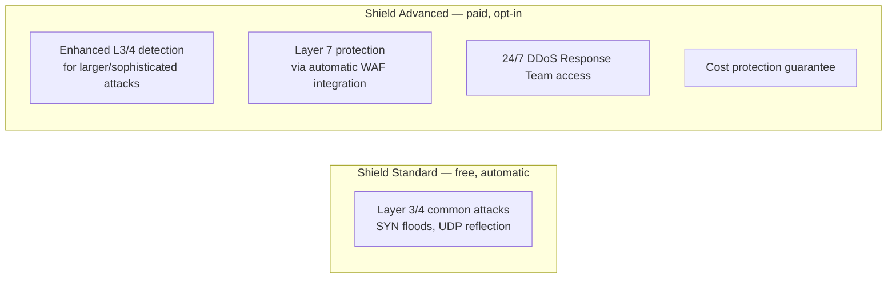

**Step by step:** Standard's protection is baked into the AWS edge network itself — every account
gets it, for every resource using CloudFront/Route 53/Global Accelerator, automatically, with
zero configuration. Advanced is an entirely separate, opt-in, paid tier layered on top: it doesn't
replace Standard's always-on baseline, it adds enhanced detection for bigger/more sophisticated
attacks, extends into Layer 7 *only through an integrated WAF Web ACL* (a detail many teams miss —
subscribing to Advanced with no Web ACL attached still only gets you enhanced L3/4 protection),
and unlocks the human-expert and financial-guarantee benefits (DRT, cost protection) that Standard
simply doesn't include at any price.

### Image: AWS's reference DDoS-resilient web application architecture


*Source: [AWS WAF Developer Guide — Example Shield Advanced DDoS resiliency architecture](https://docs.aws.amazon.com/waf/latest/developerguide/ddos-resiliency-example-web.html)*

**Discussion.** The architecture's key insight is *where* Shield Advanced protection is applied:
on the **edge resources** (Route 53 hosted zones, CloudFront distributions), not directly on the
origin compute. The origin (the ALB and EC2 fleet) benefits by being shielded *behind* already-
protected edge infrastructure, rather than being directly exposed to the internet at all. This is
why a question describing an architecture where EC2 instances sit directly behind a public IP with
no CloudFront/Route 53/Global Accelerator layer in front should raise suspicion — that design
leaves the compute layer with no edge-level DDoS absorption at all, regardless of whether Shield
Advanced is subscribed, because Shield Advanced can't protect a resource type it was never
associated with.

### Exam Tips
- **Shield Standard is always on, for free, for every account** — a question implying you need to
  "enable" basic DDoS protection is testing whether you know it's already there.
- **Shield vs. WAF** — Shield defends volume/availability (L3/4, and with Advanced, some L7 via
  WAF); WAF defends request *content* (SQLi, XSS, bad bots) at L7. A question mentioning "SQL
  injection" always points to WAF, never Shield alone.
- **Protected resource types are a fixed list** (CloudFront, Route 53, Global Accelerator, ELB,
  EC2 Elastic IPs) — a scenario describing protection for a resource outside this list should
  raise suspicion.

**Go even deeper:** [`services/security-identity-compliance/shield.md`](../../services/security-identity-compliance/shield.md) (457 lines — cost protection scope detail, worked gaming-company scenario, onboarding checklist)

---

## 13. AWS WAF

### Definition
A **Layer 7 (application-layer) firewall** that inspects the actual content of incoming web
requests — headers, query strings, body, IP, geography — and blocks, allows, counts, or
rate-limits them based on rules you define.

### Analogy
Network-layer defenses (security groups, Shield) are like a security guard checking that everyone
entering a building has a valid ID badge — they verify *who's* coming in, at the door. WAF is the
guard reading the *contents of every envelope and package* people are carrying in, checking for
anything matching known dangerous patterns (a forged check, a prohibited substance) regardless of
whether the person carrying it has a perfectly valid badge. A badge check and a package inspection
catch entirely different kinds of problems — a visitor with a flawless ID can still be carrying
something you don't want inside, which is exactly why WAF exists as a separate layer from network
firewalls, not a replacement for them.

### Purpose
Network-layer defenses can't tell the difference between a legitimate HTTP request and one
carrying a malicious SQL injection payload — both are "just HTTP traffic" at that layer. WAF
exists specifically to inspect *what's inside* the request and make a content-aware decision,
closing a gap lower-layer network controls fundamentally cannot address.

### When to Use
Any public-facing web application or API behind CloudFront, an ALB, API Gateway, AppSync, or a
Cognito user pool — especially whenever a scenario mentions SQL injection, cross-site scripting,
bot/scraper traffic, or credential-stuffing against a login endpoint.

### When NOT to Use (be honest about the alternative)
- **Protecting against volumetric network-layer DDoS floods** — that's **Shield**'s job; WAF
  inspects request content, it doesn't absorb massive volumetric traffic the way Shield's
  edge-network mitigation does. In practice they're layered together, never substitutes.
- **Internal, non-HTTP traffic** (database connections, SSH, raw TCP) — WAF only inspects HTTP(S)
  requests to the specific resource types it attaches to; use security groups/NACLs instead.
- **A raw EC2 instance with no ALB/CloudFront/API Gateway in front of it** — WAF can't attach
  directly to a bare EC2 instance; put a supported resource in front of it first, or consider AWS
  Network Firewall for broader VPC-level inspection.

### Use Cases
- **Blocking SQL injection/XSS without custom detection logic** — AWS Managed Rule Groups give
  continuously-updated protection against the OWASP Top 10 with zero custom rule authoring.
- **Rate-limiting a login endpoint against credential stuffing** — a rate-based rule scoped
  specifically to `/login` via a `ScopeDownStatement`, without affecting other site traffic.
- **Geo-blocking high-fraud or unsupported regions** — a geo-match rule blocking by country code
  with no custom IP-range maintenance needed.
- **Distinguishing good bots from bad bots** — Bot Control classifies traffic sources, blocking
  scrapers while explicitly allowing known-good search engine crawlers through.
- **Safe rollout of a new security rule in production** — deploying in **Count** mode first to
  observe match volume via CloudWatch before switching to **Block**, catching false positives.
- **Protecting a public ML inference endpoint** — layering a Managed Rule Group, Bot Control, and
  a rate-based rule scoped to the inference path addresses payload risk, scraping, and cost
  exposure simultaneously.

### Why It's Important
SQL injection and cross-site scripting remain perennial entries in the OWASP Top 10 despite being
well-understood for decades, because manual input sanitization is easy to get wrong across
hundreds of code paths. A managed, continuously-updated WAF rule set catches classes of attack
even well-written application code sometimes misses.

### Diagram: Web ACL Rule Evaluation — Ordered, with Labels for Multi-Stage Logic

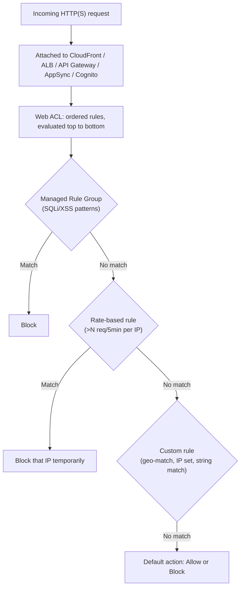

**Step by step:** a Web ACL's rules are evaluated **in priority order**, and the moment one rule's
action takes effect (typically Block), evaluation for that request stops — rules later in the
list never get a chance to fire on an already-blocked request. **Count mode** is the specific,
named mechanism for testing a new rule safely: it logs a match exactly as if the rule had fired,
without actually blocking anything, letting a team observe real-traffic false-positive rates
before flipping the same rule to Block. **Labels** take this further — a rule in Count mode can
tag a matching request with a label, and a *later* rule in the same Web ACL can key its own
block/allow decision off that label, letting you build compound, multi-signal logic ("suspicious
user agent AND unusual request pattern") across multiple rule evaluations instead of each rule
acting in total isolation.

### Image: WAF Web ACL as the inspection layer in front of CloudFront


*Source: [AWS Solutions Constructs — aws-wafwebacl-cloudfront](https://docs.aws.amazon.com/solutions/latest/constructs/aws_wafwebacl_cloudfront.html)*

**Discussion.** This reference architecture also depicts the CloudWatch log group every evaluated
request can stream into — a detail worth calling out because it's the mechanism behind "prove to
an auditor that application-layer attacks are actively defended against" (a PCI-DSS style
requirement). The logs are a concrete, timestamped record of blocked/counted requests, which is
real evidence a control exists and fires — but it's worth being honest in an exam answer that this
evidence proves the *control* works, not that the *application's own code* correctly handles every
input; WAF is a defense-in-depth layer sitting in front of the application, never a substitute for
secure application code underneath it.

### Exam Tips
- **WAF vs. Shield, the recurring pairing** — WAF = content inspection (Layer 7); Shield =
  volumetric/availability (Layer 3/4). "SQL injection" or "cross-site scripting" always points to
  WAF, never Shield alone.
- **WAF attaches only to specific resource types**: CloudFront, ALB, API Gateway, AppSync, Cognito
  user pools — never directly to a raw EC2 instance or NLB.
- **Count mode before Block mode** is the safe-rollout pattern the exam explicitly rewards for
  "test a new rule without risking blocking legitimate traffic."

**Go even deeper:** [`services/security-identity-compliance/waf.md`](../../services/security-identity-compliance/waf.md) (497 lines — full Web ACL JSON, WCU capacity mechanics, WAF Classic vs. WAFv2)

---
## 14. Amazon Cognito

### Definition
AWS's managed service for handling **your application's end-user identity** — sign-up, sign-in,
password resets, social/enterprise login, and issuing tokens your app uses to decide what a
logged-in user can access.

### Analogy
If IAM Identity Center is the keycard system for your own employees entering your company's own
offices, Cognito is the membership-card system a gym issues to its *paying customers*. Totally
different population, totally different purpose: a gym member's card gets them into the workout
floor (your app), not into the gym's back-office payroll system (your AWS account). Cognito's
**User Pool** is the membership database (who are you, is your password right); its **Identity
Pool** is a separate, optional upgrade — like a member who's also been given a personal locker key
(temporary AWS credentials) because they specifically need to store something (upload to their
own S3 folder) beyond just getting through the front door.

### Purpose
Every consumer-facing app needs user accounts, and building authentication correctly (password
hashing, MFA, account recovery, social login, protecting against credential stuffing) is genuinely
hard to get right and a terrible place to have a bug. Cognito lets application teams plug in a
battle-tested, scalable identity system instead of reinventing login.

### When to Use
Any application with external, product-facing users — a mobile app's sign-up flow, a web
product's login page, a B2B SaaS product's tenant SSO. Add an Identity Pool specifically when
those logged-in users need to call AWS services *directly* (not just your own backend).

### When NOT to Use (be honest about the alternative)
- **Your own employees/workforce needing AWS account access** — that's **IAM Identity Center**,
  not Cognito. Cognito is for your product's external customers, never your staff.
- **Fine-grained, app-specific authorization logic beyond "is this user logged in and what
  scope"** — Cognito handles authentication and coarse authorization; for rich, policy-based
  authorization, pair it with Amazon Verified Permissions rather than stretching Cognito further.
- **An existing, mature in-house or third-party identity provider the product is already built
  around** — migrating purely to adopt Cognito isn't worth it unless there's a specific AWS-
  integration reason; Cognito can federate with that existing IdP instead of replacing it.

### Use Cases
- **Consumer app sign-up/login with social federation** — a User Pool normalizes email/password
  and "Sign in with Google" into the same JWT format, so the rest of the app never needs to know
  which path the user took.
- **Mobile uploads directly to a per-user S3 prefix** — an Identity Pool exchanges the User
  Pool's token for temporary AWS credentials scoped to only that user's folder, no backend relay.
- **API Gateway authorizing end users with no custom JWT issuer** — the built-in Cognito
  authorizer validates tokens locally with no custom token-issuing code to maintain.
- **B2B SaaS tenant SSO** — a shared User Pool federates many enterprise customers' own SAML/OIDC
  IdPs, normalizing every tenant's login into the same token shape the app already handles.
- **Guest/unauthenticated access for public content** — an Identity Pool's "guest" identity gets
  its own scoped IAM role, distinct from the authenticated role, for pre-login browsing.
- **Incident response — revoking a compromised user's active sessions** — `AdminUserGlobalSignOut`
  explicitly invalidates refresh tokens, which simply disabling or deleting the account does not.

### Why It's Important
Authentication is one of the few parts of an app where a subtle bug becomes a direct account-
takeover vulnerability, not just a feature defect — using a managed, widely-audited identity
service meaningfully reduces that risk surface versus hand-rolled auth.

### Diagram: User Pool vs. Identity Pool — the #1 trap on this topic

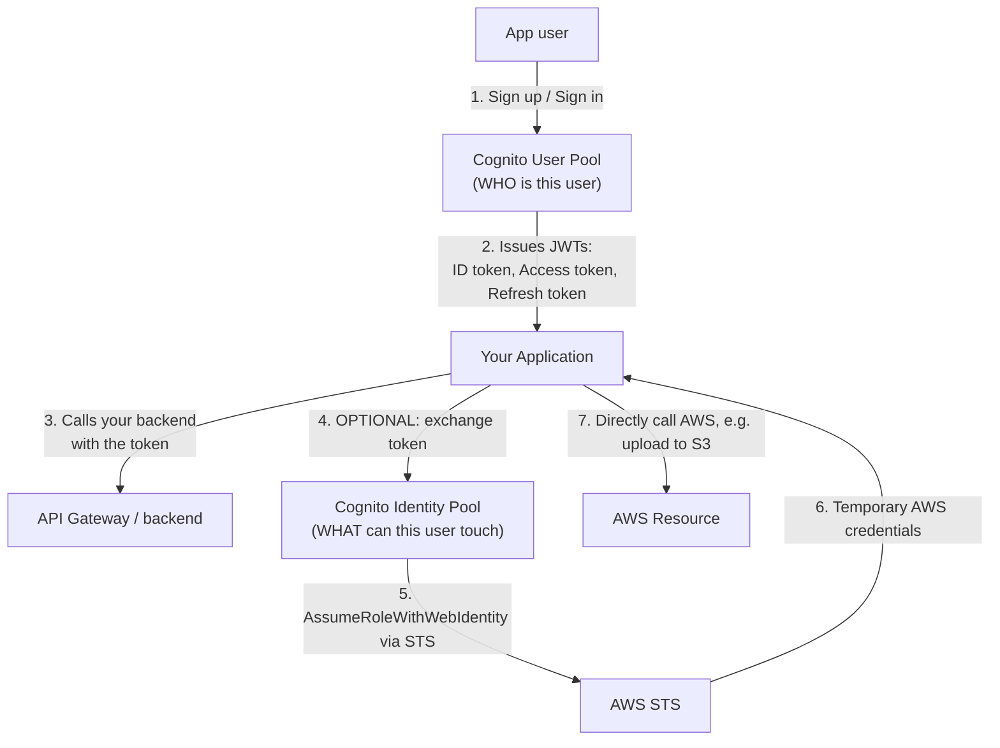

**Step by step:** the **User Pool** answers "who is this user" — it's the actual directory,
issuing JWTs after validating credentials (possibly federated from Google/SAML/OIDC). That's
often the entire story: if your app's backend just needs to verify "is this a valid, logged-in
user," you stop right there, with no Identity Pool involved at all. The **Identity Pool** is a
distinct, optional second step that answers "what AWS resources can this user touch directly" —
it takes the User Pool's token (or even an unauthenticated guest context) and exchanges it, via
`AssumeRoleWithWebIdentity`, for real temporary AWS credentials scoped to an IAM role. Conflating
these two — assuming "Cognito" always means "the user gets AWS credentials" — is the single most
common mistake on this topic.

### Image: the official Identity Pool exchange sequence


*Source: [AWS Cognito Developer Guide — What is Amazon Cognito?](https://docs.aws.amazon.com/cognito/latest/developerguide/what-is-amazon-cognito.html)*

**Discussion.** The diagram's sequencing matters: the User Pool interaction happens first and
completely independently of any AWS resource access — a user can sign in, get a JWT, and use your
app's own backend API for the entire session without ever touching an Identity Pool. Only the
*additional* step of exchanging that token through an Identity Pool brings `AssumeRoleWithWebIdentity`
and STS into the picture. This is exactly why a scenario describing "users sign in and call our
own backend API" needs only a User Pool, while "users sign in and upload directly to their own S3
folder from the mobile app, bypassing our backend" needs both a User Pool *and* an Identity Pool
layered on top.

### Exam Tips
- **User Pool vs. Identity Pool is the #1 trap** — User Pool = authentication (who). Identity
  Pool = AWS-resource authorization bridge (what, via STS). Don't assume one implies the other.
- **Cognito vs. IAM Identity Center** — Cognito is for your product's external customers; Identity
  Center is for your own employees. "Customers of our application" → Cognito; "our engineers" →
  Identity Center.
- **Refresh token lifetime is configurable up to 10 years** — a question balancing convenience
  against security is testing whether you'd tune this *down*, not leave the long default in place.

**Go even deeper:** [`services/security-identity-compliance/cognito.md`](../../services/security-identity-compliance/cognito.md) (535 lines — full token lifecycle, Lambda triggers, multi-tenant ABAC via claims)

---

## 15. Amazon GuardDuty

### Definition
AWS's managed **threat detection** service — continuously watches activity across your account
(API calls, network traffic metadata, DNS queries, container/Kubernetes activity) and uses
machine learning plus threat intelligence to flag things that look like an actual attack or
compromise.

### Analogy
GuardDuty is a building's behavioral security system, not a lock on any particular door — it
doesn't stop anyone from doing anything (that's the job of IAM policies, security groups, locks).
Instead, it's the network of cameras and anomaly-detection software watching how people move
through the building: "this badge normally enters through the east door at 9am, and just used the
west door at 3am" or "someone's badge just tried forty doors in sixty seconds." It doesn't catch
every bad actor — a sufficiently novel technique can slip past known patterns — but it catches
the behavioral *shape* of an attack even when no single action looks obviously wrong in isolation.

### Purpose
Most security incidents aren't announced — they look like normal-shaped API calls from a stolen
credential, or an EC2 instance quietly talking to a known cryptomining pool. GuardDuty turns "turn
it on" into continuous, intelligent threat detection across an entire account or Organization,
backed by AWS's own threat intelligence and curated partner feeds.

### When to Use
Every serious AWS account, essentially by default — it's considered a "just turn it on" baseline
control, not a specialized tool reserved for high-risk workloads only.

### When NOT to Use (be honest about the alternative)
- **Discovering and classifying sensitive data in S3** — that's **Macie**'s job; GuardDuty
  detects behavioral threats, not data content.
- **Vulnerability scanning of EC2/container/Lambda software for known CVEs** — that's **Amazon
  Inspector**; GuardDuty detects active malicious *behavior*, not *potential* weaknesses.
- **A unified dashboard across many security services** — GuardDuty produces findings but isn't
  itself the aggregation layer; pair it with **Security Hub** for that central view.

### Use Cases
- **Detecting a compromised EC2 instance recruited into a botnet** — DNS/VPC Flow Log analysis
  catches cryptomining-pool or C&C traffic signatures automatically, with zero agent installed.
- **Catching a leaked/stolen IAM access key in use** — anomaly models flag the key being used
  from an unexpected geography/time pattern relative to the user's normal behavior.
- **Reconnaissance detection before a bigger breach** — flagging port-scanning or API probing
  early, giving a response window before an attacker escalates.
- **EKS cluster anomaly monitoring** — EKS Protection analyzes audit logs for privilege escalation
  or unexpected `kubectl` activity, no sidecar agent in every pod required.
- **Org-wide monitoring from one delegated security account** — centralized visibility across
  dozens of member accounts without touching the Organizations management account.
- **Automated containment of a compromised instance** — routing a finding through EventBridge to
  a Lambda that isolates security groups, snapshots the EBS volume, and revokes active sessions.

### Why It's Important
The median time to detect a breach without active monitoring is measured in months in industry
breach reports; GuardDuty is one of the cheapest, lowest-effort ways to collapse that detection
window to minutes or hours.

### Diagram: Finding → EventBridge → Automated Remediation

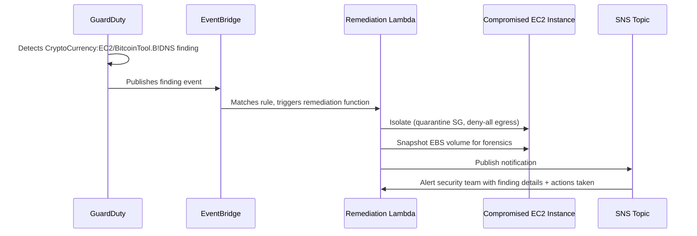

**Step by step:** this is the canonical "finding to containment" pipeline referenced across both
SAA-C03 and DVA-C03 event-driven security questions, and the *order* of operations matters:
isolate first (minimize further damage), preserve evidence second (snapshot before making further
changes that could overwrite forensic data), revoke credentials third (limit what the attacker can
still do elsewhere with that identity), and notify humans last — containment shouldn't wait on a
person being awake and available at 3am. No part of this requires GuardDuty to have an agent on
the instance; the entire detection happened purely from analyzing existing log sources (CloudTrail,
VPC Flow Logs, DNS).

### Image: GuardDuty detecting a malicious IAM permission change via CloudTrail


*Source: [AWS Documentation — Amazon GuardDuty (SAP on AWS security reference)](https://docs.aws.amazon.com/sap/latest/general/guardduty.html)*

**Discussion.** This illustrated scenario is worth tracing carefully because it shows GuardDuty's
detection working entirely on data it never had to be specially configured to collect: data is
written to S3 for ordinary business purposes, a malicious actor modifies IAM permissions on that
bucket (a normal-shaped CloudTrail management event), and GuardDuty's ongoing analysis of that
same CloudTrail stream — which was already flowing whether GuardDuty existed or not — flags the
anomalous permission change against its behavioral baseline and alerts administrators. Nothing
about this detection depended on an agent, a special log format, or extra instrumentation; it's
the same CloudTrail everyone already has, analyzed continuously instead of ignored.

### Exam Tips
- **GuardDuty vs. Macie vs. Inspector — the recurring three-way trap**: GuardDuty = behavioral
  threat detection (is something malicious happening *now*). Macie = sensitive data discovery
  (what data exists, is it exposed). Inspector = vulnerability scanning (what weaknesses exist
  before exploitation).
- **No agent required for core detection** — GuardDuty reads existing log sources automatically;
  Runtime Monitoring is the one component that does use a lightweight agent for deeper visibility.
- **Delegated administration is per-service** — being the GuardDuty delegated admin doesn't
  automatically make the same account the Macie or Security Hub admin too.

**Go even deeper:** [`services/security-identity-compliance/guardduty.md`](../../services/security-identity-compliance/guardduty.md) (505 lines — finding-type quick reference, severity scoring, multi-finding incident correlation)

---

## 16. Amazon Macie

### Definition
A managed service that automatically **discovers, classifies, and reports on sensitive data**
(PII, credentials, financial data) stored in Amazon S3, using pattern matching and machine
learning, so you know exactly where sensitive data lives and whether it's exposed.

### Analogy
Imagine a company that's been operating for a decade with dozens of storage closets (S3 buckets)
accumulated from every department, era, and forgotten project — nobody has a master inventory of
what's actually inside each one. Macie is a team of inspectors who walk through every closet,
photograph and categorize the contents (is this a tax document, a medical record, a box of old
receipts), and — critically — also check whether the closet door even locks (is the bucket
public). You can't protect what you don't know you have, and a decade of ad hoc storage means
nobody remembers which closet has the sensitive stuff until someone actually goes and looks.

### Purpose
Organizations routinely lose track of where sensitive data actually is — a bucket from a one-off
export two years ago, a backup still containing customer PII, a "just for testing" bucket that
somehow has real production data. You can't protect data you don't know exists, and compliance
frameworks (GDPR, HIPAA, PCI-DSS) all require knowing exactly where regulated data lives.

### When to Use
Any organization storing meaningful amounts of data in S3 over time — especially during a
compliance audit cycle, before granting broader access to a shared bucket, or after an
acquisition brings in an unfamiliar S3 estate.

### When NOT to Use (be honest about the alternative)
- **Detecting active attacker behavior** (unusual API calls, compromised credentials) — that's
  **GuardDuty**'s job; Macie looks at data content/exposure, not behavioral threats.
- **Data stored outside S3** (RDS, DynamoDB, on-prem) — Macie is S3-specific; other stores need a
  different discovery approach (export to S3 first, database-native tools, or third-party DSPM).
- **A very small S3 footprint with known, well-documented contents** — the cost/benefit of
  continuous discovery jobs may not be worth it with strict, well-audited bucket policies already
  in place and few buckets to track.

### Use Cases
- **Auditing years of accumulated S3 buckets for forgotten PII** — managed identifiers scan
  content across the entire estate, surfacing exactly where sensitive data actually lives.
- **Catching accidental exposure the moment it happens** — automated discovery continuously
  samples the S3 estate at lower cost, catching new exposure fast rather than at an annual audit.
- **Compliance audit evidence for PCI-DSS/HIPAA/GDPR** — a continuous, timestamped finding history
  instead of a one-time manual spreadsheet.
- **Correlating exposure and sensitivity to prioritize remediation** — combining Macie's
  sensitive-data findings with IAM Access Analyzer's external-exposure findings surfaces the true
  highest-risk intersection: buckets both reachable from outside *and* worth protecting.
- **Custom data identifiers for organization-specific formats** — a regex-based identifier for an
  internal employee-ID format Macie's 100+ managed identifiers were never designed to catch.
- **ML training data hygiene before model training** — a targeted scan confirms a dataset slated
  for training doesn't contain PII that shouldn't end up memorized by the model.

### Why It's Important
Data breaches involving S3 misconfiguration — a public bucket containing customer records — have
been some of the most damaging, headline-making incidents in cloud history, and the root cause
was often simply nobody realizing sensitive data was sitting in an exposed bucket.

### Diagram: Findings vs. Results — the distinction the exam tests

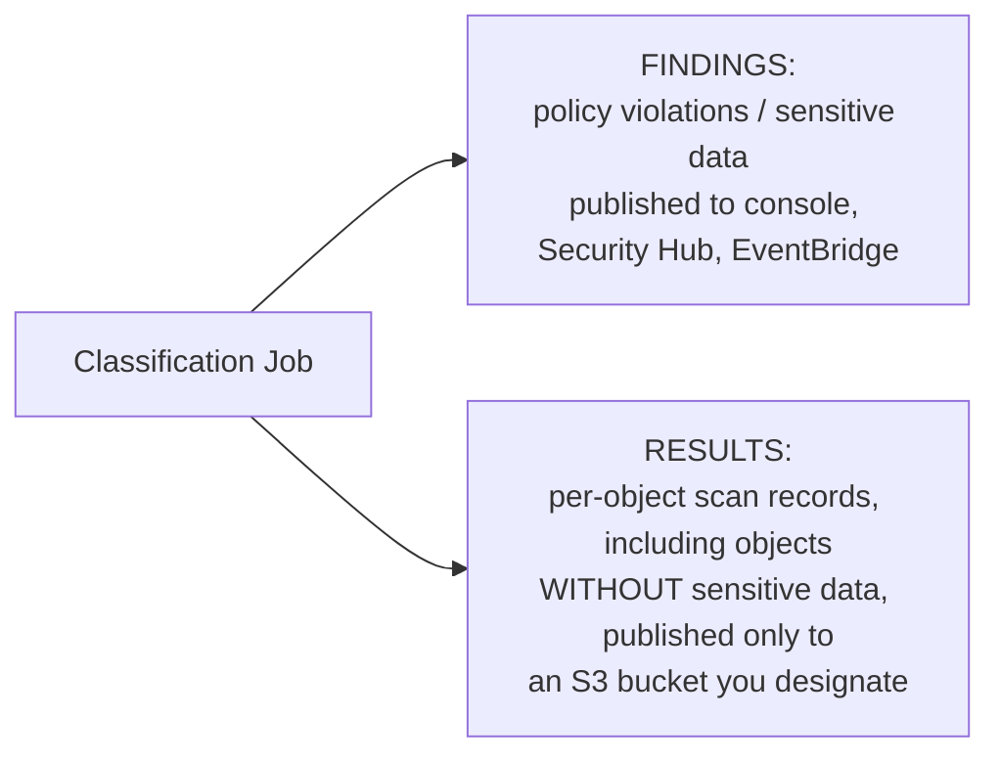

**Step by step:** **Findings** are the alert-worthy signal — something specific to act on right
now, streamed to the console, Security Hub, and EventBridge for immediate visibility and
automated remediation. **Results** are a completely different artifact: the exhaustive,
per-object scan log of *every* object examined, including the ones that had nothing sensitive in
them at all, published only to an S3 bucket you choose. Results exist for building your own
Athena/QuickSight analytics over Macie's full scan history — they're not meant for immediate
action, and conflating the two (expecting Findings-level alerting from Results, or expecting
Results' exhaustive detail from Findings) is a real, testable confusion.

### Image: Macie continuously analyzing an S3 bucket for PII


*Source: [AWS Documentation — Amazon Macie (SAP on AWS security reference)](https://docs.aws.amazon.com/sap/latest/general/macie.html)*

**Discussion.** The word "continuously" in this diagram's own caption is the detail worth
dwelling on: Macie isn't a one-time audit tool you run once and forget — its automated discovery
tier keeps sampling the bucket as new objects land, which is precisely what lets it catch a
compliance problem the week it's introduced rather than the next time someone happens to run a
manual review (which, in many real organizations, is "never" or "only after a breach"). This
continuous framing is also exactly why auditors specifically ask about Macie rather than accepting
"we did a manual review last year" as sufficient evidence for a data-residency or PII-handling
compliance requirement.

### Exam Tips
- **Macie vs. GuardDuty vs. Inspector** — Macie = sensitive data content/exposure; GuardDuty =
  active malicious behavior; Inspector = software vulnerabilities. "PII," "credit card numbers,"
  "discover sensitive data in S3" always points to Macie.
- **Macie is S3-only** — it does not scan RDS, DynamoDB, or EC2 filesystems directly.
- **Automated discovery (continuous, cheap, sampled) vs. full classification jobs (thorough,
  pricier)** — a full job should be targeted at specific high-sensitivity buckets, not run
  blindly against an entire multi-petabyte estate on a recurring schedule.

**Go even deeper:** [`services/security-identity-compliance/macie.md`](../../services/security-identity-compliance/macie.md) (489 lines — custom identifier tuning, severity model, end-to-end investigation walkthrough)

---

## 17. Security Hub & Inspector

### Definition
**Security Hub** is a central dashboard that aggregates security findings from GuardDuty, Macie,
Inspector, IAM Access Analyzer, Firewall Manager, and third-party tools into one place, and
continuously checks your account against security standards. **Amazon Inspector** is an automated
**vulnerability scanner** checking EC2, ECR container images, and Lambda functions for known
software vulnerabilities (CVEs) and network reachability issues.

### Analogy
If GuardDuty is behavioral security cameras and Macie is the closet inspector checking for
sensitive contents, Inspector is a building code inspector checking every room for *structural
weaknesses* that haven't failed yet but legally should be fixed (a known-faulty wiring type still
installed, a door that doesn't meet current fire code). Security Hub is the single master
dashboard on the building manager's desk that pulls in reports from the camera system, the closet
inspector, *and* the code inspector, plus runs its own independent walkthrough checklist (CIS,
PCI-DSS) against the whole building — so the manager never has to walk to five separate offices
to get the full picture.

### Purpose
A mature AWS environment quickly accumulates findings from many different security tools, each
with its own console and alert-fatigue risk — nobody can realistically watch five separate
dashboards. Security Hub exists to be the single pane of glass; Inspector exists because "did we
patch this known vulnerability" is a continuous, moving target that doesn't scale to manual
tracking.

### When to Use
Security Hub: any environment running more than one or two of GuardDuty/Macie/Inspector/IAM
Access Analyzer, or needing continuous compliance-standard scoring (CIS, PCI-DSS, NIST). Inspector:
any account running EC2, pushing images to ECR, or deploying Lambda functions that need continuous
CVE visibility.

### When NOT to Use (be honest about the alternative)
- **Expecting Security Hub to generate findings on its own** — it doesn't; enabling it with no
  source services turned on produces an empty dashboard. It aggregates what GuardDuty/Macie/
  Inspector already produce.
- **Deep, authenticated vulnerability scanning with custom compliance policies beyond AWS's
  supported standards, or scanning non-AWS/on-prem assets** — consider a third-party vulnerability
  management tool (several integrate back into Security Hub) rather than expecting Inspector to
  cover everything.
- **A single, very small account with only one security tool enabled** — the aggregation value
  scales with the number of accounts/tools; a lone developer account may not need Security Hub's
  extra layer immediately.

### Use Cases
- **One dashboard instead of five across a large Organization** — normalized ASFF/OCSF findings
  and cross-account aggregation replace five separate consoles with one filterable view.
- **Continuous compliance posture ahead of an audit** — ongoing PCI-DSS or CIS benchmark tracking
  with a continuously-updated percentage score, not a point-in-time manual checklist.
- **Catching a previously-clean container image flagged by a new CVE** — Inspector automatically
  rescans existing ECR images against new vulnerability intelligence with no rebuild required.
- **Prioritizing patch work by actual exposure, not raw CVSS alone** — Inspector factors network
  reachability into its risk scoring, so an internet-reachable critical CVE outranks an identical
  CVE on an isolated internal instance.
- **Gating CI/CD container promotion on vulnerability scan results** — blocking deployment of an
  image with unpatched critical vulnerabilities until it's clean or an exception is approved.
- **Correlating misconfiguration with vulnerability for true priority** — Security Hub's exposure
  findings combine posture-management and Inspector findings into one composite, higher-ranked
  finding.

### Why It's Important
Security operations teams are measured on mean-time-to-detect and mean-time-to-remediate;
fragmented tooling directly worsens both. Continuous vulnerability scanning closes the gap between
"a CVE was published" and "we know we're affected" — for internet-facing systems, often a gap
measured in hours before active exploitation begins in the wild.

### Diagram: Exposure Findings — Security Hub's Correlation Capability

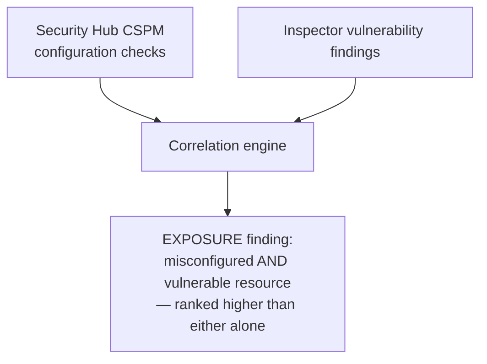

**Step by step:** newer Security Hub versions go beyond simple side-by-side aggregation into
actual **correlation** — specifically combining a posture-management signal ("this resource is
misconfigured, e.g., publicly reachable") with a vulnerability signal from Inspector ("this same
resource runs software with a known CVE") into a single composite finding ranked more urgently
than either alone. This mirrors exactly the same philosophy used elsewhere in this security
category (Macie's correlation with IAM Access Analyzer): the question that actually matters isn't
"is this resource exposed" or "is this resource vulnerable" in isolation, but "is it *both*
simultaneously" — that intersection is where real-world exploitation risk concentrates.

### Image: a centralized Security Tooling account running all four services


*Source: [AWS Prescriptive Guidance — Security Reference Architecture, Security Tooling account](https://docs.aws.amazon.com/prescriptive-guidance/latest/security-reference-architecture/security-tooling.html)*

**Discussion.** The fact that all four services (Security Hub, GuardDuty, Inspector, Macie) are
pictured living together in one dedicated **Security Tooling account** is itself a load-bearing
architectural detail, not an arbitrary grouping: delegating administration of each service to this
one account lets a security team see and manage findings across the *entire* Organization without
that team ever needing standing admin rights inside any individual workload account. Note,
though, that this delegation happens **per service** — a question describing findings missing
from only one of the four services almost always points to that one service's delegation link
being misconfigured or never completed, not a Security Hub-wide failure.

### Exam Tips
- **Security Hub aggregates; it doesn't detect on its own** — its native contribution is
  compliance-standard checks, exposure correlation, and the unified dashboard, not primary threat
  detection.
- **Inspector vs. GuardDuty vs. Macie** — Inspector = known software vulnerabilities (CVEs);
  GuardDuty = active malicious behavior; Macie = sensitive data content/exposure. "CVE,"
  "vulnerability," "patch" always point to Inspector.
- **Inspector continuously rescans** — an ECR image can go from clean to flagged without anyone
  rebuilding it, purely because a new CVE was published against an existing, unchanged package.

**Go even deeper:** [`services/security-identity-compliance/security-hub-and-inspector.md`](../../services/security-identity-compliance/security-hub-and-inspector.md) (478 lines — ASFF schema reference, standards comparison, triage-priority worked scenario)

---
## 18. Additional Security Services (CloudHSM etc.)

### Definition
A consolidated group of lower-exam-weight security/identity/compliance services: **CloudHSM**
(dedicated single-tenant hardware key custody), **Detective** (investigation graphing for
GuardDuty findings), **Directory Service** (managed Active Directory), **Firewall Manager**
(org-wide WAF/Shield/SG policy enforcement), **Network Firewall** (deep packet inspection for a
VPC), **RAM** (cross-account resource sharing), **Artifact** (AWS's own compliance report
portal), and **Audit Manager** (continuous evidence collection for your own compliance audits).

### Analogy
Think of this group as the specialized tools in a security team's toolbox beyond the headline
services — CloudHSM is a bank-vault-grade safe you alone hold the key to (versus KMS's
well-guarded but shared storage room); Detective is the detective's corkboard with string
connecting clues after a crime (GuardDuty finding) was already reported; Network Firewall is a
customs checkpoint inspecting cargo contents at the VPC's border (versus security groups, which
just check if a truck has the right permit); Firewall Manager is the regional policy memo that
automatically applies to every branch office, present and future; and RAM is the shared company
car pool — one vehicle, multiple departments allowed to use it, nobody duplicates the car.

### Purpose
These eight services fill specific, narrower gaps that KMS, GuardDuty, WAF, and IAM alone don't
cover: compliance mandates requiring dedicated hardware (CloudHSM), investigation tooling beyond
raw detection (Detective), Windows/AD-dependent workloads (Directory Service), consistent
org-wide policy enforcement (Firewall Manager), deep packet inspection beyond L3/L4 (Network
Firewall), clean cross-account resource sharing (RAM), and compliance documentation (Artifact,
Audit Manager).

### When to Use
CloudHSM: a compliance mandate explicitly requires single-tenant, FIPS 140-2 Level 3 hardware.
Detective: investigating *why* a GuardDuty finding happened, not detecting it. Directory Service:
Windows/AD-dependent workloads needing real Active Directory. Firewall Manager: enforcing
consistent security policy across many accounts automatically. Network Firewall: deep packet
inspection or domain-name-based outbound filtering a security group/NACL can't do. RAM: sharing
one resource (a subnet, a Transit Gateway) across accounts without duplicating it.

### When NOT to Use (be honest about the alternative)
- **CloudHSM for the vast majority of encryption needs** — KMS is simpler, cheaper, and
  sufficient almost always; CloudHSM's dedicated-hardware overhead is only justified by an
  explicit compliance mandate that KMS's shared model genuinely can't satisfy.
- **Network Firewall for simple allow/deny-by-port filtering** — that's a security group/NACL
  job; reach for Network Firewall only when deep packet inspection or domain-based filtering is
  genuinely required.
- **Artifact for evidence about your *own* workload's compliance** — Artifact only provides AWS's
  own third-party audit reports about AWS itself; use **Audit Manager** for continuous evidence
  about your own environment.

### Use Cases
- **CloudHSM**: a financial institution's compliance mandate requires keys never accessible to
  any third party, including AWS operators, running on FIPS 140-2 Level 3 certified hardware.
- **Detective**: a security team receives a GuardDuty finding and opens it directly in Detective,
  which has already correlated related API calls, network connections, and resources into one
  navigable graph.
- **Directory Service**: a company migrating Windows workloads wants users to keep authenticating
  with existing corporate credentials without maintaining two separate identity stores — AD
  Connector proxies straight to the existing on-prem AD.
- **Firewall Manager**: a security team wants every VPC across 50 accounts to have the same
  baseline WAF managed rule set on its ALBs, including any new account or ALB created later.
- **Network Firewall**: a company needs to block all outbound traffic to a list of known-malicious
  domains, plus intrusion detection on packet payloads crossing the VPC boundary.
- **RAM**: a central networking team owns one Transit Gateway and wants every application
  account to attach their own VPCs to it, without granting broader access to the networking
  account itself.

### Why It's Important
These services are each the *specific, correct* answer when a scenario's requirement is narrower
or stricter than what the headline services (KMS, GuardDuty, WAF) can satisfy — recognizing which
narrow tool fits which narrow requirement is exactly what separates a surface-level answer from a
precise one on harder SAA-C03 questions.

### Diagram: Firewall Manager — Define Once, Enforce Everywhere, Forever

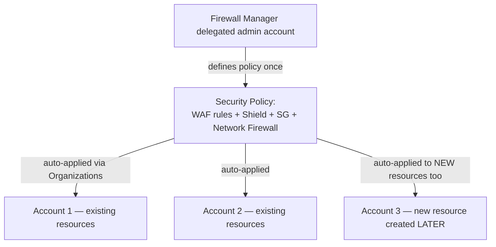

**Step by step:** a security team defines a policy exactly once, from the delegated admin
account. AWS Organizations propagates its enforcement across every member account in scope — and
critically, this isn't a one-time push. Firewall Manager keeps watching and automatically applies
the same policy to brand-new resources and even newly created accounts, so there's no manual step
anyone can forget for a resource that didn't exist yet when the policy was written. This is the
mechanism that turns "every account must have this WAF baseline" from an ongoing manual
enforcement chore into a single, durable policy definition.

### Image: AWS Network Firewall inspecting both inbound and outbound VPC traffic


*Source: [AWS Reference Architecture Diagrams — Network Firewall inspection models](https://docs.aws.amazon.com/reference-architecture-diagrams/)*

**Discussion.** The diagram's depiction of **both** inbound and outbound inspection on the same
firewall is the detail worth internalizing: Network Firewall isn't just a smarter inbound
perimeter guard — it's equally capable of inspecting *outbound* traffic for things a security
group fundamentally cannot see, like a request to a specific known-malicious domain name
regardless of which IP that domain currently resolves to. A security group can only match on IP/
port; it has no concept of "block requests to this domain." This is precisely the capability gap
that makes Network Firewall the right answer whenever a scenario explicitly mentions domain-name-
based outbound filtering or deep packet payload inspection.

### Exam Tips
- **CloudHSM vs. KMS**: "dedicated hardware," "FIPS 140-2 Level 3," "AWS has no access to key
  material" → CloudHSM. KMS is the default, sufficient answer for nearly everything else.
- **Detective vs. GuardDuty**: GuardDuty *detects*; Detective *investigates* an existing finding's
  root cause and blast radius. A question about finding generation points to GuardDuty; one about
  correlating/investigating an existing finding points to Detective.
- **Artifact vs. Audit Manager**: Artifact downloads AWS's *own* compliance reports about AWS;
  Audit Manager continuously collects evidence about *your* workload's compliance.

**Go even deeper:** [`services/security-identity-compliance/additional-security-services.md`](../../services/security-identity-compliance/additional-security-services.md) (330 lines — all 8 services in full, Directory Service's 3 flavors compared)

---

## 19. AWS Systems Manager

### Definition
A collection of operational tools for managing fleets of EC2 instances and on-premises servers at
scale — running commands across hundreds of machines at once, storing configuration/secrets
centrally, opening a secure shell session without SSH keys or open ports, and patching operating
systems automatically.

### Analogy
Traditional remote management (SSH, RDP) is like needing to personally walk up to every single
house on a street and knock on the front door (open an inbound port) to talk to whoever's inside.
Systems Manager inverts this entirely: every house has already placed an outbound call to a
central switchboard the moment it was built, and sits there waiting. When you need to talk to a
house, you call the switchboard, and the switchboard connects you through the *already-open*
outbound line — nobody ever needs a key to anyone's front door, and no door is ever left unlocked
for a stranger to find. This single architectural inversion is why Session Manager can reach a
fully private-subnet instance with zero inbound rules at all.

### Purpose
Managing a handful of servers by hand doesn't scale past a few machines, and opening SSH/RDP ports
is itself a security liability — one of the most common sources of compromise. Systems Manager
lets fleets be configured, patched, inspected, and accessed entirely through the AWS API,
authenticated by IAM, logged by CloudTrail, with zero inbound ports ever opened.

### When to Use
Any fleet of EC2 instances (or on-prem servers registered as "managed instances") needing
operational access, patching, or centralized configuration — and especially whenever a scenario
says "no bastion host," "no open SSH port," or "fully audited shell access."

### When NOT to Use (be honest about the alternative)
- **Secrets requiring automatic rotation, fine-grained resource policies, or cross-account
  sharing as a first-class feature** — **Secrets Manager** is purpose-built for that; Parameter
  Store SecureString can hold secrets but doesn't natively rotate them.
- **Container orchestration/patching** — containers are typically replaced, not patched in place;
  Patch Manager targets EC2/on-prem OS patching, not container image updates.
- **Configuration feature-flagging with gradual rollout/validation** — **AWS AppConfig** is
  purpose-built for dynamic application configuration with deployment strategies and automatic
  rollback, which plain Parameter Store doesn't provide.

### Use Cases
- **Eliminating SSH keys and open port 22/3389 entirely** — Session Manager's outbound-only agent
  channel means IAM policy, not a network rule, governs access, with full session logging.
- **Fleet patch management with scheduled compliance reporting** — Patch Manager's baseline +
  maintenance window + compliance reporting, with no manual SSHing into hundreds of machines.
- **Fan-out diagnostic commands across a tagged fleet** — Run Command targets by tag, not a static
  instance list, automatically covering newly launched Auto Scaling instances.
- **Centralizing application configuration across Lambda, ECS, EC2, and CI/CD** — Parameter Store
  gives one canonical location any service reads via API, eliminating drift between copies.
- **Feeding dynamic, non-hardcoded values into CloudFormation/CDK templates** — a
  `{{resolve:ssm:...}}` dynamic reference resolves at deploy time, keeping the literal value out
  of the versioned template.
- **Accessing fully private-subnet instances with no NAT Gateway budgeted** — VPC interface
  endpoints for `ssm`/`ssmmessages`/`ec2messages` let the agent reach Systems Manager entirely
  within the VPC, no internet route required.

### Why It's Important
Session Manager eliminating open SSH/RDP ports is one of the highest-leverage, lowest-effort
security improvements available on AWS — it closes one of the most commonly exploited attack
surfaces with no workflow downside, since every session is still fully logged.

### Diagram: Session Manager — The Outbound-Only Connection That Removes the Need for an Open Port

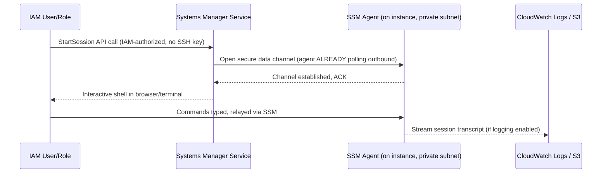

**Step by step:** the single fact that makes this entire architecture work is that the SSM Agent
on the instance establishes an **outbound** connection to the Systems Manager service the moment
it starts — it's already "on the phone" with AWS before any administrator ever wants to connect.
When a user requests a session, authorized purely by IAM policy with zero SSH key exchange, AWS
relays the request down that already-existing outbound channel. At no point does AWS or the user
initiate a *new inbound* connection to the instance — there is structurally nothing to open a port
for. If session logging is enabled, every keystroke streams to CloudWatch Logs/S3 in parallel,
producing a durable audit transcript no local shell-history file (which an attacker with root
could simply delete) could ever provide.

### Image: initiating a Session Manager session, and its audit log in CloudWatch


*Source: ["Using AWS Systems Manager in Hybrid Cloud Environments" — AWS Architecture Blog](https://aws.amazon.com/blogs/architecture/using-aws-systems-manager-in-hybrid-cloud-environments/)*


*Source: same article, "Using AWS Systems Manager in Hybrid Cloud Environments"*

**Discussion.** These two images together tell the complete story in one glance: the first shows
how simple starting a session actually is from the console (click a managed instance, start a
session — no key file, no bastion hop, no VPN client), and the second shows the *consequence* of
that simplicity: every command typed during that session is already streaming to CloudWatch Logs
in parallel, with zero extra effort from the user. This pairing is exactly why Session Manager is
considered a "free win" security improvement — the security benefit (no open port) and the audit
benefit (centralized logging) both come bundled with the *easier* way to connect, not a
trade-off against convenience.

### Exam Tips
- **"No bastion host, no open SSH port, fully audited shell access" → Session Manager** — one of
  the most reliable keyword matches on SAA-C03.
- **A missing IAM instance profile is the #1 real-world and exam-scenario cause** of "I can't
  connect via Session Manager" — not a network/security-group issue, since Session Manager
  requires no inbound rule at all.
- **Parameter Store vs. Secrets Manager**: both can hold secrets, but automatic **rotation** and
  **cross-account resource policies** are Secrets Manager's distinguishing feature — a question
  mentioning automatic rotation always points to Secrets Manager, even though Parameter Store
  SecureString looks superficially similar.

**Go even deeper:** [`services/management-governance/systems-manager.md`](../../services/management-governance/systems-manager.md) (680 lines — full patch-run trace, Parameter Store dynamic references, 5 exam scenario walkthroughs)

---

## 20. AWS KMS (Key Management Service)

### Definition
AWS's managed service for creating, storing, and controlling access to the **cryptographic keys**
used to encrypt and decrypt data across almost every other AWS service, without you ever having
to build, run, or secure your own key-management infrastructure.

### Analogy
Picture KMS as a bank's safe-deposit vault system. You never actually hold a master key that
opens every box — instead, the vault's own machinery does the locking and unlocking, and you
simply *request* access through a teller who checks your ID and authorization (the key policy and
IAM policy) before letting the vault machinery act on your behalf. You can store something huge
in the vault (envelope encryption: the vault gives you a small personal lockbox key, you use that
key locally to seal your own giant trunk, then the vault locks away just the small lockbox key) —
the vault itself never has to physically swallow your entire trunk to protect it. And just like a
bank, if nobody is ever authorized to open a particular box (a key policy granting no one access),
not even the bank's own president can override that — the box is permanently sealed.

### Purpose
Encryption is only as strong as the protection around the keys doing the encrypting. Before
services like KMS existed, teams either rolled their own key storage (a notorious source of
breaches) or didn't encrypt sensitive data at rest because key management was too much overhead.
KMS makes "encrypt everything, by default, with centrally audited keys" the path of least
resistance.

### When to Use
Essentially every AWS workload storing data at rest — S3, EBS, RDS, DynamoDB, Lambda environment
variables — should default to KMS-backed encryption. Use a Customer Managed Key specifically when
you need control over the key policy, cross-account sharing, or custom rotation; use an
asymmetric key when you need to share a public key with a party that has no AWS credentials.

### When NOT to Use (be honest about the alternative)
- **Dedicated, single-tenant HSM hardware for strict compliance (FIPS 140-2 Level 3) or direct
  PKCS#11 access** — use **CloudHSM** instead; KMS's default HSMs are FIPS 140-2 Level 2 and
  multi-tenant.
- **Storing an application secret/credential itself, not performing bulk encrypt/decrypt
  operations** — use **Secrets Manager** or **Parameter Store**, which use KMS underneath but are
  the correct service for the secret *lifecycle* itself (rotation, retrieval, versioning).
- **TLS/SSL certificates for HTTPS** — that's **ACM**, not KMS; KMS keys are not certificates.

### Use Cases
- **Encrypting data at rest across the storage/database layer** — SSE-KMS gives one centrally
  governed key reused across S3, EBS, RDS, and DynamoDB.
- **Sharing an encryption key with a partner who has no AWS account** — an asymmetric KMS key's
  public key can be exported and given to the partner with zero AWS credentials required on
  their side; the private key never leaves KMS.
- **Signing build artifacts so downstream systems can verify provenance** — a `SIGN_VERIFY`
  asymmetric key lets the pipeline sign while any verifier checks the signature offline using the
  exported public key, no AWS credentials needed for verification.
- **MFA-gated decryption of highly sensitive data** — a key policy condition requiring
  `aws:MultiFactorAuthPresent` adds this requirement at the key layer itself, holding even if an
  IAM policy elsewhere is too permissive.
- **Cross-account data sharing without copying data** — the key policy in the owning account
  names the other account's role directly, readable without ever duplicating the data.
- **Zero-trust data access through an explicitly scoped path** — a `kms:ViaService` condition
  restricts usage to only when invoked through a named AWS service, closing off a direct,
  unscoped `kms:Decrypt` call even if the caller's IAM policy would otherwise allow it.

### Why It's Important
"Was the data encrypted at rest, and who could access the key" is one of the first two questions
in almost every data-breach post-incident review and almost every compliance audit.

### Diagram: Envelope Encryption — How KMS Encrypts Data Far Larger Than Its Own 4KB API Limit

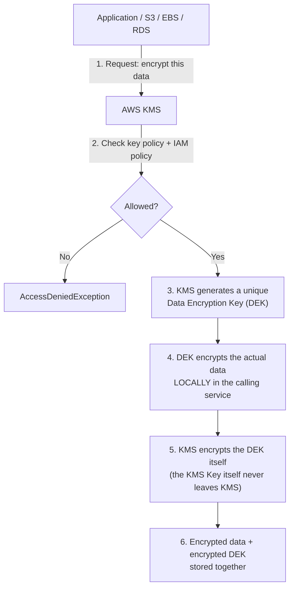

**Step by step:** KMS's own `Encrypt` API call has a hard 4KB payload limit, which raises an
obvious question — how does it encrypt a 50GB S3 object? The answer is **envelope encryption**:
KMS generates a one-time-use **Data Encryption Key (DEK)** and hands back *both* a plaintext copy
and an encrypted ("wrapped") copy of it. The calling service uses the plaintext DEK **locally, in
memory**, with a fast symmetric algorithm (AES-256-GCM) to encrypt the actual 50GB object —
nothing about that bulk encryption work ever touches KMS's network boundary. Only the small,
already-encrypted DEK is stored alongside the ciphertext, and to decrypt later, the service sends
*that* small encrypted DEK back to KMS, which unwraps it (checking permissions again) and returns
the plaintext DEK for local decryption. The actual KMS key backing all of this never leaves AWS's
HSMs at any point in the process.

### Image: the official envelope encryption key hierarchy


*Source: [AWS KMS Developer Guide — AWS KMS cryptography essentials](https://docs.aws.amazon.com/kms/latest/developerguide/kms-cryptography.html)*

**Discussion.** This diagram shows the full hierarchy envelope encryption actually rests on: a
root key encrypts key-encryption keys, which in turn encrypt data keys, which finally encrypt the
actual data. Each layer exists to limit the blast radius of any single key's exposure and to let
KMS rotate backing material internally without ever needing to touch — or even know about — the
data each layer ultimately protects. The practical takeaway for the exam: rotating a KMS key does
**not** mean re-encrypting all your data. KMS retains every prior layer of backing material
internally (as long as the key isn't deleted), so old ciphertext stays decryptable through old
material while only *new* operations start using the newest material.

### Exam Tips
- **Symmetric keys never leave KMS and support automatic annual rotation; asymmetric keys let
  you export the public key (private key still never leaves) but do NOT support automatic
  rotation** — know this table cold.
- **A KMS key with no key policy granting access is unusable, even by the account root** — the
  opposite failure mode from most AWS resources, where forgetting to *restrict* is the usual risk;
  here, forgetting to *grant* correctly locks everyone out permanently.
- **Cross-account KMS access needs both sides**: the key policy in the key's account AND an IAM
  policy in the caller's account — exactly the same dual-policy pattern as cross-account S3.

**Go even deeper:** [`services/security-identity-compliance/kms.md`](../../services/security-identity-compliance/kms.md) (643 lines — full key policy JSON, custom key stores, service integration matrix)

---

## 21. ACM & Private CA

### Definition
ACM **issues, renews, and manages free public TLS/SSL certificates** for AWS resources, so
traffic to your website or API can be encrypted (HTTPS) without buying a certificate or manually
tracking expiry. **AWS Private CA** is a companion service letting you run your own private
certificate authority for internal systems that should never be trusted by the public internet.

### Analogy
A public ACM certificate is like a passport issued by a recognized national government — every
border guard (every browser) on Earth already trusts it, because they all recognize the issuing
authority. A Private CA certificate is like an employee ID badge issued by your own company — it
gets you into every door *your own company* has configured to recognize it, but it means nothing
at the actual national border; nobody outside your organization has any reason to trust it, nor
should they. Both are genuinely useful identity documents, just scoped to completely different
trust boundaries, and building a Private CA hierarchy is literally building your own passport
office, complete with the responsibility of deciding who gets to open which trust level.

### Purpose
TLS certificate management used to be a recurring operational headache: pay a CA, generate a CSR,
install the cert, and remember to renew it before expiry — an expired cert is one of the most
common causes of unplanned production outages industry-wide. ACM makes certificates for
AWS-facing services free and automatically renewed. Private CA exists because not every
certificate should be trusted by every browser on Earth.

### When to Use
ACM: any public-facing resource behind an ALB, CloudFront, or API Gateway needing HTTPS. Private
CA: internal service-to-service mTLS, IoT device identities, VPN client certificates, or
code-signing — anything needing a certificate trusted only within your own organization.

### When NOT to Use (be honest about the alternative)
- **You need the raw private key for use outside AWS-integrated services** (installed directly
  on a self-managed server via SSH) — ACM public certificates cannot be exported; either
  terminate TLS at an ALB in front of the instance, or import an externally-obtained certificate
  and accept manual renewal responsibility.
- **You need certificates trusted by the public internet but issued by your own authority** — not
  possible; public trust requires a chain to a recognized public root CA. Private CA certificates
  are only trusted by parties you've explicitly configured to trust them.
- **Low-volume internal use where standing up a full Private CA hierarchy is overkill** — for a
  handful of internal services, Private CA's real hourly cost may not be justified versus simpler,
  manually-managed self-signed certs.

### Use Cases
- **Free HTTPS on a public ALB/CloudFront distribution** — a DNS-validated public ACM cert
  auto-renews indefinitely for free as long as the validation record stays in place.
- **Internal service mesh with mutual TLS (mTLS)** — a Private CA issues per-service certificates
  trusted only within the organization's own hierarchy, with zero exposure to the public CA chain.
- **IoT fleet identity at scale** — Short-Lived CA mode issues high-volume, frequently-rotated
  device certificates at a lower per-CA rate tuned for exactly this pattern.
- **Code-signing internal build artifacts** — a Private CA-issued signing certificate lets
  downstream systems verify provenance entirely within the organization's own trust boundary.
- **M&A — extending a centralized Private CA hierarchy to an acquired company** — sharing the
  parent's *subordinate* CA (never the root) via AWS RAM lets the acquired team self-serve
  certificate issuance without exposing root-level trust.
- **Avoiding certificate-expiry outages entirely** — switching to DNS-validated ACM certificates
  removes the human-forgetfulness failure mode completely for every AWS-integrated endpoint.

### Why It's Important
Expired certificates causing outages is a recurring, embarrassing, and entirely preventable
category of incident across the industry — ACM's automatic renewal removes an entire class of
human-error risk for free.

### Diagram: CA Hierarchy — Nested Validity Periods, the Single Most Important Design Constraint

```mermaid
flowchart TD
    Root["Root CA — Security account\nvalidity: 10 years"] --> SubOps["Subordinate CA: Operations\nvalidity: 5 years"]
    Root --> SubIoT["Subordinate CA: IoT Devices\nvalidity: 5 years"]
    SubOps --> LeafService1["Leaf cert: payment-service\nvalidity: 13 months"]
    SubOps --> LeafService2["Leaf cert: inventory-service\nvalidity: 13 months"]
    SubIoT --> LeafDevice1["Leaf cert: device-fleet-batch-A\nvalidity: 90 days"]
```

**Step by step:** every certificate's validity window must sit **entirely inside** its parent's
window — a subordinate CA's validity must fit inside the root's, and every leaf certificate it
issues must fit inside the subordinate's. AWS's own rule of thumb: a CA certificate's validity
should be roughly 2-5x longer than any certificate it will issue, so the hierarchy doesn't need
constant re-issuance just to keep leaf certificates valid near the end of a CA's own lifetime.
Sharing the **subordinate** CA (never the root) to individual application accounts via AWS RAM
lets application teams self-serve certificate issuance while the actual foundation of trust — the
root — stays locked down in a dedicated security account, never directly exposed to workload
teams.

### Image: the official nested-validity diagram


*Source: [AWS Private Certificate Authority User Guide — Manage the private CA lifecycle](https://docs.aws.amazon.com/privateca/latest/userguide/ca-lifecycle.html)*

**Discussion.** This diagram is the visual proof of why "the leaf certificate hasn't expired yet,
why is the mTLS handshake failing" is a real, testable troubleshooting scenario: a client
performing strict chain validation checks *every* certificate in the chain's validity, not just
the leaf's. If a leaf certificate's own `notAfter` date somehow extends past its issuing
subordinate CA's validity window — a configuration mistake, not the normal case — the handshake
fails the moment the CA's own window passes, even though the leaf certificate itself still looks
perfectly valid in isolation. Designing the nesting correctly up front (leaf validity meaningfully
shorter than its issuing CA's remaining lifetime) is what prevents this from ever becoming a
production incident.

### Exam Tips
- **ACM certs cannot be exported** — if a scenario needs the private key installed on a self-
  managed server outside AWS-integrated services, ACM alone is the wrong tool.
- **DNS validation enables reliable auto-renewal; email validation and imported certs do not
  auto-renew reliably** — "the cert keeps expiring and breaking the site" often points to an
  imported certificate or a lapsed email-validation contact.
- **ACM is free; Private CA is not** — a real, testable distinction, since many assume "ACM = free
  certs" covers this entire category.

**Go even deeper:** [`services/security-identity-compliance/acm-and-private-ca.md`](../../services/security-identity-compliance/acm-and-private-ca.md) (458 lines — full openssl-mirrored CA hierarchy lab, revocation via CRL/OCSP, Short-Lived vs. General-Purpose cost comparison)

---

## 22. Secrets Manager vs. Parameter Store

### Definition

Two different AWS services that both let an application fetch a configuration value or sensitive
string at runtime via an IAM-governed API call instead of hardcoding it. **AWS Secrets Manager**
is purpose-built for secrets that need **automatic rotation** (database passwords, API keys).
**Systems Manager Parameter Store** is a general-purpose, mostly-free configuration/secret store
with no built-in rotation engine of its own.

### Analogy

Think of a hotel. **Parameter Store** is the hotel's own in-room safe with a simple keypad code —
free to use, fine for storing your passport or a spare key, but if you want the code to change
automatically every night without you lifting a finger, the hotel doesn't do that for you.
**Secrets Manager** is the hotel's managed safety-deposit box service at the front desk: it costs
a monthly fee, but the hotel staff will *automatically* swap the combination on a schedule, test
that the new combination works, and only then throw away the old one — all without you ever being
locked out mid-swap.

### Purpose

Hardcoded credentials in source code or environment variables are one of the oldest, most
persistent breach vectors (leaked GitHub repos, compromised CI logs, a former employee who still
remembers a password years later). Both services exist to make "pull it securely at runtime"
trivial. Secrets Manager additionally solves the much harder problem of **rotating** a secret on a
schedule without ever breaking the application mid-rotation — something Parameter Store was never
built to do.

### When to Use

- A database/API credential must **rotate automatically** on a schedule with zero manual steps and
  zero downtime (use Secrets Manager's built-in rotation Lambda templates).
- A secret must be shared securely and auditably **across AWS accounts** (Secrets Manager resource
  policies are first-class for this).
- Compliance explicitly requires **demonstrable periodic rotation evidence** (version staging
  labels + rotation history).
- Hundreds/thousands of **non-rotating** config values at near-zero cost (Parameter Store Standard,
  free up to 10,000 parameters).
- A whole **config tree** needs fetching in one call at app startup (`GetParametersByPath
  --recursive`) — Parameter Store's hierarchical paths have no Secrets Manager equivalent.

### When NOT to Use (be honest about the alternative)

- Don't force a secret that genuinely needs rotation into Parameter Store to save money — you end
  up reimplementing (poorly) what Secrets Manager already does reliably; the "savings" evaporate
  once you count the engineering time to hand-build a rotation pipeline.
- Don't put 2,000 non-rotating feature flags into Secrets Manager "for consistency" — at
  ~$0.40/secret/month that's roughly **$800/month** for data that costs $0 in Parameter Store
  Standard. This exact mismatch is the #1 real-world cost mistake in this category.
- Never hardcode secrets in Lambda environment variables or container images in plaintext, even if
  neither service seems to fit perfectly — at minimum KMS-encrypt the environment variable.

### Use Cases

1. **RDS password auto-rotation with zero downtime** — the RDS console can auto-create and manage
   a Secrets Manager secret, wiring up rotation with no custom Lambda code needed.
2. **Cross-account secret sharing with a partner account** — a resource policy scoped to
   `secretsmanager:VersionStage = AWSCURRENT` so the partner never fetches a stale `AWSPREVIOUS`
   version mid-rotation.
3. **2,000+ feature flags and environment settings** — Parameter Store Standard tier, effectively
   free, versus the same data in Secrets Manager costing hundreds of dollars a month.
4. **Incident response: rotating a credential believed compromised** — `put-secret-value` or an
   out-of-band rotation invalidates the leaked password immediately; if the app re-fetches rather
   than caches, the change propagates with no redeploy.
5. **M&A credential consolidation** — migrating an acquired company's scattered secrets into the
   parent's existing setup, sorted into "needs rotation" (Secrets Manager) vs. "static config"
   (Parameter Store), under one governance/audit trail.
6. **ECS task definitions / Lambda referencing a secret directly** — both services let the task
   definition reference the secret by ARN with zero application code needed to fetch it.

### Why It's Important

A database password that's never rotated is a permanent, growing liability — the longer it exists
unrotated, the more systems and people end up knowing it. Secrets Manager turns rotation from an
operationally painful manual chore (the actual reason most teams skip it) into a scheduled,
zero-downtime, automatic process. This is directly named in **SAA-C03 Domain 1, Task 1.2** ("Design
secure workloads and applications"), and the cost/rotation tradeoff against Parameter Store is one
of the most recurring "which service" scenario questions on the exam.

### Diagram

```mermaid
flowchart TD
    App[Application] -->|GetSecretValue / GetParameter| IAMCheck{IAM policy allows\nthis caller + this secret/parameter?}
    IAMCheck -- No --> Deny[AccessDenied]
    IAMCheck -- Yes --> Fetch[Service decrypts value via KMS\nreturns plaintext to caller]
    Fetch --> App
    subgraph Secrets Manager only — automatic rotation
        Sched[Rotation schedule fires] --> Lambda[Rotation Lambda]
        Lambda -->|1. create AWSPENDING version| DB[(Target DB)]
        Lambda -->|2. test it works| DB
        Lambda -->|3. promote to AWSCURRENT| SM[(Secrets Manager)]
        Lambda -->|4. retire old as AWSPREVIOUS| SM
    end
```

**Step by step:** (1) the app calls `GetSecretValue`/`GetParameter`; IAM checks the caller against
the specific secret/parameter (and, for a `SecureString`, `kms:Decrypt` too). (2) If allowed, the
decrypted plaintext comes back. (3) Only Secrets Manager has the bottom half: a rotation Lambda
creates a brand-new credential as `AWSPENDING`, **tests** it actually works against the real
target, only **then** promotes it to `AWSCURRENT` (what the app fetches by default), and finally
retires the old version as `AWSPREVIOUS` rather than deleting it immediately — so a failed test
never breaks the live application, and a short rollback window always exists.

### Image


*Source: [AWS Secrets Manager User Guide — Lambda function rotation strategies](https://docs.aws.amazon.com/secretsmanager/latest/userguide/rotation-strategy.html), © Amazon Web Services.*

**Discussion.** This is the **alternating users** rotation strategy, AWS's recommended
high-availability pattern: instead of repeatedly changing one database user's password (which
briefly invalidates any already-open connection using the old password at the exact moment of the
switch), Secrets Manager clones the original user into a second user on the first rotation, then
alternates which of the two users' passwords it updates on each subsequent rotation. At any given
moment — including mid-rotation — at least one of the two credentials is guaranteed valid, which is
why this strategy is preferred over the simpler single-user rotation for anything availability-
critical.

### Exam Tips

- **"Needs automatic rotation" is the single word that decides this question** — regardless of
  cost, if rotation is required, the answer is Secrets Manager; Parameter Store has no native
  rotation engine, full stop.
- **Both encrypt via KMS identically** — don't pick an answer implying Parameter Store
  `SecureString` is "less secure"; the only real differences are rotation tooling and price.
- **Version staging labels (`AWSCURRENT`/`AWSPENDING`/`AWSPREVIOUS`)** are Secrets-Manager-specific
  vocabulary — if a question uses these terms, the answer is Secrets Manager, not Parameter Store.

**Go even deeper:** [`services/security-identity-compliance/secrets-manager-vs-parameter-store.md`](../../services/security-identity-compliance/secrets-manager-vs-parameter-store.md) (509 lines — full resource-policy JSON, rotation Lambda code, single-user vs. alternating-users comparison table)

---

## 23. AWS Lake Formation

### Definition

AWS Lake Formation centralizes **fine-grained permissions** for a data lake — database-, table-,
column-, row-, and even cell-level access control — enforced consistently across every integrated
query engine (Athena, Redshift Spectrum, EMR, Glue, QuickSight, SageMaker) that reads from the same
Glue Data Catalog. You define who-can-see-what **once**, and every integrated engine automatically
enforces that same grant.

### Analogy

IAM + S3 bucket policies alone are a building's front-door lock: you're either let into the
building or you're not — fine for coarse access, but no way to say "you may enter, but inside the
finance department's filing cabinet, only open the drawers that aren't labeled HR." Lake Formation
is the finer internal lock system installed *inside* that building: it checks, at the moment
someone reaches for a specific drawer (table/column/row), whether they're actually allowed to open
it — before they ever touch the contents.

### Purpose

Before Lake Formation, securing a data lake meant stacking S3 bucket policies (file-level access)
and IAM policies (API-call-level access) across every service touching the lake — with no native
concept of "let this analyst see every column except `ssn` and `salary`" or "let this regional
manager only see rows where `region = 'EU'`." Lake Formation adds a database-like, fine-grained
permissions layer on top of the Glue Data Catalog so governance can be expressed the way a data
administrator actually thinks about it.

### When to Use

- Several business units share one Data Catalog, but **only specific columns** of a shared table
  (e.g., salary/SSN) should be visible to a specific team.
- A global company needs **region-scoped row visibility** into one shared table, without
  maintaining a separate table per region.
- A curated table needs to be shared with **other AWS accounts** without duplicating the data.
- Governance needs to scale across **hundreds of tables** without writing hundreds of individual
  grants (LF-TBAC tag-based access control).
- A security requirement demands that a column-level restriction **can't be bypassed** by an
  analyst switching from Athena to an EMR notebook using the same underlying IAM role.

### When NOT to Use (be honest about the alternative)

- A small, single-team lake needing nothing finer than "this role can read this S3 prefix" —
  **plain IAM + S3 bucket policies** are simpler to set up and reason about; Lake Formation's
  registration and grant model is real, avoidable overhead here.
- Data that isn't in S3/Glue Data Catalog at all (pure DynamoDB or RDS with no lake layer) — that's
  a plain IAM/database-native-permissions problem, not a Lake Formation one.
- Row-level security for a traditional data warehouse, not a lake — **Redshift's own row-level
  security** operates natively inside the warehouse; the two aren't interchangeable.

### Use Cases

1. **Multi-team data mesh with column-level sensitivity** — one broadly-shared employee table,
   with only the finance team's role granted `SELECT` including the salary/SSN columns.
2. **Regional data residency/visibility** — a row-level data filter (`region = 'EU'`) per regional
   manager role against one shared `orders` table, instead of one table per region.
3. **Governed cross-account sharing without data duplication** — a `shared_metrics` table exposed
   to three other accounts via AWS Resource Access Manager, with no copy of the data made.
4. **Scaling governance across hundreds of tables** — LF-TBAC: tag tables by sensitivity/domain
   once, tag roles once, and grants apply automatically as new matching tables appear.
5. **Rapid bootstrap of a governed lake from a legacy database** — a Database snapshot or
   incremental **blueprint** auto-generates the Glue Workflow (crawler + import job) and registers
   the resulting tables with Lake Formation in one guided flow.
6. **Preventing tool-switching bypass** — the same IAM role querying through Athena vs. an EMR
   notebook still gets the same column/row restriction, because the check lives in the shared
   credential-vending layer, not inside either engine independently.

### Why It's Important

The single most common cause of a data lake turning into an ungoverned "data swamp" isn't a
storage problem, it's a governance problem: nobody can confidently say who can see what across a
growing set of tools and teams. Lake Formation makes that answerable in one place, enforced
everywhere, instead of trusting a dozen separately-written IAM and bucket policies across Athena,
EMR, and Redshift Spectrum to all agree with each other indefinitely. Named directly in **SAA-C03
Task 3.5** ("data ingestion and transformation solutions").

### Diagram

```mermaid
sequenceDiagram
    participant User as Analyst (role: FinanceAnalystRole)
    participant Athena as Amazon Athena
    participant Cat as Glue Data Catalog
    participant LF as Lake Formation
    participant S3 as Amazon S3
    User->>Athena: SELECT * FROM salesdb.curated_orders
    Athena->>Cat: Request table metadata
    Cat->>LF: Check FinanceAnalystRole's permissions
    LF-->>Cat: Authorized — SELECT, excluding ssn/salary
    Cat-->>Athena: Schema (minus excluded columns)
    Athena->>LF: Request scoped temporary credentials
    LF-->>Athena: Time-limited S3 credentials, scoped to grant
    Athena->>S3: Read only the authorized columns' data
    S3-->>Athena: Data (ssn, salary never fetched)
    Athena-->>User: Results, sensitive columns absent
```

**Step by step:** the key insight is **credential vending** — step 6 and 7. FinanceAnalystRole's
own underlying IAM policy might be broad (a general `s3:GetObject` on the bucket), but Lake
Formation never hands Athena credentials broader than the specific grant. This is why an analyst
can't bypass a column-level restriction by opening the same table through an EMR notebook using the
*same* IAM role — the restriction lives at the Lake Formation/Data Catalog layer every integrated
engine must pass through, not inside each engine's own access logic.

### Image


*Source: [AWS Lake Formation Developer Guide — How it works](https://docs.aws.amazon.com/lake-formation/latest/dg/how-it-works.html), © Amazon Web Services.*

**Discussion.** Notice the engine never talks to S3 directly until Lake Formation has vended it
scoped, temporary credentials for that exact query — this is the structural reason Lake Formation's
guarantees hold even when the calling engine's own IAM role is far broader than what any individual
query should see. It's the architectural detail that makes the answer "Lake Formation" correct over
"just write a tighter IAM policy per service," because a tighter IAM policy per service still has to
be independently written and kept in sync across every engine, while Lake Formation's grant is
written once and mechanically enforced everywhere via this same vending step.

### Exam Tips

- **Column-level, row-level, or multi-engine consistent enforcement** named together in a scenario
  → Lake Formation, not per-service IAM/S3 policies.
- **Lake Formation sits on top of the Glue Data Catalog, it does not replace it** — a question
  implying it's a separate catalog is wrong.
- **LF-TBAC is the scaling answer** for "hundreds of tables, don't want hundreds of grants."

**Go even deeper:** [`services/analytics/lake-formation.md`](../../services/analytics/lake-formation.md) (451 lines — blueprint types, LF-TBAC deep dive, hybrid access mode migration path)

---

## 24. AWS Backup

### Definition

AWS Backup is a fully managed, centralized backup service. Instead of configuring backups
separately inside each AWS service (an EBS snapshot schedule here, an RDS snapshot setting there, a
DynamoDB point-in-time-recovery toggle somewhere else), you define one policy — a **backup plan**
— and apply it across many services and many accounts at once.

### Analogy

Imagine a company with five different departments, each historically keeping its own fire safe
with its own combination and its own schedule for swapping documents in and out. AWS Backup is
hiring one facilities manager who installs one master safe system across every department, on one
schedule, with one combination policy — and who can prove to an auditor, with one report, that
every department's important documents are actually inside a safe and actually retrievable.

### Purpose

Every AWS service that holds data historically had its *own* backup mechanism with different
settings, different retention models, and no single place to prove "here is our backup policy and
here is proof it ran." AWS Backup gives one consistent policy engine, one audit trail, and one
place to test restores — across EC2, EBS, RDS/Aurora, DynamoDB, EFS, FSx, Storage Gateway volumes,
and S3. Importantly, it doesn't replace each service's native backup mechanism, it **orchestrates**
it — a backup job against an EBS volume is still, literally, an EBS `CreateSnapshot` call under the
hood.

### When to Use

- A regulated organization needs **one provable backup policy** across EC2, RDS, and DynamoDB
  rather than three separate per-service audit stories.
- **Ransomware resilience** is required against an attacker who has obtained full admin
  credentials — Vault Lock in Compliance mode makes recovery points undeletable even by root.
- **Cross-account/cross-Region DR governance** across many AWS Organizations member accounts,
  enrolling every new resource automatically by tag.
- A pipeline needs an **auditable, on-demand rollback point** immediately before a risky database
  migration, not just the previous night's scheduled backup.

### When NOT to Use (be honest about the alternative)

- A single, one-off snapshot you'll delete in an hour — just call the native EBS/RDS snapshot API
  directly; spinning up a whole backup plan for one ad-hoc action is unneeded overhead.
- Extremely custom backup logic (e.g., an application-consistent backup needing a bespoke
  pre/post-script sequence) beyond what AWS Backup's hooks support — you may need a native or
  third-party tool alongside it.
- **Real-time/near-zero-RPO replication** isn't really "backup" semantics at all — use RDS read
  replicas, DynamoDB Global Tables, or AWS Elastic Disaster Recovery for continuous replication
  instead.

### Use Cases

1. **Regulated healthcare group** needing one provable backup policy and AWS Backup Audit Manager
   compliance reports across EC2/RDS/DynamoDB for an auditor.
2. **Ransomware resilience** after a near-miss credential compromise — Vault Lock in Compliance
   mode defeats even a fully-compromised administrator credential.
3. **Organization-wide tag-based governance** — a management account deploys backup roles/vaults
   into every member account via StackSets; any resource tagged `Environment=production` anywhere
   is automatically enrolled.
4. **Separation-of-duties S3 data lake protection** for a financial institution — a storage admin
   owns S3-native protections while a distinct backup admin role owns the AWS Backup vault and its
   KMS key, so no single compromised identity can both alter and delete the data.
5. **Pre-deployment backup gate in CI/CD** — an on-demand backup job triggered as a pipeline step
   before a risky migration, giving an auditable rollback point newer than the nightly schedule.
6. **Logically air-gapped vault** for a critical-infrastructure company needing backup storage
   isolated into a separate, service-owned account boundary an attacker in production can't reach.

### Why It's Important

Backup governance is one of the first things an auditor or a new CISO asks about — "show me your
backup policy and prove it's being enforced" — and AWS Backup is the standard answer for doing that
across a multi-service AWS footprint without reinventing it per team. Vault Lock has become a
baseline ransomware-defense expectation in many compliance frameworks. Covered directly in
**SAA-C03 Domain 1, Task 1.3** ("Determine appropriate data security controls").

### Diagram

```mermaid
sequenceDiagram
    participant Admin as Backup administrator
    participant Vault as Backup Vault
    participant Attacker as Compromised admin credential
    Admin->>Vault: Apply Vault Lock (Compliance mode, min/max retention)
    Note over Vault: Policy becomes immutable —\nnot even the root account can\ndelete or loosen it before retention expires
    Attacker->>Vault: Attempt DeleteRecoveryPoint before retention expires
    Vault-->>Attacker: Denied — Vault Lock blocks this\nregardless of IAM permissions held
```

**Step by step:** Vault Lock has two modes. **Governance mode** can still be removed by
specifically authorized principals — useful while testing a retention policy before committing to
it. **Compliance mode** is permanent: once locked, *no one*, including AWS itself, can delete the
vault or shorten retention before it expires. This single feature is what turns "we have backups"
into "we have backups an attacker with full admin access cannot destroy" — the actual bar most
ransomware and regulatory-compliance frameworks require.

### Image


*Source: [AWS Storage Blog — Best practices for data lake protection with AWS Backup](https://aws.amazon.com/blogs/storage/best-practices-for-data-lake-protection-with-aws-backup/), © Amazon Web Services.*

**Discussion.** This diagram shows a real, AWS-recommended **separation-of-duties** pattern for
compliance-sensitive data lakes: the storage administrator configures S3-native protections
(Versioning, Replication, Object Lock), while a *distinct* backup administrator owns the AWS Backup
vault and the KMS key encrypting it. The point of the separation is structural, not cosmetic — if
the same team/role managed both, a single compromised identity could alter the live data *and*
delete its backups in the same breach, which is exactly the finding an auditor will specifically
test for in a regulated environment.

### Exam Tips

- **"Centralize backup policy across multiple AWS services/accounts"** is the signature phrase
  pointing to AWS Backup over any single service's native snapshot tooling.
- **Vault Lock = immutability/WORM/ransomware defense** — "even an administrator should not be able
  to delete backups before retention expires" is Vault Lock specifically.
- **Governance mode is reversible by authorized principals; Compliance mode is not, ever** — a
  question emphasizing "not even AWS can override this" wants Compliance mode.

**Go even deeper:** [`services/storage/aws-backup.md`](../../services/storage/aws-backup.md) (500 lines — cross-account copy cost worked example, item-level restore, Backup Audit Manager controls)

---

## 25. Amazon S3

### Definition

Amazon S3 is AWS's **object storage** service. You store files — called **objects** — inside
containers called **buckets**, and reach them over HTTP(S) using a key (a name/path string), not a
traditional filesystem. There's no drive to format, no fixed capacity to plan for, and practically
no upper limit on how much you can store.

### Analogy

Before S3, "storage" was like building your own private warehouse: you had to guess how big to
build it years in advance, pay for the whole building whether it's full or empty, and build your
own fire-suppression and security system from scratch. S3 is like renting space in a vast,
professionally-run public warehouse that automatically grows to fit whatever you put in it, mirrors
every item you store into three separate fireproof vaults at no extra charge, and bills you only
for the shelf space your items actually occupy that month.

### Purpose

Storage, pre-S3, meant buying physical disks, planning capacity years ahead, and building your own
redundancy and backup. S3 was AWS's answer: storage that is **durable by default** (11 nines —
99.999999999% — durability of objects over a year), **elastic** (you never provision size), and
billed **per GB actually used**. "11 nines of durability" is not uptime — it's about not losing
data: AWS models it as, with 10,000,000 objects stored, you'd statistically expect to lose a single
object roughly once every 10,000 years, achieved by redundantly storing each object across at least
three physical AZs and continuously self-healing bit rot.

### When to Use

- Any unstructured file storage need at any scale: static websites, data lake foundations, media
  archives, backup/DR targets, ML training data staging, CI/CD artifacts, log storage.
- An external/anonymous user needs to **temporarily** upload or download one specific private
  object without being given an IAM identity — **presigned URLs**.
- A compliance requirement needs **tamper-evident** retention — **S3 Object Lock** in Compliance
  mode.

### When NOT to Use (be honest about the alternative)

- A real filesystem mounted on a server with random in-place edits and POSIX file locking — S3 is
  **not** a filesystem; use **EBS** (single instance, block) or **EFS** (many instances, shared
  NFS) instead.
- Microsecond/low-millisecond transactional read-write for a database — use EBS-backed RDS/EC2 or
  DynamoDB.
- Booting an OS — only EBS (or instance store) can be a boot volume.
- Extremely small, extremely frequent read/writes of the same key (hot-key contention) — consider
  DynamoDB or a cache in front of S3.

### Use Cases

1. **Static website/SPA hosting** — S3 + CloudFront serves a React SPA with zero servers to patch,
   versus an EC2-based web server billing 24/7 for just-static content.
2. **Data lake foundation** — S3's flat, schema-less object model lets every team land partitioned
   Parquet data without provisioning a database first, queried by Athena/Redshift Spectrum.
3. **Compliance log retention** — CloudTrail/ALB/VPC Flow Logs land in S3 by AWS convention, with
   Object Lock (Compliance mode) guaranteeing immutability for a SOX/PCI 7-year requirement.
4. **Backup/DR target** — nightly RDS snapshots and application exports land in S3, replicated
   cross-Region for a HIPAA contingency-planning requirement.
5. **ML training data staging** — millions of labeled images sit in S3 before SageMaker/EC2 GPU
   jobs read them, instead of re-copying the dataset onto local disk per training node.
6. **Multi-Region active-active content syndication** — S3 Multi-Region Access Points plus
   bi-directional Cross-Region Replication give one global endpoint with sub-15-minute propagation.

### Why It's Important

S3 is the default home for almost every unstructured byte an AWS-based company owns — cheap,
essentially infinitely durable, and the data substrate behind data lakes, ML pipelines, static
hosting, and backups industry-wide. Picking the wrong storage class or leaving a bucket publicly
writable are among the most common real-world cost and security incidents. S3 is arguably the
single most tested AWS service across all three certs, named directly across **SAA-C03 Domain 1
Task 1.3** (encryption/replication/data security controls), **Domain 3 Task 3.1** (object vs. block
vs. file tradeoffs), and **Domain 4 Task 4.1** (cost-optimized storage).

### Diagram

```mermaid
flowchart LR
    Client[Client app / SDK / CLI] -->|PUT object| API[S3 API Endpoint]
    API --> Bucket[(Bucket: my-app-bucket)]
    Bucket --> AZ1[Copy — AZ 1]
    Bucket --> AZ2[Copy — AZ 2]
    Bucket --> AZ3[Copy — AZ 3]
    Client -->|GET object| API
    API -->|returns object| Client
```

**Step by step:** the client sends a `PUT` with the object's bytes and key; S3 checks IAM/bucket
policy, then writes the object durably to **multiple AZs synchronously** before returning success
to the client — this is why S3 offers both 11 nines of durability and (since December 2020) **strong
read-after-write consistency**: the moment a `PUT` succeeds, every subsequent `GET`/`LIST` sees it,
including overwrites and deletes, with no eventual-consistency race window left to code around.

### Image


*Source: [Amazon S3 User Guide — Welcome to Amazon S3](https://docs.aws.amazon.com/AmazonS3/latest/userguide/Welcome.html), © Amazon Web Services.*

**Discussion.** This single property eliminated an entire historical category of "read-after-write
race condition" workarounds — sleep-and-retry loops, DynamoDB-based consistency trackers sitting in
front of S3 — that pre-2020 architectures had to hand-build. It's also a specific, testable exam
fact: older study material describing S3 as "eventually consistent" for overwrites is describing a
model that no longer exists; the current, correct answer is **strong consistency for all
operations**, including overwrite PUTs and DELETEs.

### Exam Tips

- **Object vs. block vs. file storage** is the most common framing trap: S3 = object (HTTP API,
  flat namespace, no mount); if the question says "mount a drive" or "boot an instance," the
  answer is never S3.
- **Consistency changed in December 2020** — current exams test the *current*, strongly-consistent
  model, not the older "eventually consistent" description.
- **Presigned URLs** are the standard answer for "let an unauthenticated user download/upload one
  specific private object temporarily" without touching the IAM permission model.

**Go even deeper:** [`services/storage/s3.md`](../../services/storage/s3.md) (629 lines — multipart upload sequence, replication deep dive, full pricing worked examples)

---

## 26. S3 Storage Classes

### Definition

S3 storage classes are different **pricing and performance tiers** you can assign to an object
inside the same bucket, using the exact same API. The data, durability, and how you reach it don't
fundamentally change — what changes is how much it costs to store, how much it costs/takes to
retrieve, and how many AZs back it.

### Analogy

Think of a public library with three sections: the front shelves (S3 Standard) hold books people
check out every day; a back room (S3 Standard-IA) holds books that are requested occasionally but
still fetched by staff instantly when asked; and an off-site archive warehouse an hour away
(Glacier) holds books nobody has asked for in years but the library is legally required to keep —
retrievable, just not instantly, and far cheaper to store per book because the warehouse doesn't
need prime real estate or instant-access staff on hand.

### Purpose

Not all data gets accessed the same way. A product photo served to customers all day needs
millisecond access; a 7-year-old tax record almost never gets opened. AWS built storage classes so
cost can match actual access pattern instead of paying premium-tier prices for data that just sits
there. The gap between the most expensive class (S3 Standard) and the cheapest (S3 Glacier Deep
Archive) is roughly **23x per GB-month** — correctly tiering a large, mostly-cold dataset is
routinely the single biggest lever an organization has over its AWS storage bill.

### When to Use

- **Live, hot application content** (product images, active app assets) — S3 Standard.
- **Unpredictable, changing access patterns across a shared data lake** — S3 Intelligent-Tiering,
  which monitors real access and moves objects automatically with no retrieval fee for moving back
  to frequent.
- **Monthly-ish access with instant retrieval needed** — Standard-IA or Glacier Instant Retrieval,
  chosen by running the actual access-frequency math against both storage and retrieval rates.
- **Rarely-touched regulatory records with no retrieval-time requirement** — Glacier Deep Archive.

### When NOT to Use (be honest about the alternative)

- Don't put data you can't afford to lose on **One Zone-IA** — it has no cross-AZ redundancy; only
  use it for recreatable/secondary data.
- Don't archive data accessed more than once a quarter into Glacier tiers — the per-GB retrieval
  fee plus wait time usually costs more than leaving it on Standard-IA or Intelligent-Tiering.
- Don't transition huge numbers of very small objects into Glacier tiers just because it's
  "cheaper per GB" — the ~40 KB metadata overhead per object and the transition-request fee can make
  it a net *loss*; run the break-even math first.
- Don't use Deep Archive for anything with an unpredictable "I might need this tomorrow"
  requirement — 12–48 hour retrieval is a hard constraint, not a worst case.

### Use Cases

1. **E-commerce product photos** on S3 Standard — requested constantly, needs millisecond latency;
   any colder class adds retrieval fee/latency to every page load, the wrong tradeoff for hot data.
2. **Shared data lake with unpredictable per-team access** — Intelligent-Tiering removes the burden
   of hand-tuning a lifecycle rule per team/prefix as access patterns shift over time.
3. **Monthly financial reports** on Standard-IA — occasionally pulled, needs millisecond access
   when accessed, and Standard-IA's lower retrieval fee wins at monthly-ish access frequency.
4. **Medical imaging archive** on Glacier Instant Retrieval — rarely reopened but must load
   instantly the moment a clinician needs it; no restore-wait is clinically acceptable here.
5. **Regulatory records (7–10 year retention)** on Glacier Deep Archive — essentially never read,
   with no retrieval-time requirement, at the cheapest per-GB rate by a wide margin.
6. **Tiered backup pipeline** — Standard → Standard-IA (30 days) → Glacier Flexible Retrieval
   (90 days) → Deep Archive (1 year), matching cost to declining restore probability over time.

### Why It's Important

Storage class choice is one of the highest-leverage, lowest-effort cost optimizations in any AWS
bill — misconfigured lifecycle rules (or none at all) are a textbook FinOps finding, and getting
durability class wrong (One Zone-IA for critical data) is a real resiliency risk, not just a cost
one. Explicitly named in **SAA-C03 Domain 4, Task 4.1 — "Design cost-optimized storage solutions."**

### Diagram

```mermaid
flowchart LR
    Create[Object created] --> Standard[S3 Standard]
    Standard -->|lifecycle: 30 days no access| IA[S3 Standard-IA]
    IA -->|lifecycle: 90 days| Glacier[S3 Glacier Flexible Retrieval]
    Glacier -->|lifecycle: 180 days| DeepArchive[S3 Glacier Deep Archive]
    Standard -.->|unpredictable access pattern| IT[S3 Intelligent-Tiering]
    IT -.auto-moves between tiers based on real access.-> IT
```

**Step by step:** an object starts in whatever class you specify on upload (default: S3 Standard).
A **lifecycle rule** (a policy on the bucket/prefix) automatically transitions it to cheaper classes
as it ages — zero application changes, same key, same API calls. **S3 Intelligent-Tiering** is the
exception to the age-based model entirely: instead of you defining rules, AWS *monitors actual
access* per object and moves it between frequent/infrequent (and optionally archive) tiers
automatically, with **no retrieval fee** for moving back to frequent — the core reason it's the
pragmatic default for genuinely unpredictable access patterns.

### Image


*Source: [Amazon S3 User Guide — Transitioning objects using Amazon S3 Lifecycle](https://docs.aws.amazon.com/AmazonS3/latest/userguide/lifecycle-transition-general-considerations.html), © Amazon Web Services.*

**Discussion.** The key detail this diagram makes visible is that transitions are **one-directional
only** — warmer to colder. There is no native "demote this lifecycle rule back to Standard"; to
promote an object back you'd `COPY` it, which is itself billed as a brand-new PUT into the target
class. This is why Intelligent-Tiering (which moves an object *both* directions automatically, at
no retrieval-fee cost) is structurally different from a manual lifecycle rule, not just a
convenience wrapper around one.

### Exam Tips

- **Retrieval time/fee differences across the three Glacier tiers**: Instant Retrieval =
  milliseconds, Flexible Retrieval = minutes to hours, Deep Archive = 12–48 hours. "Instant, very
  rarely accessed" wants Glacier Instant Retrieval, not Standard-IA or Deep Archive.
- **One Zone-IA vs. Standard-IA**: the only difference is AZ count (1 vs. 3+) — "must survive the
  loss of a facility" rules out One Zone-IA.
- **Minimum storage duration + early-deletion fee**: deleting/transitioning before 30/90/180 days
  still bills the remainder — a classic scenario-math trap.

**Go even deeper:** [`services/storage/s3-storage-classes.md`](../../services/storage/s3-storage-classes.md) (496 lines — full per-class pricing table, break-even worked examples, Intelligent-Tiering internal tier state machine)

---

---

# Part 2 — Domain 2: Design Resilient Architectures (26%)

*Full domain guide with task-statement mapping: [`domain-2-resilient-architectures/README.md`](domain-2-resilient-architectures/README.md). This section is domain-2-resilient-architectures's MASTER-CHUNK, reproduced in full below.*

> **Purpose of this file:** every one of this domain's 22 tested services/topics, in one
> standalone, scroll-and-study document. You should be able to read this file top to bottom the
> night before the exam and never have to jump to another file. Each entry follows the same
> shape: **Definition → Analogy → Purpose → When to Use → When NOT to Use → Use Cases → Why
> Important → How It Works (diagram) → Visual Reference (real AWS image) → Exam Tips**, plus a
> link to the full `services/` doc if you want more depth than a study chunk needs. For the
> deepest possible treatment of any one service — worked CLI examples, full pricing tables,
> troubleshooting runbooks, every quota — follow that link; this file is the 80/20 version of
> all 22, tuned for exam recall and real-architecture intuition, not operational reference.
>
> Domain 2 splits into two task statements this file constantly cross-references:
> **Task 2.1 — Design scalable and loosely coupled architectures** (the "architecture shape"
> question: decoupled vs. monolithic, can one slow piece drag down the rest) and
> **Task 2.2 — Design highly available and/or fault-tolerant architectures** (the "failure
> response" question: automatic failover, backup/DR). Every section below is tagged with which
> task(s) it maps to.

## Table of Contents

1. [Amplify](#1-aws-amplify) — Task 2.1
2. [AWS Backup](#2-aws-backup) — Task 2.2
3. [Device Farm](#3-aws-device-farm) — Task 2.1
4. [Fargate](#4-aws-fargate) — Task 2.1
5. [Step Functions](#5-aws-step-functions) — Task 2.1
6. [X-Ray](#6-aws-x-ray) — Task 2.2
7. [API Gateway](#7-amazon-api-gateway) — Task 2.1
8. [Aurora](#8-amazon-aurora) — Task 2.1 / 2.2
9. [CloudFront](#9-amazon-cloudfront) — Task 2.1
10. [EC2 Auto Scaling](#10-amazon-ec2-auto-scaling) — Task 2.1 / 2.2
11. [ECS](#11-amazon-ecs) — Task 2.1
12. [EKS](#12-amazon-eks) — Task 2.1
13. [EventBridge](#13-amazon-eventbridge) — Task 2.1
14. [Fraud Detector & Kendra](#14-amazon-fraud-detector--amazon-kendra) — Task 2.1
15. [Amazon MQ](#15-amazon-mq) — Task 2.1
16. [Pinpoint](#16-amazon-pinpoint) — Task 2.1
17. [RDS](#17-amazon-rds) — Task 2.2
18. [Route 53](#18-amazon-route-53) — Task 2.2
19. [SNS](#19-amazon-sns) — Task 2.1
20. [SQS](#20-amazon-sqs) — Task 2.1
21. [Containers vs. VMs vs. Serverless](#21-containers-vs-vms-vs-serverless) — Task 2.1
22. [Elastic Load Balancing](#22-elastic-load-balancing) — Task 2.1 / 2.2
23. [Messaging Patterns Overview](#23-messaging-patterns-overview) — Task 2.1
24. [Niche Compute Services](#24-niche-compute-services-outposts-wavelength-sar-vmware-cloud-on-aws) — Task 2.1

---

## 1. AWS Amplify

**Definition.** AWS Amplify is a set of tools and services for building and deploying full-stack
web and mobile applications quickly — it provisions a backend (auth, API, database, storage,
functions) from CLI commands or TypeScript config, gives you client libraries to call that
backend, and hosts/deploys your frontend with Git-push CI/CD — all without you hand-wiring each
underlying AWS service yourself.

**Analogy.** Building a full-stack app from raw AWS services is like building a house by
individually sourcing lumber, wiring, plumbing, and a crew for each room. Amplify is the
general contractor: you say "I need a login system, a database-backed API, and a place to store
files," and it pulls in the right trades (Cognito for auth, AppSync/DynamoDB for the API, S3 for
storage), wires them together correctly, and hands you a single, working front door — while you
can still walk into any individual room (open the Cognito console) and see exactly how it was
built.

**Purpose.** A typical full-stack app needs an auth service, an API layer, a database, file
storage, and a CI/CD-driven hosting pipeline before a single feature ships. Wiring all five
together correctly (consistent IAM roles, matching API schemas, a working deploy pipeline) is
real, repetitive work most app teams don't want to own. Amplify collapses that setup from
days/weeks of manual wiring to a CLI command or console click, while still deploying real,
individually-manageable AWS resources underneath.

**When to Use.** Standing up a full-stack mobile/web backend fast; rapid prototyping/hackathon
MVPs; static site/SPA hosting with Git-based CI/CD and PR previews; mobile apps needing
offline-first data sync (DataStore); apps needing drop-in, pre-styled auth UI; teams wanting
environment-per-Git-branch isolation.

**When NOT to Use.** An existing, complex backend architecture that doesn't map cleanly to
Amplify's categories (wire Cognito/AppSync/DynamoDB/S3 directly instead); you need fine-grained,
non-standard infrastructure control (use CloudFormation/CDK directly — Amplify generates
CloudFormation under the hood but optimizes for setup speed, not maximal control); your frontend
hosting is already solved elsewhere; heavy server-side rendering/backend logic beyond simple
Lambda functions (consider Elastic Beanstalk, App Runner, or ECS/Fargate instead).

**Use Cases.**
- A three-person startup needs auth + GraphQL API + file upload shipped in days, not sprints —
  `amplify init && amplify add api && amplify push` gets a working backend live same-day.
- A React SPA needs automatic build-and-deploy on every Git push, including PR preview URLs for
  reviewers, without hand-wiring S3 + CloudFront + a CI tool.
- A field-service mobile app must work fully offline and sync changes once connectivity returns —
  DataStore's built-in offline cache and conflict resolution handles this natively.
- A team wants dev/staging/prod as genuinely separate, isolated backend environments tied
  one-to-one with Git branches, with zero manual per-environment CloudFormation stack management.
- A mobile team wants a complete, pre-styled login/sign-up/MFA flow in a few lines of code instead
  of hand-building a Cognito Hosted UI integration from scratch.

**Why Important.** Amplify meaningfully lowers the barrier for small teams to ship a
production-grade, horizontally-scalable backend without becoming infrastructure experts — and
because every resource it provisions is real and individually inspectable, teams aren't locked
into Amplify's CLI forever if they outgrow it. On the exam, Amplify is a recognition-level
service: know what it bundles (auth + API + storage + hosting) and that it decouples the app
team from hand-wiring each underlying service, which is exactly the "loosely coupled, fast to
build" theme Task 2.1 tests.

**How It Works.**

```mermaid
flowchart LR
    Dev[Developer] -->|amplify add auth/api/storage| CLI[Amplify CLI / Studio]
    CLI -->|provisions| Cognito[(Cognito User Pool)]
    CLI -->|provisions| AppSync[AppSync GraphQL API]
    CLI -->|provisions| S3Store[(S3 file storage)]
    Git[Git push] -->|triggers| Hosting[Amplify Hosting build+deploy]
    Hosting --> CDN[CloudFront + S3 static hosting]
```

Each `amplify add <category>` command provisions a real, standalone AWS resource — not a hidden
proprietary runtime — and generates a config file (`aws-exports.js`/`amplify_outputs.json`) your
app imports once. Separately, Amplify Hosting watches your Git repo and redeploys the frontend on
every push to a tracked branch, with PR-based preview environments included.

**Visual Reference.**


*Source: [AWS Reference Architecture Diagrams — "ReadForMe"](https://docs.aws.amazon.com/reference-architecture-diagrams/latest/readforme/readforme.html).* This reference architecture
shows Amplify distributing a serverless mobile/web app's frontend (HTML/JS/CSS) to end-user
devices, while Cognito grants those devices temporary, scoped AWS credentials to call the rest of
the backend (Textract, Polly, Step Functions) directly — the exact "Amplify ships the client,
Cognito authorizes it, the rest is real AWS services" pattern this whole section describes. It's
a useful reminder that Amplify's value is concentrated at the client-to-backend handoff, not in
replacing the backend services themselves.

**Exam Tips.**
- **"Fast full-stack app backend without managing each AWS service individually"** is the
  direct Amplify trigger phrase.
- Amplify provisions **real, separately manageable AWS resources** — it is not a hidden
  proprietary compute platform; you can always "eject" to the raw Cognito/AppSync/S3 consoles.
- Don't confuse Amplify (build the backend) with **Device Farm** (test the app) or **Pinpoint**
  (engage users post-launch) — same exam category, three different lifecycle stages.

*Deeper dive:* [`services/front-end-web-mobile/amplify.md`](../../services/front-end-web-mobile/amplify.md)

---

## 2. AWS Backup

**Definition.** AWS Backup is a fully managed, centralized backup service that lets you define
backup policies once (schedule, retention, cross-Region/cross-account copy rules) and apply them
across many AWS services — EBS, RDS, DynamoDB, EFS, S3, and more — from one console, instead of
configuring each service's own native backup feature separately.

**Analogy.** Without AWS Backup, backing up a multi-service application is like each department
in a company keeping its own filing cabinet with its own lock, its own schedule for archiving old
files, and its own offsite storage vendor — nothing is consistent, and an auditor asking "show me
everything backed up in the last 30 days" gets five different answers. AWS Backup is the single
company-wide records-management policy: one retention schedule, one vault, one audit trail,
applied uniformly across every department (service) at once.

**Purpose.** Each AWS storage/database service historically had its own, separately-configured
backup mechanism (RDS automated backups, EBS snapshots, DynamoDB point-in-time recovery) with no
unified policy, reporting, or cross-account/cross-Region copy management. AWS Backup exists to
centralize that: define a backup plan once, tag the resources it applies to, and get consistent
retention, lifecycle (transition to cold storage), cross-Region/cross-account copying, and
compliance reporting across every supported service from a single pane of glass.

**When to Use.** Any multi-service application where backup policy needs to be consistent,
centrally audited, and provably compliant (SOC2/HIPAA/PCI-DSS); cross-Region DR copies as the
"Backup & Restore" rung of the DR ladder; organizations managing backups across many AWS accounts
via AWS Organizations; any time a security/compliance review needs one report answering "what's
backed up, how long is it kept, and is it tested."

**When NOT to Use.** A single service with one simple backup need and no cross-service/
cross-account consistency requirement — that service's own native snapshot/backup feature may be
simpler to configure directly; extremely latency-sensitive continuous-replication DR needs (Aurora
Global Database/DynamoDB Global Tables are a better fit than scheduled backup copies for near-zero
RPO).

**Use Cases.**
- A healthcare company must prove to an auditor that every RDS instance, EFS file system, and S3
  bucket in production follows an identical 35-day retention policy — one AWS Backup plan, tagged
  resources, one compliance report, instead of five different configurations to audit separately.
- A company's DR strategy requires nightly snapshots copied to a second Region — AWS Backup's
  cross-Region copy rule does this declaratively, feeding the "Backup & Restore" rung of the DR
  ladder described in `disaster-recovery-strategies.md`.
- A platform team managing 40 AWS accounts under AWS Organizations wants one centrally-defined
  backup policy enforced on every account via AWS Backup's organization-wide policies, rather than
  per-account manual configuration.
- A data-lake team needs backup vaults with separate storage-administrator and
  backup-administrator IAM personas, so no single role can both create data and delete its own
  backups — a direct security-separation-of-duties requirement.
- A company recovering from a ransomware-style incident needs backup vaults with
  immutability/vault lock to guarantee backups can't be altered or deleted even by a compromised
  admin credential.

**Why Important.** Untested or inconsistent backups are one of the most common real causes of a
"we thought we had a backup" disaster-recovery failure. AWS Backup's centralization turns backup
policy from "five teams' separate tribal knowledge" into one declarative, auditable plan — a
direct, measurable reduction in real operational risk, and the exact mechanism Task 2.2's
"backup/DR strategies" wording points to.

**How It Works.**

```mermaid
flowchart LR
    Plan[Backup Plan: schedule + retention + copy rules] -->|applies to tagged resources| RDS[(RDS)]
    Plan --> EBS[(EBS Volumes)]
    Plan --> EFS[(EFS)]
    Plan --> DDB[(DynamoDB)]
    RDS & EBS & EFS & DDB -->|scheduled backup| Vault[(Backup Vault)]
    Vault -.->|cross-Region copy rule| DRVault[(DR Region Vault)]
```

You tag resources (or select them by resource type), attach them to a backup plan with a cron-like
schedule and a retention period, and AWS Backup executes that plan automatically, storing recovery
points in a vault — optionally copying each recovery point to a vault in a second Region or a
second AWS account for disaster-recovery isolation.

**Visual Reference.**


*Source: AWS Storage Blog, "Back up and restore your Amazon S3 data lake" (2023).* The detail
worth internalizing from this diagram: AWS Backup deliberately separates the **storage
administrator** persona (who manages the data lake's S3 content day to day) from the **backup
administrator** persona (who manages vault policy and retention) — the same separation-of-duties
principle an auditor expects of any serious backup program, enforced here at the IAM role level
rather than left as a manual process convention.

**Exam Tips.**
- **"Centralized backup policy across multiple AWS services/accounts"** is the direct AWS Backup
  trigger phrase — distinguish from a single service's own native backup feature (RDS automated
  backups, EBS snapshots) used in isolation.
- AWS Backup is the mechanism feeding the **Backup & Restore** rung of the DR ladder, not Pilot
  Light/Warm Standby/Active-Active on its own — those need continuously-running infrastructure in
  the DR Region too, which AWS Backup's scheduled snapshots alone don't provide.
- Cross-account and cross-Region copy rules are the specific, nameable AWS Backup feature a
  scenario describing "copy backups to a separate account for ransomware protection" is pointing
  at.

*Deeper dive:* [`services/storage/aws-backup.md`](../../services/storage/aws-backup.md)

---

## 3. AWS Device Farm

**Definition.** AWS Device Farm is an app-testing service that lets you test Android, iOS, and
web apps on real, physical phones and tablets hosted by AWS — either running automated test
suites across many real devices in parallel, or remotely controlling a single real device
interactively through your browser.

**Analogy.** Building and maintaining a physical device lab covering every phone/tablet model
your users might own is like a car manufacturer trying to own one of every competitor's vehicle
just to crash-test against them — expensive, constantly out of date as new models ship, and most
of the fleet sits idle most of the time. Device Farm is a shared, always-current car-testing
facility you rent by the hour: AWS owns and refreshes the fleet, you pay only for the minutes you
actually test on it.

**Purpose.** Mobile apps behave differently across real hardware (screen sizes, OS versions,
manufacturer customizations, chipset quirks) in ways emulators don't fully reproduce, and owning a
representative hardware lab is expensive and goes stale every year as new devices ship. Device
Farm lets any team test against a large, continuously refreshed fleet of real devices on demand,
paying only for actual testing time.

**When to Use.** Pre-release regression testing across real hardware before shipping; reproducing
a user-reported, device-specific bug on the exact model a developer doesn't own; a CI/CD pipeline
gate that blocks a release automatically on device-specific failures; screen-size/rendering
verification across form factors; quick crash-hunting via built-in, script-free Fuzz testing;
testing apps that must reach an internal/private VPC-hosted backend from a real device.

**When NOT to Use.** Everyday, fast-feedback unit/UI test runs during development — local
emulators/simulators are cheaper and faster for that routine loop; reserve Device Farm for
pre-release gates or genuinely hardware-specific verification; pure backend/API logic testing with
no device-specific UI concern — ordinary integration/unit test frameworks fit better.

**Use Cases.**
- A mobile team's CI pipeline runs the full Appium suite across 20 real Android/iOS devices in
  parallel on every release-candidate build, failing the build automatically if any device fails
  — in roughly the same wall-clock time testing on one device would take.
- QA needs to manually reproduce a layout bug a user reported on a specific mid-range Android
  phone the team doesn't own — Remote Access gives live, interactive control of that exact model
  through a browser, no hardware purchase needed.
- A fintech app under test needs to reach an internal, VPC-hosted staging API that's never been
  exposed publicly — Device Farm's VPC connectivity lets real devices reach that private endpoint
  for the duration of the test run.
- A small team with no time to write a full test suite wants basic crash-hunting coverage before
  a beta release — Device Farm's built-in, script-free Fuzz test provides randomized-input
  stress-testing with zero test code.
- A team verifies UI layout holds up across both small phones and large tablets by running the
  identical test suite against a custom device pool spanning screen sizes, catching a tablet-only
  layout bug an emulator-only pipeline missed entirely.

**Why Important.** Device fragmentation is one of the hardest-to-catch-in-development sources of
mobile bugs — a crash that only reproduces on one manufacturer's Android skin is nearly impossible
to anticipate without the actual hardware. Device Farm turns "do we have access to that device"
from a capital/logistics problem into an on-demand service call, which materially improves release
quality for teams of any size.

**How It Works.**

```mermaid
flowchart LR
    Dev[Developer / CI pipeline] -->|upload app + test package| DF[AWS Device Farm]
    DF -->|run in parallel| D1[Real device: Pixel X]
    DF -->|run in parallel| D2[Real device: iPhone Y]
    DF -->|run in parallel| D3[Real device: Galaxy Z]
    D1 --> R[Logs, screenshots, video, pass/fail report]
    D2 --> R
    D3 --> R
```

You upload your app package and test package (or use the built-in Fuzz test), select a device
pool, and Device Farm runs the suite on every device in parallel — the core time-saving mechanism,
since testing 20 devices takes roughly as long as testing one. Results return per-device: pass/
fail, logs, screenshots at each step, and a video recording of the run on that physical hardware.

**Visual Reference.**


*Source: [AWS Device Farm Developer Guide — Downloading artifacts](https://docs.aws.amazon.com/devicefarm/latest/developerguide/artifacts.html).* This hierarchy — Project → Run → Job (one
job per device) → Test Suite → Test — is the mental model worth internalizing: a single "Run"
fans out into one "Job" per device in the pool, and artifacts (logs/screenshots/video) are
generated at the Job level, which is exactly why Device Farm's parallel-device execution doesn't
multiply wall-clock time the way sequential per-device testing would.

**Exam Tips.**
- **"Real physical devices," "device fragmentation," "without maintaining a device lab"** are the
  Device Farm trigger phrases.
- Two distinct usage modes: **automated testing** (parallel suite runs across a pool) vs. **remote
  access** (live interactive control of one device) — a question may ask about either.
- Sits in the same "front-end web & mobile" exam category as **Amplify** (build the backend) and
  **Pinpoint** (engage users post-launch) — know these solve different stages of the mobile app
  lifecycle, not overlapping functions.

*Deeper dive:* [`services/front-end-web-mobile/device-farm.md`](../../services/front-end-web-mobile/device-farm.md)

---

## 4. AWS Fargate

**Definition.** AWS Fargate is a serverless compute engine for containers — it runs ECS or EKS
workloads without you ever provisioning, patching, or managing the underlying EC2 servers. You
specify the vCPU/memory each container needs, and AWS runs it on infrastructure you never see.

**Analogy.** Running containers on your own EC2 fleet is like owning a fleet of delivery vans:
you buy them, maintain them, decide how many to keep running even overnight when demand is low,
and replace them when they break down. Fargate is like calling a rideshare instead — you specify
"I need a ride for this package, this size," a vehicle appears, does the job, and disappears; you
never own, park, or maintain a single van, and you pay only for the minutes you actually rode.

**Purpose.** Even after ECS/EKS removed the need to build your own orchestrator, teams still had
to size, patch, scale, and secure the EC2 instances containers ran on. Fargate removes that
remaining layer entirely: you describe the container's resource needs, and AWS handles capacity,
placement, isolation, and host OS patching — the container equivalent of what Lambda did for
functions.

**When to Use.** Spiky, unpredictable traffic with long idle gaps (per-second billing, zero idle
cost); teams with no dedicated ops/platform staff; multi-tenant SaaS needing hard per-tenant
compute isolation (each task gets its own micro-VM and ENI); batch/scheduled jobs via `RunTask`;
filling the gap beyond Lambda's 15-minute duration ceiling; scale-to-zero dev/test environments.

**When NOT to Use.** Dense, steady-state workloads at high predictable scale (EC2 launch type with
Reserved Instances/Savings Plans is cheaper per unit of compute at high utilization); GPU workloads,
custom kernel modules, or privileged/host-level access (Fargate supports none of this — use EC2 or
EKS with GPU node groups); EKS DaemonSets (no node concept exists on Fargate, so DaemonSets are
architecturally impossible).

**Use Cases.**
- A workload bursts unpredictably with long idle gaps between bursts — per-second billing with
  zero idle cost means never paying for warm-but-unused EC2 capacity sitting around between spikes.
- A small team with no dedicated ops staff wants containers in production without a patch cadence
  or AMI pipeline — AWS owns all host-level patching and capacity planning end to end.
- A multi-tenant SaaS platform needs hard compute isolation between tenants' workloads — each
  Fargate task gets its own micro-VM and ENI, with no shared host across tenants.
- A nightly ETL job runs as a scheduled `RunTask` call, billed only for the actual run duration
  with zero idle fleet cost between runs — the ECS-native equivalent of a cron job.
- A Step Functions workflow's fast steps run on Lambda, but one step (a large file transform) might
  exceed Lambda's 15-minute ceiling — that step calls `ECS RunTask` on Fargate instead, with no
  duration cap at all.

**Why Important.** Fargate shifts the "undifferentiated heavy lifting" of patching and capacity
planning entirely to AWS — a genuine reduction in operational risk, since unpatched hosts are a
top real-world breach vector — and lets small teams run production container workloads without a
dedicated platform/SRE function. It's a named example in Task 2.1 of scalable, loosely-coupled
compute that removes server management from the architecture.

**How It Works.**

```mermaid
flowchart LR
    TD["Task Definition\nCPU: 0.5 vCPU, Mem: 1GB"] --> Choice{Launch Type?}
    Choice -->|EC2| YourFleet["Your EC2 Instances\nyou patch, size, scale"]
    Choice -->|Fargate| AWSInfra["AWS-managed micro-VM\nisolated per task"]
    AWSInfra --> Run2["Pay per-second for exactly\nthe vCPU/mem requested"]
    Run2 --> Teardown["Task stops -> micro-VM torn down\nno idle billing"]
```

Fargate is not a standalone service you call directly — it's a launch type you select inside ECS
or EKS. Instead of your Task/Pod landing on an EC2 instance from your own fleet, AWS transparently
provisions a right-sized, isolated micro-VM, runs your container there, and tears it down when the
task stops; you're billed only for the seconds it actually ran.

**Visual Reference.**


*Source: [AWS Reference Architecture Diagrams — "Modern Serverless Mobile/Web Application Architecture"](https://docs.aws.amazon.com/reference-architecture-diagrams/latest/modern-serverless-mobile-web/modern-serverless-mobile-web.html).*
The piece of this diagram worth isolating: the backend processing layer runs as an **ECS on
Fargate** service reached privately from API Gateway via AWS PrivateLink, with container images
pulled from ECR through an interface VPC endpoint — no NAT Gateway or public internet path
required anywhere in the request path. This is the textbook answer to "serverless front end
calling a backend that needs a long-running process Lambda's duration limit doesn't fit" —
Fargate fills that gap without introducing EC2 fleet management into an otherwise fully
serverless architecture.

**Exam Tips.**
- **"No servers to manage"** tests Fargate *specifically as the launch type* — this is orthogonal
  to whether the orchestrator is ECS or EKS; don't let "no servers to manage" push you toward
  picking "EKS" or "ECS" when the real axis being tested is EC2-vs-Fargate.
- Cost-optimization framing: "predictable, steady, high-volume" → EC2 launch type; "spiky,
  unpredictable, or small team with no ops capacity" → Fargate.
- Fargate has a **hard maximum task size** (16 vCPU / 120 GB) and **no GPU support** — a scenario
  describing GPU or very large single-container needs disqualifies Fargate outright.

*Deeper dive:* [`services/containers/fargate.md`](../../services/containers/fargate.md)

---

## 5. AWS Step Functions

**Definition.** AWS Step Functions is a serverless workflow orchestrator — you describe a
multi-step process (call this Lambda, check a condition, retry on failure, wait for human
approval) as a **state machine**, and Step Functions runs it, tracks exactly where it is, handles
retries/errors declaratively, and shows you the execution history visually.

**Analogy.** Coordinating a multi-step business process with hand-written Lambda-calling-Lambda
code is like running a relay race where each runner has to personally remember who hands off to
whom, what to do if the baton drops, and keep their own private notes about how the race is
going — with no one able to see the whole race at once. Step Functions is the race official with
a master scoreboard: it knows the entire course (every step), automatically signals the next
runner, has a documented recovery plan if a baton drops (retry/catch), and anyone can glance at
the scoreboard mid-race to see exactly where things stand.

**Purpose.** Coordinating multiple services into one business process traditionally meant either
a giant Lambda full of try/except chains, or a hand-rolled queue-based saga with no central
visibility into where a given execution currently is. Step Functions makes orchestration explicit,
visual, and resilient by default — the state machine itself owns retries, timeouts, parallel
branches, and error handling, with every execution's history inspectable step by step afterward.

**When to Use.** Multi-step business processes needing rollback on failure (the saga/compensation
pattern); workflows with conditional branching across multiple Lambda functions; orchestrating
native AWS service calls (DynamoDB, SNS, SQS) without an unnecessary Lambda wrapper; human-in-the-
loop approval spanning hours or days (`waitForTaskToken`, Standard Workflows only); processing
millions of records via Distributed Map; high-volume, short, event-heavy processing via Express
Workflows.

**When NOT to Use.** A single, simple function call with no branching/retries/multi-step
coordination — invoke the Lambda directly; one event needing to reach many independent,
unrelated consumers — that's SNS/EventBridge's job, not Step Functions; a durable work queue many
interchangeable workers pull from at their own pace — that's SQS.

**Use Cases.**
- An e-commerce order needs payment validation, inventory reservation, and shipping scheduling,
  with a clean automatic refund if any step fails partway — Parallel/Task states with Catch
  routing to a compensating "RefundPayment" state implement the saga pattern explicitly.
- A loan-approval pipeline branches differently based on credit score and requires a human
  underwriter's sign-off above a certain amount, with auditors needing to see exactly which path
  a given application took — Choice states plus task-token-based human approval provide both.
- A data migration must validate and transform every row in a 2-million-row manifest far beyond
  what a single Lambda invocation can handle economically — Distributed Map mode runs each item as
  its own child execution at massive fan-out.
- An IoT platform validates and routes millions of telemetry events per day, each processed in
  well under 5 minutes, without needing full execution-history retention — Express Workflows fit
  the volume/duration/cost profile Standard Workflows don't.
- A procurement workflow must pause for a manager's approval that might not arrive for two
  business days with zero polling cost — the `waitForTaskToken` pattern pauses the execution with
  no wasted invocations until the callback actually arrives.

**Why Important.** Step Functions turns "a bunch of Lambdas calling each other with custom retry
logic scattered across the codebase" into one visual, versioned, auditable definition — cutting
both bugs (declarative retry/catch beats hand-rolled try/except sprawl) and mean-time-to-diagnose,
since you can see exactly which execution got stuck at which state, with what input. It's the
named answer whenever Task 2.1 describes coordinated retries/rollback across multiple services.

**How It Works.**

```mermaid
flowchart TD
    START([Start: OrderPlaced]) --> V[Task: ValidatePayment]
    V -->|success| C{Choice: Inventory Available?}
    V -->|failure, after retries| F1[Fail: PaymentDeclined]
    C -->|yes| P[Parallel]
    C -->|no| F2[Fail: OutOfStock]
    P --> R[Task: ReserveInventory]
    P --> N[Task: NotifyWarehouse]
    R --> W[Task: ScheduleShipping]
    N --> W
    W --> END([Succeed: OrderComplete])
```

A state machine, defined in Amazon States Language (JSON), describes states and transitions:
Task states invoke Lambda or call AWS services directly, Choice states branch declaratively,
Parallel runs branches concurrently, Map fans out over a dataset, and Retry/Catch attached to any
state handles transient errors and permanent failures respectively — all without custom
orchestration code.

**Visual Reference.**


*Source: [AWS Step Functions Developer Guide — What is Step Functions?](https://docs.aws.amazon.com/step-functions/latest/dg/welcome.html).* The console renders exactly this kind of
graph for a running or completed execution, color-coding each state by outcome — which is the
actual day-to-day debugging workflow Step Functions enables: open a stuck execution and see, at a
glance, precisely which state it's stuck on and what input it received, instead of correlating
logs across several separate Lambda functions by hand.

**Exam Tips.**
- **Standard vs. Express** is a guaranteed topic: duration >5 minutes, exactly-once, full
  execution history in-console → Standard. High volume, short-lived, cost-sensitive at scale,
  at-least-once acceptable → Express.
- **"Orchestration"** is the keyword pointing to Step Functions — several Lambdas that must run
  in a specific order with conditional branching/retries/rollback is Step Functions, not a single
  Lambda with internal if/else.
- **Retry vs. Catch, precisely**: Retry always runs first and re-attempts the *same* state; Catch
  only engages once retries are exhausted and transitions to a *different* (often compensating)
  state.

*Deeper dive:* [`services/application-integration/step-functions.md`](../../services/application-integration/step-functions.md)

---

## 6. AWS X-Ray

**Definition.** AWS X-Ray is a distributed tracing service — it follows a single request as it
travels through every component of your application (API Gateway, Lambda, a database call, a
downstream microservice) and stitches it all together into one visual timeline, so you can see
exactly where time was spent and where something broke.

**Analogy.** Debugging a slow request across six microservices without tracing is like trying to
figure out why a relay baton was slow by interviewing each runner separately, hoping their
wristwatches were all synchronized. X-Ray gives every baton a GPS tracker from the moment it
leaves the starting line — one continuous, timestamped trail through every runner, assembled
automatically into a single picture of exactly where the time went.

**Purpose.** A modern application split across API Gateway, several Lambda functions, Step
Functions, and a downstream database has no single log file — a user-facing request might touch
six services, each writing its own logs independently, with no shared thread connecting them.
X-Ray solves this: every request gets a trace ID that follows it through every service it touches,
and X-Ray assembles the pieces back into one coherent picture automatically.

**When to Use.** Serverless/microservice pipelines where a customer complaint ("checkout was
slow") needs attribution to one specific service/call; on-call triage during an incident needing
to localize which of many services is unhealthy fast (the service map); isolating third-party API
latency from your own code; visibility into what a Step Functions-invoked Lambda is actually doing
when the execution history alone doesn't explain a slow state; ML inference pipeline latency
breakdown (is it the model or the surrounding glue code).

**When NOT to Use.** Plain-text log search with no request-flow visualization need — that's
CloudWatch Logs' job, with X-Ray as the complement telling you *which* trace/time window to go
search; a genuinely single-service, single-log-file monolith with no cross-service call chain;
code-level CPU/memory profiling inside one process — that's CodeGuru Profiler's job, a different
granularity entirely.

**Use Cases.**
- A checkout flow spans API Gateway, three chained Lambda functions, and DynamoDB, and customers
  intermittently report slow checkouts with no pattern in any single service's own metrics —
  Active Tracing (a config flag, no code change) immediately shows which specific call in the
  chain is slow on a per-request basis.
- An on-call engineer gets paged for elevated 5xx errors across a 12-microservice ECS fleet under
  real time pressure — the service map immediately highlights the one red (high-error-rate) node
  among twelve, pointing the investigation at the right service in seconds.
- A payments company suspects a third-party card-network API is intermittently slow but can't
  prove it — a subsection wrapping just that outbound call shows its latency cleanly separated
  from the rest of the request, settling "is it us or them" with data.
- A Step Functions workflow occasionally stalls at an unpredictable step, and execution history
  alone doesn't show *why* a downstream Lambda call inside one state took unusually long — tracing
  that Lambda shows per-call timing and error detail execution history doesn't expose.
- A real-time fraud-scoring pipeline chains API Gateway → Lambda → SageMaker endpoint → Lambda,
  and the team needs to know whether model inference or surrounding glue code is the bottleneck
  before investing engineering time optimizing the wrong thing.

**Why Important.** As architectures decompose into more services, "where did this specific slow
or broken request actually go" becomes genuinely hard to answer without tracing — mean time to
resolve an incident is directly shaped by how fast an engineer can localize the problem to one
service. Task 2.2 names X-Ray explicitly for workload visibility/observability across decoupled
components — the same signal Route 53 and ELB health checks act on automatically, surfaced here
for a human during an incident.

**How It Works.**

```mermaid
flowchart LR
    U[Client Request] -->|X-Ray trace header injected| ALB[Load Balancer / API Gateway]
    ALB -->|propagates trace ID| L1[Lambda: Checkout Function]
    L1 -->|subsegment: DynamoDB call| DDB[(DynamoDB)]
    L1 -->|subsegment: downstream call| L2[Lambda: Payment Function]
    L1 & L2 & ALB -.sends segments.-> XR[(X-Ray: trace store + service map)]
    XR --> CONSOLE[X-Ray Console: Trace timeline + Service Map]
```

Every traced request gets a trace ID generated the moment it enters the system; each service
records its own segment/subsegment and reports it to X-Ray tagged with that same ID. X-Ray's
backend reassembles every segment sharing a trace ID into one end-to-end trace, and aggregates
many traces into a service map — a graph of every node your traffic touches, annotated with
latency and error rate per edge.

**Visual Reference.**


*Source: [AWS X-Ray Developer Guide — What is AWS X-Ray?](https://docs.aws.amazon.com/xray/latest/devguide/aws-xray.html).* The detail worth internalizing: the SDK (inside your
application process) sends segment data over UDP to the **daemon** — a separate, lightweight
process that buffers and batches before uploading to the X-Ray API. This two-hop design means
your application's request-handling thread never blocks on a network call to X-Ray itself; it
only does a fast local UDP write. On Lambda/Elastic Beanstalk the daemon already runs for you;
on EC2/ECS/EKS, you run it yourself as a process/sidecar/DaemonSet.

**Exam Tips.**
- **X-Ray vs. CloudWatch**: CloudWatch tells you *something* crossed a threshold (a metric/alarm);
  X-Ray tells you *why*, at the level of one specific request's path through your services.
- **Enabling tracing on Lambda is a configuration flag** ("Active Tracing"), not a code rewrite —
  a question implying X-Ray requires re-architecting a function is wrong.
- **Sampling is expected behavior, not a bug** — a question describing "some requests don't
  appear in X-Ray even though tracing is enabled" is usually describing normal sampling (1/sec +
  5% of the rest, by default), not a misconfiguration.

*Deeper dive:* [`services/developer-tools/x-ray.md`](../../services/developer-tools/x-ray.md)

---

## 7. Amazon API Gateway

**Definition.** Amazon API Gateway is a fully managed service for creating, publishing, securing,
and monitoring APIs — the "front door" between API clients and your backend logic, handling
routing, auth, throttling, request/response transformation, and versioning.

**Analogy.** Without API Gateway, every client talking to your backend is like visitors walking
directly into a company's individual offices with no reception desk — no one checking IDs
(auth), no one limiting how many visitors can enter per minute (throttling), no consistent sign-in
sheet (logging). API Gateway is the reception desk: every visitor checks in at one place, gets
authorized, is rate-limited fairly, and is routed to the right office — while the offices
themselves (your Lambda functions) never have to worry about who's walking up to the building.

**Purpose.** Building a production-grade API by hand means solving authentication, rate limiting,
request validation, CORS, versioning, usage metering, caching, and monitoring before writing a
line of business logic. API Gateway exists so developers focus purely on backend logic (often a
Lambda function) while AWS handles all of that surrounding API infrastructure as a managed,
auto-scaling layer.

**When to Use.** A new serverless REST/HTTP API backed by Lambda and DynamoDB; fronting an
existing on-prem/EC2 HTTP backend to add auth/throttling/caching as an incremental modernization
step with no code change; a monetized partner API needing tiered rate limits/quotas per customer
(usage plans + API keys); a real-time chat/dashboard app needing persistent bidirectional
connections (WebSocket API); a compliance-driven internal API that must never be reachable from
the public internet (Private API type behind a VPC interface endpoint).

**When NOT to Use.** Extremely high-throughput, low-latency internal service-to-service calls —
consider direct ALB/NLB routing or VPC Lattice instead; basic HTTP routing with no auth/throttling
needs — an ALB alone may be cheaper per-request at high volume; GraphQL APIs — AppSync is
purpose-built for that; an extremely simple single-Lambda webhook with no auth complexity — a
Lambda Function URL can be simpler and cheaper.

**Use Cases.**
- A new product needs a REST/HTTP API backed by Lambda and DynamoDB with no servers to manage at
  any layer — the canonical serverless-backend pairing, trading per-request pricing at scale for
  zero capacity planning at low-to-moderate traffic.
- A company wants to modernize an existing on-prem HTTP backend incrementally — API Gateway fronts
  it directly via an HTTP integration, adding auth/throttling/caching immediately without touching
  legacy code yet.
- A SaaS company offers a public API with free/pro/enterprise pricing tiers, each with different
  rate limits and monthly quotas enforced per customer — usage plans and API keys achieve this
  natively, offloading metering entirely to the managed layer.
- An internal microservice API must never be reachable from the public internet, only from
  specific VPCs in the company's AWS Organization — a Private REST API type behind an interface
  VPC endpoint, with a resource policy naming allowed endpoints, satisfies this at the API
  Gateway configuration level.
- A data-processing endpoint occasionally needs more than 29 seconds to complete a request — since
  API Gateway's integration timeout is a hard, non-raisable ceiling, the fix is an asynchronous
  redesign (kick off the work via Step Functions/SQS, return immediately, client polls or receives
  a push later).

**Why Important.** API Gateway removes an enormous amount of "undifferentiated heavy lifting" —
teams that hand-build their own auth/throttling/versioning layer on raw EC2/load balancers spend
weeks on infrastructure API Gateway provides out of the box, and get it wrong more often. It's
named explicitly in Task 2.1 as part of scalable, loosely coupled, event-driven architecture
design.

**How It Works.**

```mermaid
flowchart LR
    Client((Mobile / Web Client))
    subgraph APIGW["API Gateway"]
        Auth["Authorizer (Cognito / Lambda / IAM)"]
        Throttle["Throttling + Usage Plan"]
        Route1["Route: GET /users/{id}"]
    end
    Lambda1["Lambda: getUser"]
    DynamoDB[("DynamoDB")]
    Client -->|"HTTPS + token"| Auth
    Auth -->|authorized| Throttle --> Route1 --> Lambda1 --> DynamoDB
```

The client sends an HTTPS request with a bearer token; an authorizer (Cognito User Pool, Lambda
custom authorizer, or IAM/SigV4) validates it before anything else runs; the request passes
through throttling (account-level, per-method, and usage-plan limits, most restrictive wins),
then matches a route by path/method and invokes its integration — most commonly a Lambda function.

**Visual Reference.**


*Source: [AWS Documentation — "What is Amazon API Gateway?"](https://docs.aws.amazon.com/apigateway/latest/developerguide/welcome.html).* This is AWS's own framing of API Gateway as the
single front door between clients (web, mobile, services) and backend targets (EC2, Lambda, other
AWS services), simultaneously handling traffic management, authorization/access control,
monitoring, and API version management — the four concerns this whole section's "Purpose"
section describes as the undifferentiated work API Gateway removes from application teams.

**Exam Tips.**
- **HTTP API vs. REST API**: lowest cost/latency + simple JWT auth → HTTP API. Needs API
  keys/usage plans, request validation, caching, or private VPC-only APIs → REST API.
- **The 29-second integration timeout is hard, not soft** — a long-running backend scenario
  through API Gateway is almost always pointing at an asynchronous redesign, not a limit-increase
  request (this particular limit cannot be raised at all).
- **Private API Gateway requires an interface VPC endpoint (PrivateLink)** — "reachable only
  from inside our VPC" needs both a Private API type AND a VPC endpoint, not just one.

*Deeper dive:* [`services/networking-content-delivery/api-gateway.md`](../../services/networking-content-delivery/api-gateway.md)

---

## 8. Amazon Aurora

**Definition.** Amazon Aurora is AWS's own relational database engine, wire-compatible with
MySQL and PostgreSQL but re-engineered underneath to be faster, self-healing, and far more elastic
— a single logical "cluster volume" holding 6 copies of your data spread across 3 Availability
Zones, decoupled from the compute instances running queries.

**Analogy.** A classic database's storage is like one filing cabinet a single clerk has to
physically carry data in and out of — fast enough for one office, but it becomes the bottleneck
the moment the office grows. Aurora's storage is like a distributed records vault with six
synchronized copies spread across three buildings: a write only needs four of the six vault
copies to confirm "received" before it's considered safe, so losing an entire building (an AZ)
still leaves the vault fully operational — and adding a new "reader" clerk who needs access to the
same vault takes minutes, not a full re-copy of every record.

**Purpose.** Classic relational databases (including RDS's own MySQL/PostgreSQL) were bottlenecked
by a storage architecture where the engine and storage are tightly coupled, replication ships
whole data pages, and crash recovery can take minutes. Aurora decouples compute from storage,
distributes storage across many nodes and AZs automatically, and replicates only minimal log
records — eliminating most of those pain points while keeping 100% SQL compatibility.

**When to Use.** A high-throughput application that has outgrown plain RDS's 5-replica ceiling;
a global SaaS app needing sub-second cross-Region read replication with fast promotion (Aurora
Global Database); spiky traffic with long idle periods (Aurora Serverless v2); an e-commerce
system needing both ACID transactions and sub-30-second failover during peak sales; dev/test
fleets needing dozens of near-identical, frequently refreshed databases (fast cloning).

**When NOT to Use.** A simple, small, cost-sensitive workload with steady low traffic — plain RDS
is usually cheaper, Aurora's I/O billing and premium aren't justified yet; the engine must be
Oracle or SQL Server specifically (Aurora doesn't support them, stay on RDS); you need NoSQL
flexible schema and millions of ops/sec — DynamoDB; heavy OLAP queries across billions of
historical rows — Redshift, not Aurora Parallel Query.

**Use Cases.**
- A SaaS application outgrows plain RDS's 5-replica ceiling under growing read traffic — Aurora's
  up-to-15-replica fan-out, all sharing the same storage layer, scales further without a schema
  or SQL rewrite.
- A global company needs sub-second cross-Region read replication with fast promotion for DR —
  Aurora Global Database, not a plain RDS cross-Region replica, satisfies both the latency and
  promotion-speed requirement.
- A spiky SaaS workload has long idle periods interrupted by sudden 10x bursts and the team
  doesn't want to manage capacity — Aurora Serverless v2 scales compute within configured ACU
  bounds automatically, including scaling near-zero overnight.
- An e-commerce checkout system needs sub-30-second failover during a peak sales event, tighter
  than classic RDS Multi-AZ's 60-120 second window — Aurora's quorum-based storage model and fast
  replica promotion deliver this directly.
- A dev team needs dozens of near-identical database environments refreshed per feature branch
  without ballooning storage cost — Aurora's copy-on-write fast cloning spins up a full working
  copy in seconds/minutes regardless of source dataset size.

**Why Important.** Aurora is frequently the default "just use this" recommendation for new
relational workloads on AWS because it combines open-source compatibility (no proprietary-
language lock-in) with meaningfully better throughput, faster failover, and cheaper read-scaling
than plain RDS, at a modest price premium. It appears across both Task 2.1 (replica scaling) and
Task 2.2 (Multi-AZ, Global Database) because the same service answers both the "scale reads" and
"survive failure" questions.

**How It Works.**

```mermaid
flowchart TB
    App[Application] --> Writer[Writer Instance - all writes]
    App -->|read traffic| Reader1[Reader Instance 1]
    App -->|read traffic| Reader2[Reader Instance 2]
    Writer --> CV[(Aurora Cluster Volume - 6 copies / 3 AZs)]
    Reader1 --> CV
    Reader2 --> CV
    CV -.->|continuous backup, no perf hit| S3[(S3)]
```

Writes require a quorum of 4 of 6 storage copies to acknowledge before being considered durable
(tolerating an entire AZ loss plus one more copy); reads require 3 of 6. All readers share the
*same* underlying cluster volume, so adding a reader takes minutes, not hours of copying — and any
reader can be promoted to writer in under 30 seconds during failover.

**Visual Reference.**


*Source: [AWS Aurora User Guide](https://docs.aws.amazon.com/AmazonRDS/latest/AuroraUserGuide/CHAP_AuroraOverview.html).* The detail this diagram makes visually obvious: the cluster volume
sits *below* both the writer and every reader instance as one shared layer — unlike classic RDS,
where a read replica is a genuinely separate, fully-copied database. That's precisely why Aurora
read replicas add in minutes instead of hours: there's no actual data copy happening, just a new
compute instance attaching to storage that already exists.

**Exam Tips.**
- The exam loves **"MySQL/PostgreSQL compatible, needs better performance and availability than
  RDS, minimal application changes"** — that's Aurora, not DynamoDB (which requires access-pattern
  redesign, not minimal changes).
- Know the **storage model**: 6 copies / 3 AZs / quorum writes (4 of 6) and reads (3 of 6) — this
  is mechanically why Aurora tolerates AZ failure without downtime, not just a marketing claim.
- Don't confuse **Aurora Replicas** (read scaling within one cluster) with **Aurora Global
  Database** (cross-Region) — different features solving different problems.

*Deeper dive:* [`services/database/aurora.md`](../../services/database/aurora.md)

---

## 9. Amazon CloudFront

**Definition.** Amazon CloudFront is AWS's Content Delivery Network (CDN) — a globally
distributed network of caching servers (edge locations) that stores copies of your content
physically close to users, so it loads faster and your origin server handles far less direct
traffic.

**Analogy.** Without a CDN, every user request — Tokyo or São Paulo — travels all the way to
wherever your single server lives, like every customer worldwide having to drive to one central
warehouse for every purchase. CloudFront is a network of local pop-up stores (edge locations)
stocked with your most-requested items near every customer — most purchases are fulfilled from
the nearest pop-up instantly, and the central warehouse only ever restocks each pop-up
occasionally instead of shipping every single order itself.

**Purpose.** Without a CDN, every request travels to wherever your origin lives, adding latency
and putting full load on that one origin. CloudFront caches content at edge locations worldwide
so most requests are answered from a nearby cache instead of a round trip to origin, and it
absorbs traffic spikes/DDoS attempts at the edge before they reach your actual infrastructure.

**When to Use.** Global content delivery for a static website or SPA; dynamic API acceleration
in front of an ALB/API Gateway purely for optimized backbone routing and edge-absorbed DDoS
protection even with caching disabled; multi-Region origin failover for high availability;
video-on-demand with signed cookies for subscriber-only access; any public-facing service wanting
baseline DDoS protection (Shield Standard is automatically included).

**When NOT to Use.** Purely internal, VPC-only traffic with no external users — a CDN shortens
distance to end users, and internal east-west VPC traffic gains nothing from it; extremely
low/unpredictable traffic with tight cost sensitivity and no latency requirement — serving
directly from origin may be simpler; a non-AWS multi-cloud stack where the other provider's
native CDN integrates more tightly.

**Use Cases.**
- A marketing site or SPA with images, JS, and CSS bundles needs fast global loads — S3 +
  CloudFront is the canonical pattern, cutting both latency and origin load dramatically.
- A dynamic, mostly uncacheable API still benefits from sitting behind CloudFront purely for
  optimized backbone routing and edge-absorbed DDoS protection, even with caching disabled for
  those routes.
- A business-critical site needs to keep serving content if its primary origin Region has an
  outage — an origin group with a primary and secondary origin lets CloudFront fail over
  automatically on configured error codes, with no client-visible interruption or DNS change.
- A video-on-demand platform must ensure only authenticated subscribers can stream content without
  exposing the origin bucket directly — signed cookies scoped to `/videos/*` plus Origin Access
  Control on the S3 origin satisfy this in one shot, covering an entire path pattern per session.
- A software distributor needs fast global download times for large installers — CloudFront's
  edge caching and optimized long-haul network between edge and origin keep repeat downloads fast
  worldwide and cut S3 data-transfer cost at volume.

**Why Important.** CloudFront is frequently the cheapest, highest-leverage performance improvement
available — moving static assets behind a CDN can cut page load time dramatically and reduce
origin infrastructure cost, since most requests never reach it. It's also a first-line DDoS
defense, absorbing volumetric attacks at the edge. On Task 2.1, CloudFront is the named CDN
pattern for surviving traffic spikes without the origin ever seeing most of the load.

**How It Works.**

```mermaid
flowchart LR
    User1((User - Tokyo))
    Edge1["Edge Location - Tokyo"]
    Origin["Origin: S3 bucket / ALB"]
    User1 -->|request| Edge1
    Edge1 -->|cache hit? serve immediately| User1
    Edge1 -.->|cache miss: fetch once| Origin
```

A user's request is routed via anycast DNS to the nearest edge location; a cache hit serves
immediately with no origin trip; a cache miss pulls once from origin, caches per the configured
TTL, and returns to the user — every subsequent nearby request is served from the edge, with the
origin seeing only the first request per edge location per cache-expiry window, not every user
request.

**Visual Reference.**


*Source: [AWS Documentation — "How CloudFront delivers content"](https://docs.aws.amazon.com/AmazonCloudFront/latest/DeveloperGuide/HowCloudFrontWorks.html).* The subtlety worth noting from
this diagram: CloudFront begins forwarding the response to the viewer **as soon as the first byte
arrives** from the origin on a cache miss, rather than waiting for the complete object — which is
part of why even a cache *miss* through CloudFront often feels faster than hitting the origin
directly, not just cache *hits*.

**Exam Tips.**
- **S3 + CloudFront + OAC** is the textbook secure static-hosting pattern — if a question
  describes a public S3 bucket serving a website directly, the "more secure" answer is almost
  always "CloudFront with Origin Access Control, bucket made private."
- **Cache invalidation vs. versioned object keys**: invalidation costs money and isn't instant
  across every edge; the recommended pattern for frequent updates is versioned filenames
  (`app.v2.js`), with invalidation reserved as an emergency rollback tool.
- Remember CloudFront includes **AWS Shield Standard automatically** at no extra cost — a common
  "which combination gives DDoS protection for free" exam answer.

*Deeper dive:* [`services/networking-content-delivery/cloudfront.md`](../../services/networking-content-delivery/cloudfront.md)

---

## 10. Amazon EC2 Auto Scaling

**Definition.** EC2 Auto Scaling automatically adds or removes EC2 instances from a group based
on rules you set, so your application always has roughly the right amount of compute — not too
little (and falling over), not too much (and wasting money) — and automatically replaces any
instance that fails a health check.

**Analogy.** A restaurant staffing for a fixed number of waiters regardless of how busy it is will
either be understaffed on a Saturday night (orders backed up, customers leave) or overstaffed on a
slow Tuesday (paying wages for idle hands). EC2 Auto Scaling is a staffing agency that watches the
dining room in real time and calls in (or sends home) exactly the right number of waiters to match
how many tables are actually full right now — and if a waiter walks off the job mid-shift
(an unhealthy instance), a replacement is dispatched automatically without a manager having to
notice and call one in.

**Purpose.** A fixed number of servers is wrong almost all the time — too many at 3am, too few
during a sales spike. Auto Scaling lets you describe the desired state ("keep CPU around 50%,
between 2 and 10 instances") and AWS continuously reconciles reality to match it, launching
instances when load rises, terminating them when it falls, and replacing any that fail health
checks — all without a human watching a dashboard.

**When to Use.** Any EC2-backed web/app tier needing to match capacity to variable traffic;
replacing unhealthy instances automatically (a Task 2.2 availability mechanism, not just a cost
tool); worker fleets scaling off a custom metric like SQS queue depth rather than CPU; multi-AZ
resilience (an ASG spanning AZs survives one AZ's loss by simply launching replacement capacity
elsewhere); scheduled scaling for predictable daily/weekly traffic patterns.

**When NOT to Use.** A workload that's bursty, stateless, and genuinely tiny — Lambda avoids any
capacity planning at all, including an ASG's minimum floor; a workload needing hard compute
isolation per customer at small scale — containers (Fargate) may fit the isolation need more
cleanly than scaling a shared EC2 fleet.

**Use Cases.**
- A web tier's traffic triples during a product launch and settles back down afterward — target
  tracking on `ALBRequestCountPerTarget` scales the ASG out automatically during the spike and
  back in afterward, with no manual intervention.
- An Auto Scaling group's health check is only EC2 status checks, and an instance that's "up" but
  failing application-level requests isn't being replaced — switching to ELB health checks
  (application-aware) catches and replaces instances EC2-status-only checks would miss.
- A worker fleet processing SQS messages needs to grow and shrink based on actual backlog, not
  CPU, which can look fine even while a queue grows unboundedly — a target tracking policy on
  `ApproximateNumberOfMessagesVisible` scales workers directly off the leading signal of pending
  work.
- A three-tier application needs to survive the complete loss of one Availability Zone with no
  manual intervention — an ASG spanning multiple AZs simply launches replacement instances in the
  surviving AZs, restoring desired capacity automatically.
- A retailer knows from historical data that traffic reliably spikes every weekday morning at 9am
  — a scheduled scaling action pre-warms capacity ahead of the predictable spike instead of
  reacting to it after the fact, avoiding a brief under-capacity window a purely reactive policy
  would hit.

**Why Important.** The difference between a well-configured Auto Scaling group and a fixed fleet
is the difference between automatically absorbing a traffic spike and an outage, and between
automatically replacing a failed instance in minutes versus a multi-hour manual incident. This is
one of the most heavily tested Task 2.1/2.2 crossover topics — scaling is a Task 2.1 concern
(architecture shape), but instance replacement on health-check failure is squarely Task 2.2
(automatic fault tolerance).

**How It Works.**

```mermaid
flowchart LR
    CW[CloudWatch Metric: CPU / Request Count / Queue Depth] --> Policy[Scaling Policy: Target Tracking]
    Policy -->|above target| Launch[Launch new instances]
    Policy -->|below target| Terminate[Terminate excess instances]
    ASG["Auto Scaling Group (spans multiple AZs)"] --> Launch
    ASG --> Terminate
    HC[Health Check: EC2 status OR ELB target health] -->|unhealthy| Replace[Terminate + launch replacement]
```

You define a desired-state policy (commonly target tracking on a CloudWatch metric); the ASG
continuously compares actual capacity against that target and launches or terminates instances to
close the gap, always respecting configured min/max bounds and spreading new instances across the
group's configured Availability Zones. Separately, health checks (EC2 status checks or,
preferably, ELB target health checks) continuously probe running instances and replace any that
fail.

**Visual Reference.**


*Source: [AWS Documentation — EC2 Auto Scaling](https://docs.aws.amazon.com/autoscaling/ec2/userguide/what-is-amazon-ec2-auto-scaling.html).* This lifecycle diagram is the mental model worth
memorizing for troubleshooting: an instance moves through distinct states (pending → in-service →
terminating) and lifecycle hooks can pause it at key transitions — e.g., to run a warm-up script
before it's marked in-service, or to drain connections before it's terminated — which is exactly
the mechanism behind graceful scale-in that doesn't drop in-flight user sessions.

**Exam Tips.**
- **"An instance is 'up' but failing application requests, and isn't being replaced"** → switch
  from EC2 status checks to **ELB health checks** — this exact phrasing is a guaranteed-type
  scenario.
- **Scale on the leading signal, not a lagging one**: queue depth (`ApproximateNumberOfMessages
  Visible`) for queue-consuming workers, not CPU, which can look healthy while a backlog grows.
- An ASG spanning multiple AZs is itself a Task 2.2 **availability** mechanism (automatic,
  routine, no human decision), distinct from a Task 2.2 **disaster recovery** strategy (deliberate,
  rare, sized to an RTO/RPO) — don't conflate "my ASG spans AZs" with "I have a DR plan for losing
  an entire Region."

*Deeper dive:* [`services/compute/ec2-auto-scaling.md`](../../services/compute/ec2-auto-scaling.md)

---

## 11. Amazon ECS

**Definition.** Amazon ECS is a fully managed, AWS-native container orchestration service — you
describe your application as a Task Definition (which image, how much CPU/memory, which IAM
role), and ECS schedules, restarts, and load-balancer-wires the resulting containers across a
cluster of compute (EC2 or Fargate) without you building your own orchestrator.

**Analogy.** Running containers without an orchestrator is like a restaurant owner personally
deciding, by hand, which cook stands at which station every single shift, restarting a cook who
walks off mid-shift by personally noticing and calling a replacement, and manually updating the
seating chart every time a new table opens. ECS is the restaurant's shift-management system: you
declare "I always want 3 cooks on the grill station," and the system places them, replaces anyone
who leaves unexpectedly, and keeps the whole kitchen running to that staffing target without a
manager micromanaging every shift change by hand.

**Purpose.** Before container orchestrators, running containers at scale meant hand-rolling your
own scheduler: deciding which server runs which container, restarting crashed containers, rolling
out new versions without downtime, wiring up service discovery and load balancing. ECS is AWS's
own answer to this, deeply integrated with IAM, VPC, ELB, and CloudWatch, for teams who don't need
Kubernetes's full feature set and complexity.

**When to Use.** Teams starting fresh on AWS with no existing Kubernetes investment wanting
container orchestration with a smaller learning curve; microservices migrations off a monolith;
batch job orchestration via scheduled `RunTask`; multi-tenant SaaS isolation via `awsvpc`
networking (per-task ENI and security group); blue/green production rollouts via CodeDeploy;
mixed EC2+Fargate+Fargate-Spot cost optimization via Capacity Provider Strategies.

**When NOT to Use.** Multi-cloud portability or needing the Kubernetes ecosystem (Helm, Istio,
Argo CD, Operators) — use EKS instead, since ECS's API is AWS-proprietary; an organization with
deep existing Kubernetes expertise and tooling investment — standardizing on EKS avoids
maintaining two operational mental models; a single short-lived event-driven function — Lambda is
simpler and cheaper.

**Use Cases.**
- A team decomposing a legacy monolith into independently deployable services gives each service
  its own Task Definition/Service pair, scaled and deployed independently with no hand-built
  scheduler.
- A SaaS platform must isolate each tenant's compute without standing up a separate account or
  VPC per customer — `awsvpc` mode gives every task its own ENI and security group, so tenants
  can't reach each other's network traffic even on shared cluster capacity.
- A production release needs zero-downtime cutover with instant rollback — CodeDeploy's native
  ECS blue/green integration stands up a parallel task set and shifts ALB traffic to it, keeping
  the old set warm briefly for instant revert.
- A critical bug needs an immediate patch with nobody available to babysit the rollout — ECS's
  deployment circuit breaker auto-detects a crash-looping new revision and rolls back with zero
  alarm configuration required, unlike CodeDeploy's alarm-driven rollback.
- A cluster runs steady baseline traffic on cheap Reserved EC2 while bursting to Fargate/Fargate
  Spot for unpredictable spikes — a single Capacity Provider Strategy lets the scheduler do this
  placement math declaratively, from one Service definition.

**Why Important.** Containers are now the default packaging format for modern applications; ECS
removes the operational burden of running an orchestrator yourself, a major cost and reliability
lever since misconfigured orchestration is a common source of real outages. Task 2.1 names
containers/ECS/EKS explicitly as architecture-level building blocks for decoupled, horizontally
scalable systems; Task 2.2 tests that ECS Services spread tasks across multiple AZs and that the
deployment circuit breaker is itself a fault-tolerance feature.

**How It Works.**

```mermaid
flowchart TD
    Dev[Developer pushes image] --> ECR[(Amazon ECR)]
    ECR --> TD["Task Definition: CPU/mem, image, ports, IAM role"]
    TD --> SVC["ECS Service: desired count = N"]
    SVC --> SCHED[ECS Scheduler]
    SCHED -->|places tasks on| EC2["EC2 Launch Type"]
    SCHED -->|or places tasks on| FG["Fargate Launch Type"]
    SVC --> ALB[Application Load Balancer]
    ALB --> EC2
    ALB --> FG
```

A Task Definition is the blueprint; an ECS Service keeps a target number of Tasks running,
registers them with a load balancer, and continuously health-checks and replaces failed ones. The
Cluster is a logical namespace — it only has capacity once you register EC2 instances or
associate Fargate capacity providers with it.

**Visual Reference.**


*Source: [Amazon ECS Developer Guide — "What is Amazon ECS?"](https://docs.aws.amazon.com/AmazonECS/latest/developerguide/Welcome.html).* This three-layer mental model — Capacity (EC2 or
Fargate infrastructure), Controller (the scheduler placing and managing tasks), and Provisioning
(console/CLI/CloudFormation/CodePipeline) — is the cleanest way to reason about ECS
troubleshooting: a problem is almost always isolable to exactly one layer (capacity not scaling,
controller not placing tasks, or a provisioning tool sending a malformed request).

**Exam Tips.**
- **Classic trap — ECS vs. EKS vs. Fargate**: ECS vs. EKS answers "which orchestrator/API"
  (AWS-proprietary vs. Kubernetes-standard); EC2 vs. Fargate answers "who manages the servers" and
  applies to *both* orchestrators. "Kubernetes-native tooling"/"portability" → EKS. "No desire to
  manage Kubernetes" → ECS. "No servers to patch" → Fargate (independent axis).
- **Execution role vs. task role** is tested directly: execution role = ECS pulling images/
  secrets/writing logs; task role = your application code calling AWS APIs.
- The **deployment circuit breaker** is an ECS-native, alarm-free rollback mechanism — don't
  confuse it with CodeDeploy's CloudWatch-alarm-triggered rollback, a separate mechanism used for
  blue/green deployments specifically.

*Deeper dive:* [`services/containers/ecs.md`](../../services/containers/ecs.md)

---

## 12. Amazon EKS

**Definition.** Amazon EKS is a fully managed service that runs upstream, conformance-tested
Kubernetes for you — AWS manages the Kubernetes control plane (API server, etcd, scheduler) across
multiple AZs, while you keep the standard Kubernetes API, tooling, and ecosystem (Helm, kubectl,
Operators) completely unmodified.

**Analogy.** Choosing ECS is like choosing a car manufacturer's own proprietary dashboard and
service network — simpler to learn, deeply integrated, but your mechanic's certification doesn't
transfer if you switch brands. Choosing EKS is like choosing a car that runs on an open,
industry-standard engine architecture every certified mechanic worldwide already knows how to
service — you give up a little of that one-brand polish, but your team's skills, your existing
third-party tools, and your maintenance playbooks all transfer unmodified, whether the car is
parked in this garage or a different one entirely.

**Purpose.** Kubernetes is the de-facto industry standard for container orchestration, not just on
AWS. Many organizations already have Kubernetes expertise, Helm charts, Operators, and multi-cloud
or on-prem clusters, and want the *same* API on AWS rather than learning AWS's own proprietary
orchestrator. Running the Kubernetes control plane yourself is genuinely hard to do reliably; EKS
hands AWS that hardest, most failure-sensitive part.

**When to Use.** Lifting an existing on-prem/multi-cloud Kubernetes investment onto AWS unchanged;
multi-cloud or cloud-exit portability strategy; complex scheduling/admission policy requirements
(custom schedulers, OPA/Gatekeeper, CRDs) ECS has no equivalent for; GitOps continuous deployment
with Argo CD/Flux; ML/data platforms standardizing on Kubernetes-native frameworks (Kubeflow,
Spark-on-Kubernetes, Ray); zero-trust microservices needing a true service mesh (Istio/App Mesh)
with mTLS between every hop.

**When NOT to Use.** No Kubernetes expertise on the team and no multi-cloud portability need — ECS
gets most of the same orchestration benefit with a far smaller learning curve; a simple,
event-driven, short-lived workload — Lambda avoids container orchestration entirely; running your
own self-managed Kubernetes control plane on raw EC2 — almost never justified over EKS anymore.

**Use Cases.**
- A company migrates workloads from an on-premises Kubernetes cluster to AWS and wants to reuse
  existing Helm charts and Operators without rewriting deployment manifests — EKS's Kubernetes
  conformance means they work unmodified, while ECS's proprietary Task Definition model has no
  Helm/Operator compatibility at all.
- An organization wants to avoid single-cloud lock-in, running the same workloads across AWS and
  another cloud or on-prem — the Kubernetes API is identical everywhere EKS is tested against
  upstream conformance.
- A Pod needs permission to read from a specific S3 bucket, but other Pods on the same worker node
  must not have that permission — IRSA (IAM Roles for Service Accounts) scopes IAM access to the
  individual Pod's ServiceAccount, not the whole node.
- A data engineering team builds on Kubeflow or Spark-on-Kubernetes, frameworks that assume a real
  Kubernetes API underneath that only EKS (not ECS) provides.
- A Kubernetes-native app needs canary or blue/green rollouts with fine-grained traffic splitting
  via Argo Rollouts or Flagger — richer progressive-delivery tooling than ECS's deployment
  circuit breaker alone offers, at the cost of adopting and operating a third-party controller
  yourself (EKS has no built-in CodeDeploy integration the way ECS does).

**Why Important.** Kubernetes skills are broadly transferable across cloud providers and on-prem,
making EKS valuable for organizations avoiding vendor lock-in or running hybrid/multi-cloud.
Misconfigured Kubernetes RBAC and overly broad node IAM roles are a recurring source of real
security incidents — IRSA and EKS's IAM integration directly address that risk class. On the exam,
EKS appears in Task 2.1 as a container-based microservices option, and Task 2.2 tests that its
control plane already runs multi-AZ with no configuration required from you.

**How It Works.**

```mermaid
flowchart TD
    subgraph AWSManaged["AWS-managed control plane (multi-AZ)"]
        API[Kubernetes API Server]
        ETCD[(etcd)]
        SCHED[kube-scheduler]
    end
    Dev[kubectl / CI pipeline] -->|API calls| API
    API --> SCHED
    SCHED -->|places Pods on| NG["Managed Node Group (EC2)"]
    SCHED -->|or places Pods on| FP["Fargate Profile (serverless Pods)"]
    NG --> Pod1[Pod]
    FP --> Pod2[Pod]
```

AWS runs the control plane across multiple AZs, patched and scaled for you — you only manage the
data plane (worker nodes), which can be fully serverless via Fargate profiles, semi-automated via
Managed Node Groups, fully manual via self-managed EC2, or (newest) fully handed off via EKS Auto
Mode. Pods get real VPC IPs via the AWS VPC CNI, so standard security groups apply directly to
them.

**Visual Reference.**


*Source: [AWS Reference Architecture Diagrams — "Modernize Applications with Microservices Using Amazon EKS"](https://docs.aws.amazon.com/reference-architecture-diagrams/latest/modernize-applications-with-microservices-using-amazon-eks/modernize-applications-with-microservices-using-amazon-eks.html).*
The step worth isolating in this diagram: CodeBuild doesn't call an AWS container API to redeploy
— it runs `kubectl set image` against the Kubernetes API server, and *Kubernetes itself* performs
the rolling update. This is the core practical difference from ECS: with EKS, your CI/CD pipeline
ends at "tell Kubernetes what I want," and Kubernetes' own reconciliation loop does the rest.

**Exam Tips.**
- **Classic trap — ECS vs. EKS vs. Fargate**: "Kubernetes," "portability," "multi-cloud," "Helm,"
  "existing k8s manifests" → EKS. "AWS-native, simplest option, no Kubernetes expertise needed" →
  ECS. Fargate is an orthogonal axis under either.
- Remember **EKS still has a cluster-hour cost even with Fargate profiles** — the control plane
  fee never disappears, a detail some cost-optimization questions exploit.
- **IRSA** is a favorite security-scenario answer for "give a specific Pod least-privilege AWS
  access without giving the whole node broad permissions."

*Deeper dive:* [`services/containers/eks.md`](../../services/containers/eks.md)

---

## 13. Amazon EventBridge

**Definition.** Amazon EventBridge is a serverless event router. Things happen inside AWS and in
your own applications; EventBridge collects those events onto a bus, then uses rules (declarative
pattern-matching filters) to decide which events go to which targets — Lambda, SQS, Step
Functions, another AWS account, a SaaS app, and 20+ other target types.

**Analogy.** Without EventBridge, every system that needs to know about an event has to be
individually told about it by the producer — like a company where every employee has to
personally remember to call every other department that might care about something they just did.
EventBridge is a company-wide bulletin board with a smart mailroom: post one notice once, and the
mailroom automatically routes a copy to exactly the departments whose standing subscription rules
match its content — HR gets personnel notices, finance gets expense notices, and a new department
can start receiving relevant notices tomorrow with zero change to how notices get posted.

**Purpose.** As systems grow, dozens of things can happen and dozens of other things need to react
to a subset of them. Routing that by hand means every producer needs if/else logic about every
possible consumer. EventBridge centralizes that routing: producers emit an event with a `source`
and `detail`, and a rules engine — not application code — decides who gets notified based on
declarative content-matching.

**When to Use.** Reacting to AWS service activity without polling (e.g., an EC2 state change or
CodePipeline failure firing a Lambda instantly); content-based routing across many different event
types from many different sources; massive-scale per-tenant scheduled jobs (EventBridge
Scheduler); SaaS-to-AWS integrations without building webhook infrastructure (partner event
buses); cross-account security event aggregation; starting a multi-step business process from a
single trigger (feeding Step Functions).

**When NOT to Use.** A simple one-to-many broadcast with no content-based routing need — plain SNS
is simpler and cheaper; a durable, pollable queue a single worker drains at its own pace — SQS;
sub-second guaranteed ordering of a high-volume stream multiple consumers replay from any point —
Kinesis Data Streams, since EventBridge doesn't guarantee delivery order and isn't built for
ordered replay.

**Use Cases.**
- A security team wants a Lambda to fire the instant an EC2 instance's state changes, not on a
  polling schedule — EventBridge's automatic default-bus delivery for AWS service events removes
  polling latency and wasted invocations entirely.
- An order-events bus needs high-value orders to trigger a Step Functions workflow, EU orders to
  route to a compliance queue, and every order to land in an audit log — all declaratively, via
  three separate rules matching the same event stream differently.
- A SaaS platform needs to run a nightly report for each of 50,000 tenants, each at their own
  local midnight — EventBridge Scheduler is purpose-built for millions of independent schedules,
  unlike a handful of shared cron-style scheduled rules.
- A central security account in an AWS Organization needs to receive and automatically triage
  GuardDuty findings from every member account — cross-account event bus forwarding into a central
  security bus enables immediate automated remediation, not just after-the-fact batch review.
- A GuardDuty finding with HIGH severity should trigger automatic instance isolation, while all
  findings (any severity) should also reach a SIEM ingestion queue — two separate rules on the
  same bus, each matching a different slice of the same stream, keep the two reactions
  independent so a bug in one can't break the other.

**Why Important.** EventBridge is what makes modern event-driven architecture practical at AWS
scale — it replaces a web of point-to-point integrations and custom polling scripts with one
declarative rules engine that sees events from virtually every AWS service plus your own code.
Task 2.1's "loosely coupled, event-driven architecture" wording increasingly favors EventBridge
over hand-rolled polling, and it's the single most frequently tested "silent failure" topic in
this domain — more on that in the Exam Tips below.

**How It Works.**

```mermaid
flowchart LR
    S3E["S3 - Object Created"] --> BUS{{Default Event Bus}}
    APP["Custom App - OrderPlaced"] --> CBUS{{Custom Event Bus: orders}}
    BUS -->|"rule: source=aws.s3"| L1[Lambda - Process Upload]
    CBUS -->|"rule: detail.total > 500"| SF[Step Functions Workflow]
    CBUS -->|"rule: every event"| SQS[(SQS - Audit Log)]
```

Events (JSON documents with a `source`, `detail-type`, and `detail` payload) arrive on a bus —
default, custom, or partner. Every rule attached to that bus has an event pattern; EventBridge
checks the incoming event against every rule's pattern and, for each match, invokes that rule's
target(s) — one event can match many rules simultaneously.

**Visual Reference.**


*Source: [AWS Well-Architected Framework — Serverless Applications Lens, Event-Driven Architectures](https://docs.aws.amazon.com/wellarchitected/latest/serverless-applications-lens/event-driven-architectures.html).*
This diagram's core lesson: a single event bus can simultaneously ingest from AWS services,
custom applications, and SaaS partners — three categorically different source types — and route
all of them through the *same* rules engine to the *same* kinds of targets, which is exactly why
EventBridge, not SNS, is the answer whenever a scenario's event sources aren't limited to "things
my own application publishes."

**Exam Tips.**
- **EventBridge vs. SNS**: content-based filtering across multiple AWS service sources →
  EventBridge. A simple broadcast with no content logic → SNS, usually the simpler intended answer.
- **Missing DLQ = silent event loss** — this is the single most frequently tested EventBridge
  failure mode: if retries are exhausted with no `DeadLetterConfig` on the target, EventBridge
  drops the event with literally nothing left behind, unlike SQS/SNS which have a DLQ-by-default
  *mental model* even when it must still be explicitly wired.
- **Archive & Replay is not a retry mechanism** — it's a manually-triggered historical replay,
  captures events only from when archiving was enabled, and is distinct from a target's automatic
  `RetryPolicy`.

*Deeper dive:* [`services/application-integration/eventbridge.md`](../../services/application-integration/eventbridge.md)

---

## 14. Amazon Fraud Detector & Amazon Kendra

### Amazon Fraud Detector

**Definition.** Amazon Fraud Detector is a managed service that builds custom fraud-detection
machine learning models from your own historical event data (no ML expertise required) and
returns a real-time fraud risk score for new events your application can act on immediately.

**Analogy.** Building your own fraud model from scratch is like training a brand-new bank teller
yourself, from zero, to recognize every known fraud pattern using only your own branch's
transaction history — slow, and you need an ML expert on staff to do it well. Fraud Detector is
like hiring a teller who already has years of fraud-pattern training baked in, and who you then
additionally brief on your branch's own specific history — getting a trained, specialized
evaluator fast, without personally teaching them statistics.

**Purpose.** Building a fraud-detection model from scratch requires ML expertise and large volumes
of correctly-labeled historical data — a serious barrier for most teams, who end up buying an
expensive third-party product or shipping only basic rule-based checks. Fraud Detector lets a team
with its own historical transaction data get a trained, purpose-built model and a real-time
scoring API, combining a trained ML model and configurable business rules in one evaluation.

**When to Use.** An e-commerce company has years of labeled fraud/non-fraud data and wants a
real-time checkout risk score; new-account-signup fraud scoring; combining a model's score with
custom business rules ("always flag orders over $X shipping to a new address") in one evaluation.

**When NOT to Use.** You need full control and flexibility over a custom model and already have
ML expertise and build time — SageMaker gives you that, at the cost of far more build effort for a
generic fraud-specific job Fraud Detector already does fast.

**Use Case.** An e-commerce company's checkout flow calls Fraud Detector's real-time scoring API
synchronously at the moment of purchase, combining the model's score with the company's own
configurable rules to decide approve/review/block — the exact architecture Task 2.1's "call out
to a managed AI service off the critical path, or synchronously when the business logic genuinely
requires it" theme describes.

**Why Important.** A slow or momentarily degraded AI service shouldn't drag down a primary
request path — Fraud Detector's low-latency, purpose-built scoring API is designed to sit inline
at checkout without being the architecture's weak link, which is exactly why Task 2.1 lists it
alongside SQS/EventBridge decoupling patterns: the same instinct (don't let one component's
slowness become everyone's problem) applies whether the component is a queue or a managed AI call.

---

### Amazon Kendra

**Definition.** Amazon Kendra is a managed, intelligent enterprise search service using natural
language processing and semantic understanding — not keyword matching — to let users ask
natural-language questions across multiple connected document repositories and get ranked,
relevant answers back.

**Analogy.** Traditional keyword search is like asking a librarian to hand you every book
containing the literal word "vacation" and leaving you to skim all of them for the actual policy.
Kendra is like asking a knowledgeable colleague "how many vacation days do I get after 5 years?"
and getting the actual answer back directly — understanding what you meant, not just matching the
words you typed, and pulling from whichever of several filing cabinets (SharePoint, S3,
Salesforce) actually holds the answer.

**Purpose.** Traditional enterprise search returns documents containing literal keywords, forcing
users to guess the right words and manually skim results. Kendra lets users ask a real question in
plain language and get a direct, ranked answer or passage back — pulled from documents scattered
across many different systems unified into one searchable index.

**When to Use.** Unifying search across SharePoint, S3, Salesforce, and ServiceNow into one
natural-language-queryable index; feeding a Retrieval-Augmented Generation (RAG) pipeline's
grounding step via the Retrieve API.

**When NOT to Use.** A basic keyword-index search tool is sufficient and semantic/NLP-driven
relevance isn't needed — a simple OpenSearch keyword index is lighter-weight.

**Use Case.** An HR team's policy documents are scattered across SharePoint, a shared S3 bucket,
and ServiceNow, and employees struggle with keyword search across any single system — Kendra
connects to all three as data sources, indexes them together, and lets an employee ask "how many
vacation days do I get after 5 years" in plain language and get a direct answer regardless of
which underlying system holds it.

**Why Important.** Kendra's Retrieve API is purpose-built for RAG pipelines — grounding an LLM's
answers in your actual enterprise documents — a direct, testable intersection with generative-AI
scenarios, and the same "decoupled managed AI service" pattern Task 2.1 groups with Fraud
Detector.

**How It Works (both services, side by side).**

```mermaid
flowchart LR
    Hist[Historical labeled events] --> FD[Fraud Detector trains a model]
    NewEvent[New event: checkout] -->|real-time API call| FD
    FD --> Score[Fraud risk score + rules]
    DS1[(SharePoint)] --> Idx[Kendra Index]
    DS2[(S3 documents)] --> Idx
    User[Natural-language question] -->|Query/Retrieve API| Idx
    Idx --> Answer[Ranked answer / passage]
```

**Visual References.**


*Source: [Amazon Fraud Detector User Guide — "Detecting fraud with Amazon Fraud Detector"](https://docs.aws.amazon.com/frauddetector/latest/ug/frauddetector-workflow.html).* This workflow
diagram makes the continuous-improvement loop explicit: fraud detection isn't a one-time model
deploy — the guide emphasizes evaluating performance scores and metrics after deployment on an
ongoing basis, since fraud patterns themselves evolve over time.


*Source: [Amazon Kendra Developer Guide — Tutorial: Building a metadata-enriched search solution](https://docs.aws.amazon.com/kendra/latest/dg/tutorial-search-metadata.html).* This tutorial
workflow shows the typical setup sequence — connect data sources, enrich with metadata, build the
index, then query — underscoring that Kendra's value (semantic relevance) depends on getting the
indexing/metadata step right first, not just pointing it at raw documents.

**Exam Tips.**
- **Fraud Detector**: "real-time fraud risk score," "our own historical labeled data," "no ML
  expertise required" → Amazon Fraud Detector, distinct from building a custom model in SageMaker.
- **Kendra**: "natural language enterprise search across multiple document repositories,"
  "semantic search, not keyword matching" → Amazon Kendra; note its Retrieve API's RAG
  intersection as a specifically testable detail.
- Both appear in Task 2.1 as examples of "call out to a managed AI service" done the
  decoupled/resilient way — the architecture pattern is the actual exam point more than deep
  service trivia.

*Deeper dive:* [`services/machine-learning-ai/fraud-detector-and-kendra.md`](../../services/machine-learning-ai/fraud-detector-and-kendra.md)

---

## 15. Amazon MQ

**Definition.** Amazon MQ is a managed message broker service for Apache ActiveMQ and RabbitMQ —
it runs and operates the actual open-source broker software for you, exposed through the
industry-standard protocols (JMS, AMQP 0-9-1, STOMP, MQTT, WebSocket) existing applications
already speak, so a JMS/AMQP-based application can move to AWS largely unchanged on the client
side.

**Analogy.** Migrating an application built against a specific broker protocol to a cloud-native
queue is like asking everyone in a company who's only ever spoken French to suddenly conduct every
meeting in Mandarin — technically possible, but it means retraining every single person at once.
Amazon MQ is a professional interpreter who moves into the building: everyone keeps speaking the
language (protocol) they already know, and the move to new office space (AWS infrastructure)
happens without anyone having to relearn how to communicate.

**Purpose.** Many enterprise applications were built directly against a specific broker's wire
protocol, not a cloud-native API. Rewriting that messaging layer to use SQS/SNS means also
rewriting every producer and consumer — often a far larger undertaking than migrating the
infrastructure underneath a working application. Amazon MQ is a drop-in managed replacement for a
self-hosted ActiveMQ/RabbitMQ broker, so application code keeps working largely unchanged while
AWS takes over patching, scaling, and failover.

**When to Use.** Migrating an existing JMS/AMQP/STOMP/MQTT application off a self-hosted broker
with minimal code change; an IoT fleet of already-deployed devices speaking MQTT natively that
can't have firmware updated; a phased cloud migration where infrastructure must move first,
application modernization deliberately deferred to a later phase.

**When NOT to Use.** Any brand-new application with no existing broker-protocol dependency — SQS
(queuing) or SNS (pub/sub) are AWS's explicitly recommended defaults for new designs, fully
serverless with no capacity planning; extremely high-throughput, must-scale-indefinitely
messaging with no protocol-compatibility need — SQS/SNS/Kinesis remove the instance-sizing
ceiling a provisioned Amazon MQ broker still has.

**Use Cases.**
- A 15-year-old Java/JMS claims-processing system can't have every producer/consumer rewritten to
  the SQS API without real regression risk — pointing the existing JMS `ConnectionFactory` at a
  new Amazon MQ endpoint is typically just a configuration change, not an application rewrite.
- A logistics platform's self-managed RabbitMQ cluster is tiring to patch and failover-test — 
  Amazon MQ for RabbitMQ is a largely drop-in replacement, preserving the AMQP client code and
  exchange/queue topology while AWS now owns patching and clustered HA.
- A fleet of bedside hospital monitoring devices speaks MQTT natively and firmware updates are
  slow/regulated — Amazon MQ's MQTT support lets them connect with no firmware change at all.
- A financial back-office migration plan explicitly forbids touching application code in its
  infrastructure-migration phase — Amazon MQ lets the infrastructure move now, deferring any
  SQS/SNS rewrite (if ever undertaken) to a separately-scoped, later phase.
- A greenfield microservices design has no existing broker protocol dependency anywhere — the
  correct answer here is explicitly **SQS**, not Amazon MQ, a trap the exam tests directly.

**Why Important.** Enterprise cloud migrations overwhelmingly involve existing applications with
real, working JMS/AMQP messaging layers — forcing every one through a full rewrite before moving
to the cloud would make many migrations commercially unworkable. Amazon MQ decouples the
(lower-risk) move to managed infrastructure from the (higher-risk, often-optional) decision to
modernize the messaging layer — two separate decisions that don't have to happen in the same
project, and the single highest-value exam fact to carry forward.

**How It Works.**

```mermaid
flowchart LR
    Producer["Producer App (JMS/AMQP client)"] -->|existing protocol, unchanged code| Broker["Amazon MQ Broker (ActiveMQ or RabbitMQ)"]
    Broker -->|queue: point-to-point| Consumer1[Consumer 1]
    Broker -->|topic: pub/sub| Consumer2[Consumer 2]
    Broker -.->|synchronous replication| Standby[(Standby Broker - different AZ)]
```

You provision a broker (single-instance or active/standby for HA), choosing ActiveMQ or RabbitMQ
as the engine; your application connects using whichever standard protocol its client already
speaks, sending/receiving through queues or topics exactly as it would against a self-hosted
broker, with AWS handling patching and (in HA mode) automatic standby promotion.

**Visual Reference.**


*Source: [Amazon MQ Developer Guide — Deployment options for Amazon MQ for ActiveMQ brokers](https://docs.aws.amazon.com/amazon-mq/latest/developer-guide/amazon-mq-broker-architecture.html).*
The detail worth internalizing: both brokers share the same underlying EFS storage volume
(replicated across AZs) and only one is active at any moment — if the active broker fails,
Amazon MQ promotes the standby, which already has access to the same EFS-backed data, so no
messages are lost in the handoff. RabbitMQ brokers instead use a clustered deployment (three nodes
across three AZs) — each engine runs its *own* native HA mechanism, not one uniform AWS layer.

**Exam Tips.**
- **The defining trigger phrase is "migrating an existing application"** that already uses JMS,
  AMQP, STOMP, or MQTT, or names ActiveMQ/RabbitMQ directly — see that and the answer is Amazon
  MQ; see a *new* decoupling need with no such phrase and the answer is SQS/SNS.
- **Don't pick Amazon MQ just because a scenario says "message broker"** — SQS/SNS are brokers in
  the generic sense too; the specific signal is protocol compatibility with an *existing* system.
- **Amazon MQ is not more scalable than SQS/SNS** — the opposite tradeoff: less operational
  overhead than self-hosting, but still bounded by a provisioned broker's instance size.

*Deeper dive:* [`services/application-integration/amazon-mq.md`](../../services/application-integration/amazon-mq.md)

---

## 16. Amazon Pinpoint

**Definition.** Amazon Pinpoint is a managed service for engaging customers through multi-channel
messaging — email, SMS, push notifications, voice, and in-app messages — with built-in audience
segmentation, campaign scheduling, and delivery/engagement analytics unified across channels.

**Analogy.** Running customer messaging without Pinpoint is like five separate departments
(email team, SMS team, push-notification team, an analytics team stitching results together
after the fact) each independently deciding who to contact and tracking their own results in
separate spreadsheets — duplicate messages, inconsistent opt-out handling, and no unified picture
of what actually worked. Pinpoint is the single marketing operations desk that owns the master
customer list, decides who's in which audience segment, and reports results across every channel
in one dashboard.

**Purpose.** Customer engagement messaging gets genuinely hard at scale: meaningful segmentation,
honoring opt-outs consistently, tracking delivery/engagement, and coordinating the same campaign
across multiple channels without five bespoke pipelines. Pinpoint gives application teams this as
one managed service instead of wiring SES, a push service, a third-party SMS gateway, and a
homegrown analytics pipeline separately.

**When to Use.** Re-engagement push campaigns targeting a dynamically-defined inactive-user
segment; transactional messaging needing multi-channel fallback (email first, SMS if no
engagement within a window); A/B testing message copy/send-time before a full rollout; branching,
multi-step onboarding journeys adapting to real user behavior; centralizing delivery/engagement
analytics across channels in one dashboard.

**When NOT to Use.** Simple, unsegmented, one-off transactional email (password reset, order
confirmation) — plain SES directly is simpler and cheaper, Pinpoint's layer is overhead you don't
need; simple pub/sub fan-out push with no segmentation need — plain SNS mobile push is
lighter-weight; purely internal/operational alerting (not customer-facing) — SNS or CloudWatch
Alarms + SNS, not Pinpoint.

**Use Cases.**
- A mobile app wants to win back users who haven't opened it in 14+ days — a dynamic segment
  feeding a push campaign automates targeting without manual list-building, with built-in
  engagement analytics SNS alone doesn't provide.
- A critical notification must reach a user even if they ignore email — a Journey sends email
  first and branches to SMS if no engagement is detected within a configured window, coordinated
  from one place with shared segment/event data.
- A team wants to know which of two push-copy variants performs better before a full rollout —
  Pinpoint's built-in A/B variant splitting and reporting automates both the split and the
  comparison.
- A new user needs a multi-step onboarding sequence that adapts based on what they do (or don't
  do) — Journeys support branching logic keyed on real engagement, not a fixed one-size-fits-all
  drip schedule.
- A retail customer enters a geofenced area near a physical store — Pinpoint integrates with
  Amazon Location Service-driven geofence events to trigger a targeted campaign the moment that
  happens.

**Why Important.** Fragmented, uncoordinated messaging across channels is a common source of both
poor user experience (duplicate/conflicting messages) and compliance risk (failing to honor
opt-outs consistently). Pinpoint's unified endpoint/segment/opt-out model reduces both risks by
centralizing the logic in one service. It sits alongside Amplify and Device Farm in Task 2.1's
"decoupled front-end lifecycle" grouping — Pinpoint specifically being the post-launch engagement
piece, moved off the critical request path and into its own asynchronous channel.

**How It Works.**

```mermaid
flowchart TD
    App[Application] -->|PutEvents / SDK| Pinpoint[Amazon Pinpoint]
    Pinpoint --> Seg["Segments - filtered audience"]
    Seg --> Camp[Campaign / Journey]
    Camp -->|Email| SES[via SES]
    Camp -->|SMS/Voice| SMS[SMS/Voice channel]
    Camp -->|Push| Push[APNs / FCM push]
    SES & SMS & Push --> Events[(Delivery & engagement events)]
```

You define a filtered audience Segment (static or dynamic), create a Campaign (one-time/scheduled)
or Journey (multi-step, branching) targeting it, and Pinpoint sends through the appropriate
channel — email via SES, SMS/voice directly, push via APNs/FCM — with delivery and engagement
events flowing back into built-in analytics or out to Kinesis Firehose for a custom pipeline.

**Visual Reference.**


*Source: [AWS Pinpoint Resilient Architecture Guide](https://docs.aws.amazon.com/pinpoint/latest/archguide/architectures.html).* This is AWS's own reference architecture for making Pinpoint
itself resilient — traffic split across two Regions under normal conditions, with event data
replicated so reporting data isn't lost if traffic needs to fail over entirely to one Region. It's
a useful reminder that even a "front-end lifecycle" service like Pinpoint gets the same
multi-Region resilience treatment as any Task 2.2 workload once engagement messaging becomes
business-critical.

**Exam Tips.**
- **"Segmented," "multi-channel campaign," "engagement analytics," "push/SMS/email together"**
  are Pinpoint trigger phrases.
- Distinguish from **SES** (plain transactional/bulk email, no built-in segmentation/analytics)
  and **SNS** (plain pub/sub push, no segmentation/campaign concept) — Pinpoint sits a layer
  above both, often using them underneath for actual channel delivery.
- **Journeys** = branching, multi-step, trigger-based flows; **Campaigns** = simpler one-time or
  scheduled single-message sends — know which term a question is describing.

*Deeper dive:* [`services/front-end-web-mobile/pinpoint.md`](../../services/front-end-web-mobile/pinpoint.md)

---

## 17. Amazon RDS

**Definition.** Amazon RDS is a managed service that runs a traditional relational database for
you — MySQL, PostgreSQL, MariaDB, Oracle, or SQL Server — without you installing, patching,
backing up, or babysitting the database server yourself. You still design the schema and write
the SQL; RDS takes everything below the SQL layer off your plate.

**Analogy.** Running your own database server is like owning and personally maintaining a car —
you do the oil changes, replace the brakes, and are the one who gets the 2am call if it breaks
down on the highway. RDS is a car with a full-service lease: you still drive it exactly how you
want (your schema, your SQL, your tuning), but the dealership handles every oil change, every
scheduled recall, and swaps in a working replacement automatically if something fails — you just
keep driving.

**Purpose.** Before RDS, running a relational database meant provisioning a server, installing
the engine, configuring storage, writing backup scripts, patching on a schedule, and building
failover — all before a line of application code. RDS takes that entire operational burden off
engineering teams while still giving them the full relational engine they already know.

**When to Use.** Any workload needing ACID transactions across multiple tables as the default
(order + inventory debited atomically); lift-and-shift of an existing on-prem MySQL/PostgreSQL/
Oracle/SQL Server application with minimal rewrite; a multi-tenant SaaS schema expressing
tenant-scoped referential integrity via foreign keys; a reporting replica offloading read-heavy
dashboard queries from a live OLTP primary; disaster recovery via a cross-Region read replica.

**When NOT to Use.** Needing to scale writes horizontally across many nodes or handle massive,
unpredictable traffic — DynamoDB; wanting MySQL/PostgreSQL compatibility but needing 5x the
throughput, storage up to 128 TB, and serverless scale-to-zero — Aurora/Aurora Serverless v2; heavy
OLAP queries across billions of rows for BI — Redshift, not a read replica; your app is fundamentally
about relationships/graph traversal — Neptune.

**Use Cases.**
- An e-commerce order must debit inventory and record payment atomically, with a clean rollback
  if either fails — RDS's ACID transaction guarantee is the default for every multi-statement
  transaction, not an explicit, scoped exception the way DynamoDB's `TransactWriteItems` is.
- A banking ledger needs double-entry bookkeeping across arbitrary account pairs where the books
  must always balance — the textbook relational use case, where foreign keys enforce referential
  integrity and multi-row transactions are the normal mode of operation.
- An existing on-prem MySQL/PostgreSQL/Oracle/SQL Server application moves to AWS with minimal
  rewrite — RDS preserves the exact engine, schema, and SQL, unlike a NoSQL migration that would
  force an access-pattern redesign.
- A reporting team's dashboard queries are slowing down checkout page load times — a read replica
  takes reporting traffic off the primary entirely, with zero changes to the write path.
- A security audit flags that the production database is reachable from the internet — the fix is
  a networking/security-group change (not publicly accessible, security group scoped to the app
  tier), not a database engine change, Multi-AZ, or encryption — a common exam trap testing
  whether you recognize the *actual* category of fix a finding needs.

**Why Important.** Relational databases still run the majority of the world's business-critical
transactional systems. The difference between a well-configured Multi-AZ RDS instance and a
single unmanaged server is the difference between a 2-minute automatic failover and a multi-hour
outage (or data loss) when hardware eventually fails. Task 2.2 names Multi-AZ and backup/DR
strategies explicitly; Task 2.1 names read replicas for scaling — RDS is one of the few services
genuinely central to both task statements.

**How It Works.**

```mermaid
flowchart LR
    App[Application] -->|writes + reads| EP["RDS Endpoint (DNS name)"]
    EP --> Primary[(Primary Instance - AZ-a)]
    Primary -- synchronous replication --> Standby[(Standby Instance - AZ-b, Multi-AZ)]
    Primary -- asynchronous replication --> Replica1[(Read Replica)]
    App -->|read-only queries| Replica1
```

The application connects to a stable DNS endpoint, not a server IP. In Multi-AZ mode, every write
is also sent synchronously to a standby in a different AZ before being acknowledged — if the
primary dies, RDS fails over automatically and repoints the endpoint DNS, typically in 60-120
seconds. Read replicas are separate, optional, asynchronous copies whose job is offloading read
traffic, not availability.

**Visual Reference.**


*Source: [AWS RDS User Guide — Multi-AZ deployments](https://docs.aws.amazon.com/AmazonRDS/latest/UserGuide/Concepts.MultiAZ.html).* The detail this diagram makes concrete: Multi-AZ provisions
and maintains the standby *automatically* — there's no manual replication setup, and the standby
exists purely for failover, never serving application read traffic on its own (that's what a
separate, asynchronous read replica is for). Conflating these two — "I have a standby, so reads
can go there too" — is one of the most common real misunderstandings this diagram exists to
correct.

**Exam Tips.**
- **Multi-AZ ≠ read scaling.** It's purely for availability/failover. If a question says "improve
  read performance," the answer is a **Read Replica**, not Multi-AZ — this pairing is tested
  relentlessly.
- **"Lift and shift an on-prem SQL Server/Oracle database" with "minimal code changes" and "same
  engine"** is the classic RDS trigger phrase, not Aurora/DynamoDB.
- **Encryption at rest cannot be enabled on an existing unencrypted instance** — the only path is
  snapshot → copy with encryption → restore as a new instance. This is a guaranteed exam trap.

*Deeper dive:* [`services/database/rds.md`](../../services/database/rds.md)

---

## 18. Amazon Route 53

**Definition.** Amazon Route 53 is AWS's highly available, scalable DNS web service — it
translates human-readable names into IP addresses, registers domain names, and performs
health-check-based traffic routing, making DNS itself part of your availability strategy, not
just a lookup table.

**Analogy.** Plain DNS is like a phone book that always gives out the same number for a business,
even if that location has burned down. Route 53 is a smart receptionist who, before transferring
any caller, actually checks whether each branch location is currently open and answering the
phone — automatically routing callers only to branches that are actually up, and even routing
different callers to whichever branch is genuinely closest or fastest for them specifically.

**Purpose.** Every application needs users to find it by name, and that lookup needs to be fast,
globally available, and resistant to failure. Running your own reliable, globally distributed DNS
infrastructure is hard — Route 53 gives you that as a managed service, and goes further by baking
in health checks and routing policies so DNS itself executes your availability/traffic-management
strategy.

**When to Use.** A public-facing app's root domain needing an Alias record (CNAME can't exist at
the zone apex); active-passive multi-Region disaster recovery via Failover routing with health
checks; global latency-based routing across 3+ Regions; weighted canary/blue-green deployments;
hybrid DNS resolution between on-prem and VPC via Resolver endpoints; compliance-driven
geolocation content restriction.

**When NOT to Use.** You need routing decisions with no DNS caching delay at all — for truly
instant network-layer failover, front backends with AWS Global Accelerator instead, which reroutes
within seconds using static anycast IPs, not DNS TTL propagation; internal service discovery
inside a single VPC between microservices might fit AWS Cloud Map or ECS/EKS-native discovery
better, though a private hosted zone remains a valid simpler option.

**Use Cases.**
- A public web app's root domain (`example.com`, no subdomain) needs to point at an ALB, which a
  CNAME record cannot do per the DNS spec — a Route 53 **Alias record** resolves this at the zone
  apex, for free, with no extra DNS hop.
- A primary Region's ALB must automatically hand off to a secondary Region's standby if health
  checks detect failure, with no manual intervention — Failover routing with health checks on the
  primary is the classic DR pattern underlying most of Task 2.2's cross-Region scenarios.
- A global application wants each user routed to whichever Region genuinely responds fastest, not
  just the geographically nearest — Latency-based routing uses AWS's own measured network latency
  data, which doesn't always correlate with simple geographic distance.
- An application must serve different legal content to EU users versus the rest of the world,
  enforced at the DNS layer rather than in application code — Geolocation routing resolves
  differently based on the resolver's geographic location, centralizing enforcement in one place.
- A merged on-prem/AWS hybrid environment needs on-prem systems to resolve AWS private hosted zone
  names, and VPC-resident systems to resolve on-prem internal domains — Route 53 Resolver inbound/
  outbound endpoints bridge both directions over Direct Connect/VPN.

**Why Important.** DNS is one of the most common single points of failure in real outages — a
fully functional application is still completely unreachable if nobody can resolve its name.
Route 53's global anycast name server network and SLA make this failure mode rare, which is
exactly why it's the default choice for production AWS workloads. Task 2.2 names "Route 53
routing/failover" explicitly as core Domain 2 content.

**How It Works.**

```mermaid
sequenceDiagram
    participant User as User's Browser
    participant R53 as Route 53
    participant HC as Health Checker
    participant ALB as ALB (us-east-1)
    participant ALB2 as ALB (eu-west-1)
    HC->>ALB: periodic health check
    HC->>ALB2: periodic health check
    User->>R53: resolve www.example.com
    R53->>R53: evaluate routing policy + health
    R53-->>User: healthy, lowest-latency endpoint IP
    User->>ALB: HTTPS request (direct, bypasses R53)
```

Route 53's health checker continuously probes endpoints in the background, independent of any
user request. When a user's resolver asks for a name, Route 53 evaluates the configured routing
policy (simple, weighted, latency-based, failover, geolocation, geoproximity, multi-value, or
IP-based) and returns the IP of whichever answer that policy — and current health-check state —
dictates. From there the client talks directly to the backend; Route 53 is out of the data path.

**Visual Reference.**


*Source: [AWS Documentation — "Resolving DNS queries between VPCs and your network"](https://docs.aws.amazon.com/Route53/latest/DeveloperGuide/resolver-overview-DSN-queries-to-vpc.html).* This
diagram is worth internalizing for the hybrid-DNS scenario specifically: a Resolver **outbound**
endpoint forwards a query from a VPC to on-prem DNS servers, and a Resolver **inbound** endpoint
carries queries the other direction — both endpoints are independent of each other, so a
hybrid-DNS requirement might need only one direction configured, not necessarily both.

**Exam Tips.**
- **Alias record vs. CNAME**: Alias records are free, work at the zone apex (which CNAME cannot,
  per DNS spec), and are AWS's preferred way to point at ALB/CloudFront/S3 — "root domain pointing
  at an ALB" always means Alias record, never CNAME.
- **Routing policy keyword matching**: "lowest latency" → Latency-based. "percentage of traffic /
  canary" → Weighted. "active/standby, automatic failover" → Failover. "route by user's country" →
  Geolocation. "shift traffic with a bias dial between locations" → Geoproximity.
- **DNS failover is not instant like a load balancer removing an unhealthy target** — it depends
  on TTL and resolver caching; don't confuse the two failure-handling speeds on the exam.

*Deeper dive:* [`services/networking-content-delivery/route53.md`](../../services/networking-content-delivery/route53.md)

---

## 19. Amazon SNS

**Definition.** Amazon SNS is a fully managed publish/subscribe messaging service. A publisher
sends one message to a topic, and SNS instantly delivers an independent copy to *every*
subscriber attached — email, SMS, mobile push, SQS queues, Lambda functions, or HTTP endpoints,
all at once.

**Analogy.** A topic is a radio station: one broadcast, every tuned-in listener hears it, in
parallel, without the broadcaster knowing or caring how many radios are turned on. Compare this
to SQS's to-do list — SNS is the opposite shape: instead of one worker picking one task off a
list, every single subscriber gets its own full copy of the exact same announcement at the same
moment.

**Purpose.** Many systems need to notify several different, unrelated consumers about the same
event. Before pub/sub, the publisher had to know about and call each consumer directly. SNS lets
the publisher talk only to one topic — subscribers can be added or removed with zero change to
the publisher's code, each getting an independent, parallel, near-instant copy.

**When to Use.** Fan-out to independent microservices reacting to one business event; alerting a
human and a system simultaneously from one trigger (a CloudWatch Alarm emailing an engineer and
posting to Slack); mobile/SMS push at scale without building APNs/FCM connection management
yourself; processing one uploaded object multiple independent ways (thumbnail + metadata + virus
scan, each its own pipeline); cross-account security event forwarding; FIFO-ordered notifications
for a specific business key.

**When NOT to Use.** The message needs to be durably held until a single consumer is ready, with
retry on failure — that's SQS's job; SNS's own retry policy covers brief outages but not a
consumer down longer than that window (pair SNS → SQS fan-out for durability *and* fan-out
together); complex routing based on content matched against many AWS service sources —
EventBridge's rules engine is richer; need a replayable, ordered event log many independent
readers can consume from any point — Kinesis Data Streams.

**Use Cases.**
- An "order placed" event needs to reach billing, shipping, and analytics systems independently,
  each owned by a different team — SNS → three SQS queues decouples the order service from every
  consumer's availability and API shape, and a fourth consumer can be added later with zero
  publisher change.
- A CloudWatch Alarm needs to both email the on-call engineer and post to a Slack webhook the
  instant it fires — one topic, two subscriptions, no custom fan-out code in the alerting
  pipeline.
- An image upload needs thumbnail generation, EXIF extraction, and malware scanning as three
  independent pipelines that shouldn't block each other — S3 event → SNS → three SQS queues → three
  Lambdas, since S3 natively targets only a limited number of destinations per event type directly.
- A central security account needs GuardDuty findings forwarded from every member account in an
  AWS Organization — SNS topic policies granting cross-account subscription permission let the
  central account react in near-real-time rather than only on the next scheduled bucket scan.
- A trading platform needs "order placed" and "order cancelled" events for the same order ID
  delivered and processed in that exact order by downstream FIFO consumers — a FIFO SNS topic
  feeding FIFO SQS queues is the fit, trading away Standard SNS's broader protocol support and
  higher throughput specifically to guarantee order.

**Why Important.** SNS is the backbone of "broadcast an event once, let every team build their
own reaction" architectures — it decouples the number and identity of consumers from the
publisher entirely, letting large organizations add new downstream systems without touching the
original application's code. Task 2.1's "loosely coupled architectures" wording directly tests
recognizing a one-to-many broadcast requirement and reaching for SNS (often SNS→SQS fan-out)
instead of direct service-to-service calls.

**How It Works.**

```mermaid
flowchart LR
    P["Publisher / App"] -->|Publish| T{{SNS Topic: order-events}}
    T -->|push| S1[(SQS Queue - Fulfillment)]
    T -->|push| S2[(SQS Queue - Analytics)]
    T -->|push| L[Lambda - Send Receipt Email]
```

The publisher calls `Publish` once against the topic ARN, with no idea how many subscribers exist.
SNS immediately pushes an independent copy to every current subscription, in parallel — one slow
or failing subscriber doesn't block delivery to the others. Subscription filter policies let each
subscriber see only messages matching certain attributes, so one topic can serve many different
subscriber needs declaratively instead of requiring a topic per event type.

**Visual Reference.**


*Source: [AWS Documentation — "What is Amazon SNS?"](https://docs.aws.amazon.com/sns/latest/dg/welcome.html).* This is the single clearest illustration of the fan-out pattern's purpose: one
publish event becomes two independently-durable SQS queues, each feeding its own EC2-based
consumer — order processing and data analysis can each fail, retry, or scale completely
independently of the other, despite both reacting to the exact same original message.

**Exam Tips.**
- **SQS vs. SNS, the single question that decides it**: "does more than one consumer need this
  message?" → SNS. "Does exactly one worker pull and process this at its own pace?" → SQS. Both at
  once (durability *and* fan-out) → **SNS → multiple SQS queues**.
- **SNS is push, not pull** — subscribers don't poll; SNS delivers to them, the opposite of SQS.
- **Filter policies let one topic serve many subscriber needs declaratively** — a message failing
  to match a filter policy is silently dropped for that subscriber, no error, no DLQ entry, a
  common "why didn't this arrive" trap.

*Deeper dive:* [`services/application-integration/sns.md`](../../services/application-integration/sns.md)

---

## 20. Amazon SQS

**Definition.** Amazon SQS is a fully managed message queue. One part of your system drops a
message into the queue, and another part picks it up and processes it later — the two sides never
talk directly, or even need to be running at the same time.

**Analogy.** A to-do list sitting between two workers: one writes tasks onto the list and moves on
immediately without waiting to see them done; the other reads tasks off the list whenever they
have capacity, at their own pace. If the second worker is on a break, the list simply holds the
tasks — nothing is lost, nothing forces the first worker to wait around.

**Purpose.** Before queues, if Service A called Service B directly and B was down, slow, or
overwhelmed, A's request failed or hung — and a sudden burst of requests could take B down
entirely. SQS decouples producers from consumers: the producer enqueues and moves on; the
consumer drains the queue whenever it has capacity, absorbing spikes and surviving downstream
outages.

**When to Use.** Decoupling a web app from slow background work; buffering a traffic spike that
would otherwise crash a downstream service; load leveling between microservices with different
throughput capabilities; order-of-operations-sensitive processing per entity (FIFO with
per-entity message groups); durable fan-out buffering behind SNS; scaling a worker fleet directly
off backlog depth.

**When NOT to Use.** Many subscribers need the same message (one-to-many fan-out) — use SNS or
SNS→SQS fan-out, since a single SQS queue delivers each message to only one consumer; complex
content-based routing across many AWS services — EventBridge; a durable, replayable event log
multiple independent consumer groups each read from the beginning — Kinesis Data Streams or MSK.

**Use Cases.**
- A user uploads an image and the app shouldn't make them wait for resizing to finish — the app
  enqueues a "resize this image" message and returns instantly; a worker fleet drains the queue at
  its own pace, decoupling user-facing latency from background processing time entirely.
- An order-processing backend comfortably handling 50 orders/sec gets hit with 500/sec during a
  flash sale — SQS absorbs the burst and workers drain it steadily, buying the same resilience as
  over-provisioning for the rare peak, at a fraction of the idle-capacity cost.
- A banking system must process a "withdraw" event before a "deposit reversal" for the same
  account, but doesn't care about relative ordering across different accounts — SQS FIFO with
  per-account message groups gives strict per-entity ordering while still scaling across many
  independent groups.
- An Auto Scaling Group needs to grow and shrink based on actual pending work, not guesswork — the
  `ApproximateNumberOfMessagesVisible` metric driving a scaling policy is a direct, leading signal,
  letting workers scale up before CPU utilization even climbs.
- Several independent microservices (billing, shipping, analytics) each need their own durable
  copy of every order event, with their own retry/DLQ even if one is temporarily down — SNS fanning
  out into multiple SQS queues is the fit; plain SNS alone would lose the message for a subscriber
  down longer than its own retry window.

**Why Important.** SQS is the cheapest, simplest way to make a system resilient to partial
failure — often the first service introduced when a monolith is broken into services, because it
buys huge reliability for very little operational cost. Task 2.1's "scalable and loosely coupled
architectures" wording explicitly calls out queuing as the decoupling mechanism, and SQS between
tiers (web → queue → worker) is the textbook answer whenever a scenario describes surviving a slow
or failing downstream component.

**How It Works.**

```mermaid
flowchart LR
    P["Producer / App"] -->|SendMessage| Q[(SQS Queue)]
    Q -->|ReceiveMessage - poll| C1[Consumer Worker 1]
    C1 -->|DeleteMessage on success| Q
    Q -.->|not deleted in time| DLQ[(Dead-Letter Queue)]
```

A producer calls `SendMessage`; SQS stores it durably and returns success immediately without the
producer waiting for processing. A consumer polls, receives the message (which becomes invisible
to other consumers for a configurable visibility timeout), processes it, and calls `DeleteMessage`
to confirm — if that call never arrives (crash, timeout), the message automatically becomes
visible again for retry, and after `maxReceiveCount` failed attempts, moves to a dead-letter queue
instead of looping forever.

**Visual Reference.**


*Source: [AWS Documentation — "What is Amazon Simple Queue Service?"](https://docs.aws.amazon.com/AWSSimpleQueueService/latest/SQSDeveloperGuide/welcome.html).* The lifecycle this diagram
depicts — send, receive (invisible during visibility timeout), delete — is the entire mental
model needed to reason about SQS's at-least-once delivery guarantee: a consumer that crashes
*between* receiving and deleting leaves the message visible again automatically once the timeout
elapses, which is precisely why consumers must be written to be idempotent regardless of how
carefully visibility timeouts are tuned.

**Exam Tips.**
- **SQS vs. SNS, the classic trap**: SQS is pull-based, one consumer per message (point-to-point);
  SNS is push-based, many subscribers per message (pub/sub). "Multiple services need to react to
  the same event" points to SNS (often fanning into multiple SQS queues), not a single SQS queue.
- **FIFO vs. Standard tradeoff**: FIFO = ordering + exactly-once, lower throughput ceiling, higher
  cost. Standard = unlimited throughput, cheaper, best-effort ordering, possible duplicates.
- **Visibility timeout vs. retention period** — don't confuse them. Visibility timeout = how long
  a message is hidden after being received. Retention period = how long an unprocessed message
  survives in the queue at all (up to 14 days) before SQS deletes it regardless of DLQ settings.

*Deeper dive:* [`services/application-integration/sqs.md`](../../services/application-integration/sqs.md)

---

## 21. Containers vs. VMs vs. Serverless

**Definition.** These are three different answers to the same question: how much of the computer
do you want to manage yourself, versus hand to AWS? A **VM** is a full emulated computer with its
own OS kernel running on shared hardware. A **container** packages an app and its dependencies
(not a full kernel) into a lightweight unit sharing the host's kernel. **Serverless** removes the
"server" concept almost entirely — you supply code or an image, and the provider handles
everything about where/how it runs, scaling to zero when idle.

**Analogy.** A VM is like renting an entire private house — you control everything inside it, but
you're also responsible for its own roof, plumbing, and utilities, and it exists whether you're
home or not. A container is like renting a furnished apartment in a shared building — you share
the building's foundation and utilities (the kernel) with other tenants, but your unit is still
isolated and yours. Serverless is like booking a hotel room by the hour precisely when you need
one — you never own or maintain any part of the building, you're billed only for the hours you
actually occupied a room, and the building disappears from your bill entirely the moment you
check out.

**Purpose.** Every cloud architecture decision starts here: how much infrastructure do you want to
own? Each model moves the line between "what you manage" and "what the provider manages" further
toward the provider, trading control for reduced operational burden — and each trades differently
on cost, startup latency, portability, and flexibility.

**When to Use.** VM (EC2): legacy software licensed to a specific machine identity; GPU-heavy ML
training needing specific drivers/kernel modules; workloads needing the absolute lowest cost at
very large, predictable, steady scale (Reserved/Savings Plans). Containers (ECS/EKS): microservices
migrations needing consistent packaging across environments and fast horizontal per-service
scaling. Serverless (Lambda): infrequent, bursty, short-lived event-driven glue code with no idle
cost between triggers.

**When NOT to Use.** Don't use VMs for a stateless workload that fits in a container — you're
paying for OS-management overhead you don't need. Don't use containers for extremely short,
bursty, low-traffic event handling where even a container's few-second startup is overkill — use
Lambda. Don't use serverless for processes exceeding 15 minutes, needing persistent local state or
specialized hardware, or very high-and-constant traffic where per-invocation billing costs more
than a steady-state fleet.

**Use Cases.**
- Software license validation is tied to a specific kernel/hardware fingerprint — only a full VM
  preserves license validity the way no container or function can.
- A monolith is being decomposed into independently deployable services — containers give
  consistent packaging across dev/staging/prod and fast horizontal scaling per service, at the
  cost of adding an orchestration layer (ECS/EKS) with its own operational surface.
- Infrequent, bursty processing between two services (an event-driven webhook) — serverless scales
  to zero and bills per invocation with no idle cost between triggers, at the cost of a hard
  15-minute execution ceiling.
- A batch pipeline has quick steps and at least one step that might run over 15 minutes — Step
  Functions calls Lambda for the fast steps and Fargate `RunTask` for the long one, accepting the
  complexity of operating two compute models for the flexibility of fitting both constraints.
- A workload has constant, high, predictable request volume 24/7 with no idle periods — the
  counter-intuitive, exam-favorite case where **serverless is likely more expensive** than
  Reserved EC2/Fargate with Savings Plans, because per-invocation billing scales linearly (or
  worse) with volume at that scale.

**Why Important.** This single decision shapes your cost structure, your team's operational
burden, your deployment speed, and your blast radius during an incident. Picking VMs when
containers would do means paying an ops tax forever; picking Lambda for a workload running
constantly at high volume can be *more* expensive than a steady container fleet. Task 2.1
directly lists "microservices, event-driven patterns, containers, ECS/EKS" alongside compute
scaling choices — this comparison is the mental model the exam expects you to apply, not just
memorize in isolation.

**How It Works.**

```mermaid
flowchart TB
    subgraph VM["Virtual Machines (EC2)"]
        HV[Hypervisor] --> VM1[Guest OS 1 + App 1]
        HV --> VM2[Guest OS 2 + App 2]
    end
    subgraph CTR["Containers (ECS/EKS/Fargate)"]
        Host[Host OS Kernel] --> C1[Container 1: App + libs]
        Host --> C2[Container 2: App + libs]
    end
    subgraph SL["Serverless (Lambda)"]
        Event[Event/Request] --> Alloc[Provider allocates on demand]
        Alloc --> Zero[Scales to zero when idle]
    end
    VM -->|lighter, faster start| CTR
    CTR -->|no server concept at all| SL
```

A VM's hypervisor partitions physical hardware into isolated guests, each with its own full OS
kernel — slowest to boot, most control. Containers share a host kernel via namespaces/cgroups —
starting one means starting a process, not booting an OS, seconds not minutes. Serverless has no
provisioned unit at all — the platform reacts to an event, allocates ephemeral compute, runs your
code, and tears it down, scaling to exactly zero when idle.

**Visual Reference.**


*Source: [AWS Architecture Blog — "Compute Abstractions on AWS: A Visual Story"](https://aws.amazon.com/blogs/architecture/compute-abstractions-on-aws-a-visual-story/).* The key insight from
this post, directly relevant to exam reasoning: these abstraction levels are not a strict ladder
where higher is always better — a workload needing direct access to specialized hardware
deliberately chooses a *lower* abstraction level, trading operational convenience for control. The
exam consistently rewards "match the abstraction level to the workload's actual constraint," never
"always pick the most abstracted/serverless option."

**Exam Tips.**
- Classic phrasing: "with minimal operational overhead"/"no server management" → push toward
  serverless/Fargate; "full control over the OS/kernel" → push toward EC2; "consistent across
  environments, standardized packaging" → push toward containers.
- Watch for **cost-optimization scenarios that invert intuition**: constant, high, predictable
  traffic often favors reserved EC2/containers over Lambda — don't default to "serverless = always
  cheaper."
- A workload needing **>15 minutes of continuous execution** can never be a vanilla Lambda
  function, and **GPUs or custom kernel modules** can never run on Fargate — both are instant
  disqualifiers independent of how attractive the rest of the option sounds.

*Deeper dive:* [`services/containers/containers-vs-vms-vs-serverless.md`](../../services/containers/containers-vs-vms-vs-serverless.md)

---

## 22. Elastic Load Balancing

**Definition.** Elastic Load Balancing (ELB) is AWS's managed service for automatically
distributing incoming traffic across multiple targets so no single server gets overwhelmed and
traffic keeps flowing even if some targets fail. It comes in four flavors: **Application Load
Balancer (ALB)**, **Network Load Balancer (NLB)**, **Gateway Load Balancer (GWLB)**, and the
legacy **Classic Load Balancer (CLB)**.

**Analogy.** A load balancer is like a host seating guests at a restaurant with several identical
kitchens in the back — the host (the load balancer) constantly checks which kitchen is actually
open and not backed up (health checks), and only sends new tables to kitchens that are genuinely
ready, instantly stopping seating at a kitchen that catches fire and redirecting everyone to the
ones still working. An ALB host also reads the ticket's content (HTTP path) to decide which
specific kitchen specializes in that dish; an NLB host just passes tickets straight through at
blistering speed without reading them at all.

**Purpose.** Before ELB, scaling meant running your own load-balancing software on an EC2
instance — itself a single point of failure you had to patch and keep available yourself. ELB is a
fully managed, horizontally scaling, highly available load balancer requiring no capacity planning
from you, integrating natively with Auto Scaling, health checks, and (for ALB) application-layer
routing logic.

**When to Use.** ALB: HTTP/HTTPS content-aware routing (path/host-based), microservices mesh
behind one domain, WebSocket apps, authentication offload via Cognito/OIDC. NLB: raw TCP/UDP at
extreme speed, a fixed static IP per AZ for partner firewall allowlisting, true TLS passthrough for
compliance. GWLB: transparently inserting third-party firewall/IDS appliances into a traffic path
across many VPCs.

**When NOT to Use.** A single-instance workload with no scaling need — a Route 53 record with
health checks may suffice; global multi-Region traffic steering by latency/health across Regions
(not just load distribution within one) — that's Route 53 routing policies or Global Accelerator,
used *with* ELB, not instead of it; static content only — serve directly from S3 + CloudFront, no
load balancer needed.

**Use Cases.**
- A standard web app needs HTTPS termination, path-based routing, and health-check-driven failover
  across an Auto Scaling group — an ALB handles all three natively, removing the single point of
  failure a lone instance represents.
- A gaming company needs UDP support and the lowest possible latency, with a partner firewall
  requiring a fixed IP allowlist entry — NLB is the only ELB type supporting UDP at all, and the
  only one offering a static IP per AZ; ALB supports neither requirement.
- A security team wants every packet entering/leaving several VPCs inspected by a third-party
  next-gen firewall without any application team changing their routing beyond a one-time route
  table update — Gateway Load Balancer, paired with GWLB endpoints per VPC, inserts the appliance
  transparently to both client and application.
- A regulated workload requires the load balancer itself never have access to decrypted traffic —
  NLB in TCP mode forwards encrypted bytes without ever decrypting them, at the cost of losing
  ALB's path/host-based HTTP routing entirely.
- A team wants to gradually shift production traffic from v1 to v2 while watching error rates,
  with instant rollback capability — weighted target groups on a single ALB listener rule shift
  (and revert) instantly, per-request, with no DNS TTL propagation delay unlike a Route 53
  weighted-record cutover.

**Why Important.** Choosing the wrong load balancer type is a common production mistake — using
an ALB for a non-HTTP TCP protocol (it simply can't route it) or an NLB when you needed
host/path-based routing (it's blind to HTTP content entirely). ELB is also usually the single most
visible component in an outage — if it misbehaves, everything behind it looks down — so its
health-check and cross-zone behavior is critical to real incident response. Task 2.1 lists load
balancing explicitly; it's one of the most reliably tested single topics on the whole exam.

**How It Works.**

```mermaid
flowchart TB
    Client((Clients))
    subgraph ALB_Path["Layer 7 — HTTP/HTTPS routing"]
        ALB["Application Load Balancer"]
        TG1["Target Group: /api/* -> ECS service"]
        TG2["Target Group: /images/* -> EC2 fleet"]
    end
    subgraph NLB_Path["Layer 4 — ultra-low-latency TCP/UDP"]
        NLB["Network Load Balancer (static IP per AZ)"]
    end
    Client -->|"HTTPS :443"| ALB
    ALB -->|"path-based rule"| TG1
    ALB -->|"path-based rule"| TG2
    Client -->|"TCP :443"| NLB
```

The load balancer receives all incoming traffic, continuously health-checks registered targets,
and forwards only to targets passing the health check — automatically pulling a failed target out
of rotation and restoring it once it recovers. Which type to pick depends on the OSI layer: ALB
understands HTTP content (L7), NLB handles raw TCP/UDP at extreme speed and fixed IPs (L4), GWLB
transparently inserts third-party appliances (L3/4, GENEVE encapsulation).

**Visual Reference.**


*Source: [AWS Documentation — "What is an Application Load Balancer?"](https://docs.aws.amazon.com/elasticloadbalancing/latest/application/introduction.html).* This diagram's listener → rule →
target group chain is the exact mental model for troubleshooting a misrouted request: trace it
listener first (is TLS even terminating correctly), then rule (did the right rule match, in
priority order), then target group (is the selected target actually healthy) — in that order, not
backwards.

**Exam Tips.**
- **ALB = Layer 7 (content-aware), NLB = Layer 4 (speed/static IP), GWLB = Layer 3/4 (appliance
  insertion), CLB = legacy, never pick it for new designs.** This single mapping resolves most ELB
  questions.
- **Static IP requirement in the question = NLB, almost always** — ALB has no native static/
  Elastic IP (you'd need Global Accelerator in front of it for that).
- **"Preserve client IP without extra configuration" = NLB** (preserves it natively at the TCP
  layer); ALB needs the `X-Forwarded-For` header, since it terminates and re-originates the
  connection.

*Deeper dive:* [`services/networking-content-delivery/elastic-load-balancing.md`](../../services/networking-content-delivery/elastic-load-balancing.md)

---

## 23. Messaging Patterns Overview

**Definition.** "Messaging patterns" are the handful of reusable ways independent parts of a
system can exchange information without calling each other directly. SQS, SNS, EventBridge, and
Step Functions each implement a different pattern, and real architectures almost always combine
more than one.

**Analogy.** Four different tools in a toolbox, each built for a distinct job: SQS is a mailbox
(one letter, one recipient, held safely until they check it); SNS is a town crier (one
announcement, everyone in earshot hears it at once); EventBridge is a smart mail-sorting office
(reads the content of every letter and routes it only to the departments whose standing rules
match); Step Functions is the project manager who takes a multi-step process and makes sure each
step happens in the right order, retried correctly, with a visible status board the whole team can
check at any time.

**Purpose.** Reading about SQS, SNS, EventBridge, and Step Functions one at a time can leave their
*relationship* unclear — which is exactly what exam scenario questions probe ("which combination
of services..."). This overview maps how the individual patterns fit together: point-to-point
(SQS), publish/subscribe (SNS), event-driven routing (EventBridge), and orchestration (Step
Functions).

**When to Use.** Use this combined mental model whenever a scenario's prose describes more than
one distinct messaging need simultaneously — e.g., "notify several teams about an event, durably,
and also kick off a multi-step approval process for high-value ones." Decompose the paragraph into
which parts need fan-out, which need routing, which need orchestration, and which need a plain
durable queue, before even looking at answer choices.

**When NOT to Use.** A single synchronous request/response API with no background work needs none
of these four; a genuinely single-producer/single-consumer job with no routing logic needs just
one SQS queue, not EventBridge + Step Functions ceremony layered on top for no resilience gain —
over-engineering is itself a tested failure mode.

**Use Cases.**
- Many services need to independently react to the same business event, each needing it held
  durably so a brief outage doesn't lose it — SNS fan-out to multiple SQS queues is the fit,
  versus EventBridge, which adds a rules engine that's valuable once routing varies by event
  content but pure overhead if every subscriber wants every event unconditionally.
- Routing needs to vary by event content, from many different sources including AWS services and
  SaaS partners — EventBridge's native ingestion of 200+ AWS service event sources and schedules
  is something SNS filter policies (which only filter what *you* publish yourself) can't replicate.
- A process needs a specific, ordered, branching, retryable sequence of steps with visibility into
  exactly where any one execution currently stands — Step Functions, usually triggered by an
  EventBridge rule, is the fit; chaining Lambdas that invoke each other directly is simpler
  initially but loses the single, auditable execution history.
- GuardDuty/CloudTrail findings from many accounts need HIGH-severity ones to trigger automated
  remediation while ALL findings also reach a SIEM queue — EventBridge routing into both Step
  Functions (remediation) and SQS (SIEM ingestion) from the same bus keeps the two reactions
  independent, so a bug in one can't break the other.
- An IoT platform ingests millions of daily telemetry events mostly needing batch buffering, but a
  "critical alert" subset needs to kick off an incident workflow immediately — EventBridge routes
  the critical subset into Step Functions while everything else lands in an SQS buffer, since
  running every telemetry event through a state machine would be far more expensive than necessary.

**Why Important.** Event-driven architecture — decoupling producers from consumers via queues,
topics, routers, and orchestrators instead of direct synchronous calls — is the dominant design
style for resilient, independently-scalable systems on AWS, and nearly every non-trivial
serverless/microservices architecture uses at least two of these four together. Task 2.1's "Design
scalable and loosely coupled architectures" is, almost word for word, this entire overview:
recognizing which combination removes tight coupling and single points of failure from a described
system.

**How It Works.**

```mermaid
flowchart TD
    subgraph Sources
        WEB[Web/Mobile App]
        AWSVC["AWS Service Events"]
        CRON[Scheduled Trigger]
    end
    WEB --> EB{{EventBridge}}
    AWSVC --> EB
    CRON --> EB
    EB -->|rule match: order_placed| SF[[Step Functions Workflow]]
    EB -->|rule match: audit all| SQSAUDIT[(SQS - Audit Queue)]
    SF -->|Task: notify| SNS{{SNS Topic}}
    SF -->|Task: durable handoff| SQSWORK[(SQS - Fulfillment Queue)]
    SNS -->|push| EMAIL[Email Subscriber]
    SNS -->|push| SQSBILL[(SQS - Billing Queue)]
```

EventBridge decides *what should react*, Step Functions decides *in what order and with what
logic*, SNS decides *who else needs to know right now*, and SQS decides *how do we hold this
safely until someone's ready*. None replace each other — each covers a distinct piece of the
event-driven puzzle, and most production systems combine at least two.

**Visual Reference.**


*Source: [AWS Lambda Developer Guide — "Creating event-driven architectures with Lambda"](https://docs.aws.amazon.com/lambda/latest/dg/concepts-event-driven-architectures.html).* The
before/after this diagram depicts — direct, synchronous service-to-service calls replaced by
event-based routing through an intermediary — is the single visual summary of everything Task 2.1
tests about loose coupling: the "after" picture is exactly the shape every use case above is
building toward, regardless of which specific one of the four services ends up as that
intermediary.

**Exam Tips.**
- **The exam rarely asks "what is SQS" in isolation at the scenario level** — it describes a
  business situation and expects the *right combination*. Practice labeling a paragraph: "this
  part needs pub/sub," "this part needs a durable pull queue," "this part needs content-based
  routing," "this part needs multi-step orchestration."
- **Memorize the one failure-handling exception**: of the four, only EventBridge silently drops a
  failed delivery with no DLQ by default — a scenario describing "events occasionally go missing
  with no trace" in an EventBridge-involved pipeline points at a missing `DeadLetterConfig`.
- **Don't over-select services** — if a distractor answer adds EventBridge and Step Functions to a
  scenario that's really just "one producer, one consumer, no routing, no multi-step logic," the
  simpler SQS-only answer is usually correct; the exam tests restraint as much as recall.

*Deeper dive:* [`services/application-integration/messaging-patterns-overview.md`](../../services/application-integration/messaging-patterns-overview.md)

---

## 24. Niche Compute Services (Outposts, Wavelength, SAR, VMware Cloud on AWS)

**Definition.** Four lower-exam-weight compute services consolidated here because each is a
recognition-level topic rather than a deep-architecture one: **AWS Outposts** (AWS-operated racks
shipped to your own data center), **AWS Wavelength** (AWS compute embedded inside telco 5G
networks), the **Serverless Application Repository (SAR)** (a catalog of packaged, deployable
serverless apps), and **VMware Cloud on AWS** (VMware's own virtualization stack running on
dedicated AWS bare-metal infrastructure).

**Analogy.** Outposts is AWS shipping a fully-staffed branch office into your own building, still
run by headquarters' rules. Wavelength is AWS opening a tiny express counter *inside* a telco's
own storefront so a 5G customer never has to leave the building to get served. SAR is a recipe
box — someone else already worked out the exact ingredients (a SAM/CloudFormation template) and
cooking steps for a common dish, and you just place one order to have it made in your own
kitchen. VMware Cloud on AWS is moving your entire existing restaurant franchise, staff and
equipment and recipes all intact, into a new building AWS built for you — nobody has to relearn
how to cook.

**Purpose.** Some workloads legally, technically, or operationally cannot move to a public AWS
Region at all (data residency, ultra-low on-prem latency, existing VMware investment, telco-edge
latency), and each of these four services removes a different specific barrier to using AWS-native
tooling anyway, rather than forcing a wholly separate, non-AWS stack for that one constrained
workload.

**When to Use.** **Outposts** — data must remain physically on-premises while still using
EC2/EBS/ECS/EKS/RDS APIs and tooling. **Wavelength** — ultra-low-latency mobile applications (AR/
VR, real-time gaming, connected vehicles) where traffic shouldn't leave the carrier's own 5G
network. **SAR** — a common serverless pattern (image resizing, a Slack bot) shouldn't be
hand-rebuilt by every team that needs it. **VMware Cloud on AWS** — a large existing VMware/
vSphere investment needs to move to AWS without re-architecting or retraining staff.

**When NOT to Use.** **Outposts** when you just need network connectivity to an unchanged Region
— that's Direct Connect, not local compute. **Wavelength** for general edge caching — that's
CloudFront, not telco-embedded compute. **SAR** when you need a fully custom, bespoke
infrastructure design — it's a distribution/catalog mechanism, not a substitute for your own
CloudFormation/CDK. **VMware Cloud on AWS** for a greenfield design with no existing VMware
investment — native EC2 is the simpler, cheaper default.

**Use Cases.**
- A hospital must keep patient imaging data physically within its own building per regulatory
  requirement, but wants its cloud team's existing EC2/EBS tooling — Outposts runs that workload
  on AWS-managed hardware physically inside the hospital, control plane still anchored to a Region.
- A cloud gaming company needs sub-20ms latency for real-time game-state updates to mobile players
  on 5G — running game server logic in a Wavelength Zone keeps traffic entirely inside the
  carrier's network, avoiding the extra latency of routing out to a standard, more distant Region.
- A team needs a standard "resize uploaded images" pipeline without hand-writing the Lambda/S3-
  trigger wiring — a published SAR application deploys a working, versioned pipeline directly
  into their account via console or CloudFormation.
- An enterprise running a large on-premises VMware data center needs to exit a data center lease
  quickly without re-platforming hundreds of VMs — VMware Cloud on AWS lifts those VMs onto
  AWS-hosted VMware infrastructure using the same vMotion/vSphere tooling the team already knows.
- A manufacturing floor's control systems need ultra-low-latency local processing that can't
  tolerate a round trip to even the nearest public Region — Outposts' on-premises placement is the
  only option among this group of four that's literally inside the building.

**Why Important.** Each of these services exists specifically to avoid forcing an all-or-nothing
choice between "stay fully on legacy/non-AWS infrastructure" and "re-architect everything to move
to AWS" — they're recognition-level exam content precisely because the actual skill being tested
is matching a narrow, specific constraint (data residency, 5G-edge latency, VMware investment, or
avoiding duplicated serverless wiring) to the one of these four services built for exactly that
constraint, not deep architectural reasoning about any one of them.

**How It Works (Outposts, the most commonly tested of the four).**

```mermaid
flowchart LR
    Region[AWS Region] <-->|"Service Link: Direct Connect or internet"| Outpost["AWS Outposts rack, on customer premises"]
    Outpost --> EC2[EC2 instances]
    Outpost --> EBS[(EBS volumes)]
    Outpost --> Local[Local on-prem systems, low-latency access]
```

An Outpost physically sits on-premises but connects back to its home AWS Region over a Direct
Connect or internet-based "service link," extending a VPC onto customer hardware — the control
plane still lives in the Region, while EC2/EBS workloads run locally for the data-residency or
latency reason the workload demands.

**Visual Reference.**


*Source: [AWS Reference Architecture Diagrams — Outposts Networking](https://docs.aws.amazon.com/reference-architecture-diagrams/latest/outposts-networking/outposts-networking.html).*
The detail worth internalizing: the Outpost still depends on that service-link connection back to
its home Region for control-plane operations (API calls, management) even though the actual
EC2/EBS data plane runs entirely locally — an Outpost that loses its service link can usually
keep running already-launched workloads, but can't accept new control-plane operations until
connectivity is restored, which is a real operational constraint worth knowing exists.

**Exam Tips.**
- **Outposts**: "must remain on-premises," "data residency," "low-latency to local on-prem
  systems," but still wants AWS-native APIs/tools → Outposts. Contrast with Direct Connect (a
  network link to an unchanged Region, not local compute) and Local Zones/Wavelength (AWS-operated
  infrastructure geographically close but not literally inside your building).
- **Wavelength**: "5G," "mobile edge," "ultra-low latency for mobile devices" → Wavelength.
  Contrast with CloudFront (edge caching generally, not telco-embedded compute).
- **SAR**: "pre-built serverless application," "share a SAM/CloudFormation-packaged app across
  teams" → SAR — a distribution/catalog mechanism, not a compute service itself.
- **VMware Cloud on AWS**: "existing VMware/vSphere environment," "lift-and-shift without
  re-architecting" → VMware Cloud on AWS, contrasted against a native EC2 migration (which requires
  converting VMs to AMIs and re-architecting around native AWS services).

*Deeper dive:* [`services/compute/niche-compute-services.md`](../../services/compute/niche-compute-services.md)

---

## Quick-Reference: Which Service Answers Which Question

| If the scenario needs... | Reach for... |
|---|---|
| One consumer pulling durable work at its own pace | SQS |
| One event, many independent subscribers, right now | SNS |
| Event routing by content from many different sources (AWS + custom + SaaS + schedule) | EventBridge |
| A specific, ordered, branching, retryable multi-step process | Step Functions |
| Fast global HTTP API front door with auth/throttling | API Gateway |
| MySQL/PostgreSQL-compatible database needing better scale/failover than RDS | Aurora |
| A traditional relational engine (incl. Oracle/SQL Server), minimal changes | RDS |
| Global CDN + edge DDoS absorption for static/dynamic content | CloudFront |
| Match EC2 capacity to variable load, replace unhealthy instances automatically | EC2 Auto Scaling |
| AWS-native container orchestration, simplest learning curve | ECS |
| Kubernetes-standard orchestration, portability, existing k8s tooling | EKS |
| Serverless compute for containers under ECS/EKS, no servers to patch | Fargate |
| DNS-level routing, failover, and global latency-based traffic steering | Route 53 |
| Distribute traffic across targets within one Region, health-check-driven | Elastic Load Balancing |
| Distributed tracing to localize a slow/broken request across services | X-Ray |
| Centralized, auditable backup policy across many services/accounts | AWS Backup |
| Migrating an existing JMS/AMQP app with minimal code change | Amazon MQ |
| Segmented, multi-channel customer engagement messaging with analytics | Pinpoint |
| Testing a mobile app on real physical device hardware | Device Farm |
| Fast full-stack app backend without hand-wiring each AWS service | Amplify |
| Real-time fraud risk scoring from your own historical labeled data | Fraud Detector |
| Natural-language enterprise search across multiple document repositories | Kendra |
| Deciding how much server management to own (VM vs. container vs. function) | Containers vs. VMs vs. Serverless |
| Data must stay physically on-premises but still use AWS-native APIs/tools | AWS Outposts |
| Ultra-low-latency mobile app embedded inside a telco's 5G network | AWS Wavelength |
| Deploying a pre-packaged, reusable serverless application pattern | Serverless Application Repository |
| Lift-and-shift an existing VMware/vSphere estate without re-architecting | VMware Cloud on AWS |

## Where This Connects

- [`README.md`](domain-2-resilient-architectures/README.md) — the domain's full task-statement breakdown, worked case study, and
  end-to-end architecture diagrams this master chunk's per-service sections assume as background.
- [`disaster-recovery-strategies.md`](domain-2-resilient-architectures/disaster-recovery-strategies.md) — the RTO/RPO decision
  ladder (Backup & Restore → Pilot Light → Warm Standby → Multi-Site Active/Active) that AWS
  Backup, RDS/Aurora Multi-AZ, and Route 53 failover routing all feed into.
- [`event-driven-microservice-architecture-patterns.md`](domain-2-resilient-architectures/event-driven-microservice-architecture-patterns.md) —
  a deeper synthesis of SQS/SNS/EventBridge/Step Functions/API Gateway/containers into one
  coherent decoupled-architecture design philosophy.
- [`multi-az-vs-multi-region-failover-decision-framework.md`](domain-2-resilient-architectures/multi-az-vs-multi-region-failover-decision-framework.md),
  [`loose-coupling-patterns-deep-dive.md`](domain-2-resilient-architectures/loose-coupling-patterns-deep-dive.md),
  [`rto-rpo-worked-scenarios.md`](domain-2-resilient-architectures/rto-rpo-worked-scenarios.md) — three new focused topic docs
  going deeper than this master chunk on specific decision frameworks this domain tests heavily.
- [`labs.md`](domain-2-resilient-architectures/labs.md) — runnable Floci exercises for the mechanics behind sections 19, 20, 5,
  and 17 above (SQS, Step Functions, RDS replica/Multi-AZ) specifically.

---

## Appendix A: Full Worked Case Studies — Combining Services End to End

Reading 23 sections one at a time can leave the *combinations* unclear, which is exactly what
scenario questions test. These four case studies each trace one realistic system through several
of this domain's services at once, in the same "situation → design decision → why not a simpler
answer" shape the exam rewards.

### Case Study 1 — GlobalCart: A Multi-Region E-Commerce Platform

**Situation.** GlobalCart runs an e-commerce platform currently in a single Region (`us-east-1`)
on a monolithic EC2 fleet with a single RDS instance. The board has set two hard requirements
after a competitor's multi-day outage made headlines: (1) survive the loss of an entire Region
within a 15-minute RTO and a 2-minute RPO; (2) support EU customers with sub-100ms page loads
without routing their traffic through `us-east-1` first.

**Design.**

```mermaid
flowchart TB
    Users((Global Users)) --> R53["Route 53: latency-based routing + health checks"]
    R53 -->|US users| CFUS["CloudFront"]
    R53 -->|EU users| CFEU["CloudFront"]
    CFUS --> ALBUS["ALB - us-east-1"]
    CFEU --> ALBEU["ALB - eu-west-1"]
    ALBUS --> ECSUS["ECS on Fargate - us-east-1"]
    ALBEU --> ECSEU["ECS on Fargate - eu-west-1"]
    ECSUS --> AuroraW["Aurora Global DB - Writer (us-east-1)"]
    ECSEU --> AuroraR["Aurora Global DB - Secondary Reader (eu-west-1)"]
    AuroraW <-->|"sub-second cross-Region replication"| AuroraR
    ECSUS -->|enqueue async work| SQSUS[(SQS)]
    ECSEU -->|enqueue async work| SQSEU[(SQS)]
    Backup[AWS Backup] -.->|cross-Region copy| AuroraW
```

1. **Multi-Region active/active, not a single Region with DR.** Because the requirement is
   sub-100ms for *both* US and EU users simultaneously (not just surviving an outage), this is a
   Task 2.1 "scalability/latency" problem *and* a Task 2.2 "survive a Region loss" problem at once
   — Route 53 latency-based routing sends each user to whichever Region genuinely responds
   fastest, with CloudFront caching static assets at the edge in front of each regional stack.
2. **Aurora Global Database, not plain RDS cross-Region replicas.** The 2-minute RPO requirement
   rules out anything relying on periodic snapshots; Aurora Global Database's sub-second
   cross-Region replication and fast (minutes-level) promotion comfortably satisfy both the RPO
   and the RTO, where a plain RDS cross-Region read replica's slower replication lag and promotion
   time would not.
3. **ECS on Fargate in both Regions**, not raw EC2 — the team has no desire to manage a patch
   cadence in two Regions simultaneously, and Fargate's per-task isolation and zero host
   management directly removes that burden, accepting Fargate's per-task cost premium over a
   steady, heavily-utilized EC2 fleet as worth it for a platform this business-critical.
4. **SQS in each Region**, not one shared cross-Region queue — background work (confirmation
   emails, inventory sync) stays Region-local so a network partition between Regions never blocks
   either Region's ability to accept orders and enqueue its own async work independently.
5. **AWS Backup still runs** on top of all this — Aurora Global Database protects against a
   *Region* outage, but AWS Backup's separately-stored, cross-Region-copied recovery points protect
   against a *data corruption or accidental deletion* event that active-active replication would
   otherwise faithfully replicate to every Region just as fast as the original mistake.

**Why not simpler.** A single-Region Warm Standby was considered and rejected — it would satisfy
the RTO/RPO numbers alone, but not the "EU users shouldn't route through `us-east-1` first"
latency requirement, which specifically demands active-active, not active-passive.

### Case Study 2 — MedAlert: A HIPAA-Regulated Healthcare Notification Platform

**Situation.** MedAlert sends time-sensitive medication reminders and lab-result notifications to
patients via SMS, push, and email, and separately must give auditors a complete, provable record
of every patient-record access for any given request. A recent incident showed a single slow
third-party SMS gateway backing up the entire notification pipeline for two hours.

**Design.**

```mermaid
flowchart TD
    App["Patient Portal App"] -->|API call| APIGW["API Gateway - Private, VPC endpoint only"]
    APIGW --> Lambda["Lambda: NotificationDispatcher"]
    Lambda -->|PutEvents| EB{{EventBridge}}
    EB -->|rule: channel=sms| SQSSMS[(SQS - SMS Queue)]
    EB -->|rule: channel=push/email| Pinpoint["Amazon Pinpoint"]
    EB -->|rule: ALL events| AuditQ[(SQS - Compliance Audit Queue)]
    SQSSMS --> Worker["Worker Fleet - Auto Scaling on queue depth"]
    Lambda -.->|traced| XRay[(X-Ray)]
    Pinpoint -.->|traced| XRay
    Worker -.->|traced| XRay
```

1. **A Private API Gateway**, not a public one — the patient portal's backend API must never be
   reachable from the public internet per the platform's compliance posture, satisfied by a
   Private REST API type behind a VPC interface endpoint with a resource policy naming it
   explicitly.
2. **EventBridge, not a single Lambda branching internally**, to split SMS, push/email, and the
   compliance audit trail into three independent reactions to the same "SendNotification" event —
   a bug in the SMS-specific code path can no longer touch the audit-logging path at all, because
   they're now separate rules, not separate branches of shared code.
3. **SQS specifically for the SMS channel**, decoupling it from the direct-push Pinpoint path —
   this is the direct fix for the original incident: a slow third-party SMS gateway now only backs
   up the SMS queue, with a worker fleet auto-scaling on queue depth, while push/email notifications
   through Pinpoint are entirely unaffected.
4. **Pinpoint for push/email**, not raw SNS — the product team also wants delivery/engagement
   analytics (did the patient actually open the reminder) that plain SNS mobile push doesn't
   provide, and Pinpoint's segment/campaign model is the natural fit even though this is
   transactional rather than marketing messaging.
5. **X-Ray across the Lambda dispatcher, Pinpoint calls, and worker fleet** gives the compliance
   team (and engineering) a complete per-request trace — directly useful both for debugging a slow
   notification and for showing an auditor exactly which services touched a specific patient
   notification, in order.

**Why not simpler.** A single SNS topic fanning out to SMS/push/email directly was considered —
it would solve the "notify multiple channels" need, but SNS's own retry policy (not a durable,
backlog-absorbing queue) wouldn't have prevented the original incident the same way an SQS-backed
SMS worker fleet does; the queue is specifically what buys load-leveling against a slow downstream
gateway.

### Case Study 3 — ReplayTV: A Live-Sports Streaming Platform

**Situation.** ReplayTV streams live sporting events to a global audience. A Regional outage
during a live, un-repeatable broadcast is commercially catastrophic — there's no "we'll recover it
tomorrow" option. Separately, the platform's chat and live-stats feature needs persistent,
bidirectional connections to push real-time score updates to viewers.

**Design.**

```mermaid
flowchart TB
    Viewers((Global Viewers)) --> R53["Route 53 - latency + health-checked failover"]
    R53 --> CF["CloudFront - video segment delivery"]
    CF --> OriginGroup["Origin Group: primary + secondary S3/MediaPackage origin"]
    Viewers --> WSAPI["API Gateway WebSocket API"]
    WSAPI --> ConnFn["Lambda: $connect / $disconnect"]
    ConnFn --> DDB[("DynamoDB: active connection IDs")]
    StatsService["Live Stats Service"] -->|PutEvents| EB{{EventBridge}}
    EB -->|rule: score_update| PushFn["Lambda: push to all connections"]
    PushFn --> DDB
    PushFn -->|post-to-connection| WSAPI
```

1. **Multi-Site Active/Active, deliberately the most expensive DR rung**, is the correct choice
   here specifically *because* the workload is a live, un-repeatable event — the near-zero-RTO
   cost of full duplicate capacity in two Regions is judged worth it for this workload alone,
   while the same company's back-office systems run on cheaper Pilot Light, a direct application
   of `disaster-recovery-strategies.md`'s ladder to one specific, judged-critical workload.
2. **CloudFront with an origin failover group** in front of video segment delivery specifically —
   separate from the Route 53-level Regional failover, this origin group lets CloudFront fail
   over to a secondary origin automatically on configured error codes, with no DNS change or
   client-visible interruption, covering an *origin*-level failure distinct from a full Regional
   outage.
3. **API Gateway WebSocket API, not a REST/HTTP API**, for live score push — persistent,
   bidirectional connections are exactly what WebSocket's `$connect`/`$disconnect`/custom-route
   model is built for, with connection IDs tracked in DynamoDB since API Gateway itself doesn't
   persist a queryable connection list.
4. **EventBridge routing a "score_update" event to the push Lambda**, not the stats service
   calling the push Lambda directly — this keeps the live-stats computation decoupled from the
   push-delivery mechanism, so a future second consumer (e.g., a separate analytics pipeline) can
   subscribe to the same score-update events with zero change to the stats service.

**Why not simpler.** Warm Standby was explicitly rejected for the live-streaming path — its
minutes-level RTO is not "near-zero," and for a live, un-repeatable broadcast, minutes of downtime
during the event is still commercially unacceptable in a way it wouldn't be for, say, an
overnight batch reporting system.

### Case Study 4 — LedgerFlow: A Financial Services Batch Reconciliation Pipeline

**Situation.** LedgerFlow reconciles millions of daily transaction records across multiple banking
partners every night. The current pipeline is a single, long-running EC2 script that occasionally
fails partway through, forcing a full manual restart from scratch, and that sometimes runs long
enough to risk missing its downstream SLA.

**Design.**

```mermaid
flowchart TD
    Sched["EventBridge Scheduler - nightly trigger"] -->|StartExecution| SF[["Step Functions: Reconciliation Saga"]]
    SF -->|Task| Validate["Lambda: Validate manifest"]
    Validate --> MapState["Map State - DISTRIBUTED mode"]
    MapState --> Child1["Child execution: partner batch 1..N"]
    MapState --> Child2["Child execution: partner batch N+1..2N"]
    Child1 & Child2 --> Results[(S3 - Reconciled Results)]
    SF -->|on any failure, Catch| Compensate["Lambda: flag partial run, notify"]
    SF -->|Task: on success| SNS{{SNS: Reconciliation Complete}}
    SNS --> Email[Email - Finance Team]
    SNS --> AuditSQS[(SQS - Audit Log)]
```

1. **Step Functions Distributed Map, not a single long-running script**, processes millions of
   records across many partner batches as independent child executions — a failure in one
   partner's batch no longer forces a full restart of every other partner's already-completed
   work, directly solving the original "forced full manual restart" pain point.
2. **EventBridge Scheduler, not a cron job on an EC2 instance**, triggers the nightly run — removing
   the single point of failure a cron job tied to one specific instance represents, and giving
   built-in per-schedule retry/DLQ the old EC2-cron approach never had.
3. **Explicit Catch routing to a compensating Lambda**, rather than letting a failure simply
   crash the script — the saga/compensation pattern flags exactly which partial run failed and
   notifies the finance team precisely, instead of a generic failure page needing manual log
   archaeology to even locate.
4. **SNS fanning the completion signal to both email and an audit SQS queue** — the finance team
   gets an immediate human notification while the audit trail is durably captured independently,
   with neither depending on the other's success.

**Why not simpler.** A single Lambda per partner batch, invoked directly by the nightly scheduler
without Step Functions, was considered — it would work for the happy path, but loses Step
Functions' execution history (exactly which batch failed, with what input) that the finance team
specifically needs when reconciliation inevitably breaks on a malformed partner file at 2am.

---

## Appendix B: Common Exam Traps, One Line Per Service

| Service | The trap | The correct instinct |
|---|---|---|
| Amplify | Assuming it's a proprietary runtime, not real AWS resources | It provisions real, individually-manageable Cognito/AppSync/S3/Lambda resources |
| AWS Backup | Treating it as a full DR strategy by itself | It's the Backup & Restore rung's mechanism, not Pilot Light/Warm Standby's compute layer |
| Device Farm | Confusing it with emulator-based CI testing | Its specific value is *real* physical hardware, not faster/cheaper emulation |
| Fargate | Assuming "no servers" means "no sizing decisions" | You still choose vCPU/memory per task — Fargate removes host management, not capacity planning |
| Step Functions | Conflating Retry and Catch | Retry re-attempts the same state first; Catch only fires once retries are exhausted, routing elsewhere |
| X-Ray | Treating sampling gaps as bugs | Default sampling (1/sec + 5%) is expected behavior, not misconfiguration |
| API Gateway | Assuming the 29-second timeout can be raised | It's a hard ceiling — the fix is an asynchronous redesign, not a limit increase |
| Aurora | Assuming Aurora Replicas = Aurora Global Database | Replicas scale reads within one cluster; Global Database replicates cross-Region |
| CloudFront | Using cache invalidation as the default update strategy | Versioned object keys are cheaper and faster; invalidation is the emergency-only tool |
| EC2 Auto Scaling | Relying on EC2 status checks alone | ELB (application-aware) health checks catch failures EC2 status checks miss |
| ECS | Mixing up execution role and task role | Execution role = ECS pulling images/secrets/logs; task role = your app's own AWS calls |
| EKS | Picking EKS just because "containers" are mentioned | EKS is for Kubernetes-specific needs (Helm, portability); ECS is the simpler AWS-native default |
| EventBridge | Assuming failed target deliveries always land somewhere | With no DLQ configured, EventBridge drops them silently — the single most tested gotcha |
| Fraud Detector | Reaching for it when full custom-model control is needed | SageMaker is the right tool when generic managed scoring isn't flexible enough |
| Amazon MQ | Picking it by default for any "message broker" scenario | It's specifically for migrating an *existing* JMS/AMQP app, not greenfield decoupling |
| Pinpoint | Using it for a single, simple transactional email | Plain SES is simpler/cheaper when there's no segmentation/analytics need |
| RDS | Assuming Multi-AZ improves read performance | Multi-AZ is pure failover; a Read Replica is the read-scaling answer |
| Route 53 | Trying to use a CNAME at the zone apex | Use an Alias record — CNAME cannot exist at the root domain per DNS spec |
| SNS | Assuming a filter-policy mismatch raises an error | A non-matching message is silently dropped for that subscriber, no error, no DLQ entry |
| SQS | Tuning visibility timeout shorter than real processing time | This causes duplicate processing — size it above your p99 processing time |
| Containers vs VMs vs Serverless | Assuming serverless is always cheapest | At constant, high, predictable volume, reserved EC2/Fargate usually wins |
| Elastic Load Balancing | Picking NLB for path-based routing | NLB is blind to HTTP content entirely — that requires ALB |
| Messaging Patterns Overview | Stacking all four services by default | Match pattern complexity to the actual coupling/scale problem — restraint is tested too |

## Appendix C: One-Line Pricing Model Cheat Sheet

| Service | Billed primarily by |
|---|---|
| Amplify | Build minutes + GB served (Hosting); underlying resources at their own standard rates |
| AWS Backup | Backup storage (GB-month) + restore requests + cross-Region/account copy transfer |
| Device Farm | Device-minutes of test execution or interactive session time |
| Fargate | Per-second vCPU/memory reserved per task |
| Step Functions | Per state transition (Standard) or per invocation+duration+memory (Express) |
| X-Ray | Per trace recorded + per trace retrieved, beyond a monthly free tier |
| API Gateway | Per API call + data transfer out; REST APIs add optional hourly caching |
| Aurora | Per-vCPU instance-hour (or per-ACU for Serverless v2) + storage GB-month + I/O requests |
| CloudFront | Data transfer out (per GB) + per-HTTP(S)-request |
| EC2 Auto Scaling | No direct charge — you pay for the EC2 instances the group launches |
| ECS | No orchestration fee — EC2 instance-hour or Fargate per-second billing underneath |
| EKS | Fixed hourly cluster fee + whatever compute backs the worker nodes |
| EventBridge | Per custom/partner event published; AWS-service events to the default bus are free |
| Fraud Detector / Kendra | Per prediction/API call (Fraud Detector); per hour + per query (Kendra) |
| Amazon MQ | Per broker-hour (by instance size/deployment mode) + storage + data transfer |
| Pinpoint | Per message/channel sent + monthly active/targeted endpoints |
| RDS | Per instance-hour (doubled for Multi-AZ) + storage GB-month + backup storage beyond free tier |
| Route 53 | Per hosted zone/month + per million queries + per health check (Alias queries to AWS resources are free) |
| SNS | Per request published + per notification delivered, priced per protocol |
| SQS | Per request (64 KB chunks), first 1M/month free |
| Containers vs VMs vs Serverless | N/A — conceptual; see each layer's own service for billing |
| Elastic Load Balancing | Hourly charge + Load Balancer Capacity Units (LCU), billed on the highest dimension |
| Messaging Patterns Overview | N/A — conceptual; every hop in a combined chain bills independently per its own service |

---

## Appendix D: Two More Worked Case Studies

### Case Study 5 — PeakPlay: A Mobile Gaming Leaderboard Under Launch-Day Load

**Situation.** PeakPlay is launching a new mobile game with a global real-time leaderboard. The
team expects an unpredictable, possibly 50x traffic spike on launch day that will taper off over
the following two weeks, and has a small engineering team with no dedicated ops staff. The app
itself must be validated across a wide range of real Android/iOS devices before submission to app
stores, and post-launch the team wants to re-engage players who stop opening the app.

**Design.**

```mermaid
flowchart TB
    Mobile["Mobile App (built via Amplify)"] --> APIGW["API Gateway HTTP API"]
    APIGW --> Lambda["Lambda: SubmitScore"]
    Lambda -->|enqueue| SQS[(SQS - Score Update Queue)]
    SQS --> Worker["ECS on Fargate - Leaderboard Worker, scales on queue depth"]
    Worker --> Aurora[("Aurora Serverless v2 - Leaderboard DB")]
    Lambda -.->|traced| XRay[(X-Ray)]
    DeviceFarm["Device Farm - pre-launch test"] -.->|validates| Mobile
    Pinpoint["Pinpoint - re-engagement campaigns"] -.->|post-launch| Mobile
```

1. **Amplify for the mobile app backend** — a small team with no ops staff ships auth
   (Cognito), the score-submission API, and Git-push CI/CD for the companion web dashboard without
   hand-wiring each piece, directly matching Amplify's "fast full-stack backend, no dedicated ops
   staff" use case.
2. **Device Farm for pre-launch validation** — before submitting to app stores, the team runs
   the full test suite across a real device pool spanning common Android/iOS models, catching
   hardware-specific bugs an emulator-only CI pipeline would miss, exactly the "test on real
   devices without owning them" trigger.
3. **SQS + Fargate scaling on queue depth, not CPU** — score submissions burst unpredictably by
   up to 50x; the worker fleet's target-tracking policy on `ApproximateNumberOfMessagesVisible`
   scales out ahead of CPU even registering the spike, and Fargate's per-second billing with zero
   idle cost matches the "spiky, small team, no ops capacity" signal precisely — EC2 launch type
   was rejected here specifically because of that signal.
4. **Aurora Serverless v2 for the leaderboard database** — launch-day traffic is the definition
   of "spiky, unpredictable, long idle periods interrupted by sudden bursts," scaling compute
   within configured ACU bounds automatically rather than forcing the team to guess a fixed
   instance size for a launch-day peak that tapers off over two weeks.
5. **Pinpoint for post-launch re-engagement** — once players start going inactive, a dynamic
   "inactive 14+ days" segment feeding a push campaign automates win-back messaging with built-in
   engagement analytics, a different lifecycle stage entirely from the launch-day scaling problem
   above.

**Why not simpler.** EC2 Auto Scaling behind an ALB was considered for the worker fleet — it would
work, but the team's explicit lack of ops staff and the genuinely unpredictable, short-lived
traffic shape both point toward Fargate's lower operational overhead over EC2's patch-cadence
burden, even accepting Fargate's modest per-task cost premium.

### Case Study 6 — CityWatch: A Smart-City IoT Telemetry and Incident Platform

**Situation.** CityWatch ingests telemetry from tens of thousands of city sensors (traffic,
air-quality, water-level) continuously. Most readings need only batch-style aggregation, but a
"flood risk" or "air quality hazard" reading must trigger an immediate, auditable multi-step
incident response (notify city operations, dispatch crews, alert the public). The platform also
runs on a mix of city-owned on-premises hardware (for data residency law) and AWS.

**Design.**

```mermaid
flowchart TD
    Sensors["Tens of thousands of IoT sensors"] -->|MQTT| MQ["Amazon MQ - MQTT broker"]
    MQ --> IngestFn["Lambda: normalize reading"]
    IngestFn -->|PutEvents| EB{{EventBridge}}
    EB -->|rule: ALL readings| SQS[(SQS - Telemetry Buffer)]
    EB -->|rule: hazard detected| SF[["Step Functions: Incident Response"]]
    SQS --> Analytics["Worker Fleet - batch aggregation"]
    SF -->|Task| SNS{{SNS: Alert Fan-out}}
    SNS --> OpsEmail[Email - City Operations]
    SNS --> PublicSMS[SMS - Public Alert System]
    Outposts["AWS Outposts - on-prem hardware, data residency"] -.->|same EC2/EBS APIs| IngestFn
```

1. **Amazon MQ for sensor ingestion, not plain SQS/SNS** — the existing fleet of already-deployed
   sensors speaks MQTT natively and firmware updates are slow and in some cases regulated, so
   Amazon MQ's native MQTT protocol support lets them connect unchanged, while everything behind
   the broker is modern, cloud-native AWS services — the textbook "existing protocol dependency"
   trigger that rules out a greenfield SQS/SNS answer here.
2. **EventBridge splitting "all readings" from "hazard detected"** — routing every reading to a
   batch-aggregation SQS buffer while a separate, narrower rule matches only hazard-level content
   and starts Step Functions, so the vast majority of routine telemetry never touches the far more
   expensive orchestration layer at all.
3. **Step Functions for the incident response**, not a single Lambda — "notify city operations,
   dispatch crews, alert the public" is exactly the multi-step, auditable, ordered process Step
   Functions is built for, with a visible execution history regulators or city auditors can review
   after any real incident.
4. **SNS fanning the alert out to both internal email and public SMS simultaneously** — one topic,
   two subscriptions, with no custom fan-out code in the alerting pipeline itself, matching the
   "notify a human and a system simultaneously" pattern from this file's SNS section.
5. **AWS Outposts for the on-premises portion** — data-residency law requires some processing to
   stay physically inside city-owned facilities; Outposts runs the same EC2/EBS APIs and tooling
   the rest of the platform already uses, avoiding a wholly separate, non-AWS on-premises stack
   just for the regulated portion.

**Why not simpler.** Routing *every* telemetry reading through Step Functions was considered and
explicitly rejected — at tens of thousands of sensors reporting continuously, that would be far
more expensive than necessary for the vast majority of readings that need no orchestration at all;
only the content-matched hazard subset earns that treatment.

---

## Appendix E: Glossary — Terms Used Across This File

- **RTO (Recovery Time Objective)** — how long the business can tolerate being down after a
  disaster. See `disaster-recovery-strategies.md` for the full ladder this number drives.
- **RPO (Recovery Point Objective)** — how much data (measured in time since last backup/sync) the
  business can tolerate losing.
- **Multi-AZ** — automatic, routine, same-Region high availability (seconds-to-minutes recovery,
  no human decision) — distinct from disaster recovery, which is deliberate and Region-scoped.
- **Quorum** — the minimum number of distributed copies that must acknowledge a read or write for
  it to be considered valid (Aurora's 4-of-6 write / 3-of-6 read model is the concrete example
  used throughout this file).
- **Fan-out** — one event delivered to many independent subscribers (SNS's defining pattern).
- **Point-to-point** — one message delivered to exactly one consumer (SQS's defining pattern).
- **Saga / compensation pattern** — an explicit rollback (compensating) step reached via Catch
  after a Parallel or Task failure, used because Step Functions has no native cross-service
  transaction rollback.
- **Idempotency** — a consumer's ability to safely process the same message more than once with
  no incorrect side effect — required throughout this domain because most services here are
  at-least-once, not exactly-once, by default.
- **Claim-check pattern** — storing a large payload in S3 and passing only a pointer/reference
  through a message (SQS/SNS/EventBridge/Step Functions all share the same ~256 KB payload
  ceiling, making this pattern reusable across all four).
- **Launch type (Fargate vs. EC2)** — the "who manages the servers" axis, orthogonal to the
  "which orchestrator" axis (ECS vs. EKS) — a frequently tested distinction in this file's ECS/
  EKS/Fargate sections.
- **Dead-letter queue (DLQ)** — a landing zone for messages/events that failed processing or
  delivery repeatedly; every service in this domain implements this concept slightly differently
  (see Appendix B and the Messaging Patterns Overview section's comparison table).

---

## Appendix F: Self-Check — 24 Scenario Questions, One Per Service/Topic

Cover the right-hand column and test whether the left-hand scenario resolves correctly before
checking. These are deliberately written in the same "situation, pick the service" shape as the
real exam, one per entry in this file's table of contents.

1. **"A small team needs auth, an API, and file storage for a new app shipped in days, without
   managing each AWS service individually."** → **Amplify**.
2. **"A compliance audit needs one report proving every RDS instance and EFS file system follows
   an identical 35-day retention policy."** → **AWS Backup**.
3. **"QA must reproduce a layout bug reported on a specific phone model nobody on the team owns."**
   → **Device Farm** (Remote Access specifically).
4. **"A batch job might run over 15 minutes and must be billed only for actual run time with zero
   idle infrastructure."** → **Fargate** (via ECS `RunTask`, often orchestrated by Step Functions).
5. **"Several Lambda functions must run in a specific order with conditional branching and
   automatic rollback if a later step fails."** → **Step Functions**.
6. **"A customer complaint about a slow checkout needs attribution to one specific call in a
   six-service chain, with no clear pattern in any single service's own metrics."** → **X-Ray**.
7. **"A data-processing endpoint occasionally needs more than a minute to complete, and the team
   wants to keep API Gateway as the entry point."** → Redesign asynchronously — **API Gateway's**
   29-second integration timeout is a hard, non-raisable ceiling.
8. **"A relational workload needs to survive the complete loss of an Availability Zone with zero
   data loss and minimal write-availability interruption."** → **Aurora**'s 6-copy/3-AZ quorum
   design.
9. **"A public S3 bucket serving a static website directly is flagged as a security risk, but the
   site must stay publicly reachable."** → **CloudFront** with Origin Access Control, bucket made
   private.
10. **"An Auto Scaling group's health check is only EC2 status checks, and an instance that's 'up'
    but failing application requests isn't being replaced."** → Switch to **ELB (application-
    aware) health checks**.
11. **"A team is decomposing a monolith into independently deployable services and wants AWS-
    native container orchestration with the smallest learning curve."** → **ECS**.
12. **"A company is migrating from an on-premises Kubernetes cluster and wants to reuse existing
    Helm charts without rewriting deployment manifests."** → **EKS**.
13. **"Events are matching an EventBridge rule but occasionally never reach the target, with no
    error anywhere."** → Missing **`DeadLetterConfig`** on that target — EventBridge drops
    undelivered events silently by default.
14. **"An e-commerce checkout needs a real-time fraud risk score using the company's own
    historical labeled transaction data, with no ML expertise on staff."** → **Fraud Detector**.
15. **"A 15-year-old Java/JMS claims-processing system needs to move to AWS with minimal code
    change."** → **Amazon MQ** (ActiveMQ engine).
16. **"A company wants to send targeted push notifications to users inactive for two weeks and
    track open/click rates."** → **Pinpoint**.
17. **"A reporting team's dashboard queries are slowing down checkout page load times."** → Add a
    **RDS Read Replica** and point reporting traffic at it (not Multi-AZ).
18. **"A company's root domain (`example.com`, no subdomain) must point at an ALB, and the DNS
    console rejects a CNAME record for it."** → **Route 53 Alias record**.
19. **"An 'order placed' event must reach billing, shipping, and analytics teams independently,
    each needing their own durable, retryable copy."** → **SNS fan-out to multiple SQS queues**.
20. **"A producer writes at a much faster rate than a downstream consumer can process, and the
    producer's burst shouldn't overwhelm the consumer."** → Insert an **SQS** queue as a buffer.
21. **"A workload needs specific GPU drivers and kernel modules not available in any managed
    container runtime."** → **EC2** (the VM abstraction level) — rules out both Fargate and
    Lambda regardless of how attractive their simplicity sounds.
22. **"A gaming company needs UDP support and the lowest possible latency, with a partner firewall
    requiring a fixed IP allowlist entry."** → **Network Load Balancer (NLB)**.
23. **"Many independent teams' services all need to react to the same business event without the
    publisher knowing who's listening, and routing must vary by event content from multiple AWS
    service sources."** → **EventBridge**, not SNS (content-based routing across many sources is
    the differentiator).
24. **"A workload runs 24/7 at consistently high, predictable utilization, and the team already
    has strong EC2 operational practices."** → **EC2 (Reserved Instances/Savings Plans)**, *not*
    Fargate or Lambda — the counter-intuitive, exam-favorite inversion of "serverless is always
    cheaper."

If any of these took more than a few seconds to resolve, re-read that numbered section above
before moving to `disaster-recovery-strategies.md` or the three focused topic docs linked in
"Where This Connects."

---

## Completeness Note

This file covers all 24 named entries from the Domain 2 service appendix (Amplify through Niche
Compute Services), each with a definition, analogy, purpose, when-to-use/when-not-to-use pair, 4-6
concrete use cases, a "why it's important" paragraph tying back to the exam's Task 2.1/2.2 split, a
Mermaid diagram with a step-by-step explanation, at least one real, curl-verified AWS documentation
image with discussion, and 2-3 exam tips — plus six cross-service worked case studies, a 24-item
self-check quiz, and three quick-reference appendices (exam traps, pricing model, glossary). Every
image URL embedded in this file returned HTTP 200 at the time of writing; re-verify with a `curl -I`
if AWS has since reorganized its documentation tree. For depth beyond what a single study chunk can
hold — exact current quotas, full troubleshooting runbooks, worked pricing tables — follow the
"Deeper dive" link at the end of each numbered section into that service's own `services/` doc.

---

# Part 3 — Domain 3: Design High-Performing Architectures (24%)

*Full domain guide with task-statement mapping: [`domain-3-high-performing-architectures/README.md`](domain-3-high-performing-architectures/README.md). This section is domain-3-high-performing-architectures's MASTER-CHUNK, reproduced in full below.*

> **Purpose of this file:** every service and decision topic in SAA-C03 Domain 3, in one place,
> at full depth, so you never have to tab-jump between 34+ individual docs while studying or
> drilling exam scenarios. Each entry is self-contained: Definition, a plain-English analogy,
> Purpose, When to Use, When NOT to Use, 4-6 real Use Cases, Why It's Important, at least one
> explained Mermaid diagram, at least one real (curl-verified) AWS documentation image with
> discussion, and Exam Tips. If you want *more* depth than fits here (pricing tables, full
> troubleshooting runbooks, Floci labs, quota tables), the individual `services/<category>/*.md`
> file linked at the end of each section has it — this file is the "read once, cover everything"
> version, not a replacement for those.
>
> **How this domain's services group together (5 task statements):**
> 1. **Task 3.1 — Storage.** EBS, EFS, FSx, S3, S3 Storage Classes.
> 2. **Task 3.2 — Compute.** EC2, EC2 Auto Scaling, Lambda, Fargate, AWS Batch, Containers vs.
>    VMs vs. Serverless, ECS, EKS.
> 3. **Task 3.3 — Database.** Aurora, RDS, DynamoDB, ElastiCache, DocumentDB, Neptune, Redshift,
>    Database Selection Guide, Niche Database Services.
> 4. **Task 3.4 — Network.** VPC, Elastic Load Balancing, CloudFront, Global Accelerator,
>    Direct Connect, Transit Gateway & VPC Peering, VPC Endpoints & PrivateLink.
> 5. **Task 3.5 — Data ingestion/transformation.** Kinesis Family, Glue, EMR, Data Lake Concepts,
>    Athena, Elastic Transcoder & Kinesis Video Streams, DataSync, Data Pipeline & Data Exchange.

## Table of Contents

**Task 3.1 — Storage:** [EBS](#1-amazon-ebs-elastic-block-store) ·
[EFS](#2-amazon-efs-elastic-file-system) · [FSx](#3-amazon-fsx-family) ·
[S3](#4-amazon-s3-simple-storage-service) · [S3 Storage Classes](#5-s3-storage-classes)

**Task 3.2 — Compute:** [EC2](#6-amazon-ec2) · [EC2 Auto Scaling](#7-ec2-auto-scaling) ·
[Lambda](#8-aws-lambda) · [Fargate](#9-aws-fargate) · [AWS Batch](#10-aws-batch) ·
[Containers vs. VMs vs. Serverless](#11-containers-vs-vms-vs-serverless) ·
[ECS](#12-amazon-ecs) · [EKS](#13-amazon-eks)

**Task 3.3 — Database:** [Aurora](#14-amazon-aurora) · [RDS](#15-amazon-rds) ·
[DynamoDB](#16-amazon-dynamodb) · [ElastiCache](#17-amazon-elasticache) ·
[DocumentDB](#18-amazon-documentdb) · [Neptune](#19-amazon-neptune) ·
[Redshift](#20-amazon-redshift) · [Database Selection Guide](#21-database-selection-guide) ·
[Niche Database Services](#22-niche-database-services)

**Task 3.4 — Network:** [VPC](#23-amazon-vpc) · [Elastic Load Balancing](#24-elastic-load-balancing) ·
[CloudFront](#25-amazon-cloudfront) · [Global Accelerator](#26-aws-global-accelerator) ·
[Direct Connect](#27-aws-direct-connect) ·
[Transit Gateway & VPC Peering](#28-transit-gateway--vpc-peering) ·
[VPC Endpoints & PrivateLink](#29-vpc-endpoints--privatelink)

**Task 3.5 — Data ingestion:** [Kinesis Family](#30-kinesis-family) · [AWS Glue](#31-aws-glue) ·
[Amazon EMR](#32-amazon-emr) · [Amazon Athena](#33-amazon-athena) ·
[Data Lake Concepts](#34-data-lake-concepts) ·
[Elastic Transcoder & Kinesis Video Streams](#35-elastic-transcoder--kinesis-video-streams) ·
[AWS DataSync](#36-aws-datasync) ·
[Data Pipeline & Data Exchange](#37-aws-data-pipeline--aws-data-exchange)

---

# Task 3.1 — High-Performing Storage Solutions

## 1. Amazon EBS (Elastic Block Store)

**Definition:** EBS is network-attached block storage — a virtual hard drive you attach to a
single EC2 instance. It behaves exactly like a raw disk: format it with a filesystem and the OS
reads/writes blocks directly.

**Plain-English Analogy:** EBS is like renting a storage unit that's physically wired directly to
*your* apartment (one instance) — only you can drive up and use it, but you can disconnect it and
have it reattached to a different apartment in the same neighborhood (Availability Zone) later. An
instance's local "instance store" disk, by contrast, is like storage built into a rental car: great
while you have the car, gone the moment you return it.

**Purpose:** An EC2 instance's own local disk is ephemeral — stop or terminate the instance and
that data vanishes. Databases, boot volumes, and anything that must persist across reboots need
storage that survives independently of the instance's lifecycle. EBS gives EC2 durable,
low-latency, resizable disks that behave like local storage but live on the network and can be
snapshotted, detached, and reattached elsewhere. Every EBS volume is physically tied to a single
Availability Zone — the storage racks backing it live in that AZ's facility, so the attached
instance must be colocated there to keep latency low.

**When to Use:** boot volumes for EC2 fleets; self-managed relational databases on EC2 needing
consistent low-latency block I/O; scratch disks for compute jobs; any single-instance workload
needing a persistent, resizable disk with snapshot/restore and encryption built in.

**When NOT to Use:** multiple instances needing concurrent read/write to the same files (use EFS
or FSx); serving files over HTTP/an API rather than mounting a disk (use S3); needing storage that
survives the loss of an entire AZ without manual snapshot/restore (pair with Multi-AZ RDS or
scheduled cross-Region snapshot copies instead); extreme-throughput sequential big-data workloads
at the lowest possible cost (S3 + Athena/EMR often fits better).

**Use Cases:**
1. **Boot volumes for a web server fleet** — gp3 is the default, resizable without downtime.
2. **Self-managed PostgreSQL on EC2 for a SaaS company** needing full control over extensions —
   io2 gives the consistent low-latency block I/O a transactional database needs.
3. **Pre-migration snapshot-and-rollback for a trading platform** before a risky schema change —
   instant point-in-time disk restore if the migration fails.
4. **Golden AMI with Fast Snapshot Restore** so an Auto Scaling group launches fully warmed-up
   instances the instant a flash-sale traffic spike hits.
5. **Tiered big-data cluster storage** — gp3 for hot working data, st1 for large sequential
   shuffle files, sc1 for cold historical partitions, on the same node.
6. **Cross-Region DR for an ERP system** via scheduled Data Lifecycle Manager snapshot copies to
   a secondary Region, since EBS volumes themselves can't span Regions.

**Why Important:** EBS underpins the majority of EC2-hosted workloads — every lift-and-shift
migration, every self-managed database on EC2, every custom AMI depends on it. Snapshot strategy
is also core disaster-recovery and ransomware-resilience practice (immutable, point-in-time
recovery points). On the exam, volume-type selection (gp3 vs. io2 vs. st1/sc1) is one of the most
reliably recurring Task 3.1 scenario patterns.

```mermaid
flowchart TD
    Vol[EBS Volume] -->|CreateSnapshot - manual or DLM schedule| Snap1[Snapshot - completed state]
    Snap1 -->|optional, per snapshot per AZ| FSR[Fast Snapshot Restore enabled]
    Snap1 -->|RestoreSnapshotTier: temporary restore| Restored[Standard-tier restore for 24-72 hrs]
    Snap1 -->|archive after N days: ~75% cheaper| Archive[Archive tier, min 90-day retention]
    Archive -->|must restore before use: 24-72 hr wait| Restored
    FSR -->|new volume created from this snapshot| NewVol[New volume - full performance immediately]
    Snap1 -->|no FSR: lazy-loaded| NewVolSlow[New volume - first access per block fetches from S3]
```

*Walkthrough:* by default, a volume created from a snapshot lazy-loads blocks — the first read of
each block fetches it from S3-backed storage on demand, which can cause a brief performance dip
right after a restore. **Fast Snapshot Restore (FSR)** pre-warms a specific snapshot in a specific
AZ so every volume created from it has full IOPS/throughput immediately — at an hourly cost per
snapshot-per-AZ, so it's reserved for frequently-restored "golden" snapshots, not every ad-hoc
backup. The **Archive tier** is the "Glacier of EBS snapshots" — cheaper, but with a 90-day minimum
and a 24-72 hour restore wait.


*Snap A is a full copy of the volume's 10 GiB. Snap B only physically stores the 4 GiB that
changed since Snap A, but logically represents a complete, restorable 10 GiB point-in-time state
by referencing Snap A's unchanged blocks. Snap C repeats the pattern. Total stored data for all
three snapshots: 16 GiB, not 30 GiB — this is why "incremental" doesn't mean "each snapshot alone
is useless": every snapshot is independently, fully restorable. Source: [Amazon EBS User Guide —
How Amazon EBS snapshots work](https://docs.aws.amazon.com/ebs/latest/userguide/how_snapshots_work.html).*

**Exam Tips:**
- "Multiple EC2 instances need concurrent read/write to the same files" rules EBS out (it attaches
  to one instance at a time, barring the Multi-Attach niche case) — that's EFS or FSx.
- "Highest possible IOPS, demanding transactional database" → io2 Block Express; "balanced,
  general-purpose, independently tunable IOPS/throughput" → gp3; "large sequential throughput, big
  data/log processing" → st1; "coldest, cheapest, rarely accessed sequential" → sc1.
- "Temporary, scratch, doesn't need to survive a restart" → Instance Store, not EBS — and any
  stated durability requirement immediately rules Instance Store back out.

**Full doc:** [`services/storage/ebs.md`](../../services/storage/ebs.md)

---

## 2. Amazon EFS (Elastic File System)

**Definition:** EFS is a managed, elastic NFS file system that many compute resources — EC2
instances, containers, Lambda functions — can mount and use at the same time, like a shared
network drive that automatically grows and shrinks as you add or remove files.

**Plain-English Analogy:** If EBS is a storage unit wired to one apartment, EFS is a shared
warehouse floor with multiple loading docks (mount targets, one per AZ) — any number of trucks
(compute instances) across the building can drive up to their nearest dock and see the exact same
inventory in real time, add to it, or take from it.

**Purpose:** Plenty of real workloads need the opposite of EBS's "one server, one disk": a fleet of
web servers all serving the same uploaded content, batch workers sharing a dataset, containers
needing persistent shared storage without each one owning its own volume. Before EFS, teams ran
their own NFS server — a single point of failure to manage and scale by hand. EFS gives that
shared-filesystem experience fully managed. It also has no provisioned size at all — billed purely
on bytes stored, the same mental model as S3, which is why EFS billing looks so different from
EBS's "pay for what you provisioned" model.

**When to Use:** shared content directories across a horizontally-scaled EC2/container fleet;
persistent storage for ECS/EKS tasks that get rescheduled across nodes and AZs; shared scratch
space for Lambda functions or batch/HPC workers; lift-and-shift of an existing on-prem NFS server.

**When NOT to Use:** Windows workloads (EFS speaks NFS, not SMB — use FSx for Windows File
Server); single-instance block storage like a database's data directory (use EBS, cheaper for that
pattern); extreme HPC/ML throughput at massive parallel scale (consider FSx for Lustre); durable
object storage served over HTTP without a compute instance in the loop (use S3).

**Use Cases:**
1. **Shared render-farm storage for a VFX studio** — hundreds of render nodes across AZs need
   concurrent access to the same scene files with POSIX locking.
2. **WordPress/CMS fleet behind a load balancer** — any instance must show media uploaded via a
   different instance; EFS mounted at the uploads directory solves this without a rewrite.
3. **Container persistent storage on EKS for a multi-tenant SaaS platform** — pods reschedule
   across nodes/AZs constantly, but tenant data must persist regardless of which node a pod lands.
4. **Lambda-based ML inference sharing a model artifact** across every concurrent invocation and
   AZ without re-downloading from S3 on every cold start.
5. **Genomics research shared scratch space** — dozens of EC2 nodes process the same reference
   dataset concurrently, each able to read/write intermediate results others see.
6. **Cross-Region DR for a trading platform's reference data** via EFS Replication, keeping a
   read-only standby file system promotable to writable if the primary Region fails.

**Why Important:** EFS is the standard answer whenever an architecture needs shared state across
a horizontally-scaled fleet without re-architecting into object storage or a database — extremely
common in traditional web apps and legacy migrations. SAA-C03 Domain 3 Task 3.1 explicitly names
the object/file/block tradeoff among S3, EFS, and EBS as one of its most reliably tested patterns.

```mermaid
flowchart LR
    Write[File written] --> Std[EFS Standard]
    Std -->|lifecycle policy: no access for N days| IA[EFS Standard-IA or One Zone-IA]
    IA -->|file accessed again| Std
    Std -->|lifecycle policy, optional| Archive[EFS Archive - coldest, cheapest]
    Archive -->|file accessed again| Std
```

*Walkthrough:* EFS Lifecycle Management works like S3 Intelligent-Tiering — set a policy ("move
files not accessed in 30 days to IA"), and EFS automatically demotes/promotes individual files
based on real access, with no application changes and no different mount path; the file instantly
reappears at the Standard rate the moment it's read again.


*A Regional EFS file system has one mount target per AZ — every EC2 instance in a given AZ shares
that AZ's single mount target, and all mount targets read/write the same underlying file system.
This is the picture to recall whenever a question describes "multiple AZs, same shared files."
Source: [Amazon EFS User Guide — Managing mount targets](https://docs.aws.amazon.com/efs/latest/ug/accessing-fs.html).*

**Exam Tips:**
- Keywords "mount," "shared," "POSIX," "multiple instances" point at EFS, not S3 or EBS.
- "Windows," "SMB" rules EFS out immediately — that's FSx for Windows File Server.
- One Zone storage classes trade multi-AZ resilience for lower price — only for recreatable or
  already-redundant data, the same risk profile as S3 One Zone-IA.

**Full doc:** [`services/storage/efs.md`](../../services/storage/efs.md)

---

## 3. Amazon FSx (family)

**Definition:** FSx is a family of fully managed, third-party-compatible file systems — four
purpose-built flavors (Windows File Server, Lustre, NetApp ONTAP, OpenZFS), each a managed version
of specific, well-known file system technology, so you get its native feature set without
installing, patching, or operating it yourself.

**Plain-English Analogy:** If EFS is a generic shared warehouse, FSx is four specialty warehouses
each built to a specific industry standard — one wired for Windows forklifts (SMB/AD), one
engineered for extreme parallel throughput (Lustre), one running real NetApp equipment
(ONTAP), and one built on ZFS racking (OpenZFS) — you pick the one whose native protocol and
feature set your existing operation already depends on.

**Purpose:** EFS covers Linux/NFS shared storage well, but doesn't speak SMB, isn't tuned for
extreme-throughput HPC/ML, and doesn't replicate NetApp-specific enterprise features
(deduplication, cloning, SnapMirror). FSx exists for organizations — often migrating from an
existing on-prem system — that need a managed, native-compatible equivalent, running the *actual
upstream software* as a managed service so existing tooling and operational knowledge transfer
directly.

**When to Use:** Windows enterprise file shares needing SMB + Active Directory integration (FSx
for Windows File Server); ML training/HPC workloads needing extreme parallel throughput, often
linked directly to an S3 bucket (FSx for Lustre); lift-and-shift of an existing NetApp environment
needing multiprotocol access and instant clones (FSx for NetApp ONTAP); Linux apps wanting
ZFS-style snapshots without NetApp licensing (FSx for OpenZFS).

**When NOT to Use:** simple Linux NFS shared storage with no special feature requirement — plain
EFS is simpler and cheaper; don't reach for FSx just because it's "more powerful." Object storage
over HTTP → S3 (and Lustre is often paired *with* S3, not instead of it). Single-instance block
storage → EBS.

**Use Cases:**
1. **Windows enterprise file shares for a law firm migrating off on-prem** — SMB shares with NTFS
   ACLs, DFS namespaces, and shadow-copy "previous versions" restore exactly as before.
2. **ML training for a large language model across hundreds of GPU nodes** — FSx for Lustre,
   linked to the S3 training-data bucket via a Data Repository Association, avoids S3 itself
   becoming the I/O bottleneck at that concurrency.
3. **Genomics sequencing pipeline** needing extremely high aggregate throughput across many nodes
   reading the same reference/sample data — FSx for Lustre persistent deployment with an HDD+SSD
   cache tier at a fraction of all-SSD cost.
4. **Media rendering farm scratch space** — a scratch-deployment Lustre file system pre-populated
   from S3 for the job's duration, discarded afterward, avoiding replication cost for ephemeral data.
5. **Lift-and-shift of an on-prem NetApp environment** relying on instant zero-copy clones for
   dev/test refresh and SnapMirror DR — FSx for NetApp ONTAP is the only AWS option running real
   ONTAP software.
6. **Multiprotocol database storage** where Linux analytics, Windows reporting, and a database
   server (iSCSI) must all touch the same dataset — only FSx for NetApp ONTAP offers genuine
   multiprotocol access to one dataset.

**Why Important:** FSx is the practical bridge for enterprises whose applications are not
Linux/NFS-native — Windows file shares and NetApp environments are extremely common in regulated
and legacy enterprise IT. FSx for Lustre specifically has become a standard building block in
large-scale ML training pipelines, sitting between S3 and thousands of GPU training nodes
precisely to avoid S3 I/O bottlenecks at that scale.

```mermaid
flowchart LR
    Job[Short-lived HPC/ML job] --> Scratch["Scratch deployment (Lustre)<br/>no replication, highest raw IOPS"]
    LongJob[Longer-running / production workload] --> Persistent["Persistent deployment (Lustre)<br/>replicates within the AZ, backups"]
```

*Walkthrough:* Scratch has no replication at all — if the underlying hardware fails, that data is
gone. That's fine for a short-lived job whose source data lives durably in S3 and whose output is
exported back before the file system is deleted anyway: a mid-job failure just means re-running
the job. Persistent trades a little extra cost for durability a longer-running or production
workload actually needs — the decision is really "how bad is it if this file system's contents
disappear tonight?"


*A real genomics-workflow architecture using three separate FSx for Lustre file systems (reference
data, source data, working/output data), each linked to its own S3 bucket via a Data Repository
Association — reference and source are read-only imports, while the working file system has both
import and export paths so results land back in S3 as the single source of truth. Source: [AWS
Storage Blog — Using Amazon FSx for Lustre for Genomics Workflows](https://aws.amazon.com/blogs/storage/using-amazon-fsx-for-lustre-for-genomics-workflows-on-aws/).*

**Exam Tips:**
- Match the scenario's protocol/feature keyword to the flavor: "Windows," "SMB," "Active
  Directory" → Windows File Server; "HPC," "ML training," "genomics," "linked to S3" → Lustre;
  "multiprotocol," "NetApp," "SnapMirror," "instant clone" → NetApp ONTAP; "ZFS snapshots on
  Linux, no NetApp need" → OpenZFS.
- Don't default to the most specialized (and often priciest) FSx flavor when EFS would do.
- "Scratch" deployment = no replication, acceptable only when source data lives durably elsewhere.

**Full doc:** [`services/storage/fsx.md`](../../services/storage/fsx.md)

---

## 4. Amazon S3 (Simple Storage Service)

**Definition:** S3 is AWS's object storage service. Files ("objects") live inside containers
("buckets"), reached over HTTP(S) by a key string — not a traditional filesystem. No drive to
format, no fixed capacity to plan for, practically no upper storage limit.

**Plain-English Analogy:** S3 is like a planet-sized self-service post office with no size limit
on packages and no limit on how many PO boxes you can rent — you drop a labeled package (object) in
a box (bucket), and anyone with the right key can retrieve it from anywhere on Earth, instantly,
without ever touching a physical shelf yourself.

**Purpose:** Before S3 (2006), "storage" meant buying physical disks, planning capacity years in
advance, and building your own redundancy/backup. S3 made storage durable by default (11 nines of
durability — 99.999999999%), elastic (never provision size), and billed per GB actually used. 11
nines is about **not losing data** — AWS models it as losing roughly one object out of 10,000,000
every 10,000 years — not the same thing as availability (S3 Standard's uptime SLA is ~99.99%, a
much lower number); AWS achieves this by redundantly storing each object across a minimum of three
physical facilities and continuously self-healing bit rot invisibly.

**When to Use:** static website/SPA hosting; data lake foundation for analytics; media archives at
petabyte scale; compliance log retention with Object Lock; backup/DR targets; ML training data
staging; event-driven pipelines (S3 trigger → Lambda/SNS/SQS).

**When NOT to Use:** a real filesystem mounted on a server needing random in-place edits or POSIX
locking (use EBS or EFS); microsecond/low-millisecond transactional read-write for a database (use
EBS-backed RDS/EC2 or DynamoDB); booting an OS (only EBS/instance store can be a boot volume);
extremely small, extremely frequent reads/writes of the same key (consider DynamoDB or a cache in
front of S3).

**Use Cases:**
1. **Static website/SPA hosting for a marketing site** — S3 + CloudFront scales to any traffic
   spike with zero servers to patch.
2. **Data lake foundation for enterprise analytics** — a retailer centralizes clickstream, POS,
   and inventory data as partitioned Parquet, queried ad hoc by Athena/Redshift Spectrum.
3. **Media archive for a broadcast studio** — petabyte-scale raw footage, lifecycle-tiered into
   Glacier classes, replacing a tape library the studio would otherwise own and refresh.
4. **Compliance log retention for a financial firm** — CloudTrail/ALB/VPC Flow Logs centrally
   retained 7 years for SOX/PCI audits, with Object Lock guaranteeing immutability.
5. **Backup/DR target for a healthcare provider's EHR database** — nightly RDS snapshots and
   exports, replicated cross-Region, satisfying HIPAA contingency-planning requirements.
6. **Game patch/asset distribution for a global player base** — uploaded once, fanned out via
   CloudFront, absorbing launch-day download spikes without studio-provisioned edge nodes.

**Why Important:** S3 is the default home for almost every unstructured byte an AWS-based company
owns — cheap, essentially infinitely durable, and the data substrate behind data lakes, ML
pipelines, static hosting, and backups industry-wide. S3 is arguably the single most tested AWS
service across all three certs; on SAA-C03 it anchors Domain 1 (encryption/replication), Domain 3
Task 3.1 (object vs. block vs. file tradeoffs — a named task statement), and Domain 4 (cost-
optimized storage via classes/lifecycle).

```mermaid
sequenceDiagram
    participant C as Client/SDK
    participant S3 as Amazon S3
    C->>S3: CreateMultipartUpload (key)
    S3-->>C: UploadId
    par Parallel part uploads
        C->>S3: UploadPart 1/2/.../N
    end
    S3-->>C: ETag per part
    C->>S3: CompleteMultipartUpload (UploadId, ETags)
    S3-->>C: 200 OK - object now visible as one key
```

*Walkthrough:* uploading a multi-gigabyte object as one HTTP PUT is fragile — any network blip
fails the whole transfer. Multipart upload splits it into independently-uploaded parts (5 MB-5 GB
each) uploaded in parallel, in any order; the object doesn't exist as a readable key until
`CompleteMultipartUpload` succeeds. **Incomplete multipart uploads silently consume billed storage**
— a very common real-world cost leak fixed with a lifecycle rule that aborts them after N days.


*How S3's strong read-after-write consistency model (since Dec 2020) resolves two near-simultaneous
writes to the same key — every reader, from any client, sees the same final value immediately
after the last write completes. This eliminated an entire category of pre-2020 "read-after-write
race condition" workarounds architectures used to have to build by hand. Source: [Amazon S3 User
Guide — Welcome to Amazon S3](https://docs.aws.amazon.com/AmazonS3/latest/userguide/Welcome.html).*

**Exam Tips:**
- "11 nines" = durability (won't lose it), not availability (uptime) — don't conflate the two.
- S3 is not a mountable filesystem — "mount," "POSIX," "multiple instances share the same file"
  rules S3 out in favor of EFS/FSx.
- Presigned URLs are the answer whenever a scenario needs to let an unauthenticated/external user
  temporarily upload or download one specific private object without granting them IAM access.

**Full doc:** [`services/storage/s3.md`](../../services/storage/s3.md)

---

## 5. S3 Storage Classes

**Definition:** Different pricing/performance tiers you assign to an object inside the same
bucket, using the same API — the data, durability guarantee, and access mechanism don't
fundamentally change; what changes is storage cost, retrieval cost/speed, and (for some classes)
how many AZs back the copy.

**Plain-English Analogy:** Think of a parking garage with a valet-speed ground floor (Standard),
a slightly-slower upper floor (IA), and an off-site impound lot you need advance notice to retrieve
from (Glacier tiers) — same car, same garage company, wildly different price depending on how
quickly you need it back.

**Purpose:** A product photo served to customers all day needs millisecond access; a 7-year-old
tax record almost never gets opened. Storing both at the same price is wasteful. Storage classes
let you (or an automated lifecycle rule) match cost to actual access pattern. The gap between the
most expensive class (S3 Standard) and cheapest (Glacier Deep Archive) is roughly **23x per
GB-month** — correctly tiering a large, mostly-cold dataset is routinely the single biggest lever
over an AWS storage bill, bigger than almost any compute optimization.

**When to Use:** Standard for genuinely hot, frequently-accessed data; Intelligent-Tiering for
unpredictable/changing access patterns; Standard-IA for infrequent-but-instant-access data (monthly
reports); One Zone-IA for recreatable/secondary copies only; Glacier Instant Retrieval for rarely
touched archives needing zero restore wait; Glacier Flexible Retrieval/Deep Archive for compliance
archives essentially never read.

**When NOT to Use:** don't put data you can't afford to lose on One Zone-IA (no cross-AZ
redundancy); don't archive data accessed more than quarterly into Glacier tiers (retrieval fee +
wait usually costs more than Standard-IA); don't use Deep Archive for anything with an
unpredictable "might need this tomorrow" requirement (12-48 hour retrieval is a hard constraint).

**Use Cases:**
1. **Live product images on S3 Standard** for an e-commerce site needing millisecond latency and
   full multi-AZ resilience on every page load.
2. **Shared data lake on Intelligent-Tiering** where different teams' access patterns vary and
   change over time — automatic monitoring removes the burden of hand-tuned rules per team.
3. **Monthly financial reports on Standard-IA** for an accounting firm — infrequent but needs
   millisecond access the moment a client review happens.
4. **Medical imaging archive on Glacier Instant Retrieval** for a hospital network — rarely
   reopened, but when a clinician needs one, zero restore-wait is a clinical requirement.
5. **Regulatory records on Glacier Deep Archive** for an insurance company — 7-10 year retention,
   essentially never read, cheapest possible rate is the only requirement that matters.
6. **Log retention pipeline (Standard → Standard-IA → Glacier)** for a SaaS company — logs are hot
   for 30 days, occasionally checked for 90, then archival, with a single lifecycle rule automating
   the whole descent.

**Why Important:** storage class choice is one of the highest-leverage, lowest-effort cost
optimizations in any AWS bill — misconfigured (or absent) lifecycle rules are a textbook FinOps
finding. Getting durability class wrong (One Zone-IA for critical data) is also a real resiliency
risk, not just a cost one. SAA-C03 Domain 4 Task 4.1 names storage classes/lifecycle directly;
Domain 3 Task 3.1 touches the retrieval-latency performance tradeoff.

```mermaid
flowchart TD
    FA["Frequent Access tier<br/>(Intelligent-Tiering)<br/>same price as Standard"] -->|30 days no access| IA2["Infrequent Access tier<br/>same price as Standard-IA"]
    IA2 -->|90 days no access - opt-in| AA["Archive Access tier<br/>same price as Glacier Flexible"]
    AA -->|180 days no access - opt-in| DAA["Deep Archive Access tier<br/>same price as Glacier Deep Archive"]
    IA2 -->|accessed again| FA
    AA -->|accessed again - restore, minutes-hours| FA
```

*Walkthrough:* S3 Intelligent-Tiering is itself a small internal state machine, not one tier —
Archive and Deep Archive Access tiers are opt-in (configured per bucket/prefix); without opting in,
objects only oscillate between Frequent and Infrequent. Objects under 128 KB are never monitored
and always stay at the Frequent Access rate, since the monitoring fee wouldn't be worth it on tiny
objects — a detail that matters directly for the break-even math below.


*Not every class can transition directly to every other class — you cannot transition *backward*
from a colder class to a warmer one via Lifecycle (you'd need to re-upload/copy the object).
Source: [Amazon S3 User Guide — Transitioning objects using S3 Lifecycle](https://docs.aws.amazon.com/AmazonS3/latest/userguide/lifecycle-transition-general-considerations.html).*

**Exam Tips:**
- Durability is the same (11 nines) across every multi-AZ class — storage classes change cost and
  retrieval speed, not whether you'll lose the data (except One Zone-IA, which trades away AZ
  redundancy specifically).
- IA and Glacier classes bill a **128 KB minimum object size** and have **minimum storage
  durations** (30/90/180 days) — early deletion still bills the remainder; millions of tiny objects
  in these classes can cost *more* than Standard once this floor kicks in.
- "Unpredictable access pattern" is the Intelligent-Tiering tell; a stated, known age-based pattern
  points at a hand-authored lifecycle rule instead.

**Full doc:** [`services/storage/s3-storage-classes.md`](../../services/storage/s3-storage-classes.md)


---

# Task 3.2 — High-Performing and Elastic Compute Solutions

## 6. Amazon EC2

**Definition:** EC2 lets you rent a virtual computer in AWS's data centers, by the second, and use
it like any server — install software, open ports, store files, run a website — except you never
touch physical hardware, and you can create or destroy it in about a minute.

**Plain-English Analogy:** EC2 is like leasing a fully-equipped office by the hour instead of
buying and building your own building — you pick the floor plan (instance type), move in (boot),
work as long as you need, and hand the keys back the moment you're done, never having touched
plumbing or electrical (physical hardware).

**Purpose:** Before cloud computing, "I need a server" meant ordering hardware, waiting weeks,
racking it, and guessing capacity — guess low and it falls over, guess high and you waste money
idle. EC2 removes all of that: AWS already owns the physical fleet; you claim a slice of it (an
**instance**) for as long as needed and give it back when done. Nearly every other AWS compute
service (Elastic Beanstalk, ECS/EKS EC2 launch type, EMR, parts of RDS) is EC2 running underneath a
more opinionated management layer.

**When to Use:** workloads needing full OS/kernel control, custom AMIs, GPU access, or specific
instance families; self-managed databases; lift-and-shift migrations; licensed software tied to a
machine identity; any workload needing the lowest level of abstraction with the most control.

**When NOT to Use:** stateless workloads that fit cleanly in a container (use ECS/EKS/Fargate —
less ops overhead); extremely short, bursty, event-driven logic (use Lambda); workloads wanting
zero infrastructure management at all.

**Use Cases:**
1. **Self-managed PostgreSQL database for a SaaS company** needing full control over extensions
   and tuning that RDS's managed model doesn't expose.
2. **Lift-and-shift of a legacy ERP application** expecting a local disk mount with no
   application-rewrite budget.
3. **GPU-heavy ML training job** needing specific driver versions and direct hardware access no
   container or function abstraction level offers.
4. **Tightly-coupled HPC cluster** (CFD simulation, weather modeling) placed in a cluster placement
   group for the lowest possible inter-instance network latency.
5. **Software licensed to a specific machine/kernel identity** — only full OS/kernel control
   preserves license validity.
6. **Cost-optimized batch rendering farm** using Spot Instances across C-family compute-optimized
   types, tolerating 2-minute interruption notices since each frame-render job is independently
   retriable.

**Why Important:** EC2 is one of AWS's oldest and most foundational services (2006) — understanding
it deeply pays off across nearly every other compute service, since most are EC2 running under a
more opinionated layer. Instance-family/placement-group selection (Task 3.2) and purchasing-option
selection (Task 4.2) are among the most reliably recurring SAA-C03 exam patterns.

```mermaid
flowchart TD
    START{Can the workload\ntolerate interruption?} -->|Yes, fully fault-tolerant| SPOT[Spot Instances]
    START -->|No| STEADY{Is usage steady\nand predictable long-term?}
    STEADY -->|Yes, 1-3 year horizon| COMMIT{Need instance-family\nflexibility?}
    STEADY -->|No, short/unknown duration| OD[On-Demand]
    COMMIT -->|Yes| SP[Savings Plans]
    COMMIT -->|No, locked family is fine| RI[Reserved Instances]
```

*Walkthrough:* this decision tree collapses EC2 pricing into two questions: can the workload
survive an instance disappearing with two minutes' notice, and if not, how confident are you in the
usage pattern over 1-3 years? A common expensive mistake is skipping straight to "Reserved
Instances save money" without first asking the interruption-tolerance question — locking in a
3-year RI for a workload that's actually bursty (and would work fine on Spot) wastes the
commitment's discount on capacity you didn't need to commit to.


*`pending` is the only way in, `terminated` is the only way out with no return path, and
`stopping`/`stopped` form a reversible loop. You're billed only while `running` — a stopped
instance keeps its instance ID, private IP, and attached EBS volumes, but releases its public IP
and any instance-store data, which is one of the most exam-relevant facts about EC2. Source: [Amazon
EC2 User Guide — Instance state changes](https://docs.aws.amazon.com/AWSEC2/latest/UserGuide/ec2-instance-lifecycle.html).*

**Exam Tips:**
- Read the vCPU:RAM ratio in a scenario's metric description — "CPU-bound, cost-sensitive" → C
  family; "in-memory cache/large dataset in RAM" → R family; "general app, unknown profile" → M
  family (safe default).
- `t`-family burstable instances are for genuinely bursty workloads with real idle time — sustained
  high CPU on a `t3`/`t4g` in Unlimited mode can silently cost *more* per hour than a fixed `m`
  instance, due to surplus CPU-credit charges.
- "Lowest latency between instances" → cluster placement group; "maximum fault isolation for a
  small number of critical instances" → spread placement group.

**Full doc:** [`services/compute/ec2.md`](../../services/compute/ec2.md)

---

## 7. EC2 Auto Scaling

**Definition:** EC2 Auto Scaling automatically adds or removes EC2 instances from a group based on
rules you set, so your application always has roughly the right amount of compute — not too
little (and falling over), not too much (and wasting money).

**Plain-English Analogy:** it's a thermostat for compute capacity — you set a target (keep CPU
around 50%), and the system continuously adds or removes "heating/cooling" (instances) to hold
that target, instead of a person checking a dashboard and manually adjusting capacity at 3am.

**Purpose:** a fixed number of servers is wrong almost all the time — too many at 3am, too few
during a launch or sales spike. Auto Scaling lets you describe the *desired state* and AWS
continuously reconciles reality to match it: launching instances when load rises, terminating them
when it falls, and replacing any that fail health checks, all without a human watching a dashboard.

**When to Use:** any horizontally-scalable web/app tier behind a load balancer; queue-depth-driven
worker fleets; workloads with predictable daily/weekly traffic patterns (scheduled or predictive
scaling); cost-optimized fleets mixing On-Demand baseline with Spot for the bulk of capacity.

**When NOT to Use:** stateful, single-instance workloads that can't tolerate instances coming and
going (externalize state first, or don't use ASG for that tier); truly serverless event-driven
workloads (Lambda has no concept of "minimum fleet size" at all); container workloads (prefer ECS
Service Auto Scaling or EKS's Cluster Autoscaler/Karpenter operating at the container/pod level).

**Use Cases:**
1. **E-commerce flash-sale web tier** — a scheduled action pre-scales to peak capacity minutes
   before a sale opens, instead of reacting after users already see slow page loads.
2. **Fintech fraud-detection worker fleet** — target tracking on a custom "messages per worker"
   SQS metric keeps the fleet sized to the actual backlog rather than a fixed guess.
3. **Gaming matchmaking backend** — predictive scaling learns the recurring daily evening peak
   from historical CloudWatch data and pre-provisions ahead of it.
4. **Zero-downtime security patch rollout** — an instance refresh replaces instances in batches
   respecting a minimum healthy percentage, auto-pausing/rolling back if the new AMI fails health
   checks.
5. **Cost-optimized CI/CD build-runner fleet** — a mixed-instances policy weighted toward Spot,
   scaling on a "queued build jobs" custom metric, since a killed build simply retries.
6. **Healthcare patient-portal web tier** — a Multi-AZ ASG behind an ALB with ELB health checks
   self-heals from failed instances automatically, meeting an uptime SLA.

**Why Important:** Auto Scaling is the mechanism that actually delivers "the cloud scales" — not
magic, an automated feedback loop. Getting it wrong in either direction is expensive: too
conservative causes outages during real spikes; too aggressive pays for unused capacity. It's
central to SAA-C03 Domain 2 (resilient architectures, Multi-AZ ASGs) and Domain 4
(cost-optimized Spot/On-Demand mixes).

```mermaid
flowchart TD
    Q1{Known, calendar-based\ntraffic pattern?} -->|Yes| SCHED[Scheduled Scaling]
    Q1 -->|No| Q2{Recurring daily/weekly\npattern, enough history?}
    Q2 -->|Yes| PRED[Predictive Scaling]
    Q2 -->|No| Q3{Simple 'keep metric at X%'\nrequirement?}
    Q3 -->|Yes| TT[Target Tracking]
    Q3 -->|No, need tiered response| STEP[Step Scaling]
```

*Walkthrough:* read the scenario for two signals — is the traffic pattern genuinely known ahead of
time on a calendar (scheduled), or recurring but inferred from history (predictive)? If neither, is
the requirement a single target percentage (target tracking) or a tiered response curve at
different thresholds (step scaling)? Picking the wrong branch (e.g., step scaling for a simple
"keep CPU near 50%" requirement) adds unnecessary configuration complexity target tracking already
handles automatically.


*The canonical SAA-C03 "design a highly available web application" reference architecture — AWS
deliberately draws instances in every AZ, never concentrated in one, to make the fault tolerance
visually obvious. Source: [Amazon EC2 Auto Scaling User Guide — Auto Scaling benefits](https://docs.aws.amazon.com/autoscaling/ec2/userguide/auto-scaling-benefits.html).*

**Exam Tips:**
- ELB health checks (application-aware) catch failures EC2 status checks miss (an instance that's
  "up" but returning 500s) — a scenario describing missed failing instances usually points at
  switching from EC2-only to ELB health checks.
- Reserved vs. Target Tracking vs. Predictive vs. Scheduled are not interchangeable — match the
  scenario's stated traffic-pattern knowledge to the right policy type using the decision tree.
- "Scale based on X" wants the CloudWatch metric that reflects the *real* bottleneck (queue depth
  for a worker fleet) — not a default habit of CPUUtilization.

**Full doc:** [`services/compute/ec2-auto-scaling.md`](../../services/compute/ec2-auto-scaling.md)

---

## 8. AWS Lambda

**Definition:** Lambda runs your code for you without you ever provisioning or managing a server —
you upload a function, tell AWS what should trigger it, and AWS runs it only when that trigger
fires, billing you only for the milliseconds it actually executed.

**Plain-English Analogy:** Lambda is like a vending machine for compute — you never keep an
employee on staff waiting for a customer; a request (coin) arrives, the machine does exactly one
job instantly, and it costs nothing to have the machine simply standing there between purchases.

**Purpose:** most applications spend most of their time idle, waiting for something to happen.
Running a full-time server to handle that is wasteful — you pay 24/7 for bursts of work. Lambda
solves "I just need this logic to run when X happens" without any surrounding server lifecycle —
no OS to patch, no capacity to plan, no idle cost. This is the foundational "serverless compute"
idea Lambda is widely credited with popularizing industry-wide.

**When to Use:** event-driven glue (S3 upload → process → write to DynamoDB); REST/HTTP API
backends behind API Gateway; fan-out processing via SNS; scheduled jobs under 15 minutes;
lightweight ML inference with spiky traffic.

**When NOT to Use:** long-running processes over 15 minutes (use Fargate, EC2, or Step Functions to
break work into steps); workloads needing consistent sub-10ms latency on every call without paying
for Provisioned Concurrency; high, sustained, predictable throughput (at large constant scale, a
provisioned server is often cheaper — see the worked cost example in the full doc); workloads
needing specialized hardware or full OS-level control.

**Use Cases:**
1. **E-commerce order-confirmation image processing** — resize/scan uploaded review photos; the
   work takes milliseconds, happens at unpredictable volume, with real idle time between uploads.
2. **Fintech real-time fraud-check API** — API Gateway + Lambda scales per-request automatically,
   so a 3am Black Friday spike is handled identically to a quiet Tuesday without pre-provisioning.
3. **Healthcare appointment-reminder scheduler** — an EventBridge-scheduled Lambda running every
   few minutes needs no server sitting idle between runs.
4. **Infrastructure compliance remediation** — automatically disabling IAM keys inactive 90 days,
   triggered by an AWS Config rule, a handful of times a day at most.
5. **SaaS multi-tenant webhook processing** — per-integration Lambda functions isolate blast radius
   so one integration partner's bug can't take down another's.
6. **Gaming leaderboard update glue** — event-driven, sub-second execution with huge swings in
   concurrent match-end events during peak play hours.

**Why Important:** Lambda is the clearest expression of "pay for value, not idle capacity," removing
an entire category of operational work (patching, capacity planning, scaling policies). It's also
a common source of surprising bugs for newcomers — cold starts, VPC networking quirks, and the
15-minute timeout all bite people who assume it behaves like a tiny always-on server.

```mermaid
flowchart TD
    EVT[Invocation event arrives] --> CHECK{Warm environment available?}
    CHECK -->|Yes| WARM[Reuse environment - skip to Invoke]
    CHECK -->|No| COLD[Cold start path]
    COLD --> DL[Download code package / pull image]
    DL --> BOOT[Bootstrap runtime]
    BOOT --> INIT[Run static init code]
    INIT --> HANDLER[Invoke phase: run handler]
    WARM --> HANDLER
    HANDLER --> RESP[Return response]
```

*Walkthrough:* every invocation checks for a warm environment first, and only pays the
download/bootstrap/init cost on the cold path. This is a genuine fork, not a gradual slowdown —
which is why cold-start mitigations (Provisioned Concurrency, SnapStart, smaller packages) each
target a specific box on the "cold" side rather than trying to make every invocation uniformly
faster.


*`Init` only happens once, before the first invocation — every subsequent invocation on a warm
environment skips straight to `Invoke`, which is why the second and third calls in this diagram are
faster than the first. Source: [AWS Lambda Developer Guide — Understanding the Lambda execution
environment lifecycle](https://docs.aws.amazon.com/lambda/latest/dg/lambda-runtime-environment.html).*

**Exam Tips:**
- 15-minute hard timeout — any scenario describing hours-long or unpredictable long duration rules
  Lambda out; look for Step Functions, Fargate, or Batch.
- Reserved concurrency *caps and guarantees* a slice of account concurrency for a function;
  provisioned concurrency *pre-warms* environments to avoid cold starts — these are not the same
  tool, and the exam tests the distinction directly.
- Synchronous (API Gateway — caller gets the error), asynchronous (S3/SNS — Lambda retries
  automatically, needs a DLQ/destination), and poll-based (SQS/Kinesis — batches, a poison-pill
  record can block the whole batch) invocation models determine who handles failure.

**Full doc:** [`services/compute/lambda.md`](../../services/compute/lambda.md)

---

## 9. AWS Fargate

**Definition:** Fargate runs your containers for you without you ever provisioning, patching, or
managing the underlying EC2 instances — you describe the container (CPU, memory, image), and AWS
finds and manages the compute behind the scenes.

**Plain-English Analogy:** if EC2 is leasing an office and Lambda is a vending machine, Fargate is
a serviced office for a team of a specific headcount — you specify exactly how many desks and how
much space (CPU/memory) your "team" (container) needs, and the building manager (AWS) handles
everything about the physical space, never showing you a floor plan.

**Purpose:** running containers on ECS or EKS traditionally still meant managing an EC2 fleet to
host them — patching the OS, sizing instances, bin-packing containers efficiently. Fargate removes
that layer entirely: you stop thinking about *servers* and only think about *containers*, extending
the serverless idea proven by Lambda to the broader world of containerized workloads that don't
fit Lambda's 15-minute/stateless constraints.

**When to Use:** containerized microservices needing more control than Lambda but no server
management; PCI-scoped workloads needing per-task network isolation (`awsvpc` mode gives every task
its own ENI/security group); workloads whose duration or dependency size doesn't fit Lambda;
autoscaling async job-queue processing scaling to/from zero based on SQS depth.

**When NOT to Use:** very short, bursty, sub-second-to-minute functions (Lambda's per-millisecond
billing wins); workloads needing GPUs (Fargate doesn't support them — use EC2); very high,
sustained, predictable scale where a well-utilized Reserved/Savings-Plan EC2 fleet is cheaper per
unit of compute; workloads needing privileged host-level access or custom kernel modules.

**Use Cases:**
1. **E-commerce storefront microservices** — catalog, cart, checkout each become their own ECS
   service on Fargate, scaling independently with zero host provisioning.
2. **Fintech PCI-scoped payment processing** — `awsvpc` mode gives every task its own ENI/security
   group, narrowing PCI audit scope to the task level, not the shared host.
3. **Media on-demand transcoding workers** — an ECS service scaling from (and back to) zero based
   on SQS queue depth, paying for compute only while there's an actual backlog.
4. **Healthcare clinical-data validation pipeline** — handles container tasks longer than Lambda's
   15-minute limit without provisioning/patching an EC2 fleet for compliance reasons.
5. **SaaS multi-tenant background-job containers** — task-level `awsvpc` isolation keeps noisy or
   compromised tenant jobs from affecting others.
6. **Teams migrating off Lambda as workloads mature** — same serverless philosophy, full container
   runtime, no duration limit, once a function outgrows Lambda's timeout or package size.

**Why Important:** Fargate eliminates an entire job function's worth of toil (capacity-planning and
patching an EC2 fleet backing a container cluster) for a large share of real-world container
workloads. SAA-C03 Domain 2 (loosely-coupled architectures) and Domain 4 (Fargate vs. EC2-backed
container cost tradeoff) both reference it.

```mermaid
flowchart LR
    subgraph PublicSubnet
        NAT[NAT Gateway]
        IGW[Internet Gateway]
    end
    subgraph PrivateSubnet
        T1[Fargate Task - awsvpc ENI]
    end
    NAT --- IGW
    T1 -->|outbound only, e.g. pull from ECR| NAT
    ALB[Internal or External ALB] --> T1
```

*Walkthrough:* this is the specific routing distinction that trips up many first-time Fargate
deployments — a task in a private subnet has no inbound internet route, but still needs an
*outbound* route (through a NAT Gateway) to pull its container image from ECR or call an external
API. Confusing "no inbound route" with "no outbound route" is exactly why a task that should be
secure sometimes also fails to start — if the NAT Gateway route is missing, the task can't pull its
image either.


*Each job type gets its own ECS service (desired count starting at zero) and its own SQS queue;
CloudWatch alarms on queue depth drive desired count up when work arrives and back to zero when the
queue drains — the containerized equivalent of Lambda's "pay only when running" model, achieved
through ECS Service Auto Scaling. Source: [AWS Reference Architecture Diagrams — Autoscaling
Asynchronous Job Queues](https://docs.aws.amazon.com/reference-architecture-diagrams/latest/autoscaling-async-job-queues/autoscaling-async-job-queues.html).*

**Exam Tips:**
- Task execution role (lets Fargate itself pull the image and write logs) vs. task role (what your
  application code calls other AWS services with) is a commonly confused, commonly tested pair —
  identical structure to ECS's own confusion, since Fargate is a launch type under ECS/EKS.
- "No GPU support" immediately rules Fargate out for ML training scenarios — that's EC2.
- Fargate Spot (~70% discount) is for fault-tolerant batch/background work tolerating a ~2-minute
  interruption warning — not for anything needing a guaranteed, uninterrupted run.

**Full doc:** [`services/compute/fargate.md`](../../services/compute/fargate.md)

---

## 10. AWS Batch

**Definition:** AWS Batch runs large numbers of batch computing jobs by automatically provisioning
the right amount and type of compute, queuing work when capacity isn't ready, and scaling compute
back to zero when the queue is empty.

**Plain-English Analogy:** Batch is like a freight dispatch center — jobs (shipments) queue up,
the dispatcher (scheduler) matches them to available trucks (compute) sized for the load, adds
more trucks when the loading dock backs up, and sends every truck home the moment the dock is
empty — nobody pays for a truck sitting idle overnight.

**Purpose:** batch computing (jobs that run to completion rather than serve live requests) has a
different shape than a web app — you might need one large job or ten thousand small ones, with no
requirement to run *right now*, just *efficiently and eventually*. Batch packages the
queue/scheduler/autoscaler logic teams would otherwise hand-build. Under the hood it's a scheduling
layer built on top of ECS (and increasingly EKS) — its compute environments are really just ECS
clusters with a Batch-managed autoscaler attached.

**When to Use:** large-scale parallel processing with automatic capacity scaling tied to backlog
(ETL validation, nightly image processing); ML training hyperparameter sweeps on GPU-backed EC2;
media transcoding at scale with Spot cost efficiency; multi-stage pipelines expressed as job
dependencies.

**When NOT to Use:** workloads needing to respond to a live user request (use Lambda/Fargate/EC2
behind a load balancer); simple, short, infrequent jobs (a scheduled Lambda via EventBridge is much
less setup); complex workflows with branching logic or human approval steps (use Step Functions,
optionally calling Batch for the compute-heavy step); always-on services (use ECS/EKS directly).

**Use Cases:**
1. **E-commerce catalog re-indexing at scale** — an array job processes every SKU as an
   independent unit, scaling to the backlog and back to zero once the index finishes.
2. **Fintech risk-model backtesting sweep** — each parameter combination becomes one array job
   index running in parallel on Spot, with automatic retry if interrupted.
3. **Healthcare genomic variant-calling pipeline** — multi-stage job dependencies model
   validate → align → call-variants → report directly, with GPU-backed compute for the accelerated
   stage.
4. **Gaming server-side replay analysis** — an array job analyzes potentially millions of replays
   per night on Spot compute to detect cheating patterns at low cost.
5. **SaaS tenant-wide data migration jobs** — each tenant's migration becomes one job/array index,
   with per-tenant retry logic not blocking others.
6. **ML training hyperparameter sweeps** — an array job (or Batch orchestrating SageMaker training
   jobs) runs every combination in parallel on GPU compute, scaling to zero once training finishes.

**Why Important:** Batch quietly removes a huge amount of custom infrastructure data engineering
and research teams used to build themselves. Its biggest real-world cost lever is Spot usage —
most batch jobs are naturally interruption-tolerant, so Batch + Spot routinely delivers large real
savings over always-on EC2/Fargate for the same workload.

```mermaid
flowchart TD
    QHIGH[High-Priority Queue - priority 10] --> CE[Shared Compute Environment]
    QLOW[Low-Priority Queue - priority 1] --> CE
    CE -->|high-priority jobs scheduled first\nwhen capacity is constrained| RUN[Running Jobs]
```

*Walkthrough:* two job queues share one compute environment's capacity, distinguished only by a
priority number. When capacity is plentiful, both queues run without contention; priority only
matters when capacity is constrained, at which point the scheduler drains the higher-priority queue
first — the mechanism behind a common real-world pattern: a "production" queue and a "best-effort"
queue sharing the same Spot fleet so the organization doesn't pay for two separate compute
environments.


*Workloads sit at the top, Batch's scheduling/orchestration logic sits in the middle, and the
actual capacity (EC2, Fargate, or ECS Managed Instances) sits at the bottom — the "Batch" layer is
pure orchestration, and the capacity layer is billed exactly as if you'd provisioned it yourself.
Source: [AWS Batch User Guide — What is AWS Batch?](https://docs.aws.amazon.com/batch/latest/userguide/what-is-batch.html).*

**Exam Tips:**
- Batch's compute environment sizing controls how *fast* the backlog drains, not how *much* the
  total job costs — a scenario about deadline pressure, not budget, points at raising max vCPU.
- GPU support exists only on EC2-backed compute environments, not Fargate-backed ones — a scenario
  needing both "Batch-style queueing" and GPUs rules out the Fargate launch type specifically.
- Array jobs (one job definition run N times with an index) are the answer whenever a scenario
  describes thousands of independent, same-shaped units of work — far simpler than submitting
  thousands of individual jobs.

**Full doc:** [`services/compute/aws-batch.md`](../../services/compute/aws-batch.md)

---

## 11. Containers vs. VMs vs. Serverless

**Definition:** three different answers to "how much of the computer do I want to manage myself,
versus hand to AWS?" A VM is a full emulated computer with its own OS kernel; a container packages
an app and its dependencies (not a full kernel) sharing the host's kernel; serverless removes the
"server" concept almost entirely, scaling to zero when idle.

**Plain-English Analogy:** think of three ways to rent space for a restaurant — a VM is leasing an
entire standalone building (you handle everything about the building); a container is renting a
fully-equipped kitchen stall in a shared commercial kitchen (shared plumbing/electrical, your own
equipment and staff); serverless is a food-truck-for-hire you only pay when it's actually cooking an
order, gone entirely between orders.

**Purpose:** every cloud architecture decision starts here — how much infrastructure do you want to
own? Each model moves the "what you manage vs. what the provider manages" line further toward the
provider, trading control for reduced operational burden, and each trades differently on cost,
startup latency, portability, and flexibility.

**When to Use:** VMs for direct hardware/GPU access, custom kernel modules, or machine-identity-
locked licensing; containers for consistent packaging across environments and independently
deployable microservices; serverless for infrequent, bursty, short-lived event processing with
real idle time.

**When NOT to Use:** VMs when the workload is stateless and fits in a container (you're paying for
OS-management overhead unneeded); containers for extremely short, bursty, low-traffic handling
where even a few seconds of startup is overkill (use Lambda); serverless for long-running processes,
workloads needing persistent local state/specialized hardware, or very high-constant traffic where
per-invocation billing costs more than a steady-state fleet.

**Use Cases:**
1. **Legacy software licensed to a specific machine identity** — full OS/kernel control preserves
   license validity no container or function can.
2. **Microservices migration off a monolith** — consistent packaging across dev/staging/prod and
   fast horizontal scaling per service, at the cost of an added orchestration layer.
3. **Event-driven webhook/glue code** — serverless scales to zero with no idle cost between
   triggers, but the 15-minute ceiling and cold-start latency rule out sustained high-frequency work.
4. **Batch pipelines mixing short and long steps** — Step Functions calling Lambda for fast steps
   and Fargate `RunTask` for a step that might run over 15 minutes.
5. **GPU-heavy ML training** — only a VM (EC2) offers direct hardware access, forgoing container
   orchestration convenience.
6. **Cost optimization by traffic shape** — Reserved EC2 wins at steady, high, predictable volume;
   Lambda/Fargate win at spiky, low-average volume — picking the wrong layer for the actual shape
   is the single most common real-world and exam cost mistake.

**Why Important:** this single decision shapes cost structure, operational burden, deployment
speed, and incident blast radius. Picking VMs when containers would do means paying an ops tax
forever; picking Lambda for constant high-volume traffic can be *more* expensive than a steady
container fleet. SAA-C03 Domain 2 Task 2.1 and Domain 4 both directly test this spectrum.

```mermaid
flowchart TD
    Traffic[Traffic pattern] --> Q{Characteristics?}
    Q -->|Steady, high, predictable| EC2Win["EC2 Reserved/Savings Plans<br/>usually cheapest per unit"]
    Q -->|Steady, high, zero ops burden wanted| FargateMed["Fargate<br/>premium over EC2, no patching"]
    Q -->|Spiky, unpredictable, low average| ServerlessWin["Lambda or Fargate<br/>pay only for actual usage"]
    Q -->|Extremely bursty, event-driven| LambdaWin["Lambda specifically<br/>fastest cold start"]
```

*Walkthrough:* there is no universally cheapest option — the crossover depends on **utilization
shape**, not raw workload size. A workload running 24/7 at 80% CPU is almost always cheaper on
Reserved EC2 than as Lambda invocations; a workload idle 95% of the time bursting rarely is often
*more* expensive on EC2 (paying for idle capacity) than Lambda/Fargate. "Serverless is always
cheaper" is a reliable wrong-answer trap the exam tests directly.


*Each successive layer shifts more "undifferentiated heavy lifting" (patching, scaling, capacity
planning) from the customer side of the shared-responsibility line to the AWS side. These levels
are not a strict ladder where higher is always better — a workload needing specialized hardware
deliberately chooses a *lower* abstraction level. Source: [AWS Architecture Blog — Compute
Abstractions on AWS: A Visual Story](https://aws.amazon.com/blogs/architecture/compute-abstractions-on-aws-a-visual-story/).*

**Exam Tips:**
- "Constant, high, predictable request volume 24/7 with no idle periods" is the counter-intuitive
  case where serverless is likely *more* expensive than Reserved EC2/Fargate — expect "Lambda" as
  a tempting but wrong answer here.
- "Specific GPU drivers/kernel modules not available in any managed container runtime" → EC2 (VM
  level) — rules out Fargate and often Lambda regardless of the rest of the architecture.
- "Function needs to run up to 45 minutes" disqualifies Lambda outright (hard 15-minute ceiling) —
  the correct move is down a level to Fargate/EC2, not a Lambda chaining workaround.

**Full doc:** [`services/containers/containers-vs-vms-vs-serverless.md`](../../services/containers/containers-vs-vms-vs-serverless.md)

---

## 12. Amazon ECS

**Definition:** ECS is a fully managed service that runs and manages your containers on a cluster
of compute, without you building your own container-orchestration system. You tell it "run 3
copies of this container, keep them healthy," and ECS does the scheduling, restarting, and
load-balancer wiring.

**Plain-English Analogy:** ECS is AWS's own in-house concierge for running containers — simpler to
work with than hiring a universal, industry-standard facilities manager (Kubernetes/EKS), at the
cost of that concierge only knowing AWS's own building (you can't take the same concierge to
another property).

**Purpose:** before container orchestrators existed, running containers at scale meant hand-rolling
your own scheduler — deciding which server runs which container, restarting crashed containers,
rolling out new versions without downtime. AWS built ECS as its AWS-native answer, deeply
integrated with IAM, VPC, ELB, CloudWatch, and Fargate, so teams who don't need Kubernetes's full
complexity get orchestration with a much smaller learning curve.

**When to Use:** teams starting fresh on AWS with no existing Kubernetes investment; microservices
migrations off a monolith wanting independent scaling per service without hand-building a
scheduler; mixed EC2 + Fargate + Fargate Spot cost optimization via Capacity Provider Strategies;
scheduled batch jobs via EventBridge + `RunTask`.

**When NOT to Use:** needing multi-cloud portability or the Kubernetes ecosystem (Helm, Istio,
Operators) — use EKS instead, since ECS's API is AWS-proprietary; needing a single short-lived
task/event-driven function with zero orchestration thinking at all — use Lambda; an org already
deeply invested in Kubernetes expertise and tooling.

**Use Cases:**
1. **Public-facing web API behind an ALB** — Route 53 → ALB (public subnet) → ECS Service on
   Fargate (private subnet, `awsvpc`) → RDS/DynamoDB — the default modern containerized web
   service shape.
2. **Multi-tenant SaaS isolation via `awsvpc` networking** — every task gets its own ENI/security
   group so tenants can't reach each other's traffic even on shared cluster capacity.
3. **Blue/green production rollouts via CodeDeploy** — a parallel task set stands up, ALB traffic
   shifts to it, the old set stays warm briefly for instant rollback.
4. **Hotfix emergency deploys with the deployment circuit breaker** — auto-detects a crash-looping
   new revision and rolls back with zero alarm configuration required.
5. **SQS-backed worker queue consumers** — Service Auto Scaling on queue-depth metrics grows or
   shrinks the worker Service's desired count automatically.
6. **Mixed EC2 + Fargate + Fargate Spot cost optimization** — a Capacity Provider Strategy places
   steady baseline load on Reserved EC2 and burst load on Fargate/Fargate Spot declaratively.

**Why Important:** containers are now the default packaging format for modern applications — they
solve "works on my machine" and enable independent service deployment. ECS removes the operational
burden of running an orchestrator yourself, directly affecting both reliability (mis-configured
orchestration is a common outage cause) and cost (EC2-vs-Fargate launch type choice).

```mermaid
flowchart TD
    Start([New task definition revision registered]) --> Update[UpdateService called]
    Update --> Spawn[Scheduler launches new tasks\nup to maximumPercent]
    Spawn --> HC{New tasks pass\nhealth checks?}
    HC -->|yes| Drain[Old tasks deregistered - connection draining]
    Drain --> Terminate[Old tasks stopped]
    HC -->|no, repeated failures| CB{Circuit breaker enabled?}
    CB -->|yes| Rollback[Auto rollback: redeploy last-good revision]
    CB -->|no| Stuck[Deployment stuck - manual intervention]
```

*Walkthrough:* the scheduler never does a hard cutover — it launches new tasks *alongside* the old
ones (bounded by `maximumPercent`), waits for them to become healthy, drains connections from the
old tasks, then terminates them, never dropping below `minimumHealthyPercent`. The deployment
circuit breaker is the safety net: if the new revision can't reach a steady healthy state, ECS
gives up automatically and reverts, rather than leaving the service flapping indefinitely.


*The three logical layers of every ECS deployment — Capacity (EC2 or Fargate infrastructure),
Controller (the scheduler placing/managing tasks), and Provisioning (console, CLI, CloudFormation/
CDK, CodePipeline). This is the cleanest way to reason about ECS troubleshooting — a problem is
almost always isolable to exactly one layer. Source: [Amazon ECS Developer Guide — What is Amazon
ECS?](https://docs.aws.amazon.com/AmazonECS/latest/developerguide/Welcome.html).*

**Exam Tips:**
- Task execution role (ECS pulling the image, writing logs) vs. task role (your app code calling
  other AWS services) is the single most-confused field pair — mixing these up is a classic
  distractor and a classic real "why can't my container reach S3" bug.
- `awsvpc` networking mode gives every task its own ENI/security group — mandatory for Fargate,
  best practice for EC2 launch type; `bridge`/`host` share the host's network stack.
- "Desired count" lives on the Service, not the Task Definition — the Task Definition is a
  stateless blueprint with no opinion on how many copies run.

**Full doc:** [`services/containers/ecs.md`](../../services/containers/ecs.md)

---

## 13. Amazon EKS

**Definition:** EKS is a fully managed service that runs upstream, certified Kubernetes for you on
AWS — you keep the standard Kubernetes API, tooling, and ecosystem, while AWS manages the
hardest, most failure-sensitive part (the control plane: API server, etcd, scheduler).

**Plain-English Analogy:** if ECS is AWS's in-house concierge, EKS is hiring a universally-certified
facilities manager who speaks the same industry-standard language (Kubernetes) used at every other
building in the world — you can transfer your playbooks (Helm charts, operators) anywhere else that
manager also works, at the cost of a steeper learning curve than the in-house option.

**Purpose:** Kubernetes became the de-facto container orchestration standard industry-wide, not
just on AWS. Many organizations already have Kubernetes expertise, Helm charts, and multi-cloud
clusters, and want the *same* API on AWS rather than learning a proprietary orchestrator. Running
Kubernetes' control plane yourself is genuinely hard to do reliably and securely — EKS gives you
real, conformant Kubernetes with AWS managing the hardest part.

**When to Use:** lifting an existing on-prem/multi-cloud Kubernetes investment to AWS without
rewriting manifests; multi-cloud/cloud-exit portability strategy; complex scheduling/admission
policy requirements (custom schedulers, OPA/Gatekeeper); GitOps continuous deployment (Argo CD/
Flux); ML/data platforms standardizing on Kubernetes-native frameworks (Kubeflow, Spark-on-k8s).

**When NOT to Use:** no Kubernetes expertise on the team and no multi-cloud portability need — ECS
gets most of the same orchestration benefit with a much smaller learning curve; simple,
event-driven, or short-lived workloads — Lambda avoids container orchestration entirely; wanting
absolute least operational overhead — Fargate (as a launch type under either ECS or EKS) removes
node management, but the API choice (ECS vs. EKS) is separate.

**Use Cases:**
1. **Lifting an on-premises Kubernetes cluster to AWS** — existing Helm charts, operators, and
   manifests work unmodified, no rewrite onto an AWS-proprietary API.
2. **Multi-cloud or cloud-exit portability strategy** — the Kubernetes API is identical everywhere
   EKS is conformance-tested against upstream.
3. **Complex scheduling and admission policy requirements** — custom schedulers, pod affinity
   rules, or OPA/Gatekeeper admission policies ECS has no equivalent for.
4. **Multi-tenant SaaS isolation via namespaces and NetworkPolicy** — namespaces plus
   `NetworkPolicy` plus IRSA scope both network reachability and IAM access per tenant.
5. **ML/data platforms standardizing on Kubeflow, Spark-on-Kubernetes, or Ray** — these frameworks
   assume a real Kubernetes API underneath, which only EKS (not ECS) provides.
6. **Zero-trust microservices with a service mesh** — Istio/App Mesh run natively on EKS with no
   AWS-proprietary equivalent, enforcing mTLS on every service-to-service hop.

**Why Important:** Kubernetes skills are broadly transferable across cloud providers and on-prem,
making EKS valuable for organizations avoiding vendor lock-in or running hybrid/multi-cloud.
Misconfigured Kubernetes RBAC and overly broad node IAM roles are a recurring source of real
security incidents — IRSA and EKS's IAM integration directly address that risk class.

```mermaid
flowchart LR
    Choice{Who manages\nworker nodes?} -->|You fully| Self["Self-managed EC2 nodes<br/>you patch AMIs yourself"]
    Choice -->|AWS automates lifecycle| MNG["Managed Node Groups<br/>AWS handles provisioning, upgrades"]
    Choice -->|AWS fully owns compute + nodes| Fargate["EKS Fargate Profiles<br/>per-Pod micro-VMs, no node concept"]
    Choice -->|AWS owns compute AND node ops| Auto["EKS Auto Mode<br/>AWS picks instances, scales, patches"]
```

*Walkthrough:* Managed Node Groups are the most common production choice when you need more
node-level control than Fargate allows (DaemonSets, GPU instances, specific storage drivers) —
Fargate profiles eliminate the node concept entirely but can't run DaemonSets, privileged
containers, or (historically) GPUs. EKS Auto Mode is the newest option, extending AWS management
into the data plane to approach Fargate's simplicity while keeping the full Kubernetes API.


*A developer commits to CodeCommit, triggering CodePipeline; CodeBuild builds and pushes an image
to ECR, then runs `kubectl set image` against the Kubernetes API server, and Kubernetes' own
reconciliation loop performs the rolling update — the core practical difference from ECS, where
CodeDeploy typically drives the deployment instead. Source: [AWS Reference Architecture Diagrams —
Modernize Applications with Microservices Using Amazon EKS](https://docs.aws.amazon.com/reference-architecture-diagrams/latest/modernize-applications-with-microservices-using-amazon-eks/modernize-applications-with-microservices-using-amazon-eks.html).*

**Exam Tips:**
- "Reuse existing Helm charts/operators without rewriting deployment manifests" is the single
  clearest EKS-vs-ECS tell — ECS's task-definition model has no Helm/operator compatibility.
- IRSA (IAM Roles for Service Accounts) scopes IAM permissions to a specific Pod's ServiceAccount —
  giving the whole node's IAM instance profile broad access instead is the common wrong-answer trap.
- The control plane runs across multiple AZs and is patched by AWS automatically — a scenario
  asking "how do you make the control plane survive an AZ failure" is often testing whether you
  know this is *already true by default*, not a customer-side HA mechanism to build.

**Full doc:** [`services/containers/eks.md`](../../services/containers/eks.md)

---

# Task 3.3 — High-Performing Database Solutions

## 14. Amazon Aurora

**Definition:** Aurora is AWS's own relational database engine, wire-compatible with MySQL and
PostgreSQL (your existing drivers, ORMs, and SQL just work) but re-engineered underneath to be
faster, self-healing, and far more elastic than running MySQL/PostgreSQL yourself.

**Plain-English Analogy:** if RDS is a reliable, well-maintained standard car, Aurora is the same
driving experience (same pedals, same steering wheel — MySQL/PostgreSQL compatible) but with a
completely re-engineered engine and chassis underneath built for far higher sustained speed and
near-instant recovery from a flat tire.

**Purpose:** AWS noticed classic relational databases were bottlenecked by a 1990s-era storage
architecture: engine and storage tightly coupled, replication shipping whole data pages, crash
recovery taking minutes. Aurora decouples compute from storage, distributes storage across many
nodes/AZs automatically, and replicates only minimal log records — eliminating most traditional
relational pain points at scale while keeping 100% SQL compatibility.

**When to Use:** high-throughput applications that have outgrown plain RDS's replica ceiling (5
replicas) or failover speed (60-120s); global applications needing sub-second cross-Region reads
(Aurora Global Database); spiky SaaS traffic with long idle periods (Aurora Serverless v2);
dev/test environments needing dozens of frequently-refreshed databases (fast cloning).

**When NOT to Use:** simple, small, cost-sensitive steady low-traffic workloads (plain RDS is
usually cheaper — Aurora's I/O billing and instance premium isn't worth it yet); needing NoSQL
flexible schema and massive horizontal write scale (DynamoDB); needing Oracle or SQL Server
specifically (Aurora doesn't support those engines — stay on RDS).

**Use Cases:**
1. **High-throughput SaaS application that has outgrown plain RDS** — needs read-replica fan-out
   beyond RDS's 5-replica ceiling, justifying Aurora's cost premium at genuine scale.
2. **Global SaaS application needing low-latency reads in multiple Regions** — Aurora Global
   Database gives sub-second cross-Region replication with one authoritative write Region.
3. **Spiky SaaS traffic with long idle periods and sudden 10x bursts** — Aurora Serverless v2
   scales compute within configured ACU bounds automatically.
4. **E-commerce order system requiring both relational guarantees and fast failover** — checkout
   logic needs multi-table ACID transactions and can't tolerate a 60-120s Multi-AZ failover window.
5. **Near-real-time analytics on live transactional data without a custom ETL pipeline** — a
   zero-ETL integration continuously replicates Aurora data into Redshift.
6. **Dev/test environments needing dozens of near-identical, frequently refreshed databases** —
   Aurora's copy-on-write fast cloning spins up a full working copy in seconds regardless of size.

**Why Important:** Aurora's separation of "durable" from "applied" (a write is durable the moment
a storage quorum acknowledges it, applied to data pages later, asynchronously) is responsible for
most of its throughput and failover-speed advantage — a genuinely different architecture, not
just "RDS but faster." SAA-C03 tests the RDS-vs-Aurora checklist directly, by scale/replica/
failover-speed signals in a scenario.

```mermaid
flowchart TB
    subgraph AZ1[Availability Zone A]
        S1[(Storage copy 1)]
        S2[(Storage copy 2)]
    end
    subgraph AZ2[Availability Zone B]
        S3[(Storage copy 3)]
        S4[(Storage copy 4)]
    end
    subgraph AZ3[Availability Zone C]
        S5[(Storage copy 5)]
        S6[(Storage copy 6)]
    end
    Writer[Writer Instance] -->|write to all 6, need 4/6 ack| S1 & S2 & S3 & S4 & S5 & S6
    Reader[Reader Instance] -->|read, need 3/6 quorum| S1 & S2 & S3 & S4 & S5 & S6
```

*Walkthrough:* the 6-copies-across-3-AZs number isn't arbitrary — writes require a quorum of 4 of
6 copies, tolerating the loss of an entire AZ (2 copies) plus one more copy elsewhere and still
reaching quorum. Reads require only 3 of 6, tolerating the same AZ loss plus one more while still
serving consistent reads. Aurora's "survives the loss of an entire AZ without downtime" claim is a
precise, mechanically-grounded statement derived directly from this quorum math.


*A primary cluster in one Region handles writes; secondary read-only clusters in up to several
other Regions replicate with typically sub-second lag and can be promoted to primary in minutes
during a regional disaster — the headline reason teams choose Global Database over a plain
cross-Region read replica. Source: [Amazon Aurora User Guide — Aurora Global Database](https://docs.aws.amazon.com/AmazonRDS/latest/AuroraUserGuide/aurora-global-database.html).*

**Exam Tips:**
- "MySQL/PostgreSQL compatible, needs sub-30-second failover, up to 15 read replicas" → Aurora,
  not RDS (RDS Multi-AZ failover is 60-120s and caps at 5 replicas).
- Aurora isn't "strictly better" than RDS — at small, steady, cost-sensitive scale, plain RDS is
  usually cheaper; the exam expects you to recognize the threshold where Aurora's premium pays off.
- Aurora Serverless v2 is the specific answer for "spiky/unpredictable relational load, team
  doesn't want to manage capacity" — not provisioned Aurora/RDS generically.

**Full doc:** [`services/database/aurora.md`](../../services/database/aurora.md)

---

## 15. Amazon RDS

**Definition:** RDS is a managed service that runs a traditional relational (SQL) database for
you — MySQL, PostgreSQL, MariaDB, Oracle, or SQL Server — without you installing, patching,
backing up, or babysitting the database server yourself.

**Plain-English Analogy:** RDS is like hiring a building superintendent for an apartment you
already know how to live in — you still decorate and arrange your own rooms (schema, SQL,
tuning), but someone else handles the boiler, the roof, and the fire alarm system (OS patching,
storage, backups, failover).

**Purpose:** before RDS, running a relational database meant provisioning a server, installing
the engine, configuring storage, writing backup scripts, patching on schedule, and building a
failover system — all before writing a line of application code. RDS takes that entire
operational burden off engineering teams while keeping the full relational engine they already
know.

**When to Use:** lift-and-shift of an on-prem MySQL/PostgreSQL/Oracle/SQL Server application;
banking/financial ledgers needing strict ACID multi-table transactions as the default; internal
admin dashboards with ad-hoc, evolving SQL queries; licensed commercial database migration needing
Oracle/SQL Server specifically.

**When NOT to Use:** needing to scale writes horizontally across many nodes or handle massive
unpredictable traffic (DynamoDB); wanting MySQL/PostgreSQL compatibility but 5x the throughput and
serverless scale-to-zero (Aurora/Aurora Serverless v2); needing sub-millisecond caching in front of
a database (ElastiCache); heavy analytical queries across billions of rows (Redshift).

**Use Cases:**
1. **E-commerce order system with strict inventory/payment consistency** — an order must debit
   inventory and record payment atomically, which RDS's ACID transactions guarantee by default.
2. **Banking/financial ledger with double-entry bookkeeping** — foreign keys enforce referential
   integrity, and multi-row transactions are the normal mode of operation, not a rare case.
3. **Lift-and-shift of an on-prem MySQL/PostgreSQL/Oracle/SQL Server application** — minimal
   rewrite when the engine must stay Oracle/SQL Server or the workload is modest/cost-sensitive.
4. **SaaS application with per-tenant relational data** — foreign keys naturally express
   tenant-scoped referential integrity that DynamoDB would need to enforce at the app level.
5. **Reporting replica offloading read-heavy dashboards** — a Read Replica serves analyst queries
   so they don't compete with checkout-path traffic for CPU/IO on the primary.
6. **Blue/Green deployment for a major version upgrade** — a full staging copy validated against
   production-like traffic before cutover, with an immediate rollback path.

**Why Important:** relational databases encode business rules in their schema (foreign keys,
uniqueness constraints) and transaction guarantees (ACID) — those guarantees are only as good as
the infrastructure underneath them. RDS makes "the database never lies, and rarely goes down"
operationally cheap instead of operationally heroic.

```mermaid
sequenceDiagram
    participant App as Application
    participant DNS as RDS Endpoint (DNS)
    participant Pri as Primary (AZ-a)
    participant Std as Standby (AZ-b)
    participant CP as RDS Control Plane

    App->>Pri: Write transaction
    Pri->>Std: Synchronous replication
    Std-->>Pri: Ack
    Pri-->>App: Commit confirmed
    Note over Pri: Primary instance fails
    CP->>CP: Detects failure
    CP->>Std: Promote standby to primary
    CP->>DNS: Update CNAME to new primary
    App->>DNS: Re-resolve on next connection
    App->>Std: Resume writes against promoted instance
```

*Walkthrough:* the 60-120 second failover window is mostly DNS propagation and the promoted
standby coming fully online — applications that cache DNS resolutions aggressively or hold
long-lived connections without retry logic experience failovers lasting far longer *from the app's
perspective* than they actually took on the database side, which is exactly why RDS Proxy exists —
it absorbs the reconnect storm so the app doesn't have to.


*The standby is a synchronous, unreadable (standard Multi-AZ) or readable (Multi-AZ DB cluster
variant) copy in a different AZ — its job is availability, not read scaling, which is the single
most commonly confused distinction between Multi-AZ and Read Replicas on the exam. Source: [Amazon
RDS User Guide — Multi-AZ deployments](https://docs.aws.amazon.com/AmazonRDS/latest/UserGuide/Concepts.MultiAZ.html).*

**Exam Tips:**
- Multi-AZ = availability (synchronous standby, automatic failover); Read Replicas = read
  scaling (asynchronous, can lag) — conflating these is the single most common RDS exam trap.
- "A company has existing Oracle licenses it wants to use in the cloud" → Bring-Your-Own-License
  (BYOL), not License Included.
- Connection-per-request from Lambda exhausts `max_connections` fast — RDS Proxy is the answer,
  not "just open more connections" or switching away from RDS entirely.

**Full doc:** [`services/database/rds.md`](../../services/database/rds.md)

---

## 16. Amazon DynamoDB

**Definition:** DynamoDB is a fully managed NoSQL key-value and document database that stores
data as items identified by a key, scales automatically to essentially unlimited size and request
rate, and responds in single-digit milliseconds no matter how big your table gets.

**Plain-English Analogy:** DynamoDB is like a city with an unlimited number of numbered P.O. boxes
— finding box #48291 takes exactly as long whether the city has a thousand boxes or a trillion,
because you go directly to its address rather than searching through every box in order.

**Purpose:** relational databases hit real limits at internet scale — sharding SQL across many
servers is hard and operationally painful, and a single primary can only take so many writes per
second. DynamoDB gives applications unlimited horizontal scaling with predictable low-latency
performance, trading away ad-hoc joins, complex multi-row transactions, and strict upfront schema.
The hardest discipline it demands is **access-pattern-first design** — know your queries before
designing your table, the opposite order from relational modeling.

**When to Use:** shopping cart/checkout state needing flat latency during flash-sale spikes;
session stores at massive scale; gaming leaderboards paired with DAX; IoT device state/telemetry
at millions of devices; serverless API backends (API Gateway + Lambda + DynamoDB) with no
connection-pool exhaustion risk.

**When NOT to Use:** complex JOINs across many entities or a schema that changes access patterns
often (use RDS/Aurora); strong multi-row, multi-table ACID transactions as the default (relational
models this more naturally); heavy analytical aggregation across millions of rows directly against
live data (export to Redshift or query via Athena/EMR); data fundamentally about relationships past
1-2 hops (Neptune).

**Use Cases:**
1. **E-commerce shopping cart/checkout state** — pure key lookup with flat latency regardless of
   concurrent shoppers during flash-sale spikes.
2. **Session store for web/mobile apps** — TTL auto-expires logged-out/stale sessions for free at
   tens of millions of concurrent sessions.
3. **Gaming leaderboard with real-time rank updates** — extremely read-heavy, paired with DAX for
   microsecond reads.
4. **IoT device state and recent telemetry** — millions of devices reporting every few seconds,
   keyed by deviceId with a timestamp sort key, TTL auto-expiring old readings.
5. **Serverless API backend** — DynamoDB's HTTP-API nature means no connection pool to exhaust
   across thousands of concurrent Lambda invocations, unlike RDS.
6. **Globally distributed product catalog with local writes** — Global Tables give true
   multi-writer active-active replication with automatic conflict resolution.

**Why Important:** DynamoDB is the concrete proof that giving up SQL's flexibility buys essentially
unbounded horizontal scale at flat latency — a tradeoff that's either exactly right or completely
wrong depending on whether access patterns are genuinely known upfront. SAA-C03 Domain 3 Task 3.3
tests this exact tradeoff, often via the "access patterns may change" tie-breaker phrase that
deliberately points away from DynamoDB.

```mermaid
flowchart TB
    Key["Partition key value<br/>e.g. 'cust-00482'"] --> Hash["Internal hash function"]
    Hash --> Decide{Which partition?}
    Decide --> P1[("Partition A")]
    Decide --> P2[(Partition B)]
    Decide --> P3[(Partition C)]
    P1 -->|exceeds size/throughput threshold| Split1[Auto-split into two new partitions]
```

*Walkthrough:* DynamoDB automatically splits a partition when it exceeds roughly 10 GB or its
throughput demand consistently exceeds a single partition's share — this happens transparently,
but it's a *consequence* of key design, not something you control directly. A **hot partition**
happens when one partition key value gets disproportionate traffic (e.g., 90% of items having
`status="PENDING"`) — write sharding (appending a random/calculated suffix) is the standard fix.


*A good partition key spreads writes evenly across partitions, avoiding hot partitions — this is
the single most important DynamoDB design decision, and the reason latency stays flat whether a
table has 100 items or 100 billion. Source: [Amazon DynamoDB Developer Guide — Partitions and
data distribution](https://docs.aws.amazon.com/amazondynamodb/latest/developerguide/HowItWorks.Partitions.html).*

**Exam Tips:**
- "Access patterns may change" or "need ad-hoc reporting" is a deliberate tie-breaker phrase
  steering *away* from DynamoDB, toward relational.
- On-Demand capacity mode suits unpredictable/new workloads; Provisioned (with Auto Scaling) is
  cheaper once traffic is steady and well-understood — not "On-Demand is always safer."
- DynamoDB Transactions (up to 100 items/25 tables) handle the *occasional* all-or-nothing case —
  ongoing cross-account double-entry bookkeeping is still better modeled relationally.

**Full doc:** [`services/database/dynamodb.md`](../../services/database/dynamodb.md)

---

## 17. Amazon ElastiCache

**Definition:** ElastiCache is a managed, in-memory data store (Redis/Valkey or Memcached) that
keeps frequently accessed data in RAM so applications read it back in sub-millisecond time instead
of hitting a slower disk-based database every time.

**Plain-English Analogy:** ElastiCache is sticky notes on your monitor for the phone numbers you
dial constantly — instantly glanceable, versus flipping through the full address book (the
database) every single time, with the explicit tradeoff that you have to remember to update the
sticky note when the real number changes.

**Purpose:** databases (even fast ones like Aurora or DynamoDB) read from disk-backed or
network-attached storage — slow compared to RAM. For data read far more often than it changes,
re-fetching from the database on every request wastes latency budget and database capacity.
ElastiCache puts a thin, managed layer of pure RAM in front of (or beside) your database. The
deeper tradeoff: every cache is a second copy of the truth, and keeping it in sync (invalidation)
remains entirely the application's responsibility — ElastiCache manages infrastructure, not your
invalidation logic.

**When to Use:** product catalog caching for high-traffic sites; session stores needing Multi-AZ
failover; real-time leaderboards via Redis Sorted Sets; API rate limiting via atomic `INCR` +
`EXPIRE`; semantic caching in front of LLM inference endpoints.

**When NOT to Use:** needing durable, authoritative storage (use a real database — ElastiCache is
not meant to be the source of truth); DynamoDB-specific caching with zero custom invalidation
logic (use DAX instead, purpose-built and API-compatible); workloads needing complex relational
queries (no joins/schema concept); budget-tight situations where read load isn't yet a confirmed
bottleneck (don't add a cache speculatively — measure first).

**Use Cases:**
1. **Product catalog cache for a high-traffic e-commerce site** — cache-aside with a TTL serves
   the overwhelming majority of reads from memory, meaningfully faster than a read replica.
2. **Session store for a web/mobile application** — Multi-AZ Redis failover means a node failure
   doesn't force mass re-login, at the cost of a small window of potential lost writes.
3. **Real-time gaming leaderboard with atomic rank updates** — Redis Sorted Sets give ranking
   natively from the data structure (`ZADD`/`ZREVRANGE`), not application-side sorting.
4. **API rate limiting/request throttling** — Redis's atomic `INCR` + `EXPIRE` makes a
   sliding-window or token-bucket limiter safe under concurrent requests without a separate lock.
5. **Semantic caching in front of an LLM inference endpoint** — caching responses to semantically
   similar (not just identical) prompts cuts both latency and model inference cost.
6. **Distributed locking for coordination across multiple app instances** — `SET key value NX EX
   ttl` implements a simple distributed lock for short-lived coordination needs.

**Why Important:** caching is the single biggest lever for database *read* performance in nearly
every exam scenario describing "read-heavy traffic overwhelming the database." SAA-C03 Domain 3
Task 3.3 treats ElastiCache as the first lever to reach for before even considering a faster
database engine.

```mermaid
sequenceDiagram
    participant App
    participant Cache
    participant DB

    App->>Cache: GET key
    alt Cache HIT
        Cache-->>App: cached value (sub-ms)
    else Cache MISS
        Cache-->>App: nil
        App->>DB: SELECT ...
        DB-->>App: row
        App->>Cache: SET key (with TTL)
    end
```

*Walkthrough:* this cache-aside pattern is the mechanism behind every "add caching to speed up
reads" exam scenario — application code (not the database) checks the cache first and populates
it on a miss, with a TTL bounding staleness. A scenario describing stale cached data causing bugs
usually points at a TTL/invalidation design problem, not a reason to abandon caching entirely.


*A primary node accepts writes; replica nodes serve reads and provide automatic failover if the
primary fails — conceptually similar to RDS Multi-AZ, but entirely in-memory and far faster to
fail over. Because Redis replication is asynchronous, a failover during a write burst can lose the
most recent, not-yet-replicated writes — the one meaningful durability tradeoff versus a true
database. Source: [Amazon ElastiCache for Redis User Guide](https://docs.aws.amazon.com/AmazonElastiCache/latest/dg/WhatIs.html).*

**Exam Tips:**
- Cache-aside is the default assumed pattern unless a question specifically describes
  write-through or write-behind — know all three exist, but cache-aside is the one to reach for
  by default.
- Redis Sorted Sets are the specific reason Redis is chosen over Memcached far more often than
  "it has persistence" — ranking comes from the native data structure, not app-side sorting.
- "Sub-millisecond caching for session data" → ElastiCache, not a database read replica (replicas
  still hit disk/engine overhead; a cache doesn't).

**Full doc:** [`services/database/elasticache.md`](../../services/database/elasticache.md)

---

## 18. Amazon DocumentDB

**Definition:** DocumentDB is a managed document database that speaks the MongoDB wire protocol —
your existing MongoDB drivers, queries, and tools work against it — while AWS handles the
underlying infrastructure, scaling, backups, and patching.

**Plain-English Analogy:** DocumentDB is like a moving company that drives the exact same truck
and uses the exact same loading ramps your business already owns (MongoDB drivers/queries), but
you no longer have to maintain the truck's engine yourself (replica sets, sharding, failover).

**Purpose:** many applications naturally model data as flexible, nested JSON-like documents —
user profiles with arbitrary preferences, catalogs with wildly different attributes per category.
MongoDB became the dominant engine for this, but self-hosting (or MongoDB Atlas) means managing
replica sets and sharding yourself. DocumentDB implements the MongoDB wire protocol/API surface
on AWS's own distributed storage engine (borrowing Aurora's decoupled-storage design) — it is not
literally running MongoDB's own server code, so feature parity trails upstream MongoDB somewhat.

**When to Use:** lift-and-shift of an existing MongoDB-backed application; content management
systems with per-content-type varying schema; user profile stores with flexible, evolving
preference fields; catalogs with deeply nested product variants read together as one unit.

**When NOT to Use:** no existing MongoDB investment starting fresh (consider DynamoDB — it scales
further and is cheaper at extreme scale, though less query-flexible); genuinely relational data
with foreign keys and multi-table transactions (RDS/Aurora); needing the very latest native
MongoDB features (DocumentDB trails upstream version support); graph traversal/relationship-centric
queries (Neptune).

**Use Cases:**
1. **Lift-and-shift of an existing MongoDB-backed application** — driver code, aggregation
   pipelines, and queries unchanged; only the operational burden moves to AWS.
2. **Content management system with per-content-type varying schema** — articles, videos, and
   product pages each have different metadata shapes, modeled as documents rather than sparse
   relational tables.
3. **User profile store with flexible, evolving preference fields** — documents naturally absorb
   new optional fields per user without schema migrations.
4. **Catalog with deeply nested product variants** — a single product document embeds variants
   and specs as nested arrays, read together in one query rather than multiple JOINs.
5. **Multi-Region read scaling with Global Clusters** — serves local reads with low replication
   lag across Regions, promotable during a regional failure.
6. **Write-heavy workload outgrowing a single primary's throughput** — Elastic Clusters shard
   writes across multiple underlying clusters while preserving MongoDB query capability.

**Why Important:** DocumentDB's entire value proposition is "you already know/use MongoDB" — it's
not meant to out-scale DynamoDB, it's meant to avoid a rewrite for teams with existing MongoDB
investment. SAA-C03 occasionally tests this as a direct distractor against DynamoDB for
document-shaped data.

```mermaid
flowchart LR
    ClusterEP["Cluster Endpoint<br/>points at Primary"] --> Primary[(Primary Instance)]
    ReaderEP["Reader Endpoint<br/>load-balances reads"] --> Replica1[(Replica 1)]
    ReaderEP --> Replica2[(Replica 2)]
    Primary -. shared storage .- CV[(Cluster Volume)]
    Replica1 -. shared storage .- CV
    Replica2 -. shared storage .- CV
```

*Walkthrough:* because DocumentDB replicas share the same underlying storage volume as the
primary (the Aurora-family architecture), failover promotion is fast — the promoted replica
doesn't need to "catch up" on data it doesn't already have, unlike a traditional MongoDB replica
set where secondaries hold their own full data copy and must apply the oplog to stay current.


*The cluster endpoint always points at the current primary for writes; the reader endpoint
load-balances read-only connections across all available replicas automatically, picking up newly
added replicas without application config changes. Source: [Amazon DocumentDB Developer Guide —
Overview of Amazon DocumentDB endpoints](https://docs.aws.amazon.com/documentdb/latest/developerguide/docdb-connect-to-replica-set.html).*

**Exam Tips:**
- "Already uses MongoDB drivers/aggregation pipeline, wants minimal rewrite" is the single
  clearest DocumentDB tell versus DynamoDB.
- Don't assume 100% MongoDB feature parity — DocumentDB's supported API version trails upstream
  MongoDB; a scenario needing a specific cutting-edge MongoDB feature may need actual MongoDB/Atlas.
- "Document-shaped data" alone doesn't mean DocumentDB — if there's no existing MongoDB
  investment, DynamoDB is usually the cheaper, more scalable default.

**Full doc:** [`services/database/documentdb.md`](../../services/database/documentdb.md)

---

## 19. Amazon Neptune

**Definition:** Neptune is a managed graph database built to store and rapidly traverse data
that's fundamentally about relationships between things — who knows whom, what connects to what —
rather than rows, documents, or key-value pairs.

**Plain-English Analogy:** Neptune is like navigating a subway map by literally walking the
tracks from station to station, versus a relational database's approach of cross-referencing
every possible station-pair in a giant spreadsheet each time you ask "how do I get from A to F" —
the subway-walk approach stays fast no matter how big the map gets, because each step only looks
at the next station, not the whole system.

**Purpose:** some data is naturally graph-relational, not SQL-relational — social networks, fraud
detection (accounts connected through shared devices), recommendation engines, knowledge graphs.
Modeling this in SQL means endless self-joins that get slower with every additional "hop." A
relational JOIN at depth N computes and materializes intermediate result sets that can grow
combinatorially; a graph engine walks edges directly using adjacency information, so the cost per
hop stays roughly constant regardless of how many hops came before.

**When to Use:** "people you may know" social recommendations (2-3 hop friend-of-friend
traversal); fraud ring detection via shared devices/payment methods several hops apart; knowledge
graphs for regulated domains needing RDF/SPARQL; IT/network dependency mapping; link prediction
via Neptune ML (graph neural networks).

**When NOT to Use:** data isn't really about relationships — standard transactional records (use
RDS/Aurora, don't model simple one-to-many data as a graph for sophistication's sake); simple
key-value lookups at massive scale with no traversal logic (DynamoDB); shallow 1-2 hop
relationships better served by a DynamoDB adjacency list or secondary index.

**Use Cases:**
1. **"People you may know" social recommendations** — a 2-3 hop traversal through FRIENDS_WITH
   edges finds mutual connections, which Neptune walks natively in one query.
2. **Fraud ring detection via shared devices/payment methods** — a 4-hop SQL join chain becomes
   unreadable and slow; Neptune's traversal cost scales with actual graph connectivity.
3. **Product recommendation engine ("customers who bought X also bought Y")** — collaborative
   filtering based on live graph proximity, reflecting current state rather than a stale
   precomputed table.
4. **Knowledge graph/semantic search for regulated domains** — a formal ontology queried via
   SPARQL over RDF triples, specifically when standardized vocabulary/interoperability matters.
5. **Link prediction with Neptune ML** — predicting the likelihood of a new connection (e.g., "is
   this account linked to a known fraud ring") trained directly on graph data via SageMaker.
6. **Organizational hierarchy/reporting-chain queries at large scale** — variable-depth traversal
   once recursive-CTE performance in a relational database becomes a genuine measured bottleneck.

**Why Important:** Neptune is the direct answer whenever a scenario's query pattern is "starting
from this node, walk relationships N hops out" — recognizing this shape (not the data's surface
appearance) is the actual tested skill. Forcing a genuinely shallow one-to-many relationship into
Neptune is explicitly called out as an anti-pattern.

```mermaid
flowchart LR
    Alice((Alice)) -- FRIENDS_WITH --> Bob((Bob))
    Bob -- FRIENDS_WITH --> Carol((Carol))
    Carol -- FRIENDS_WITH --> Dave((Dave))
    Dave -- PURCHASED --> Product((Product X))
    Alice -.->|"4-hop traversal"| Product
```

*Walkthrough:* a "find products purchased by friends-of-friends-of-friends" query is a direct walk
along existing adjacency structures — cost scales with edges actually traversed, bounded by real
connectivity, not total dataset size. The same query in SQL needs 3-4 self-joins, each ballooning
intermediate result sets past what query planners can optimize well beyond 2-3 joins.


*Neptune Workbench's Jupyter-notebook-based visual rendering of query paths is useful for
interactively exploring and debugging graph traversal results — seeing the actual path a query
walked is often the fastest way to confirm a traversal is doing what you expect. Source: [Amazon
Neptune User Guide — Visualizing graphs](https://docs.aws.amazon.com/neptune/latest/userguide/notebooks-visualization.html).*

**Exam Tips:**
- The query pattern "walk relationships N hops out" is the tell, regardless of how the data is
  superficially described (social, fraud, recommendations, dependency mapping — all the same
  shape).
- Property graph (Gremlin/openCypher) vs. RDF (SPARQL) is chosen per cluster, not mixed — RDF is
  specifically for formal ontologies/standardized vocabularies (life sciences, regulatory).
- Explicitly recognize the "simple one-to-many relationship modeled as a graph" anti-pattern — a
  question testing this wants you to say RDS/DynamoDB, not Neptune, despite surface-level graph
  vocabulary.

**Full doc:** [`services/database/neptune.md`](../../services/database/neptune.md)

---

## 20. Amazon Redshift

**Definition:** Redshift is a managed data warehouse — a database built specifically to run
complex analytical queries across billions of rows of historical data quickly, rather than to
handle fast, small transactions.

**Plain-English Analogy:** if an OLTP database is a librarian fetching one specific book by call
number instantly, Redshift is a team that can simultaneously flip through every book in the
library counting how many mention a specific topic — a different job entirely, optimized for
breadth-across-everything rather than one precise lookup.

**Purpose:** operational databases are optimized for lots of small, fast reads/writes of
individual records; analysts need the opposite — huge, complex queries aggregating millions or
billions of historical rows at once. Running that against a live OLTP database competes with
production traffic and is slow anyway, because row-store layout isn't suited to wide-scan,
few-column aggregation. Redshift's columnar storage (column-by-column, not row-by-row) plus
massively parallel processing (MPP) are purpose-built for exactly this opposite I/O shape.

**When to Use:** executive BI dashboards aggregating years of sales/usage data; centralizing data
from many operational systems into one queryable warehouse; near-real-time analytics via zero-ETL
from Aurora/RDS; Lake House architectures querying both hot Redshift data and cold S3 data via
Spectrum.

**When NOT to Use:** fast lookups/updates of individual records for a live application (RDS/
Aurora/DynamoDB); occasionally querying data already in S3 without wanting to manage/pay for a
cluster at all (Athena is simpler and cheaper for genuinely infrequent, ad-hoc analytics);
unstructured big-data processing needing custom Spark code (EMR).

**Use Cases:**
1. **Executive BI dashboard aggregating years of sales/usage data** — columnar storage and MPP
   make a "revenue by region by month for 3 years" query fast where row-store OLTP would compete
   with production traffic and still be slow.
2. **Centralizing data from many operational systems into one queryable warehouse** — analysts
   query one place with standard SQL instead of federating across source systems.
3. **Near-real-time analytics on live transactional data via zero-ETL** — fresher data with less
   pipeline maintenance than scheduled Glue/EMR batch jobs.
4. **Lake House architecture querying both hot Redshift data and cold S3 data together** — recent
   data lives natively in Redshift; historical data stays in S3, queried via Spectrum without
   duplicating storage.
5. **Intermittent, bursty analytical workload (quarterly close reporting)** — Redshift Serverless
   avoids paying for a provisioned cluster idle 11 weeks out of 13.
6. **Historical log/clickstream analysis for product analytics** — billions of event rows queried
   by time range and dimension, where DynamoDB Scans would be slow and expensive at this volume.

**Why Important:** OLTP and OLAP workloads have opposite I/O shapes — trying to make one storage
engine excellent at both is why "just run the report against production" always eventually becomes
a real operational problem. SAA-C03 Domain 3.5/3.3 tests recognizing analytical workload shape and
routing it to Redshift rather than adding read replicas indefinitely to an OLTP database.

```mermaid
flowchart TB
    Leader[Leader Node] --> CN1[Compute Node 1]
    Leader --> CN2[Compute Node 2]
    CN1 --> Slice1a[Slice 1a]
    CN1 --> Slice1b[Slice 1b]
    CN2 --> Slice2a[Slice 2a]
    CN2 --> Slice2b[Slice 2b]
    Slice1a -.->|"KEY distribution: same join key co-located"| Slice2a
```

*Walkthrough:* each compute node is further divided into slices processing their own portion of
data in parallel. **KEY distribution** co-locates matching join-key rows on the same slice,
avoiding expensive cross-node shuffling; **ALL distribution** copies small dimension tables to
every node; **EVEN distribution** (the default) spreads rows round-robin. Choosing the wrong
distribution style causes **data skew** — the single most common real-world Redshift performance
problem, conceptually the same failure mode as a DynamoDB hot partition.


*The Leader Node receives the SQL query, builds an execution plan, and splits work across Compute
Nodes, each scanning only its own slice of data — this parallelism is why Redshift can scan
billions of rows in seconds rather than minutes/hours. Source: [Amazon Redshift Getting Started
Guide — Data warehouse system architecture](https://docs.aws.amazon.com/redshift/latest/gsg/getting-started.html).*

**Exam Tips:**
- Columnar storage + MPP is the mechanical reason Redshift beats row-store OLTP databases for
  wide-scan aggregation — know *why*, not just *that* it's faster.
- "Occasional, low-volume querying of data in S3, don't want to manage a cluster" → Athena, not
  Redshift (even Serverless) — Redshift earns its keep once volume/complexity/concurrent users grow.
- A `date`-based sort key on a huge fact table is the highest-leverage schema decision for queries
  almost always filtered by date range, via zone-map block-skipping.

**Full doc:** [`services/database/redshift.md`](../../services/database/redshift.md)

---

## 21. Database Selection Guide

**Definition:** not a single service — the decision framework for picking which AWS database to
use for a given workload: relational (RDS/Aurora), key-value/NoSQL (DynamoDB), in-memory
(ElastiCache), document (DocumentDB), graph (Neptune), or analytical/data warehouse (Redshift).

**Plain-English Analogy:** this is a toolbox, not one multi-tool — a screwdriver, hammer, and
wrench each do one job better than a Swiss Army knife would, and a real workbench (application)
usually needs three or four different tools simultaneously, not one tool trying to do everything.

**Purpose:** AWS deliberately offers many different databases because different workloads
genuinely trade off against each other — you cannot simultaneously optimize for unlimited
horizontal write scale, complex ad-hoc joins, strict ACID across many tables, sub-millisecond
latency, and petabyte-scale analytical aggregation in one engine. This is "polyglot persistence" —
using multiple purpose-built databases within one system, each handling the part it's actually
good at.

**When to Use:** every new system's data-layer design should start here — list distinct data
needs separately (most real systems have 2-4 genuinely different shapes: transactional, cache,
analytical, relationship-heavy) rather than assuming one database serves everything.

**When NOT to Use (anti-patterns):** putting analytical workloads on your OLTP database; forcing a
graph problem into relational tables past 2-3 hops; choosing DynamoDB because it's "the scalable
one" when access patterns are still unknown/evolving; adding a cache before confirming the database
is actually the bottleneck; splitting a single logical transaction across two different database
services (no native two-phase commit across them).

**Use Cases:**
1. **E-commerce order system, banking ledger** → RDS or Aurora — strict relational consistency
   and multi-table JOINs are the default mode of operation, not an exception.
2. **Shopping cart, gaming leaderboard, IoT device state at massive scale** → DynamoDB — flat
   single-digit-millisecond latency regardless of table size, with known/simple access patterns.
3. **Quarterly revenue report across 3 years of sales data** → Redshift — columnar storage and MPP
   make wide, aggregate-heavy queries over billions of rows fast.
4. **Content management system already built on MongoDB** → DocumentDB — wire protocol
   compatibility means existing driver code/queries/aggregation pipelines work unchanged.
5. **Fraud ring detection, "people you may know," recommendation engine** → Neptune — multi-hop
   traversal cost scales with actual graph connectivity, not combinatorial JOIN blowup.
6. **Mixed workload: structured metadata plus large binary files** → split across services —
   metadata in RDS/DynamoDB, files in S3, database holds only a reference.

**Why Important:** the single most expensive and hardest-to-reverse architecture decision in most
systems is the choice of primary data store — migrating between database families after the fact
often means redesigning the entire data access layer, not just a connection string. SAA-C03 Domain
3.3 *is this decision tree*, almost verbatim.

```mermaid
flowchart TD
    Start{What's the primary workload?} -->|Bulk analytics / BI| Redshift[Amazon Redshift]
    Start -->|Operational, one record at a time| Q2{Strict relational structure<br/>needing JOINs + ACID?}
    Q2 -->|Yes| Q3{Massive write throughput,<br/>high availability?}
    Q3 -->|Yes| Aurora[Amazon Aurora]
    Q3 -->|No, moderate scale or Oracle/SQL Server| RDS[Amazon RDS]
    Q2 -->|No, flexible schema| Q4{Core pattern = walk relationships<br/>between many entities?}
    Q4 -->|Yes| Neptune[Amazon Neptune]
    Q4 -->|No| Q5{Existing MongoDB drivers/queries?}
    Q5 -->|Yes| DocumentDB[Amazon DocumentDB]
    Q5 -->|No, known access patterns| DynamoDB[Amazon DynamoDB]
```

*Walkthrough:* the fastest way to narrow the right database is asking, in order — is this data
operational or analytical? If operational, does it need strict relational structure? If not, is
relationship-traversal the actual core query pattern? Only after those forks does "document vs.
key-value" even become the relevant question — and caching (ElastiCache/DAX) is always an overlay
on top of whatever answer this tree gives, never the primary store itself.


*The same Redshift MPP architecture shown in its own section above anchors the very first fork of
this decision tree — "bulk analytics / BI / historical aggregation" is a complete, standalone
answer the moment it's recognized, regardless of what the underlying operational system looks
like. Source: [Amazon Redshift Getting Started Guide](https://docs.aws.amazon.com/redshift/latest/gsg/getting-started.html).*

**Exam Tips:**
- A scenario bundling two distinct needs (e.g., "friends playing now" + "leaderboard with
  microsecond reads") is testing whether you recognize it as *two* database decisions, not one.
- "Unknown, likely-to-change access patterns" is a deliberate tie-breaker phrase pointing toward
  relational (RDS/Aurora), away from DynamoDB's upfront-design-heavy model.
- Large binary files never belong directly in any of these databases — the correct answer is
  always S3 plus a reference/URL stored in whichever database holds the metadata.

**Full doc:** [`services/database/database-selection-guide.md`](../../services/database/database-selection-guide.md)

---

## 22. Niche Database Services

**Definition:** three lower-exam-weight database services — **Aurora Serverless** (an auto-scaling
capacity mode of Aurora), **Amazon Keyspaces** (managed, Cassandra-API-compatible wide-column
database), and **Amazon QLDB** (a managed ledger database with cryptographically verifiable
history).

**Plain-English Analogy:** Aurora Serverless is a utility bill that scales with actual usage
instead of a flat monthly rate; Keyspaces is Cassandra with someone else maintaining the
ring/cluster for you; QLDB is a notarized, tamper-evident logbook where every page's seal
incorporates the previous page's seal, so altering any past entry breaks every seal after it.

**Purpose:** each of these answers a specific compatibility or guarantee need that the mainline
database services don't directly cover — Aurora Serverless for workloads whose *load itself*
varies unpredictably, Keyspaces for organizations with existing Cassandra investment wanting it
fully managed, QLDB for data needing mathematical (not just procedural) proof against tampering.

**When to Use:** Aurora Serverless for spiky/unpredictable relational workloads (dev/test, new
apps with unknown traffic, SaaS tenants with variable load); Keyspaces for existing Cassandra/CQL
applications wanting to stop operating clusters by hand; QLDB for financial/supply-chain/insurance
records needing provable, immutable audit history.

**When NOT to Use:** Aurora Serverless v1 specifically for latency-critical production traffic
that can't tolerate a cold-start pause (use v2, or provisioned Aurora); Keyspaces when there's no
existing Cassandra investment (DynamoDB is usually the more natural fresh-start choice); QLDB for
a routine audit-log need that doesn't require cryptographic tamper-evidence (a plain audit table
in RDS/DynamoDB is simpler) or for multi-party trust scenarios (Amazon Managed Blockchain, since
QLDB is a centralized ledger owned by one party).

**Use Cases:**
1. **SaaS company with highly unpredictable new-product adoption** — Aurora Serverless v2 scales
   compute within seconds as load increases and back down afterward, avoiding both over-sized
   fixed capacity and a manual resize during a live traffic surge.
2. **Existing high-write-throughput IoT sensor data store on Cassandra** — migrating to Keyspaces
   keeps the exact same CQL queries and driver code running, now fully managed.
3. **Insurance company needing auditable, tamper-evident claim-change history** — QLDB's
   hash-chained journal provides regulator-verifiable proof natively, instead of a trusted
   audit-log table.
4. **Dev/test database used only a few hours a day** — Aurora Serverless v1's pause/resume model
   is acceptable here specifically because latency-tolerance is explicit.
5. **Financial transaction ledger needing cryptographic proof of non-tampering** — QLDB's digest
   can be requested and independently verified against the chain at any time.
6. **Organization standardizing on managed, API-compatible replacements for self-hosted open-source
   engines** — Keyspaces (Cassandra), DocumentDB (MongoDB), and Aurora (MySQL/PostgreSQL) all
   follow the identical "same API, fully managed" pattern.

**Why Important:** these three round out the SAA-C03 database appendix's lower-weight but still
directly-tested services — each has a distinctive exam-trigger phrase that, once recognized, makes
the answer unambiguous rather than a guess among several plausible-sounding database names.

```mermaid
flowchart LR
    T1[Transaction 1] --> B1["Journal Block 1<br/>hash = H(data1)"]
    T2[Transaction 2] --> B2["Journal Block 2<br/>hash = H(data2 + H(Block1))"]
    T3[Transaction 3] --> B3["Journal Block 3<br/>hash = H(data3 + H(Block2))"]
    B1 -.->|chained hash| B2
    B2 -.->|chained hash| B3
```

*Walkthrough:* QLDB's journal blocks chain hashes together exactly like a blockchain — each
block's hash incorporates the previous block's hash, so altering any past entry breaks every
subsequent hash in the chain, making tampering mathematically detectable rather than merely
procedurally discouraged. QLDB exposes a cryptographic digest you can request and independently
verify at any time.


*A client program accesses Amazon Keyspaces by connecting to a predetermined endpoint and issuing
standard CQL statements — identical to how it would talk to self-hosted Cassandra, except AWS now
owns everything below the API surface (ring topology, repair jobs, node replacement). Source:
[Amazon Keyspaces Developer Guide — How it works](https://docs.aws.amazon.com/keyspaces/latest/devguide/how-it-works.html).*

**Exam Tips:**
- "Infrequent, unpredictable, variable workload, pay only for what you use, scale to zero" →
  Aurora Serverless; distinguish v1's cold-start pause from v2's fine-grained, no-connection-drop
  scaling when a question's details hinge on exactly that difference.
- "Apache Cassandra," "CQL," "wide-column," "existing Cassandra workload, want it managed" →
  Amazon Keyspaces — the direct Cassandra-compatibility analog to DocumentDB/Aurora.
- "Immutable," "cryptographically verifiable," "tamper-evident," "complete history of every
  change" → QLDB; "single company, one source of truth owned by us" points to QLDB, while
  "multiple independent organizations, no single trusted party" points to blockchain instead.

**Full doc:** [`services/database/niche-database-services.md`](../../services/database/niche-database-services.md)

---

# Task 3.4 — High-Performing and Scalable Network Architectures

## 23. Amazon VPC

**Definition:** a VPC is your own private, logically isolated slice of the AWS network — a
virtual data center you fully control: you pick the IP address range, carve it into
sub-networks, decide what can talk to the internet, and decide what can talk to what.

**Plain-English Analogy:** a VPC is an entire gated office park you design from a blank lot —
you decide how many buildings (subnets) go where, which buildings have a street-facing door
(public subnets with an Internet Gateway route) and which are accessible only from inside the
park (private subnets), and every door has its own lock (security groups).

**Purpose:** before VPC existed, every EC2 instance landed on a single flat, shared network with
almost no control over IP addressing, isolation, or topology. VPC gives each customer the
networking experience of running their own physical data center — subnets, routing, firewalls,
address planning — without owning a single router or cable. It's the foundational layer every
other networking service is built on top of.

**When to Use:** every production AWS workload needs a deliberately-designed custom VPC (not the
auto-created default VPC); multi-tier applications needing isolation between web/app/data tiers;
hybrid cloud connectivity requiring careful CIDR planning; regulatory workloads needing an
architecturally enforced zero-internet-path isolated subnet.

**When NOT to Use:** a quick throwaway Lambda with no VPC-only resource access (VPC-attached
Lambdas add cold-start/ENI overhead and need a NAT Gateway for internet access); static website
hosting (S3 + CloudFront needs no VPC at all).

**Use Cases:**
1. **Multi-tier web application** — a VPC's subnet/route-table model enforces tier isolation
   natively (public subnet for web, private subnets for app/data) so a compromised web server
   can't reach the database directly.
2. **Hybrid cloud connectivity** — a VPC with a deliberately chosen, non-overlapping CIDR plus
   VPN/Direct Connect lets on-prem and AWS-side resources address each other by private IP.
3. **Multi-Region disaster recovery** — a second VPC in the DR Region, CIDR-planned not to
   collide with the primary, enables failover via Route 53 or peering/Transit Gateway.
4. **Microservices/container platform networking** — secondary CIDR blocks (often from the
   `100.64.0.0/16` CGNAT range) solve IP-per-pod exhaustion that the VPC CNI creates on EKS.
5. **Regulatory/compliance network isolation** — an isolated subnet with no IGW/NAT route, only
   VPC endpoints for the exact AWS services needed, gives an architecturally enforced isolation
   boundary, not just a written policy.
6. **Multi-account landing zone** — each account gets its own VPC(s) built from a standard CIDR
   allocation plan, stitched together via Transit Gateway for centralized routing/segmentation.

**Why Important:** VPC design mistakes are the single most common source of both security
incidents (overly permissive default VPCs, misconfigured public subnets exposing databases) and
outages (CIDR overlap blocking a merger/VPN, running out of IP space). SAA-C03 Domain 1 and
Domain 3 Task 3.4 both treat VPC fundamentals as the single most tested foundational topic.

```mermaid
flowchart TD
    Start(["Given a subnet, check its associated route table"])
    Q1{"Does it have a route 0.0.0.0/0 -> igw-xxxx?"}
    Q2{"Does it have a route 0.0.0.0/0 -> nat-gateway-id?"}
    Public["PUBLIC subnet"]
    Private["PRIVATE subnet (outbound-only via NAT)"]
    Isolated["ISOLATED subnet (no internet path at all)"]
    Start --> Q1
    Q1 -- Yes --> Public
    Q1 -- No --> Q2
    Q2 -- Yes --> Private
    Q2 -- No --> Isolated
```

*Walkthrough:* whether a subnet is "public" or "private" isn't a setting on the subnet itself —
it's purely determined by its route table. This decision tree resolves the majority of "is this
subnet exposed to the internet" exam questions without needing any other scenario context, and is
worth memorizing cold.


*A subnet is always 100% inside one AZ — this is why at least 2 subnets (one per AZ) are needed
for high availability. The Internet Gateway is the VPC's single door to the public internet,
attached once at the VPC level. Source: [Amazon VPC User Guide — What is Amazon VPC?](https://docs.aws.amazon.com/vpc/latest/userguide/what-is-amazon-vpc.html).*

**Exam Tips:**
- Public vs. private subnet is entirely a route-table fact, not a subnet "setting" — read the
  route table, not the subnet's label.
- Always leave CIDR headroom — running out of address space in a live VPC is a painful fix
  (secondary CIDR block, which complicates routing, or re-IP'ing everything).
- "An existing, populated VPC has run out of IP space" → attach a secondary CIDR block, not a
  full VPC rebuild.

**Full doc:** [`services/networking-content-delivery/vpc.md`](../../services/networking-content-delivery/vpc.md)

---

## 24. Elastic Load Balancing

**Definition:** ELB is AWS's managed service for automatically distributing incoming traffic
across multiple targets so no single server gets overwhelmed and traffic keeps flowing even if
some targets fail — in four flavors: Application Load Balancer (ALB), Network Load Balancer (NLB),
Gateway Load Balancer (GWLB), and legacy Classic Load Balancer (CLB).

**Plain-English Analogy:** ALB is a receptionist who reads each visitor's request and directs them
to the correct department (path-based routing); NLB is a express turnstile that just lets traffic
through at maximum speed without reading anything about it; GWLB is a hidden security checkpoint
everyone passes through without knowing it's there.

**Purpose:** before ELB, scaling meant manually running your own load-balancing software — itself
a single point of failure you had to patch and keep highly available. ELB is fully managed,
horizontally scaling, and integrates natively with Auto Scaling, health checks, and (for ALB)
application-layer routing logic.

**When to Use:** ALB for HTTP/HTTPS path/host-based routing, WebSocket, Cognito authentication at
the load balancer; NLB for millions of requests/sec, microsecond latency, a fixed static IP per
AZ, or TLS passthrough for compliance; GWLB for transparently inserting third-party security
appliances into a traffic path across many VPCs.

**When NOT to Use:** single-instance workloads with no scaling need (adds cost/latency for no
benefit); global multi-Region traffic steering by latency/health (use Route 53 or Global
Accelerator, which sit above ELB); deep L7 business-rule routing beyond simple path/host rules
(consider API Gateway).

**Use Cases:**
1. **Multi-tier web application front door** — an ALB handles HTTPS termination, path-based
   routing, and health-check-driven failover across an Auto Scaling group natively.
2. **Hybrid cloud API front end with static IP allowlisting** — an NLB (or Global Accelerator in
   front of an ALB) provides the fixed IP a partner firewall requires, which ALB alone cannot.
3. **Compliance-driven TLS passthrough** — NLB in TCP mode forwards encrypted bytes without ever
   decrypting them, satisfying a "load balancer must never access decrypted traffic" requirement.
4. **Third-party security appliance insertion across many VPCs** — a Gateway Load Balancer, paired
   with GWLB endpoints per VPC, inserts a firewall/IDS transparently with no client/server changes.
5. **Blue/green and canary deployments** — weighted target groups on a single ALB listener rule
   shift traffic instantly, with no DNS propagation delay, unlike Route 53 weighted records.
6. **Extreme low-latency, non-HTTP backend** — a trading platform or gaming backend needing raw
   TCP/UDP at the lowest possible latency fits NLB's Layer 4 design precisely.

**Why Important:** choosing the wrong load balancer type is a common production mistake — e.g.
using ALB for non-HTTP TCP (it can't route it correctly) or NLB when host/path routing is
actually needed (NLB is blind to HTTP content). SAA-C03 Domain 3 Task 3.4 tests the ALB vs. NLB
vs. GWLB distinction as one of the most reliably tested single topics on the whole exam.

```mermaid
sequenceDiagram
    participant Client as Client Browser
    participant ALBNode as ALB Node
    participant TG as Target Group
    participant Target as EC2 Target

    Client->>ALBNode: TCP SYN, TLS ClientHello
    Note over ALBNode: TLS handshake terminates HERE
    ALBNode->>TG: decrypted HTTP request routed by listener rule
    TG->>Target: NEW connection, X-Forwarded-For header added
    Target-->>TG: HTTP response
    TG-->>ALBNode: response
    ALBNode-->>Client: HTTPS response (re-encrypted)
```

*Walkthrough:* the ALB terminates the client's TLS connection and opens a *separate* connection
to the target — this is why the target only ever sees the ALB's internal IP as the source unless
it reads `X-Forwarded-For`. Contrast with NLB, which in its default mode does *not* terminate the
TCP connection — it preserves the original client IP natively because it's forwarding, not
re-originating, the connection.


*A listener evaluates rules by priority and routes to a target group; one target can be
registered with multiple target groups. Content-based routing at the ALB is itself a performance
pattern — splitting traffic across independently-scaled target groups so a spike in one path
triggers scaling only for the target group actually under load. Source: [Elastic Load Balancing —
What is an Application Load Balancer?](https://docs.aws.amazon.com/elasticloadbalancing/latest/application/introduction.html).*

**Exam Tips:**
- "Path-based routing" → ALB; "millions of requests per second" or "static IP" → NLB — the
  exam's distinguishing clue is almost always one of these two phrasings.
- NLB preserves client IP natively at the packet level; ALB needs `X-Forwarded-For` because it
  re-originates the connection — this distinction is tested constantly.
- Classic Load Balancer is never the right "new design" answer — if a scenario describes a CLB in
  use today, the fix is migrating to ALB or NLB depending on traffic type.

**Full doc:** [`services/networking-content-delivery/elastic-load-balancing.md`](../../services/networking-content-delivery/elastic-load-balancing.md)

---

## 25. Amazon CloudFront

**Definition:** CloudFront is AWS's Content Delivery Network (CDN) — a globally distributed
network of caching servers ("edge locations") that stores copies of your content physically close
to users, so it loads faster and your origin server handles far less direct traffic.

**Plain-English Analogy:** CloudFront is a chain of neighborhood branch libraries that each keep a
copy of the most popular books — most readers never have to travel to the one central archive
(your origin) at all, and the archive only ever has to produce one copy per branch, not one copy
per reader.

**Purpose:** without a CDN, every user request — Tokyo or São Paulo — travels all the way to
wherever your server lives, adding latency and putting full load on that one origin. CloudFront
caches content at hundreds of edge locations worldwide so most requests are answered from a
nearby cache, and absorbs traffic spikes/DDoS attempts at the edge before they reach your actual
infrastructure.

**When to Use:** global content delivery for static websites/SPAs; dynamic API acceleration even
with caching disabled (optimized backbone routing + edge-absorbed DDoS protection); multi-Region
origin failover for high availability; video-on-demand with signed cookies restricting access by
subscription.

**When NOT to Use:** purely internal, VPC-only traffic with no external users (a CDN exists to
shorten distance to end users); extremely low/unpredictable traffic with tight cost sensitivity
and no latency requirement (serving directly from origin may be simpler).

**Use Cases:**
1. **Global content delivery for a static website** — S3 + CloudFront is the canonical pattern,
   cutting both latency and origin load dramatically.
2. **Multi-tier application API acceleration** — a mostly-uncacheable API still benefits from
   CloudFront's optimized backbone routing and edge-absorbed DDoS protection.
3. **Multi-Region origin failover for high availability** — an origin group with primary and
   secondary origins fails over automatically on configured error codes, faster than DNS TTL wait.
4. **Compliance-driven private content distribution** — signed cookies scoped to `/videos/*` plus
   Origin Access Control on the S3 origin ensure only authenticated subscribers can stream.
5. **Software/game distribution at scale** — edge caching plus CloudFront's optimized long-haul
   network keep download times low worldwide for large installers/game assets.
6. **DDoS-resilient public front door** — every distribution includes AWS Shield Standard
   automatically at no extra cost.

**Why Important:** CloudFront is frequently the cheapest, highest-leverage performance improvement
available — moving static assets behind a CDN can cut page load time dramatically and reduce
origin infrastructure cost. SAA-C03 Domain 3 (High-Performing Architectures) explicitly lists CDN
as a core performance pattern, usually paired with S3 as the origin.

```mermaid
flowchart TB
    Viewer((Viewer))
    POP["Edge Location (POP) - closest to viewer"]
    REC["Regional Edge Cache - larger, longer-lived"]
    Origin["Origin"]
    Viewer --> POP
    POP -->|"cache miss"| REC
    REC -->|"cache miss"| Origin
    Origin -->|"object returned"| REC
    REC -->|"cached here too"| POP
    POP -->|"served to viewer, cached at edge"| Viewer
```

*Walkthrough:* this two-tier design means a genuinely rare object doesn't have to be re-fetched
from the origin by *every* edge location independently — once one edge pulls it through a
Regional Edge Cache, other nearby edges get a faster, closer-than-origin cache hit instead of each
needing their own trip all the way back to the origin.


*A viewer's request is routed to the nearest edge location; on a cache miss, CloudFront fetches
from the origin, begins forwarding the response to the viewer as soon as the first byte arrives,
and caches the object for future requests. Source: [Amazon CloudFront Developer Guide — How
CloudFront delivers content](https://docs.aws.amazon.com/AmazonCloudFront/latest/DeveloperGuide/HowCloudFrontWorks.html).*

**Exam Tips:**
- The single biggest lever on cache hit ratio is how narrow the cache key is — including every
  cookie/header/query string in the key can collapse the hit ratio to near-zero even for
  identical content.
- "Cacheable" is the word that should flip an answer between CloudFront and Global Accelerator —
  read scenarios for it explicitly.
- Origin Access Control (OAC) ensures an S3 origin is only reachable through CloudFront, not
  directly — a standard security best-practice pairing, not an optional extra.

**Full doc:** [`services/networking-content-delivery/cloudfront.md`](../../services/networking-content-delivery/cloudfront.md)

---

## 26. AWS Global Accelerator

**Definition:** Global Accelerator gives your application a small set of static anycast IP
addresses that act as a fixed front door, then routes traffic over AWS's private global network
backbone to the closest, healthiest regional endpoint — improving performance and enabling
near-instant failover at the network layer instead of DNS.

**Plain-English Analogy:** Global Accelerator is like a single, unchanging phone number that
always rings whichever of your company's offices is closest to the caller and currently open —
the caller never has to look up a new number, and if the nearest office suddenly closes, the call
instantly reroutes to the next-nearest one without the caller noticing.

**Purpose:** two persistent problems with internet-routed, DNS-based global traffic management:
the public internet's routing isn't optimized for performance, and DNS-based failover is
inherently slow because clients/resolvers cache answers for the TTL duration. Anycast IPs mean
the same IP is announced from many AWS edge locations, so a user's traffic enters the AWS network
at the nearest edge and travels AWS's private backbone the rest of the way; failover happens by
rerouting at the network layer within seconds — no DNS cache to wait out.

**When to Use:** multi-tier applications needing a fixed IP despite an ALB front end (which has no
native static IP); multi-Region active-active workloads needing sub-minute failover; non-cacheable,
dynamic global traffic (where CloudFront's caching model offers nothing); UDP-based gaming
backends needing custom routing to specific instance:port combinations.

**When NOT to Use:** primarily static/cacheable content (CloudFront is the right tool — Global
Accelerator does not cache anything, it only optimizes the network path); single-Region
applications (gain nothing from it); cost-sensitive workloads where Route 53 TTL-based failover
timing is acceptable.

**Use Cases:**
1. **Multi-tier application needing a fixed IP despite an ALB front end** — Global Accelerator
   provides fixed anycast IPs in front of the existing ALB without re-architecting to NLB.
2. **Multi-Region active-active with sub-minute failover** — a trading platform needs failover
   within seconds of an outage, with partner systems pinned to a fixed, unchangeable IP.
3. **Global content delivery for non-cacheable, dynamic traffic** — Global Accelerator optimizes
   the network path itself rather than caching content, the right tool when nothing is cacheable.
4. **Microservices mesh UDP-based backend** — a gaming matchmaking backend needs the lowest
   possible latency globally, which Global Accelerator explicitly supports (CloudFront is
   HTTP-focused).
5. **Compliance-driven fixed-IP partner integration** — a B2B partner's security team insists on
   allowlisting one specific, unchanging IP rather than a domain name.
6. **Custom routing for gaming session backends** — a custom routing accelerator maps specific
   external ports to specific internal EC2 instance:port combinations across many VPCs.

**Why Important:** applications with hard real-time availability requirements cannot tolerate DNS
TTL delays during a Regional failure — Global Accelerator's sub-minute network-layer failover is
the difference between a blip and a visible outage. SAA-C03 Domain 2 and Domain 3 both reference
it as a distractor/correct-answer pair against Route 53 and CloudFront.

```mermaid
flowchart TB
    Accelerator["Accelerator"]
    subgraph EG_US["Endpoint Group: us-east-1 - Traffic Dial: 70%"]
        EP_US1["ALB (weight 100)"]
    end
    subgraph EG_EU["Endpoint Group: eu-west-1 - Traffic Dial: 30%"]
        EP_EU1["ALB (weight 100)"]
    end
    Accelerator -->|"70% of eligible traffic"| EG_US
    Accelerator -->|"30% of eligible traffic"| EG_EU
```

*Walkthrough:* **Traffic dial** operates at the endpoint group (Region) level — controlling what
percentage of traffic a whole Region's endpoint group is eligible to receive, often used to
gradually bring a newly deployed Region online or drain one ahead of maintenance. **Endpoint
weight** operates within a single endpoint group, distributing that group's share across
individual endpoints in the same Region — a scenario about "gradually shift traffic to a new
Region" is a traffic-dial question; "distribute load unevenly across two ALBs in the same Region"
is an endpoint-weight question.


*Endpoint weights determine what proportion of a listener's traffic each endpoint in a group
receives, calculated as each endpoint's weight divided by the sum of all weights in that group — a
weight of 0 removes an endpoint from rotation entirely without deleting it, useful for draining
ahead of maintenance. Source: [AWS Global Accelerator Developer Guide — How endpoint weights
work](https://docs.aws.amazon.com/global-accelerator/latest/dg/about-endpoints-endpoint-weights.html).*

**Exam Tips:**
- Global Accelerator terminates the client's TCP connection at the nearest edge and opens a
  *separate* new connection over AWS's backbone — conceptually similar to ALB's TLS
  termination-and-reencrypt, just happening at the very edge of AWS's network.
- CloudFront = cacheable content; Global Accelerator = non-cacheable/non-HTTP traffic still
  needing the fastest path — a common exam trap offers both as answer choices for one scenario.
- Setting client affinity to `SOURCE_IP` is the fix for stateful UDP protocols where a client's
  session state lives on one specific server.

**Full doc:** [`services/networking-content-delivery/global-accelerator.md`](../../services/networking-content-delivery/global-accelerator.md)

---

## 27. AWS Direct Connect

**Definition:** Direct Connect is a dedicated, private physical network connection between your
own data center (or a colocation facility) and AWS — a real fiber link, not a connection that
travels over the public internet at all.

**Plain-English Analogy:** Direct Connect is your own private driveway straight from your house
to the highway on-ramp, versus a Site-to-Site VPN's use of public roads shared with every other
driver — the driveway has guaranteed, predictable capacity, but you have to pay to build it and
it takes weeks to pave.

**Purpose:** connecting to AWS over the public internet gives no guarantees — variable latency,
variable bandwidth, exposure to public network congestion/security surface. For large data
migrations, hybrid applications split between on-prem and AWS, or strict compliance requirements
forbidding public internet traversal, Direct Connect gives a dedicated physical link with
predictable performance and a smaller attack surface.

**When to Use:** hybrid cloud connectivity for large, steady data volumes; multi-tier applications
split across on-prem and AWS with latency-sensitive components on both sides; enterprise-scale
multi-VPC hybrid entry point via Direct Connect Gateway + Transit Gateway; compliance workloads
needing a literal "never touches the internet" guarantee.

**When NOT to Use:** quick setup, low/variable bandwidth, or temporary connectivity needs (Direct
Connect provisioning takes weeks to months — use Site-to-Site VPN, standable in minutes); small/
startup workloads without the budget or physical presence for dedicated circuits; a temporary
bandwidth spike (not an elastic, instantly-scalable resource).

**Use Cases:**
1. **Hybrid cloud connectivity for large, steady data volumes** — the dedicated physical link
   gives predictable bandwidth and lower per-GB rates at volume versus a Site-to-Site VPN.
2. **Multi-tier application split across on-prem and AWS** — a trading system cannot tolerate the
   public internet's variable latency for latency-sensitive cross-boundary traffic.
3. **Multi-Region enterprise hybrid connectivity** — a Direct Connect Gateway extends one physical
   connection's reach across multiple Regions without separate physical connections per Region.
4. **Global content delivery origin ingestion** — a media company ingests massive raw footage
   uploads via a public VIF reaching S3's public endpoint over the dedicated link, not the internet.
5. **Compliance-driven no-internet-traversal requirement** — Direct Connect is the only
   connectivity option that satisfies "never touches the internet" literally (VPN tunnels over it
   by definition).
6. **Direct Connect + VPN backup for automatic failover** — a parallel Site-to-Site VPN, BGP-
   configured with lower route preference, takes over automatically if Direct Connect's BGP
   session drops.

**Why Important:** Direct Connect is a cornerstone of serious enterprise hybrid-cloud architecture
— petabyte-scale migrations or latency-sensitive hybrid systems are impractical over the public
internet. It's also a frequent point of real misunderstanding: many teams assume it's automatically
redundant/encrypted, when neither is true without deliberate extra design.

```mermaid
flowchart TB
    subgraph Basic["Basic (single connection) - NOT resilient"]
        B1["One connection, one DX location"]
    end
    subgraph High["High Resiliency - recommended for production"]
        H1["Two connections, two DX locations, separate devices"]
    end
    subgraph Maximum["Maximum Resiliency - critical workloads"]
        M1["Four connections across two DX locations<br/>separate routers AND separate devices"]
    end
```

*Walkthrough:* AWS explicitly publishes these resiliency tiers because "add a Direct Connect
connection" is not synonymous with "now I have a redundant hybrid link" — a single dedicated
connection remains a single point of failure at the physical layer. Any scenario emphasizing
fault tolerance for Direct Connect specifically needs multiple connections at multiple locations,
not just a bigger single connection.


*All three virtual interface types ride over one physical Direct Connect connection — private VIF
for VPC access, public VIF for AWS public services (S3, DynamoDB) over the dedicated link instead
of the internet, and transit VIF for Transit Gateway access. Source: [AWS Direct Connect User
Guide — What is Direct Connect?](https://docs.aws.amazon.com/directconnect/latest/UserGuide/Welcome.html).*

**Exam Tips:**
- Direct Connect is **not encrypted by default** and **not redundant by default** — both require
  deliberate extra design (MACsec or an overlay VPN for encryption; multiple connections/locations
  for redundancy).
- A scenario naming a specific percentage/bandwidth/latency SLA for hybrid connectivity points at
  Direct Connect, not VPN.
- Direct Connect uses BGP, not static routes — this is what enables automatic failover to a backup
  VPN path when the DX BGP session drops.

**Full doc:** [`services/networking-content-delivery/direct-connect.md`](../../services/networking-content-delivery/direct-connect.md)

---

## 28. Transit Gateway & VPC Peering

**Definition:** VPC Peering is a direct, one-to-one private network connection between exactly two
VPCs. Transit Gateway is a managed, scalable, central network hub that connects many VPCs, VPN
connections, and Direct Connect attachments through a single point.

**Plain-English Analogy:** VPC Peering is running a direct phone line between two specific offices;
Transit Gateway is installing a central phone switchboard that every office plugs into once,
letting the switchboard route any call to any other connected office without a dedicated wire
between every possible pair.

**Purpose:** as organizations grow past a handful of VPCs, pure peering becomes unmanageable —
peering doesn't transitively route (A peering with B and B peering with C doesn't let A reach C),
so N VPCs needing full connectivity requires roughly N×(N-1)/2 peering connections, a
connection-management nightmare at scale. Transit Gateway replaces that full mesh with a
hub-and-spoke model: every VPC attaches once, and the Transit Gateway routes between all of them
centrally.

**When to Use:** VPC Peering for a narrow, specific two-VPC relationship (e.g., one app VPC
reaching one shared-services VPC) with no plan to add a third party; Transit Gateway for
enterprise-scale multi-VPC/hybrid connectivity, centralized egress architectures, compliance-driven
dev/prod network segmentation, or multicast workload support peering fundamentally cannot provide.

**When NOT to Use:** Transit Gateway for just 2-3 VPCs (adds hourly cost and a hop for no real
benefit); trying to make VPC Peering "transitive" by adding more peering connections as a
workaround at real scale (the exact signal to migrate to Transit Gateway instead); either service
when you only need private access to specific AWS services, not whole-VPC connectivity (use a VPC
Endpoint instead).

**Use Cases:**
1. **Multi-tier application split across shared-services and app VPCs** — a single, narrowly-
   scoped VPC Peering connection is the simplest fit for exactly two VPCs with no hub fee.
2. **Hybrid cloud centralized entry point** — attaching a Direct Connect Gateway and VPN
   connections once to a Transit Gateway lets every attached VPC reach on-prem without a
   connection per VPC.
3. **Multi-Region disaster recovery backbone** — Transit Gateway peering connects two regional
   hubs directly, avoiding a mesh of inter-Region VPC peerings.
4. **Compliance-driven environment isolation** — separate Transit Gateway route tables for dev and
   prod attachments, both with shared-services routes propagated in but not each other's, enforce
   "dev never reaches prod" at the network layer.
5. **M&A account consolidation at scale** — migrating a merged organization's 15+ VPCs to a shared
   Transit Gateway collapses what would be 100+ individual peering connections into one attachment
   per VPC.
6. **Centralized egress architecture** — routing all spoke VPCs' internet-bound traffic through
   one central "egress VPC" attached to the same Transit Gateway reduces NAT Gateway sprawl.

**Why Important:** as companies adopt multi-account AWS strategies, Transit Gateway becomes the
backbone that makes that strategy operationally sane — without it, network engineering teams
drown in peering-connection sprawl. SAA-C03 Domain 2 and Domain 4 Task 4.4 both reference the
peering-vs-Transit-Gateway tradeoff (non-transitivity, connection count at scale, cost) as a
frequently tested comparison.

```mermaid
flowchart LR
    subgraph Peering["VPC Peering - non-transitive"]
        VPCA["VPC A"] <-->|"direct peering"| VPCB["VPC B"]
        VPCB -.->|"peered separately"| VPCC["VPC C"]
        VPCA -.-x|"CANNOT reach C without its own peering"| VPCC
    end
```

*Walkthrough:* even though B can reach both A and C, and traffic could theoretically flow A → B →
C at the network layer, AWS explicitly disallows this — a VPC peering connection only permits
traffic whose source and destination are the two directly peered VPCs. This isn't a
configuration limitation you can work around with route tables — it's an architectural rule of
the peering connection object itself, and the single most tested fact about peering.


*Each VPC's route table sends traffic destined for the other two VPCs to the Transit Gateway,
which routes it at Layer 3 based on destination IP — giving both full-mesh connectivity by default
and fine-grained segmentation (via per-attachment route tables) in one managed service. Source:
[Amazon VPC Transit Gateways — How AWS Transit Gateway works](https://docs.aws.amazon.com/vpc/latest/tgw/how-transit-gateways-work.html).*

**Exam Tips:**
- Non-transitivity is the single most tested peering fact — "A peers with B, B peers with C" does
  NOT mean A can reach C.
- "Many VPCs, growing, hard to manage peering connections" is the Transit Gateway tell; a narrow,
  permanent two-VPC relationship is the peering tell.
- Transit Gateway route table **association** (what an attachment can send traffic *to*) is
  distinct from **propagation** (what other attachments learn about *its* routes) — this
  distinction is exactly how dev/prod segmentation is enforced on a shared hub.

**Full doc:** [`services/networking-content-delivery/transit-gateway-and-peering.md`](../../services/networking-content-delivery/transit-gateway-and-peering.md)

---

## 29. VPC Endpoints & PrivateLink

**Definition:** a VPC Endpoint lets resources inside a VPC reach an AWS service (or another VPC's
application) without that traffic ever leaving the AWS network or touching the public internet —
no NAT Gateway, no Internet Gateway, no public IP required. AWS PrivateLink is the underlying
technology, also letting you expose your *own* application as a privately-consumable service.

**Plain-English Analogy:** a Gateway Endpoint is a dedicated back-door hallway directly connecting
your building to one specific neighboring building (S3/DynamoDB only), free to use. An Interface
Endpoint is more like a private, secured elevator bank to any other building in the same
business park, with its own small maintenance fee, but still never stepping onto a public street.

**Purpose:** by default, reaching an AWS service's public API endpoint from a private subnet
requires routing out through a NAT Gateway and Internet Gateway, even though the traffic's final
destination is still inside AWS — wasteful (NAT Gateway per-GB cost) and a larger attack surface
than necessary. VPC Endpoints let AWS-service (and PrivateLink-exposed third-party) traffic travel
entirely within AWS's private network, cheaper and more securely.

**When to Use:** removing NAT Gateway from the critical path for S3/DynamoDB-heavy private-subnet
workloads (free Gateway Endpoints); Lambda-in-VPC calling other AWS services (Secrets Manager, SQS,
KMS) without adding a NAT Gateway just for that; compliance requirements that AWS API traffic must
never cross the public internet; SaaS vendors exposing a product privately to many customer VPCs
via PrivateLink.

**When NOT to Use:** public-facing resources meant to be reached over the internet anyway (an
endpoint adds nothing); occasional/low-volume AWS API calls from a subnet that already has a NAT
Gateway for other reasons (the marginal savings may not be worth the interface endpoint's hourly
charge — though Gateway Endpoints are free and always worth adding regardless); connecting whole
VPC networks to each other (that's Peering or Transit Gateway's job, not VPC Endpoints).

**Use Cases:**
1. **Multi-tier application removing NAT Gateway from the critical path** — a Gateway Endpoint
   (S3) plus an Interface Endpoint (Secrets Manager) handle both dependencies with no NAT Gateway
   needed at all.
2. **Hybrid cloud API traffic staying inside AWS** — Interface Endpoints keep AWS-API traffic from
   ever routing out to the internet, even though the instance also has hybrid connectivity.
3. **Global content delivery pipeline processing** — a Gateway Endpoint for S3 removes NAT Gateway
   cost entirely from a typically high-volume read/write path.
4. **Compliance requirement: AWS API traffic must never cross the public internet** — comprehensive
   Gateway + Interface Endpoint coverage for every AWS service touched satisfies PCI-DSS/HIPAA.
5. **SaaS vendor exposing a product privately to customer VPCs** — PrivateLink's Endpoint Service
   model avoids unmanageable peering sprawl as the customer base grows.
6. **Cost optimization retrofit on an existing, running VPC** — adding a free Gateway Endpoint for
   S3 removes that traffic's NAT Gateway cost with zero application changes, often the single
   highest-leverage, lowest-effort network cost optimization available.

**Why Important:** VPC Endpoints are one of the most common, high-value cost-optimization levers
in real AWS bills — teams running S3-heavy workloads from private subnets routinely cut meaningful
NAT Gateway data-processing costs by adding a free Gateway Endpoint. SAA-C03 Domain 4 Task 4.4
names VPC endpoints explicitly as a cost-optimization technique versus NAT Gateway.

```mermaid
sequenceDiagram
    participant App as Application
    participant DNS as VPC-internal DNS
    participant ENI as Interface Endpoint ENI (10.0.1.50)
    participant Service as AWS Service

    App->>DNS: resolve secretsmanager.us-east-1.amazonaws.com
    DNS-->>App: 10.0.1.50 (the ENI's private IP, NOT public)
    App->>ENI: TCP connection to 10.0.1.50:443
    ENI->>Service: forwarded over AWS's private network
    Service-->>App: response, same private path back
```

*Walkthrough:* the DNS override is what makes this invisible to application code — no SDK
configuration or endpoint URL change is required. The application calls the exact same hostname it
always would, and the private hosted zone automatically associated with the interface endpoint
intercepts that DNS query inside the VPC and answers with the private IP instead of letting it
resolve publicly.


*The default path — reaching an AWS service through an Internet Gateway — still technically stays
within the AWS network, but requires a public IP path and an IGW/NAT Gateway hop that an endpoint
removes entirely. Source: [Amazon VPC User Guide — Access AWS services through AWS
PrivateLink](https://docs.aws.amazon.com/vpc/latest/privatelink/privatelink-access-aws-services.html).*

**Exam Tips:**
- Gateway Endpoints (S3, DynamoDB only) are free and implemented as a route-table entry, no ENI —
  always worth adding regardless of traffic volume.
- Interface Endpoints (nearly every other service) create a billed ENI per AZ — a genuine
  cost/operational tradeoff against an existing NAT Gateway for low-volume traffic.
- "Lambda functions in private subnets reach S3 through a Gateway VPC Endpoint rather than a NAT
  Gateway" shaves a network hop off every invocation — a performance win that's also free.

**Full doc:** [`services/networking-content-delivery/vpc-endpoints-privatelink.md`](../../services/networking-content-delivery/vpc-endpoints-privatelink.md)

---

# Task 3.5 — High-Performing Data Ingestion and Transformation Solutions

## 30. Kinesis Family (Data Streams, Firehose, Data Analytics/Managed Flink)

**Definition:** the Kinesis family is AWS's set of managed services for collecting, buffering, and
processing **streaming** data in near-real-time — Kinesis Data Streams for custom, low-latency
stream processing; Kinesis Data Firehose for zero-code streaming delivery straight into storage/
analytics destinations; and Managed Service for Apache Flink (formerly Kinesis Data Analytics)
for real-time SQL/Flink processing on a stream.

**Plain-English Analogy:** Data Streams is a conveyor belt you build custom robotic arms along to
grab and process items as they pass; Firehose is the same belt with an auto-sorter at the end that
drops items straight into the correct bin (S3, Redshift, OpenSearch) with zero programming;
Managed Flink is a continuously-running calculator sitting over the belt, computing running totals
in real time as items pass by.

**Purpose:** batch processing (run a job nightly, wait hours for results) is fundamentally the
wrong shape for use cases needing answers in seconds — fraud detection, live dashboards, IoT
alerting. The Kinesis family exists to ingest continuous, high-volume event data and let it be
acted upon within seconds of arrival, rather than waiting for the next scheduled batch run.

**When to Use:** custom, multi-consumer, replayable real-time processing (Data Streams); simple
"deliver this stream into S3/Redshift/OpenSearch, maybe lightly transform it" with zero
infrastructure (Firehose); real-time SQL aggregations/anomaly detection directly on a stream
(Managed Flink); any clickstream, IoT telemetry, or log-shipping pipeline needing sub-minute
visibility into events.

**When NOT to Use:** low-volume or non-urgent data where a scheduled batch job (Glue, EMR) is
simpler and cheaper; a need for message queuing/pub-sub with per-message processing guarantees and
dead-letter handling (use SQS/SNS/EventBridge instead — Kinesis is stream-shaped, not
queue-shaped); data that's already comfortably at rest and just needs periodic batch transforms.

**Use Cases:**
1. **Clickstream analytics feeding a real-time dashboard** — Data Streams ingests millions of
   click events/sec, with multiple independent consumer applications (fraud detection, live
   dashboard, data lake archival) reading the same stream in parallel.
2. **IoT telemetry at massive device scale** — thousands of sensors stream readings continuously;
   Firehose delivers them straight into S3 with zero custom consumer code, partitioned by arrival
   time automatically.
3. **Log shipping and centralized observability** — application logs stream via Firehose into
   OpenSearch Service for near-real-time search/dashboarding without a custom log-shipping agent.
4. **Real-time fraud/anomaly detection** — Managed Service for Apache Flink runs continuous SQL
   over a transaction stream, flagging anomalies within seconds rather than after a nightly batch
   job finds them the next morning.
5. **Feeding a data lake's raw zone continuously** — Firehose buffers and batches a stream before
   writing to S3 in right-sized Parquet files, avoiding the "too many tiny files" problem a naive
   per-event write pattern would create.
6. **Multi-consumer replay for reprocessing** — Data Streams retains events for a configurable
   window (up to 365 days with extended retention), letting a new consumer be added later and
   replay recent history, something a one-shot queue can't offer.

**Why Important:** streaming ingestion is the foundation almost every "real-time" requirement on
the exam ultimately rests on — recognizing Data Streams (build custom) vs. Firehose (zero-code
delivery) vs. Managed Flink (in-stream SQL) is one of SAA-C03 Task 3.5's most directly tested
distinctions.

```mermaid
flowchart LR
    Producers["Producers: app servers,\nIoT devices, clickstream SDK"] --> KDS[("Kinesis Data Streams\nshards, ordered, replayable")]
    KDS --> C1["Consumer 1: real-time\nfraud detection app"]
    KDS --> C2["Consumer 2: Lambda\nenrichment function"]
    KDS --> Firehose["Kinesis Data Firehose\n(reads from KDS or direct-ingest)"]
    Firehose -->|buffered, batched| S3[(S3 raw zone)]
    Firehose --> Redshift[(Redshift)]
    Firehose --> OS[(OpenSearch)]
    KDS --> Flink["Managed Service for\nApache Flink: real-time SQL"]
    Flink --> Alert["SNS alert on anomaly"]
```

*Walkthrough:* Data Streams is the durable, replayable, multi-consumer backbone — many independent
readers can consume the same events differently. Firehose, by contrast, is a one-way delivery
pipe with no replay/multi-consumer model — it either reads from a Data Streams stream or ingests
directly, buffers by size/time, and writes once to its configured destination. Choosing between
them is really "do I need multiple independent readers and replay" (Data Streams) vs. "do I just
need this stream landed somewhere with minimal buffering/transform" (Firehose).


*Producers send data records into shards (the stream's unit of parallel throughput — each shard
supports 1 MB/sec or 1,000 records/sec write, 2 MB/sec read); consumers read records in order per
shard, and because records are retained for a configurable window, multiple consumer applications
can each read the same shard independently without one affecting another's position. Source:
[Amazon Kinesis Data Streams Developer Guide — Key Concepts](https://docs.aws.amazon.com/streams/latest/dev/key-concepts.html).*

**Exam Tips:**
- "Need multiple consumers reading the same real-time stream, and need to replay recent history"
  → Kinesis Data Streams; "just land this stream into S3/Redshift/OpenSearch with no custom
  consumer code" → Firehose.
- Shard count directly determines Data Streams throughput — "the stream is throttled, writes are
  failing with ProvisionedThroughputExceededException" → add shards (or switch to On-Demand mode).
- Firehose buffers before delivering (by size or time interval, whichever triggers first) — this
  is why Firehose output isn't instantaneous the way a direct Data Streams consumer read is.

**Full doc:** [`services/analytics/kinesis-family.md`](../../services/analytics/kinesis-family.md)

---

## 31. AWS Glue

**Definition:** AWS Glue is a serverless data integration service that discovers, catalogs,
cleans, transforms, and moves data between storage and analytics systems — combining a metadata
catalog (the Glue Data Catalog), a visual/code-based ETL engine, and crawlers that automatically
infer schema from raw files.

**Plain-English Analogy:** Glue is a factory that receives raw materials of unknown shape, has
robots (crawlers) that inspect and label every box automatically, and assembly lines (ETL jobs)
that clean/reshape the contents into standardized parts — all without you ever buying or
maintaining the machinery yourself.

**Purpose:** before Glue, cataloging and transforming data in a lake meant manually writing Hive
DDL to describe every table's schema and standing up/managing a Spark cluster just to run
transformation jobs. Glue automates schema discovery (crawlers), provides a shared metadata layer
every analytics service in the account can use (the Data Catalog), and runs Spark ETL jobs
serverlessly — no cluster to provision, patch, or scale.

**When to Use:** schema discovery and cataloging for any S3-based data lake; recurring, scheduled
ETL (clean, join, reshape, convert to Parquet) without wanting to manage Spark infrastructure;
visual, low-code data preparation for business analysts (Glue DataBrew); any pipeline where Athena,
Redshift Spectrum, or EMR need a shared, consistent schema definition.

**When NOT to Use:** workloads needing fine-grained control over Spark executor tuning, custom
non-standard distributed algorithms, or HBase/Presto-specific frameworks (use EMR instead); simple
ad-hoc one-off SQL queries with no recurring transformation need (use Athena directly); extremely
latency-sensitive, sub-second transformation needs (Glue jobs have real startup/cold-start latency,
unsuited to request/response-style processing).

**Use Cases:**
1. **Automatic schema discovery for a new data lake** — a Glue Crawler scans a raw S3 prefix,
   infers column types and partition structure, and registers a queryable table, with zero manual
   DDL authored by anyone.
2. **Recurring ETL converting raw JSON/CSV to partitioned Parquet** — a nightly Glue job cleans,
   joins, and converts files landing in a raw zone, writing optimized output to a curated zone for
   Athena/Redshift Spectrum to query cheaply.
3. **Shared Data Catalog serving multiple query engines** — Athena, Redshift Spectrum, and EMR all
   read the same Glue Data Catalog table definitions, so schema is defined once, not three times.
4. **Low-code data preparation for business analysts** — Glue DataBrew gives a visual interface
   for cleaning/normalizing data without writing Spark code, for teams without dedicated engineers.
5. **Change-data-capture style incremental ETL** — Glue job bookmarks track which S3 objects (or
   JDBC rows) were already processed, so a rerun only processes new/changed data, not the whole
   history every time.
6. **ML feature pipeline, moderate scale** — standard joins/filters/encodings over data too large
   for a single machine but not requiring EMR's full custom-Spark control feed a SageMaker
   training job directly from Glue's output.

**Why Important:** Glue is the connective tissue of nearly every AWS-native data lake — without
its catalog, Athena/Redshift Spectrum/EMR would each need separately-maintained, inevitably
inconsistent schema definitions. SAA-C03 Task 3.5 names Glue explicitly as the default serverless
ETL answer against EMR's "full control, manage your own cluster" alternative.

```mermaid
flowchart TB
    S3Raw[(S3 raw zone)] --> Crawler["Glue Crawler\ninfers schema + partitions"]
    Crawler --> Catalog[("Glue Data Catalog\nshared metadata layer")]
    S3Raw --> ETLJob["Glue ETL Job\nserverless Spark, visual or code"]
    Catalog -.schema.-> ETLJob
    ETLJob --> S3Curated[(S3 curated zone\nPartitioned Parquet)]
    S3Curated --> Catalog
    Catalog --> Athena["Athena"]
    Catalog --> Redshift["Redshift Spectrum"]
    Catalog --> EMR["EMR"]
```

*Walkthrough:* the Data Catalog is the single source of truth every downstream engine reads from
— a crawler populates it from raw data, an ETL job both reads the schema from it and writes a new,
updated schema back after transforming the data, closing the loop so Athena/Redshift/EMR always
see a current, consistent view of both raw and curated data without re-discovering schema
themselves.


*A crawler points at a data store, infers schema, and populates the Data Catalog with table
definitions; an ETL job then reads from that catalog, transforms the data, and loads it to a
target — this is the mechanism that lets a data lake have one consistent, centrally governed view
of "what tables exist" regardless of how many independent teams are landing data into it. Source:
[AWS Glue Developer Guide — AWS Glue concepts](https://docs.aws.amazon.com/glue/latest/dg/components-key-concepts.html).*

**Exam Tips:**
- "Serverless ETL with no cluster to manage" → Glue; "need full control over Spark tuning or a
  non-standard framework like HBase/Presto" → EMR — this is the single most tested Glue-vs-EMR
  distinction.
- Job bookmarks are the mechanism for incremental processing — a scenario describing "reprocess
  only new files each run" is testing whether you know bookmarks exist rather than a custom
  "track last-processed timestamp" solution.
- DataBrew is the low-code, analyst-facing sibling of Glue ETL — a scenario naming "business
  analysts, no code" alongside data cleaning points at DataBrew, not a hand-written Glue job.

**Full doc:** [`services/analytics/glue.md`](../../services/analytics/glue.md)

---

## 32. Amazon EMR

**Definition:** Amazon EMR is a managed big-data platform that runs open-source frameworks —
Apache Spark, Hadoop, Hive, Presto/Trino, HBase — on a cluster of EC2 instances (or containers, or
serverless workers) that AWS provisions, configures, and can scale, giving you the full,
unrestricted open-source big-data ecosystem without racking physical servers.

**Plain-English Analogy:** EMR is a construction crew AWS assembles on demand — you specify which
tools you need (Spark? Hive? Presto?) and how big a crew, and it shows up fully pre-wired to work
together and to your data in S3; when the job's done, you send the crew home and stop paying.

**Purpose:** running real Hadoop/Spark clusters used to mean buying hardware and tuning dozens of
interdependent open-source components for weeks before a single job ran reliably. EMR gives teams
a correctly-configured, production-grade cluster in minutes, scalable up for a big job and back
down (or to zero) when done, paying only for what's running, while keeping the full open-source
ecosystem available rather than a cut-down AWS-only substitute.

**When to Use:** workloads needing fine-grained Spark/Hadoop tuning control (shuffle partitions,
executor memory); frameworks Glue doesn't cover (Hive, Presto/Trino, HBase specifically); cost-
sensitive, fault-tolerant batch processing taking advantage of Spot Task nodes; custom distributed
algorithms beyond what Glue's visual ETL or DataBrew's recipe model expresses; GPU-accelerated
large-scale preprocessing.

**When NOT to Use:** a job that's "clean this data on a schedule, zero ops burden" — Glue is the
simpler fit; ad-hoc SQL on data in S3 with no transformation pipeline — Athena answers that
directly; data warehousing with complex joins over curated structured data at BI scale — Redshift
usually wins over running Presto/Hive yourself on EMR.

**Use Cases:**
1. **Petabyte-scale nightly Spark ETL with hand-tuned executor memory** — a media company joins
   and reshapes 10TB/night of viewing logs, needing real Spark configuration knobs Glue abstracts
   away.
2. **Workloads needing Hive, Presto/Trino, or HBase specifically** — a team migrating an on-prem
   Hadoop stack relies on HBase for low-latency key lookups alongside Hive SQL, requiring the full
   open-source ecosystem EMR provides.
3. **Cost-sensitive, fault-tolerant batch processing with Spot** — a genomics lab runs large,
   interruptible overnight jobs with Spot Task nodes (On-Demand Core/Master) for significant
   savings on work that tolerates a retry.
4. **Custom distributed algorithms beyond standard joins/filters** — a quant trading firm runs a
   proprietary distributed simulation that doesn't map onto Glue's visual ETL or DataBrew's recipe
   model.
5. **GPU-accelerated large-scale ML preprocessing** — a computer vision team preprocesses millions
   of images with GPU-accelerated transforms before training, at a scale beyond a single
   SageMaker Processing instance.
6. **Unpredictable, bursty Spark workloads with zero capacity planning** — EMR Serverless
   allocates workers per job automatically, closing the operational gap with Glue while keeping
   full Spark framework flexibility.

**Why Important:** EMR remains the backbone of a huge share of real-world big-data pipelines at
scale — the honest "we actually need Spark/Hadoop/Presto with real control" option when managed/
serverless tools don't fit. SAA-C03 Task 3.5 names it explicitly as the "full framework control,
manage/tolerate a cluster" answer against Glue's serverless alternative.

```mermaid
flowchart LR
    S3in[(S3: Raw/Landing Data)] --> Master["EMR Master Node\ncluster coordinator"]
    Master --> Core1["Core Node\nSpark/Hadoop + HDFS"]
    Master --> Core2["Core Node\nSpark/Hadoop + HDFS"]
    Master --> Task1["Task Node\ncompute only, Spot"]
    Core1 -.shuffles data.-> Core2
    Core2 --> S3out[(S3: Processed Output)]
    S3out --> Athena2["Athena / Redshift Spectrum"]
```

*Walkthrough:* Master and Core nodes run On-Demand because losing the Master kills the cluster and
losing a Core node loses the HDFS blocks it was holding; Task nodes carry no HDFS data, so losing
one to a Spot reclamation only costs a retry of whatever task was running, not data loss — this
"why" (not just "Spot = cheaper") is exactly what the exam expects you to articulate.


*The Primary node coordinates the cluster and runs YARN's ResourceManager; Core nodes run tasks and
hold HDFS storage; Task nodes add pure compute capacity with no storage — this separation is why
Task nodes are the safe place to use Spot instances and Core/Primary are not. This diagram traces
a cluster through STARTING → BOOTSTRAPPING → RUNNING/WAITING → TERMINATING, the exact state machine
covered earlier in this entry. Source: [Amazon EMR Management Guide — Understanding how to create
and work with Amazon EMR clusters](https://docs.aws.amazon.com/emr/latest/ManagementGuide/emr-overview.html).*

**Exam Tips:**
- "Serverless, zero-ops ETL" → Glue; "need to hand-tune Spark/Hadoop, or need Hive/Presto/HBase
  specifically" → EMR — the core exam distinction, tested repeatedly across both SAA-C03 and
  cost-optimization (Domain 4) scenarios.
- Spot instances belong on Task nodes only — Core/Master nodes hold state (HDFS, cluster
  coordination) that a Spot interruption would actually lose, not just retry.
- EMRFS lets Spark/Hadoop treat S3 as if it were HDFS — this is what makes EMR clusters safely
  ephemeral (terminate the cluster, keep the data, because S3 — not local disk — is durable).

**Full doc:** [`services/analytics/emr.md`](../../services/analytics/emr.md)

---

## 33. Amazon Athena

**Definition:** Amazon Athena is a serverless, interactive query service that runs standard SQL
directly against data sitting in S3 — no database to load data into, no servers to provision, no
cluster to manage — querying files (CSV, JSON, Parquet, ORC, Avro) as if they were already
database tables.

**Plain-English Analogy:** Athena is a librarian who, instead of making you check books out
first, lets you walk in, point at any shelf, and ask a question about what's on it — she reads
only the relevant books, answers your question, and charges you for exactly the pages she had to
read.

**Purpose:** before Athena, querying data sitting in S3 meant first loading it into a database or
warehouse — a whole ETL step just to ask a question. Athena lets you query data in place, the
moment it lands in S3, paying only for the query you run rather than for a database sitting there
24/7 waiting to be queried.

**When to Use:** ad-hoc or infrequent SQL queries against S3 data; incident investigation over log
files (VPC Flow Logs, CloudTrail); a SQL query layer on top of a curated data lake feeding
QuickSight dashboards; federated queries joining S3 data with RDS/DynamoDB/CloudWatch Logs without
a separate ETL/copy step.

**When NOT to Use:** frequent, complex analytical queries at large scale with many concurrent
users and strict latency SLAs (Redshift is more cost-predictable and faster at that scale); any
transactional/OLTP workload needing single-row inserts/updates at low latency (Athena is not a
database); workloads where query cost from scanning large unpartitioned/uncompressed files has
become expensive — that's a signal to convert to Parquet and partition, not to abandon Athena.

**Use Cases:**
1. **Incident investigation over log files** — a security team queries VPC Flow Logs for
   suspicious traffic during an active incident, right now, with nothing to provision.
2. **One-off or infrequent analytical queries** — a finance analyst answers "what were Q3 regional
   sales" exactly once this quarter, paying per-query rather than standing up a warehouse.
3. **SQL query layer on a curated data lake feeding BI dashboards** — QuickSight connects directly
   to Athena-backed datasets over partitioned Parquet with no separate database layer.
4. **Federated queries joining a lake against a live operational database** — a single Athena
   query joins curated S3 data with a live RDS table via the RDS connector, no copy step needed.
5. **Cost and usage analysis on AWS's own billing data** — Cost and Usage Reports land in S3 and
   get queried directly with partition projection on their date-based layout.
6. **ML data profiling before training** — a data scientist checks null rates, outliers, and row
   counts by category before deciding how to transform a dataset, without spinning up EMR just to
   look at distributions.

**Why Important:** Athena is often the cheapest, fastest way to get a first answer out of a data
lake — no infrastructure, pay-per-query, and the standard query/analysis endpoint of nearly every
AWS-native data lake pipeline. SAA-C03 Task 3.5 treats it as the default answer whenever a scenario
says "serverless, ad-hoc SQL over S3 data, no infrastructure to manage."

```mermaid
sequenceDiagram
    participant C as Client (console/JDBC/API)
    participant ATH as Athena
    participant GC as Glue Data Catalog
    participant S3 as S3
    C->>ATH: SELECT order_id, SUM(amount) FROM sales WHERE dt='2026-11-20' GROUP BY order_id
    ATH->>GC: Resolve table schema + partition locations
    GC-->>ATH: Columns, types, matching partition(s) only
    ATH->>ATH: Planning stage: prune partitions/columns
    ATH->>S3: Execution stage: scan only dt=2026-11-20 files, only needed columns
    S3-->>ATH: Matching rows
    ATH-->>C: Return result set + bytes-scanned stats
```

*Walkthrough:* partition pruning happens at the planning stage, before any S3 scan occurs — this
is why a well-partitioned table can make an otherwise-expensive query nearly free: the planner
simply never requests the irrelevant files from S3 at all. Converting unpartitioned CSV to
partitioned Parquet routinely cuts bytes scanned (and therefore cost) by 1,000x or more on the
exact same logical query.


*The "Data scanned" statistic shown after every Athena query is the direct basis for billing — it
is the single number every Athena cost-optimization technique (partitioning, columnar conversion,
CTAS) is working to shrink. Source: [Amazon Athena User Guide — Viewing query
statistics](https://docs.aws.amazon.com/athena/latest/ug/query-column-stats.html).*

**Exam Tips:**
- "Convert source data to Parquet and partition by the filtered column" is the correct fix for
  nearly every "Athena query is slow/expensive" scenario — it's the only lever that changes
  Athena's actual billing basis (bytes scanned).
- "Increase Athena's compute capacity" is always a wrong-answer distractor — Athena is serverless;
  there is no compute to provision or scale.
- CTAS (`CREATE TABLE AS SELECT ... WITH (format='PARQUET', partitioned_by=...)`) is the standard
  one-shot fix for an existing unoptimized table.

**Full doc:** [`services/analytics/athena.md`](../../services/analytics/athena.md)

---

## 34. Data Lake Concepts

**Definition:** a data lake is a centralized storage repository holding data in its raw, native
format — structured, semi-structured, unstructured alike — at any scale, without forcing a rigid
schema on it before it's stored ("schema-on-read" rather than "schema-on-write"). On AWS, Amazon
S3 is the near-universal foundation for building one.

**Plain-English Analogy:** a data warehouse is a filing cabinet where every folder must be
pre-labeled and every document reformatted to fit before it's filed; a data lake is a big, cheap
warehouse where you drop boxes of any size and shape as they arrive, and index/label them later,
only when someone actually needs to find something.

**Purpose:** traditional warehouses require designing a schema and transforming data to fit it
before storage — fine when you know exactly what questions you'll ask, expensive and slow when you
don't, or when data arrives in wildly different shapes. A data lake lets an organization capture
everything cheaply in its original form and decide the valuable questions later, without
re-ingesting history every time a new question comes up.

**When to Use:** unifying wildly different data shapes (JSON logs, CSV exports, images, IoT
telemetry) under one roof; ML/AI training data assembly needing full raw history to reprocess as
modeling needs evolve; decoupling storage growth from compute cost; long-term, cost-efficient
compliance retention; multi-team governed data sharing (data mesh).

**When NOT to Use:** data that's already well-structured, known in advance, and queried frequently
by many users with strict performance SLAs — go straight to a warehouse (Redshift) and skip the
lake's extra cataloging/transformation steps; low-latency transactional application data (use
RDS/DynamoDB) — a lake serves analytical, not operational, workloads.

**Use Cases:**
1. **Unifying wildly different data shapes under one roof** — app logs, clickstream, exported
   database tables, and IoT readings all land in S3 before anyone decides exactly how to use each.
2. **ML/AI training data assembly** — raw historical events are never discarded or summarized away,
   letting a data science team re-engineer features or reprocess as modeling needs change.
3. **Decoupling storage growth from compute cost** — storage (S3) and compute (Athena/EMR) are
   billed and scaled completely independently, unlike a bundled warehouse.
4. **Long-term, cost-efficient compliance retention** — lifecycle-tiered raw-zone storage (S3 →
   Glacier) keeps years of records cheaply, satisfying audit requirements without warehouse-tier
   storage rates.
5. **Multi-team, multi-account governed data sharing** — Lake Formation cross-account grants let
   several business units each own and share their own data with central, auditable governance.
6. **Lake house ACID guarantees for concurrent pipelines** — Apache Iceberg/Hudi/Delta on S3 gives
   every reader a consistent snapshot even with multiple concurrent writers (a nightly Glue job and
   a streaming Firehose delivery writing to the same table).

**Why Important:** nearly every modern analytics and ML program at real scale is built on a data
lake because it's the only approach that scales economically to "capture everything now, figure
out the valuable question later." SAA-C03 Task 3.5 effectively tests "can you design the ingestion
→ transform → store → query pipeline that is a data lake," right alongside Kinesis, Glue, and EMR.

```mermaid
flowchart TD
    RAW[("Raw zone\nimmutable, source-of-truth\nnever modified in place")] --> STAGE[("Staging zone\ntransient, in-progress\ntransformation output")]
    STAGE --> CURATED[("Curated zone\nclean, partitioned, Parquet\nthe trusted business layer")]
    CURATED --> SANDBOX[("Sandbox/consumption zone\nanalyst-created derived tables")]
    RAW -.lifecycle policy.-> GLACIER[("S3 Glacier\ncold archival tier")]
    CURATED --> DC2[("Glue Data Catalog\nregistered schemas")]
```

*Walkthrough:* the raw zone is never edited in place — a transformation job always reads raw and
writes elsewhere; treating raw as mutable is the single most common way a lake's "we can always
reprocess from scratch" guarantee quietly breaks. The sandbox zone exists specifically so analyst
exploration can never risk the curated zone's integrity or be mistaken for official data.


*This AWS reference architecture shows the full shape a data lake question is usually testing:
multiple ingestion paths (DMS, DataSync, Kinesis, Data Exchange) feeding a Lake Formation-governed
S3 lake, with Glue cataloging and Athena/Redshift/EMR as consumption engines. Source: [AWS
Reference Architecture Diagrams — Modern Data Analytics Reference Architecture on
AWS](https://docs.aws.amazon.com/reference-architecture-diagrams/latest/modern-data-analytics-on-aws/modern-data-analytics-on-aws.html).*

**Exam Tips:**
- A "data swamp" (analysts can't find or trust data) is a governance/cataloging failure, not a
  storage problem — the fix is a Glue Data Catalog plus zone discipline plus Lake Formation
  permissions, never "add more storage" or "migrate everything to a warehouse."
- "Schema-on-read" (lake) vs. "schema-on-write" (warehouse) is the single defining distinction the
  exam uses to separate the two architectures.
- A lake house is not a separate storage system — it's a lake (S3) with a transactional table
  format (Iceberg/Hudi/Delta) layered on top; "ACID on S3," "time travel," and "upserts" are the
  lake house signal phrases.

**Full doc:** [`services/analytics/data-lake-concepts.md`](../../services/analytics/data-lake-concepts.md)

---

## 35. Elastic Transcoder & Kinesis Video Streams

**Definition:** Elastic Transcoder is a managed media transcoding service that converts video/
audio files between formats, resolutions, and bitrates. Kinesis Video Streams is a fully managed
service for securely streaming live video (and other time-encoded data) from millions of connected
devices to AWS, durably storing it for real-time and batch consumption.

**Plain-English Analogy:** Elastic Transcoder is a translator who takes one master document and
produces several versions sized for different readers (a phone screen, a tablet, a desktop
monitor). Kinesis Video Streams is a security office's bank of monitors fed by every camera in a
building, where several different people — a live guard watching now, an auditor reviewing last
week's footage, an analyst running face-detection software — can each watch independently off the
exact same feed.

**Purpose:** transcoding media for different devices is computationally expensive and the codec
tooling is fiddly to run/scale yourself — Elastic Transcoder turns it into a managed API call with
presets. Streaming live video from many distributed devices reliably, with time-indexing and
support for multiple independent consumers, is a genuinely hard distributed-systems problem —
Kinesis Video Streams handles the ingestion, storage, and multi-consumer distribution as a managed
service.

**When to Use:** Elastic Transcoder for converting a stored video library into device-appropriate
output formats (or the newer MediaConvert for broader codec/format needs); Kinesis Video Streams
for any workload ingesting live video/audio/telemetry from distributed devices (security cameras,
dashcams, IoT sensors) needing both real-time and later batch access to the same footage.

**When NOT to Use:** Elastic Transcoder for live/real-time video (it's a file-based, batch
transcoding service, not a live stream processor); Kinesis Video Streams for a single static video
file needing format conversion only (that's Elastic Transcoder/MediaConvert's job, not a streaming
ingestion problem).

**Use Cases:**
1. **Streaming catalog preparation** — a media company converts high-resolution master files into
   mobile, web, and HD variants via Elastic Transcoder presets, writing results back to S3.
2. **Security camera fleet with real-time + forensic review** — Kinesis Video Streams ingests from
   every camera, with separate consumers doing live monitoring, ML-based analytics (via
   Rekognition Video), and stored-footage playback — all off the same underlying stream.
3. **Connected-vehicle telemetry and dashcam footage** — a fleet of vehicles streams dashcam video
   and sensor data continuously, durably stored and time-indexed for later incident review.
4. **Real-time video analytics pipeline** — Kinesis Video Streams paired with Rekognition Video
   detects specific events (a person entering a restricted area) as footage arrives, not after a
   batch review.
5. **WebRTC-based live, bidirectional video apps** — Kinesis Video Streams with WebRTC supports
   real-time, peer-to-peer video (e.g., a live camera-viewing mobile app), distinct from the
   standard durable producer/consumer model.
6. **Format conversion for legacy transcoding pipelines** — an existing Elastic Transcoder-based
   pipeline continues converting stored files, while new projects are steered toward the newer,
   more broadly-featured MediaConvert.

**Why Important:** media and IoT video workloads are a recurring niche-but-real exam category —
recognizing the file-based-batch (Elastic Transcoder) vs. live-streaming-ingestion (Kinesis Video
Streams) distinction, and KVS's pairing with Rekognition Video for ML analysis, is exactly what
SAA-C03's media-services appendix and MLA-C02's Media category both test.

```mermaid
flowchart LR
    Cam["Producer device:\nsecurity camera, dashcam,\nbody-worn camera"] -->|"Producer SDK"| KVS[("Kinesis video stream")]
    KVS -->|"parallel, independent\nconsumers"| C1["Real-time consumer:\nlive monitoring app"]
    KVS --> C2["Batch consumer:\nML video analytics (Rekognition)"]
    KVS --> C3["Playback consumer:\nstored footage review"]
```

*Walkthrough:* a producer pushes media into the stream once; three completely independent
consumers then read it on their own terms — none of them competing with or blocking the others.
This multi-consumer, durable-storage model is exactly what distinguishes Kinesis Video Streams from
a simple live-video relay with no storage or replay capability.


*AWS's own overview of how Kinesis Video Streams works — one or more producer devices push media
into a stream, which one or more independent consumer applications can read from in parallel,
either in real time or after the fact. Source: [Amazon Kinesis Video Streams Developer Guide — How
it works](https://docs.aws.amazon.com/kinesisvideostreams/latest/dg/how-it-works.html).*

**Exam Tips:**
- "Convert stored video/audio into multiple output formats for different devices" → Elastic
  Transcoder (or MediaConvert, its newer, broader-featured successor — exact naming in the
  question determines which is tested).
- "Stream live video from many devices, needing both real-time and later batch analysis of the
  same footage" → Kinesis Video Streams.
- KVS + Rekognition Video is the standard pairing for ML-based video analysis on a live stream —
  recognize this combination as a unit, not two unrelated services.

**Full doc:** [`services/media/elastic-transcoder-and-kinesis-video-streams.md`](../../services/media/elastic-transcoder-and-kinesis-video-streams.md)

---

## 36. AWS DataSync

**Definition:** AWS DataSync is an online data transfer service that moves large amounts of files
and objects quickly and securely between on-premises storage, other clouds, edge locations, and
AWS storage services (S3, EFS, FSx), or between AWS storage services themselves, without custom
scripts handling retries, checksums, or scheduling.

**Plain-English Analogy:** DataSync is a professional moving crew with their own specialized truck
(the agent) that shows up, carefully inventories everything being moved, verifies nothing was
damaged or lost in transit, and can come back on a schedule to move only the new boxes that have
appeared since the last trip — versus a friend with a pickup truck (a hand-rolled `rsync` script)
who might forget to check that everything actually arrived intact.

**Purpose:** moving large file datasets into AWS used to mean writing and maintaining a custom
copy script, babysitting it through network blips, manually verifying every file arrived intact,
and re-running it by hand whenever new files appeared — unsustainable past a few hundred
gigabytes. DataSync turns "copy this dataset into AWS, correctly, repeatedly, verifiably" into a
managed job, running at up to 10x the speed of generic copy tools because its transfer protocol is
purpose-built to saturate the available network path.

**When to Use:** migrating an on-prem file server's active dataset into EFS/FSx/S3; feeding a data
lake with recurring on-premises file exports; seeding ML training data from on-prem storage into
S3 for SageMaker; cross-Region replication of a data lake with filtering/scheduling flexibility
beyond plain S3 CRR; decommissioning a legacy Hadoop cluster (HDFS) into S3.

**When NOT to Use:** truly offline, bandwidth-constrained bulk transfers at tens-to-hundreds-of-TB
scale with poor/no internet link (use the Snow Family instead); live, ongoing database replication
with change-data-capture semantics (use DMS — DataSync moves files/objects, not transactional rows);
interactive file transfer for external partners over SFTP/FTPS (use Transfer Family); a single,
tiny one-off file copy (a plain `aws s3 cp` is simpler).

**Use Cases:**
1. **Migrating a file server's active dataset into EFS with zero custom tooling** — a company
   retiring an on-prem NAS mirrors its NFS share into EFS via a DataSync agent, keeping both in
   sync with scheduled incremental tasks until cutover.
2. **Feeding a data lake with recurring on-premises exports** — a manufacturing plant exports
   daily sensor logs to a local file share; a scheduled DataSync task uploads only new files each
   night into an S3 prefix Glue/Athena already watches.
3. **Seeding ML training data from on-prem storage into S3** — a multi-terabyte image dataset
   moves from an on-prem HPC cluster's NFS mount into S3, with DataSync's built-in verification
   catching silent corruption a plain `aws s3 sync` wouldn't.
4. **Cross-Region replication of a data lake for DR or multi-Region training** — an agentless
   DataSync task mirrors a training-data bucket on a schedule, useful when filtering/scheduling
   flexibility matters more than S3 CRR's continuous event-driven model.
5. **Decommissioning a legacy Hadoop cluster into S3** — a DataSync agent with HDFS support reads
   the cluster directly and lands data as S3 objects for a Glue/EMR pipeline to pick up.
6. **Edge-to-cloud transfer using a Snow Family device as the agent** — a remote site with
   intermittent connectivity runs DataSync directly on a Snowcone/Snowball Edge device, syncing to
   AWS whenever connectivity allows, rather than waiting for a full offline ship-the-device cycle.

**Why Important:** every large migration or hybrid-cloud project eventually hits the "how do we
actually move the data, correctly" problem, and hand-rolled transfer scripts are a recurring source
of silent data-loss incidents. SAA-C03 lists DataSync in the Migration and Transfer appendix as the
default answer whenever a scenario describes moving large file datasets with emphasis on
"automatically, repeatedly, and with verified integrity."

```mermaid
flowchart LR
    Source["Source location:\nNFS / SMB / HDFS / object storage\non-prem, edge, or other cloud"] -->|"read"| Agent["DataSync Agent\nVM or Snow Family device"]
    Agent -->|"TLS-encrypted transfer"| Service["AWS DataSync service"]
    Service -->|"write"| Dest[("Destination:\nS3, EFS, or FSx")]
    Service -.->|"verify checksums"| Service
```

*Walkthrough:* the agent is only needed when the source isn't already an AWS storage service — for
AWS-to-AWS transfers (e.g., syncing one S3 prefix to another, or replicating EFS cross-Region), no
agent is required at all, because DataSync calls AWS storage APIs directly in that case.


*The classic use case the service was built for: a DataSync agent lives on-premises, reads from an
existing NFS/SMB share, and the service — not the agent — does the heavy lifting of chunking,
encrypting, verifying, and landing the data in AWS. Source: [AWS DataSync User Guide — How AWS
DataSync works](https://docs.aws.amazon.com/datasync/latest/userguide/how-datasync-transfer-works.html).*

**Exam Tips:**
- "Large file/object dataset, needs automatic retry and verified integrity, between on-prem and
  AWS storage" → DataSync; "transactional database rows with CDC" → DMS; "partners need to push/
  pull over SFTP themselves" → Transfer Family — three similarly-named but functionally distinct
  "migration and transfer" services.
- After the first full copy, DataSync's incremental transfers only move new/changed files — a
  scenario about efficient recurring syncs is testing recognition of this default behavior, not a
  custom change-detection mechanism.
- DataSync Discovery profiles an on-prem environment's real throughput/IOPS/capacity before a
  migration — the answer whenever a scenario says "size the target storage based on real workload
  data rather than guessing."

**Full doc:** [`services/migration-transfer/datasync.md`](../../services/migration-transfer/datasync.md)

---

## 37. AWS Data Pipeline & AWS Data Exchange

**Definition:** AWS Data Pipeline is a (now maintenance-mode) web service for defining,
scheduling, and running data-driven workflows — data nodes, transformation activities, schedules,
and the EC2/EMR compute to run them. AWS Data Exchange is a service for finding, subscribing to,
and securely receiving third-party data (or publishing/licensing your own) without either side
building custom delivery or entitlement infrastructure.

**Plain-English Analogy:** Data Pipeline is an aging but still-functioning factory scheduling
system that tells each machine what to do and when, and pages someone if a machine jams — most
factories have since replaced it with newer scheduling software (Glue/Step Functions/MWAA), but
some older lines still run on it. Data Exchange is a subscription newsstand for data — a publisher
puts out a new issue (a revision), subscribers automatically get the new issue delivered, and their
access is cut off the instant their subscription lapses, with no one manually canceling anything.

**Purpose:** Data Pipeline existed to turn hand-rolled cron jobs and bespoke retry/dependency logic
into one declarative pipeline definition, before Glue, Step Functions, and MWAA existed as
purpose-built alternatives; AWS now steers new workloads to those instead, though Data Pipeline
remains a documented, in-scope legacy service. Data Exchange solves an entirely different problem
— getting licensed third-party data into your own analytics pipeline without negotiating a
bespoke SFTP/API delivery mechanism and manual entitlement expiration for every data relationship.

**When to Use:** Data Pipeline only for describing/maintaining an *existing* Data Pipeline
deployment (a new design question should point to Glue/Step Functions/MWAA instead); Data Exchange
whenever a scenario needs third-party licensed data (market data, demographic data, weather data)
flowing into your own S3/Redshift/Lake Formation-governed environment, or when your organization
wants to publish/license its own data to others.

**When NOT to Use:** Data Pipeline for any greenfield ETL design (Glue is the modern default) or
general-purpose workflow orchestration (Step Functions); Data Exchange for data you generate
yourself that needs to move between your own systems (that's DataSync/DMS/Transfer Family's job —
Data Exchange's entitlement/licensing model solves a two-organization relationship, not internal
data movement).

**Use Cases:**
1. **Legacy nightly EMR/Hive aggregation job still running on Data Pipeline** — an existing
   pipeline copies daily logs, runs a weekly EMR summary job with a precondition that all seven
   daily copies completed first, loads the result into Redshift, and notifies via SNS on failure.
2. **Greenfield replacement of an aging Data Pipeline deployment** — a team migrating off Data
   Pipeline moves scheduled EMR/Hive ETL to Glue, general cross-service orchestration to Step
   Functions, and complex DAG-style workflows to Amazon MWAA, matching each piece to its modern
   equivalent.
3. **Subscribing to third-party financial market data** — a hedge fund subscribes to a
   daily-refreshed FX-rate data set via Data Exchange, with each day's new revision appearing
   automatically in their entitled S3 location, feeding a SageMaker trading model.
4. **Publishing proprietary data to other organizations** — a company packages its own curated
   data set and lists it on AWS Marketplace via Data Exchange, with subscription billing and
   access revocation handled automatically rather than built in-house.
5. **Direct, non-public data sharing between two known organizations** — a Data Exchange data
   grant lets a provider hand a specific receiver account time-limited access without a public
   Marketplace listing.
6. **Compliance-driven automatic access expiration** — a scenario requiring that third-party data
   access literally stop at the end of a license term (not "someone remembers to revoke it") is
   solved natively by Data Exchange's entitlement model.

**Why Important:** Data Pipeline is tested as a legacy-literacy fact (recognizing its components
and, more importantly, recognizing when a *new* design question should route to Glue/Step
Functions/MWAA instead), while Data Exchange fills a genuinely distinct niche — the only service in
this category designed around a licensing relationship between separate organizations rather than
movement of your own data.

```mermaid
flowchart LR
    subgraph Provider["Data Provider"]
        Asset["Data set\n(files / API / Redshift share / S3 access / Lake Formation grant)"]
    end
    Asset -->|"publish"| ADX["AWS Data Exchange\n(catalog + entitlement + delivery)"]
    ADX -->|"discover & subscribe"| MP["AWS Marketplace listing"]
    MP --> Sub["Subscriber account"]
    ADX -->|"grant / revoke access automatically"| Sub
    Sub --> S3DX["Subscriber's own S3 / Redshift / Lake Formation"]
    S3DX --> Analytics["Athena / QuickSight / SageMaker"]
```

*Walkthrough:* a provider packages data into a data set made of revisions (new revisions let data
update over time without breaking a subscriber's access to prior versions). Data Exchange handles
entitlement bookkeeping automatically — granting access for exactly the agreed period and revoking
it the moment a subscription lapses, with zero manual cleanup on either side.


*Data Exchange's role in the bigger ingestion picture: while DMS, DataSync, Kinesis, and Transfer
Family ingest data your own systems generated, Data Exchange is the one ingestion path that brings
in data your organization never generated at all, flowing into the same Lake Formation-governed S3
data lake everything else lands in. Source: [AWS Reference Architecture Diagrams — Modern Data
Analytics Reference Architecture on AWS](https://docs.aws.amazon.com/reference-architecture-diagrams/latest/modern-data-analytics-on-aws/modern-data-analytics-on-aws.html).*

**Exam Tips:**
- A scenario describing an *existing* Data Pipeline setup and asking about its components (data
  nodes, activities, preconditions, Task Runner) is a legacy-literacy question; a scenario asking
  "design a new scheduled transformation pipeline today" should point to Glue or Step Functions,
  not a brand-new Data Pipeline.
- "Incorporate third-party data into an analytics/ML pipeline without building custom delivery or
  entitlement infrastructure" → AWS Data Exchange, not a custom S3-sharing setup, and not AWS
  Marketplace alone (Marketplace is the storefront; Data Exchange is the underlying data-set/
  revision/entitlement mechanism).
- "We generate this data ourselves and need to move/replicate it" → DMS/DataSync/Transfer Family;
  "we need someone else's licensed data, delivered and expiring automatically" → Data Exchange —
  this distinction is the core of every Data Exchange exam question.

**Full doc:** [`services/analytics/data-pipeline-and-data-exchange.md`](../../services/analytics/data-pipeline-and-data-exchange.md)

---

# Part 4 — Domain 4: Design Cost-Optimized Architectures (20%)

*Full domain guide with task-statement mapping: [`domain-4-cost-optimized-architectures/README.md`](domain-4-cost-optimized-architectures/README.md). This section is domain-4-cost-optimized-architectures's MASTER-CHUNK, reproduced in full below.*

> **Appears in:** [SAA-C03](../README.md) | [Domain 4 README](domain-4-cost-optimized-architectures/README.md)
>
> This is a **single, standalone, self-contained reference** covering every service and topic in
> scope for Domain 4. It duplicates material from the individual `services/` docs and the four
> decision-framework docs in this folder *on purpose* — the goal is a file you can open once,
> during a final review pass, and never have to leave. If you want the deeper per-service
> treatment (more console screenshots, more edge cases, more CLI examples), follow the links in
> each section to the full `services/<category>/<name>.md` doc this section was distilled from.

## How to use this file

Each of the 29 sections below follows the same fixed structure, so you can scan for exactly the
piece you need instead of reading linearly:

1. **Definition** — what the service/topic actually is, in one tight paragraph.
2. **Plain-English Analogy** — a non-AWS comparison that makes the mental model stick.
3. **Purpose** — the specific problem AWS built this to solve.
4. **When to Use** — the pattern-match signal that should make this service come to mind.
5. **When NOT to Use** — the pattern-match signal for the wrong tool.
6. **Use Cases** — 4-6 concrete, cost-focused scenarios.
7. **Why Important** — how this maps to the exam and to real bills.
8. **Diagram** — at least one Mermaid diagram with a walkthrough.
9. **Real AWS Image** — a curl-verified screenshot/diagram straight from AWS's own documentation,
   with a discussion of what it shows.
10. **Exam Tips** — 2-3 tips, including worked pricing math wherever the topic has a real pricing
    dimension (which, in this domain, is almost always).

## Table of Contents

1. [AWS Backup](#1-aws-backup)
2. [Cost Management Tools](#2-cost-management-tools)
3. [AWS DataSync](#3-aws-datasync)
4. [AWS Database Migration Service (DMS)](#4-aws-database-migration-service-dms)
5. [AWS Direct Connect](#5-aws-direct-connect)
6. [AWS Fargate](#6-aws-fargate)
7. [AWS Lambda](#7-aws-lambda)
8. [Site-to-Site VPN & Client VPN](#8-site-to-site-vpn--client-vpn)
9. [AWS Snow Family](#9-aws-snow-family)
10. [AWS Transfer Family](#10-aws-transfer-family)
11. [AWS Trusted Advisor](#11-aws-trusted-advisor)
12. [Additional Governance Services](#12-additional-governance-services)
13. [Amazon Aurora](#13-amazon-aurora)
14. [Amazon CloudFront](#14-amazon-cloudfront)
15. [Amazon DynamoDB](#15-amazon-dynamodb)
16. [Amazon EBS](#16-amazon-ebs)
17. [Amazon EC2](#17-amazon-ec2)
18. [EC2 Auto Scaling](#18-ec2-auto-scaling)
19. [Amazon RDS](#19-amazon-rds)
20. [Amazon S3 Glacier](#20-amazon-s3-glacier)
21. [Containers vs. VMs vs. Serverless](#21-containers-vs-vms-vs-serverless)
22. [Data Transfer Pricing](#22-data-transfer-pricing)
23. [Database Selection Guide](#23-database-selection-guide)
24. [Migration Services Overview](#24-migration-services-overview)
25. [Niche Compute Services](#25-niche-compute-services)
26. [Niche Database Services](#26-niche-database-services)
27. [Amazon S3 Storage Classes](#27-amazon-s3-storage-classes)
28. [Transit Gateway & VPC Peering](#28-transit-gateway--vpc-peering)
29. [VPC Endpoints & PrivateLink](#29-vpc-endpoints--privatelink)

---

## 1. AWS Backup

### Definition
AWS Backup is a fully managed, policy-based backup service that centralizes and automates data
protection across many AWS services (EBS, RDS, Aurora, DynamoDB, EFS, FSx, Storage Gateway, EC2,
S3, and more) through one console, one API, and one set of backup plans — instead of configuring
native, service-specific backup/snapshot mechanisms separately for each resource type.

### Plain-English Analogy
Native per-service snapshots are like every department in a company keeping its own filing cabinet
with its own retention rules — HR shreds documents after 3 years, Legal keeps them for 10, nobody
can tell you company-wide what's backed up or for how long. AWS Backup is the single corporate
records-management policy applied to every department's cabinet at once: one retention schedule,
one audit trail, one person who can answer "is everything backed up?" truthfully.

### Purpose
Before AWS Backup, protecting a multi-service application meant configuring EBS snapshot
lifecycles, RDS automated backups, DynamoDB point-in-time recovery, and EFS backup policies
*separately*, each with its own retention rules and its own blind spots. AWS Backup exists to
collapse that into one declarative backup plan — schedule, retention (including lifecycle
transition to cold storage), and resource selection by tag — applied uniformly, with Backup Audit
Manager able to prove compliance against that plan automatically.

### When to Use
- An organization needs one consistent retention/compliance policy across 3+ AWS data services.
- Backup Audit Manager-style compliance reporting ("is everything backed up per policy?") is a
  stated requirement.
- Cross-account or cross-Region backup copies are needed for disaster recovery or ransomware
  protection, without hand-building the copy pipeline.
- Immutable backups (ransomware/compliance protection) are required — AWS Backup Vault Lock.

### When NOT to Use
- A single resource type with a trivial retention need (e.g., just daily RDS automated backups
  for one database) doesn't need the centralization overhead of a backup plan — native automated
  backups suffice.
- Extremely fine-grained, application-aware backup logic (e.g., application-consistent snapshots
  requiring custom pre/post scripts beyond what AWS Backup's hooks support) may still need a
  native or third-party tool alongside it.

### Use Cases (cost-focused)
1. **Consolidating retention tiers into one lifecycle rule.** A company with daily EBS snapshots
   kept forever (because nobody had written an expiration rule) applies an AWS Backup plan: daily
   backups retained 35 days, weekly retained 90 days, monthly transitioned to cold storage and
   retained 7 years — cutting standing backup storage cost without losing any required retention.
2. **Cross-account copy replacing a hand-rolled Lambda/EventBridge pipeline.** Instead of engineer
   time building and maintaining a custom snapshot-copy script, a backup plan rule copies backups
   to a separate backup account automatically — removing both the engineering cost and the risk
   of a broken custom script silently failing.
3. **Backup Audit Manager avoiding a compliance fire-drill.** Rather than paying for a manual,
   quarterly spreadsheet audit proving every production resource is backed up per policy, Audit
   Manager's automated reports generate that evidence continuously at no extra engineering cost.
4. **Vault Lock satisfying an immutability mandate without a pricier storage tier.** A compliance
   requirement for tamper-proof backups is met by a policy setting (Vault Lock in compliance
   mode) layered on the same lifecycle-tiered backup storage — no separate, costlier storage
   product required.
5. **Right-sizing retention after an audit finds 3-year-old daily snapshots nobody restores from.**
   Shortening the hot-tier retention window and adding a cold-storage transition for the handful
   of snapshots kept for compliance cuts backup storage spend materially with zero application risk.
6. **One dashboard replacing five separate per-service backup reviews.** A FinOps review that used
   to require logging into EBS, RDS, DynamoDB, and EFS consoles separately to check backup
   coverage and cost now runs against one AWS Backup view, cutting the recurring review's time
   cost (and the chance something gets missed).

### Why Important
Backup storage is a slow, compounding cost leak if nobody ever tiers or expires it — AWS Backup is
the domain's answer to "apply one lifecycle-aware retention policy across every data service at
once" rather than hand-rolling per-service tiering. On the exam, AWS Backup is the canonical
answer whenever a scenario says "manage backups consistently/centrally across multiple AWS
services" or "prove compliance with a retention policy."

### Diagram

```mermaid
flowchart TD
    Plan["Backup Plan<br/>(schedule + retention + lifecycle rule)"] --> Rule1["Rule: daily, keep 35 days"]
    Plan --> Rule2["Rule: weekly, keep 90 days"]
    Plan --> Rule3["Rule: monthly, transition to<br/>cold storage after 90 days,<br/>keep 7 years"]

    Tag["Resources selected by tag<br/>(Environment=prod)"] --> Plan

    Rule1 --> Vault["Backup Vault"]
    Rule2 --> Vault
    Rule3 --> Vault
    Vault -.->|"cross-account copy rule"| VaultDR["Backup Vault<br/>(DR account)"]
    Vault -->|"Vault Lock"| Immutable["Immutable, compliance-mode<br/>— cannot be deleted<br/>even by root, until retention expires"]
```

Walkthrough: one **Backup Plan** fans out into multiple **rules**, each with its own schedule and
retention, applied to every resource matching a **tag selector** — so tagging `Environment=prod`
is enough to bring a brand-new RDS instance or EFS file system under the exact same policy with no
extra configuration. The **cross-account copy rule** is how a single plan satisfies a disaster-
recovery or ransomware-protection requirement without a custom pipeline. **Vault Lock** is a
one-way switch (in compliance mode, not even the AWS account root user can shorten retention or
delete a locked recovery point before its retention expires) — follow that dashed arrow and you've
traced the exact mechanism an exam question means by "immutable backups."

### Real AWS Image


*Source: [AWS Storage Blog — Protect your Amazon S3 data-lake with AWS Backup](https://aws.amazon.com/blogs/storage/protect-your-amazon-s3-data-lake-using-aws-backup/)*

This diagram shows the governance pattern AWS Backup enables and the exam likes to test: a
**backup administrator** role (which can create vaults, plans, and restore data) is deliberately
separated from a **storage administrator** role (which manages the underlying S3 bucket day to
day) — so no single compromised credential can both corrupt production data *and* delete the
backups that would otherwise undo that corruption. That separation-of-duties pattern, layered on
top of Vault Lock's immutability, is specifically AWS's answer to ransomware scenarios where an
attacker with application-level access must not also have backup-deletion rights.

### Exam Tips

- "Centralized backup policy across multiple AWS services, one place to prove compliance" → AWS
  Backup, every time — the exam rarely tests the native per-service backup mechanisms once AWS
  Backup is in scope for Domain 4.
- **Worked cost math — tiering backup retention.** A company keeps 2 TB of daily EBS snapshots in
  hot (warm) backup storage at roughly $0.05/GB-month, retained for 3 years with no tiering: that's
  2,000 GB × $0.05 × 36 months = **$3,600/month-equivalent averaged**, or **$129,600** over the
  full 3-year retention window if the volume stayed constant. Adding a lifecycle rule that keeps
  only 35 days hot and transitions the rest to cold storage at roughly $0.01/GB-month changes the
  blended rate to approximately (35/1095 × $0.05 + 1060/1095 × $0.01) ≈ $0.0113/GB-month — a drop
  of about 77%, from $3,600/month down to roughly **$824/month** for the same 2 TB and the same
  3-year retention requirement, simply by tiering instead of leaving everything hot.
- "Immutable backups required for compliance/ransomware protection" → Vault Lock in compliance
  mode, not a different (and not necessarily pricier) storage product — don't let the word
  "immutable" push you toward assuming a cost increase that isn't actually required.

---

## 2. Cost Management Tools

### Definition
"Cost Management Tools" covers the native AWS suite for seeing, forecasting, and controlling
spend: **Cost Explorer** (visualize/analyze historical and forecasted cost and usage), **AWS
Budgets** (set thresholds and get alerted/act when exceeded), **Cost and Usage Report (CUR)**
(the most granular, line-item-level billing export), and **Compute Optimizer** (actual-utilization-
based right-sizing recommendations).

### Plain-English Analogy
If your AWS bill is a bank statement, Cost Explorer is the banking app's spending-by-category
graph, Budgets is the "alert me if I go over $500 this month" notification, CUR is the full raw
transaction export an accountant would actually reconcile against, and Compute Optimizer is a
financial advisor who looked at your actual spending habits and said "you're paying for a premium
card you only use 10% of its features."

### Purpose
You cannot optimize spend you cannot see. These tools exist to turn "the bill was $40,000 this
month, we don't know why" into a specific, actionable answer: which service, which linked
account, which tag, which hour of the day, and — via Compute Optimizer — which specific
over-provisioned resource is responsible, with a concrete right-sized recommendation attached.

### When to Use
- Any cost-optimization initiative's *first* step is always one of these tools — you diagnose
  before you fix.
- A recurring, proactive alert is needed before a budget threshold is breached (Budgets).
- Finance needs the most granular, auditable breakdown of exactly what was billed (CUR).
- Engineers are over-provisioning "to be safe" and need data-backed right-sizing (Compute
  Optimizer).

### When NOT to Use
- Real-time, sub-hourly cost visibility isn't these tools' job — Cost Explorer's finest
  granularity is hourly, and CUR data lands with some delay; neither is a real-time billing meter.
- Compute Optimizer needs a meaningful history of CloudWatch metrics (typically at least 14 days)
  before its recommendations are trustworthy — a brand-new resource won't yet have a useful
  recommendation.

### Use Cases (cost-focused)
1. **Tracing a surprise bill spike to one linked account via Cost Explorer.** A 40% month-over-
   month jump is isolated, within minutes, to a single linked account's NAT Gateway data
   processing charges — turning a vague "the bill went up" into a specific, fixable line item.
2. **A Budget alert catching a runaway dev account before month-end.** A forgotten, oversized
   EC2 test fleet left running over a long weekend triggers an 80%-of-budget alert on day 20
   instead of being discovered on the invoice on day 31.
3. **CUR feeding a custom Athena/QuickSight cost dashboard for finance.** A finance team that
   needs resource-tag-level cost allocation (for internal chargeback across business units) builds
   it directly from CUR data, since Cost Explorer's UI doesn't expose that level of granularity.
4. **Compute Optimizer right-sizing before a Savings Plan purchase.** A fleet running at 12%
   average CPU utilization gets right-sized to a smaller instance family *first*, so the
   subsequent 1-year Savings Plan commitment is sized to actual need, not a bloated baseline.
5. **Anomaly Detection (a Cost Explorer feature) flagging an unexpected new cost pattern.** A
   misconfigured Lambda function retrying indefinitely racks up invocation costs; Cost Anomaly
   Detection flags the unusual pattern well before the next billing cycle's invoice would have.
6. **Reserved Instance/Savings Plan coverage and utilization reports guiding renewal decisions.**
   Before a 1-year Savings Plan term expires, Cost Explorer's utilization report shows it was
   97% utilized — informing a confident renewal decision instead of guessing.

### Why Important
Every decision-framework doc in this folder assumes you've already *found* the cost problem —
that discovery step is this toolset's job. On the exam, "how do we know where the money is going"
or "how do we get alerted before we overspend" questions map directly here, distinct from the
purchasing-model questions (Reserved/Spot/Serverless) that come *after* this diagnostic step.

### Diagram

```mermaid
flowchart LR
    Billing["Billing & Cost data"] --> CE["Cost Explorer<br/>(visualize + forecast)"]
    Billing --> CUR["Cost and Usage Report<br/>(granular line-item export to S3)"]
    Billing --> Budgets["AWS Budgets<br/>(thresholds + alerts/actions)"]
    CloudWatchData["CloudWatch utilization<br/>metrics (14+ days)"] --> CO["Compute Optimizer<br/>(right-sizing recommendations)"]

    CE --> Anomaly["Cost Anomaly Detection<br/>(ML-based unusual-spend alerts)"]
    CUR --> Athena["Athena / QuickSight<br/>(custom finance dashboards)"]
    Budgets -->|"threshold breached"| SNS["SNS notification /<br/>automated action (e.g. stop instances)"]
    CO -->|"recommendation"| Decision["Right-size BEFORE<br/>committing to Reserved/Savings Plan"]
```

Walkthrough: raw **billing data** feeds four different tools depending on the question being
asked — Cost Explorer for visual trend analysis, CUR for the most granular export (the only one
finance typically reconciles against), Budgets for threshold-based alerting, and (fed by
CloudWatch rather than billing data directly) Compute Optimizer for utilization-based right-
sizing. The critical ordering in the diagram is the final arrow: Compute Optimizer's
recommendation should land **before** any purchasing-model commitment, not after — this is the
single most common sequencing mistake the exam tests in this area.

### Real AWS Image


*Source: [Amazon CloudWatch Monitoring Guide — Cost Explorer example](https://docs.aws.amazon.com/AmazonCloudWatch/latest/monitoring/ce.png)*

This is the default Cost Explorer view most engineers see first: daily cost bars broken down and
colored by service. The exam-relevant habit this screen builds is **filtering/grouping before
concluding** — grouping by linked account, by tag, or by usage type (e.g., isolating "DataTransfer-
Out-Bytes" specifically) turns a vague "AWS costs more than last month" into the exact line item
a fix should target, which is the pattern every use case above actually depends on.

### Exam Tips

- "We need to know *before* we exceed $X this month" → AWS Budgets (proactive/alerting), not Cost
  Explorer (which is retrospective/analytical) — the tense of the requirement is the tell.
- **Worked cost math — right-sizing before committing.** A fleet of 50 × m5.2xlarge On-Demand
  instances ($0.384/hr each) running 24/7 costs 50 × $0.384 × 730 hours ≈ **$14,016/month**.
  Compute Optimizer finds they're consistently under 15% CPU and recommends m5.xlarge
  ($0.192/hr) instead: 50 × $0.192 × 730 ≈ **$7,008/month** — a 50% cut from right-sizing *alone*,
  before any purchasing-model discount is even applied. Only after that right-sizing should a
  Savings Plan be purchased against the new, smaller $7,008/month baseline — committing to a
  Savings Plan against the original $14,016/month baseline would have locked in the waste for the
  full term.
- Finance asking for "the most granular, line-item cost data, exportable for our own analysis
  tooling" is asking for CUR specifically — Cost Explorer's UI/API does not expose that level of
  detail.

---

## 3. AWS DataSync

### Definition
AWS DataSync is a managed data-transfer service that moves large amounts of data between
on-premises storage (NFS, SMB, HDFS, object storage) and AWS storage services (S3, EFS, FSx), or
between AWS storage services themselves, at up to 10x the speed of typical open-source copy tools
— handling scripting, scheduling, encryption, retry logic, and data-integrity validation
automatically.

### Plain-English Analogy
Writing your own `rsync`/`rclone` cron job to move files into S3 is like personally driving a
moving truck cross-country, taking phone calls from the office to find out if a box fell off
along the way, and re-checking every item at the destination yourself. DataSync is hiring a
professional moving company with GPS-tracked trucks, automated damage-checking, and someone who
calls you if a box goes missing — the job gets done faster, more reliably, and without you
babysitting the process.

### Purpose
Moving large datasets (the "last mile" of a lift-and-shift migration, or an ongoing data-pipeline
feed) over a hand-rolled copy script is slow, fragile (one dropped connection means restarting or
building your own resume logic), and consumes real engineering time to build and maintain.
DataSync exists to remove that engineering cost and the retry/validation risk, while optimizing
the network path (it can use the full available bandwidth, with optional throttling controls) in
a way a naive script typically doesn't.

### When to Use
- A one-time or recurring, large-scale transfer from on-premises storage into S3/EFS/FSx.
- Ongoing replication between two AWS storage services (e.g., S3-to-S3 cross-Region, or S3-to-EFS)
  that needs to run on a recurring schedule.
- A migration needs built-in data-integrity verification and the ability to preserve file
  metadata/permissions, which a basic copy command doesn't guarantee.

### When NOT to Use
- A one-time, small transfer (a few GB) doesn't justify standing up a DataSync agent — a direct
  `aws s3 cp`/console upload is simpler and cheaper for a trivial amount of data.
- A live, continuously-changing relational or NoSQL *database* (not a file/object store) is DMS's
  job, not DataSync's — DataSync moves files/objects, not database records with schema and
  transaction semantics.
- Petabyte-scale data with limited or no network bandwidth available is the Snow Family's job —
  DataSync still needs a usable network path; past a certain size/bandwidth ratio, physically
  shipping a device is faster and cheaper (see Section 9).

### Use Cases (cost-focused)
1. **Avoiding the engineering cost of a custom transfer script entirely.** A team that would have
   spent 2-3 engineer-weeks building and testing retry/validation logic for a one-time 50 TB
   migration instead configures a DataSync task in an afternoon — the "cost optimization" here is
   avoided engineering time, not a per-GB discount.
2. **Scheduled, incremental sync instead of full re-copies.** A nightly DataSync task transfers
   only changed files from an on-premises NAS to S3, instead of a naive script re-copying the
   entire dataset every run and wasting both time and data-transfer cost on unchanged files.
3. **Replacing a brittle on-prem backup-to-cloud pipeline.** A company's previous nightly backup-
   to-S3 process occasionally silently failed mid-transfer with no alert; DataSync's built-in
   task-execution status and CloudWatch integration surfaces failures immediately, avoiding the
   hidden cost of an undetected backup gap.
4. **Cross-Region S3 replication for data no longer needed at the source immediately after
   transfer.** Rather than paying for S3 Cross-Region Replication's continuous sync for data that
   actually just needs a one-time move, a single DataSync task handles the transfer at a known
   one-time cost.
5. **Consolidating many regional file shares into one S3 data lake ahead of an analytics
   project.** Multiple DataSync agents, one per regional office, feed into a single destination
   bucket on a schedule — cheaper and faster to stand up than a bespoke multi-site replication
   tool, and billed simply per GB transferred.
6. **Decommissioning an on-premises file server after a verified, validated migration.** DataSync's
   built-in data-integrity verification gives the confidence needed to actually power off (and
   stop paying for) the legacy hardware, rather than keeping it running "just in case" the migration
   wasn't complete.

### Why Important
DataSync is this domain's answer to "the cost-optimized way to move large datasets isn't writing
your own transfer tooling" — a managed-service-over-DIY argument, parallel to the same argument
Transfer Family and DMS make for their respective transfer types. The exam flags DataSync whenever
a scenario describes a *large, one-time or recurring* bulk data movement into AWS storage with a
usable network path.

### Diagram

```mermaid
flowchart LR
    OnPrem[("On-premises NFS/SMB<br/>file share")] --> Agent["DataSync Agent<br/>(VM or hardware appliance,<br/>deployed on-prem)"]
    Agent -->|"encrypted, optimized<br/>transfer over the internet<br/>or Direct Connect"| Task["DataSync Task<br/>(scheduled, incremental,<br/>validated)"]
    Task --> S3[("Amazon S3")]
    Task --> EFS[("Amazon EFS")]
    Task --> FSx[("Amazon FSx")]

    S3Src[("S3 bucket<br/>(Region A)")] -.->|"agentless<br/>AWS-to-AWS task"| Task2["DataSync Task"] -.-> S3Dst[("S3 bucket<br/>(Region B)")]
```

Walkthrough: for on-premises sources, a **DataSync Agent** (a small VM you deploy locally) handles
the actual read from the file share and the optimized, encrypted upload — this is the piece that
gives DataSync its throughput advantage over a naive script, since it manages parallelism and
retries itself. The dashed, lower path shows the **agentless** case: AWS-to-AWS transfers (S3 to
S3, S3 to EFS) don't need an agent at all, since both ends are already inside AWS's network.

### Real AWS Image


*Source: [AWS DataSync User Guide — How DataSync works](https://docs.aws.amazon.com/datasync/latest/userguide/how-datasync-works.html)*

This diagram shows the canonical on-premises-to-AWS DataSync flow the exam most often describes:
a local file share, an agent, and a destination AWS storage service, connected either over the
public internet or (for larger, steadier volumes) a Direct Connect link — the same Direct Connect
vs. internet cost tradeoff from Section 5 applies directly to which path a large DataSync
migration should use.

### Exam Tips

- "Large dataset, has a usable network connection, needs to move into S3/EFS/FSx reliably and
  fast" → DataSync. If the scenario instead says "no usable network bandwidth" or "petabyte scale,
  tight deadline" → Snow Family, not DataSync.
- **Worked cost math — DataSync vs. engineering time.** Building a custom, retry-safe transfer
  script for a 50 TB on-prem-to-S3 migration realistically costs 2-3 engineer-weeks; at a loaded
  cost of roughly $120/hour, 2.5 weeks (100 hours) of engineering time is **$12,000** in labor
  alone, before accounting for the risk of a bug causing a failed, re-started transfer that
  doubles the data-transfer cost. DataSync itself charges per GB transferred (roughly
  $0.0125/GB at time of writing) — 50 TB (≈51,200 GB) × $0.0125 ≈ **$640** in DataSync fees, a
  fraction of the avoided engineering cost, on top of removing the re-transfer risk.
- A DataSync task re-run after a partial failure transfers only the delta (changed/new files), not
  the whole dataset again — a detail that matters when a scenario is testing whether you understand
  DataSync avoids the "start over from scratch" cost risk of a naive script.

---

## 4. AWS Database Migration Service (DMS)

### Definition
AWS DMS migrates databases to AWS with minimal downtime, supporting both **homogeneous**
migrations (same engine, e.g. Oracle to Oracle) and **heterogeneous** migrations (different
engine, e.g. Oracle to Aurora PostgreSQL, using the companion **Schema Conversion Tool**), and can
run in one-time (full load) or continuous (full load + change data capture / CDC) mode to keep a
source and target in sync during a cutover window.

### Plain-English Analogy
Migrating a database by manually exporting and re-importing a dump file is like moving house by
packing everything into boxes, driving them over, and hoping nothing changed at the old house
while you were en route — if anyone adds a new item at the old place after you left, it's lost.
DMS's CDC mode is like having a second truck constantly running back and forth carrying every new
item the moment it appears at the old house, right up until the exact second you flip the sign on
the door — so the move finishes with nothing missing and almost no time the old house and new
house are both "live" at once.

### Purpose
A large production database can't simply be dumped, copied, and restored without an unacceptable
downtime window — the database keeps changing while the (possibly many-hour) copy is in flight.
DMS exists to solve this specific problem: an initial full load of existing data, followed by
ongoing change data capture that keeps replicating new writes from source to target continuously,
so the actual cutover (pointing the application at the new database) can happen in minutes rather
than hours, at the exact moment source and target are fully in sync.

### When to Use
- Migrating a production database to AWS (RDS, Aurora, Redshift, or even another EC2-hosted
  database) with a downtime window that must be minimized.
- Migrating to a *different* database engine (heterogeneous migration) where schema translation
  is also needed — pair DMS with the Schema Conversion Tool.
- Ongoing database replication for purposes beyond migration — e.g., continuously replicating
  production data into a separate analytics/reporting database without touching production load.
- Database consolidation (combining several smaller databases into one) or database splitting.

### When NOT to Use
- Migrating a file/object dataset (not structured database records) is DataSync's job, not DMS's.
- A trivially small database with an acceptable maintenance-window downtime may not need CDC's
  added complexity — a straightforward export/import during a scheduled window can be simpler and
  cheaper to set up for a one-off, non-critical migration.
- DMS's replication instance itself is a billed, running resource for the duration of the
  migration — leaving it running indefinitely after cutover (rather than decommissioning it) is a
  pure cost leak with no further function.

### Use Cases (cost-focused)
1. **Minimizing the cost of a maintenance-window downtime commitment.** A company that would
   otherwise need an expensive overnight maintenance window (with on-call engineering staff paid
   for standby) instead uses DMS's CDC to keep source and target in sync continuously, cutting the
   actual cutover window — and the associated staffing cost — to minutes.
2. **Heterogeneous migration avoiding ongoing commercial database licensing.** Migrating from a
   licensed, commercial engine (e.g., Oracle or SQL Server) to Aurora PostgreSQL via DMS + Schema
   Conversion Tool removes a recurring licensing cost line item entirely, not just a one-time
   migration cost.
3. **Decommissioning the DMS replication instance immediately after cutover.** A team that leaves
   a DMS replication instance running for months "just in case" after a successful cutover is
   paying for compute with no remaining function — stopping/deleting it the moment CDC confirms
   sync is the direct cost-optimization action.
4. **Validating a migration with a parallel-run period before fully committing.** Rather than an
   all-or-nothing cutover risking a costly rollback, a brief parallel-run period (both source and
   target live, traffic gradually shifted) de-risks the migration at the cost of a short period of
   running both databases — cheaper than an emergency rollback after a bad cutover.
5. **Using DMS for ongoing analytics replication instead of a custom ETL pipeline.** Continuously
   replicating production OLTP data into a separate reporting database via DMS avoids both the
   engineering cost of a hand-built replication pipeline and the production performance risk of
   running analytics queries directly against the primary database.
6. **Right-sizing the replication instance to the migration's actual data volume.** Over-
   provisioning the DMS replication instance "to be safe" for a migration that doesn't need that
   much throughput is pure waste for a resource that only exists for the migration's duration —
   right-sizing it the same way you'd right-size any other temporary compute resource is a direct,
   if modest, savings.

### Why Important
DMS is this domain's answer to "the cost-optimized way to migrate a live database isn't a risky,
expensive downtime window" — minimizing the downtime window has a direct dollar cost (on-call
staff, lost revenue during an outage, rollback risk) that DMS's CDC approach specifically targets.
On the exam, any scenario describing "migrate a database to AWS with minimal downtime" is a DMS
signal; add "different engine" and Schema Conversion Tool joins it.

### Diagram

```mermaid
flowchart TD
    Source[("Source database<br/>(on-prem or another cloud)")] --> FullLoad["DMS Replication Instance:<br/>Full Load — copy existing data"]
    FullLoad --> CDC["Change Data Capture (CDC) —<br/>continuously replicate new writes"]
    CDC --> Target[("Target database<br/>(RDS / Aurora / Redshift)")]
    Source -.->|"ongoing writes<br/>during migration"| CDC

    SCT["Schema Conversion Tool<br/>(only for heterogeneous<br/>engine migrations)"] -.->|"converts schema<br/>before full load starts"| FullLoad

    CDC -->|"source and target<br/>fully in sync"| Cutover["Cutover: repoint application<br/>to target (minutes, not hours)"]
```

Walkthrough: the **Full Load** phase does the heavy one-time copy of existing data, while **CDC**
starts capturing every write made to the source *during* that load and keeps replaying them to the
target — so by the time Full Load finishes, CDC has already caught the target up to nearly
real-time. The **Schema Conversion Tool** only enters the picture for heterogeneous migrations
(different source and target engines), converting schema and, where possible, application code
before DMS ever starts moving data. The final **Cutover** step is the payoff of the whole
diagram: because CDC kept the two databases converging the entire time, flipping the application's
connection string is a minutes-long operation, not an hours-long one.

### Real AWS Image


*Source: [AWS DMS — SQL Server to Aurora PostgreSQL Migration Playbook](https://docs.aws.amazon.com/dms/latest/sql-server-to-aurora-postgresql-migration-playbook/how-aws-dms-works.html)*

This diagram, from a real heterogeneous migration playbook, shows exactly the full-load-then-CDC
flow walked through above, applied to the specific SQL-Server-to-Aurora-PostgreSQL case — a
migration that also removes SQL Server's per-core licensing cost once cutover completes, which is
frequently the single largest cost justification for the entire migration project.

### Exam Tips

- "Migrate a production database with minimal/near-zero downtime" → DMS with CDC, not a manual
  dump-and-restore — "minimal downtime" is the specific phrase that rules out a simple export/
  import.
- "Different source and target database engines" → DMS *plus* the Schema Conversion Tool — DMS
  alone handles the data; SCT handles the schema/code translation.
- **Worked cost math — downtime cost avoided.** A company estimates lost revenue during a
  maintenance-window outage at $2,000/minute. A naive dump-and-restore migration needing a
  6-hour (360-minute) downtime window would cost 360 × $2,000 = **$720,000** in lost revenue
  alone (ignoring on-call staffing). Using DMS's CDC approach to cut the actual cutover window to
  10 minutes instead costs 10 × $2,000 = **$20,000** in equivalent downtime exposure — a
  **$700,000** difference that dwarfs the DMS replication instance's own running cost (typically a
  few hundred dollars for the migration's duration on a modestly-sized instance).

---

## 5. AWS Direct Connect

### Definition
AWS Direct Connect is a dedicated, private network connection from an on-premises data center (or
colocation facility) directly into AWS, bypassing the public internet entirely — available as a
dedicated connection (1/10/100 Gbps, provisioned by AWS) or a hosted connection (sub-1 Gbps to
10 Gbps, provisioned through an AWS Direct Connect Partner).

### Plain-English Analogy
Internet-based VPN traffic to AWS is like driving to the airport on public roads that anyone can
use and that get congested at rush hour — usually fine, occasionally unpredictable. Direct Connect
is a private, dedicated highway lane built just for your traffic between your building and AWS's
front door — consistent, predictable, and not subject to the public internet's congestion, but it
costs real money to build and maintain that dedicated lane whether you use it heavily or not.

### Purpose
Direct Connect exists for two things internet-based connectivity structurally can't guarantee:
**consistent, predictable network performance** (no variable public-internet congestion/latency)
and, at **sustained high volume, a lower per-GB data transfer rate** than standard internet
egress. Both matter for workloads where bandwidth cost and/or performance consistency at scale
justify a dedicated circuit's fixed cost.

### When to Use
- Sustained, high-volume data transfer between on-premises and AWS (bulk migration, hybrid
  workloads, continuous replication) where the data-transfer savings at that volume exceed the
  circuit's fixed monthly cost.
- Workloads needing consistent, low-jitter network performance that a shared internet path can't
  guarantee (e.g., real-time hybrid application tiers).
- Compliance or security requirements for traffic to never traverse the public internet.

### When NOT to Use
- Lower-volume, intermittent, or backup/failover-only connectivity — the fixed monthly port-hour
  cost isn't justified by light, bursty use; Site-to-Site VPN is the cheaper default here (see
  Section 8).
- A brand-new, uncertain workload without established traffic volume — committing to a Direct
  Connect circuit (and often a multi-month lead time to provision one) before you have real usage
  data to justify it risks paying for capacity that goes underused.

### Use Cases (cost-focused)
1. **Bulk, continuous data replication crossing the VPN-vs-DX breakeven point.** A company
   replicating 50 TB/month from on-prem to S3 finds Direct Connect's per-GB rate, even after
   adding the fixed port-hour cost, comes in below what the same volume would cost over standard
   internet egress — the migration from VPN to DX pays for itself within a few months.
2. **A Direct Connect gateway consolidating multiple VPCs/Regions onto one physical connection.**
   Instead of provisioning (and paying the port-hour cost for) a separate physical connection per
   Region, a single Direct Connect connection paired with a Direct Connect Gateway reaches VPCs in
   multiple Regions, spreading the fixed circuit cost across more of the business's total traffic.
3. **Avoiding Direct Connect until traffic volume actually justifies it.** An early-stage
   company initially provisions Site-to-Site VPN, deliberately deferring Direct Connect's
   provisioning lead time and fixed cost until usage data proves the sustained volume that would
   make the dedicated circuit cost-effective.
4. **A hosted connection sized to actual need instead of a full dedicated connection.** A mid-
   size company needing 500 Mbps doesn't provision a full 1 Gbps or 10 Gbps dedicated connection —
   a sub-1-Gbps hosted connection through a Direct Connect Partner is both available and
   appropriately priced for that smaller, specific bandwidth need.
5. **Link Aggregation Group (LAG) consolidating multiple physical connections' billing.** Rather
   than running several unrelated lower-bandwidth connections for redundancy, a LAG combines
   multiple physical connections into one logical, higher-bandwidth, often more cost-efficient
   connection with a single aggregated billing line.
6. **Using a VPN connection as a Direct Connect failover path instead of a second physical
   circuit.** Rather than paying for two full Direct Connect circuits purely for redundancy, a
   Site-to-Site VPN running over standard internet serves as the (less performant, but far
   cheaper) failover path if the primary Direct Connect connection goes down.

### Why Important
Direct Connect is the domain's clearest example of a service with a **real fixed cost floor** —
unlike almost everything else in this domain, provisioning one has a cost even before a single
byte moves, which makes the "is the volume high and steady enough to justify this" judgment call
a direct, frequently-tested cost-optimization decision rather than a pure technical one.

### Diagram

```mermaid
flowchart LR
    OnPrem["On-premises data center"] -->|"dedicated, private<br/>physical connection<br/>(1/10/100 Gbps)"| DXLocation["AWS Direct Connect location<br/>(colocation facility)"]
    DXLocation --> PrivateVIF["Private VIF"] --> VPC[("Your VPC")]
    DXLocation --> PublicVIF["Public VIF"] --> PublicSvc[("S3, DynamoDB, other<br/>public AWS service endpoints")]
    DXLocation --> TransitVIF["Transit VIF"] --> TGW["Transit Gateway<br/>(multiple VPCs)"]

    OnPrem -.->|"failover path<br/>(cheaper, lower priority)"| VPNFailover["Site-to-Site VPN<br/>over internet"]
    VPNFailover -.-> VPC
```

Walkthrough: all three virtual interface (VIF) types share the **same physical connection** and
therefore the **same fixed port-hour cost** — a **Private VIF** reaches a VPC directly, a
**Public VIF** reaches AWS's public service endpoints (S3, DynamoDB) over the dedicated link
instead of the internet, and a **Transit VIF** reaches a Transit Gateway for multi-VPC
connectivity. The dashed path is the cost-conscious failover pattern from Use Case 6: a cheap
VPN connection as backup, rather than doubling the fixed Direct Connect cost for redundancy alone.

### Real AWS Image


*Source: [AWS Direct Connect User Guide — Virtual interfaces](https://docs.aws.amazon.com/directconnect/latest/UserGuide/WorkingWithVirtualInterfaces.html)*

This is the official VIF reference diagram — the exam-relevant detail it makes visible is that
**one physical Direct Connect connection carries multiple logical VIFs simultaneously**, which is
exactly how a company consolidates several traffic types (private VPC traffic, public AWS service
traffic, and Transit Gateway traffic) onto a single fixed-cost circuit instead of paying for
separate physical connections for each.

### Exam Tips

- "Steady, high-volume, sustained on-prem-to-AWS traffic, cost-sensitive at that volume" → Direct
  Connect. "Lower volume, intermittent, backup, or need it provisioned quickly" → Site-to-Site VPN.
- **Worked cost math — the VPN/DX breakeven.** Say internet-based data transfer out costs roughly
  $0.09/GB, and a 1 Gbps dedicated Direct Connect port costs roughly $0.30/hour ($219/month) with
  a Direct Connect data transfer rate of roughly $0.02/GB. At 10 TB/month (10,240 GB): over
  standard internet egress that's 10,240 × $0.09 ≈ **$922/month**. Over Direct Connect:
  $219 (port) + 10,240 × $0.02 ≈ $219 + $205 = **$424/month** — already cheaper despite the fixed
  port cost. At only 1 TB/month (1,024 GB), internet egress is 1,024 × $0.09 ≈ **$92/month**,
  while Direct Connect would still cost $219 + 1,024 × $0.02 ≈ **$240/month** — more expensive at
  that lower volume. The breakeven is squarely a function of monthly volume, which is exactly why
  the exam phrases this as a volume/pattern question, not a "which is technically better" one.
- A Direct Connect Gateway is the mechanism for reaching VPCs in *multiple Regions* over one
  connection — a scenario needing that multi-Region reach without a second physical circuit is
  pointing at the Gateway, not a second connection.

---

## 6. AWS Fargate

### Definition
AWS Fargate is a serverless compute engine for containers, usable with both ECS and EKS, that
removes the need to provision, patch, or scale the underlying EC2 instances a container runs on —
you specify vCPU and memory per task/pod, and AWS runs it, billing per-second for exactly that
vCPU/memory combination for the duration the task actually runs.

### Plain-English Analogy
Running containers on self-managed EC2 instances is like owning a delivery van fleet — you pay for
every van around the clock whether it's full of packages or empty, and you're responsible for its
maintenance. Fargate is like a courier service you call only when you have packages to move — you
pay per delivery, for exactly the size of van that one delivery needs, and you never think about
van maintenance, idle vans, or right-sizing the fleet.

### Purpose
Self-managed EC2 instances backing an ECS/EKS cluster must be sized, patched, and scaled by you —
and they bill whether or not every container on them is fully utilizing that capacity, creating
the same bin-packing/right-sizing cost problem as any EC2 fleet. Fargate exists to remove that
entire layer: you pay for the exact vCPU/memory each task/pod requests, per second, with no
underlying instance to size, patch, or leave idle.

### When to Use
- Containerized workloads with variable or unpredictable load, where right-sizing and managing an
  underlying EC2 fleet would otherwise mean either over-provisioning (waste) or under-provisioning
  (risk).
- Teams wanting to eliminate the operational burden (and associated engineering time cost) of
  patching and scaling container-hosting EC2 instances.
- Batch or scheduled containerized jobs that don't run continuously, where per-second billing for
  only the run duration beats paying for an always-on instance.

### When NOT to Use
- Extremely high, sustained, predictable container density where a well-tuned, Reserved-covered
  EC2 fleet's bin-packing efficiency can beat Fargate's per-task pricing at scale — Fargate carries
  a per-vCPU/memory premium over equivalent raw EC2 capacity.
- Workloads needing specialized hardware (GPUs, specific instance families) or deep OS-level
  control that Fargate's abstraction doesn't expose.

### Use Cases (cost-focused)
1. **Spiky batch image-processing jobs billed only for actual run time.** A nightly job
   processing uploaded images runs as Fargate tasks that scale from zero, billing per-second only
   while images are actually being processed — no idle EC2 fleet during the other 22 hours a day.
2. **Replacing a chronically under-utilized EC2-backed ECS cluster.** A cluster's EC2 instances
   averaging 20% utilization (sized for a rare peak) moves to Fargate, trading the per-vCPU
   premium for eliminating the much larger waste of 80% idle reserved capacity.
3. **A CI/CD pipeline running build containers on Fargate instead of dedicated build servers.**
   Build agents that only run for the duration of each build (minutes) bill per-second on
   Fargate, versus a fleet of permanently-running EC2 build servers billed 24/7 regardless of
   build frequency.
4. **Removing patching labor cost from a compliance-sensitive container fleet.** A security team
   that previously spent recurring engineer-hours patching the OS on container-hosting EC2
   instances eliminates that labor cost entirely by moving to Fargate, where AWS manages the
   underlying infrastructure.
5. **Mixed Fargate + EC2 capacity providers in one ECS cluster for cost-efficient bursting.** A
   steady baseline runs on Reserved/Savings-Plan-covered EC2 capacity (cheaper per-vCPU at
   steady scale) while burst capacity above that baseline runs on Fargate, avoiding both EC2
   over-provisioning and Fargate's premium on the steady-state portion.
6. **Fargate Spot for interruption-tolerant containerized batch work.** A long-running but
   checkpoint-friendly data-processing task runs on Fargate Spot, capturing a meaningful discount
   (up to roughly 70% off standard Fargate pricing) for workloads that can tolerate the occasional
   interruption.

### Why Important
Fargate is this domain's clearest illustration of "serverless removes the instance-sizing decision
from the cost equation entirely" applied to containers specifically — directly relevant to Task
4.2's "serverless, containers" phrasing. The exam contrasts Fargate against self-managed EC2-backed
ECS/EKS precisely on this operational-cost-vs-per-unit-premium tradeoff.

### Diagram

```mermaid
flowchart TD
    Task["ECS Task Definition<br/>(0.5 vCPU, 1 GB memory)"] --> Launch{"Launch type?"}
    Launch -->|"EC2 launch type"| EC2Fleet["Self-managed EC2 fleet —<br/>you size, patch, scale;<br/>bills 24/7 regardless of<br/>actual task utilization"]
    Launch -->|"Fargate launch type"| FargateRun["Fargate —<br/>bills per-second for<br/>exactly 0.5 vCPU / 1 GB,<br/>only while task runs"]
    FargateRun -->|"interruption-tolerant<br/>batch work"| FargateSpot["Fargate Spot —<br/>up to ~70% cheaper,<br/>can be interrupted"]
```

Walkthrough: the same **task definition** can run under either launch type with zero change to
the container image itself — the EC2 path bills for the underlying instance's full capacity
whether or not the task uses all of it, while the Fargate path bills exactly for the task's
declared vCPU/memory, per second. **Fargate Spot** is a further branch off the Fargate path
specifically for workloads that tolerate interruption, the same interruption-tolerance test from
the EC2 Spot discussion in Section 17/18.

### Real AWS Image


*Source: [AWS Reference Architecture Diagrams — Autoscaling async job queues](https://docs.aws.amazon.com/reference-architecture-diagrams/latest/autoscaling-async-job-queues/autoscaling-async-job-queues.html)*

This reference architecture is the textbook cost-optimized async-job pattern: an SQS queue decouples
job submission from processing, and ECS-on-Fargate tasks scale based on queue depth — so compute
cost tracks the actual *backlog of work* rather than a fixed, always-on worker fleet sized for an
assumed peak that may rarely occur.

### Exam Tips

- "Containerized, variable/bursty load, wants to avoid managing EC2 instances" → Fargate.
  "Containerized, steady, high-density, cost-sensitive at scale" → EC2 launch type with Reserved/
  Savings Plan coverage, often beats Fargate's per-vCPU premium at that volume.
- **Worked cost math — Fargate premium vs. idle EC2 waste.** A Fargate task using 1 vCPU + 2 GB
  running 24/7 for a month costs roughly (1 × $0.04048/hr + 2 × $0.004445/hr) × 730 hours ≈
  ($0.04048 + $0.00889) × 730 ≈ $0.04937 × 730 ≈ **$36/month** (us-east-1 On-Demand Fargate
  rates). An equivalent always-on t3.medium EC2 instance (2 vCPU, 4 GB) costs roughly
  $0.0416/hr × 730 ≈ **$30/month** On-Demand — slightly *cheaper* raw, but that EC2 instance
  still needs patching labor and, if running multiple tasks' worth of spare capacity sitting idle
  most of the day, the comparison flips the other way quickly once utilization drops below roughly
  50-60%. This is why the exam frames the Fargate-vs-EC2 choice around utilization/variability,
  never a flat "Fargate is always more expensive" rule.
- Fargate Spot is the answer whenever a scenario pairs "containerized" with "fault-tolerant/
  interruptible batch work" — don't default to standard Fargate pricing if the workload shape
  matches Spot's eligibility criteria.

---

## 7. AWS Lambda

### Definition
AWS Lambda is a fully serverless compute service that runs your code in response to events
(API calls, file uploads, schedule triggers, queue messages) without provisioning or managing any
server, billing per-millisecond of actual execution time (rounded to the nearest 1ms) multiplied
by the memory allocated, with zero charge while no function is executing.

### Plain-English Analogy
Lambda is like paying an on-call electrician only for the exact minutes they're in your house
fixing something, with zero retainer fee the rest of the month — versus a full-time electrician
on staff (an EC2 instance) who you pay a salary whether or not anything in the house needs fixing
today.

### Purpose
Many workloads are genuinely event-driven and idle the vast majority of the time — a webhook
handler, a nightly cleanup job, an image-resize trigger. Provisioning and paying for a server to
sit idle waiting for these infrequent triggers is pure waste. Lambda exists to make "idle" cost
exactly zero, removing both the server-sizing decision and the idle-time cost simultaneously.

### When to Use
- Event-driven, bursty, or infrequent workloads (API backends with uneven traffic, file-processing
  triggers, scheduled jobs) where most of the time nothing is happening.
- Short-duration tasks (Lambda has a 15-minute max execution time) that don't need a persistent
  process.
- Workloads where eliminating server management (patching, scaling, right-sizing) entirely is a
  stated goal, not just a cost one.

### When NOT to Use
- Long-running processes exceeding 15 minutes need Fargate, EC2, or Batch instead.
- Very high, sustained, predictable invocation volume can make Lambda's per-invocation pricing
  more expensive than an equivalently-sized, Reserved-covered EC2/Fargate fleet — the
  "always busy" case flips the serverless cost advantage.
- Workloads sensitive to cold-start latency that can't tolerate Lambda's cold-start behavior
  (and don't want to pay for Provisioned Concurrency to eliminate it) may fit a persistently-
  running compute option better.

### Use Cases (cost-focused)
1. **A webhook handler invoked a few hundred times a day.** Running this on even the smallest
   always-on EC2 instance would cost roughly $5-10/month in pure idle waste; on Lambda, a few
   hundred sub-second invocations a day cost a small fraction of a cent total, inside the Lambda
   free tier for many workloads of this size.
2. **Nightly cleanup/reporting jobs running on an EventBridge schedule.** A 90-second nightly job
   bills for exactly 90 seconds of compute, 365 times a year — versus a dedicated EC2 instance
   that would bill 24/7 for a job that only needs 0.17% of that time.
3. **Avoiding Provisioned Concurrency's added cost for functions that don't need it.** A function
   invoked only a few times an hour tolerates occasional cold starts fine; the team correctly
   skips paying for Provisioned Concurrency (which bills for pre-warmed capacity even when idle),
   reserving that cost for only the latency-critical, high-frequency functions that actually
   justify it.
4. **A seasonal registration system active two weeks a year.** The entire backend runs on Lambda,
   billing essentially nothing for the other fifty weeks and scaling automatically during the
   two-week registration window, with no standing reservation ever purchased for a workload this
   genuinely intermittent.
5. **Right-sizing memory allocation to reduce per-invocation cost.** Since Lambda bills
   memory × duration, a function over-allocated at 1024 MB that only needs 256 MB (and, often,
   also runs *faster* at higher memory due to proportionally more CPU) is tuned down — directly
   cutting the per-invocation cost for a high-volume function.
6. **Switching a Lambda function to ARM/Graviton2 (Lambda's arm64 architecture) for a price cut.**
   A compute-bound function recompiled for arm64 gets up to roughly 20% better price-performance
   at the same memory setting, with no functional change — a pure cost win for eligible workloads.

### Why Important
Lambda is the domain's purest example of "serverless removes the sizing/purchasing decision
entirely" — there's no instance type, no Reserved/Spot choice, just a memory setting and a
duration. The exam uses Lambda as the default correct answer whenever a scenario describes
"infrequent," "event-driven," or "unpredictable, mostly idle" compute needs.

### Diagram

```mermaid
flowchart LR
    Event["Trigger event<br/>(API call, S3 upload,<br/>schedule, queue message)"] --> Init["Init phase<br/>(cold start if no<br/>warm execution<br/>environment available)"]
    Init --> Invoke["Invoke phase —<br/>your code runs;<br/>billed per-ms × memory"]
    Invoke --> Idle["No invocation —<br/>$0 cost, zero servers running"]
    Idle -.->|"next event arrives"| Init

    Invoke -->|"latency-critical,<br/>high frequency"| PC["Provisioned Concurrency —<br/>pre-warmed, billed even idle,<br/>eliminates cold start"]
```

Walkthrough: the loop between **Invoke** and **Idle** is the entire cost story — the moment a
function finishes executing, billing stops completely, and it stays at exactly $0 until the next
event. **Provisioned Concurrency** is the one branch that reintroduces an idle-time cost
deliberately, trading it for eliminated cold-start latency — appropriate only when that latency
guarantee is worth paying for, which is why Use Case 3 explicitly calls out *not* reaching for it
by default.

### Real AWS Image


*Source: [AWS Lambda Developer Guide — Lambda execution environment](https://docs.aws.amazon.com/lambda/latest/dg/lambda-runtime-environment.html)*

This is AWS's own lifecycle diagram for a Lambda execution environment. The cost-relevant detail:
after the **Init** phase completes once, a "warm" execution environment can serve *multiple*
subsequent invocations without repeating Init — which is why a function invoked frequently enough
rarely pays the cold-start cost repeatedly, while one invoked rarely (once an hour or less) pays
it on nearly every invocation, a detail that matters when a scenario is weighing Lambda against
Provisioned Concurrency.

### Exam Tips

- "Infrequent, event-driven, unpredictable, idle most of the time" → Lambda, almost by default in
  this domain — look for language like "triggered by," "on a schedule," or "only runs when."
- **Worked cost math — Lambda vs. always-on EC2 for a light workload.** A function runs 200,000
  times/month, each invocation taking 300ms at 512 MB memory. Lambda cost ≈ 200,000 invocations ×
  $0.0000166667 per GB-second × 0.5 GB × 0.3s ≈ 200,000 × $0.0000025 ≈ **$0.50/month** in compute
  (plus a negligible per-request charge of 200,000 × $0.0000002 = $0.04) — call it roughly
  **$0.54/month** total, likely covered entirely by the free tier's 1M free requests and 400,000
  GB-seconds/month. The cheapest comparable always-on EC2 instance (t3.micro, ~$0.0104/hr) would
  cost 730 × $0.0104 ≈ **$7.59/month** just to exist, regardless of whether it ever handled a
  single request — over 14x more expensive for this specific, low-volume access pattern.
- A scenario describing "millions of steady, constant invocations per second, 24/7" is testing
  whether you recognize Lambda's per-invocation economics can *lose* to a well-utilized, Reserved
  EC2/Fargate fleet at sufficiently high, sustained volume — don't treat "serverless" as
  unconditionally cheaper.

---

## 8. Site-to-Site VPN & Client VPN

### Definition
**Site-to-Site VPN** creates an encrypted IPsec connection between an on-premises network (or
another cloud) and a VPC over the public internet, using redundant tunnels for high availability,
provisioned in minutes with no dedicated hardware circuit. **Client VPN** is a managed, OpenVPN-
based remote-access VPN service letting individual users (not whole networks) securely connect
from their laptops into a VPC.

### Plain-English Analogy
Site-to-Site VPN is like renting an armored car service that still drives on public roads —
encrypted and secure, but subject to the same public road conditions as any other traffic, and
you can book it same-day with no construction project. Direct Connect, by contrast, is building
your own private road. Client VPN is the individual-employee version: a secure, personal tunnel
each remote worker dials into from home, rather than a connection for an entire office network.

### Purpose
Site-to-Site VPN exists to connect an on-premises network to AWS **quickly and without the
provisioning lead time or fixed cost of a dedicated Direct Connect circuit** — ideal when volume
is lower, intermittent, or when a connection is needed as a backup path. Client VPN exists for
the parallel individual-user problem: secure remote access into private VPC resources for people,
not sites, without building a traditional corporate VPN concentrator.

### When to Use
- **Site-to-Site VPN:** lower/intermittent-volume hybrid connectivity, a fast-to-provision
  connection needed now (no months-long circuit lead time), or a backup/failover path for an
  existing Direct Connect connection.
- **Client VPN:** remote employees/contractors need secure access to private VPC resources
  (internal tools, databases) from unmanaged networks, without exposing those resources publicly.

### When NOT to Use
- Site-to-Site VPN for sustained, very high-volume hybrid traffic where Direct Connect's lower
  per-GB rate would pay back its fixed cost quickly (see Section 5's worked breakeven math).
- Client VPN for *site-to-site* connectivity (an entire branch office's network, not a single
  user) — that's Site-to-Site VPN's or Direct Connect's job, not Client VPN's.

### Use Cases (cost-focused)
1. **Standing up hybrid connectivity same-day while a Direct Connect circuit is being
   provisioned.** A company that knows it will eventually need Direct Connect's volume discount
   starts with Site-to-Site VPN immediately, avoiding weeks or months of zero connectivity while
   the dedicated circuit is physically installed.
2. **A Site-to-Site VPN as the cost-effective backup for a primary Direct Connect connection.**
   Rather than paying for a second full Direct Connect circuit purely for redundancy, a VPN
   connection (riding on standard internet pricing, no fixed circuit cost) serves as the failover
   path, activated only if the primary connection fails.
3. **Client VPN replacing a traditional, licensed corporate VPN appliance.** A company retiring an
   aging, per-seat-licensed VPN concentrator moves remote access to Client VPN, paying per
   connection-hour instead of a large upfront hardware and licensing cost.
4. **Scaling Client VPN down outside business hours for a smaller remote team.** Usage-based,
   per-connection-hour billing means a small team's Client VPN endpoint costs roughly proportional
   to actual connected hours, rather than a flat licensed-seat cost that's the same whether anyone
   connects or not.
5. **A branch office with modest, intermittent traffic choosing VPN over Direct Connect
   permanently.** After a cost review (the same breakeven math from Section 5) shows the branch's
   actual monthly volume would never pay back a dedicated circuit's fixed cost, the company
   deliberately keeps that branch on Site-to-Site VPN rather than "upgrading" out of habit.
6. **Transit Gateway VPN attachments consolidating many sites' Site-to-Site VPN connections.**
   Multiple regional offices' individual VPN connections attach to one Transit Gateway instead of
   each one separately attaching to a VPC, simplifying management and avoiding the connection
   sprawl cost discussed in Section 28.

### Why Important
VPN services are the domain's "lower commitment, lower fixed cost" counterpart to Direct Connect —
every exam scenario pitting VPN against Direct Connect is testing the volume/pattern judgment from
Section 5's framework, while Client VPN specifically tests recognizing *individual remote-user*
access as a distinct problem from *site-to-site* connectivity.

### Diagram

```mermaid
flowchart TD
    OnPrem["On-premises network"] -->|"2 redundant IPsec tunnels<br/>over the public internet"| VGW["Virtual Private Gateway<br/>or Transit Gateway"]
    VGW --> VPC[("VPC")]

    RemoteUser["Remote employee laptop"] -->|"OpenVPN-based<br/>client connection"| CVPNEndpoint["Client VPN Endpoint"]
    CVPNEndpoint --> VPC

    OnPrem -.->|"same internet path,<br/>no dedicated circuit,<br/>provisioned in minutes"| Note1["Cost: no fixed port-hour fee,<br/>but internet egress pricing applies"]
```

Walkthrough: Site-to-Site VPN's two tunnels (shown terminating at a Virtual Private Gateway or
Transit Gateway) exist for availability, not throughput scaling — AWS recommends configuring both
for redundancy even though a single tunnel alone could carry the traffic. **Client VPN** is a
structurally separate path for individual users, terminating at its own endpoint rather than a
gateway meant for whole-network traffic — the diagram deliberately keeps these two flows visually
distinct because conflating them is a common point of confusion on the exam.

### Real AWS Image


*Source: [AWS Site-to-Site VPN User Guide — How AWS Site-to-Site VPN works](https://docs.aws.amazon.com/vpn/latest/s2svpn/how_it_works.html)*

This is AWS's canonical Site-to-Site VPN diagram, showing the Virtual Private Gateway attached to
one side of the VPC and the customer gateway device on the on-premises side. The detail worth
internalizing for cost purposes: nothing in this diagram has a dedicated-circuit fixed cost the
way Direct Connect does — the VPN connection itself has a modest hourly charge, and the traffic
itself still bills at standard data-transfer rates, which is exactly why Section 5's breakeven
math is the deciding factor between this diagram and Direct Connect's.

### Exam Tips

- "Need hybrid connectivity fast, don't want to wait for a circuit to be provisioned" or "lower,
  intermittent volume" → Site-to-Site VPN. "Individual remote workers need secure access to VPC
  resources" → Client VPN — don't confuse the two when a scenario mentions "VPN" without
  specifying site vs. individual-user.
- **Worked cost math — VPN as backup vs. a second Direct Connect circuit.** A second dedicated
  1 Gbps Direct Connect circuit purely for redundancy costs roughly $219/month in port-hours alone
  (per Section 5's rate), before any data transfer. A Site-to-Site VPN connection used only as a
  failover path costs roughly $0.05/hour × 730 ≈ **$36.50/month** to simply exist on standby, plus
  data transfer only during the rare periods it's actually carrying traffic — a difference of
  roughly $182/month, or **over $2,100/year**, for redundancy that in most designs is only ever
  active during a primary-connection outage.
- Client VPN bills per connection-hour per active client connection — a scenario asking you to
  estimate its cost needs the number of concurrent remote users and typical session length, not
  just a flat per-endpoint rate.

---

## 9. AWS Snow Family

### Definition
The AWS Snow Family (Snowcone, Snowball Edge, Snowmobile) is a set of physical, ruggedized edge
devices AWS ships to you for offline, large-scale data transfer and/or edge compute — you load
data onto the device locally, ship it back to AWS, and the data is ingested into S3 (or another
service) without ever traversing a network connection for the bulk transfer.

### Plain-English Analogy
Transferring a petabyte of data over even a fast internet connection is like trying to empty a
swimming pool through a drinking straw — technically possible, but it'll take an absurdly long
time. Snow Family devices are the "just drain the pool into a tanker truck and drive it over"
solution — physically moving the bytes is, past a certain volume, dramatically faster than
pushing them through any network pipe you're likely to have.

### Purpose
Past a certain dataset size relative to available bandwidth, no network transfer — not even
Direct Connect — finishes in a reasonable time or at a reasonable cost. Snow Family devices exist
specifically for that crossover point: shipping physical storage is faster and/or cheaper than
transferring the same bytes over any network connection realistically available.

### When to Use
- Petabyte-scale (or very large terabyte-scale), one-time data migrations where calculating
  network transfer time at available bandwidth yields an unacceptably long duration.
- Environments with limited, unreliable, or no network connectivity at all (remote field
  locations, ships, disaster response) — Snowcone/Snowball Edge can also run edge compute/ML
  workloads locally in these environments.
- Data center decommissioning or migration where bulk data must move out quickly ahead of a
  hardware retirement deadline.

### When NOT to Use
- Smaller datasets, or any dataset where available bandwidth can realistically complete the
  transfer within the actual deadline — DataSync over a normal network connection (or Direct
  Connect for recurring bulk transfer) is simpler and avoids physical shipping logistics/time.
- Ongoing, continuous data flows — Snow Family is fundamentally a one-time or occasional physical
  transfer mechanism, not a standing replication pipeline (that's DataSync's or DMS's job).

### Use Cases (cost-focused)
1. **A media company migrating 2 PB of archival video off legacy on-prem storage.** Calculating
   that even a dedicated 10 Gbps connection would take over 18 days of saturated, nonstop
   transfer (and realistically far longer with contention), the company instead orders multiple
   Snowball Edge devices, loads them in parallel, and completes the physical shipping-based
   transfer in about a week.
2. **A research vessel with no reliable internet connectivity collecting terabytes of sensor
   data.** Rather than attempting any network-based transfer at sea, data is stored locally on a
   Snowball Edge device (which also runs some on-board preprocessing via its compute capability)
   and shipped to AWS only once the vessel returns to port.
3. **Data center exit under a hard deadline.** A company closing a leased data center within 60
   days uses Snowmobile (a shipping-container-scale, exabyte-capable transfer vehicle) for its
   multi-petabyte dataset, since no feasible network transfer could complete in that window at
   any cost.
4. **Avoiding Snow Family for a dataset that fits comfortably within the available network
   window.** A company evaluating Snowball for a 20 TB migration runs the math, finds its 1 Gbps
   connection would complete the transfer in under 2 days, and uses DataSync instead — correctly
   recognizing that Snow Family's shipping lead time would actually be *slower* at this smaller
   scale.
5. **Edge compute/inference at a disconnected or intermittently-connected remote site.** A mining
   or oil-and-gas remote site uses Snowball Edge's onboard compute to run local processing and
   ML inference where no cloud connectivity exists, syncing results back only when a device is
   periodically shipped or reconnected.
6. **Right-sizing the number of devices ordered to the actual dataset size.** A company avoids
   over-ordering Snowball Edge devices "to be safe," instead calculating actual capacity needed
   per device and ordering precisely that number, since each device has its own handling and
   shipping cost regardless of how full it ends up being.

### Why Important
Snow Family is the domain's clearest "physics beats network economics past a certain scale"
lesson — a petabyte-scale, deadline-driven, one-time transfer is a recurring exam scenario
specifically testing whether you'll reach for a Snow device instead of defaulting to "just use
the internet" or even Direct Connect.

### Diagram

```mermaid
flowchart LR
    DataSrc[("Large on-prem dataset<br/>(100s of TB to PB+)")] --> Order["Order Snow device<br/>(Snowcone/Snowball/Snowmobile)<br/>sized to dataset"]
    Order --> Load["Load data onto device<br/>locally (no network transfer<br/>of the bulk data)"]
    Load --> Ship["Ship device back to AWS"]
    Ship --> Ingest["AWS ingests data<br/>into S3 (or specified target)"]

    BandwidthCheck{"Transfer time over<br/>available network<br/>vs. shipping time?"} -->|"network wins"| NetworkPath["Use DataSync /<br/>Direct Connect instead"]
    BandwidthCheck -->|"shipping wins"| Order
```

Walkthrough: the entire decision hinges on the **BandwidthCheck** diamond — this is a math
problem (dataset size ÷ available bandwidth = network transfer time) compared against the
device's shipping and handling lead time, not a subjective preference. The main flow below it
is deliberately simple: load locally, ship, ingest — the whole point of Snow Family is removing
the network from the bulk-transfer critical path entirely.

### Real AWS Image


*Source: [AWS Snowball Edge Developer Guide — Snowball Edge device overview](https://docs.aws.amazon.com/snowball/latest/developer-guide/device-overview.html)*

This is the actual physical Snowball Edge appliance — a genuinely rugged, briefcase-sized piece of
hardware with an E Ink shipping-label display built into the case. Seeing the real device makes
the exam's "physical shipping" framing concrete: this is tamper-evident, ruggedized, purpose-built
hardware, not a repurposed consumer drive, which is also why it satisfies the chain-of-custody and
encryption requirements (AWS Key Management Service-backed encryption at rest on the device) that
sensitive-data migrations need.

### Exam Tips

- "Petabyte-scale, one-time, deadline-driven, limited/no network bandwidth" → Snow Family. If the
  scenario instead has a workable network path and a less extreme data volume, that's DataSync's
  territory, not Snow Family's.
- **Worked cost math — the network-vs-ship crossover.** Transferring 1 PB (1,048,576 GB) over a
  dedicated 1 Gbps connection, at a realistic sustained throughput of roughly 80% efficiency
  (≈100 MB/s effective), takes 1,048,576,000 MB ÷ 100 MB/s ≈ 10,485,760 seconds ≈ **121 days** —
  over 4 months, nonstop, saturating that entire connection the whole time (ignoring contention
  from any other traffic). A handful of Snowball Edge Storage Optimized devices (each holding up
  to 80 TB usable), loaded in parallel and shipped, can physically complete that same 1 PB
  transfer in roughly **1-2 weeks** including shipping time both ways — the shipping path wins by
  more than a factor of 8, even before accounting for the fact that a 1 Gbps link saturated for
  121 days straight is itself an unrealistic assumption for a production network.
- Snowmobile exists specifically for the far end of this spectrum (exabyte-scale) — a scenario
  mentioning data center decommissioning at multi-petabyte-plus scale under a tight deadline is
  the Snowmobile signal, distinct from Snowball Edge's smaller (terabyte-to-low-petabyte) range.

---

## 10. AWS Transfer Family

### Definition
AWS Transfer Family is a fully managed service for SFTP, FTPS, FTP, and AS2 file transfers
directly into and out of Amazon S3 or Amazon EFS, letting you replace self-managed FTP/SFTP
server infrastructure with a managed endpoint while keeping existing client tooling, scripts, and
authentication workflows mostly unchanged.

### Plain-English Analogy
Running your own SFTP server fleet is like owning and maintaining a small post office building —
you patch the roof, staff the counter, and handle break-ins yourself. Transfer Family is renting a
post-office box at a building someone else maintains, patches, and secures, while your customers
keep mailing things to the exact same address and process they always used.

### Purpose
Many partners, vendors, and legacy systems can only exchange files via SFTP/FTPS/FTP/AS2 — often
non-negotiable on the partner's side, even when your own infrastructure is otherwise fully modern
and AWS-native. Transfer Family exists to let you meet that old-protocol requirement without
building and patching your own EC2-hosted SFTP server fleet, while using S3 or EFS as the actual
storage behind it.

### When to Use
- A business partner/vendor integration mandates SFTP/FTPS/FTP/AS2 and cannot be changed to a
  modern API, but the data itself should land directly in S3 or EFS once received.
- An organization is currently running and patching its own EC2-hosted SFTP servers and wants to
  eliminate that operational burden and its associated EC2 instance cost.
- A migration needs to preserve existing partner-facing SFTP endpoints/credentials/workflows
  exactly, with the storage backend swapped out behind the scenes.

### When NOT to Use
- Any workflow where you control both ends and can use a modern transfer method instead (S3
  direct upload, an API, DataSync) — Transfer Family exists specifically for legacy-protocol
  compatibility, not as a general-purpose transfer tool.
- Extremely low-frequency, low-volume transfers where a manually-managed, single small EC2
  instance might genuinely be cheaper if truly rare — though this rarely holds once patching
  labor time is counted.

### Use Cases (cost-focused)
1. **Retiring a self-managed SFTP server fleet for partner EDI file exchange.** A retailer
   eliminates several permanently-running EC2 instances (with their associated patching labor and
   security-review overhead) that existed solely to receive partner order files via SFTP, replacing
   them with a Transfer Family endpoint backed directly by S3.
2. **Scaling automatically for seasonal partner file volume without any capacity planning.** A
   logistics company's partner file volume spikes during holiday season; Transfer Family scales
   transparently with no instance-sizing decision, versus a self-managed fleet that would have
   needed capacity planned (and paid for) ahead of the predictable seasonal spike.
3. **An SFTP connector pulling files from a remote partner's SFTP server into S3 on a schedule.**
   Rather than building a custom polling script (with its own hosting and maintenance cost) to
   pull files from a partner's own SFTP server, the managed SFTP connector handles authentication,
   scheduling, and retry logic.
4. **Consolidating multiple legacy protocol endpoints (SFTP, FTPS, AS2) into one managed
   service.** A healthcare company exchanging data with different partners over three different
   legacy protocols retires three separately-maintained server types in favor of one Transfer
   Family deployment supporting all three.
5. **Paying only for actual file-transfer activity instead of a server running 24/7.** Transfer
   Family bills by provisioned endpoint hours plus data transferred/uploaded — for partners who
   only send files during business hours, this tracks much closer to actual usage than a
   permanently-running EC2-hosted FTP server billed regardless of traffic.
6. **Avoiding a costly custom-build project to modernize a legacy partner integration.** Rather
   than a multi-month engineering project to migrate a partner off SFTP entirely (often not even
   possible if the partner controls the requirement), Transfer Family achieves the storage
   modernization (into S3/EFS) without needing the partner-side protocol to change at all.

### Why Important
Transfer Family is this domain's example of "the managed-service-over-DIY" argument applied to a
*legacy* protocol specifically — it's the answer whenever a scenario needs SFTP/FTPS/FTP
compatibility but the actual cost-optimization goal is removing self-managed server
infrastructure and its ongoing patching/labor cost.

### Diagram

```mermaid
flowchart LR
    Partner["Business partner<br/>(SFTP/FTPS/FTP/AS2 client)"] --> Endpoint["Transfer Family endpoint<br/>(managed, scales automatically)"]
    Endpoint --> Auth["Identity provider<br/>(IAM, Active Directory,<br/>or custom via Lambda)"]
    Endpoint --> S3[("Amazon S3")]
    Endpoint --> EFS[("Amazon EFS")]

    RemoteSFTP["Remote partner's own<br/>SFTP server"] -.->|"SFTP Connector —<br/>scheduled pull, no polling<br/>script to build/maintain"| S3
```

Walkthrough: partners connect using the exact same protocol clients and credentials workflow they
already use — the managed **endpoint** handles authentication (pluggable: IAM, Active Directory,
or a custom Lambda-based authorizer) and writes directly to **S3 or EFS**, with no EC2 instance
anywhere in this picture for you to patch or scale. The dashed **SFTP Connector** path (the
inverse direction — pulling from a partner's server rather than receiving pushes) removes an
entire category of custom polling-script engineering that would otherwise need its own hosting.

### Real AWS Image


*Source: [AWS Transfer Family User Guide — SFTP connectors](https://docs.aws.amazon.com/transfer/latest/userguide/create-sftp-connector.html)*

This diagram shows the SFTP Connector's real integration points: Secrets Manager for the remote
server's credentials (so they're never hardcoded anywhere), CloudWatch for transfer logging, and
IAM roles governing exactly what the connector can touch in S3 — the same security-and-
observability pattern AWS applies across its managed services, here specifically removing the
need for a custom script to re-implement credential storage and logging from scratch.

### Exam Tips

- "Partner/vendor requires SFTP/FTPS/FTP/AS2, data should land in S3 or EFS, currently running
  self-managed servers for this" → AWS Transfer Family, almost always the intended answer.
- **Worked cost math — retiring a self-managed SFTP fleet.** Two m5.large EC2 instances
  ($0.096/hr each) running 24/7 as an SFTP server pair (for HA) cost 2 × $0.096 × 730 ≈
  **$140/month** in compute alone, before counting patching labor (conservatively 4 hours/month
  at $120/hr loaded cost ≈ $480/month) — a combined real cost around **$620/month**. A Transfer
  Family endpoint handling a modest, business-hours-only volume (say 50 GB/month transferred)
  costs roughly $0.30/hour provisioned × 730 ≈ $219/month in endpoint-hours plus 50 × $0.04/GB
  ≈ $2 in transfer, call it **~$221/month** — cutting the fully-loaded cost by over 60% once
  patching labor is honestly counted, which the exam's framing of "fully managed" is specifically
  pointing you toward.
- Transfer Family's billing model (provisioned hours + data) means a partner integration with
  truly minimal, occasional volume should still budget for the endpoint-hour charge — it is not
  a "free unless used" service the way a Lambda function is.

---

## 11. AWS Trusted Advisor

### Definition
AWS Trusted Advisor is an automated service that inspects your AWS environment against best-
practice checks across five categories — **cost optimization**, security, fault tolerance,
performance, and service limits — and surfaces specific, actionable findings (e.g., "this EBS
volume has had zero I/O for 30 days," "this load balancer has no healthy targets").

### Plain-English Analogy
Trusted Advisor is like a building inspector who walks through your entire house on a recurring
schedule and hands you a specific checklist — "this faucet's been dripping money for months,"
"this room's smoke detector battery is dead," "this door doesn't lock properly" — rather than you
having to remember to personally check every room, every system, yourself.

### Purpose
Cost leaks (idle load balancers, unattached EBS volumes, underutilized EC2/RDS instances,
unused Elastic IPs) accumulate quietly in any sufficiently large or long-lived AWS environment,
and nobody manually audits for all of them regularly. Trusted Advisor exists to run that audit
continuously and automatically, surfacing findings proactively instead of waiting for a dedicated
cost-review project to stumble across them.

### When to Use
- Any ongoing cost-governance practice — Trusted Advisor's cost-optimization checks should be a
  recurring, low-effort first pass before a deeper manual cost review.
- Identifying genuinely idle or unattached resources (unattached EBS volumes, idle load balancers,
  underutilized EC2/RDS instances, unassociated Elastic IPs) that are pure waste with no
  tradeoff to removing them.
- A Business or Enterprise Support plan unlocks the *full* set of checks (the free tier only
  includes a handful of core checks) — a scenario implying comprehensive automated auditing is
  implicitly assuming at least Business-level support.

### When NOT to Use
- Trusted Advisor's findings are reactive/retrospective flags, not a purchasing-model or
  architecture-design tool — it tells you *what's wrong now*, not *which Reserved Instance term
  to buy*; pair it with Cost Explorer/Compute Optimizer for the forward-looking decision.
- The Core/free-tier support plan only exposes a limited check set — don't assume full cost-
  optimization coverage without at least Business support.

### Use Cases (cost-focused)
1. **Finding unattached EBS volumes left behind by terminated instances.** A routine Trusted
   Advisor review surfaces dozens of unattached volumes accumulated over two years of test-
   instance churn, each billing for its full provisioned size with zero function — a direct,
   no-tradeoff cost recovery once snapshotted and deleted.
2. **Flagging idle load balancers with no healthy, in-service targets.** An ALB left behind after
   a service migration, still running and billing hourly with nothing actually behind it, is
   surfaced and decommissioned.
3. **Identifying underutilized EC2 instances for right-sizing.** Trusted Advisor's "low
   utilization" EC2 check flags instances averaging well under typical thresholds, feeding the
   same right-sizing decision Compute Optimizer's deeper analysis supports.
4. **Surfacing unassociated Elastic IP addresses still being billed.** AWS charges for Elastic IPs
   not attached to a running instance; Trusted Advisor's check catches these before they
   accumulate across dozens of forgotten addresses.
5. **Reserved Instance/Savings Plan optimization checks flagging underused commitments.**
   Trusted Advisor flags Reserved Instances with declining utilization (e.g., the workload they
   were purchased for has shrunk), prompting a review of whether to modify, sell (on the RI
   Marketplace), or let the commitment run out.
6. **Running Trusted Advisor checks across a whole AWS Organization via the Organizational view
   (TAO).** A company with 40 member accounts runs Trusted Advisor's cost checks aggregated across
   all of them at once, rather than logging into each account individually — turning a 40-account
   manual audit into one dashboard.

### Why Important
Trusted Advisor is the domain's "automated detection of pure waste" tool, distinct from the
purchasing-model decisions (Reserved/Spot/Serverless) the four framework docs cover — a scenario
describing "idle/unattached/underutilized resources quietly adding to the bill" is a Trusted
Advisor signal specifically, not a different cost-management tool.

### Diagram

```mermaid
flowchart TD
    TA["Trusted Advisor —<br/>continuous automated checks"] --> Cost["Cost Optimization<br/>(idle LBs, unattached EBS,<br/>underutilized EC2/RDS,<br/>unused Elastic IPs,<br/>RI/SP utilization)"]
    TA --> Security["Security"]
    TA --> FaultTol["Fault Tolerance"]
    TA --> Perf["Performance"]
    TA --> Limits["Service Limits"]

    SupportTier{"Support plan tier"} -->|"Basic/Developer (free)"| Limited["Handful of core checks only"]
    SupportTier -->|"Business/Enterprise"| Full["Full check set across<br/>all five categories"]

    Cost --> Org["Aggregated across an<br/>Organization — TAO dashboard"]
```

Walkthrough: the **support tier branch** is the single most commonly tested gotcha in this area —
a scenario implying "we're running Trusted Advisor's full cost-optimization check set" is
implicitly also describing at least a Business support plan, since the free Basic/Developer tier
exposes only a small number of core checks (not the full cost category). The **Organization**
branch (TAO) is the mechanism for running this once across many accounts instead of per-account.

### Real AWS Image


*Source: [AWS Guidance — Cloud Intelligence Dashboards, Trusted Advisor Organizational dashboard](https://docs.aws.amazon.com/guidance/latest/cloud-intelligence-dashboards/trusted-advisor-organizational-dashboard.html)*

This dashboard is exactly the aggregated, multi-account view from the diagram's "Org" branch —
findings broken down by category and by individual member account, which is how a central cloud-
governance team at a large organization turns dozens of separate Trusted Advisor consoles into
one reviewable report, without logging into every account one at a time.

### Exam Tips

- "Idle/unattached/underutilized resource quietly costing money" → Trusted Advisor's cost-
  optimization checks are the detection mechanism; the *fix* (delete the volume, right-size the
  instance, add an endpoint) is whatever that specific resource's framework doc recommends.
- **Worked cost math — recovering idle waste.** A Trusted Advisor audit finds 40 unattached
  200 GB gp3 EBS volumes (at roughly $0.08/GB-month) that have existed for an average of 14
  months. Monthly waste: 40 × 200 × $0.08 = **$640/month**. Across the 14-month average
  existence: 40 × 200 × $0.08 × 14 ≈ **$8,960** already spent on volumes attached to nothing —
  a number worth presenting to leadership as "recovered," not just "future savings," once the
  volumes are snapshotted and deleted.
- A question describing comprehensive cost-optimization check coverage ("all five categories,"
  "every check available") is implicitly requiring Business or Enterprise support — flag the
  support-tier detail if a scenario's stated plan is Basic/Developer and still expects full
  coverage, since that combination is internally inconsistent.

---

## 12. Additional Governance Services

### Definition
This section covers the lower-exam-weight management/governance services most relevant to cost
in Domain 4: **AWS Control Tower** (automated multi-account landing zone setup), **AWS Compute
Optimizer** (utilization-based right-sizing, also covered under Cost Management Tools), **AWS
Health Dashboard** (account-specific operational/service health events), and **Service Catalog**
(governed, pre-approved self-service product catalog for provisioning standardized resources).

### Plain-English Analogy
Control Tower is a franchise headquarters handing every new store a pre-approved blueprint, fire-
code checklist, and standard point-of-sale system on day one, instead of each store manager
inventing their own from scratch (and some inevitably skipping the fire code). Service Catalog is
that same franchise's approved equipment list — employees can order a new espresso machine, but
only from the pre-approved, pre-negotiated vendor list, not whatever they personally find online.

### Purpose
As an organization grows past a handful of AWS accounts, ungoverned self-service access to AWS
becomes a cost (and security) risk — anyone can spin up an oversized instance, pick an expensive
unapproved service, or skip tagging entirely, making later cost allocation impossible. Control
Tower and Service Catalog exist to make the *governed, standardized* path the easy path, so cost-
optimized defaults (tagging, approved instance types, budget guardrails) happen automatically
rather than by individual discipline.

### When to Use
- **Control Tower:** establishing a new multi-account AWS environment with consistent guardrails
  (including cost-related ones, like preventing public S3 buckets or mandating tagging) across
  every account from account creation onward.
- **Service Catalog:** letting developers self-service-provision infrastructure, but only from a
  centrally-governed, cost-approved set of templates (right-sized by default, correctly tagged,
  pre-vetted for cost) rather than freeform console access.
- **Compute Optimizer:** (see Section 2) any right-sizing decision before a purchasing-model
  commitment.

### When NOT to Use
- A single-account, small-team environment rarely needs Control Tower's multi-account landing-
  zone machinery — it's solving an organizational-scale governance problem, not a technical one a
  small team has yet.
- Service Catalog adds governance overhead that's unnecessary friction for a small, trusted team
  that doesn't have a cost-governance or compliance problem to solve with it.

### Use Cases (cost-focused)
1. **New account guardrails preventing an oversized resource from ever launching.** A Control
   Tower preventive guardrail blocks launching instance types outside an approved list in new
   member accounts, stopping an expensive mis-click before it ever generates a bill.
2. **Service Catalog standardizing a "right-sized by default" EC2 launch template.** Developers
   self-service-provision a new application stack from a pre-approved Service Catalog product
   that defaults to a cost-appropriate instance size and includes the correct cost-allocation
   tags automatically, removing both the oversizing risk and the "forgot to tag it" cost-
   allocation gap.
3. **Control Tower's mandatory tagging guardrail enabling accurate chargeback.** Before Control
   Tower, cost allocation across business units was guesswork due to inconsistent tagging; a
   mandatory tagging guardrail applied account-wide makes Cost Explorer's tag-based filtering
   actually trustworthy.
4. **Consolidating 12 previously separate AWS accounts under one Control Tower-managed
   Organization.** Beyond governance, this pools Savings Plan/Reserved Instance discounts and
   volume-tier pricing (S3, data transfer) across all member accounts — a direct cost benefit of
   the consolidation Control Tower makes operationally manageable.
5. **AWS Health Dashboard surfacing a deprecated-instance-type notice before it becomes an
   emergency migration.** An account-specific Health event flags an upcoming retirement of a
   legacy instance type/generation well in advance, letting a planned, unhurried migration to a
   newer (often cheaper, better price-performance) instance generation happen on the team's own
   schedule instead of under deadline pressure.
6. **Compute Optimizer feeding a Service Catalog product's default instance size.** An
   organization periodically updates its Service Catalog templates' default instance types based
   on Compute Optimizer's fleet-wide recommendations, so every *new* resource provisioned through
   the catalog starts right-sized rather than needing a later correction.

### Why Important
These services operationalize the cost discipline the rest of this domain describes — a
guardrail or a standardized template makes the cost-optimized choice the *default*, rather than
relying on every individual engineer remembering every lesson from the four decision-framework
docs. The exam's governance-adjacent cost questions ("how do you ensure consistent tagging/
guardrails across many accounts") map here.

### Diagram

```mermaid
flowchart TD
    CT["AWS Control Tower"] --> Root["Organization Root"]
    Root --> SecurityOU["Security OU<br/>(Log Archive, Audit accounts)"]
    Root --> WorkloadsOU["Workloads OU"]
    CT -->|"applies automatically"| Guardrails["Guardrails —<br/>e.g. mandatory tagging,<br/>approved instance types,<br/>no public S3 buckets"]
    CT --> AF["Account Factory —<br/>self-service, pre-configured<br/>new accounts"]

    WorkloadsOU --> SC["Service Catalog —<br/>governed self-service<br/>product templates"]
    SC -->|"right-sized default,<br/>tagged automatically"| NewResource["Developer-provisioned<br/>resource — cost-compliant<br/>from creation"]

    CO["Compute Optimizer<br/>fleet-wide data"] -.->|"informs template defaults"| SC
```

Walkthrough: **Control Tower's guardrails** apply the moment an account is created via **Account
Factory**, so cost-governance rules exist before anyone provisions a single resource. Within a
workload account, **Service Catalog** is the day-to-day mechanism developers actually interact
with — self-service provisioning, but from templates whose defaults (instance size, tags) are
centrally maintained and, per the dashed arrow, periodically refreshed using real fleet-wide
Compute Optimizer data rather than guesswork.

### Real AWS Image


*Source: [AWS Prescriptive Guidance — Designing an AWS Control Tower landing zone](https://docs.aws.amazon.com/prescriptive-guidance/latest/designing-control-tower-landing-zone/account-structure.html)*

This real reference architecture shows the OU structure Control Tower automates: a **Security OU**
for Log Archive/Audit accounts, an **Infrastructure OU** for shared services (including, notably,
a dedicated Backup account — tying directly back to Section 1), and a **Workloads OU** for actual
application accounts — the structural backbone that makes consistent guardrails and consolidated
billing/discounts across many accounts actually manageable at scale.

### Exam Tips

- "Consistent guardrails/tagging across many new AWS accounts from day one" → Control Tower.
  "Governed self-service provisioning from pre-approved, right-sized templates" → Service
  Catalog — these solve adjacent but distinct problems and the exam tests the distinction.
- **Worked cost math — consolidated billing's discount-pooling effect.** Twelve regional accounts
  each independently purchase Reserved Instances at their own (smaller) usage volume, qualifying
  only for standard tier discounts. Consolidating under one Control Tower-managed Organization
  pools all twelve accounts' usage for Savings Plans and S3 volume-tier pricing — if combined
  S3 storage crosses a volume-discount tier threshold (e.g., over 500 TB/month qualifying for a
  lower per-GB rate across the *whole* pooled volume instead of each account separately falling
  short of that threshold), the savings apply to every account's usage simultaneously with zero
  change to any individual workload.
- AWS Health Dashboard's account-specific events (as opposed to the public AWS Service Health
  Dashboard) are the ones that warn of things like upcoming EC2 instance retirement — a scenario
  about planning ahead for a deprecation is pointing here, not the public status page.

---

## 13. Amazon Aurora

### Definition
Amazon Aurora is AWS's MySQL- and PostgreSQL-compatible relational database engine, built on a
distributed, auto-scaling, self-healing shared storage layer decoupled from compute — storage
scales automatically in 10 GiB increments up to 128 TiB, and **Aurora Serverless v2** adds
on-demand, fine-grained compute scaling on top of that same storage layer.

### Plain-English Analogy
A standard RDS instance is a house you build at a fixed size — if the family grows, you're stuck
renovating. Aurora's storage layer is more like renting a storage unit facility that silently adds
more units as you need them and removes them as you empty them out, with the billing following
exactly what's filled, not a fixed unit size. Aurora Serverless v2 extends that same idea to the
*compute* side — the "staff on duty" scales up and down with actual customer traffic rather than
a fixed headcount scheduled for a guessed-at busy day.

### Purpose
Standard RDS requires pre-provisioning both storage and compute to a guessed capacity, with
storage in particular typically over-provisioned to avoid a disruptive resize later. Aurora's
separated, auto-scaling storage layer removes the storage-sizing guess entirely, and Aurora
Serverless v2 extends the same philosophy to compute, letting both halves track real usage rather
than a provisioned guess.

### When to Use
- A MySQL/PostgreSQL-compatible relational workload needing higher throughput/availability than
  standard RDS, where Aurora's architecture (6-way replicated storage across 3 AZs, fast
  failover) is worth its modest price premium over RDS.
- Variable, spiky, or hard-to-forecast relational load — Aurora Serverless v2 scales compute in
  real time without a manual resize or scheduled scaling action.
- Global applications needing low-latency reads across Regions — Aurora Global Database
  replicates with sub-second typical lag without the cost/complexity of building that
  replication yourself.

### When NOT to Use
- A genuinely steady, well-understood, small workload where standard RDS's lower baseline price
  (Aurora costs more than equivalent RDS MySQL/PostgreSQL for the same provisioned capacity) isn't
  offset by any throughput/availability benefit actually needed.
- Non-MySQL/PostgreSQL-compatible engine requirements (Oracle, SQL Server) — Aurora only supports
  those two engines; RDS is the only option for the others.

### Use Cases (cost-focused)
1. **A promotional-event database scaling to near-zero outside flash sales.** Aurora Serverless
   v2 scales from near-idle Aurora Capacity Units up to a configured maximum automatically during
   a flash sale, then back down afterward, with no standing reservation sized for a peak that
   occurs only a few days a year.
2. **Removing the storage over-provisioning tax that RDS workloads often carry.** A workload
   migrated from an RDS instance that had been pre-provisioned at 2 TB "to be safe" (using only
   600 GB) moves to Aurora, which bills for actual storage consumed and grows automatically —
   removing the wasted-headroom cost entirely.
3. **Aurora I/O-Optimized for an I/O-heavy reporting workload.** A workload whose per-I/O charges
   under Aurora's standard configuration exceed what a flat I/O-Optimized price would cost
   switches configurations (not instance size), directly reducing the bill for I/O-dominant
   access patterns.
4. **Per-tenant Aurora Serverless v2 clusters for a multi-tenant SaaS product.** Rather than one
   large, permanently-provisioned shared cluster sized for the sum of every tenant's peak, each
   premium tenant gets an isolated Serverless v2 cluster that scales to near-zero outside that
   specific customer's business hours.
5. **Aurora Global Database avoiding a custom cross-Region replication build.** A company needing
   low-latency reads in three Regions uses Aurora Global Database instead of engineering its own
   replication pipeline — both an engineering-cost avoidance and a performance win, with pricing
   based on replicated write I/O rather than a flat per-Region instance cost.
6. **Reserved pricing for Aurora's steady, well-understood production baseline.** Once a
   production Aurora cluster's load is confirmed stable over a year of observation, a Reserved
   Instance commitment captures the same ~discount mechanism as RDS/EC2 Reserved pricing, layered
   on top of Aurora's already-efficient storage model.

### Why Important
Aurora is the domain's example of "the database's own architecture can be the cost optimization" —
separate from any purchasing-model choice, the storage-compute separation and Serverless v2's
fine-grained scaling remove waste that a standard RDS deployment structurally can't avoid without
manual intervention. Task 4.3 explicitly lists "engine choice... serverless options," which is
Aurora (and Aurora Serverless v2 specifically) front and center.

### Diagram

```mermaid
flowchart TD
    Writer["Writer instance"] --> SharedStorage[("Shared, distributed storage —<br/>auto-scales in 10 GiB increments,<br/>replicated 6 ways across 3 AZs")]
    Reader1["Reader instance"] --> SharedStorage
    Reader2["Reader instance"] --> SharedStorage

    SharedStorage -->|"bills for actual<br/>GB consumed,<br/>not a provisioned size"| Cost1["Storage cost tracks<br/>real usage automatically"]

    Load["Variable application load"] --> ASv2["Aurora Serverless v2"]
    ASv2 -->|"scales ACUs in<br/>fine-grained increments,<br/>seconds, no connection drop"| SharedStorage
```

Walkthrough: every instance (one writer, any number of readers) shares the **same underlying
storage volume** rather than each having its own copy — this is both Aurora's performance/HA
trick (readers see the writer's changes almost immediately, failover is fast because a new writer
just attaches to the same storage) and its cost trick (storage is billed once, for actual bytes
used, auto-growing rather than pre-provisioned). **Serverless v2** scales the compute side
against that same shared storage, closing the loop on both dimensions tracking real usage.

### Real AWS Image


*Source: [Amazon Aurora User Guide — Amazon Aurora DB clusters](https://docs.aws.amazon.com/AmazonRDS/latest/AuroraUserGuide/Aurora.Overview.html)*

This official architecture diagram makes the shared-storage model visually obvious: one storage
volume underneath, multiple compute instances on top. The cost-relevant takeaway: adding a read
replica in Aurora means adding compute cost only — there's no duplicated storage cost the way
there would be if each replica needed its own full copy of the data, which is cheaper than the
mental model many candidates default to from non-Aurora relational databases.

### Exam Tips

- "MySQL/PostgreSQL-compatible, needs more throughput/availability than RDS, OR has spiky/
  unpredictable load" → Aurora (Serverless v2 specifically for the spiky case). "Steady, modest,
  cost-sensitive, standard engine fits fine" → plain RDS may actually be cheaper.
- **Worked cost math — Serverless v2 vs. provisioned for a 9-to-6 workload.** A reporting database
  needed only 9am-6pm on business days (9 hours × ~21.7 weekdays/month ≈ 195 active hours/month
  out of 730 total) runs on a db.r6g.xlarge equivalent (4 vCPU, 32 GB, ~8 ACUs) if provisioned
  24/7: 8 ACUs × $0.12/ACU-hr × 730 ≈ **$701/month**. On Aurora Serverless v2, scaling to roughly
  8 ACUs only during the 195 active hours and down to a 0.5 ACU floor the remaining 535 hours:
  (8 × 195 + 0.5 × 535) × $0.12 ≈ (1,560 + 267.5) × $0.12 ≈ 1,827.5 × $0.12 ≈ **$219/month** —
  roughly a 69% reduction for a workload whose actual usage pattern simply doesn't match 24/7
  provisioning.
- "No duplicated storage cost per read replica" is a detail worth stating explicitly if a
  question's cost comparison assumes Aurora replicas scale storage cost linearly the way a
  non-shared-storage engine would.

---

## 14. Amazon CloudFront

### Definition
Amazon CloudFront is AWS's global content delivery network (CDN) — it caches content (static
assets, API responses, video) at edge locations physically close to end users, serving cached
responses from the edge instead of the origin server for every cache hit, and reducing both
latency and the origin's data-transfer-out billing.

### Plain-English Analogy
Without a CDN, every single customer walks all the way to the one central warehouse to pick up
their order, no matter where in the world they live. CloudFront is a network of local pickup
lockers stocked with the most commonly requested items — most customers grab what they need from
the nearby locker and never make the trip to the warehouse at all, and the warehouse (the origin)
only has to ship to replenish lockers occasionally, not fulfill every single customer request
individually.

### Purpose
Serving every request directly from an origin server means paying that origin's full data-
transfer-out rate for every single byte, to every user, regardless of how repetitive the content
is. CloudFront exists to intercept the repetitive part: a cache hit at the edge means the origin
never sees that request at all, which is both a latency win (closer to the user) and a direct,
continuous reduction in the origin's billed data transfer.

### When to Use
- Static or semi-static content (images, CSS/JS, downloadable files) served to a geographically
  distributed audience, where caching at the edge meaningfully reduces repeat origin hits.
- Reducing the data-transfer-out cost of an S3-hosted website or API — CloudFront's data transfer
  pricing from AWS origins to CloudFront edge is free, and CloudFront's own data transfer to
  users, at volume, is often cheaper than S3's direct internet egress rate.
- Protecting an origin from traffic spikes (viral content, a launch event) by absorbing the bulk
  of repeat requests at the edge rather than letting the origin take the full brunt.

### When NOT to Use
- Highly dynamic, uncacheable, per-user-unique content gains little from CloudFront's caching —
  though it can still help via protocol optimizations and reduced origin connection overhead even
  for some dynamic content, it isn't the cost lever it is for cacheable assets.
- A purely internal, single-Region application with no geographically distributed audience likely
  doesn't need CDN caching at all — the added configuration isn't worth it without distributed
  users.

### Use Cases (cost-focused)
1. **An e-commerce site's product images served almost entirely from edge cache.** With a high
   cache-hit ratio on product photos, the vast majority of image requests never reach the origin
   S3 bucket at all, cutting S3's data-transfer-out bill dramatically versus serving images
   directly from S3 to every user.
2. **A software download site avoiding the origin's egress cost for a viral release.** A new
   version's installer, cached at edge locations worldwide, absorbs a launch-day traffic spike
   almost entirely at the edge — the origin serves the file once per edge location's cache miss,
   not once per actual download.
3. **Regional Edge Caches reducing origin trips for less-popular-but-still-cacheable content.**
   Content too infrequently requested to stay in every edge location's cache still benefits from
   an intermediate regional cache tier before falling back to the origin, reducing (though not
   eliminating) origin hits for the long tail of content.
4. **Reducing cross-Region data transfer cost for a global audience hitting a single-Region
   origin.** Rather than replicating an application to every Region purely to reduce transfer
   cost/latency, CloudFront's edge caching captures much of that benefit for cacheable content
   without the operational cost of multi-Region replication.
5. **Origin Shield reducing duplicate origin requests across many edge locations.** For an origin
   serving many edge locations, Origin Shield adds one additional caching layer that consolidates
   near-simultaneous cache misses from different edges into a single origin request, protecting
   origin capacity (and cost) during a traffic spike.
6. **Signed URLs/cookies controlling exactly who can rack up CloudFront's usage-based bill.** A
   premium video-streaming feature behind CloudFront signed URLs prevents unauthorized hot-
   linking from driving up data-transfer costs for content that should only be served to paying
   users.

### Why Important
CloudFront is the domain's example of "reducing *origin* cost by reducing requests that ever reach
it," distinct from every other network lever in this domain that's about choosing a cheaper *path*
for traffic that still happens — CloudFront reduces the amount of traffic that needs to happen in
the first place for a cacheable workload.

### Diagram

```mermaid
flowchart LR
    User["End user"] -->|"request"| Edge["CloudFront Edge Location<br/>(nearest to user)"]
    Edge -->|"cache HIT"| User
    Edge -->|"cache MISS"| RegionalCache["Regional Edge Cache"]
    RegionalCache -->|"cache HIT"| Edge
    RegionalCache -->|"cache MISS"| Origin[("Origin — S3 bucket<br/>or application server")]
    Origin -->|"response cached<br/>at edge + regional tier"| RegionalCache

    Origin -.->|"every cache MISS<br/>is a billed origin<br/>data-transfer event"| Cost["Origin data-transfer-out<br/>cost scales with MISS rate,<br/>not total request volume"]
```

Walkthrough: the whole cost story lives in the gap between **total requests** and **cache
misses** — a high cache-hit ratio means the **Origin** box at the bottom only ever sees a small
fraction of total traffic, and that fraction (not the full request volume) is what drives the
origin's billed data transfer. The **Regional Edge Cache** tier exists specifically to catch
misses from individual edge locations before they become origin hits, improving the effective
hit ratio for content too long-tail to stay cached at every single edge location simultaneously.

### Real AWS Image


*Source: [Amazon CloudFront Developer Guide — How CloudFront delivers content](https://docs.aws.amazon.com/AmazonCloudFront/latest/DeveloperGuide/Introduction.html)*

This is AWS's own canonical request-flow diagram, and the detail worth internalizing for cost
purposes is exactly how few hops a cache **hit** takes (edge location straight back to the user)
versus a cache **miss** (edge → origin → edge → user) — every miss is strictly more expensive and
slower than a hit, which is the entire argument for tuning cache behavior (TTLs, cache keys,
Origin Shield) as a cost lever, not just a performance one.

### Exam Tips

- "Reduce latency AND origin data-transfer cost for geographically distributed users accessing
  cacheable content" → CloudFront — the exam frequently frames this as a dual-benefit question,
  and both halves are correct simultaneously.
- **Worked cost math — CloudFront cache hit ratio and origin savings.** An application serves
  10 TB/month of static assets. Direct-from-S3 data transfer out to the internet costs roughly
  $0.09/GB at that volume tier: 10,240 GB × $0.09 ≈ **$922/month**. With CloudFront achieving an
  85% cache-hit ratio, only 15% of that volume (1,536 GB) actually reaches the origin as an S3
  egress-to-CloudFront transfer (which, AWS-origin-to-CloudFront, is free), while CloudFront's own
  data transfer to users at that volume runs at a comparable or lower blended rate than direct S3
  egress at scale — the origin's own egress bill effectively drops to near **$0** (S3-to-
  CloudFront transfer isn't billed as internet egress), with CloudFront's separate data-transfer-
  out charge replacing it, typically at a similar or better rate at volume, plus the latency win
  from edge delivery as a bonus that cost math alone doesn't capture.
- "Viral spike, origin getting overwhelmed" is as much a CloudFront caching/Origin Shield question
  as it is an Auto Scaling one — don't reach only for "scale the origin bigger" when "stop most
  requests from reaching the origin at all" is the more directly cost-effective fix.

---

## 15. Amazon DynamoDB

### Definition
Amazon DynamoDB is a fully managed, serverless NoSQL key-value and document database offering
single-digit-millisecond latency at any scale, with two billing modes — **On-Demand** (pay per
request, no capacity planning) and **Provisioned** (pay for configured read/write capacity units,
optionally with Auto Scaling) — and no server to size, patch, or manage in either mode.

### Plain-English Analogy
Provisioned DynamoDB without Auto Scaling is like pre-ordering a fixed number of pizzas for a
party before you know the headcount — guess low and guests go hungry (throttling), guess high and
you're stuck with cold leftovers (paying for unused capacity). On-Demand is ordering exactly one
pizza per guest who actually shows up and asks for one — no guessing, though each individual slice
costs a little more than it would have in a well-guessed bulk order.

### Purpose
Relational databases require pre-provisioned instance capacity regardless of actual traffic.
DynamoDB's two modes exist to offer a genuine choice on that spectrum: On-Demand removes the
capacity-planning problem entirely (and the throttling risk from guessing wrong), while
Provisioned + Auto Scaling is cheaper per-request once a workload's traffic pattern is well
enough understood to forecast confidently.

### When to Use
- **On-Demand:** new, unpredictable, or highly spiky traffic where you have no reliable usage
  history to provision against, or where the cost of occasional throttling (on under-provisioned
  Provisioned capacity) is unacceptable.
- **Provisioned + Auto Scaling:** steady, well-understood traffic where the lower per-request
  rate at forecastable volume outweighs On-Demand's simplicity.
- Any workload whose access pattern is genuinely key-value/simple-document, regardless of billing
  mode choice — this is first and foremost a database-selection decision (see Section 23).

### When NOT to Use
- Provisioned mode *without* Auto Scaling for a growing or variable workload — this risks
  `ProvisionedThroughputExceededException` throttling the moment traffic exceeds the fixed
  capacity, which is a functional failure, not just a missed discount.
- Forcing complex multi-table joins or ad hoc relational queries onto DynamoDB when the access
  pattern genuinely needs a relational engine — that's a database-selection mismatch, not a
  billing-mode problem.

### Use Cases (cost-focused)
1. **A brand-new product feature launching with zero traffic history.** The table starts in
   On-Demand mode, avoiding both the risk of guessing capacity wrong (throttling at launch, the
   worst possible time) and the cost of over-provisioning "to be safe" for a traffic pattern
   nobody can forecast yet.
2. **A year-old table with stable, well-understood traffic switching to Provisioned + Auto
   Scaling.** Once On-Demand billing itself has revealed a clear, steady baseline request volume,
   moving to Provisioned captures a lower per-request rate for that now-predictable load, with
   Auto Scaling still covering any residual variability.
3. **DynamoDB Reserved Capacity purchased against a confirmed steady floor.** After Provisioned +
   Auto Scaling has run stably for a year, a Reserved Capacity commitment (DynamoDB's equivalent
   of a Reserved Instance/Savings Plan) locks in a further discount on top of Provisioned's
   already-lower per-request rate.
4. **Migrating a high-volume key-value workload out of RDS entirely.** A "recently viewed items"
   feature forced into the same relational instance as an order database moves to DynamoDB,
   removing a permanently-provisioned RDS cost for a workload with no relational need, replaced
   by DynamoDB cost that scales with actual item count/traffic.
5. **DynamoDB Standard-IA table class for a table with a large, rarely-accessed portion.** A
   table storing years of historical records, most of which are read rarely, moves to the
   Standard-Infrequent-Access table class, trading a lower storage price for a higher per-request
   price — a direct storage-vs-request cost tradeoff analogous to S3's Standard-IA tier.
6. **Avoiding DynamoDB Accelerator (DAX) cost for a workload that doesn't need microsecond
   latency.** A team correctly skips adding a DAX caching layer (itself a billed, provisioned
   resource) for a workload whose single-digit-millisecond DynamoDB latency is already fully
   sufficient, avoiding an unnecessary added cost layer.

### Why Important
DynamoDB's billing-mode choice is this domain's cleanest illustration of "pay-per-request vs.
pay-for-provisioned-capacity" as a general cost pattern that recurs across several services in
this domain (Aurora Serverless v2, Fargate, Lambda all share the same underlying logic). Task 4.3
names "DynamoDB vs RDS" explicitly.

### Diagram

```mermaid
flowchart TD
    Start{"Is the access pattern<br/>relational (joins, ACID<br/>across tables) or<br/>key-value/document?"} -->|"Relational"| RDS["See Section 19/23 —<br/>RDS/Aurora is the right engine"]
    Start -->|"Key-value/document"| DDB["DynamoDB"]
    DDB --> Mode{"Traffic pattern<br/>known and steady?"}
    Mode -->|"No / new / spiky"| OnDemand["On-Demand billing —<br/>pay per request,<br/>no throttling risk"]
    Mode -->|"Yes / stable / forecastable"| Provisioned["Provisioned + Auto Scaling —<br/>lower per-request cost<br/>at steady scale"]
    Provisioned -->|"confirmed stable<br/>for 1+ years"| Reserved["DynamoDB Reserved Capacity —<br/>further discount"]
```

Walkthrough: the **first** decision (relational vs. key-value) is a database-selection question,
not a DynamoDB-internal one — getting this wrong (forcing a relational workload onto DynamoDB, or
vice versa) is a bigger cost mistake than any billing-mode choice downstream of it. Only once
you're confidently in the **key-value/document** branch does the On-Demand vs. Provisioned
decision apply, and even that has its own maturity path (On-Demand → Provisioned+AutoScaling →
Reserved Capacity) as confidence in the traffic pattern grows over time.

### Real AWS Image


*Source: [Amazon DynamoDB Developer Guide — Partitions and data distribution](https://docs.aws.amazon.com/amazondynamodb/latest/developerguide/HowItWorks.CoreComponents.html)*

This diagram shows *why* DynamoDB has no "instance" to right-size at all — data and throughput
are spread across partitions automatically based on the partition key's hash, which is also why a
poorly-chosen partition key (one with low cardinality, causing a "hot partition") can degrade
performance and effectively waste provisioned capacity concentrated on one overloaded partition
while the rest sit idle — a cost-relevant detail: hot-partition problems manifest as throttling
even with seemingly generous total provisioned capacity, because that capacity isn't evenly used.

### Exam Tips

- "New table / unpredictable / can't tolerate throttling risk" → On-Demand. "Steady, well-
  forecast, cost-sensitive at scale" → Provisioned + Auto Scaling. "Confirmed steady for 1+
  years" → layer on Reserved Capacity.
- **Worked cost math — On-Demand vs. Provisioned for a steady 1,000 WCU/500 RCU workload.** At
  roughly $1.25 per million write request units and $0.25 per million read request units
  (On-Demand rates), a table doing a steady 1,000 writes/sec and 500 reads/sec for 730 hours
  (2,628,000 seconds) processes 2,628,000,000 writes and 1,314,000,000 reads/month — On-Demand
  cost ≈ 2,628 × $1.25 + 1,314 × $0.25 ≈ $3,285 + $328.50 ≈ **$3,613.50/month**. The equivalent
  steady Provisioned capacity (1,000 WCU + 500 RCU, no Auto Scaling needed since it's genuinely
  flat) costs roughly 1,000 × $0.00065/WCU-hr × 730 + 500 × $0.00013/RCU-hr × 730 ≈ $474.50 +
  $47.45 ≈ **$522/month** — Provisioned is roughly **85% cheaper** for traffic this steady and
  well-understood, which is exactly why the exam never treats On-Demand as a universally cheaper
  default.
- A table class switch (Standard to Standard-IA) is a pure storage/request-price tradeoff
  independent of billing mode — both can combine (e.g., On-Demand + Standard-IA) if the access
  pattern justifies each independently.

---

## 16. Amazon EBS

### Definition
Amazon Elastic Block Store (EBS) provides persistent, network-attached block storage volumes for
EC2 instances, available in several volume types (gp3/gp2 general purpose SSD, io2/io1
provisioned IOPS SSD, st1/sc1 HDD for throughput-oriented workloads) billed for provisioned
capacity (and, for io2/io1, provisioned IOPS) regardless of actual usage or whether the volume is
even attached to a running instance.

### Plain-English Analogy
An EBS volume is like a storage unit you rent by the month — you pay for the entire unit's square
footage whether it's half-empty, completely full, or (easy to forget) the apartment it was
servicing has already moved out. That last case — a volume still billing after its instance is
long gone — is the single most common real-world and exam EBS cost leak.

### Purpose
EBS's provisioned-capacity billing model means cost is a direct function of **what you provision**,
not what you actually use — making right-sizing, snapshot lifecycle management, and (especially)
cleaning up unattached volumes the core cost levers, distinct from any purchasing-model decision
(EBS has no Reserved/Spot equivalent the way EC2 compute does).

### When to Use
- Persistent block storage for an EC2 instance's OS/application/database files, where data must
  survive instance stop/start or even termination (with the right settings).
- **gp3** as the default general-purpose choice (allows independently provisioning IOPS/
  throughput beyond the baseline without upsizing capacity, unlike gp2) for most workloads.
- **io2/io1** specifically for sustained, high, consistent IOPS requirements (large relational
  databases) where gp3's provisionable ceiling isn't sufficient.
- **st1/sc1** for large, throughput-oriented, sequential workloads (big data, log processing)
  where per-GB cost matters more than IOPS.

### When NOT to Use
- Ephemeral, easily-regenerable scratch data that doesn't need to survive instance termination
  can use instance store (physically attached, included in the instance's cost, faster, but gone
  if the instance stops/terminates) instead of paying for a separate EBS volume.
- Leaving io2/io1's provisioned IOPS set far above what the workload actually sustains is pure
  waste — provisioned IOPS bills regardless of whether they're ever used.

### Use Cases (cost-focused)
1. **Cleaning up unattached volumes left behind by terminated instances.** A Trusted Advisor-
   style audit (see Section 11) finds dozens of unattached EBS volumes accumulated over years of
   test-instance churn, each billing for its full provisioned size with zero function — snapshotted
   then deleted for a direct, risk-free cost recovery.
2. **Migrating gp2 volumes to gp3 for a flat ~20% cost reduction.** gp3 is priced lower per-GB
   than gp2 at the same baseline performance (3,000 IOPS / 125 MiB/s included), with IOPS/
   throughput provisionable independently beyond that baseline if ever needed — a mechanical
   migration with essentially no downside for most workloads still on gp2.
3. **Right-sizing over-provisioned io2 IOPS.** A database volume provisioned at 10,000 IOPS "to
   be safe" but observed (via CloudWatch) to sustain under 3,000 IOPS in practice is resized
   down, directly cutting the provisioned-IOPS charge without any performance impact on the
   actual workload.
4. **Leveraging incremental snapshots instead of full-volume-sized backups.** Because each EBS
   snapshot after the first stores only changed blocks, a frequent-snapshot strategy costs far
   less than the full volume size might suggest — though deleting an *early* snapshot in a chain
   doesn't necessarily free as much space as expected if later snapshots still reference its data.
5. **Fast Snapshot Restore used sparingly, not by default.** Fast Snapshot Restore (which
   eliminates the "first-touch" latency penalty when restoring a volume from snapshot) has its
   own hourly charge per snapshot per AZ — enabling it reflexively for snapshots that don't need
   instant restore performance is an avoidable added cost.
6. **Choosing st1 over gp3 for a large, throughput-bound big-data workload.** A workload doing
   large sequential reads/writes (log processing, big-data staging) at a size where per-GB cost
   dominates the decision moves to st1, which is priced meaningfully lower per-GB than SSD-backed
   options for exactly this access pattern.

### Why Important
EBS is the domain's primary example of storage cost being driven by **provisioned capacity**
regardless of use — unlike S3 (pay for what's stored) or DynamoDB (pay for requests/capacity
units), an EBS volume's bill doesn't shrink just because the data on it does, which is exactly why
unattached-volume cleanup and right-sizing provisioned IOPS are the two most frequently tested
EBS cost actions.

### Diagram

```mermaid
flowchart TD
    Instance["EC2 instance running"] --> Vol["EBS volume attached<br/>(bills for provisioned<br/>size/IOPS regardless<br/>of actual usage)"]
    Instance -->|"instance terminated"| Detach{"Was 'Delete on<br/>Termination' set?"}
    Detach -->|"Yes"| Deleted["Volume deleted —<br/>billing stops"]
    Detach -->|"No (common default<br/>for non-root volumes)"| Orphan["Volume survives,<br/>now UNATTACHED —<br/>still billing in full"]
    Orphan -.->|"Trusted Advisor /<br/>Cost Explorer audit"| Cleanup["Snapshot, then delete —<br/>direct cost recovery"]

    Vol --> Snap1["Snapshot 1 (full)"] --> Snap2["Snapshot 2<br/>(incremental — only<br/>changed blocks)"]
```

Walkthrough: the **Delete on Termination** flag at instance-termination time is the single
highest-leverage setting in this whole diagram — it's frequently left at its non-root-volume
default (often *not* delete), which is precisely how unattached volumes accumulate silently over
months or years of test-instance churn, feeding directly into the audit-and-cleanup cycle Trusted
Advisor automates.

### Real AWS Image


*Source: [Amazon EBS User Guide — Amazon EBS snapshots](https://docs.aws.amazon.com/ebs/latest/userguide/ebs-snapshots.html)*

This diagram is the exact mechanism behind Use Case 4: Snap A is a full copy, but Snap B stores
only the blocks that changed since Snap A, referencing the rest — so three snapshots of a 15 GiB
volume do **not** cost 3 × 15 GiB worth of storage; they cost roughly the size of the first full
snapshot plus only the changed data in each subsequent one, which is why frequent snapshotting is
far cheaper than a naive "full backup every time" mental model would suggest.

### Exam Tips

- "Unattached/orphaned EBS volumes quietly costing money" is one of the most recognizable exam
  tells in this entire domain — the fix is always "identify via Trusted Advisor/Cost Explorer,
  snapshot as a safety net, then delete," never "leave it running just in case" by default.
- **Worked cost math — gp2 to gp3 migration.** A fleet of 100 × 500 GB gp2 volumes at roughly
  $0.10/GB-month costs 100 × 500 × $0.10 = **$5,000/month**. Migrating to gp3 at roughly
  $0.08/GB-month (same baseline 3,000 IOPS / 125 MiB/s included, no extra charge needed for most
  of this fleet) costs 100 × 500 × $0.08 = **$4,000/month** — a flat **$1,000/month** ($12,000/
  year) reduction for a one-time, typically non-disruptive migration with no workload change.
- Provisioned IOPS (io2/io1) bills for the IOPS number itself, separate from and in addition to
  the GB-month storage charge — a scenario describing a database with modest storage size but a
  very high IOPS requirement is testing whether you remember provisioned IOPS is its own billed
  dimension, not bundled into the per-GB rate the way gp3's baseline IOPS is.

---

## 17. Amazon EC2

### Definition
Amazon EC2 provides resizable virtual compute instances across many families optimized for
different workload shapes (general purpose, compute-optimized, memory-optimized, storage-
optimized, accelerated computing), priced under multiple purchasing models — On-Demand, Reserved
Instances, Savings Plans, and Spot — on top of a choice of processor architecture (x86 Intel/AMD,
or Graviton/ARM) that itself affects price-performance.

### Plain-English Analogy
EC2 is a car rental counter offering every purchasing model at once: pay full daily rate with no
commitment (On-Demand), prepay for a guaranteed car over a year for a steep discount (Reserved/
Savings Plans), or take whatever car is sitting unused on the lot for a huge discount, understanding
the counter can reclaim it with two minutes' notice if someone else needs it more (Spot).

### Purpose
EC2's purchasing-model diversity exists because a single flat price can't efficiently serve both
"I need this guaranteed and running for 3 years" and "I need capacity occasionally and can tolerate
losing it" — the same underlying hardware capacity is priced differently depending on the
commitment and interruption-tolerance a workload is willing to offer AWS in exchange for a lower
rate.

### When to Use
- Essentially any workload needing a persistent, general-purpose virtual machine with full OS-
  level control — the starting point for most non-serverless compute decisions.
- Workloads needing specific instance families (GPU, high-memory, bare-metal) that Fargate/Lambda
  can't offer.
- See the Compute Cost-Optimization Decision Framework doc in this folder for the full
  purchasing-model decision tree (steady→Reserved/Savings Plans, interruptible→Spot,
  unpredictable→On-Demand, bursty-idle→serverless).

### When NOT to Use
- Workloads genuinely better served by serverless (Lambda/Fargate) shouldn't default to EC2 just
  out of familiarity — see Section 21's Containers vs. VMs vs. Serverless comparison for the
  decision criteria.
- Committing to Reserved Instances/Savings Plans for an instance size that hasn't been right-
  sized first locks in waste for the full commitment term.

### Use Cases (cost-focused)
1. **Graviton migration for a stateless, ARM-compatible web tier.** A team recompiles its
   application for arm64 and switches to Graviton (m7g family) instances, which offer better
   price-performance than the equivalent x86 instance for compatible workloads, with zero further
   architecture change.
2. **A 3-year Compute Savings Plan sized to a confirmed-stable baseline.** After two years of
   Cost Explorer data confirm the production fleet's load floor isn't shrinking, a 3-year
   commitment captures the deepest available discount tier for that portion of spend.
3. **Spot Instances absorbing a stateless web tier's burst capacity.** Traffic above a Savings-
   Plan-covered baseline runs on Spot within the same mixed-instances Auto Scaling group,
   capturing a deep discount for capacity that's genuinely optional and interruption-tolerant.
4. **Right-sizing an over-provisioned fleet using Compute Optimizer before any purchasing
   commitment.** A fleet running at 15% average CPU utilization is downsized to a smaller
   instance family first, so any subsequent Reserved/Savings Plan purchase is sized against real
   need, not inherited waste.
5. **Scheduling non-production instances to stop outside business hours.** Dev/test EC2 instances
   that only need to exist 10 hours a day, 5 days a week, are stopped the other ~76% of the time
   via Instance Scheduler or a scheduled Lambda, cutting their compute cost by roughly that same
   proportion.
6. **Choosing the right instance family instead of oversizing a general-purpose type.** A memory-
   bound caching workload moves from an oversized general-purpose instance to a smaller, memory-
   optimized (r-family) instance that matches the actual bottleneck resource, often both cheaper
   and better-performing for that specific workload shape.

### Why Important
EC2's purchasing-model spectrum is the foundational cost-optimization lesson the rest of Domain 4
generalizes to every other service (RDS/Aurora Reserved Instances, DynamoDB Reserved Capacity,
Fargate Savings Plans) — understanding it deeply here pays off across nearly every other section
in this file.

### Diagram

```mermaid
flowchart LR
    OD["On-Demand<br/>No commitment, full price,<br/>no interruption risk"]
    SP["Savings Plans<br/>1-3yr $/hr commitment,<br/>up to ~72% off,<br/>flexible across family/Region"]
    RI["Reserved Instances<br/>1-3yr commitment to<br/>specific config, up to ~72% off"]
    Spot["Spot<br/>No commitment,<br/>up to ~90% off,<br/>2-min interruption notice"]

    OD --- SP --- RI --- Spot
    Graviton["Graviton/ARM —<br/>better price-performance,<br/>orthogonal to purchasing model"] -.-> OD
    Graviton -.-> SP
    Graviton -.-> Spot
```

Walkthrough: the four purchasing models sit on one spectrum from zero commitment/zero discount
(On-Demand) to maximum discount/maximum interruption risk (Spot) — but **Graviton** is a
separate, orthogonal axis entirely: any of the four purchasing models can be applied to a
Graviton instance just as easily as an x86 one, stacking the architecture's price-performance
advantage on top of whichever purchasing discount already applies.

### Real AWS Image


*Source: [Amazon EC2 User Guide — Instance lifecycle](https://docs.aws.amazon.com/AWSEC2/latest/UserGuide/ec2-instance-lifecycle.html)*

The cost-relevant detail in this lifecycle diagram is the distinction between **stopped** and
**terminated** — a stopped instance no longer bills for compute but its *attached EBS volumes
still bill in full* (tying directly back to Section 16's unattached-volume lesson), while a
terminated instance (depending on the Delete on Termination setting) may or may not take its
volumes with it. "Stop outside business hours" (Use Case 5) relies on understanding exactly this
distinction — it saves compute cost, not storage cost.

### Exam Tips

- Memorize the four-way purchasing-model lookup: steady/known/long-term → Reserved/Savings Plans;
  flexible/interruptible → Spot; unpredictable/short-term → On-Demand; bursty/idle-mostly →
  serverless (Lambda/Fargate). Nearly every EC2 cost scenario on the exam reduces to this lookup.
- **Worked cost math — Savings Plan break-even vs. On-Demand.** A 1-year, no-upfront Compute
  Savings Plan commits to $10/hour of compute spend in exchange for up to a 66% discount off
  On-Demand rates for usage covered by that commitment (illustrative rate). Running the
  equivalent $10/hr-On-Demand-rate workload for a full year costs 10 × 8,760 = **$87,600**
  On-Demand. Under the Savings Plan at a 66% discount, that same usage costs roughly
  10 × 0.34 × 8,760 ≈ **$29,784** for the year — a **$57,816** difference, which is why the exam
  treats "known, steady, 24/7, multi-year" as close to an automatic Savings Plan/Reserved
  Instance signal rather than a judgment call.
- A stopped (not terminated) EC2 instance still bills for its attached EBS storage — a scenario
  claiming "we stopped the instance to save money" and still describing a large storage bill
  attached to it is testing exactly this distinction.

---

## 18. EC2 Auto Scaling

### Definition
EC2 Auto Scaling automatically adjusts the number of EC2 instances in a group based on demand —
defined by a minimum, maximum, and desired capacity, scaled by dynamic policies (target tracking,
step scaling), scheduled actions, or predictive scaling — and supports a **mixed instances
policy** blending purchasing models (On-Demand baseline + Spot burst) and instance types within
one group.

### Plain-English Analogy
Without Auto Scaling, staffing a retail store for the year's single busiest shopping day means
keeping that full peak-day staff on the clock all 365 days — Auto Scaling is hiring exactly the
right number of staff for each day's actual expected foot traffic, scaling the schedule up before
a known busy weekend and back down afterward, automatically.

### Purpose
A fixed-size EC2 fleet sized for peak load wastes money during every period below peak — which,
for nearly every real-world traffic pattern, is most of the time. Auto Scaling exists to track
actual (or predicted) demand and run only the capacity currently needed, removing the "sized for
the worst day, paid for every day" waste a static fleet carries.

### When to Use
- Any workload with variable traffic where a fixed fleet size would either waste money (sized for
  peak) or risk performance/availability (sized for average).
- Workloads needing a blended purchasing-model strategy (steady baseline on Reserved/Savings-
  Plan-covered On-Demand, burst on Spot) within a single managed group.
- Predictable traffic patterns (known business hours, known seasonal peaks) where scheduled or
  predictive scaling can pre-provision capacity ahead of demand rather than reactively.

### When NOT to Use
- A genuinely flat, unchanging workload gets little benefit from Auto Scaling's dynamic behavior
  — though even a flat workload can still use Auto Scaling purely for self-healing (replacing an
  unhealthy instance), which is a resilience benefit more than a cost one.
- Stateful workloads that can't tolerate instances being added/removed dynamically need careful
  design (or a different scaling unit entirely) before Auto Scaling is safely cost-effective.

### Use Cases (cost-focused)
1. **A mixed instances policy blending Reserved-covered On-Demand baseline with Spot burst.** An
   Auto Scaling group runs its known-floor capacity on On-Demand instances already covered by a
   Savings Plan, with any load above that floor served by Spot Instances — capturing deep burst
   discounts without exposing the baseline to interruption risk.
2. **Scheduled scaling anticipating a known weekly/seasonal pattern.** A retail site's Auto
   Scaling group scales up automatically every Friday afternoon ahead of a well-known weekend
   traffic increase and back down Monday morning, rather than reactively scaling (and briefly
   under-serving) after the traffic has already arrived.
3. **Target tracking scaling policy avoiding both over- and under-provisioning.** A policy
   targeting 50% average CPU utilization keeps the fleet closely matched to actual load
   continuously, rather than a manually-set static capacity that drifts out of alignment with
   real traffic over time.
4. **Predictive scaling for a workload with a recurring but not perfectly regular pattern.**
   Machine-learning-based predictive scaling pre-provisions capacity ahead of a daily demand curve
   that shifts slightly week to week, outperforming a fixed schedule while still avoiding the lag
   of purely reactive scaling.
5. **Scaling to zero outside business hours for a workload that genuinely needs none.** A non-
   production or batch-triggered Auto Scaling group's minimum capacity is set to 0 outside its
   needed window, scaling up only when a scheduled action or an event actually requires capacity.
6. **Instance refresh rolling in a cheaper instance family without manual intervention.** An Auto
   Scaling group's instance refresh feature replaces running instances with a newly-selected,
   better-price-performance instance type (e.g., migrating to Graviton) gradually and safely,
   without a manual fleet-wide cutover.

### Why Important
Auto Scaling is the mechanism that makes the Compute Cost-Optimization Decision Framework's
"blend baseline + burst" principle actually operational — it's rarely the purchasing model itself
that's being tested, but whether you recognize Auto Scaling (specifically a mixed instances
policy) as the thing that *implements* that blend.

### Diagram

```mermaid
flowchart TD
    Policy["Scaling policy"] --> Dynamic["Dynamic — target tracking /<br/>step scaling, reactive<br/>to real-time metrics"]
    Policy --> Scheduled["Scheduled — pre-provision<br/>for a known future time<br/>(e.g. every Friday 3pm)"]
    Policy --> Predictive["Predictive — ML-based,<br/>pre-provisions ahead of a<br/>forecasted recurring pattern"]

    ASG["Auto Scaling Group —<br/>mixed instances policy"] --> Baseline["Baseline capacity —<br/>On-Demand, Savings-Plan-covered"]
    ASG --> Burst["Burst capacity —<br/>Spot Instances"]

    Dynamic --> ASG
    Scheduled --> ASG
    Predictive --> ASG
```

Walkthrough: the three **policy types** feeding into the Auto Scaling Group are not mutually
exclusive — a real production group often combines scheduled scaling (pre-provision ahead of a
known Friday spike) with dynamic scaling (handle whatever deviates from that schedule in real
time). Either way, the group's actual capacity splits into **baseline** (covered by a cheaper
purchasing model, since it's known to always be needed) and **burst** (Spot, since it's only
needed some of the time and can tolerate interruption) — the mixed instances policy is what makes
that split possible within one managed group instead of two separately-managed fleets.

### Real AWS Image


*Source: [Amazon EC2 Auto Scaling User Guide — Amazon EC2 Auto Scaling groups](https://docs.aws.amazon.com/autoscaling/ec2/userguide/auto-scaling-groups.html)*

This diagram shows the basic Auto Scaling group architecture spanning multiple Availability
Zones — the cost-relevant detail is that Auto Scaling actively launches *and terminates*
instances as policies dictate, meaning the group's billed instance-hours genuinely track its
scaling activity in real time, rather than simply representing a static, manually-managed fleet
count that happens to have a label attached.

### Exam Tips

- "Variable/seasonal/daily traffic pattern, fixed fleet is wasting money off-peak" → Auto Scaling
  with an appropriate policy type matched to how *predictable* the pattern is (scheduled for
  known patterns, dynamic for reactive, predictive for recurring-but-irregular).
- **Worked cost math — scaling to match a daily curve vs. a fixed peak-sized fleet.** A workload
  needs 50 instances at peak (business hours, 10 hrs/day) and only 10 instances the other 14
  hours. A fixed fleet sized for peak costs 50 × $0.10/hr (illustrative On-Demand rate) × 730
  hours ≈ **$3,650/month**. An Auto Scaling group tracking that daily curve costs roughly
  (50 × 10 + 10 × 14) × $0.10 × 30.4 days ≈ (500 + 140) × $0.10 × 30.4 ≈ 640 × $0.10 × 30.4 ≈
  **$1,946/month** — a reduction of roughly 47% for exactly matching capacity to the known daily
  shape instead of provisioning statically for the busiest hour of the day, all day.
- A mixed instances policy's baseline/burst split is the concrete implementation detail behind
  any exam answer that says "blend Reserved/Savings Plan coverage with Spot" — naming Auto
  Scaling's mixed instances policy specifically (not just "use both Spot and Reserved somehow")
  is the more precise, fully-correct answer.

---

## 19. Amazon RDS

### Definition
Amazon RDS is a managed relational database service supporting six engines (MySQL, PostgreSQL,
MariaDB, Oracle, SQL Server, and Aurora as a seventh/distinct option), handling patching, backups,
and (optionally) Multi-AZ synchronous standby failover and read replicas, priced by instance size,
storage, and purchasing model (On-Demand or Reserved).

### Plain-English Analogy
RDS is renting a fully-staffed apartment where the landlord handles plumbing repairs and security
patrols (patching, backups) — you still pick and pay for the apartment's size (instance class) and
whether you want a backup unit on standby (Multi-AZ), but you're not personally doing the
maintenance.

### Purpose
Self-managed databases on raw EC2 require you to handle patching, backup scheduling, and failover
orchestration yourself — real, recurring engineering time with real cost. RDS exists to remove
that operational burden, at the cost of less low-level control than a self-managed database would
offer, while still exposing the same cost levers (instance sizing, purchasing model, HA
tradeoffs) any database deployment has.

### When to Use
- A traditional relational (SQL, ACID, joins) workload where a specific, non-Aurora-compatible
  engine (Oracle, SQL Server, specific MariaDB features) is required.
- A steady workload size that benefits from Reserved Instance pricing, without needing Aurora's
  storage-architecture benefits specifically.
- Workloads needing Multi-AZ for production availability, understanding it roughly doubles
  compute cost (a second, synchronously-replicating standby instance is itself billed).

### When NOT to Use
- Dev/test environments mirroring production's Multi-AZ setting unnecessarily — non-production
  rarely needs the same availability tier as production, and removing Multi-AZ there is one of
  the most common, easy cost wins in this domain.
- A pure key-value access pattern forced into RDS instead of DynamoDB — paying for a
  permanently-provisioned instance for traffic that doesn't need relational capabilities at all.
- Workloads that would benefit meaningfully from Aurora's auto-scaling storage/better throughput
  at a modest price premium, if that premium pencils out favorably (see Section 23's selection
  guide for the full Aurora-vs-RDS tradeoff).

### Use Cases (cost-focused)
1. **Removing an unnecessary Multi-AZ standby from dev/test.** A non-production RDS instance
   mirroring production's Multi-AZ setting is switched to Single-AZ, cutting its compute cost
   roughly in half with zero functional loss for an environment that doesn't carry production's
   availability requirement.
2. **A 3-year Reserved Instance commitment for a stable, multi-year production database.** Once
   a production database's load has proven stable over an extended period, a long-term Reserved
   commitment captures a deep discount for capacity that was always going to be paid for anyway.
3. **Read replicas added only as far as the actual read-offload requirement justifies.** Each
   additional read replica is a separately billed instance — a team reviews actual read-query
   volume before adding a third or fourth replica "to be safe," avoiding paying for read capacity
   that isn't actually needed.
4. **Scheduling non-production RDS instances to stop outside business hours.** A dev database
   that only needs to exist during working hours is stopped nightly and on weekends (RDS supports
   stopping for up to 7 days at a time before an automatic restart), cutting its running time —
   and therefore compute cost — substantially.
5. **Storage Auto Scaling avoiding manual over-provisioning.** Rather than pre-provisioning a
   large storage ceiling "to be safe" against running out of space, RDS Storage Auto Scaling
   grows allocated storage automatically as needed, closer to Aurora's auto-scaling storage
   philosophy without switching engines.
6. **Right database engine avoiding unnecessary commercial licensing cost.** A workload running
   on licensed SQL Server or Oracle that doesn't actually need engine-specific features migrates
   to PostgreSQL or Aurora PostgreSQL, removing a recurring licensing cost line item entirely —
   separate from, and often larger than, any instance-sizing optimization.

### Why Important
RDS is the baseline relational option this domain's database framework compares every alternative
against (Aurora for throughput/auto-scaling, DynamoDB for key-value, Aurora Serverless v2 for
variable load) — understanding RDS's cost structure (instance + storage + Multi-AZ doubling +
purchasing model) is the prerequisite for every comparison in Section 23.

### Diagram

```mermaid
flowchart TD
    Primary["RDS Primary instance"] -->|"synchronous replication<br/>(Multi-AZ) — DOUBLES<br/>compute cost"| Standby["Standby instance<br/>(different AZ, failover target,<br/>not readable)"]
    Primary -->|"asynchronous replication<br/>— each replica is its own<br/>billed instance"| Replica1["Read Replica 1"]
    Primary --> Replica2["Read Replica 2"]

    DevTest["Dev/Test RDS instance"] -.->|"does NOT need<br/>Multi-AZ or 24/7"| Savings["Single-AZ + scheduled<br/>stop/start = ~50%+ savings"]
```

Walkthrough: **Multi-AZ** and **read replicas** are both "add another billed instance" levers,
but for different reasons — Multi-AZ's standby exists purely for failover and isn't even
readable, while read replicas exist to offload read traffic and *are* readable. Conflating the
two (assuming a Multi-AZ standby can serve reads, or that a read replica provides automatic
failover the way Multi-AZ does) is a common exam confusion this diagram is meant to prevent.

### Real AWS Image


*Source: [Amazon RDS User Guide — Multi-AZ deployments](https://docs.aws.amazon.com/AmazonRDS/latest/UserGuide/Concepts.MultiAZ.html)*

This official Multi-AZ diagram makes the "second billed instance" cost fact visually explicit —
there are genuinely two running database instances in this picture, not one instance with some
background replication magic, which is exactly why a scenario emphasizing cost-sensitivity for a
non-critical environment should prompt you to question whether Multi-AZ is really needed there.

### Exam Tips

- "Non-production environment mirrors production's HA/Multi-AZ settings" is one of the most
  reliable "here's the unoptimized answer" signals in the whole domain — the fix is almost always
  removing Multi-AZ and/or scheduling stop/start for dev/test.
- **Worked cost math — Multi-AZ cost doubling.** A db.r6g.xlarge Single-AZ instance costs roughly
  $0.504/hour; running it 24/7 costs 0.504 × 730 ≈ **$368/month**. The same instance with Multi-
  AZ enabled costs roughly double for compute (a second, synchronously-replicating standby
  instance) — 0.504 × 2 × 730 ≈ **$736/month** — a **$368/month** ($4,416/year) difference purely
  for the standby, before even counting storage (which Multi-AZ also effectively duplicates). For
  a dev/test environment with no genuine availability requirement, removing Multi-AZ alone
  recovers that full amount with zero functional loss.
- A read replica promoted to a standalone instance (to handle a permanent split of read-heavy
  traffic) stops being billed as a "replica" and starts being billed as its own independent
  instance — a scenario testing whether a promoted replica's cost structure changed is checking
  this detail specifically.

---

## 20. Amazon S3 Glacier

### Definition
Amazon S3 Glacier (now offered as two S3 storage classes — **Glacier Instant Retrieval**,
**Glacier Flexible Retrieval**, and **Glacier Deep Archive**) is S3's archival storage tier family
for data that's rarely or never accessed, trading retrieval speed and flexibility for a
dramatically lower per-GB storage price than S3 Standard.

### Plain-English Analogy
S3 Standard is a filing cabinet in your office — instant access, but office real estate is
expensive per square foot. Glacier Flexible Retrieval is an off-site records warehouse — cheap
storage, but you call ahead and wait a few hours for your box to be delivered. Glacier Deep
Archive is an underground salt-mine document vault — the cheapest storage that exists, but you
wait most of a day for anyone to physically go retrieve your box.

### Purpose
Long-term, rarely-accessed, compliance-driven, or purely archival data doesn't need Standard's
millisecond access — paying for that speed on data nobody's touching is wasted spend. The Glacier
tiers exist to let that same data cost a small fraction of Standard's price, in exchange for
accepting a retrieval delay and (for the deeper tiers) a retrieval fee proportional to how much is
pulled back.

### When to Use
- Regulatory/compliance retention data with a known, long retention period and a tolerable
  retrieval delay if ever actually needed (Glacier Deep Archive is the cheapest, 12-hour-retrieval
  option for exactly this).
- Backup/archival data that's genuinely "write once, almost never read," especially past the
  point a hand-written lifecycle rule or Intelligent-Tiering has already moved it there
  automatically from Standard.
- **Glacier Instant Retrieval** specifically for archival data that, unlike the other two tiers,
  still needs millisecond retrieval on the rare occasion it is accessed — trading a higher
  storage price than Flexible/Deep Archive for zero retrieval delay.

### When NOT to Use
- Data accessed more than a handful of times a year, or needing fast/unpredictable retrieval, is
  usually cheaper in Standard-IA than in Glacier once retrieval fees and delay-related
  operational cost are accounted for.
- Data that turns over (gets deleted/replaced) faster than the tier's minimum storage duration
  (90 days for Flexible Retrieval, 180 for Deep Archive) — moving short-lived data into Glacier
  can cost *more*, not less, due to early-deletion charges (see Section 27 for the full minimum-
  duration trap discussion).

### Use Cases (cost-focused)
1. **7-year regulatory retention at the lowest possible storage cost.** Financial or healthcare
   records required by law to be kept for 7 years, essentially never accessed after the first few
   months, move into Glacier Deep Archive — the cheapest per-GB rate available, appropriate
   because the 12-hour retrieval delay is explicitly tolerable for the rare compliance request.
2. **Glacier Instant Retrieval for archival media occasionally needed immediately.** A media
   archive of older content that's rarely requested but, when it is requested (a licensing deal,
   a sudden resurgence in popularity), needs to be available instantly uses Instant Retrieval
   instead of Flexible Retrieval or Deep Archive, avoiding the retrieval-delay mismatch with that
   business need.
3. **Expedited retrieval for a rare, urgent legal discovery request.** Flexible Retrieval's
   Expedited option (1-5 minutes, at a premium price per request) is used only for the rare,
   genuinely urgent retrieval need, while the far cheaper Standard or Bulk retrieval speeds handle
   the vast majority of planned, non-urgent restores.
4. **Bulk retrieval for a large-scale, planned restoration project.** Restoring an entire archived
   dataset for a one-time analytics project uses Bulk retrieval (the cheapest, slowest option, 5-12
   hours) rather than paying Expedited's premium for a restoration that was planned well in
   advance and isn't actually time-critical.
5. **Avoiding Deep Archive for data with an active, ongoing secondary business use.** A podcast
   network's back-catalog, initially moved to Deep Archive on a standard schedule, is moved back
   to Standard-IA once a licensing business line requiring same-day access to specific episodes
   makes the 12-hour Deep Archive delay operationally incompatible — a direct tier-mismatch
   correction.
6. **S3 Storage Lens surfacing Glacier-eligible data that lifecycle rules have missed.** A
   storage-analytics review using S3 Storage Lens identifies buckets/prefixes with old, untouched
   data that somehow lacks a lifecycle rule entirely, prompting a retroactive policy addition that
   captures savings the original configuration missed.

### Why Important
The Glacier tiers are the deep end of the storage-cost-tiering lesson this entire domain is built
around — Task 4.1's "lifecycle policies, storage classes" phrasing points here directly, and the
minimum-duration trap (covered fully in Section 27) is one of the most frequently tested specific
gotchas in the whole exam.

### Diagram

```mermaid
flowchart LR
    Standard["S3 Standard<br/>(ms access, highest $/GB)"] -->|"infrequent access"| IA["S3 Standard-IA"]
    IA -->|"rarely accessed,<br/>instant access<br/>still needed"| GIR["Glacier Instant Retrieval<br/>(ms access, lower $/GB than IA)"]
    IA -->|"rarely accessed,<br/>hours OK"| GFR["Glacier Flexible Retrieval<br/>(minutes-hours, 90-day minimum)"]
    GFR -->|"essentially never<br/>accessed, 12hrs OK"| GDA["Glacier Deep Archive<br/>(12hrs, 180-day minimum,<br/>lowest $/GB of all)"]

    GFR -->|"retrieval speed tiers"| Speed["Expedited (1-5 min, $$$) /<br/>Standard (3-5hrs, $) /<br/>Bulk (5-12hrs, cheapest)"]
```

Walkthrough: moving down this chain trades increasing retrieval delay (and, past Standard-IA,
retrieval fees) for decreasing storage price — **Glacier Instant Retrieval** is the one branch
that breaks the "slower = cheaper" pattern slightly, offering instant access at a lower storage
price than Standard-IA specifically for truly archival-but-occasionally-urgent data. The
**retrieval speed tiers** branching off Flexible Retrieval are themselves a cost lever
independent of storage class — choosing Bulk over Expedited for a non-urgent restore is a direct,
often-overlooked savings.

### Real AWS Image


*Source: [AWS Storage Blog — Optimize Amazon S3 storage cost with storage analytics](https://aws.amazon.com/blogs/storage/optimize-amazon-s3-storage-cost-with-storage-analytics/)*

This pipeline is the *analytical* step before archiving — using S3 server access logs and S3
Inventory to actually confirm which data is cold (rarely/never accessed) rather than archiving
based on a guess, directly preventing the "moved genuinely-needed data into a slow tier" mistake
that an ungrounded lifecycle rule can make.

### Exam Tips

- "Compliance/regulatory retention, essentially never accessed, 12-hour retrieval is fine" →
  Glacier Deep Archive, the cheapest answer whenever that retrieval delay is explicitly
  acceptable. "Archival but occasionally needs instant access" → Glacier Instant Retrieval.
- **Worked cost math — Deep Archive savings at 7-year scale.** 10 TB (10,240 GB) of compliance
  data in S3 Standard at roughly $0.023/GB-month costs 10,240 × $0.023 ≈ **$235.52/month**, or
  over 7 years (84 months) ≈ **$19,784**. The same 10 TB in Glacier Deep Archive at roughly
  $0.00099/GB-month costs 10,240 × $0.00099 ≈ **$10.14/month**, or over 84 months ≈ **$852** —
  a reduction of roughly **96%**, over $18,900 saved across the retention period, for data that
  the compliance requirement itself says will almost certainly never be read.
- Retrieval fees (per-GB, scaled by speed tier) are a real, separate charge from storage — a
  scenario asking for *total* cost of an archival strategy that includes even an occasional
  planned restoration needs both the storage-cost math above and a retrieval-cost estimate, not
  storage cost alone.

---

## 21. Containers vs. VMs vs. Serverless

### Definition
This topic compares the three compute abstraction levels available on AWS — **virtual machines**
(EC2, full OS control, you manage everything above the hypervisor), **containers**
(ECS/EKS/Fargate, OS-level virtualization sharing a kernel, lighter-weight and faster-starting than
a VM), and **serverless/functions** (Lambda, no infrastructure concept at all, pure code-on-event)
— each trading progressively more operational control for progressively less idle cost and
management burden.

### Plain-English Analogy
A VM is owning a house — full control over every room, but you fix the roof and pay property tax
whether you're home or not. A container is renting a furnished apartment in a shared building —
less control over the building's structure, but far less maintenance burden, and you can move
apartments quickly. Serverless is a hotel room you only pay for the specific nights you actually
stay — maximum flexibility, zero cost when you're not there, but no ability to permanently
renovate the room to your exact specifications.

### Purpose
This comparison exists because the "right" compute abstraction is a direct function of a
workload's traffic shape and operational-control needs, not a universal best choice — AWS
deliberately offers all three so a cost-optimized architecture can place each component of a
system at the abstraction level that actually fits it, rather than running everything on the same
model out of habit.

### When to Use
- **VMs (EC2):** need full OS control, specific hardware (GPU, bare-metal), or a steady,
  high-density workload where Reserved/Savings-Plan-covered EC2's raw efficiency at scale beats
  the per-unit premium of the higher abstraction levels.
- **Containers (ECS/EKS, Fargate or EC2 launch type):** workloads already packaged as containers,
  needing portability, faster scaling than a VM, and (via Fargate) removing instance management
  for variable load.
- **Serverless (Lambda):** event-driven, bursty, or genuinely idle-most-of-the-time workloads
  where zero idle cost matters more than persistent-process convenience.

### When NOT to Use
- Serverless for anything exceeding its execution-duration/resource limits, or genuinely
  constant, high-volume, 24/7 invocation where a well-utilized EC2/Fargate fleet's steady-state
  economics win.
- Containers for a workload needing kernel-level isolation stronger than container
  virtualization provides, or needing a different OS/kernel version per workload than the shared
  host offers.
- VMs by default for workloads that would clearly benefit from containers' or serverless' lower
  idle cost — defaulting to EC2 "because that's what we know" is a real, frequently tested anti-
  pattern on this exam.

### Use Cases (cost-focused)
1. **A monolith migrating to containers before a full serverless rewrite.** A team containerizes
   an existing application (minimal code change) to run on ECS/Fargate first, capturing
   Fargate's variable-load cost benefits immediately, deferring a more invasive serverless
   rewrite to a later phase.
2. **A GPU-bound ML training job staying on EC2.** Despite the organization's general move toward
   containers/serverless elsewhere, this workload stays on EC2 because it needs specific GPU
   instance types neither Fargate nor Lambda can provide.
3. **A bursty webhook processor moving from a permanently-running EC2 instance to Lambda.** A
   workload invoked unpredictably, a few dozen times a day, moves off a 24/7-billed EC2 instance
   onto Lambda, cutting idle-time cost essentially to zero.
4. **A steady, high-density batch-processing fleet staying on EC2 with Reserved pricing.** A
   consistently busy, 24/7 processing fleet evaluates Fargate but finds, at that density and
   steadiness, a well-utilized Reserved-covered EC2 fleet comes out cheaper due to Fargate's
   per-vCPU premium not being offset by any variability benefit this particular workload doesn't have.
5. **Mixing all three abstraction levels within one application, by component.** A single
   e-commerce platform runs its core API on EC2 with Savings Plans (steady baseline), its
   nightly batch jobs on Fargate (variable, containerized), and its webhook handlers on Lambda
   (bursty, idle most of the time) — each component matched to the abstraction level that fits
   its own traffic shape rather than forcing one model across the whole system.
6. **Avoiding Lambda for a workload now exceeding its practical fit.** A function that's grown
   to run near its 15-minute timeout ceiling on nearly every invocation, with steady, predictable,
   high-frequency traffic, is migrated to Fargate instead — recognizing serverless has stopped
   being the cost-optimal (or even functionally appropriate) fit as the workload's shape changed.

### Why Important
This comparison is the meta-lesson underneath Task 4.2's "auto scaling, serverless, containers"
phrasing — the exam consistently rewards matching abstraction level to workload shape over
defaulting to one model, and this is the conceptual map for making that match correctly across
every compute scenario in the domain.

### Diagram

```mermaid
flowchart TD
    Shape{"Workload traffic shape<br/>and control needs"} -->|"Steady, high-density,<br/>needs OS/hardware control"| VM["EC2 (VM)<br/>— full control,<br/>bills for provisioned instance<br/>regardless of idle time"]
    Shape -->|"Containerized, variable load,<br/>wants portability"| Container["Containers — ECS/EKS<br/>(Fargate: no instance to manage;<br/>EC2 launch type: you manage it)"]
    Shape -->|"Event-driven, bursty,<br/>idle most of the time"| Serverless["Lambda — zero idle cost,<br/>no infrastructure concept at all"]

    VM -->|"abstraction increases,<br/>idle cost decreases,<br/>control decreases"| Container
    Container --> Serverless
```

Walkthrough: moving left to right along the bottom arrow trades **control for reduced idle
cost** — this is the single axis every exam question in this area is really testing, even when
phrased as "which service should handle this workload." The top branches are the actual decision
tree: match the workload's real shape (steady vs. variable vs. bursty) and real control needs
(hardware/OS specificity) to the abstraction level built for that shape, rather than defaulting.

### Real AWS Image


*Source: [AWS Compute Blog — Container vs. serverless: Choosing the right AWS compute option](https://aws.amazon.com/blogs/compute/comparing-aws-container-and-block-storage-options/)*

This diagram makes the abstraction progression explicit — each layer up, AWS takes on more
operational responsibility (and the cost model shifts from "pay for the box" toward "pay for
exactly what ran"), which is the visual summary of this entire section's cost argument in one
image.

### Exam Tips

- A scenario describing "variable/bursty load" paired with "wants to avoid managing servers" is
  almost always serverless-or-containers, not VMs — read for that phrase specifically as a
  signal against defaulting to EC2.
- **Worked cost math — idle-cost comparison across all three for a bursty workload.** A workload
  invoked roughly 2 hours of actual compute time per day, spread unpredictably: on EC2 (always-on
  to be ready), it costs 24 hours × $0.10/hr (illustrative) × 30 days = **$72/month** regardless
  of the 2 real hours of work. On Fargate, billing only for the ~2 hours/day actually running:
  2 × $0.10/hr-equivalent × 30 ≈ **$6/month**. On Lambda, billing per-millisecond for that same
  2 hours/day of actual execution, likely landing in a similar or lower range depending on memory
  allocation, frequently **under $5/month** for workloads this light — EC2 is roughly 12-14x more
  expensive here purely from unavoidable idle time, which is the entire argument for not
  defaulting to VMs for this traffic shape.
- The exam does test the *reverse* direction too — a steady, dense, 24/7 workload where Fargate/
  Lambda's per-unit premium, applied continuously with no idle time to save on, loses to a well-
  utilized Reserved EC2 fleet. Don't treat "serverless/containers are always cheaper" as a rule.

---

## 22. Data Transfer Pricing

### Definition
AWS data transfer pricing charges differently depending on **direction** (in vs. out) and
**path** (same AZ, cross-AZ, cross-Region, to/from the internet, to/from another AWS account) —
data transfer **in** to AWS is free in virtually all cases; data transfer **out** is tiered,
generally free within the same AZ, a small per-GB charge cross-AZ/cross-Region, and the highest
per-GB charge to the public internet.

### Plain-English Analogy
Think of it like a toll road system: driving *into* the city (data in) is free at every gate.
Driving around within the same city block (same AZ) is free. Crossing into a different
neighborhood of the same city (cross-AZ) has a small toll both ways. Driving to a different city
entirely (cross-Region) costs more. Driving out of the entire country to the public highway
network (internet egress) is the most expensive toll of all.

### Purpose
This pricing model exists because AWS's internal network capacity is genuinely cheaper to provide
than internet-facing bandwidth, and AWS passes that cost structure straight through — the
cost-optimization implication is that **architectural placement decisions** (same-AZ vs. cross-
AZ, same-Region vs. cross-Region, internal vs. internet-facing paths) are themselves direct,
continuous cost levers, not just technical ones.

### When to Use
- Every network-cost-optimization decision in this domain (NAT Gateway vs. VPC Endpoint, Direct
  Connect vs. VPN, CloudFront's origin-cost reduction, Transit Gateway vs. peering) is an
  application of this same underlying pricing model — understanding it deeply here is the
  prerequisite for every other network cost decision.
- Explicitly evaluating whether a multi-AZ or multi-Region architecture's resilience benefit is
  worth its continuous cross-AZ/cross-Region data transfer cost.

### When NOT to Use
- Don't assume data transfer pricing is symmetric — transfer *in* is free in nearly every case,
  while transfer *out* is the metered direction; a scenario emphasizing cost needs to identify
  which direction the bulk of traffic actually flows.
- Don't assume same-Region traffic is automatically free — only same-AZ traffic (and traffic to
  specific free-for-this-traffic endpoints like S3/DynamoDB Gateway Endpoints) is genuinely free;
  cross-AZ within the same Region still has a real, if smaller, charge.

### Use Cases (cost-focused)
1. **Consolidating a chatty two-service pair into the same AZ.** Two frequently-communicating
   microservices deliberately split across AZs purely out of habit, with no real availability
   requirement for that specific pair, are consolidated into the same AZ, removing a continuous
   cross-AZ data transfer charge with no availability tradeoff.
2. **CloudFront reducing origin data-transfer-out cost for cacheable content.** As covered fully
   in Section 14, a high cache-hit ratio means most user traffic never reaches the origin at all,
   avoiding the origin's (often pricier, direct-to-internet) data-transfer-out charge for that
   cached portion.
3. **VPC Gateway Endpoints removing NAT Gateway data-processing charges for S3/DynamoDB
   traffic.** As covered in the Network Cost-Optimization Decision Framework doc, this single
   change is one of the highest-leverage, most frequently tested individual fixes in the domain.
4. **Choosing Direct Connect over internet egress once sustained volume justifies it.** As
   covered in Section 5, Direct Connect's lower per-GB rate at high sustained volume directly
   reduces the most expensive pricing tier (internet egress) for hybrid traffic.
5. **Keeping cross-Region replication traffic to only what's genuinely needed for resilience/
   compliance.** A team reviews whether a cross-Region read replica or backup copy is actually
   required by the stated RTO/RPO or compliance need, rather than replicating broadly "to be
   safe" and paying the cross-Region transfer rate for data that didn't need to move.
6. **Measuring and tagging data-transfer cost by service/direction to find the real driver.**
   Rather than treating "data transfer" as one opaque line item, a Cost Explorer breakdown by
   usage type (e.g., isolating `DataTransfer-Out-Bytes` specifically) identifies which exact
   traffic flow is driving the charge, enabling a targeted fix rather than a guess.

### Why Important
Data transfer pricing is the underlying pricing model every network-cost decision in this domain
ultimately reduces to — it's listed explicitly in Task 4.4 ("data transfer cost minimization") and
is the conceptual foundation the Network Cost-Optimization Decision Framework doc and the
dedicated "Data Transfer Cost Traps" topic doc both build on.

### Diagram

```mermaid
flowchart TD
    SameAZ["Same AZ"] -->|"$0.00/GB<br/>(free)"| Cheapest
    CrossAZ["Cross-AZ,<br/>same Region"] -->|"small $/GB,<br/>BOTH directions"| Small
    CrossRegion["Cross-Region"] -->|"higher $/GB<br/>than cross-AZ"| Medium
    Internet["To the public<br/>internet"] -->|"highest $/GB<br/>of any tier"| Expensive

    In["Data transfer IN<br/>to AWS, any source"] -->|"$0.00/GB<br/>in nearly all cases"| FreeIn["Free"]
```

Walkthrough: this diagram is effectively a price list sorted from cheapest to most expensive —
**same-AZ** is free, **cross-AZ** has a small charge applied in *both* directions (sending and
receiving each incur the charge), **cross-Region** costs more than cross-AZ, and **internet
egress** is the most expensive tier of all. The separate **inbound** arrow is the detail many
candidates forget: almost nothing is charged for data coming *into* AWS, which is why cost-
optimization focus belongs almost entirely on the outbound side.

### Real AWS Image


*Source: [AWS Storage Blog — Reduce data transfer costs using VPC endpoints](https://aws.amazon.com/blogs/storage/reduce-data-transfer-costs-using-vpc-endpoints/)*

This image illustrates the exact distinction that underlies the single most commonly tested
pricing-model gotcha in this domain: traffic to an AWS service can take a **free, internal**
path or a **metered, NAT-Gateway-routed** path depending purely on how the VPC's routing is
configured — the same destination, the same data, two very different costs, based entirely on
architecture choice rather than anything about the traffic itself.

### Exam Tips

- Build the mental price ladder and never forget inbound is (almost always) free: same-AZ ($0) <
  cross-AZ (small, both ways) < cross-Region (more) < internet egress (most) — every network
  cost question in this domain is testing where on this ladder a described traffic flow sits.
- **Worked cost math — cross-AZ cost for a chatty pair.** Two services exchanging 500 GB/month
  between each other, split across AZs purely for redundancy with no real HA need for this
  specific pair, at a cross-AZ rate of roughly $0.01/GB each direction: 500 GB × $0.01 × 2
  directions = **$10/month** — modest alone, but multiplied across dozens of similarly-chatty
  service pairs in a microservices architecture, this becomes a real, continuously recurring
  cost purely from AZ placement, recoverable at $0 additional engineering cost by simply
  co-locating the pair in the same AZ where availability requirements genuinely permit it.
- See the dedicated "Data Transfer Cost Traps — Deep Dive" topic doc in this folder for several
  more fully worked numeric scenarios (NAT Gateway vs. endpoint, cross-Region replica cost,
  CloudFront's origin-shielding effect) beyond what fits in this summary section.

---

## 23. Database Selection Guide

### Definition
The database selection guide is the decision framework for choosing *which* AWS database engine
fits a workload's access pattern — relational (RDS/Aurora) for joins/ACID/complex queries,
key-value/document (DynamoDB) for simple, high-scale access patterns, plus specialized engines
(Redshift for OLAP analytics, ElastiCache for caching, Neptune for graph, DocumentDB for
MongoDB-compatible document workloads) each fitting a specific shape.

### Plain-English Analogy
Choosing a database engine is like choosing a vehicle for a job — a sedan (RDS) handles everyday
relational trips fine, a delivery van (DynamoDB) is built for high-volume simple pickups, a
freight train (Redshift) moves enormous analytical loads efficiently but isn't nimble, and a
motorcycle (ElastiCache) is blazing fast for the one specific narrow job of getting somewhere
instantly. Using the wrong one — a freight train for a quick errand, a motorcycle for a freight
load — isn't just the wrong tool, it's expensive in a very specific way for that mismatch.

### Purpose
The single most consequential cost decision in the entire database portion of this domain happens
*before* any purchasing model or capacity mode is even considered — picking an engine that
structurally doesn't fit the access pattern (forcing key-value traffic into RDS, or complex
relational joins into DynamoDB) creates cost (and performance) problems no amount of instance
right-sizing or Reserved pricing can fully undo.

### When to Use
- **RDS/Aurora:** relational data with joins, multi-table transactions, complex queries, ACID
  guarantees across related records.
- **DynamoDB:** simple key-value or document access by primary key (optionally with a sort key/
  GSI), extremely high scale, access patterns known in advance and modeled around specific
  queries rather than ad hoc joins.
- **Redshift:** large-scale analytical (OLAP) queries across historical data, separate from
  transactional (OLTP) production traffic.
- **ElastiCache:** sub-millisecond caching layer in front of a database to reduce read load (and
  therefore the size/cost of the database tier itself).
- **Aurora Serverless v2 / DynamoDB On-Demand:** either engine's variable-capacity option for
  unpredictable load within the already-correct engine choice.

### When NOT to Use
- Don't force a reporting/analytical workload directly against a production OLTP database
  (RDS/Aurora) — this both degrades production performance and often requires an oversized
  production instance to absorb analytical query load it shouldn't have to carry.
- Don't default to RDS "because that's what the team knows" for a workload whose actual access
  pattern (simple, high-volume, key-value) is a clear DynamoDB fit — this is one of the most
  frequently tested unoptimized-answer patterns in the domain.

### Use Cases (cost-focused)
1. **Splitting a "recently viewed items" feature out of a relational order database.** Identified
   as a pure key-value access pattern with no relational need, this feature moves to DynamoDB,
   removing both an engine mismatch and the RDS instance capacity that had been sized to absorb
   its traffic alongside the actual order data.
2. **Offloading analytical reporting to Redshift instead of scaling up production RDS.** Rather
   than repeatedly resizing a production database to absorb growing analytical query load,
   a separate Redshift cluster (fed by a data pipeline) takes over reporting entirely, letting
   production stay right-sized for its actual OLTP traffic.
3. **Adding ElastiCache in front of a read-heavy RDS database.** A cache layer absorbing the
   majority of read traffic allows the underlying RDS instance to be downsized (or avoid a
   previously-planned upsize), making a caching layer a direct database-cost lever, not just a
   performance one.
4. **Choosing DocumentDB over forcing a MongoDB-style workload into DynamoDB or RDS.** A workload
   built around MongoDB's document query API migrates to Amazon DocumentDB (MongoDB-compatible)
   rather than an awkward re-modeling into either DynamoDB's key-value shape or a relational
   schema, avoiding a costly and risky re-architecture.
5. **Avoiding a premature move to a specialized engine (Neptune) without a genuine graph access
   pattern.** A team evaluating Neptune for a feature that, on closer analysis, doesn't actually
   need graph traversal queries sticks with its existing relational database, avoiding the
   operational and cost overhead of standing up and learning a new specialized engine
   unnecessarily.
6. **Revisiting an earlier engine choice after traffic patterns matured.** A workload originally
   built on RDS, now observed to be almost entirely simple key-value lookups at very high
   volume, is migrated to DynamoDB once that pattern is confirmed — database selection is
   revisited as a workload's real-world usage becomes clearer, not locked in permanently at
   initial design time.

### Why Important
Every subsequent cost lever in the database portion of this domain (Reserved pricing, Aurora
Serverless v2, DynamoDB billing mode) only optimizes cost *within* an already-correct engine
choice — getting this selection wrong is a structural cost problem those levers can't fully fix,
which is why this guide sits conceptually upstream of the Database Cost-Optimization Decision
Framework doc in this folder.

### Diagram

```mermaid
flowchart TD
    Pattern{"What's the actual<br/>access pattern?"} -->|"Joins, ACID,<br/>complex relational queries"| Relational["RDS / Aurora"]
    Pattern -->|"Simple key-value/document,<br/>known access patterns,<br/>massive scale"| DDB["DynamoDB"]
    Pattern -->|"Large-scale analytical (OLAP)<br/>queries over historical data"| Redshift["Redshift"]
    Pattern -->|"Need sub-ms caching<br/>layer in front of a DB"| Cache["ElastiCache"]
    Pattern -->|"MongoDB-compatible<br/>document workload"| DocDB["DocumentDB"]
    Pattern -->|"Graph traversal<br/>(relationships-as-data)"| Graph["Neptune"]

    Relational -->|"variable load"| AuroraServerless["Aurora Serverless v2"]
    DDB -->|"unpredictable traffic"| DDBOnDemand["DynamoDB On-Demand"]
```

Walkthrough: this is the decision tree every other database section in this file sits downstream
of — the branch you take here determines which entire family of cost levers (Reserved pricing,
Serverless options, read replicas) even applies. The two bottom nodes (**Aurora Serverless v2**,
**DynamoDB On-Demand**) are *not* separate engine choices — they're capacity-model refinements
within whichever top-level engine branch the access pattern already pointed to.

### Real AWS Image


*Source: [Amazon Redshift Getting Started Guide — Redshift architecture](https://docs.aws.amazon.com/redshift/latest/gsg/working-with-clusters.html)*

Redshift's architecture — a leader node coordinating many compute nodes, each scanning a slice of
columnar-stored data in parallel — is structurally built for scanning huge volumes of historical
data across few, wide queries, the opposite shape from OLTP's many small, individual-record
queries. Trying to run OLTP-shaped traffic against this architecture (or vice versa) is exactly
the engine mismatch this entire section is about avoiding.

### Exam Tips

- The fastest way to answer a database-selection question: identify whether the described access
  pattern needs joins/ACID across related tables (relational) or simple lookups by key at scale
  (DynamoDB) — nearly every scenario reduces to this one fork before any cost-optimization
  consideration even applies.
- **Worked cost math — engine mismatch cost.** A "recently viewed items" feature doing 5,000
  writes/sec and 2,000 reads/sec is forced onto a provisioned RDS instance sized to handle that
  volume around the clock — a db.r6g.2xlarge-class instance at roughly $1.008/hour costs
  1.008 × 730 ≈ **$736/month**, running continuously regardless of how the feature's traffic
  actually fluctuates through the day. The same access pattern on DynamoDB On-Demand, billed per
  request at roughly $1.25/million writes and $0.25/million reads, assuming that volume is
  actually concentrated in an 8-hour business-traffic window rather than genuinely 24/7 flat
  (5,000 writes/sec × 8hrs × 3,600s ≈ 144M writes/day ≈ 4.32B/month; 2,000 reads/sec × same
  window ≈ 1.73B/month) costs roughly 4,320 × $1.25 + 1,730 × $0.25 ≈ $5,400 + $432.50 ≈ **$5,832/
  month** — in this specific high-volume case DynamoDB can actually cost *more* at sustained peak
  request rates than a flat-rate provisioned RDS instance, which is exactly why "simple key-value"
  alone doesn't automatically mean "cheaper on DynamoDB" — the full math (including whether
  Provisioned+Auto Scaling beats On-Demand at this volume, per Section 15's framework) must be
  run, not assumed.
- A question emphasizing "needs to join data across multiple related entities in a single query"
  is explicitly ruling out DynamoDB regardless of scale or cost pressure — DynamoDB's lack of
  native joins is a structural limitation, not a configuration choice.

---

## 24. Migration Services Overview

### Definition
This topic covers AWS's broader migration tooling beyond the data-movement services already
detailed elsewhere in this file: **AWS Application Discovery Service** (inventories on-premises
servers and their dependencies before a migration), **AWS Application Migration Service (MGN)**
(lift-and-shift rehosting of entire servers, including their OS, with minimal changes), and
**AWS Migration Hub** (a single place to track migration progress across multiple AWS and
partner migration tools).

### Plain-English Analogy
Application Discovery Service is the home inspector who catalogs everything in a house before a
move, including which appliances depend on which outlets. MGN is the moving company that picks
up the entire house's contents, including furniture nobody's measured properly for the new place,
and sets it up again with minimal reassembly. Migration Hub is the single tracking number you
check to see the status of every different moving truck involved in a multi-truck move, instead
of calling five different moving companies separately.

### Purpose
A large migration project — dozens or hundreds of on-premises servers — can't be planned, let
alone cost-estimated, without first knowing what actually exists and how it's interconnected.
These services exist to remove the guesswork (and the risk of migrating something whose
dependencies weren't understood, causing an expensive post-migration fire drill) from a
large-scale lift-and-shift.

### When to Use
- **Application Discovery Service:** before any large migration, to build an accurate server/
  dependency inventory that informs both the migration plan and the right-sized target
  architecture (avoiding both under- and over-provisioning the destination).
- **MGN:** rehosting (lift-and-shift) servers to AWS with minimal re-architecture, especially
  under deadline pressure (e.g., a data center lease expiring) where a full re-platform/refactor
  isn't feasible in the available time.
- **Migration Hub:** any migration using multiple tools/services simultaneously, needing one
  consolidated status view instead of checking several consoles separately.

### When NOT to Use
- MGN's lift-and-shift approach, by design, doesn't optimize the target architecture's cost
  beyond matching the source server's specs — a migration intended to also right-size or
  re-architect for cost should treat MGN's output as a starting point for *further* optimization
  (right-sizing, Reserved pricing, maybe later a true re-platform), not the final cost-optimized
  state.
- A small, simple migration (a handful of servers, well understood already) may not need the full
  discovery/tracking machinery these services provide — the overhead isn't justified at that
  scale.

### Use Cases (cost-focused)
1. **Avoiding a mid-migration surprise dependency that forces an expensive emergency fix.**
   Application Discovery Service's dependency mapping surfaces that a seemingly standalone server
   is actually tightly coupled to two others, letting the migration plan and cost estimate account
   for all three together rather than discovering the coupling mid-migration under pressure.
2. **MGN rehosting an entire data center ahead of a lease expiration deadline.** With only 90 days
   before a data center lease ends, MGN's minimal-change rehosting approach completes the move in
   time, with cost/architecture optimization explicitly deferred to a second phase after the
   deadline pressure is gone.
3. **Right-sizing the lift-and-shift target instead of matching source specs 1:1.** Application
   Discovery Service's actual utilization data (not just the source server's provisioned size)
   informs a target EC2 instance size that matches real usage, avoiding simply replicating any
   over-provisioning that existed on-premises into the new AWS environment.
4. **Migration Hub consolidating status across DMS, MGN, and a Snow Family physical transfer in
   one project.** A complex migration using all three tools simultaneously (databases via DMS,
   servers via MGN, bulk file data via Snowball) tracks overall progress from one dashboard,
   reducing the project-management overhead of checking three separate tool consoles.
5. **A phased migration prioritized by Application Discovery Service's dependency map.**
   Migrating tightly-coupled server groups together (as identified by the discovery phase) rather
   than in an arbitrary order avoids a costly partial-migration state where some dependent servers
   are on AWS and others are still on-premises, generating extra data-transfer and latency cost
   during the transition.
6. **Treating MGN's output as the starting point for a later re-platform, not the end state.** A
   company rehosts first under deadline pressure, then — once settled on AWS — runs a second
   project applying this domain's compute/database/storage frameworks to right-size, add
   Reserved/Savings Plan coverage, and potentially re-platform onto Aurora or DynamoDB where the
   access pattern fits, capturing the deeper savings a rushed lift-and-shift alone can't.

### Why Important
These services frame "migrate to AWS" itself as a cost-optimization-adjacent decision — a
well-discovered, well-tracked migration avoids both the direct cost of mid-migration surprises and
the indirect cost of carrying on-premises over-provisioning habits straight into the cloud
unexamined.

### Diagram

```mermaid
flowchart TD
    OnPrem["On-premises environment<br/>(unknown inventory)"] --> ADS["Application Discovery Service —<br/>inventories servers +<br/>dependencies + utilization"]
    ADS --> Plan["Migration plan —<br/>right-sized targets,<br/>dependency-aware sequencing"]
    Plan --> MGN["MGN — lift-and-shift<br/>rehosting (fast, minimal change)"]
    Plan --> DMSPath["DMS — database migration<br/>(see Section 4)"]
    Plan --> SnowPath["Snow Family — bulk data<br/>(see Section 9)"]

    MGN --> Hub["AWS Migration Hub —<br/>consolidated status<br/>across all tools"]
    DMSPath --> Hub
    SnowPath --> Hub

    MGN -.->|"later phase"| Optimize["Right-size, apply Reserved/<br/>Savings Plans, consider<br/>re-platform (Aurora/DynamoDB)"]
```

Walkthrough: **Application Discovery Service** feeds the **migration plan**, which fans out to
whichever specific migration tools the project actually needs (MGN for servers, DMS for
databases, Snow Family for bulk data) — all converging into **Migration Hub** for unified status
tracking. The dashed arrow at the bottom is the detail Use Case 6 emphasizes: MGN's rehosting is
explicitly a *starting point*, with real cost optimization (right-sizing, purchasing models,
potential re-platform) as a deliberate follow-on phase, not something MGN does automatically.

### Real AWS Image


*Source: [AWS Overview Whitepaper — Migration services](https://docs.aws.amazon.com/whitepapers/latest/aws-overview/migration-services.html)*

This overview diagram groups AWS's migration services by category — a useful mental map for
matching each piece of a complex migration (data, databases, entire servers, offline bulk
transfer) to the specific tool built for that piece, rather than trying to force one tool (e.g.,
MGN) to handle every migration need in a project that genuinely spans several different types.

### Exam Tips

- "Need to understand what's actually running on-premises and how it's connected before planning
  a migration" → Application Discovery Service, always the first step, before MGN or any other
  migration tool is selected.
- "Lift-and-shift, minimal changes, under deadline pressure" → MGN. If the scenario instead
  describes re-architecting *during* the migration (e.g., moving to a managed database engine),
  that's DMS (for the database piece) plus an application-level redesign, not MGN.
- A migration project's *initial* AWS bill is not the end state to judge the migration's cost
  success by — a scenario testing this nuance describes a rehosted environment still running
  on-premises-equivalent instance sizes, which should prompt recognizing the need for a follow-on
  right-sizing/purchasing-model pass, not concluding the migration "failed" to save money.

---

## 25. Niche Compute Services

### Definition
This section covers two lower-exam-weight, edge/hybrid compute services with a distinct cost
angle: **AWS Outposts** (AWS-managed hardware racks installed in your own data center, extending
a standard Region's APIs/services on-premises) and **AWS Wavelength** (AWS infrastructure embedded
within telecom providers' 5G networks, for ultra-low-latency edge compute).

### Plain-English Analogy
A standard AWS Region is ordering from a well-stocked central warehouse with great shipping
rates. Outposts is paying extra to have a smaller, dedicated version of that same warehouse's
inventory built *inside your own building*, because you have an operational reason (data
residency, extreme local latency) that a shipping truck — however fast — can't satisfy. Wavelength
is the same idea, but the dedicated mini-warehouse sits inside a telecom company's own building,
specifically to be milliseconds away from 5G mobile devices.

### Purpose
Both services exist for workloads where a standard Region's physical distance — even with a fast
network path — is structurally incompatible with a latency or data-residency requirement. They
both cost meaningfully more per unit of compute than an equivalent standard-Region instance,
because you're paying for dedicated, specialized hardware placement rather than shared Region-
scale economics.

### When to Use
- **Outposts:** a genuine data-residency requirement (data legally/contractually can't leave a
  specific physical premises) or a sub-10ms local-latency requirement a standard Region cannot
  structurally meet, even with excellent connectivity.
- **Wavelength:** mobile/5G application-tier latency requirements (AR/VR, real-time gaming,
  connected-vehicle processing) that need compute physically embedded within the telecom
  network itself.

### When NOT to Use
- Defaulting to Outposts/Wavelength out of a vague "lower latency is always better" instinct when
  a standard Region, possibly paired with CloudFront or Global Accelerator, would already meet
  the actual stated latency requirement at meaningfully lower cost.
- Any workload without a genuine regulatory, contractual, or hard-latency requirement that a
  standard Region structurally cannot meet — the premium these services carry is only justified
  when that specific requirement is real and unmet otherwise.

### Use Cases (cost-focused)
1. **A manufacturing facility with a contractual data-residency requirement.** Production data
   from a sensitive facility must never leave the premises per a client contract; Outposts
   extends AWS services on-site, satisfying that requirement in a way no standard Region ever
   could, despite its real cost premium.
2. **A hospital's real-time medical imaging processing needing sub-5ms local latency.** A
   standard Region's round-trip time, even over Direct Connect, can't meet this requirement — an
   Outposts rack physically inside the hospital's own data center does.
3. **A mobile AR gaming company evaluating, then rejecting, Wavelength for a feature that didn't
   actually need it.** After testing, the team finds standard Region latency (with CloudFront)
   is already within the acceptable range for the specific feature in question, avoiding
   Wavelength's premium for a requirement that, on closer measurement, was already satisfied.
4. **A connected-vehicle telemetry platform genuinely requiring Wavelength's embedded-in-network
   latency.** Real-time vehicle control feedback loops measured to require latency only achievable
   by compute physically inside the telecom's 5G network accept Wavelength's cost premium because
   the alternative (standard Region) measurably fails the requirement.
5. **Right-sizing an Outposts rack's capacity instead of over-ordering "to be safe."** Because an
   Outposts rack is a fixed, dedicated hardware commitment (not elastic the way a standard Region
   is), a team carefully sizes the order to actual projected need rather than over-provisioning,
   since excess Outposts capacity can't be as easily returned or resized as a standard EC2 fleet.
6. **Running the bulk of an application in a standard Region, with only the latency-critical
   component on Outposts/Wavelength.** Rather than moving an entire application's footprint to
   the premium edge location, only the specific component with the hard latency/residency
   requirement runs there, keeping everything else on standard Region pricing.

### Why Important
These services are the domain's example of "the premium is real, and the exam tests whether
you'll justify it correctly" — Task 4.2 explicitly frames the cost angle here as recognizing when
a hybrid/edge premium is actually earned by a structural requirement versus habit or an
unverified assumption.

### Diagram

```mermaid
flowchart TD
    Req{"Genuine data-residency<br/>OR sub-10ms latency<br/>requirement?"} -->|"No — standard Region<br/>+ CloudFront/Direct Connect<br/>already meets the need"| Region["Standard AWS Region<br/>(cheaper, elastic)"]
    Req -->|"Yes — on-prem<br/>data residency"| Outposts["AWS Outposts<br/>(dedicated rack,<br/>on-premises, premium cost)"]
    Req -->|"Yes — 5G/mobile<br/>embedded-network latency"| Wavelength["AWS Wavelength<br/>(telecom-embedded,<br/>premium cost)"]
```

Walkthrough: the single decision diamond at the top of this diagram is the entire cost-
optimization lesson — everything downstream of it is just "which specific premium option fits
which specific unmet requirement." The exam's cost-angle question is really testing whether a
candidate will correctly answer "No" at that diamond when the requirement doesn't actually demand
Outposts/Wavelength, not whether they know these services exist.

### Real AWS Image


*Source: [AWS Reference Architecture Diagrams — Outposts networking](https://docs.aws.amazon.com/reference-architecture-diagrams/latest/outposts-networking/outposts-networking.html)*

This diagram shows Outposts' real connectivity model: a dedicated rack on-premises, connected
back to its parent AWS Region via a required "service link" for management, while still serving
local LAN traffic with on-premises latency — the service link's ongoing connectivity requirement
is itself worth noting, since Outposts is not a fully disconnected/offline solution the way a
Snow Family device can be.

### Exam Tips

- "Data cannot leave a specific premises" or "requires single-digit-millisecond local latency a
  standard Region's network path cannot achieve" → Outposts/Wavelength is justified. Anything
  less extreme than that is testing whether you'll overreach for the premium option unnecessarily.
- **Worked cost math — the premium, stated plainly.** Outposts pricing (a 3-year commitment on a
  compute/storage-focused rack, illustrative) runs into the tens of thousands of dollars upfront
  plus ongoing support, versus an equivalent amount of standard-Region EC2 capacity under a
  3-year Reserved Instance/Savings Plan commitment, which (per Section 17's math) could run at
  roughly a third of On-Demand pricing — the Outposts premium over that already-discounted
  standard-Region cost can easily be **2-4x**, which is the order of magnitude the exam wants you
  to recognize must be justified by a genuinely unmet requirement, not assumed as a rounding
  error.
- Wavelength's billing is usage-based (similar structurally to standard EC2/Region pricing) but
  at a location-specific premium rate — a scenario shouldn't assume Wavelength pricing mirrors
  standard Region pricing exactly.

---

## 26. Niche Database Services

### Definition
This section covers three lower-exam-weight database services with a distinct cost profile:
**Aurora Serverless (v1 and v2)** (covered in depth cost-wise in Section 13, included here for
completeness), **Amazon Keyspaces** (serverless, Apache Cassandra-compatible wide-column
database), and **Amazon QLDB** (a fully managed ledger database providing a cryptographically
verifiable, immutable transaction log — now in maintenance mode per AWS's own guidance, with
migration to partner solutions recommended for new workloads).

### Plain-English Analogy
Amazon Keyspaces is Cassandra's "no servers, pay only for what you use" twin — if Cassandra is
running your own fleet of delivery trucks, Keyspaces is calling a logistics company that owns the
trucks and only bills you per package actually delivered. QLDB was AWS's purpose-built notary
public for data — a service whose entire job was producing a tamper-evident paper trail nobody
could quietly alter after the fact, though AWS's own current guidance steers new projects toward
alternative ledger/audit-log patterns instead.

### Purpose
Amazon Keyspaces exists so teams already invested in Cassandra's data model and query language
(CQL) don't have to run and scale their own Cassandra cluster — removing the node-provisioning,
patching, and capacity-planning overhead a self-managed Cassandra cluster carries, with the same
serverless, pay-for-what-you-use philosophy DynamoDB applies to its own data model. QLDB existed
to remove the significant engineering cost of building a cryptographically verifiable audit trail
from scratch.

### When to Use
- **Keyspaces:** an existing Cassandra-compatible workload (using CQL) that would otherwise
  require self-managing Cassandra nodes, where removing that operational burden is the explicit
  goal, similar in spirit to choosing DynamoDB over self-managed NoSQL infrastructure.
- **QLDB (for an existing workload, or where its specific immutable-ledger guarantee is uniquely
  required):** an application needing a complete, verifiable history of every change to a dataset
  — though for *new* projects, check AWS's current guidance on QLDB's status before committing to
  it as the long-term platform.

### When NOT to Use
- Keyspaces for a workload with no existing Cassandra/CQL investment — if starting fresh with a
  key-value/document access pattern and no Cassandra-specific requirement, DynamoDB is typically
  the more natural AWS-native fit.
- QLDB for a brand-new project given AWS's own maintenance-mode guidance — evaluate current
  alternatives (e.g., a verifiable audit-log pattern built on DynamoDB Streams + cryptographic
  hashing, or a partner ledger solution) rather than building new, long-term dependency on a
  service AWS itself is steering customers away from for new builds.

### Use Cases (cost-focused)
1. **Migrating off a self-managed Cassandra cluster to remove node-management cost.** A company
   running its own 9-node Cassandra cluster (with the associated EC2 instance cost and ongoing
   patching/tuning labor) migrates to Keyspaces, paying per-request/per-GB instead of for
   permanently-provisioned cluster nodes.
2. **Keyspaces On-Demand for an unpredictable, newly-migrated workload.** Immediately after
   migration, before the new platform's traffic pattern is well understood, Keyspaces' on-demand
   capacity mode (mirroring DynamoDB's) avoids guessing provisioned throughput wrong during the
   riskiest, least-understood early period.
3. **Avoiding a costly re-platform by keeping CQL compatibility.** Rather than rewriting an
   entire application's data access layer to fit DynamoDB's API (a real, potentially expensive
   engineering project), keeping the existing CQL-based code working against Keyspaces avoids
   that rewrite cost entirely.
4. **Reviewing QLDB's maintenance-mode status before a new project commits to it.** A team
   evaluating QLDB for a brand-new supply-chain audit-trail feature checks AWS's current guidance
   first, ultimately choosing an alternative pattern for the new build while leaving an existing,
   working QLDB-based system in place where it already functions.
5. **Right-sizing Keyspaces provisioned capacity once traffic stabilizes.** As with DynamoDB, a
   Keyspaces workload that starts on-demand moves to provisioned capacity with Auto Scaling once
   its traffic pattern is well-enough understood to forecast, capturing a lower per-request cost.
6. **Comparing Keyspaces' operational-cost removal against its per-unit premium versus self-
   managed Cassandra at very high, steady scale.** As with Fargate-vs-EC2 and Aurora-Serverless-
   vs-provisioned, a team at extremely high, steady scale runs the actual numbers rather than
   assuming "serverless/managed" is automatically cheaper — self-managed Cassandra at that scale
   might still win on raw per-unit cost, offset against the operational labor Keyspaces removes.

### Why Important
These niche services extend the same "managed/serverless removes operational cost at a per-unit
premium" pattern established by DynamoDB and Aurora Serverless v2 to a different data model
(wide-column) and a different problem entirely (immutable ledgers) — recognizing the pattern
generalizes faster than memorizing each service separately.

### Diagram

```mermaid
flowchart TD
    CassandraSelfManaged["Self-managed Cassandra<br/>cluster — node provisioning,<br/>patching, capacity planning"] -->|"migrate, keep CQL,<br/>remove ops burden"| Keyspaces["Amazon Keyspaces —<br/>serverless, pay per<br/>request/GB"]
    Keyspaces --> Mode{"Traffic pattern<br/>known?"}
    Mode -->|"No / new"| KOnDemand["On-Demand capacity"]
    Mode -->|"Yes / stable"| KProvisioned["Provisioned + Auto Scaling"]

    LedgerNeed["Need immutable,<br/>cryptographically verifiable<br/>audit trail"] -.->|"check current AWS<br/>guidance before<br/>new commitments"| QLDB["Amazon QLDB<br/>(maintenance mode)"]
```

Walkthrough: the Keyspaces path mirrors DynamoDB's exact on-demand/provisioned maturity curve
from Section 15, applied to a different query language and data model — the underlying cost
logic doesn't change just because the API does. The **QLDB** branch is deliberately drawn with a
dashed line and an explicit "check current guidance" label, reflecting that this is a service
whose future-facing recommendation has genuinely changed since it first launched — a detail worth
stating honestly rather than presenting QLDB as an unconditional default ledger solution.

### Real AWS Image


*Source: [Amazon Keyspaces Developer Guide — How it works](https://docs.aws.amazon.com/keyspaces/latest/devguide/how-it-works.html)*

This high-level diagram shows a client application connecting to Keyspaces via a predetermined
endpoint using standard CQL — no cluster of nodes behind it for you to see or manage, which is
the visual confirmation of the entire cost argument: compare this single-endpoint picture against
a real multi-node Cassandra cluster diagram, and the removed operational surface area (and its
associated cost) is immediately obvious.

### Exam Tips

- "Existing Cassandra/CQL-based workload, wants to stop managing cluster nodes" → Amazon
  Keyspaces specifically — not DynamoDB, since DynamoDB doesn't speak CQL and would require a
  data-access-layer rewrite Keyspaces avoids.
- **Worked cost math — Keyspaces migration avoiding cluster cost.** A self-managed 9-node
  Cassandra cluster on i3.xlarge instances (~$0.312/hr each) costs 9 × $0.312 × 730 ≈
  **$2,050/month** in raw compute alone, before storage, patching labor, or replication
  overhead. Migrating that workload's actual request volume to Keyspaces On-Demand, assuming a
  moderate, well-distributed load (illustrative figure around $400-600/month depending on exact
  read/write mix), can land meaningfully below that $2,050 compute floor even before counting the
  avoided patching/ops labor — though, per the framework's own caution, this comparison should
  always be run against the workload's *actual* measured request volume, not assumed.
- A scenario explicitly testing current service status/guidance (not just technical fit) is
  pointing at QLDB's maintenance-mode detail specifically — a correct, up-to-date answer
  acknowledges that status rather than treating QLDB as the unconditionally-recommended ledger
  solution it was positioned as at launch.

---

## 27. Amazon S3 Storage Classes

### Definition
Amazon S3 offers multiple storage classes along one cost-vs-access-pattern spectrum — Standard
(frequent access), Intelligent-Tiering (automated tier movement based on observed access),
Standard-IA and One Zone-IA (infrequent access, lower storage price, retrieval fee, minimum
duration), and the Glacier family (archival, covered in depth in Section 20) — with lifecycle
policies automating transitions between them as data ages.

### Plain-English Analogy
S3 storage classes are a spectrum of closet space in your home: Standard is the hallway closet you
open ten times a day (most convenient, priced like premium square footage), Standard-IA is the
basement storage room (cheaper, a bit of a walk, fine for things you grab a few times a year),
and One Zone-IA is that same basement room but in a cabin you only visit sometimes — cheaper
still, but if a storm takes that one cabin out, you lose everything in it, since there's no
backup copy elsewhere.

### Purpose
Not all data deserves the same per-GB price — S3's storage class spectrum exists so you can pay
Standard's premium only for genuinely hot data, and progressively less for data that's accessed
less often or more predictably, automating the movement with lifecycle rules so this optimization
doesn't require ongoing manual intervention.

### When to Use
- **Standard:** actively, frequently accessed data (the current product catalog, this week's logs).
- **Intelligent-Tiering:** genuinely unpredictable or unknown access patterns — it automates tier
  placement, trading a small monitoring fee for not having to guess a manual lifecycle schedule.
- **Standard-IA:** data accessed infrequently (roughly monthly or less) but still needing fast
  retrieval when it is accessed, and durable across multiple AZs.
- **One Zone-IA:** the same infrequent-access profile as Standard-IA, but *only* for data that's
  easily reproducible/re-derivable elsewhere — never for a sole copy of irreplaceable data.
- **Lifecycle rules:** automating the Standard → IA → Glacier progression for data whose access
  pattern is predictable enough to hand-schedule.

### When NOT to Use
- Intelligent-Tiering for data whose access pattern is, in fact, well known and predictable — the
  monitoring fee is wasted money when a plain lifecycle rule achieves the identical outcome for
  free.
- One Zone-IA for any data that cannot be regenerated or restored from elsewhere if that single
  AZ is lost — the savings aren't worth the durability tradeoff for irreplaceable data.
- Moving data into Standard-IA/Glacier faster than its minimum storage duration if it's likely to
  be deleted or re-transitioned before that minimum elapses — this risks an early-deletion
  penalty that can cost more than leaving it in Standard.

### Use Cases (cost-focused)
1. **A media catalog with unpredictable, trend-driven access using Intelligent-Tiering.**
   Individual video titles can unpredictably spike in popularity years after release; Intelligent-
   Tiering avoids both overpaying for Standard storage on cold titles and a costly early-
   retrieval penalty on a title that suddenly trends after being manually tiered down.
2. **Derivable analytics output using One Zone-IA deliberately.** Intermediate, easily-
   regeneratable analytics output (re-computable from source data stored safely elsewhere)
   stores on One Zone-IA for the lower price, accepting single-AZ risk specifically because
   nothing irreplaceable is lost if that AZ fails.
3. **A predictable, hand-scheduled lifecycle rule for compliance logs.** Logs known to be
   accessed heavily for 30 days, rarely for the next 60, then essentially never, use a precisely-
   scheduled lifecycle rule (cheaper than Intelligent-Tiering's monitoring fee) because the access
   pattern is genuinely well understood in advance.
4. **S3 Storage Lens surfacing buckets with no lifecycle policy at all.** An organization-wide
   Storage Lens review finds several legacy buckets accumulating years of Standard-tier storage
   with zero lifecycle automation, prompting a retroactive policy addition across all of them in
   one pass.
5. **Versioning combined with a noncurrent-version-expiration lifecycle rule.** A bucket with S3
   Versioning enabled (protecting against accidental overwrite/deletion) adds a rule expiring
   noncurrent versions after a set period, preventing unbounded storage growth from every past
   version of every object being kept forever.
6. **Avoiding Intelligent-Tiering's small monitoring fee at very small object counts/sizes where
   it doesn't pay for itself.** A bucket holding a modest number of small, genuinely-predictable-
   access objects skips Intelligent-Tiering, since the per-object monitoring fee could exceed any
   storage savings at that small scale — the automation is worth its fee mainly at larger,
   genuinely-uncertain-access scale.

### Why Important
This is the deepest, most directly tested storage topic in the domain — Task 4.1 names "lifecycle
policies, storage classes" explicitly, and the minimum-duration trap plus the Intelligent-Tiering-
vs-manual-lifecycle judgment call are two of the most reliably recurring specific exam gotchas.

### Diagram

```mermaid
flowchart LR
    Standard["S3 Standard"] -->|"30 days no access"| IA["Standard-IA"]
    IA -->|"90 days no access"| Glacier["Glacier tiers<br/>(see Section 20)"]
    Unknown["Unpredictable<br/>access pattern"] -.-> IT["Intelligent-Tiering —<br/>auto-moves, small<br/>monitoring fee"]
    Derivable["Infrequent access,<br/>easily re-derivable<br/>elsewhere"] -.-> OZIA["One Zone-IA —<br/>cheaper, single-AZ risk"]

    IA -->|"deleted/moved BEFORE<br/>30-day minimum elapses"| Penalty["Early-deletion charge —<br/>billed for full minimum<br/>regardless"]
```

Walkthrough: the top row is the standard, predictable-pattern lifecycle progression; the two
dashed branches are the **exceptions** to a plain schedule — Intelligent-Tiering for genuinely
unknown patterns, One Zone-IA for reproducible data willing to trade AZ redundancy for price.
The **Penalty** branch at the bottom right is the trap: every IA/Glacier tier enforces a minimum
storage duration, and the exam tests whether a described access pattern's actual turnover rate
is faster than that minimum before you reach for a "cheaper" tier that can, in that specific
case, cost more.

### Real AWS Image


*Source: [Amazon S3 User Guide — Transitioning objects using Amazon S3 Lifecycle](https://docs.aws.amazon.com/AmazonS3/latest/userguide/lifecycle-transition-general-considerations.html)*

This is AWS's authoritative transition-path diagram — the key detail it makes explicit is that
**not every transition is bidirectional or even allowed directly**; lifecycle rules can only move
data in the directions this diagram shows (generally toward cheaper/colder tiers), which is worth
knowing before assuming you can freely shuffle an object back and forth between tiers at will.

### Exam Tips

- Match the stated access pattern's frequency *and* predictability to a tier: predictable +
  infrequent → manual lifecycle rule; genuinely unknown → Intelligent-Tiering; reproducible +
  infrequent → consider One Zone-IA for the extra discount.
- **Worked cost math — Intelligent-Tiering's monitoring fee breakeven.** Intelligent-Tiering
  charges roughly $0.0025 per 1,000 objects monitored per month, on top of tier-appropriate
  storage pricing. For 100,000 objects, that's 100 × $0.0025 = **$0.25/month** in monitoring fee
  — trivial next to the storage savings if even a modest fraction of those objects would
  otherwise sit needlessly in Standard; the fee only becomes a real factor at very large object
  counts with uniformly tiny, cheap-to-store objects, where the per-object monitoring charge can
  approach or exceed the storage cost difference itself.
- **Worked cost math — the minimum-duration trap, concretely.** 1 TB (1,024 GB) of data
  incorrectly scheduled to transition to Glacier Flexible Retrieval (90-day minimum) but actually
  deleted on day 45: AWS still bills for the full 90-day minimum. At roughly $0.0036/GB-month,
  that's 1,024 × $0.0036 × 3 months ≈ **$11.06** billed for data that existed in that tier for
  only 45 of those 90 days — not a large single number here, but the exact mechanism the exam
  tests, and one that scales linearly with the mistake's size.

---

## 28. Transit Gateway & VPC Peering

### Definition
**VPC Peering** is a direct, one-to-one network connection between two VPCs (same or different
accounts/Regions) with no hourly charge, just data transfer pricing, but no transitive routing
(peered VPC A-B and B-C does *not* let A reach C). **Transit Gateway** is a centralized hub that
many VPCs (and VPNs, Direct Connect connections) attach to, routing between all of them through
one managed hub with an hourly-plus-per-GB charge, and does support transitive routing.

### Plain-English Analogy
VPC Peering is calling your neighbor directly, house to house — no monthly phone bill, just
pay for the call. Fine for one or two neighbors, obviously turns into a tangled mess of wires if
you try to directly connect fifteen houses that way. Transit Gateway is installing a shared
switchboard in the middle of the neighborhood — a bit of fixed monthly cost for the switchboard
itself, but every house just makes one connection to it and can reach every other house through
it, instead of everyone wiring directly to everyone else.

### Purpose
A full mesh of peering connections grows combinatorially (n VPCs need n(n-1)/2 peering
connections for full connectivity) — both the management overhead and the lack of transitive
routing become genuinely painful past a handful of VPCs. Transit Gateway exists to replace that
growing mesh with one hub, trading peering's zero hourly cost for a flat, predictable hourly-plus-
per-GB fee that becomes cheaper (in total cost of ownership, including the labor of managing many
peering connections) once VPC count grows large enough.

### When to Use
- **VPC Peering:** a small, stable number of VPCs (2-3, rarely more) needing direct connectivity,
  where the zero hourly charge outweighs any management overhead at that small scale.
- **Transit Gateway:** many VPCs (and/or VPNs, Direct Connect connections) needing to reach each
  other, especially if transitive routing (any-to-any, not just pairwise) is required.

### When NOT to Use
- VPC Peering once the VPC count grows large enough that the full-mesh connection count becomes
  operationally unwieldy — a scenario describing "growing number of VPCs, peering connections
  becoming hard to manage" is the Transit Gateway signal specifically.
- Transit Gateway for just 2-3 VPCs with no anticipated growth — its hourly-plus-per-GB charge
  isn't justified when a couple of free peering connections already do the job perfectly well.

### Use Cases (cost-focused)
1. **Two VPCs peered directly for a simple shared-services need.** A small company with a
   production VPC and one shared-services VPC peers them directly, paying no hourly fee at all
   for a connectivity need that will plausibly never grow beyond this pair.
2. **Replacing a 15-connection full-mesh peering tangle with one Transit Gateway hub.** Six
   regional VPCs, previously connected via a growing mesh approaching 15 individual peering
   connections, consolidate onto a single Transit Gateway, cutting both the connection-management
   overhead and, at that VPC count, the aggregate cost and complexity of maintaining the mesh.
3. **Transit Gateway VPN/Direct Connect attachments consolidating multiple sites' connectivity.**
   Several regional offices' individual Site-to-Site VPN connections attach to one Transit
   Gateway instead of each one separately attaching to a VPC, simplifying both routing and the
   connection count that needs to be managed and audited.
4. **Deliberately staying on peering for a two-VPC design that doesn't need transitive
   routing.** A team evaluating Transit Gateway for a simple two-VPC setup concludes the added
   hourly cost isn't justified, since peering already provides everything the (small, stable)
   requirement actually needs.
5. **Transit Gateway inter-Region peering for a global multi-Region architecture.** Rather than
   a complex mesh of cross-Region VPC peering connections, Transit Gateways in each Region peer
   with each other directly, simplifying the global routing topology at scale.
6. **Using Transit Gateway Network Manager for centralized visibility across a complex, multi-
   Region connectivity topology.** As an organization's Transit Gateway-based network grows
   across Regions and accounts, Network Manager provides one dashboard for monitoring and
   troubleshooting, reducing the operational cost of what would otherwise be a fragmented,
   per-Region manual review.

### Why Important
This is the domain's direct application of "architectural complexity has a cost, and a managed
hub trades a small fixed fee for removing that complexity at the point it stops being worth
managing yourself" — Task 4.4 names this tradeoff explicitly, and it's one of the cleaner
"crossover point" cost questions in the exam.

### Diagram

```mermaid
flowchart TD
    subgraph Peering["VPC Peering — small VPC count"]
        VPCA["VPC A"] <--> VPCB["VPC B"]
        VPCB <--> VPCC["VPC C"]
        VPCA -.->|"NOT reachable —<br/>peering isn't transitive"| VPCC
    end
    subgraph TGW["Transit Gateway — many VPCs"]
        TG["Transit Gateway"]
        VPC1["VPC 1"] --> TG
        VPC2["VPC 2"] --> TG
        VPC3["VPC 3"] --> TG
        VPC4["VPC 4"] --> TG
        TG -->|"any VPC can<br/>reach any other —<br/>transitive routing"| VPC1
    end
```

Walkthrough: the **Peering** subgraph deliberately shows the non-transitive limitation explicitly
— A and B are connected, B and C are connected, but **A cannot reach C** without a direct A-C
peering connection of its own, which is exactly the "growing mesh" problem that gets painful fast.
The **Transit Gateway** subgraph shows the fix: every VPC connects once to the hub, and the hub's
routing (not a web of individual connections) handles reachability between all of them.

### Real AWS Image


*Source: [Amazon VPC Transit Gateways guide — Transit Gateways](https://docs.aws.amazon.com/vpc/latest/tgw/what-is-transit-gateway.html)*

This official diagram shows the hub-and-spoke model in its simplest form — three VPCs, one
Transit Gateway, full any-to-any connectivity without a single direct VPC-to-VPC connection
anywhere in the picture, which is the structural reason Transit Gateway's routing table (not a
growing set of peering connections) is what scales cleanly as VPC count grows.

### Exam Tips

- "A handful of VPCs, stable count, simple connectivity" → Peering (free). "Growing VPC count,
  peering mesh unwieldy, OR need transitive routing, OR need to attach VPNs/Direct Connect
  alongside VPCs" → Transit Gateway.
- **Worked cost math — the mesh-vs-hub crossover.** A full mesh of n VPCs needs n(n-1)/2 peering
  connections: at 4 VPCs that's 6 connections (manageable); at 10 VPCs it's 45 connections; at 20
  VPCs it's 190 connections — the *management* cost (not a per-connection AWS fee, since peering
  itself is free) grows quadratically and becomes its own real operational cost well before AWS
  bills a cent for the connections themselves. A Transit Gateway, by contrast, costs a flat rate
  per attachment (roughly $0.05/hour per VPC attachment, ≈$36.50/month per VPC at 730 hours) plus
  per-GB processing — for 20 VPCs that's roughly 20 × $36.50 ≈ **$730/month** in attachment fees
  alone, which the exam frames as worth paying specifically once the *alternative's* management
  complexity (190 individual peering connections, each needing its own route-table entries) has
  become the larger, if less visible, cost.
- Peering connections support cross-account and cross-Region connectivity just like Transit
  Gateway does — the deciding factor between them is VPC count/topology complexity, not whether
  cross-account/cross-Region reach is needed at all.

---

## 29. VPC Endpoints & PrivateLink

### Definition
VPC Endpoints let resources inside a VPC reach AWS services without traversing the public
internet or a NAT Gateway. **Gateway Endpoints** (S3 and DynamoDB only) are free, route-table-
based, and require no additional networking component. **Interface Endpoints** (PrivateLink, for
most other AWS services plus many third-party/partner services) create an elastic network
interface (ENI) with a private IP in your subnet, carrying a small hourly-per-AZ and per-GB charge.

### Plain-English Analogy
Without an endpoint, reaching an AWS service from a private subnet is like driving your own car
out of a private neighborhood, through the public highway system, just to reach a store that's
actually also inside the same gated community — you pay a highway toll (NAT Gateway charge) for a
trip that never needed to leave the neighborhood at all. A Gateway Endpoint is a free, direct
back-door path straight into that in-community store. An Interface Endpoint is the same idea for
stores that need a staffed storefront (an ENI) rather than a direct back-door, charging a small
fee for that storefront instead of a highway toll.

### Purpose
Routing AWS-internal traffic (an app talking to S3, DynamoDB, SQS, KMS, Secrets Manager, etc.)
through a NAT Gateway and Internet Gateway is both unnecessary (the traffic never actually needs
the public internet) and costly (NAT Gateway's hourly-plus-per-GB charge applies to every byte).
VPC Endpoints exist to give that traffic a direct, private path that's free (for the two Gateway-
eligible services) or meaningfully cheaper than the NAT Gateway path it replaces (for everything
else, via PrivateLink).

### When to Use
- **Gateway Endpoints:** essentially always, for any private-subnet traffic to S3 or DynamoDB —
  there is no real reason not to use these; they're free and strictly better than the NAT
  Gateway alternative.
- **Interface Endpoints/PrivateLink:** private-subnet traffic to any other AWS service (SNS, SQS,
  KMS, Secrets Manager, CloudWatch, and dozens more), or to a partner/third-party service exposed
  via PrivateLink, where keeping traffic off the public internet and/or reducing NAT Gateway cost
  for that traffic matters.

### When NOT to Use
- Treating Interface Endpoints as free "like Gateway Endpoints" — they have a real, if usually
  favorable, cost; only S3/DynamoDB Gateway Endpoints are genuinely free.
- Adding an Interface Endpoint for a service with genuinely trivial traffic volume, where the
  endpoint's own hourly-per-AZ charge could exceed the NAT Gateway charge it would have replaced
  for that specific small amount of traffic — this is rare, but worth checking at very low volume.

### Use Cases (cost-focused)
1. **The single highest-leverage fix in the domain: an S3 Gateway Endpoint eliminating NAT
   Gateway charges for S3 traffic.** An application reading/writing S3 objects heavily from
   private subnets adds a free Gateway Endpoint, eliminating nearly the entire NAT Gateway
   data-processing charge for that traffic overnight, with a one-line route-table change.
2. **An SNS Interface Endpoint replacing a NAT-routed publish path.** Lambda functions
   publishing frequently to SNS from private subnets switch to an SNS Interface Endpoint, costing
   a small hourly-plus-per-GB fee but still coming in cheaper than the combined NAT Gateway
   hourly-plus-per-GB charge for the same traffic, while also keeping that traffic off the public-
   facing path entirely.
3. **Auditing a NAT Gateway bill and finding it's almost entirely AWS-internal traffic.** A Cost
   Explorer deep-dive traces the single largest network line item to a mix of S3 and SQS traffic
   from private subnets — fixed with a free S3 Gateway Endpoint plus an SQS Interface Endpoint,
   two targeted fixes for what initially looked like one undifferentiated problem.
4. **PrivateLink exposing a SaaS partner's service without that traffic touching the public
   internet.** A company consuming a third-party SaaS API via its own PrivateLink-exposed
   endpoint keeps that traffic entirely within AWS's network, both for security reasons and
   avoiding NAT Gateway charges for that traffic.
5. **A new Region expansion adding Gateway/Interface Endpoints from day one, not as an
   afterthought.** A disaster-recovery standby Region's app tier is wired up with the same
   endpoints as production from initial launch, avoiding a second, duplicate NAT Gateway cost
   discovery months after the standby Region quietly started costing more per byte than
   necessary.
6. **Reviewing whether a Gateway Endpoint policy is scoped correctly, avoiding an over-broad
   free path.** While Gateway Endpoints themselves are free regardless of scope, a company
   reviews its endpoint policy to ensure it isn't inadvertently providing free-path access to S3
   buckets outside its intended account/data boundary — a security-adjacent check that doesn't
   change the cost math but matters for the design's correctness.

### Why Important
VPC Endpoints are the domain's single most repeatable, highest-leverage, zero-downside cost fix —
Task 4.4 names "VPC endpoints" explicitly, and "NAT Gateway charges dominated by traffic to S3"
is likely the single most recognizable individual exam pattern in all of Domain 4.

### Diagram

```mermaid
flowchart TB
    subgraph Before["Before — routed through NAT Gateway"]
        App1["Private-subnet app"] --> NAT1["NAT Gateway<br/>(hourly + per-GB,<br/>on EVERY byte)"] --> IGW1["Internet Gateway"] --> Svc1[("S3 / DynamoDB /<br/>SNS / SQS / etc.")]
    end
    subgraph AfterGateway["After — S3/DynamoDB via Gateway Endpoint"]
        App2["Private-subnet app"] --> GWE["Gateway Endpoint —<br/>FREE, route-table based"] --> Svc2[("S3 / DynamoDB")]
    end
    subgraph AfterInterface["After — other services via Interface Endpoint"]
        App3["Private-subnet app"] --> IE["Interface Endpoint (ENI) —<br/>small hourly + per-GB,<br/>still cheaper than NAT"] --> Svc3[("SNS / SQS / KMS /<br/>Secrets Manager / etc.")]
    end
```

Walkthrough: all three subgraphs show the exact same originating app and the exact same
destination AWS services — the only thing that changes is the **path**, and with it, the cost.
The **Before** path's NAT Gateway charges apply regardless of the fact that the destination never
actually needed the public internet at all; both **After** paths remove that unnecessary hop,
with the Gateway-vs-Interface split determined purely by which AWS services support which
endpoint type (only S3 and DynamoDB get the free Gateway option).

### Real AWS Image


*Source: [AWS PrivateLink Guide — Access AWS services using an internet gateway](https://docs.aws.amazon.com/vpc/latest/privatelink/concepts.html)*

This diagram shows the **Before** state from a different angle — AWS is careful to note that even
traffic leaving through an Internet Gateway to reach an AWS service technically stays within
AWS's own network backbone rather than the literal public internet, but it still incurs NAT
Gateway's metered charge if a NAT Gateway is in that path, which is the specific, narrow detail
(security concern aside) that makes this a *cost* problem worth fixing with an endpoint,
independent of any security argument for doing the same thing.

### Exam Tips

- "NAT Gateway charges, traffic going to S3 or DynamoDB" → Gateway Endpoint, free, no reason not
  to use it. "NAT Gateway charges going to any other AWS service" → Interface Endpoint/
  PrivateLink, small but favorable cost versus the NAT path it replaces.
- **Worked cost math — the Gateway Endpoint fix, concretely.** An application generates 20 TB/
  month of S3 traffic through a NAT Gateway at roughly $0.045/hour + $0.045/GB processed
  (us-east-1 illustrative rates): monthly NAT charge ≈ $0.045 × 730 (≈$32.85 fixed) +
  20,480 GB × $0.045 ≈ $32.85 + $921.60 ≈ **$954.45/month** for this traffic alone. Adding a free
  S3 Gateway Endpoint eliminates essentially all of that — the fixed and processing charges both
  disappear for traffic now routed through the endpoint instead, leaving the data transfer cost
  that would have applied regardless and removing the NAT-specific charge entirely, a savings of
  roughly **$900+/month** for a configuration change requiring no code deployment.
- Interface Endpoints are deployed per-AZ for high availability (an ENI in each AZ you want
  covered) — a cost estimate for an Interface Endpoint needs to multiply the hourly rate by the
  number of AZs deployed into, not treat it as a single flat per-Region charge.

---

## Closing: The One Move This Entire Domain Teaches

Every one of the 29 sections above is the same underlying move, applied to a different service:
**match the purchasing model, capacity mode, or storage/network tier to the workload's actual,
observed pattern** — steady workloads get committed/reserved pricing, interruptible workloads get
Spot, unpredictable/bursty workloads get serverless or on-demand, hot data stays hot-tier, cold
data gets tiered down, and traffic that never needed the public internet or a NAT Gateway gets a
free or cheaper private path instead. If you can recognize which of these four "shapes" a scenario
is describing — steady, interruptible, unpredictable, or cold/rarely-accessed — you can derive the
correct answer for almost any Domain 4 question even for a service not explicitly covered above,
because AWS's own pricing structure is built around exactly this same logic everywhere.

## Related Documents In This Folder

- [`README.md`](domain-4-cost-optimized-architectures/README.md) — the domain overview, with the GreenLedger Logistics full case study
  and the four-task breakdown this master chunk's 29 sections map onto.
- [`compute-cost-optimization-decision-framework.md`](domain-4-cost-optimized-architectures/compute-cost-optimization-decision-framework.md),
  [`storage-cost-optimization-decision-framework.md`](domain-4-cost-optimized-architectures/storage-cost-optimization-decision-framework.md),
  [`database-cost-optimization-decision-framework.md`](domain-4-cost-optimized-architectures/database-cost-optimization-decision-framework.md),
  [`network-cost-optimization-decision-framework.md`](domain-4-cost-optimized-architectures/network-cost-optimization-decision-framework.md) —
  the four per-task decision frameworks, each with its own additional worked mini-case.
- [`reserved-savings-plans-vs-spot-worked-math.md`](domain-4-cost-optimized-architectures/reserved-savings-plans-vs-spot-worked-math.md) —
  a dedicated deep dive on the compute purchasing-model decision with extensive worked numeric
  comparisons beyond what Section 17/18 above could fit.
- [`data-transfer-cost-traps-deep-dive.md`](domain-4-cost-optimized-architectures/data-transfer-cost-traps-deep-dive.md) — a dedicated
  deep dive on the most commonly tested data-transfer cost mistakes, with more fully worked
  numeric scenarios than Section 22 above.
- [`database-capacity-mode-cost-crossover.md`](domain-4-cost-optimized-architectures/database-capacity-mode-cost-crossover.md) — a
  dedicated deep dive on the DynamoDB On-Demand vs. Provisioned and Aurora Serverless v2 vs.
  Provisioned crossover math, extending Sections 13, 15, and 19 above.
- [`labs.md`](domain-4-cost-optimized-architectures/labs.md) — hands-on Floci labs practicing the configuration mechanics behind several
  of the cost levers described throughout this file.

---

## Full Exam-Readiness Checklist

Before sitting SAA-C03, you should be able to, from memory, for EVERY service in the parts above: (1) state its one-sentence definition, (2) give the plain-English analogy, (3) name 2+ scenarios where it's the right answer, (4) name the #1 wrong-answer trap the exam uses it for, (5) know its rough pricing model.

- Practice: [`practice-questions/`](practice-questions/index.md) (domain-split, read slowly) → [`exam-bank/`](exam-bank/README.md) (3×65 study-mode banks) → [`practice-questions/full-exams/`](practice-questions/full-exams/index.md) (2×65 timed, blind).

- Service checklist: [`services-used-in-this-exam.md`](services-used-in-this-exam.md).

- Official exam guide (final authority): https://d1.awsstatic.com/training-and-certification/docs-sa-assoc/AWS-Certified-Solutions-Architect-Associate_Exam-Guide.pdf
