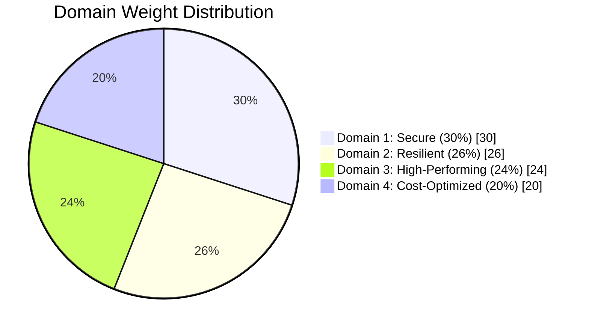
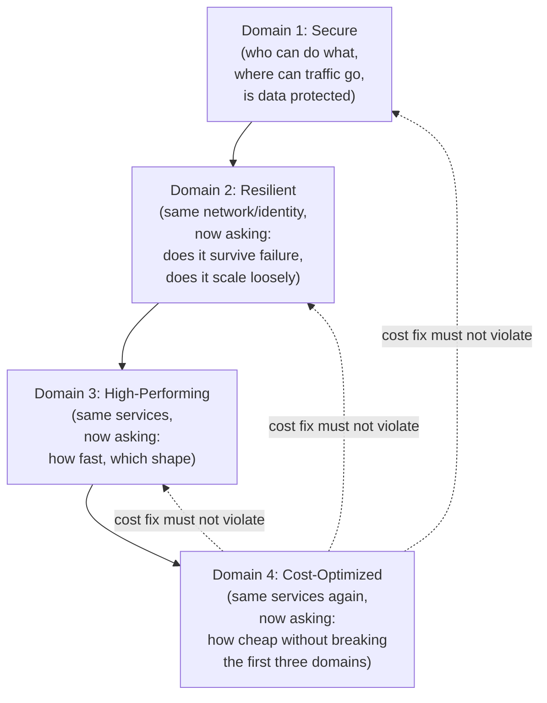

# SAA-C03 — AWS Certified Solutions Architect – Associate

## Exam Overview

| | |
|---|---|
| Who it's for | Anyone who designs AWS architectures — validates ability to design solutions aligned with the AWS Well-Architected Framework |
| Questions | 65 total (50 scored, 15 unscored — you can't tell which is which) |
| Time | 130 minutes |
| Format | Multiple choice & multiple response |
| Passing score | 720 / 1000 (scaled score) |
| Cost | $150 USD |
| Delivery | Pearson VUE test center or online proctored |
| Valid for | 3 years |
| Official guide | https://d1.awsstatic.com/training-and-certification/docs-sa-assoc/AWS-Certified-Solutions-Architect-Associate_Exam-Guide.pdf |

This is the first certification on en's path (targeted Jan 2027) and the one this repo treats as
the most thoroughly documented of any cert here — every domain folder below has full topic docs,
worked case studies, Mermaid architecture diagrams, and runnable labs, not just a checklist.

*Source: [AWS WAF Developer Guide — Shared Responsibility Model](https://docs.aws.amazon.com/waf/latest/developerguide/)*

## What This Certification Actually Tests

SAA-C03 is not a trivia test about AWS service names — every question is a **scenario**: a
company with a stated requirement (security, resilience, performance, or cost) and four or five
candidate architectures, only one of which actually satisfies the *stated* requirement without
over- or under-engineering it. The skill being tested is translation: reading a business
requirement and mapping it to the specific AWS service (or combination of services) built for
exactly that requirement — not the most impressive-sounding one, not the cheapest one, not the
most familiar one, but the *right-sized* one. Every domain folder in this repo is organized
around that translation skill specifically, which is why each domain README leads with a
"how to think about this domain" framing before diving into the service tables.

## Domains & Weights

| # | Domain | Weight | Folder |
|---|---|---|---|
| 1 | Design Secure Architectures | **30%** | [`domain-1-secure-architectures/`](domain-1-secure-architectures) |
| 2 | Design Resilient Architectures | **26%** | [`domain-2-resilient-architectures/`](domain-2-resilient-architectures) |
| 3 | Design High-Performing Architectures | **24%** | [`domain-3-high-performing-architectures/`](domain-3-high-performing-architectures) |
| 4 | Design Cost-Optimized Architectures | **20%** | [`domain-4-cost-optimized-architectures/`](domain-4-cost-optimized-architectures) |

## Domain 1: Design Secure Architectures (30%)

- **Task 1.1** — Design secure access to AWS resources (IAM, IAM Identity Center/SSO, federated
  access, multi-account strategy, least privilege, MFA, STS/role switching, SCPs, Control Tower)
- **Task 1.2** — Design secure workloads and applications (VPC security — security groups, NACLs,
  route tables, NAT gateways, public/private subnet segmentation, Shield, WAF, Secrets Manager,
  Cognito, GuardDuty, Macie, VPN, Direct Connect)
- **Task 1.3** — Determine appropriate data security controls (KMS encryption at rest, ACM/TLS
  encryption in transit, key rotation, certificate renewal, backup/replication, data lifecycle
  policies)

Full coverage: [`domain-1-secure-architectures/README.md`](domain-1-secure-architectures/README.md),
plus two decision-level topic docs
([`multi-account-security-strategy.md`](domain-1-secure-architectures/multi-account-security-strategy.md),
[`vpc-security-architecture-patterns.md`](domain-1-secure-architectures/vpc-security-architecture-patterns.md))
and [`labs.md`](domain-1-secure-architectures/labs.md).

## Domain 2: Design Resilient Architectures (26%)

- **Task 2.1** — Design scalable and loosely coupled architectures (API Gateway, SQS,
  microservices, event-driven patterns, horizontal/vertical scaling, CDN, containers, ECS/EKS,
  load balancing, multi-tier architecture, Step Functions, read replicas)
- **Task 2.2** — Design highly available and/or fault-tolerant architectures (Multi-AZ, Auto
  Scaling, Route 53 routing/failover, backup/DR strategies)

Full coverage: [`domain-2-resilient-architectures/README.md`](domain-2-resilient-architectures/README.md),
plus [`disaster-recovery-strategies.md`](domain-2-resilient-architectures/disaster-recovery-strategies.md),
[`event-driven-microservice-architecture-patterns.md`](domain-2-resilient-architectures/event-driven-microservice-architecture-patterns.md),
and [`labs.md`](domain-2-resilient-architectures/labs.md).

## Domain 3: Design High-Performing Architectures (24%)

- **Task 3.1** — Determine high-performing and/or scalable storage solutions (S3, EFS, EBS —
  object/file/block tradeoffs)
- **Task 3.2** — Design high-performing and elastic compute solutions
- **Task 3.3** — Determine high-performing database solutions
- **Task 3.4** — Determine high-performing and/or scalable network architectures
- **Task 3.5** — Determine high-performing data ingestion and transformation solutions (Kinesis,
  Glue, EMR, data lakes, CSV→Parquet)

Full coverage: [`domain-3-high-performing-architectures/README.md`](domain-3-high-performing-architectures/README.md),
plus [`compute-performance-decision-framework.md`](domain-3-high-performing-architectures/compute-performance-decision-framework.md),
[`storage-performance-decision-framework.md`](domain-3-high-performing-architectures/storage-performance-decision-framework.md),
[`network-performance-architecture-patterns.md`](domain-3-high-performing-architectures/network-performance-architecture-patterns.md),
and [`labs.md`](domain-3-high-performing-architectures/labs.md).

## Domain 4: Design Cost-Optimized Architectures (20%)

- **Task 4.1** — Design cost-optimized storage solutions (lifecycle policies, storage classes,
  backup strategy)
- **Task 4.2** — Design cost-optimized compute solutions (Spot/Reserved/Savings Plans, auto
  scaling, serverless, containers)
- **Task 4.3** — Design cost-optimized database solutions (engine choice, DynamoDB vs RDS,
  serverless options)
- **Task 4.4** — Design cost-optimized network architectures (NAT gateway cost, Direct Connect
  vs VPN vs internet, VPC endpoints, Transit Gateway, data transfer cost minimization)

Full coverage: [`domain-4-cost-optimized-architectures/README.md`](domain-4-cost-optimized-architectures/README.md),
plus [`compute-cost-optimization-decision-framework.md`](domain-4-cost-optimized-architectures/compute-cost-optimization-decision-framework.md),
[`database-cost-optimization-decision-framework.md`](domain-4-cost-optimized-architectures/database-cost-optimization-decision-framework.md),
[`network-cost-optimization-decision-framework.md`](domain-4-cost-optimized-architectures/network-cost-optimization-decision-framework.md),
[`storage-cost-optimization-decision-framework.md`](domain-4-cost-optimized-architectures/storage-cost-optimization-decision-framework.md),
and [`labs.md`](domain-4-cost-optimized-architectures/labs.md).

## How the Four Domains Relate to Each Other

This is the single most useful mental model for the whole exam: it is **not four unrelated topic
areas** — it's the same AWS services and the same architecture, examined through four
successive lenses, each one layered on top of the last. A VPC design from Domain 1 is reused
unchanged in Domain 2's resilience diagrams; Domain 3 asks how fast that same VPC's resources can
go; Domain 4 asks how to make it all cheaper *without undoing* what Domains 1-3 established. A
cost answer that would reopen a security hole, remove necessary redundancy, or tank performance
below a stated requirement is always the wrong answer on this exam, no matter how much money it
saves — the dotted arrows above are a reminder that Domain 4 operates under constraints set by
the other three, not in isolation.

## Mapping Task Statements to Where They Live

A quick cross-reference so you can find any single task statement's home instantly:

| Task | Domain | Primary doc |
|---|---|---|
| 1.1 Secure access | 1 | `multi-account-security-strategy.md` |
| 1.2 Secure workloads | 1 | `vpc-security-architecture-patterns.md` |
| 1.3 Data security controls | 1 | domain README (KMS/ACM/Backup table) |
| 2.1 Scalable/loosely coupled | 2 | `event-driven-microservice-architecture-patterns.md` |
| 2.2 Highly available/fault tolerant | 2 | `disaster-recovery-strategies.md` |
| 3.1 High-performing storage | 3 | `storage-performance-decision-framework.md` |
| 3.2 High-performing compute | 3 | `compute-performance-decision-framework.md` |
| 3.3 High-performing database | 3 | domain README + `services/database/database-selection-guide.md` |
| 3.4 High-performing network | 3 | `network-performance-architecture-patterns.md` |
| 3.5 Data ingestion/transformation | 3 | domain README (Kinesis/Glue/EMR/Athena table) |
| 4.1 Cost-optimized storage | 4 | `storage-cost-optimization-decision-framework.md` |
| 4.2 Cost-optimized compute | 4 | `compute-cost-optimization-decision-framework.md` |
| 4.3 Cost-optimized database | 4 | `database-cost-optimization-decision-framework.md` |
| 4.4 Cost-optimized network | 4 | `network-cost-optimization-decision-framework.md` |

## How to Read a Scenario Question (a worked example)

Most candidates lose points not from not knowing a fact, but from misreading which domain/lens a
question is actually testing. Take this example stem: *"A company runs a web application on a
single EC2 instance behind no load balancer. The database is a single RDS instance with no
standby. During a recent regional network event, the application was unreachable for six hours.
The company wants to reduce this risk while keeping costs reasonable."*

Walking through it the way this repo recommends: the phrase "reduce this risk" plus "regional
network event" plus "unreachable for six hours" is a **Domain 2 (resilience)** signal, not a
Domain 1 security signal (nothing here describes unauthorized access) and not a pure Domain 3
performance signal (nothing here describes slowness under load). "Keeping costs reasonable" is a
Domain 4 *constraint* layered on top of the Domain 2 question, not the primary domain being
tested — it's there to rule out the most expensive resilience answer (e.g., full multi-Region
active/active) in favor of a right-sized one (Multi-AZ RDS + an Auto Scaling group across two
AZs behind an ALB, which directly addresses "no standby" and "single instance, no load balancer"
at a modest, not maximal, cost). Practice identifying the *primary* domain signal first, then
treating any other domain's keywords as constraints narrowing the answer, not separate questions.

## Study order

1. [`00-fundamentals/`](../../00-fundamentals) if you haven't already
2. Domain 1 (biggest weight, and security concepts recur in every other domain)
3. Domain 2 (resiliency patterns build directly on Domain 1's networking)
4. Domain 3 (performance — assumes you already know the services from 1 & 2)
5. Domain 4 (cost — the "which service is cheaper for this case" layer on top of everything else)
6. [`practice-questions/`](practice-questions) once all four domains are covered, to stress-test
   recall across mixed-domain scenarios the way the real exam mixes them

## Use Cases — Real Scenarios (seeing all four domains applied together)

The exam always tests one domain's lens at a time, but real architecture decisions pull from all
four at once — these ten vignettes show the same kind of full-stack thinking the domain-level
"Full Worked Case Study" sections go into individually, but zoomed out to where a company's single
business requirement touches Security, Resilience, Performance, and Cost simultaneously.

1. **Regional hospital network migrating off on-prem.** A 12-hospital group moving patient
   records to AWS needs HIPAA-eligible encryption and account isolation per facility (Domain 1),
   a documented 4-hour RTO for its records system (Domain 2), sub-second chart lookup during ER
   admission (Domain 3), and a capped monthly spend the board already approved (Domain 4) — the
   same KMS-encrypted, Multi-AZ Aurora cluster behind ElastiCache, in its own account per facility
   under one Organization, Warm Standby in a second Region, Reserved Instance baseline pricing.
2. **Seed-stage fintech building its first production app.** A 6-person payments startup needs
   PCI-DSS-aligned network isolation (Domain 1) without the overhead of a full landing zone yet,
   basic Multi-AZ resilience (Domain 2) rather than multi-Region (too expensive for their stage),
   acceptable (not maximal) performance (Domain 3), and near-zero idle cost (Domain 4) — pointing
   to a single well-structured account with a three-tier VPC, RDS Multi-AZ, and serverless compute
   (Lambda/Fargate) rather than a standing EC2 fleet.
3. **National retailer's Black Friday readiness review.** Security team mandates WAF/Shield
   Advanced ahead of the traffic spike (Domain 1); the resilience team mandates an Auto Scaling
   group that's already warmed up before the spike, not reacting to it (Domain 2); the performance
   team mandates CloudFront + ElastiCache in front of the catalog service (Domain 3); the finance
   team mandates Spot-backed burst capacity above a Savings-Plan-covered baseline so Black Friday
   doesn't 10x the November bill (Domain 4) — all four requirements land on the identical ALB/ASG/
   ElastiCache/Aurora stack, just reviewed by four different teams in the same planning meeting.
4. **University research lab's genomics pipeline.** Needs each grant-funded project's data
   isolated in its own account for audit purposes (Domain 1), no resilience requirement beyond
   "don't lose data mid-run" because compute jobs are naturally re-runnable (Domain 2, explicitly
   a non-requirement here), maximum throughput for EMR/Glue batch processing (Domain 3), and Spot-
   backed compute since jobs checkpoint and tolerate interruption (Domain 4) — a case where
   Domain 2's usual answer (Multi-AZ, DR) is correctly *absent* because the workload's own
   re-runnability substitutes for infrastructure-level resilience.
5. **Insurance company's quarterly actuarial reporting.** Strict least-privilege IAM roles per
   analyst team (Domain 1), no real-time availability requirement since reports run monthly
   (Domain 2 mostly irrelevant here), Redshift/Athena tuned for large complex joins across years of
   claims data (Domain 3), and S3 Glacier Deep Archive for the 15 years of historical claims data
   regulators require retained but that's never queried directly (Domain 4) — illustrating that not
   every workload touches every domain with equal weight.
6. **Gaming studio launching a global multiplayer title.** Cognito-backed player authentication and
   DDoS protection at the edge given gaming is a common attack target (Domain 1), multi-Region
   active/active for near-zero downtime during a launch weekend (Domain 2), Global Accelerator for
   the non-cacheable, latency-sensitive UDP game traffic (Domain 3), and a mixed Spot/On-Demand
   fleet for the inherently bursty launch-week traffic curve (Domain 4) — a case where Domain 2's
   most expensive option (active/active) is actually justified by the stated near-zero-downtime
   launch requirement, not over-engineering.
7. **Logistics company's IoT fleet-tracking platform.** Device certificates and least-privilege IoT
   policies per truck (Domain 1), the system must keep accepting location pings even if one AZ's
   ingestion path fails (Domain 2), Kinesis Data Streams sized correctly for thousands of trucks'
   location updates per second (Domain 3), and DynamoDB on-demand billing because truck activity
   (and therefore write volume) swings hugely by time of day (Domain 4).
8. **Media company's video-on-demand catalog.** Signed CloudFront URLs so only paying subscribers
   can stream content (Domain 1), origin failover group so a single S3 origin outage doesn't take
   down playback (Domain 2), CloudFront edge caching for the actual video performance (Domain 3),
   and S3 Intelligent-Tiering for a catalog whose long-tail titles have genuinely unpredictable
   viewing spikes when older content suddenly trends (Domain 4).
9. **Government agency's citizen-facing benefits portal.** FedRAMP-aligned account structure and
   mandatory MFA for all staff access (Domain 1), the portal legally cannot be down during
   open-enrollment season so Pilot Light DR is upgraded to Warm Standby for that window only
   (Domain 2), read replicas added ahead of the predictable enrollment-season traffic spike
   (Domain 3), and the Warm Standby fleet is scaled back down to Pilot Light once enrollment season
   ends to stop paying for standby capacity the rest of the year (Domain 4) — showing that the
   Domain 2/4 tradeoff can be a *seasonal*, not permanent, architecture decision.
10. **SaaS startup consolidating after acquiring a smaller competitor.** Merging the acquired
    company's AWS account into the parent's AWS Organization under its own OU with inherited SCPs
    (Domain 1), reconciling the acquired product's single-AZ database into the parent's Multi-AZ
    standard before the next renewal (Domain 2), right-sizing the acquired product's over-
    provisioned EC2 fleet using Compute Optimizer before deciding on any purchasing commitment
    (Domain 3 and 4 together) — a realistic scenario where a Domain 1 action (account structure)
    is the very first step that makes every later domain's cleanup possible.

## Common Exam-Day Pitfalls (across all domains)

- **Picking the most "advanced-sounding" service** instead of the right-sized one for the stated
  requirement — the exam consistently rewards matching scope to the actual stated need over
  reaching for the most capable-sounding tool.
- **Treating cost as the only consideration** in a Domain 4-flavored question when the scenario
  also implies a security or availability floor that must still be respected.
- **Confusing "most secure/available/fast" distractors** that are each individually true facts
  about a service, but don't answer the specific requirement the scenario actually states.
- **Running out of time on long scenario stems** — read the *last sentence* of a long scenario
  first; it almost always states the actual requirement, with the preceding paragraph as context.
- **Second-guessing a confident first read** — on a 130-minute, 65-question exam, flag-and-move-on
  is almost always better than spending disproportionate time second-guessing a scenario you
  understood on first read.

## Status

✅ Fully expanded — every domain folder has complete topic docs, worked architecture case
studies, Mermaid diagrams, real sourced images, expanded exam-scenario banks, and runnable Floci
labs. See each `domain-*/README.md` for the full depth, and `practice-questions/` for scenario
drills across all four domains.
