# Domain 1 Master Chunk — Design Secure Architectures (30%), Every Service in One File

This is a **self-contained** reference covering all 26 services/topics in SAA-C03 Domain 1
("Design Secure Architectures," ~30% of the exam, the single largest domain). Read this file
top to bottom and you should understand the whole domain without needing to open another file.
Each service section links to its full `services/` doc at the end for "go even deeper" detail —
but you should never *need* that link to pass a Domain 1 question; everything required is here.

**How to use this file:** it's long on purpose (the goal is depth, not brevity) — treat it like a
textbook chapter, not a cheat sheet. Read it once start-to-finish, then come back to individual
sections before the exam. Every section follows the same shape: **Definition → Analogy → Purpose
→ When to Use → When NOT to Use → Use Cases → Why It's Important → Diagram → Image → Exam Tips.**

## Table of Contents

**Task 1.1 — Design secure access to AWS resources**
1. [IAM](#1-aws-identity-and-access-management-iam)
2. [IAM Identity Center (SSO)](#2-iam-identity-center-sso)
3. [STS & Role Switching](#3-sts--role-switching-assumerole)
4. [Organizations & SCPs](#4-aws-organizations--service-control-policies-scps)
5. [Additional Governance Services (Control Tower etc.)](#5-additional-governance-services-control-tower-etc)

**Task 1.2 — Design secure workloads and applications**
6. [VPC](#6-amazon-vpc)
7. [Security Groups vs. NACLs](#7-security-groups-vs-nacls)
8. [Subnets, Route Tables, IGW, NAT Gateway](#8-subnets-route-tables-internet-gateway-nat-gateway)
9. [VPC Endpoints & PrivateLink](#9-vpc-endpoints--privatelink)
10. [Direct Connect](#10-aws-direct-connect)
11. [Site-to-Site VPN & Client VPN](#11-site-to-site-vpn--client-vpn)
12. [Shield](#12-aws-shield)
13. [WAF](#13-aws-waf)
14. [Cognito](#14-amazon-cognito)
15. [GuardDuty](#15-amazon-guardduty)
16. [Macie](#16-amazon-macie)
17. [Security Hub & Inspector](#17-security-hub--inspector)
18. [Additional Security Services (CloudHSM etc.)](#18-additional-security-services-cloudhsm-etc)
19. [Systems Manager](#19-aws-systems-manager)

**Task 1.3 — Determine appropriate data security controls**
20. [KMS](#20-aws-kms-key-management-service)
21. [ACM & Private CA](#21-acm--private-ca)
22. [Secrets Manager vs. Parameter Store](#22-secrets-manager-vs-parameter-store)
23. [Lake Formation](#23-aws-lake-formation)
24. [AWS Backup](#24-aws-backup)
25. [S3](#25-amazon-s3)
26. [S3 Storage Classes](#26-s3-storage-classes)

## The One-Paragraph Mental Model

Every Domain 1 question is secretly asking "is this an **identity** problem, a **network**
problem, or a **data** problem?" — Task 1.1 is identity (who can do what), Task 1.2 is network
and workload isolation (where can traffic go, what's internet-facing), and Task 1.3 is data
protection (is it encrypted at rest, encrypted in transit, backed up, and correctly classified).
Nearly every wrong exam answer either reaches for a heavier tool than needed, a lighter tool than
needed, or the right *category* of tool but the wrong specific service (WAF instead of Shield,
Secrets Manager instead of Parameter Store). Keep asking "identity, network, or data?" before you
even look at the answer choices, then pick the right-sized tool within that category.


*Source: [AWS WAF Developer Guide — Shared Responsibility Model](https://docs.aws.amazon.com/waf/latest/developerguide/)*

**Discussion.** Read this image literally as a legal contract, not decoration. Below the line,
AWS is responsible for the physical security of data centers, the hypervisor, and the hardware
running every managed service — you can never be tested on "did AWS patch the hypervisor
correctly," because that's not your lever to pull. Above the line is everything in this master
chunk: your IAM policies, your guest OS patching (if you're running EC2 rather than something
fully managed like Lambda), your network ACLs and security groups, and your encryption key
choices. The amount you're responsible for *shrinks* as you move up the abstraction stack — S3 and
DynamoDB push almost everything below the line because AWS manages the servers entirely, while a
self-managed EC2 fleet pushes the OS, patching, and firewall configuration above the line onto
you. Every one of the 26 sections below is a different brick in the wall on *your* side of this
line.

---
## 1. AWS Identity and Access Management (IAM)

### Definition
IAM is the service that decides **who (or what) can do what, to which AWS resource, under which
conditions.** Every single API call — console click, CLI command, SDK call, one AWS service
acting on your behalf — is checked against IAM before it's allowed to happen. If IAM has no rule
allowing a call, the call is denied, full stop.

### Analogy
Think of IAM as the building's entire security system, not just the front-door lock. A **user**
is an employee's personal badge (permanent, tied to one person). A **role** is a visitor badge at
the front desk — you check it out for a visit, it works for a while, and it auto-expires; nobody
carries it home. A **policy** is the actual rule printed on a laminated card taped to each door
("badge holders from Accounting may enter, 9am–6pm only"). A **resource-based policy** is a
*second* rule taped to that specific door, independent of what any badge says, because the door's
owner wants their own say over who may enter it ("this door also admits the cleaning crew's
badge, even though Accounting's card doesn't mention them"). You only get through a given door if
the badge's own rule allows it (or that door's own separate rule allows it) — and if a big red
sign at the building entrance says "no badge may ever use the loading dock after 9pm" (an SCP),
that sign overrides every laminated card inside, even the CEO's.

### Purpose
Before IAM-style systems existed, the common failure mode was "one shared root login, full
access, hope nothing goes wrong" — a single leaked credential meant total account compromise.
IAM exists to make **least privilege** the default: every identity gets exactly the access it's
proven to need and nothing more. It is also structurally **global** — an IAM user, role, or
policy exists identically in every Region at once; there is no "replicate IAM to eu-west-1" step.

### When to Use
Use IAM for every access-control decision *inside one AWS account*: granting a human console
access, granting an application (EC2/Lambda/ECS) access to other AWS services, and granting a
narrowly-scoped cross-account role to a trusted partner. If the question is "can this identity
touch this AWS resource," the answer lives in IAM.

### When NOT to Use (be honest about the alternative)
- **Your app's own end-user login (millions of customers).** Don't build this on IAM users —
  use **Cognito**. IAM users are billed, quota-limited, and never designed for that scale or for
  self-service sign-up flows.
- **SSO across 10+ AWS accounts for your workforce.** Raw per-account IAM users don't scale and
  create an offboarding nightmare — use **IAM Identity Center**.
- **A guardrail that not even an account admin should be able to remove.** A plain IAM policy
  can always be edited by an account admin — that's not a ceiling, that's just another knob they
  control. Use an **SCP** instead, which sits structurally above any single account's admin.
- **Fine-grained, app-level business logic** ("can user X edit document Y they don't own") — this
  is application authorization, not infrastructure access; IAM policies model infrastructure
  permissions, not arbitrary business rules. Consider Amazon Verified Permissions instead.

### Use Cases
- **EC2 instance reading from one S3 bucket** via an instance profile role — zero hardcoded keys,
  auto-rotating credentials scoped to exactly that bucket.
- **Lambda execution role** scoped to only the DynamoDB table and SNS topic the function actually
  touches — Lambda assumes it automatically on every invocation.
- **Third-party vendor read access to CloudWatch metrics** via a cross-account role with an
  `ExternalId` condition — revocable instantly by deleting the trust statement, no shared secret.
- **MFA required before deleting a KMS key or editing an IAM policy** — a `Condition` requiring
  `aws:MultiFactorAuthPresent` adds a second factor exactly where blast radius is highest.
- **Multi-tenant SaaS data isolation via ABAC** — one shared role, tag-matched against the
  resource's tag at evaluation time, scales to thousands of tenants without a role-per-tenant
  explosion.
- **CI/CD pipeline credentials via OIDC-federated execution roles**, never static access keys
  pasted into build config — the #1 real-world source of leaked long-term AWS credentials.

### Why It's Important
IAM misconfiguration is consistently the #1 root cause cited in cloud security incident reports —
nearly every public "S3 bucket leaked millions of records" postmortem traces back to an
over-broad IAM policy or resource policy. There is no AWS skill more load-bearing than correctly
reading and writing a least-privilege policy.

### Diagram: The Policy Evaluation Chain (the exam's favorite mental model)

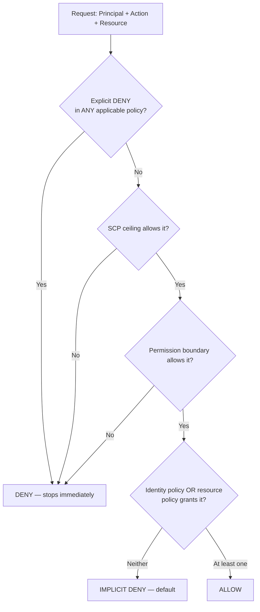

**Step by step:** (1) An explicit `Deny` anywhere in the chain wins immediately, no exceptions —
check this first when debugging. (2) Every containing *ceiling* must say yes: the SCP (org-wide),
the permission boundary (per-identity), the session policy (if assumed via STS) — these only ever
subtract, never grant. (3) Only after every ceiling passes does AWS check whether an identity
policy *or* a resource policy actually grants the action — either one is enough for most services
(S3, KMS, SQS support resource policies this way), but IAM/EC2 only support identity policies.
(4) If nothing explicitly allows it, the default is **implicit deny** — AWS denies by default,
always.

### Image: the official evaluation flowchart


*Source: [AWS IAM User Guide — Policy evaluation logic](https://docs.aws.amazon.com/IAM/latest/UserGuide/reference_policies_evaluation-logic_policy-eval-basics.html)*

**Discussion.** This is AWS's own canonical diagram, and it's worth tracing with a real example:
an IAM role in Account A with an identity policy allowing `s3:GetObject` on `*`, no SCP, no
boundary, calling a bucket in the *same* account with no bucket policy at all. Walk the chart: no
Deny anywhere → no SCP in play (single account) → no boundary → identity policy allows it → ALLOW.
Now change one fact: the bucket lives in a *different* account. The identity policy alone is no
longer sufficient — the diagram's "identity OR resource policy" box, in the cross-account case,
actually requires **both** sides to independently agree (this nuance is the single most tested
trap in this whole section: same-account identity+resource policies are a *union*, cross-account
is **both required, separately**).

### Exam Tips
- **Explicit Deny beats everything** — if a question shows one Allow and one Deny on the same
  action, the answer is always Deny, however deeply that Deny is buried (identity policy, SCP, or
  permission boundary).
- **Cross-account S3/KMS/SQS access needs BOTH** the identity policy (caller's account) and the
  resource policy (resource's account) to independently allow it — "just add an identity policy"
  is always the wrong, incomplete answer for a cross-account scenario.
- **A permission boundary that doesn't explicitly grant an action behaves like a Deny** for the
  intersection calculation — this produces an AccessDenied that looks identical to "no policy at
  all," a classic hard-mode exam trap.

**Go even deeper:** [`services/security-identity-compliance/iam.md`](../../../services/security-identity-compliance/iam.md) (942 lines — full policy JSON examples, ABAC, troubleshooting playbook, quotas)

---

## 2. IAM Identity Center (SSO)

### Definition
IAM Identity Center (formerly AWS SSO) lets **one human login** grant access to **many AWS
accounts and business applications**, with the level of access in each account decided centrally
through reusable **Permission Sets** instead of hand-creating an IAM user in every account.

### Analogy
Picture a company badge that works at every building the company owns, instead of a different
key for each building's front door. You swipe once at the main lobby (Identity Center), and the
turnstile at each building (each AWS account) reads from the same central access list to decide
which floors (Permission Sets → IAM roles) you're allowed onto. Fire someone from the company
database once, and every turnstile in every building instantly stops recognizing their badge —
compare that to the old way of physically re-keying every single building's lock when someone
leaves, which is what hand-managing IAM users per account amounts to.

### Purpose
A company with 50 AWS accounts and 30 engineers faces a scaling wall if access is managed by
hand-creating IAM users per account — potentially 1,500 credentials to rotate, offboard, and
audit. Identity Center makes identity a single central thing (one login) and permission a
separately assigned per-account thing (Permission Sets), so a person logs in once and sees every
account/role combination they're allowed to use.

### When to Use
Any organization with more than a handful of AWS accounts and a workforce needing varying access
levels across them. It's also the default "right answer" whenever a scenario says "federate with
our existing corporate directory" or "centralize employee AWS access."

### When NOT to Use (be honest about the alternative)
- **A single AWS account with a handful of people** — the setup overhead isn't worth it; a few
  directly-managed IAM roles (ideally still federated) are simpler. Identity Center's value curve
  only kicks in once you have multiple accounts.
- **Your product's own customers logging into your app** — this is strictly workforce access, not
  end-user application login. Use **Cognito** for that; mixing these two up is one of the most
  common exam traps in this whole domain.
- **Machine-to-machine access** (a Lambda in Account A calling a service in Account B) — Identity
  Center is a human-facing SSO portal. Non-human workload access still goes through a direct
  `AssumeRole`, not Identity Center, regardless of how many accounts are involved.

### Use Cases
- **Workforce access across dozens of accounts** without IAM user sprawl — one login, Permission
  Set assignments replace rotating per-account credentials entirely.
- **Instant, org-wide offboarding** — disabling someone in the corporate IdP (synced via SCIM)
  revokes Identity Center access everywhere in one action, instead of chasing IAM users account
  by account.
- **Auditor/finance read-only access across the whole Organization** for a compliance cycle, with
  zero IAM users created anywhere, cleanly removable when the audit ends.
- **Consolidating AWS and non-AWS SaaS SSO** (Salesforce, Slack, Box) into one employee portal,
  reducing password fatigue and the number of places offboarding has to happen.
- **M&A integration** — a newly acquired team gets fast, scoped access via a temporary external
  IdP connection, migrated later into the unified corporate directory.
- **Break-glass design** — even a full Identity Center rollout keeps one or two tightly monitored
  IAM emergency-access users per critical account, specifically for the scenario where the
  identity source itself is down.

### Why It's Important
Centralized identity is a near-universal compliance requirement (SOC 2, ISO 27001, PCI-DSS all
expect a documented, centrally revocable access model with MFA) — and it's how virtually every
mature AWS organization manages workforce access in practice.

### Diagram: Permission Set Lifecycle

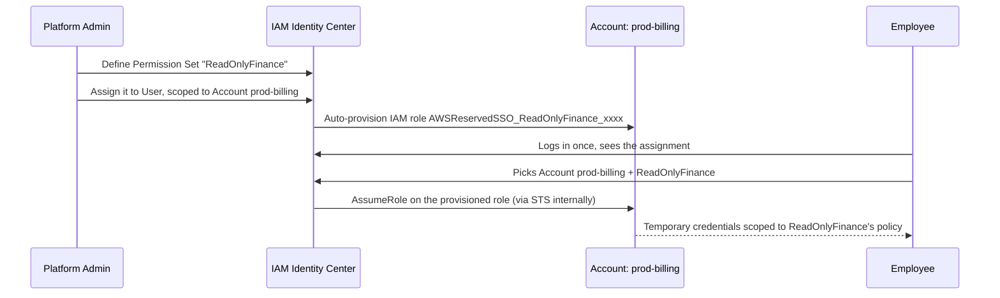

**Step by step:** an admin defines the Permission Set's policy **once**, centrally. Assigning it
to a user for a specific account causes Identity Center to silently provision (or update) a
matching IAM role in that account — you never hand-create this role yourself. When the user picks
that account+Permission Set combination in the portal, Identity Center performs a normal
`AssumeRole` call behind the scenes and hands back ordinary STS temporary credentials — nothing
about the final authorization step bypasses the IAM evaluation chain from Section 1; Identity
Center is the *provisioning and portal* layer on top of the exact same IAM/STS mechanics.

### Image: connecting an on-premises identity source without caching user data in the cloud


*Source: [AWS Prescriptive Guidance — Security Reference Architecture, IAM Identity Center](https://docs.aws.amazon.com/prescriptive-guidance/latest/security-reference-architecture-identity-management/workforce-iam-identity-center.html)*

**Discussion.** This diagram matters because it answers a very specific, recurring exam question:
a company with an existing on-premises Active Directory wants Identity Center integration but
explicitly does **not** want its employee directory data replicated or cached in the cloud. AD
Connector is the answer precisely because of what it *doesn't* do — rather than syncing a copy of
every user/group into the cloud (which is what SCIM-based sync against a SaaS IdP does), AD
Connector forwards each authentication request back to the real, on-premises directory in real
time, establishing a two-way trust without a cloud-side cache of identity data ever existing.

### Exam Tips
- **Identity Center vs. Cognito**: Identity Center is for *your own employees* accessing AWS/
  internal tools; Cognito is for *your product's customers*. This single distinction is tested
  constantly and is the fastest way to eliminate half the answer choices on a federation question.
- **SAML vs. SCIM**: SAML proves who's logging in *right now*; SCIM keeps the user/group list in
  sync so an offboarded employee actually loses access. "Access wasn't revoked when someone left"
  always points to a broken/missing SCIM sync, never a SAML problem.
- **Permission Sets are not IAM policies** — they're Identity Center's own assignment unit, which
  gets *rendered into* an actual IAM role per account; know the distinction when a question asks
  what object type actually lives in the target account.

**Go even deeper:** [`services/security-identity-compliance/iam-identity-center-sso.md`](../../../services/security-identity-compliance/iam-identity-center-sso.md) (477 lines — migration playbook, SCIM/SAML detail, break-glass design)

---

## 3. STS & Role Switching (AssumeRole)

### Definition
AWS Security Token Service (STS) **issues short-lived, temporary credentials** instead of
permanent ones. "Role switching" is the act of a principal temporarily becoming a different IAM
role by calling STS and receiving a fresh access key, secret key, and session token that expire
automatically.

### Analogy
A static IAM access key is like a house key that works forever and that you can't easily track
copies of — if someone copies it once, they have access *indefinitely*, and the only fix is
changing the lock entirely. A temporary STS credential is like a hotel key card programmed to stop
working at checkout time automatically, no front-desk action required. If a copy of today's key
card leaks, it's useless tomorrow regardless of whether anyone ever "revokes" it — the leak's
blast radius is capped by the clock, not by someone noticing and reacting in time.

### Purpose
Long-term credentials are a liability: if leaked, they work forever until someone manually
revokes them, and they're easy to accidentally commit to a public repo or bake into an AMI. STS
exists so that almost nothing in AWS ever needs a long-term secret — EC2, Lambda, federated users,
and cross-account access all get credentials that expire automatically, usually within an hour.

### When to Use
Any time a principal needs to act as a different identity, temporarily: cross-account access,
every EC2 instance profile and Lambda execution role (both use `AssumeRole` automatically under
the hood), third-party vendor access via `ExternalId`, and federated logins via SAML or OIDC.

### When NOT to Use (be honest about the alternative)
- **A long-running on-premises server with no way to periodically re-authenticate** — fighting
  STS's short-lived-by-design nature with manual hourly credential refresh is painful; **IAM
  Roles Anywhere** (still STS-based, but designed for certificate-based, longer-lived trust) is
  the better fit.
- **Simple, low-stakes single-account CLI access** — plain IAM user credentials are at least
  simpler to reason about than a full AssumeRole chain, though in practice AWS steers even this
  case toward `aws sso login` (Identity Center), which issues STS credentials transparently anyway.

### Use Cases
- **EC2 instance profile** — the single most common AssumeRole flow of all, happening completely
  automatically via the Instance Metadata Service, with zero application code calling STS directly.
- **Central security account auditing 50 member accounts** via one identical `ReadOnlyAuditRole`
  per account, each trusting only the security account — no standing credentials anywhere.
- **Third-party SaaS vendor access via `ExternalId`**, not a shared key — revocable instantly by
  deleting the trust statement, and defended against the "confused deputy" problem.
- **MFA-gated sensitive action without switching identity** — `GetSessionToken` with an MFA code
  satisfies an `aws:MultiFactorAuthPresent` condition while the caller stays the *same* identity.
- **Mobile app uploading directly to a per-user S3 prefix** via `AssumeRoleWithWebIdentity`
  through a Cognito Identity Pool, scoped using `${cognito-identity.amazonaws.com:sub}`.
- **EKS IRSA (IAM Roles for Service Accounts)** — each Kubernetes service account maps to its own
  IAM role via the cluster's OIDC provider, instead of sharing one broad node-level role.

### Why It's Important
Virtually every "serverless app got hacked because of a leaked static key" postmortem would have
been a non-issue had the workload used a role instead. STS-backed temporary credentials are the
backbone of how AWS expects every non-human workload to authenticate.

### Diagram: Trust Policy vs. Permissions Policy — the #1 confused pair

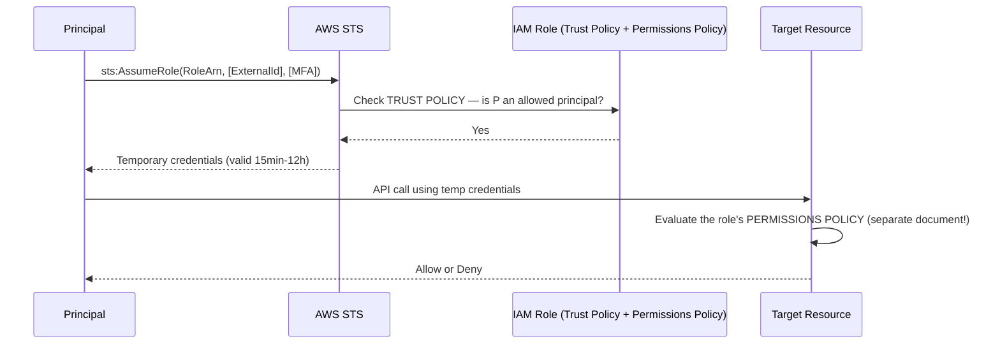

**Step by step:** the **trust policy** lives on the role and answers only "who may call
AssumeRole on me" — it's a resource-based policy, distinct from the role's **permissions policy**,
which answers "what can a session that successfully assumed this role actually do." A role can
have a wide-open trust policy and an empty permissions policy (assumption succeeds, the session
can do nothing) or the reverse (a locked-down trust policy nobody can satisfy, paired with a
permissions policy that never gets exercised). Debugging "AccessDenied" after a role assumption:
if the *assumption itself* failed, it's a trust-policy problem; if assumption succeeded but the
*next API call* failed, it's a permissions-policy problem — these are different documents, fixed
in different places.

### Image: the general trust-token exchange pattern behind every federated AssumeRole variant


*Source: [AWS IAM User Guide — Federating AWS identities across AWS partitions](https://docs.aws.amazon.com/IAM/latest/UserGuide/id_roles_providers_outbound_cross_partition.html)*

**Discussion.** Although this specific diagram illustrates a cross-partition flow, the pattern it
shows generalizes to *every* `AssumeRoleWith*` call: a token is minted by one trust anchor
(an OIDC issuer, a SAML IdP, a source account's STS), presented to the destination STS, validated
against the issuer's public signing keys, and exchanged for scoped temporary credentials. Whether
the "trust anchor" in your scenario is Okta (SAML), a Cognito Identity Pool (OIDC/web identity),
or an EKS cluster's own OIDC provider (IRSA), the shape of the exchange — present a token, get
validated, receive temporary AWS credentials — never changes.

### Exam Tips
- **ExternalId is specifically for third-party cross-account access**, defending against the
  "confused deputy" problem — a question mentioning "a vendor/partner needs access to our
  resources" almost always wants `ExternalId` in the trust policy as part of the answer.
- **Chained AssumeRole hard-caps at 1 hour**, regardless of either role's own `MaxSessionDuration`
  — a classic "why did my long session expire early" trap when a scenario involves multiple
  account hops.
- **Session policies only ever restrict, never expand** what a role's own policies already allow
  — an answer choice proposing a session policy to *grant more* access is always wrong.

**Go even deeper:** [`services/security-identity-compliance/sts-and-role-switching.md`](../../../services/security-identity-compliance/sts-and-role-switching.md) (605 lines — full API comparison table, multi-hop debugging scenario)

---

## 4. AWS Organizations & Service Control Policies (SCPs)

### Definition
AWS Organizations groups multiple AWS accounts into one managed structure (a hierarchy of
Organizational Units) for shared billing and governance. Service Control Policies (SCPs) are the
tool Organizations uses to set a **maximum permission ceiling** on everything underneath — no
identity in an affected account, including that account's own root user, can ever exceed it.

### Analogy
If IAM policies are laminated rules taped to individual doors inside a building, an SCP is a
structural decision made by the building's architect *before any door existed* — "this entire
wing of the building physically has no door leading outside." No matter what any room's manager
decides to print on their own door's sign, they cannot create a door where the architect decided
there would be a wall. SCPs don't compete with IAM's door signs; they define which walls can never
have doors in them, period, regardless of who manages which room.

### Purpose
A company running hundreds of AWS accounts needs company-wide rules individual account admins
cannot override — "no account may ever disable CloudTrail," "no account outside approved regions
may create resources." IAM policies can't do this because they're managed *within* each account
by that account's own admins. SCPs sit one level above IAM, with no opt-out.

### When to Use
Whenever a requirement explicitly needs to bind **even an account administrator** — region
restrictions, un-disablable security logging, blocking standing IAM user creation org-wide, or any
"nobody, anywhere in this org, may ever do X" requirement.

### When NOT to Use (be honest about the alternative)
- **Per-user/per-role fine-grained permissions within one account** — that's IAM's job, not SCPs;
  SCPs are deliberately coarse, account/OU-level ceilings.
- **A single standalone account with no Organization** — SCPs require AWS Organizations; use an
  **IAM permission boundary** for a similar ceiling effect scoped to one account instead.
- **Granting access** — never reach for an SCP when the goal is to give someone a *new*
  capability; SCPs are restriction-only. A question implying "the SCP is why this now works" is
  conceptually broken.

### Use Cases
- **Org-wide region restriction** for cost control or data residency — an SCP denies everything
  outside an approved region list, with no per-account opt-out.
- **Tamper-proof security logging** — an SCP denying `cloudtrail:StopLogging`/`DeleteTrail`
  applies to the account's own root user too; no in-account admin can disable it.
- **Cost-capped sandbox OU** — restricting instance types/services for experimentation accounts
  without manually policing every sandbox.
- **Forcing all human access through federated identity** — an SCP denying `iam:CreateUser`/
  `CreateAccessKey` org-wide makes "no standing IAM users" a structural guarantee, not a policy.
- **Data residency enforcement for GDPR/PCI-DSS** — the one control a malicious or careless
  account-level admin genuinely cannot bypass, which is exactly what regulators expect.
- **Preventing accidental Organization departure** — an unconditional SCP denying
  `organizations:LeaveOrganization` removes a surprisingly easy way to strand an account.

### Why It's Important
Multi-account governance at scale is unmanageable without SCPs — it's the mechanism letting a
central platform team guarantee baseline protections hold everywhere, regardless of what
individual account owners configure or how senior they are.

### Diagram: SCP + IAM policy intersection — effective permission is always the narrower of the two

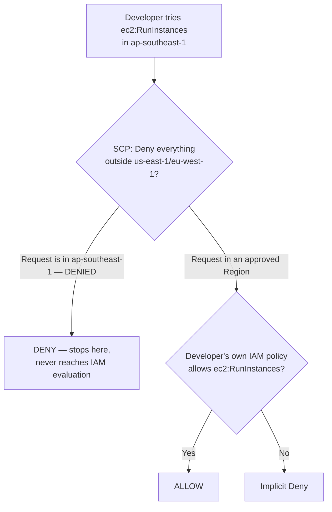

**Step by step:** the developer's own IAM policy might say "full EC2 access, everywhere" — but if
the SCP attached at the account's OU denies any non-essential action outside two approved Regions,
attempting to launch in a third Region is denied **before the identity policy is ever consulted.**
This is the clearest illustration of "SCPs are a ceiling, never a grant": removing the SCP
wouldn't need to add anything to make the call succeed in the approved Regions — the identity
policy already allows it there. The SCP only ever subtracts a possibility, never adds one.

### Image: the official Org Management account architecture


*Source: [AWS Prescriptive Guidance — Security Reference Architecture, Org Management account](https://docs.aws.amazon.com/prescriptive-guidance/latest/security-reference-architecture/org-management.html)*

**Discussion.** This diagram places Organizations/Control Tower/SCP enforcement literally at the
*top* of the account hierarchy for a reason: everything below inherits from it, and nothing below
can edit it. The management account pictured at the top is intentionally drawn running no
workloads of its own — a recurring exam fact. A scenario describing production resources running
*in* the management account is describing an anti-pattern to flag, not a design to emulate,
because SCPs attached at the Root structurally do not apply to the management account itself —
running anything sensitive there removes the one protection layer this whole diagram exists to
provide.

### Exam Tips
- **SCPs never grant, only restrict** — if an answer choice implies an SCP "enables" new access
  on its own, it's wrong; IAM must still separately allow the action underneath.
- **Effective permission = intersection, never union** — one denying SCP anywhere in the account's
  OU ancestry chain overrides an otherwise-permissive IAM policy, every time.
- **Deny-list SCPs (keep the default `FullAWSAccess`, add targeted Deny statements) are the
  AWS-recommended, lower-risk authoring style** — an allow-list SCP is powerful but every omission
  is a potential outage; a question describing an SCP accidentally breaking unrelated services
  points to an incomplete allow-list.

**Go even deeper:** [`services/security-identity-compliance/organizations-and-scps.md`](../../../services/security-identity-compliance/organizations-and-scps.md) (619 lines — RCPs, tag/backup policies, full SCP JSON bundle)

---

## 5. Additional Governance Services (Control Tower etc.)

### Definition
**AWS Control Tower** automates setting up a secure, multi-account AWS "landing zone" following
AWS best practices — provisioning the OU structure, baseline guardrails (SCPs + Config rules),
centralized logging, and a self-service **Account Factory**, all in one guided setup instead of
hand-building the equivalent with raw Organizations, Config, and CloudTrail. (This section also
briefly covers **Service Catalog**, a sibling governance service frequently paired with it.)

### Analogy
Building a secure multi-account environment from raw Organizations/SCPs/Config/CloudTrail is like
being handed a pile of lumber, wiring, and plumbing and told "build a code-compliant house."
Control Tower is the pre-fabricated house kit: the walls, wiring, and plumbing are already
correctly assembled according to a known-good blueprint (AWS's own best-practice landing zone),
and you're mainly deciding which rooms (OUs) to add on top, rather than wiring the breaker box
from scratch yourself.

### Purpose
A well-structured multi-account environment is widely recognized as the right pattern — but
building it entirely by hand is a substantial, easy-to-get-wrong, multi-week project. Control
Tower turns that into an automated, opinionated setup using the exact same underlying services
(Organizations, Config, CloudTrail) it doesn't replace them, it orchestrates them.

### When to Use
Any organization standing up a *new* multi-account AWS environment, or migrating from a tangled
single-account setup, that wants a known-good baseline (logging, guardrails, account provisioning)
without hand-assembling every piece — and especially whenever a scenario says "self-service,
pre-governed new account creation."

### When NOT to Use (be honest about the alternative)
- **An organization with deeply customized existing Organizations/SCP tooling already in place**
  — forcing a retrofit onto Control Tower's opinionated structure can be more disruptive than
  incremental hardening of what already exists.
- **A single account, or a handful of accounts with no growth plan** — the guided landing-zone
  setup is overhead you don't need yet; plain Organizations (or nothing at all) is simpler.
- **Needing a specific product catalog for end users to self-service launch** (an approved RDS
  config, an approved AMI) — that's **Service Catalog**'s job specifically, not Control Tower's.

### Use Cases
- **First-time multi-account adoption** — Control Tower provisions the Security OU (Log Archive +
  Audit accounts), baseline guardrails, and Account Factory in one guided setup.
- **Self-service, pre-governed new account creation** for a new team or project, without a manual,
  error-prone multi-step account setup process repeated every time.
- **Org-wide detective guardrails** (Config rules flagging a violation after the fact) layered
  alongside preventive guardrails (SCPs blocking it outright) — Control Tower ships both types.
- **Service Catalog: developer self-service for a pre-approved RDS configuration** — without
  granting the developer direct IAM permissions to create arbitrary RDS resources themselves.
- **Service Catalog: enforcing consistent, tagged, compliant infrastructure** across many teams
  from one curated product menu, instead of a central IT bottleneck or ungoverned sprawl.
- **Account Factory vending a new, pre-logged, pre-guardrailed account** the moment a new research
  grant or business unit is approved, instead of IT manually provisioning over days.

### Why It's Important
Control Tower is frequently the *practical* way large organizations actually adopt the SCP/
Organizations pattern from Section 4, rather than writing every guardrail from scratch — know it
as the automation layer, not a separate concept from Organizations.

### Diagram: What Control Tower Sets Up Automatically

```mermaid
flowchart TD
    Setup[Control Tower setup] --> Root[Organization Root]
    Root --> SecOU[Security OU]
    SecOU --> LogAcct[Log Archive account\ncentralized CloudTrail/Config logs]
    SecOU --> AuditAcct[Audit account\nread access for security review]
    Root --> SandboxOU[Sandbox OU]
    Root --> WorkloadsOU[Workloads OU — your app accounts]
    Setup -->|applies automatically| Guardrails[Preventive (SCP) + detective (Config)\nguardrails across all accounts]
    Setup --> AF[Account Factory:\nself-service pre-configured\nnew account creation]
```

**Step by step:** enrolling in Control Tower automatically creates a **Security OU** holding a
**Log Archive account** (every account's CloudTrail/Config logs land here, write-only) and an
**Audit account** (read access for security review without needing standing admin rights in every
account). Guardrails — **preventive** (an SCP blocking an action outright) or **detective** (a
Config rule flagging a violation after the fact) — apply automatically across every in-scope
account. **Account Factory** then lets anyone authorized self-service-create a new account that's
*already* inside an OU, with baseline guardrails and logging wired up from the moment it exists —
nobody is hand-building a new account's security posture from scratch, ever again, after this
initial setup.

### Image: Control Tower governing controls across every account in an OU


*Source: [AWS Prescriptive Guidance — Deploy and manage AWS Control Tower controls using Terraform](https://docs.aws.amazon.com/prescriptive-guidance/latest/patterns/deploy-and-manage-aws-control-tower-controls-by-using-terraform.html)*

**Discussion.** This image illustrates a fact worth internalizing: a Control Tower "control" isn't
a single, special new object type — it's a packaged bundle that ultimately resolves down into the
same SCPs and Config rules you could write by hand, applied consistently across every account in
an OU at once. The diagram's point is scope — a control is attached once, at the OU level, and
every account inside that OU (present and future) inherits it automatically, which is exactly the
mechanism behind "a new account joins the Workloads OU and immediately has the same baseline
guardrails as every sibling account," with zero manual per-account setup.

### Exam Tips
- **"Set up a multi-account landing zone" / "automate account governance" / "self-service account
  provisioning that's already compliant"** → Control Tower, not raw Organizations/SCPs alone —
  know it's built *on top of* Organizations/Config/CloudTrail, not a replacement for them.
- **Service Catalog vs. Control Tower** — Service Catalog curates a menu of *products* (an AMI, an
  RDS config, a full stack) end users self-service launch; Control Tower governs the *accounts*
  themselves. A question about "a pre-approved product catalog" wants Service Catalog, not
  Control Tower.
- **Preventive vs. detective guardrails** — a question asking "stop this from ever being
  possible" wants a preventive (SCP-based) guardrail; "alert us after it happens" wants a
  detective (Config-based) guardrail. Control Tower ships both, bundled as "controls."

**Go even deeper:** [`services/management-governance/additional-governance-services.md`](../../../services/management-governance/additional-governance-services.md) (292 lines — Health Dashboard, License Manager, Managed Grafana/Prometheus, Proton, Compute Optimizer)

---
## 6. Amazon VPC

### Definition
A Virtual Private Cloud (VPC) is your own private, logically isolated slice of the AWS network —
you pick the IP address range, carve it into sub-networks, and decide what can talk to what.
Nothing inside is reachable from outside unless you explicitly open a door.

### Analogy
A VPC is an empty plot of land you've bought inside a huge, AWS-run city. The city gives you the
plot's exact boundaries (your CIDR block) but builds nothing on it for you — no roads, no fences,
no utility hookups. You decide where the internal roads go (route tables), you build the fence
and gates (security groups/NACLs), and you decide whether there's a driveway connecting to the
city's public street grid at all (Internet Gateway) or whether your plot is only reachable by a
private road from a neighboring plot (VPC peering/Transit Gateway). Without you doing any of this
work, the plot is just... land. It does nothing until you design and build on it.

### Purpose
Before VPC existed, every EC2 instance landed on a single flat, shared network alongside every
other AWS customer — almost no control over IP addressing, isolation, or topology. VPC gives each
customer the networking experience of running their own private data center without owning a
single router or cable. It's the foundational layer every other networking service in this
domain (subnets, security groups, VPN, Direct Connect) sits on top of.

### When to Use
Essentially every non-trivial AWS workload needs a VPC — you cannot run most compute/database
resources without landing them in one. The real decision is *custom* VPC (deliberate CIDR
planning, purpose-built subnets) vs. the auto-created *default* VPC (fine for a 5-minute test,
wrong for production).

### When NOT to Use (be honest about the alternative)
- **A quick throwaway Lambda with no VPC-only resource to reach** — don't put Lambda in a VPC
  unless it must reach something VPC-only (RDS, ElastiCache); a VPC-attached Lambda needs a NAT
  Gateway for internet access and carries ENI cold-start overhead a non-VPC Lambda doesn't.
- **Static website hosting** — S3 + CloudFront needs no VPC at all; adding one is pure
  over-engineering.
- **You genuinely don't care about topology** — the auto-created default VPC exists exactly for
  this, though anything beyond a demo should move to a custom VPC quickly.

### Use Cases
- **Multi-tier web application** — public subnet for the load balancer, private subnets for app
  and database tiers, isolating a compromised web server from direct database access.
- **Hybrid cloud connectivity** — a deliberately non-overlapping CIDR plus VPN/Direct Connect lets
  on-prem and AWS resources address each other by private IP directly.
- **Multi-Region disaster recovery** — a second VPC in a DR Region, CIDR-planned not to collide
  with the primary, ready for Route 53 failover or cross-Region replication.
- **Microservices/container platform networking** — secondary CIDR blocks (often from
  `100.64.0.0/16`) solve the IP-per-pod exhaustion a dense EKS cluster's CNI creates.
- **Regulatory network isolation** — an isolated subnet with no IGW/NAT route at all, reachable
  only via VPC endpoints, gives an architecturally enforced (not just policy-written) boundary.
- **Centralized shared-services VPC** via AWS Resource Access Manager — one team owns IP
  planning/routing while application teams self-serve compute into shared subnets.

### Why It's Important
VPC design mistakes are the single most common source of both security incidents (an overly
permissive default VPC, a misconfigured public subnet exposing a database) and outages (CIDR
overlap blocking a merger's VPN, running out of IP space in an undersized subnet).

### Diagram: Is This Subnet Public or Private? (the single most exam-tested VPC fact)

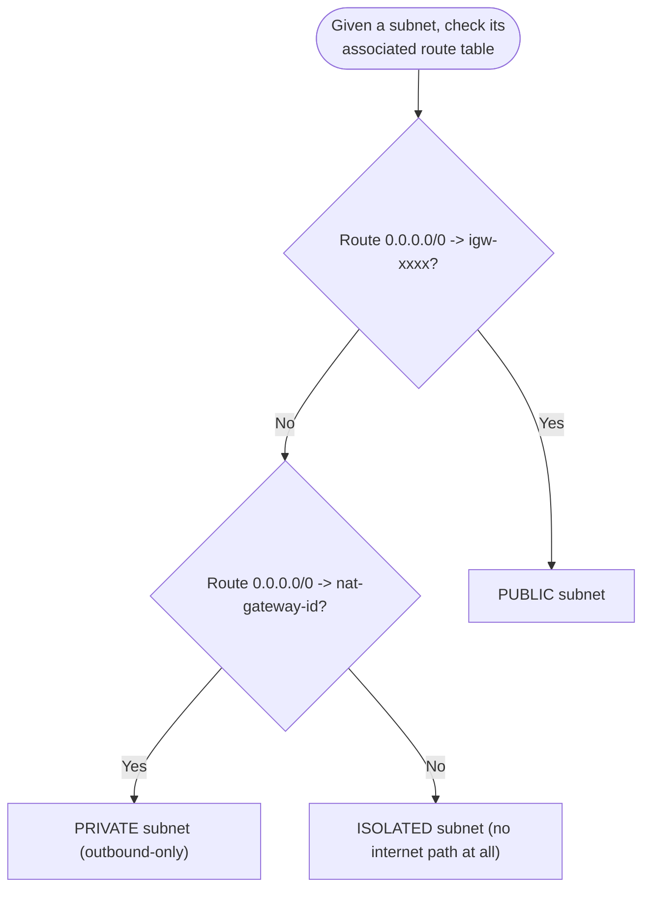

**Step by step:** "public" and "private" are never a label on the subnet itself — they're purely
a function of what its **route table** says. A subnet becomes public the instant its route table
sends `0.0.0.0/0` to an Internet Gateway. If instead it routes `0.0.0.0/0` to a NAT Gateway, it's
private (outbound allowed, inbound-initiated connections impossible). If it has no default route
at all — just the implicit `local` route plus maybe some VPC endpoint routes — it's fully
isolated. A subnet named "private-subnet-1" in the console can still be functionally public if
someone added an IGW route to it; never trust the name, always check the route table.

### Image: the reference VPC topology


*Source: [AWS Documentation — What is Amazon VPC?](https://docs.aws.amazon.com/vpc/latest/userguide/what-is-amazon-vpc.html)*

**Discussion.** This image illustrates the core structural rule that trips up almost everyone new
to VPC: the VPC itself spans every Availability Zone in its Region (it is a Regional construct),
but each individual **subnet** is pinned to exactly one AZ. You cannot create a subnet that spans
two AZs — if you want high availability, you create *multiple* subnets, one per AZ, and spread
your resources (or your Auto Scaling Group, or your RDS Multi-AZ standby) across them. The single
Internet Gateway pictured is also worth noting: there's only ever one IGW per VPC, attached once,
servicing every public subnet in every AZ simultaneously — it's horizontally scaled and redundant
by AWS, with no bandwidth limit or hourly charge of its own.

### Exam Tips
- **"Public" vs "private" is a route-table fact, not a subnet property** — don't trust a
  scenario's subnet name; trace the actual route table.
- **A VPC never spans Regions but always spans every AZ in its Region** — the subnet is what's
  AZ-pinned, not the VPC.
- **Secondary CIDR blocks** are the standard "we're running out of IP space in an existing,
  populated VPC" answer — know this exists as an alternative to recreating the whole VPC.

**Go even deeper:** [`services/networking-content-delivery/vpc.md`](../../../services/networking-content-delivery/vpc.md) (774 lines — CIDR math, IPv6, shared VPC via RAM, Reachability Analyzer)

---

## 7. Security Groups vs. NACLs

### Definition
**Security Groups** are stateful, instance-level firewalls controlling traffic to/from individual
resources. **NACLs** are stateless, subnet-level firewalls evaluated for everything crossing a
subnet boundary. They stack: a packet must pass the NACL first, then the security group.

### Analogy
A NACL is the security checkpoint at a building's main entrance — it checks everyone entering or
leaving the building, using a numbered list of posted rules, and it has no memory of who it let in
five minutes ago (every single person, in or out, gets checked fresh, every time). A security
group is a smart keycard reader on one specific office door — it remembers that *you* just badged
in, so when you leave moments later, it doesn't re-check your badge, it just lets you out because
it recognizes you're already "in conversation" with that room. This is exactly why forgetting a
NACL's outbound rule is such a common mistake: the building checkpoint has no memory, so it needs
an explicit rule for people leaving, even though the smart office door never needed one for the
same person.

### Purpose
AWS gives two layers deliberately, mirroring defense-in-depth in physical data centers: NACLs are
a perimeter fence around a subnet (coarse, blanket deny-lists), while security groups are a lock
on each individual door (fine-grained, per-resource). Relying on only one layer leaves a gap
either too coarse (can't say "only this one instance") or too narrow (can't instantly block an
entire bad IP range account-wide in one rule).

### When to Use
Security groups should carry almost all of your real, day-to-day access logic (which tier talks
to which tier, on which port). NACLs should be reserved for coarse, subnet-wide deny rules —
blocking a known-bad CIDR instantly across every instance in a subnet, or as a compliance backstop
independent of what any individual instance's security group says.

### When NOT to Use (be honest about the alternative)
- **Don't use NACLs as your primary access control** — they're coarse, stateless, and the return-
  traffic rule is easy to forget, causing a confusing "half-working" outage.
- **Don't try to make a security group "deny" something** — it structurally can't; reach for a
  NACL (or Network Firewall/WAF for sophisticated inspection) when you need an explicit block.
- **For application-layer filtering** (blocking SQL injection, rate-limiting by URL path) — SGs
  and NACLs only operate at L3/L4 (IP/port); use **WAF** in front of your ALB/CloudFront instead.

### Use Cases
- **Multi-tier access control via SG chaining** — `alb-sg → app-sg → db-sg`, each tier referencing
  the *security group ID* of the tier in front of it, not a CIDR, so the rule survives autoscaling.
- **Instant subnet-wide blocking of a known-bad IP range** — one low-numbered NACL deny rule
  covers every instance in the subnet immediately, faster than editing dozens of security groups.
- **Origin protection behind CloudFront** — a security group referencing the AWS-managed
  CloudFront prefix list ensures the origin only accepts traffic that actually came through CDN.
- **Compliance defense-in-depth for a database tier** — a NACL backstop that only allows the app
  tier's CIDR on the DB port protects against a developer accidentally attaching a broad SG.
- **Egress-lockdown for data-exfiltration compliance** — removing a security group's default
  outbound-allow-all rule and adding back only narrow, specific destinations.
- **Bastion-host administrative access** — the bastion's SG allows SSH only from a known office
  CIDR; every other instance's SG allows SSH only from the bastion's SG.

### Why It's Important
An overly permissive security group (`0.0.0.0/0` on a database port) is one of the single most
common root causes found by automated cloud security scanners and real breach post-mortems — it
is the #1 thing a security audit checks first.

### Diagram: Stateful (SG) vs. Stateless (NACL) Connection Handling

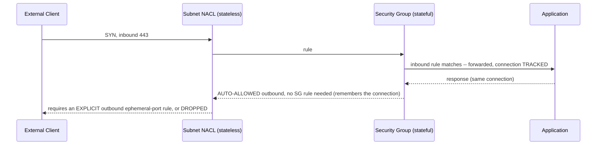

**Step by step:** the request crosses the NACL first — evaluated fresh against numbered rules,
first match wins, with zero memory of anything that happened before. It then hits the security
group, which checks its inbound rules, allows it, and — critically — **records the connection** in
a tracking table. When the application sends its response, the security group recognizes it
belongs to an already-allowed connection and auto-permits it outbound with no outbound rule
needed at all. But that response still has to cross the subnet boundary again, and the NACL has
no memory of the original request — without an explicit outbound rule covering the client's
ephemeral port range (typically 1024-65535), the response is silently dropped even though the
original inbound request was perfectly allowed.

### Image: Security Groups and NACLs together, the official diagram


*Source: [AWS Documentation — Infrastructure security in Amazon VPC](https://docs.aws.amazon.com/vpc/latest/userguide/infrastructure-security.html)*

**Discussion.** The picture is deceptively simple but encodes an ordering fact that's worth
stating explicitly: traffic *always* passes the subnet's NACL before it ever reaches an
instance's security group, in both directions. This means a security review that only audits
security groups and ignores NACLs is incomplete — a wide-open security group is still protected
if the subnet's NACL independently blocks the same traffic, and conversely, a perfectly
locked-down security group means nothing if the NACL never let the traffic through to be checked
in the first place. Treat them as two independent, serial gates, not two redundant copies of the
same rule.

### Exam Tips
- **The #1 trap**: traffic allowed inbound, but the response never arrives — this is almost always
  a missing NACL outbound rule for the ephemeral port range, since NACLs don't auto-allow return
  traffic the way security groups do.
- **Security groups cannot deny**, period — only allow rules exist; any "block this specifically"
  requirement needs a NACL (or WAF/Network Firewall).
- **NACL rules evaluate in numeric order, first match wins** — don't assume "more specific beats
  less specific" the way route tables work; it's purely about which numbered rule comes first.

**Go even deeper:** [`services/networking-content-delivery/security-groups-vs-nacls.md`](../../../services/networking-content-delivery/security-groups-vs-nacls.md) (718 lines — cross-VPC SG references, connection tracking detail, 7 worked scenarios)

---

## 8. Subnets, Route Tables, Internet Gateway, NAT Gateway

### Definition
Four building blocks that turn a VPC's empty address range into a working network: **subnets**
divide the VPC by AZ, **route tables** decide where traffic goes, the **Internet Gateway**
lets public resources reach the internet directly, and the **NAT Gateway** lets private resources
reach *out* without being reachable *from* the internet.

### Analogy
Think of a gated community. The **Internet Gateway** is the community's single main gate, open in
both directions — anyone with the gate code (a public IP) can drive straight in or out. A
**NAT Gateway** is more like a concierge desk at a different, service-only exit: residents in the
"private" homes (private subnets) can hand the concierge a package to send out to the world, and
the concierge sends it under the concierge desk's own return address — but nobody from the
outside world can use that same desk to find out which specific house sent the package, and
nobody outside can walk *in* through that exit at all. The **route table** is the community's
internal street map telling every house which exit to use for outbound mail; without an entry on
that map pointing to the main gate or the concierge desk, a house's mail simply goes nowhere.

### Purpose
A VPC alone is just an IP range with no AZ placement, no traffic rules, and no internet
connectivity. AWS split these into separate, composable objects so you can mix and match: many
subnets can share one route table, one VPC can have many route tables, and NAT/IGW are optional
layers you add deliberately.

### When to Use
Every real VPC design uses subnets and route tables. Add an Internet Gateway only to the VPC that
needs *any* public-facing resource at all. Add a NAT Gateway (one per AZ, for resiliency) whenever
private-subnet resources need outbound-only internet reachability (patches, third-party API
calls) without being directly reachable.

### When NOT to Use (be honest about the alternative)
- **Don't put a NAT Gateway where a VPC endpoint would do** — if private instances only need to
  reach S3/DynamoDB, a free Gateway Endpoint beats paying NAT Gateway's per-GB processing fee for
  that same traffic. This exact substitution is one of the most common SAA-C03 cost answers.
- **Don't use a self-managed NAT Instance in production at real scale** — it's a single EC2
  instance you must patch, size for bandwidth, and manually fail over; the managed NAT Gateway
  removes that burden for a modest cost premium. NAT Instances remain valid for genuinely
  low-traffic, cost-sensitive, or schedulable (stop/start) workloads only.
- **If everything is meant to be internet-reachable anyway** (a single-tier static site) — skip
  private subnets/NAT entirely; use a public subnet, or better, S3 + CloudFront with no EC2 at all.

### Use Cases
- **Multi-tier subnet layout** — public subnet holds only the ALB/NAT Gateway; private app and
  data subnets hold everything else, segmented purely by route-table membership.
- **One NAT Gateway per AZ** — the resiliency-correct default; a single shared NAT Gateway is
  cheaper but means one AZ's failure takes down every other AZ's outbound internet access too.
- **Fully isolated, compliance-driven subnet** — route table carries only the `local` route plus
  VPC endpoint routes, no IGW or NAT route at all, proving zero internet path, even outbound.
- **Cost-optimized retrofit** — replacing NAT-Gateway-routed S3 traffic with a free Gateway VPC
  Endpoint, often the single highest-leverage, lowest-effort cost fix in a VPC's design.
- **Centralized NAT via Transit Gateway hub VPC** — many spoke VPCs route outbound traffic through
  one central "egress VPC's" NAT Gateways instead of running NAT Gateways in every spoke.
- **IPv6 dual-stack outbound-only access** — IPv4 traffic routes through a NAT Gateway; IPv6
  traffic (which has no private-address concept) routes through an Egress-Only Internet Gateway.

### Why It's Important
NAT Gateway cost surprises are one of the most common "why is my AWS bill high" support tickets —
a forgotten NAT Gateway processing large data volumes can rack up hundreds of dollars a month in
per-GB charges alone, on top of its hourly fee.

### Diagram: Address Translation — How a NAT Gateway Hides a Private IP

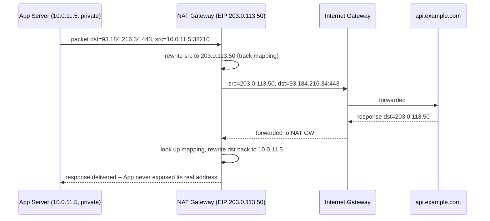

**Step by step:** the private app server's packet reaches the NAT Gateway, which rewrites the
source address from the server's private IP to its own Elastic IP and **remembers the mapping**
in an internal translation table. Only because of that remembered mapping can the response —
addressed to the NAT Gateway's single public IP — be correctly routed back to the *one* private
instance (among potentially thousands) that actually sent the original request. This translation
table is finite: a NAT Gateway caps out at 55,000 simultaneous connections *per unique
destination*, a specific number worth remembering for troubleshooting scenarios about a NAT
Gateway silently dropping new connections to one heavily-used external endpoint.

### Image: the public/private subnet + NAT Gateway reference layout


*Source: [AWS Documentation — NAT gateway use cases](https://docs.aws.amazon.com/vpc/latest/userguide/nat-gateway-scenarios.html)*

**Discussion.** Note where the NAT Gateway physically sits in this diagram: inside a **public**
subnet, not the private one it's serving. This is a frequently tested gotcha — a NAT Gateway
placed in a private subnet has no route of its own to the internet and simply cannot work; it
must live in a subnet that itself has a route to the Internet Gateway, so it can forward the
private subnet's traffic onward. The diagram's two-AZ layout is also the resiliency-correct
pattern: each AZ gets its own public subnet, its own NAT Gateway, and its own private subnet
routed only to that same AZ's NAT Gateway — avoiding both a single point of failure and avoiding
cross-AZ data transfer charges for NAT-bound traffic.

### Exam Tips
- **Memorize**: public subnet = route table has `0.0.0.0/0 → igw-xxxx`. Private subnet routes
  `0.0.0.0/0` to a NAT Gateway instead (or has no default route at all = fully isolated).
- **NAT Gateway is AZ-scoped** — one shared NAT Gateway across AZs is a cost-vs-resiliency
  tradeoff the exam tests directly; one-per-AZ is the resiliency-correct, slightly costlier design.
- **VPC endpoint beats NAT Gateway for AWS-service-only traffic** — the recurring, near-guaranteed
  cost-optimization substitution for S3/DynamoDB-bound traffic specifically.

**Go even deeper:** [`services/networking-content-delivery/subnets-route-tables-igw-natgw.md`](../../../services/networking-content-delivery/subnets-route-tables-igw-natgw.md) (535 lines — longest-prefix-match detail, NAT Instance tradeoffs, egress-only IGW)

---

## 9. VPC Endpoints & PrivateLink

### Definition
A VPC Endpoint lets resources inside a VPC reach an AWS service (or another VPC's application)
**without that traffic ever leaving the AWS network or touching the public internet** — no NAT
Gateway, no Internet Gateway, no public IP required. **AWS PrivateLink** is the technology
powering interface endpoints, and also lets you expose your *own* application privately to other
VPCs/accounts the same way AWS exposes S3 or DynamoDB.

### Analogy
Reaching an AWS service through a NAT Gateway and Internet Gateway is like mailing a letter to
your neighbor by routing it through the city's central post office, even though your neighbor
lives two doors down — technically it arrives, but you paid postage and took a longer, more
exposed path for something that never needed to leave the block. A VPC Endpoint is a direct
private pass-through fence gate between your yard and your neighbor's — the letter never enters
the public postal system at all, it's faster, and (for the Gateway Endpoint flavor, S3/DynamoDB)
it doesn't even cost you a stamp.

### Purpose
By default, reaching an AWS service's public API endpoint from a private subnet requires routing
out through a NAT Gateway and Internet Gateway even though the destination is still inside AWS —
wasteful (NAT Gateway per-GB cost for traffic that never needed the internet) and a larger attack
surface than necessary. VPC Endpoints exist so that AWS-service traffic — and even traffic to
other companies' privately-hosted services — stays entirely within AWS's private network.

### When to Use
Always add a free **Gateway Endpoint** for S3/DynamoDB traffic from private subnets — there's
close to no downside. Add **Interface Endpoints** for any other AWS service a private, NAT-
Gateway-free subnet needs to reach, and especially whenever a compliance requirement says AWS API
traffic must never cross the public internet.

### When NOT to Use (be honest about the alternative)
- **Public-facing resources meant to be reached over the internet anyway** — an endpoint adds
  nothing if the resource is supposed to be internet-reachable in the first place.
- **Occasional, low-volume AWS API calls from a subnet that already has a NAT Gateway for other
  reasons** — the marginal savings of an interface endpoint (which itself has an hourly charge)
  may not be worth the overhead; Gateway Endpoints (free) remain worth adding regardless of volume.
- **Connecting whole VPC networks to each other** — that's VPC Peering or Transit Gateway's job,
  not VPC Endpoints, which are scoped to individual services, never general network connectivity.

### Use Cases
- **Removing NAT Gateway from the critical path** — a private subnet's app tier calls S3 and
  Secrets Manager with no other internet dependency; a Gateway Endpoint + Interface Endpoint cover
  both with no NAT Gateway needed at all.
- **Lambda-in-VPC reaching other AWS services** — a function placed in a VPC for RDS access also
  needs Secrets Manager; an interface endpoint handles it directly instead of adding a NAT Gateway
  purely for that one call.
- **Cost optimization retrofit on an existing, running VPC** — adding a free S3 Gateway Endpoint
  to remove S3-bound traffic from an existing NAT Gateway bill, with zero application changes.
- **SaaS vendor exposing a product privately to hundreds of customer VPCs** — PrivateLink's
  Endpoint Service model avoids unmanageable VPC-peering sprawl as the customer base grows.
- **Private API Gateway enforcement** — an internal REST API reachable only through its
  associated interface endpoint, enforced at the API Gateway configuration level, not just by
  firewall rules.
- **Compliance requirement: AWS API traffic must never cross the public internet** — comprehensive
  Gateway + Interface Endpoint coverage for every AWS service the workload touches.

### Why It's Important
VPC Endpoints are one of the highest-value, lowest-effort cost-optimization levers in real AWS
bills — teams running S3-heavy workloads from private subnets routinely cut meaningful NAT
Gateway cost by adding a free Gateway Endpoint, often with zero application changes.

### Diagram: Interface Endpoint — Why Application Code Never Changes

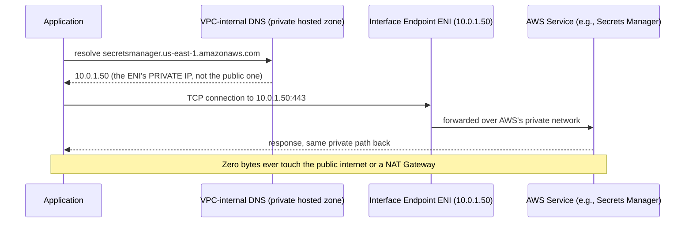

**Step by step:** the interface endpoint automatically associates a **private hosted zone** with
your VPC that intercepts the exact DNS name your application already calls — no SDK
reconfiguration, no endpoint URL change. The application thinks it's resolving the normal public
hostname; the VPC's internal DNS silently answers with the endpoint's private IP instead, and the
connection goes straight to an ENI sitting in your own subnet, never touching the internet. This
invisibility is precisely why "no code changes were needed but traffic now stays private" in an
exam scenario always points to an interface endpoint with private DNS enabled.

### Image: the default (less efficient) path this service displaces


*Source: [AWS Documentation — Access AWS services through AWS PrivateLink](https://docs.aws.amazon.com/vpc/latest/privatelink/privatelink-access-aws-services.html)*

**Discussion.** This diagram is worth reading for what it implies rather than what it shows: even
though the caption notes the traffic "stays in the AWS network," it still requires a public-IP
path and an Internet Gateway/NAT Gateway hop to get there — which is exactly the inefficiency VPC
Endpoints remove. The distinction matters for the exam: "stays within AWS's network" is not the
same claim as "never left the VPC via a NAT/IGW hop." A question emphasizing *cost* (NAT Gateway
per-GB charges) or *the strongest possible network isolation* (no IGW/NAT route of any kind) is
asking you to recognize that this default path, while not literally traversing the public
internet, still isn't good enough — the endpoint-based path pictured in Section 9's main diagram
is the actual fix.

### Exam Tips
- **"Private subnet needs S3/DynamoDB access, minimize cost" = Gateway Endpoint** — an instant,
  near-guaranteed answer pattern; Gateway Endpoints only cover S3 and DynamoDB, nothing else.
- **Interface Endpoints are billed (hourly + per-GB), Gateway Endpoints are free** — a direct
  cost-comparison trap the exam likes to set up between the two endpoint types.
- **Endpoint policies are a separate, additive access-control layer from IAM** — a scenario where
  access is blocked through an endpoint despite correct IAM permissions points to a restrictive
  endpoint policy, not an IAM misconfiguration.

**Go even deeper:** [`services/networking-content-delivery/vpc-endpoints-privatelink.md`](../../../services/networking-content-delivery/vpc-endpoints-privatelink.md) (494 lines — PrivateLink-as-provider architecture, multi-AZ endpoint design, 5 worked scenarios)

---
## 10. AWS Direct Connect

### Definition
A dedicated, private **physical network connection** between your own data center and AWS — real
fiber, never touching the public internet at all.

### Analogy
The public internet is a shared highway — fast most of the time, but you share lanes with
everyone else, and traffic (congestion, variable latency) is outside your control. Direct Connect
is a privately-built, dedicated road built just for your trucks, running straight from your
warehouse to AWS's loading dock. Building that private road takes real construction time (weeks
to months) and a fixed cost even on days you don't ship much — but once it's built, your trucks
never sit in anyone else's traffic, and hauling large, steady volumes on it is cheaper per load
than paying tolls on the public highway every single time.

### Purpose
Connecting to AWS over the public internet works but gives no guarantees — variable latency,
variable bandwidth, exposure to public-network congestion. For workloads needing consistent,
high-bandwidth, low-latency, private connectivity, Direct Connect gives a dedicated physical link
with predictable performance and a smaller attack surface.

### When to Use
Large, steady, high-volume data transfer between on-prem and AWS; latency-sensitive hybrid
applications (trading systems, real-time manufacturing); strict compliance requirements that
forbid traversing the public internet, even encrypted.

### When NOT to Use (be honest about the alternative)
- **Quick setup, low/variable bandwidth, or temporary connectivity needs** — Direct Connect
  provisioning takes weeks to months; a **Site-to-Site VPN** stands up in minutes and is the right
  choice whenever the scenario needs connectivity "now."
- **Small/startup workloads without the budget for dedicated circuits** — a VPN over the
  internet, or no hybrid connectivity at all, is usually more appropriate.
- **A temporary bandwidth spike** — provisioning a bigger dedicated connection has real lead time;
  it's not an elastic, instantly-scalable resource the way most AWS services are.

### Use Cases
- **Hybrid connectivity for large, steady data volumes** — predictable bandwidth and lower
  per-GB rates at scale beat VPN's internet-dependent, pay-per-GB-at-internet-rates model.
- **Latency-sensitive hybrid applications** — a trading system or real-time analytics pipeline
  with components on both sides of the hybrid boundary that can't tolerate internet jitter.
- **Direct Connect Gateway reaching multiple Regions** from a single physical connection, instead
  of a separate physical circuit per Region.
- **Public VIF for AWS-public-service traffic** — reaching S3/DynamoDB over the dedicated link
  without a VPC in the picture at all, and without touching the internet.
- **Compliance-driven no-internet-traversal requirement** — the only connectivity option that
  satisfies "never touches the internet" literally, since VPN tunnels *over* the internet by
  definition even when encrypted.
- **Direct Connect + VPN backup** — the standard enterprise HA pattern: Direct Connect carries
  normal traffic, a parallel VPN automatically takes over via BGP if the dedicated link fails.

### Why It's Important
Direct Connect is a cornerstone of serious enterprise hybrid-cloud architecture — migrations
measured in petabytes, or latency-sensitive hybrid trading/manufacturing systems, are simply
impractical over the public internet.

### Diagram: Direct Connect Resiliency Models (not redundant by default)

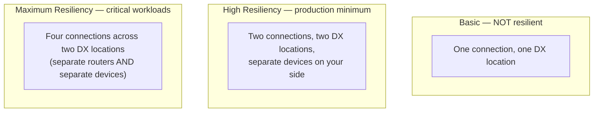

**Step by step:** a single dedicated connection, however fast, remains a single point of failure
at the physical layer — a fiber cut, a router failure, or a facility power event takes the whole
connection down, with nothing automatic to fall back to. AWS's named resiliency tiers exist
precisely because "add a Direct Connect connection" is not the same claim as "now I have a
redundant hybrid link." Only the **Maximum Resiliency** model, which mandates multiple
*physically separate* Direct Connect locations, actually eliminates facility-level single points
of failure — a question emphasizing "no single point of failure, anywhere, including the
facility" wants this specific tier, not just "two connections."

### Image: Virtual Interface types riding one physical connection


*Source: [AWS Documentation — What is Direct Connect?](https://docs.aws.amazon.com/directconnect/latest/UserGuide/Welcome.html)*

**Discussion.** One physical Direct Connect connection can carry multiple logical Virtual
Interfaces simultaneously — a **private VIF** for VPC access, a **public VIF** for reaching AWS's
public service endpoints without a VPC, and a **transit VIF** for reaching a Transit Gateway. This
is worth internalizing because it means "we have a Direct Connect connection" doesn't by itself
tell you what it's *for* — a scenario mentioning a company calling S3 directly from on-prem with
no VPC involved is describing a public VIF specifically, distinct from the private VIF most
VPC-connectivity scenarios assume.

### Exam Tips
- **Direct Connect is not redundant or encrypted by default** — two of the most common traps; a
  fault-tolerance requirement needs a second connection at a *different* location, and an
  encryption requirement needs MACsec or a VPN layered on top.
- **Provisioning lead time (weeks to months) is Direct Connect's biggest practical weakness** —
  "connectivity needed today/this week" is a VPN question in disguise.
- **Direct Connect Gateway lets one connection reach multiple VPCs/Regions** — don't confuse it
  with Transit Gateway, which interconnects many VPCs/VPNs generally; they're often used together.

**Go even deeper:** [`services/networking-content-delivery/direct-connect.md`](../../../services/networking-content-delivery/direct-connect.md) (498 lines — LAG bundling, BGP failover detail, worked cost comparison)

---

## 11. Site-to-Site VPN & Client VPN

### Definition
Encrypted, private connectivity over the **public internet** between your network and AWS —
**Site-to-Site VPN** connects an entire on-prem network to a VPC; **Client VPN** connects
individual remote users' devices directly into a VPC, both using IPsec/OpenVPN-based encryption.

### Analogy
If Direct Connect is a privately-built dedicated road, a Site-to-Site VPN is an armored,
windowless truck driving on the same public highway everyone else uses — the *path* is shared and
its traffic conditions are outside your control, but the *cargo* (your data) is completely sealed
and unreadable to anyone else on the road. It's dramatically cheaper and faster to put an armored
truck into service than to build a private road, which is exactly why VPN is the right tool when
you need secure connectivity *now* rather than the best possible connectivity *eventually*.

### Purpose
Not every organization can wait weeks for a Direct Connect cross-connect, or needs that level of
dedicated bandwidth — but plenty still need encrypted, private-feeling connectivity into AWS right
now. VPN layers strong IPsec encryption over the existing public internet, giving most of the
security benefit of a private link without the physical provisioning lead time or cost.

### When to Use
Fast-to-provision hybrid connectivity for low-to-moderate, often bursty bandwidth needs; an
automatic failover path alongside a primary Direct Connect connection; individual remote
employees needing scoped access to specific internal resources (Client VPN specifically).

### When NOT to Use (be honest about the alternative)
- **Large, sustained, high-bandwidth transfer where internet variability genuinely matters** —
  **Direct Connect** gives more predictable throughput/latency and typically cheaper per-GB rates
  at real scale.
- **Strict regulatory requirement to never traverse the public internet, even encrypted** — Direct
  Connect is the only option satisfying "never touches the internet," since VPN tunnels over it by
  definition regardless of encryption.
- **Very large numbers of remote users needing high-throughput access** — Client VPN scales, but
  for a genuinely massive remote workforce, consider whether a more targeted, zero-trust
  application-level access model fits better than full network-level VPN access to everyone.

### Use Cases
- **Fast-to-provision hybrid connectivity** — stood up in minutes to hours versus Direct
  Connect's weeks-to-months, ideal for a startup or new project needing connectivity now.
- **Direct Connect automatic backup** — a parallel BGP-based VPN with lower route preference
  takes over automatically if the dedicated connection's BGP session drops.
- **Transit Gateway VPN attachment** — one VPN connection reaches every VPC already attached to
  the Transit Gateway, so adding a new VPC needs no new VPN connection at all.
- **Remote workforce access to private resources** — Client VPN with authorization rules scoping
  each user/group to only the specific subnet/CIDR they're permitted to reach.
- **Low-to-moderate, non-steady bandwidth hybrid workloads** — pay-as-you-go, no fixed circuit
  cost, better suited to bursty traffic that doesn't justify Direct Connect's fixed port-hour fee.
- **VPN CloudHub** — several branch offices, each with their own Customer Gateway, reach each
  other through AWS as the hub, without direct site-to-site circuits between the branches.

### Why It's Important
VPN is usually the first hybrid-connectivity step any organization takes toward AWS — it's quick,
cheap, and "good enough" for a huge range of real workloads, making it one of the most commonly
deployed networking services in practice, not just an exam topic.

### Diagram: Two Tunnels, Built-In Redundancy, Per VPN Connection

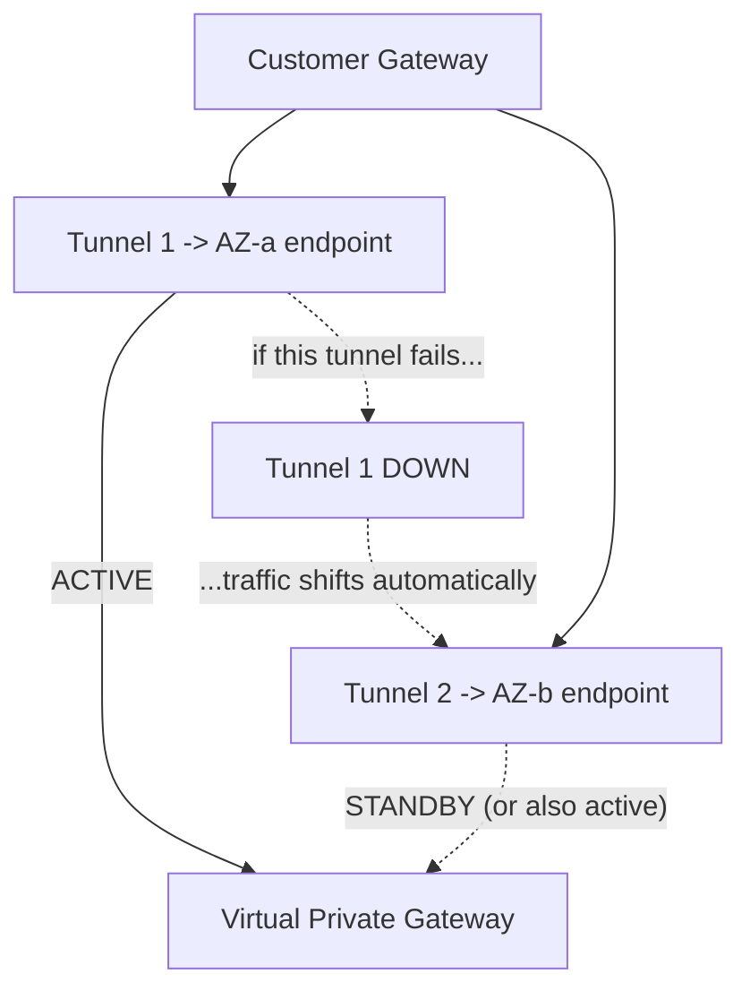

**Step by step:** every Site-to-Site VPN connection provisions **two separate encrypted tunnels**,
each terminating in a **different Availability Zone** on the AWS side — seeing two distinct public
IP addresses for one VPN connection is completely normal, not a misconfiguration. If a problem
hits Tunnel 1's path, traffic automatically shifts to Tunnel 2. A frequent real-world mistake
undermines this redundancy, though: teams configure the Customer Gateway device with only Tunnel
1's parameters (copy-pasted from a config file) and never actually test that Tunnel 2 works — so
the "built-in" redundancy turns out to be untested and sometimes non-functional exactly when it's
needed.

### Image: the reference Site-to-Site VPN topology


*Source: [AWS Documentation — How AWS Site-to-Site VPN works](https://docs.aws.amazon.com/vpn/latest/s2svpn/how_it_works.html)*

**Discussion.** The two endpoints pictured — your on-prem **Customer Gateway** and AWS's **Virtual
Private Gateway** — establish the encrypted tunnel over the ordinary public internet connection
each side already has, which is exactly why a VPN can be live in minutes: there's no physical
infrastructure to build, only configuration on two existing devices. Worth noting what this
diagram doesn't show: BGP (or static routing) must *separately* advertise which networks are
reachable over the tunnel — a tunnel showing "UP" only confirms the encryption layer is
established, and says nothing about whether any actual routes are being exchanged, which is the
single most common real-world "my VPN is up but I can't reach anything" support case.

### Exam Tips
- **Two tunnels per VPN connection, always** — built-in redundancy; seeing two IPs is expected
  behavior, not a sign of misconfiguration.
- **Client VPN vs. Site-to-Site VPN**: "individual remote employees need access" → Client VPN.
  "Two entire networks need to talk to each other" → Site-to-Site VPN.
- **1.25 Gbps is a hard, non-raisable per-tunnel ceiling** — a scenario needing more throughput
  points to ECMP across multiple tunnels/connections on a Transit Gateway, not a quota-increase
  request.

**Go even deeper:** [`services/networking-content-delivery/vpn.md`](../../../services/networking-content-delivery/vpn.md) (510 lines — IPsec encapsulation detail, split vs. full tunnel, VPN CloudHub)

---

## 12. AWS Shield

### Definition
AWS's managed **Distributed Denial of Service (DDoS) protection** service — continuously monitors
traffic to detect and automatically mitigate attacks aimed at overwhelming your application with
traffic volume or exhausting its resources.

### Analogy
Shield Standard is like a building's automatic fire-suppression sprinkler system — installed in
every building by code, triggers automatically, costs nothing extra, and handles the common case
(a small fire) without anyone needing to call the fire department. Shield Advanced is the paid
upgrade to a 24/7 on-call fire brigade with direct hotline access, specialized equipment for
larger fires (sophisticated, large-scale attacks), and an insurance policy that reimburses you for
water damage (scaling cost spikes) the sprinklers caused while putting the fire out.

### Purpose
A DDoS attack doesn't try to breach your data — it tries to make your service unusable by
flooding it with more traffic than it can handle. Defending against this at AWS's network scale
is something individual customers can't replicate themselves; Shield exists because AWS's global
network capacity and automated mitigation can absorb attack traffic that would overwhelm almost
anyone's own infrastructure.

### When to Use
Shield Standard is already protecting every AWS account automatically — there's no "should I turn
on basic DDoS protection" decision. Upgrade to Shield Advanced when the workload is revenue-
critical, a known/frequent attack target (gaming, financial services), or needs enhanced
application-layer detection, 24/7 expert response, and cost protection for attack-driven scaling.

### When NOT to Use (be honest about the alternative)
- **Protecting against application-logic exploits** (SQL injection, XSS, bad bots) — that's
  **WAF**'s job; Shield defends against volume/availability, not malicious request content.
- **Low-traffic internal applications with no public exposure** — Shield Standard's baseline is
  already free and automatic, but paying for Advanced on an internal-only, low-risk workload
  usually isn't worth the real, non-trivial subscription cost.
- **Detecting a specific malicious actor's behavior that isn't actually a DDoS** (credential
  stuffing against one login endpoint) — that's more of a WAF rate-based rule problem.

### Use Cases
- **Baseline DDoS coverage for every public-facing workload** — Standard is automatically active
  with zero configuration and zero cost for every AWS account.
- **Revenue-critical application** — an e-commerce site where even a short outage costs real
  revenue justifies Advanced's enhanced detection, DRT access, and cost-protection guarantee.
- **Layered L3/4 + L7 defense for one application** — Advanced automatically creates/tunes WAF
  rate-based rules during a detected application-layer attack, combining both layers without
  manual mid-incident intervention.
- **Latency-sensitive UDP workloads** (a real-time game server) — Advanced can protect EC2
  Elastic IPs directly, since a CloudFront/WAF-fronted design would break UDP compatibility.
- **Org-wide consistent DDoS posture via Firewall Manager** — centrally enforcing Shield Advanced
  across every account in an Organization rather than per-team configuration.
- **Cost-spike protection during a genuine attack** — crediting back EC2/CloudFront/Route 53
  charges directly attributable to a declared DDoS event on protected resources.

### Why It's Important
DDoS attacks remain one of the most common attack types against public internet infrastructure,
and they don't require any data breach to cause real business damage — an e-commerce site
unreachable during a sale event directly costs revenue and trust.

### Diagram: Shield Standard vs. Advanced — protection surface

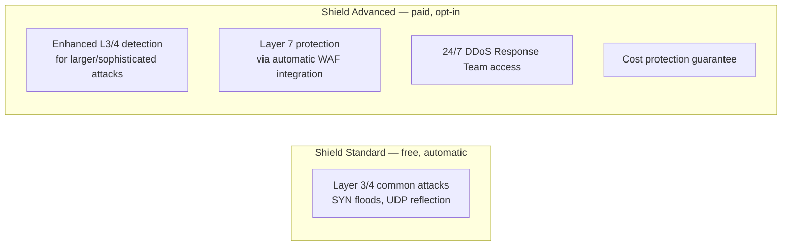

**Step by step:** Standard's protection is baked into the AWS edge network itself — every account
gets it, for every resource using CloudFront/Route 53/Global Accelerator, automatically, with
zero configuration. Advanced is an entirely separate, opt-in, paid tier layered on top: it doesn't
replace Standard's always-on baseline, it adds enhanced detection for bigger/more sophisticated
attacks, extends into Layer 7 *only through an integrated WAF Web ACL* (a detail many teams miss —
subscribing to Advanced with no Web ACL attached still only gets you enhanced L3/4 protection),
and unlocks the human-expert and financial-guarantee benefits (DRT, cost protection) that Standard
simply doesn't include at any price.

### Image: AWS's reference DDoS-resilient web application architecture


*Source: [AWS WAF Developer Guide — Example Shield Advanced DDoS resiliency architecture](https://docs.aws.amazon.com/waf/latest/developerguide/ddos-resiliency-example-web.html)*

**Discussion.** The architecture's key insight is *where* Shield Advanced protection is applied:
on the **edge resources** (Route 53 hosted zones, CloudFront distributions), not directly on the
origin compute. The origin (the ALB and EC2 fleet) benefits by being shielded *behind* already-
protected edge infrastructure, rather than being directly exposed to the internet at all. This is
why a question describing an architecture where EC2 instances sit directly behind a public IP with
no CloudFront/Route 53/Global Accelerator layer in front should raise suspicion — that design
leaves the compute layer with no edge-level DDoS absorption at all, regardless of whether Shield
Advanced is subscribed, because Shield Advanced can't protect a resource type it was never
associated with.

### Exam Tips
- **Shield Standard is always on, for free, for every account** — a question implying you need to
  "enable" basic DDoS protection is testing whether you know it's already there.
- **Shield vs. WAF** — Shield defends volume/availability (L3/4, and with Advanced, some L7 via
  WAF); WAF defends request *content* (SQLi, XSS, bad bots) at L7. A question mentioning "SQL
  injection" always points to WAF, never Shield alone.
- **Protected resource types are a fixed list** (CloudFront, Route 53, Global Accelerator, ELB,
  EC2 Elastic IPs) — a scenario describing protection for a resource outside this list should
  raise suspicion.

**Go even deeper:** [`services/security-identity-compliance/shield.md`](../../../services/security-identity-compliance/shield.md) (457 lines — cost protection scope detail, worked gaming-company scenario, onboarding checklist)

---

## 13. AWS WAF

### Definition
A **Layer 7 (application-layer) firewall** that inspects the actual content of incoming web
requests — headers, query strings, body, IP, geography — and blocks, allows, counts, or
rate-limits them based on rules you define.

### Analogy
Network-layer defenses (security groups, Shield) are like a security guard checking that everyone
entering a building has a valid ID badge — they verify *who's* coming in, at the door. WAF is the
guard reading the *contents of every envelope and package* people are carrying in, checking for
anything matching known dangerous patterns (a forged check, a prohibited substance) regardless of
whether the person carrying it has a perfectly valid badge. A badge check and a package inspection
catch entirely different kinds of problems — a visitor with a flawless ID can still be carrying
something you don't want inside, which is exactly why WAF exists as a separate layer from network
firewalls, not a replacement for them.

### Purpose
Network-layer defenses can't tell the difference between a legitimate HTTP request and one
carrying a malicious SQL injection payload — both are "just HTTP traffic" at that layer. WAF
exists specifically to inspect *what's inside* the request and make a content-aware decision,
closing a gap lower-layer network controls fundamentally cannot address.

### When to Use
Any public-facing web application or API behind CloudFront, an ALB, API Gateway, AppSync, or a
Cognito user pool — especially whenever a scenario mentions SQL injection, cross-site scripting,
bot/scraper traffic, or credential-stuffing against a login endpoint.

### When NOT to Use (be honest about the alternative)
- **Protecting against volumetric network-layer DDoS floods** — that's **Shield**'s job; WAF
  inspects request content, it doesn't absorb massive volumetric traffic the way Shield's
  edge-network mitigation does. In practice they're layered together, never substitutes.
- **Internal, non-HTTP traffic** (database connections, SSH, raw TCP) — WAF only inspects HTTP(S)
  requests to the specific resource types it attaches to; use security groups/NACLs instead.
- **A raw EC2 instance with no ALB/CloudFront/API Gateway in front of it** — WAF can't attach
  directly to a bare EC2 instance; put a supported resource in front of it first, or consider AWS
  Network Firewall for broader VPC-level inspection.

### Use Cases
- **Blocking SQL injection/XSS without custom detection logic** — AWS Managed Rule Groups give
  continuously-updated protection against the OWASP Top 10 with zero custom rule authoring.
- **Rate-limiting a login endpoint against credential stuffing** — a rate-based rule scoped
  specifically to `/login` via a `ScopeDownStatement`, without affecting other site traffic.
- **Geo-blocking high-fraud or unsupported regions** — a geo-match rule blocking by country code
  with no custom IP-range maintenance needed.
- **Distinguishing good bots from bad bots** — Bot Control classifies traffic sources, blocking
  scrapers while explicitly allowing known-good search engine crawlers through.
- **Safe rollout of a new security rule in production** — deploying in **Count** mode first to
  observe match volume via CloudWatch before switching to **Block**, catching false positives.
- **Protecting a public ML inference endpoint** — layering a Managed Rule Group, Bot Control, and
  a rate-based rule scoped to the inference path addresses payload risk, scraping, and cost
  exposure simultaneously.

### Why It's Important
SQL injection and cross-site scripting remain perennial entries in the OWASP Top 10 despite being
well-understood for decades, because manual input sanitization is easy to get wrong across
hundreds of code paths. A managed, continuously-updated WAF rule set catches classes of attack
even well-written application code sometimes misses.

### Diagram: Web ACL Rule Evaluation — Ordered, with Labels for Multi-Stage Logic

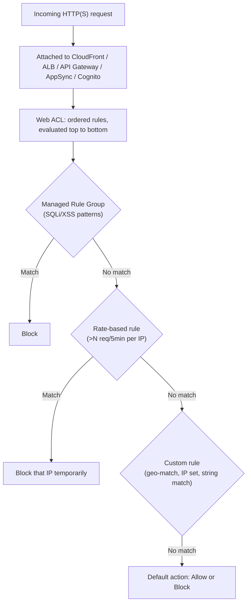

**Step by step:** a Web ACL's rules are evaluated **in priority order**, and the moment one rule's
action takes effect (typically Block), evaluation for that request stops — rules later in the
list never get a chance to fire on an already-blocked request. **Count mode** is the specific,
named mechanism for testing a new rule safely: it logs a match exactly as if the rule had fired,
without actually blocking anything, letting a team observe real-traffic false-positive rates
before flipping the same rule to Block. **Labels** take this further — a rule in Count mode can
tag a matching request with a label, and a *later* rule in the same Web ACL can key its own
block/allow decision off that label, letting you build compound, multi-signal logic ("suspicious
user agent AND unusual request pattern") across multiple rule evaluations instead of each rule
acting in total isolation.

### Image: WAF Web ACL as the inspection layer in front of CloudFront


*Source: [AWS Solutions Constructs — aws-wafwebacl-cloudfront](https://docs.aws.amazon.com/solutions/latest/constructs/aws_wafwebacl_cloudfront.html)*

**Discussion.** This reference architecture also depicts the CloudWatch log group every evaluated
request can stream into — a detail worth calling out because it's the mechanism behind "prove to
an auditor that application-layer attacks are actively defended against" (a PCI-DSS style
requirement). The logs are a concrete, timestamped record of blocked/counted requests, which is
real evidence a control exists and fires — but it's worth being honest in an exam answer that this
evidence proves the *control* works, not that the *application's own code* correctly handles every
input; WAF is a defense-in-depth layer sitting in front of the application, never a substitute for
secure application code underneath it.

### Exam Tips
- **WAF vs. Shield, the recurring pairing** — WAF = content inspection (Layer 7); Shield =
  volumetric/availability (Layer 3/4). "SQL injection" or "cross-site scripting" always points to
  WAF, never Shield alone.
- **WAF attaches only to specific resource types**: CloudFront, ALB, API Gateway, AppSync, Cognito
  user pools — never directly to a raw EC2 instance or NLB.
- **Count mode before Block mode** is the safe-rollout pattern the exam explicitly rewards for
  "test a new rule without risking blocking legitimate traffic."

**Go even deeper:** [`services/security-identity-compliance/waf.md`](../../../services/security-identity-compliance/waf.md) (497 lines — full Web ACL JSON, WCU capacity mechanics, WAF Classic vs. WAFv2)

---
## 14. Amazon Cognito

### Definition
AWS's managed service for handling **your application's end-user identity** — sign-up, sign-in,
password resets, social/enterprise login, and issuing tokens your app uses to decide what a
logged-in user can access.

### Analogy
If IAM Identity Center is the keycard system for your own employees entering your company's own
offices, Cognito is the membership-card system a gym issues to its *paying customers*. Totally
different population, totally different purpose: a gym member's card gets them into the workout
floor (your app), not into the gym's back-office payroll system (your AWS account). Cognito's
**User Pool** is the membership database (who are you, is your password right); its **Identity
Pool** is a separate, optional upgrade — like a member who's also been given a personal locker key
(temporary AWS credentials) because they specifically need to store something (upload to their
own S3 folder) beyond just getting through the front door.

### Purpose
Every consumer-facing app needs user accounts, and building authentication correctly (password
hashing, MFA, account recovery, social login, protecting against credential stuffing) is genuinely
hard to get right and a terrible place to have a bug. Cognito lets application teams plug in a
battle-tested, scalable identity system instead of reinventing login.

### When to Use
Any application with external, product-facing users — a mobile app's sign-up flow, a web
product's login page, a B2B SaaS product's tenant SSO. Add an Identity Pool specifically when
those logged-in users need to call AWS services *directly* (not just your own backend).

### When NOT to Use (be honest about the alternative)
- **Your own employees/workforce needing AWS account access** — that's **IAM Identity Center**,
  not Cognito. Cognito is for your product's external customers, never your staff.
- **Fine-grained, app-specific authorization logic beyond "is this user logged in and what
  scope"** — Cognito handles authentication and coarse authorization; for rich, policy-based
  authorization, pair it with Amazon Verified Permissions rather than stretching Cognito further.
- **An existing, mature in-house or third-party identity provider the product is already built
  around** — migrating purely to adopt Cognito isn't worth it unless there's a specific AWS-
  integration reason; Cognito can federate with that existing IdP instead of replacing it.

### Use Cases
- **Consumer app sign-up/login with social federation** — a User Pool normalizes email/password
  and "Sign in with Google" into the same JWT format, so the rest of the app never needs to know
  which path the user took.
- **Mobile uploads directly to a per-user S3 prefix** — an Identity Pool exchanges the User
  Pool's token for temporary AWS credentials scoped to only that user's folder, no backend relay.
- **API Gateway authorizing end users with no custom JWT issuer** — the built-in Cognito
  authorizer validates tokens locally with no custom token-issuing code to maintain.
- **B2B SaaS tenant SSO** — a shared User Pool federates many enterprise customers' own SAML/OIDC
  IdPs, normalizing every tenant's login into the same token shape the app already handles.
- **Guest/unauthenticated access for public content** — an Identity Pool's "guest" identity gets
  its own scoped IAM role, distinct from the authenticated role, for pre-login browsing.
- **Incident response — revoking a compromised user's active sessions** — `AdminUserGlobalSignOut`
  explicitly invalidates refresh tokens, which simply disabling or deleting the account does not.

### Why It's Important
Authentication is one of the few parts of an app where a subtle bug becomes a direct account-
takeover vulnerability, not just a feature defect — using a managed, widely-audited identity
service meaningfully reduces that risk surface versus hand-rolled auth.

### Diagram: User Pool vs. Identity Pool — the #1 trap on this topic

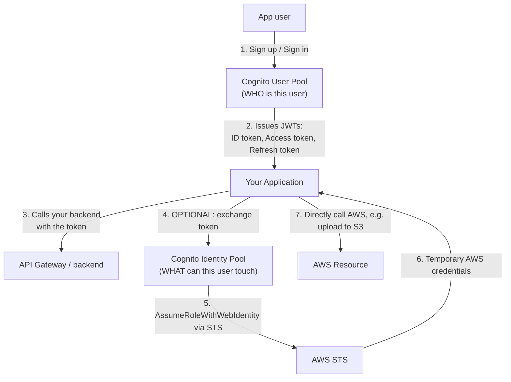

**Step by step:** the **User Pool** answers "who is this user" — it's the actual directory,
issuing JWTs after validating credentials (possibly federated from Google/SAML/OIDC). That's
often the entire story: if your app's backend just needs to verify "is this a valid, logged-in
user," you stop right there, with no Identity Pool involved at all. The **Identity Pool** is a
distinct, optional second step that answers "what AWS resources can this user touch directly" —
it takes the User Pool's token (or even an unauthenticated guest context) and exchanges it, via
`AssumeRoleWithWebIdentity`, for real temporary AWS credentials scoped to an IAM role. Conflating
these two — assuming "Cognito" always means "the user gets AWS credentials" — is the single most
common mistake on this topic.

### Image: the official Identity Pool exchange sequence


*Source: [AWS Cognito Developer Guide — What is Amazon Cognito?](https://docs.aws.amazon.com/cognito/latest/developerguide/what-is-amazon-cognito.html)*

**Discussion.** The diagram's sequencing matters: the User Pool interaction happens first and
completely independently of any AWS resource access — a user can sign in, get a JWT, and use your
app's own backend API for the entire session without ever touching an Identity Pool. Only the
*additional* step of exchanging that token through an Identity Pool brings `AssumeRoleWithWebIdentity`
and STS into the picture. This is exactly why a scenario describing "users sign in and call our
own backend API" needs only a User Pool, while "users sign in and upload directly to their own S3
folder from the mobile app, bypassing our backend" needs both a User Pool *and* an Identity Pool
layered on top.

### Exam Tips
- **User Pool vs. Identity Pool is the #1 trap** — User Pool = authentication (who). Identity
  Pool = AWS-resource authorization bridge (what, via STS). Don't assume one implies the other.
- **Cognito vs. IAM Identity Center** — Cognito is for your product's external customers; Identity
  Center is for your own employees. "Customers of our application" → Cognito; "our engineers" →
  Identity Center.
- **Refresh token lifetime is configurable up to 10 years** — a question balancing convenience
  against security is testing whether you'd tune this *down*, not leave the long default in place.

**Go even deeper:** [`services/security-identity-compliance/cognito.md`](../../../services/security-identity-compliance/cognito.md) (535 lines — full token lifecycle, Lambda triggers, multi-tenant ABAC via claims)

---

## 15. Amazon GuardDuty

### Definition
AWS's managed **threat detection** service — continuously watches activity across your account
(API calls, network traffic metadata, DNS queries, container/Kubernetes activity) and uses
machine learning plus threat intelligence to flag things that look like an actual attack or
compromise.

### Analogy
GuardDuty is a building's behavioral security system, not a lock on any particular door — it
doesn't stop anyone from doing anything (that's the job of IAM policies, security groups, locks).
Instead, it's the network of cameras and anomaly-detection software watching how people move
through the building: "this badge normally enters through the east door at 9am, and just used the
west door at 3am" or "someone's badge just tried forty doors in sixty seconds." It doesn't catch
every bad actor — a sufficiently novel technique can slip past known patterns — but it catches
the behavioral *shape* of an attack even when no single action looks obviously wrong in isolation.

### Purpose
Most security incidents aren't announced — they look like normal-shaped API calls from a stolen
credential, or an EC2 instance quietly talking to a known cryptomining pool. GuardDuty turns "turn
it on" into continuous, intelligent threat detection across an entire account or Organization,
backed by AWS's own threat intelligence and curated partner feeds.

### When to Use
Every serious AWS account, essentially by default — it's considered a "just turn it on" baseline
control, not a specialized tool reserved for high-risk workloads only.

### When NOT to Use (be honest about the alternative)
- **Discovering and classifying sensitive data in S3** — that's **Macie**'s job; GuardDuty
  detects behavioral threats, not data content.
- **Vulnerability scanning of EC2/container/Lambda software for known CVEs** — that's **Amazon
  Inspector**; GuardDuty detects active malicious *behavior*, not *potential* weaknesses.
- **A unified dashboard across many security services** — GuardDuty produces findings but isn't
  itself the aggregation layer; pair it with **Security Hub** for that central view.

### Use Cases
- **Detecting a compromised EC2 instance recruited into a botnet** — DNS/VPC Flow Log analysis
  catches cryptomining-pool or C&C traffic signatures automatically, with zero agent installed.
- **Catching a leaked/stolen IAM access key in use** — anomaly models flag the key being used
  from an unexpected geography/time pattern relative to the user's normal behavior.
- **Reconnaissance detection before a bigger breach** — flagging port-scanning or API probing
  early, giving a response window before an attacker escalates.
- **EKS cluster anomaly monitoring** — EKS Protection analyzes audit logs for privilege escalation
  or unexpected `kubectl` activity, no sidecar agent in every pod required.
- **Org-wide monitoring from one delegated security account** — centralized visibility across
  dozens of member accounts without touching the Organizations management account.
- **Automated containment of a compromised instance** — routing a finding through EventBridge to
  a Lambda that isolates security groups, snapshots the EBS volume, and revokes active sessions.

### Why It's Important
The median time to detect a breach without active monitoring is measured in months in industry
breach reports; GuardDuty is one of the cheapest, lowest-effort ways to collapse that detection
window to minutes or hours.

### Diagram: Finding → EventBridge → Automated Remediation

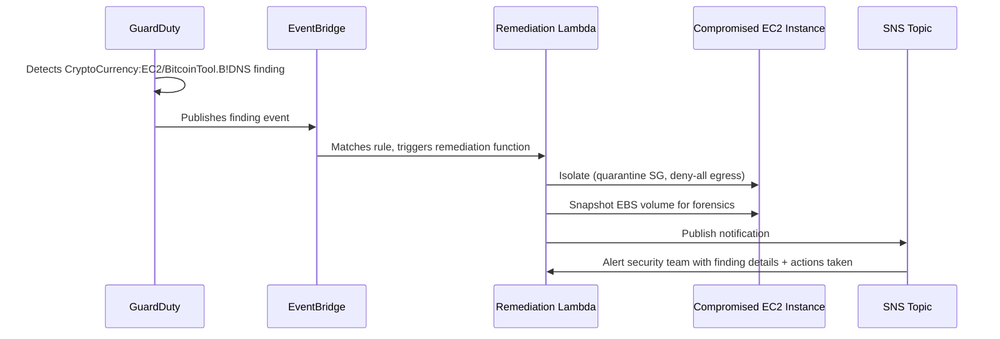

**Step by step:** this is the canonical "finding to containment" pipeline referenced across both
SAA-C03 and DVA-C03 event-driven security questions, and the *order* of operations matters:
isolate first (minimize further damage), preserve evidence second (snapshot before making further
changes that could overwrite forensic data), revoke credentials third (limit what the attacker can
still do elsewhere with that identity), and notify humans last — containment shouldn't wait on a
person being awake and available at 3am. No part of this requires GuardDuty to have an agent on
the instance; the entire detection happened purely from analyzing existing log sources (CloudTrail,
VPC Flow Logs, DNS).

### Image: GuardDuty detecting a malicious IAM permission change via CloudTrail


*Source: [AWS Documentation — Amazon GuardDuty (SAP on AWS security reference)](https://docs.aws.amazon.com/sap/latest/general/guardduty.html)*

**Discussion.** This illustrated scenario is worth tracing carefully because it shows GuardDuty's
detection working entirely on data it never had to be specially configured to collect: data is
written to S3 for ordinary business purposes, a malicious actor modifies IAM permissions on that
bucket (a normal-shaped CloudTrail management event), and GuardDuty's ongoing analysis of that
same CloudTrail stream — which was already flowing whether GuardDuty existed or not — flags the
anomalous permission change against its behavioral baseline and alerts administrators. Nothing
about this detection depended on an agent, a special log format, or extra instrumentation; it's
the same CloudTrail everyone already has, analyzed continuously instead of ignored.

### Exam Tips
- **GuardDuty vs. Macie vs. Inspector — the recurring three-way trap**: GuardDuty = behavioral
  threat detection (is something malicious happening *now*). Macie = sensitive data discovery
  (what data exists, is it exposed). Inspector = vulnerability scanning (what weaknesses exist
  before exploitation).
- **No agent required for core detection** — GuardDuty reads existing log sources automatically;
  Runtime Monitoring is the one component that does use a lightweight agent for deeper visibility.
- **Delegated administration is per-service** — being the GuardDuty delegated admin doesn't
  automatically make the same account the Macie or Security Hub admin too.

**Go even deeper:** [`services/security-identity-compliance/guardduty.md`](../../../services/security-identity-compliance/guardduty.md) (505 lines — finding-type quick reference, severity scoring, multi-finding incident correlation)

---

## 16. Amazon Macie

### Definition
A managed service that automatically **discovers, classifies, and reports on sensitive data**
(PII, credentials, financial data) stored in Amazon S3, using pattern matching and machine
learning, so you know exactly where sensitive data lives and whether it's exposed.

### Analogy
Imagine a company that's been operating for a decade with dozens of storage closets (S3 buckets)
accumulated from every department, era, and forgotten project — nobody has a master inventory of
what's actually inside each one. Macie is a team of inspectors who walk through every closet,
photograph and categorize the contents (is this a tax document, a medical record, a box of old
receipts), and — critically — also check whether the closet door even locks (is the bucket
public). You can't protect what you don't know you have, and a decade of ad hoc storage means
nobody remembers which closet has the sensitive stuff until someone actually goes and looks.

### Purpose
Organizations routinely lose track of where sensitive data actually is — a bucket from a one-off
export two years ago, a backup still containing customer PII, a "just for testing" bucket that
somehow has real production data. You can't protect data you don't know exists, and compliance
frameworks (GDPR, HIPAA, PCI-DSS) all require knowing exactly where regulated data lives.

### When to Use
Any organization storing meaningful amounts of data in S3 over time — especially during a
compliance audit cycle, before granting broader access to a shared bucket, or after an
acquisition brings in an unfamiliar S3 estate.

### When NOT to Use (be honest about the alternative)
- **Detecting active attacker behavior** (unusual API calls, compromised credentials) — that's
  **GuardDuty**'s job; Macie looks at data content/exposure, not behavioral threats.
- **Data stored outside S3** (RDS, DynamoDB, on-prem) — Macie is S3-specific; other stores need a
  different discovery approach (export to S3 first, database-native tools, or third-party DSPM).
- **A very small S3 footprint with known, well-documented contents** — the cost/benefit of
  continuous discovery jobs may not be worth it with strict, well-audited bucket policies already
  in place and few buckets to track.

### Use Cases
- **Auditing years of accumulated S3 buckets for forgotten PII** — managed identifiers scan
  content across the entire estate, surfacing exactly where sensitive data actually lives.
- **Catching accidental exposure the moment it happens** — automated discovery continuously
  samples the S3 estate at lower cost, catching new exposure fast rather than at an annual audit.
- **Compliance audit evidence for PCI-DSS/HIPAA/GDPR** — a continuous, timestamped finding history
  instead of a one-time manual spreadsheet.
- **Correlating exposure and sensitivity to prioritize remediation** — combining Macie's
  sensitive-data findings with IAM Access Analyzer's external-exposure findings surfaces the true
  highest-risk intersection: buckets both reachable from outside *and* worth protecting.
- **Custom data identifiers for organization-specific formats** — a regex-based identifier for an
  internal employee-ID format Macie's 100+ managed identifiers were never designed to catch.
- **ML training data hygiene before model training** — a targeted scan confirms a dataset slated
  for training doesn't contain PII that shouldn't end up memorized by the model.

### Why It's Important
Data breaches involving S3 misconfiguration — a public bucket containing customer records — have
been some of the most damaging, headline-making incidents in cloud history, and the root cause
was often simply nobody realizing sensitive data was sitting in an exposed bucket.

### Diagram: Findings vs. Results — the distinction the exam tests

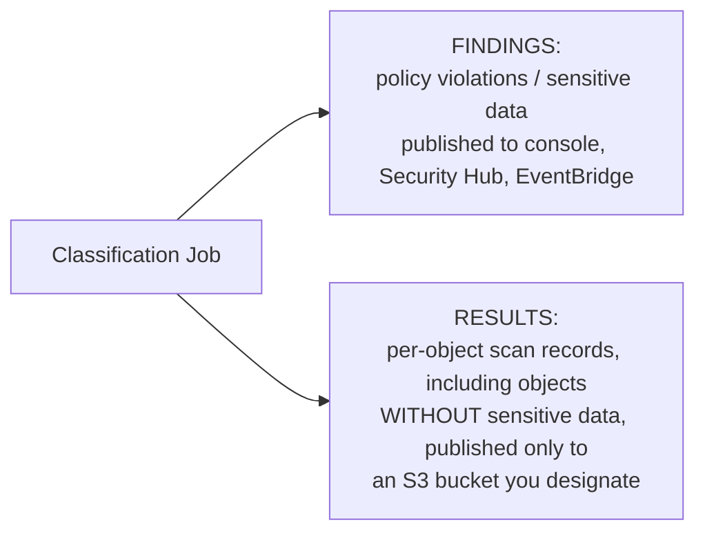

**Step by step:** **Findings** are the alert-worthy signal — something specific to act on right
now, streamed to the console, Security Hub, and EventBridge for immediate visibility and
automated remediation. **Results** are a completely different artifact: the exhaustive,
per-object scan log of *every* object examined, including the ones that had nothing sensitive in
them at all, published only to an S3 bucket you choose. Results exist for building your own
Athena/QuickSight analytics over Macie's full scan history — they're not meant for immediate
action, and conflating the two (expecting Findings-level alerting from Results, or expecting
Results' exhaustive detail from Findings) is a real, testable confusion.

### Image: Macie continuously analyzing an S3 bucket for PII


*Source: [AWS Documentation — Amazon Macie (SAP on AWS security reference)](https://docs.aws.amazon.com/sap/latest/general/macie.html)*

**Discussion.** The word "continuously" in this diagram's own caption is the detail worth
dwelling on: Macie isn't a one-time audit tool you run once and forget — its automated discovery
tier keeps sampling the bucket as new objects land, which is precisely what lets it catch a
compliance problem the week it's introduced rather than the next time someone happens to run a
manual review (which, in many real organizations, is "never" or "only after a breach"). This
continuous framing is also exactly why auditors specifically ask about Macie rather than accepting
"we did a manual review last year" as sufficient evidence for a data-residency or PII-handling
compliance requirement.

### Exam Tips
- **Macie vs. GuardDuty vs. Inspector** — Macie = sensitive data content/exposure; GuardDuty =
  active malicious behavior; Inspector = software vulnerabilities. "PII," "credit card numbers,"
  "discover sensitive data in S3" always points to Macie.
- **Macie is S3-only** — it does not scan RDS, DynamoDB, or EC2 filesystems directly.
- **Automated discovery (continuous, cheap, sampled) vs. full classification jobs (thorough,
  pricier)** — a full job should be targeted at specific high-sensitivity buckets, not run
  blindly against an entire multi-petabyte estate on a recurring schedule.

**Go even deeper:** [`services/security-identity-compliance/macie.md`](../../../services/security-identity-compliance/macie.md) (489 lines — custom identifier tuning, severity model, end-to-end investigation walkthrough)

---

## 17. Security Hub & Inspector

### Definition
**Security Hub** is a central dashboard that aggregates security findings from GuardDuty, Macie,
Inspector, IAM Access Analyzer, Firewall Manager, and third-party tools into one place, and
continuously checks your account against security standards. **Amazon Inspector** is an automated
**vulnerability scanner** checking EC2, ECR container images, and Lambda functions for known
software vulnerabilities (CVEs) and network reachability issues.

### Analogy
If GuardDuty is behavioral security cameras and Macie is the closet inspector checking for
sensitive contents, Inspector is a building code inspector checking every room for *structural
weaknesses* that haven't failed yet but legally should be fixed (a known-faulty wiring type still
installed, a door that doesn't meet current fire code). Security Hub is the single master
dashboard on the building manager's desk that pulls in reports from the camera system, the closet
inspector, *and* the code inspector, plus runs its own independent walkthrough checklist (CIS,
PCI-DSS) against the whole building — so the manager never has to walk to five separate offices
to get the full picture.

### Purpose
A mature AWS environment quickly accumulates findings from many different security tools, each
with its own console and alert-fatigue risk — nobody can realistically watch five separate
dashboards. Security Hub exists to be the single pane of glass; Inspector exists because "did we
patch this known vulnerability" is a continuous, moving target that doesn't scale to manual
tracking.

### When to Use
Security Hub: any environment running more than one or two of GuardDuty/Macie/Inspector/IAM
Access Analyzer, or needing continuous compliance-standard scoring (CIS, PCI-DSS, NIST). Inspector:
any account running EC2, pushing images to ECR, or deploying Lambda functions that need continuous
CVE visibility.

### When NOT to Use (be honest about the alternative)
- **Expecting Security Hub to generate findings on its own** — it doesn't; enabling it with no
  source services turned on produces an empty dashboard. It aggregates what GuardDuty/Macie/
  Inspector already produce.
- **Deep, authenticated vulnerability scanning with custom compliance policies beyond AWS's
  supported standards, or scanning non-AWS/on-prem assets** — consider a third-party vulnerability
  management tool (several integrate back into Security Hub) rather than expecting Inspector to
  cover everything.
- **A single, very small account with only one security tool enabled** — the aggregation value
  scales with the number of accounts/tools; a lone developer account may not need Security Hub's
  extra layer immediately.

### Use Cases
- **One dashboard instead of five across a large Organization** — normalized ASFF/OCSF findings
  and cross-account aggregation replace five separate consoles with one filterable view.
- **Continuous compliance posture ahead of an audit** — ongoing PCI-DSS or CIS benchmark tracking
  with a continuously-updated percentage score, not a point-in-time manual checklist.
- **Catching a previously-clean container image flagged by a new CVE** — Inspector automatically
  rescans existing ECR images against new vulnerability intelligence with no rebuild required.
- **Prioritizing patch work by actual exposure, not raw CVSS alone** — Inspector factors network
  reachability into its risk scoring, so an internet-reachable critical CVE outranks an identical
  CVE on an isolated internal instance.
- **Gating CI/CD container promotion on vulnerability scan results** — blocking deployment of an
  image with unpatched critical vulnerabilities until it's clean or an exception is approved.
- **Correlating misconfiguration with vulnerability for true priority** — Security Hub's exposure
  findings combine posture-management and Inspector findings into one composite, higher-ranked
  finding.

### Why It's Important
Security operations teams are measured on mean-time-to-detect and mean-time-to-remediate;
fragmented tooling directly worsens both. Continuous vulnerability scanning closes the gap between
"a CVE was published" and "we know we're affected" — for internet-facing systems, often a gap
measured in hours before active exploitation begins in the wild.

### Diagram: Exposure Findings — Security Hub's Correlation Capability

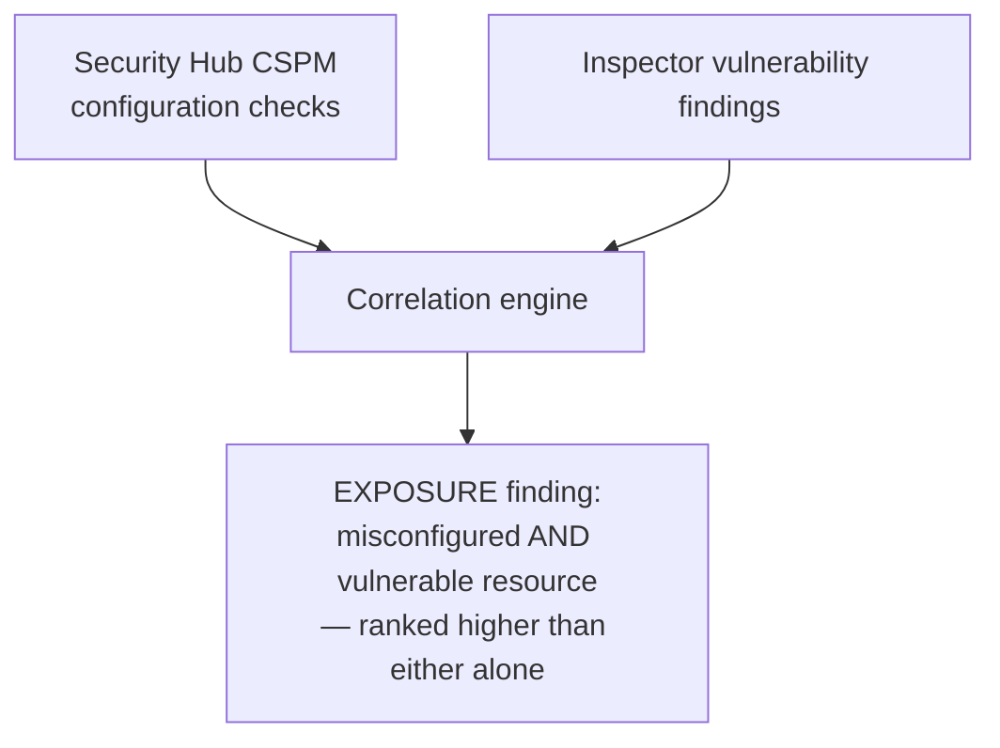

**Step by step:** newer Security Hub versions go beyond simple side-by-side aggregation into
actual **correlation** — specifically combining a posture-management signal ("this resource is
misconfigured, e.g., publicly reachable") with a vulnerability signal from Inspector ("this same
resource runs software with a known CVE") into a single composite finding ranked more urgently
than either alone. This mirrors exactly the same philosophy used elsewhere in this security
category (Macie's correlation with IAM Access Analyzer): the question that actually matters isn't
"is this resource exposed" or "is this resource vulnerable" in isolation, but "is it *both*
simultaneously" — that intersection is where real-world exploitation risk concentrates.

### Image: a centralized Security Tooling account running all four services


*Source: [AWS Prescriptive Guidance — Security Reference Architecture, Security Tooling account](https://docs.aws.amazon.com/prescriptive-guidance/latest/security-reference-architecture/security-tooling.html)*

**Discussion.** The fact that all four services (Security Hub, GuardDuty, Inspector, Macie) are
pictured living together in one dedicated **Security Tooling account** is itself a load-bearing
architectural detail, not an arbitrary grouping: delegating administration of each service to this
one account lets a security team see and manage findings across the *entire* Organization without
that team ever needing standing admin rights inside any individual workload account. Note,
though, that this delegation happens **per service** — a question describing findings missing
from only one of the four services almost always points to that one service's delegation link
being misconfigured or never completed, not a Security Hub-wide failure.

### Exam Tips
- **Security Hub aggregates; it doesn't detect on its own** — its native contribution is
  compliance-standard checks, exposure correlation, and the unified dashboard, not primary threat
  detection.
- **Inspector vs. GuardDuty vs. Macie** — Inspector = known software vulnerabilities (CVEs);
  GuardDuty = active malicious behavior; Macie = sensitive data content/exposure. "CVE,"
  "vulnerability," "patch" always point to Inspector.
- **Inspector continuously rescans** — an ECR image can go from clean to flagged without anyone
  rebuilding it, purely because a new CVE was published against an existing, unchanged package.

**Go even deeper:** [`services/security-identity-compliance/security-hub-and-inspector.md`](../../../services/security-identity-compliance/security-hub-and-inspector.md) (478 lines — ASFF schema reference, standards comparison, triage-priority worked scenario)

---
## 18. Additional Security Services (CloudHSM etc.)

### Definition
A consolidated group of lower-exam-weight security/identity/compliance services: **CloudHSM**
(dedicated single-tenant hardware key custody), **Detective** (investigation graphing for
GuardDuty findings), **Directory Service** (managed Active Directory), **Firewall Manager**
(org-wide WAF/Shield/SG policy enforcement), **Network Firewall** (deep packet inspection for a
VPC), **RAM** (cross-account resource sharing), **Artifact** (AWS's own compliance report
portal), and **Audit Manager** (continuous evidence collection for your own compliance audits).

### Analogy
Think of this group as the specialized tools in a security team's toolbox beyond the headline
services — CloudHSM is a bank-vault-grade safe you alone hold the key to (versus KMS's
well-guarded but shared storage room); Detective is the detective's corkboard with string
connecting clues after a crime (GuardDuty finding) was already reported; Network Firewall is a
customs checkpoint inspecting cargo contents at the VPC's border (versus security groups, which
just check if a truck has the right permit); Firewall Manager is the regional policy memo that
automatically applies to every branch office, present and future; and RAM is the shared company
car pool — one vehicle, multiple departments allowed to use it, nobody duplicates the car.

### Purpose
These eight services fill specific, narrower gaps that KMS, GuardDuty, WAF, and IAM alone don't
cover: compliance mandates requiring dedicated hardware (CloudHSM), investigation tooling beyond
raw detection (Detective), Windows/AD-dependent workloads (Directory Service), consistent
org-wide policy enforcement (Firewall Manager), deep packet inspection beyond L3/L4 (Network
Firewall), clean cross-account resource sharing (RAM), and compliance documentation (Artifact,
Audit Manager).

### When to Use
CloudHSM: a compliance mandate explicitly requires single-tenant, FIPS 140-2 Level 3 hardware.
Detective: investigating *why* a GuardDuty finding happened, not detecting it. Directory Service:
Windows/AD-dependent workloads needing real Active Directory. Firewall Manager: enforcing
consistent security policy across many accounts automatically. Network Firewall: deep packet
inspection or domain-name-based outbound filtering a security group/NACL can't do. RAM: sharing
one resource (a subnet, a Transit Gateway) across accounts without duplicating it.

### When NOT to Use (be honest about the alternative)
- **CloudHSM for the vast majority of encryption needs** — KMS is simpler, cheaper, and
  sufficient almost always; CloudHSM's dedicated-hardware overhead is only justified by an
  explicit compliance mandate that KMS's shared model genuinely can't satisfy.
- **Network Firewall for simple allow/deny-by-port filtering** — that's a security group/NACL
  job; reach for Network Firewall only when deep packet inspection or domain-based filtering is
  genuinely required.
- **Artifact for evidence about your *own* workload's compliance** — Artifact only provides AWS's
  own third-party audit reports about AWS itself; use **Audit Manager** for continuous evidence
  about your own environment.

### Use Cases
- **CloudHSM**: a financial institution's compliance mandate requires keys never accessible to
  any third party, including AWS operators, running on FIPS 140-2 Level 3 certified hardware.
- **Detective**: a security team receives a GuardDuty finding and opens it directly in Detective,
  which has already correlated related API calls, network connections, and resources into one
  navigable graph.
- **Directory Service**: a company migrating Windows workloads wants users to keep authenticating
  with existing corporate credentials without maintaining two separate identity stores — AD
  Connector proxies straight to the existing on-prem AD.
- **Firewall Manager**: a security team wants every VPC across 50 accounts to have the same
  baseline WAF managed rule set on its ALBs, including any new account or ALB created later.
- **Network Firewall**: a company needs to block all outbound traffic to a list of known-malicious
  domains, plus intrusion detection on packet payloads crossing the VPC boundary.
- **RAM**: a central networking team owns one Transit Gateway and wants every application
  account to attach their own VPCs to it, without granting broader access to the networking
  account itself.

### Why It's Important
These services are each the *specific, correct* answer when a scenario's requirement is narrower
or stricter than what the headline services (KMS, GuardDuty, WAF) can satisfy — recognizing which
narrow tool fits which narrow requirement is exactly what separates a surface-level answer from a
precise one on harder SAA-C03 questions.

### Diagram: Firewall Manager — Define Once, Enforce Everywhere, Forever

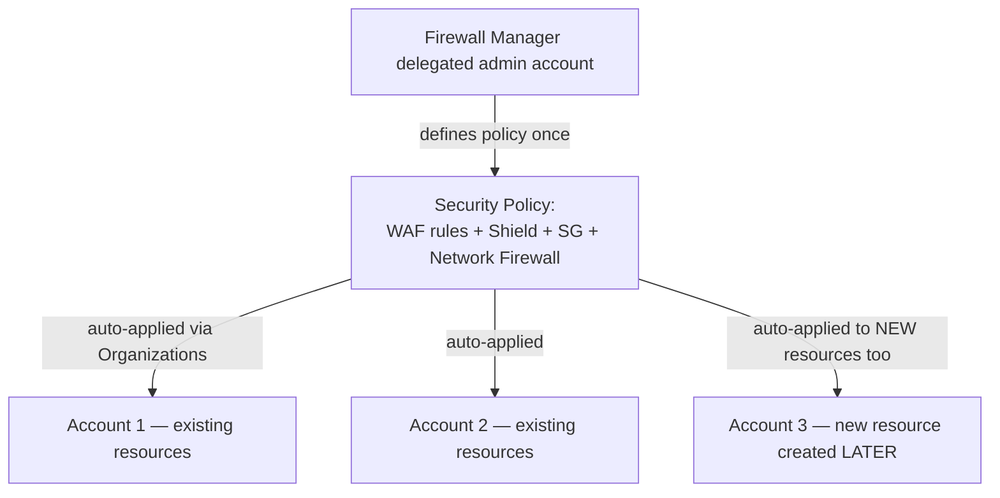

**Step by step:** a security team defines a policy exactly once, from the delegated admin
account. AWS Organizations propagates its enforcement across every member account in scope — and
critically, this isn't a one-time push. Firewall Manager keeps watching and automatically applies
the same policy to brand-new resources and even newly created accounts, so there's no manual step
anyone can forget for a resource that didn't exist yet when the policy was written. This is the
mechanism that turns "every account must have this WAF baseline" from an ongoing manual
enforcement chore into a single, durable policy definition.

### Image: AWS Network Firewall inspecting both inbound and outbound VPC traffic


*Source: [AWS Reference Architecture Diagrams — Network Firewall inspection models](https://docs.aws.amazon.com/reference-architecture-diagrams/)*

**Discussion.** The diagram's depiction of **both** inbound and outbound inspection on the same
firewall is the detail worth internalizing: Network Firewall isn't just a smarter inbound
perimeter guard — it's equally capable of inspecting *outbound* traffic for things a security
group fundamentally cannot see, like a request to a specific known-malicious domain name
regardless of which IP that domain currently resolves to. A security group can only match on IP/
port; it has no concept of "block requests to this domain." This is precisely the capability gap
that makes Network Firewall the right answer whenever a scenario explicitly mentions domain-name-
based outbound filtering or deep packet payload inspection.

### Exam Tips
- **CloudHSM vs. KMS**: "dedicated hardware," "FIPS 140-2 Level 3," "AWS has no access to key
  material" → CloudHSM. KMS is the default, sufficient answer for nearly everything else.
- **Detective vs. GuardDuty**: GuardDuty *detects*; Detective *investigates* an existing finding's
  root cause and blast radius. A question about finding generation points to GuardDuty; one about
  correlating/investigating an existing finding points to Detective.
- **Artifact vs. Audit Manager**: Artifact downloads AWS's *own* compliance reports about AWS;
  Audit Manager continuously collects evidence about *your* workload's compliance.

**Go even deeper:** [`services/security-identity-compliance/additional-security-services.md`](../../../services/security-identity-compliance/additional-security-services.md) (330 lines — all 8 services in full, Directory Service's 3 flavors compared)

---

## 19. AWS Systems Manager

### Definition
A collection of operational tools for managing fleets of EC2 instances and on-premises servers at
scale — running commands across hundreds of machines at once, storing configuration/secrets
centrally, opening a secure shell session without SSH keys or open ports, and patching operating
systems automatically.

### Analogy
Traditional remote management (SSH, RDP) is like needing to personally walk up to every single
house on a street and knock on the front door (open an inbound port) to talk to whoever's inside.
Systems Manager inverts this entirely: every house has already placed an outbound call to a
central switchboard the moment it was built, and sits there waiting. When you need to talk to a
house, you call the switchboard, and the switchboard connects you through the *already-open*
outbound line — nobody ever needs a key to anyone's front door, and no door is ever left unlocked
for a stranger to find. This single architectural inversion is why Session Manager can reach a
fully private-subnet instance with zero inbound rules at all.

### Purpose
Managing a handful of servers by hand doesn't scale past a few machines, and opening SSH/RDP ports
is itself a security liability — one of the most common sources of compromise. Systems Manager
lets fleets be configured, patched, inspected, and accessed entirely through the AWS API,
authenticated by IAM, logged by CloudTrail, with zero inbound ports ever opened.

### When to Use
Any fleet of EC2 instances (or on-prem servers registered as "managed instances") needing
operational access, patching, or centralized configuration — and especially whenever a scenario
says "no bastion host," "no open SSH port," or "fully audited shell access."

### When NOT to Use (be honest about the alternative)
- **Secrets requiring automatic rotation, fine-grained resource policies, or cross-account
  sharing as a first-class feature** — **Secrets Manager** is purpose-built for that; Parameter
  Store SecureString can hold secrets but doesn't natively rotate them.
- **Container orchestration/patching** — containers are typically replaced, not patched in place;
  Patch Manager targets EC2/on-prem OS patching, not container image updates.
- **Configuration feature-flagging with gradual rollout/validation** — **AWS AppConfig** is
  purpose-built for dynamic application configuration with deployment strategies and automatic
  rollback, which plain Parameter Store doesn't provide.

### Use Cases
- **Eliminating SSH keys and open port 22/3389 entirely** — Session Manager's outbound-only agent
  channel means IAM policy, not a network rule, governs access, with full session logging.
- **Fleet patch management with scheduled compliance reporting** — Patch Manager's baseline +
  maintenance window + compliance reporting, with no manual SSHing into hundreds of machines.
- **Fan-out diagnostic commands across a tagged fleet** — Run Command targets by tag, not a static
  instance list, automatically covering newly launched Auto Scaling instances.
- **Centralizing application configuration across Lambda, ECS, EC2, and CI/CD** — Parameter Store
  gives one canonical location any service reads via API, eliminating drift between copies.
- **Feeding dynamic, non-hardcoded values into CloudFormation/CDK templates** — a
  `{{resolve:ssm:...}}` dynamic reference resolves at deploy time, keeping the literal value out
  of the versioned template.
- **Accessing fully private-subnet instances with no NAT Gateway budgeted** — VPC interface
  endpoints for `ssm`/`ssmmessages`/`ec2messages` let the agent reach Systems Manager entirely
  within the VPC, no internet route required.

### Why It's Important
Session Manager eliminating open SSH/RDP ports is one of the highest-leverage, lowest-effort
security improvements available on AWS — it closes one of the most commonly exploited attack
surfaces with no workflow downside, since every session is still fully logged.

### Diagram: Session Manager — The Outbound-Only Connection That Removes the Need for an Open Port

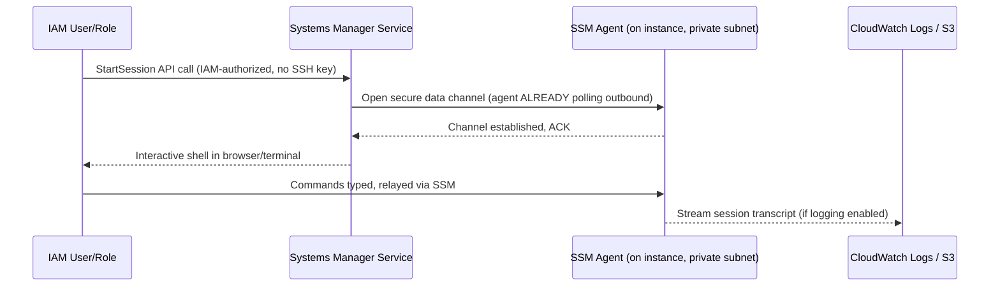

**Step by step:** the single fact that makes this entire architecture work is that the SSM Agent
on the instance establishes an **outbound** connection to the Systems Manager service the moment
it starts — it's already "on the phone" with AWS before any administrator ever wants to connect.
When a user requests a session, authorized purely by IAM policy with zero SSH key exchange, AWS
relays the request down that already-existing outbound channel. At no point does AWS or the user
initiate a *new inbound* connection to the instance — there is structurally nothing to open a port
for. If session logging is enabled, every keystroke streams to CloudWatch Logs/S3 in parallel,
producing a durable audit transcript no local shell-history file (which an attacker with root
could simply delete) could ever provide.

### Image: initiating a Session Manager session, and its audit log in CloudWatch


*Source: ["Using AWS Systems Manager in Hybrid Cloud Environments" — AWS Architecture Blog](https://aws.amazon.com/blogs/architecture/using-aws-systems-manager-in-hybrid-cloud-environments/)*


*Source: same article, "Using AWS Systems Manager in Hybrid Cloud Environments"*

**Discussion.** These two images together tell the complete story in one glance: the first shows
how simple starting a session actually is from the console (click a managed instance, start a
session — no key file, no bastion hop, no VPN client), and the second shows the *consequence* of
that simplicity: every command typed during that session is already streaming to CloudWatch Logs
in parallel, with zero extra effort from the user. This pairing is exactly why Session Manager is
considered a "free win" security improvement — the security benefit (no open port) and the audit
benefit (centralized logging) both come bundled with the *easier* way to connect, not a
trade-off against convenience.

### Exam Tips
- **"No bastion host, no open SSH port, fully audited shell access" → Session Manager** — one of
  the most reliable keyword matches on SAA-C03.
- **A missing IAM instance profile is the #1 real-world and exam-scenario cause** of "I can't
  connect via Session Manager" — not a network/security-group issue, since Session Manager
  requires no inbound rule at all.
- **Parameter Store vs. Secrets Manager**: both can hold secrets, but automatic **rotation** and
  **cross-account resource policies** are Secrets Manager's distinguishing feature — a question
  mentioning automatic rotation always points to Secrets Manager, even though Parameter Store
  SecureString looks superficially similar.

**Go even deeper:** [`services/management-governance/systems-manager.md`](../../../services/management-governance/systems-manager.md) (680 lines — full patch-run trace, Parameter Store dynamic references, 5 exam scenario walkthroughs)

---

## 20. AWS KMS (Key Management Service)

### Definition
AWS's managed service for creating, storing, and controlling access to the **cryptographic keys**
used to encrypt and decrypt data across almost every other AWS service, without you ever having
to build, run, or secure your own key-management infrastructure.

### Analogy
Picture KMS as a bank's safe-deposit vault system. You never actually hold a master key that
opens every box — instead, the vault's own machinery does the locking and unlocking, and you
simply *request* access through a teller who checks your ID and authorization (the key policy and
IAM policy) before letting the vault machinery act on your behalf. You can store something huge
in the vault (envelope encryption: the vault gives you a small personal lockbox key, you use that
key locally to seal your own giant trunk, then the vault locks away just the small lockbox key) —
the vault itself never has to physically swallow your entire trunk to protect it. And just like a
bank, if nobody is ever authorized to open a particular box (a key policy granting no one access),
not even the bank's own president can override that — the box is permanently sealed.

### Purpose
Encryption is only as strong as the protection around the keys doing the encrypting. Before
services like KMS existed, teams either rolled their own key storage (a notorious source of
breaches) or didn't encrypt sensitive data at rest because key management was too much overhead.
KMS makes "encrypt everything, by default, with centrally audited keys" the path of least
resistance.

### When to Use
Essentially every AWS workload storing data at rest — S3, EBS, RDS, DynamoDB, Lambda environment
variables — should default to KMS-backed encryption. Use a Customer Managed Key specifically when
you need control over the key policy, cross-account sharing, or custom rotation; use an
asymmetric key when you need to share a public key with a party that has no AWS credentials.

### When NOT to Use (be honest about the alternative)
- **Dedicated, single-tenant HSM hardware for strict compliance (FIPS 140-2 Level 3) or direct
  PKCS#11 access** — use **CloudHSM** instead; KMS's default HSMs are FIPS 140-2 Level 2 and
  multi-tenant.
- **Storing an application secret/credential itself, not performing bulk encrypt/decrypt
  operations** — use **Secrets Manager** or **Parameter Store**, which use KMS underneath but are
  the correct service for the secret *lifecycle* itself (rotation, retrieval, versioning).
- **TLS/SSL certificates for HTTPS** — that's **ACM**, not KMS; KMS keys are not certificates.

### Use Cases
- **Encrypting data at rest across the storage/database layer** — SSE-KMS gives one centrally
  governed key reused across S3, EBS, RDS, and DynamoDB.
- **Sharing an encryption key with a partner who has no AWS account** — an asymmetric KMS key's
  public key can be exported and given to the partner with zero AWS credentials required on
  their side; the private key never leaves KMS.
- **Signing build artifacts so downstream systems can verify provenance** — a `SIGN_VERIFY`
  asymmetric key lets the pipeline sign while any verifier checks the signature offline using the
  exported public key, no AWS credentials needed for verification.
- **MFA-gated decryption of highly sensitive data** — a key policy condition requiring
  `aws:MultiFactorAuthPresent` adds this requirement at the key layer itself, holding even if an
  IAM policy elsewhere is too permissive.
- **Cross-account data sharing without copying data** — the key policy in the owning account
  names the other account's role directly, readable without ever duplicating the data.
- **Zero-trust data access through an explicitly scoped path** — a `kms:ViaService` condition
  restricts usage to only when invoked through a named AWS service, closing off a direct,
  unscoped `kms:Decrypt` call even if the caller's IAM policy would otherwise allow it.

### Why It's Important
"Was the data encrypted at rest, and who could access the key" is one of the first two questions
in almost every data-breach post-incident review and almost every compliance audit.

### Diagram: Envelope Encryption — How KMS Encrypts Data Far Larger Than Its Own 4KB API Limit

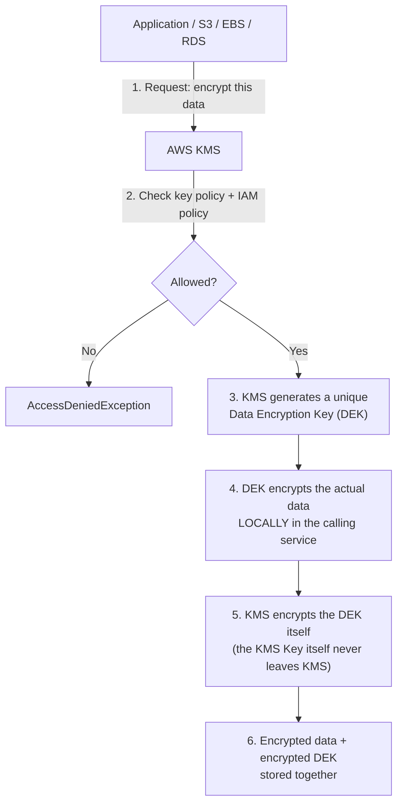

**Step by step:** KMS's own `Encrypt` API call has a hard 4KB payload limit, which raises an
obvious question — how does it encrypt a 50GB S3 object? The answer is **envelope encryption**:
KMS generates a one-time-use **Data Encryption Key (DEK)** and hands back *both* a plaintext copy
and an encrypted ("wrapped") copy of it. The calling service uses the plaintext DEK **locally, in
memory**, with a fast symmetric algorithm (AES-256-GCM) to encrypt the actual 50GB object —
nothing about that bulk encryption work ever touches KMS's network boundary. Only the small,
already-encrypted DEK is stored alongside the ciphertext, and to decrypt later, the service sends
*that* small encrypted DEK back to KMS, which unwraps it (checking permissions again) and returns
the plaintext DEK for local decryption. The actual KMS key backing all of this never leaves AWS's
HSMs at any point in the process.

### Image: the official envelope encryption key hierarchy


*Source: [AWS KMS Developer Guide — AWS KMS cryptography essentials](https://docs.aws.amazon.com/kms/latest/developerguide/kms-cryptography.html)*

**Discussion.** This diagram shows the full hierarchy envelope encryption actually rests on: a
root key encrypts key-encryption keys, which in turn encrypt data keys, which finally encrypt the
actual data. Each layer exists to limit the blast radius of any single key's exposure and to let
KMS rotate backing material internally without ever needing to touch — or even know about — the
data each layer ultimately protects. The practical takeaway for the exam: rotating a KMS key does
**not** mean re-encrypting all your data. KMS retains every prior layer of backing material
internally (as long as the key isn't deleted), so old ciphertext stays decryptable through old
material while only *new* operations start using the newest material.

### Exam Tips
- **Symmetric keys never leave KMS and support automatic annual rotation; asymmetric keys let
  you export the public key (private key still never leaves) but do NOT support automatic
  rotation** — know this table cold.
- **A KMS key with no key policy granting access is unusable, even by the account root** — the
  opposite failure mode from most AWS resources, where forgetting to *restrict* is the usual risk;
  here, forgetting to *grant* correctly locks everyone out permanently.
- **Cross-account KMS access needs both sides**: the key policy in the key's account AND an IAM
  policy in the caller's account — exactly the same dual-policy pattern as cross-account S3.

**Go even deeper:** [`services/security-identity-compliance/kms.md`](../../../services/security-identity-compliance/kms.md) (643 lines — full key policy JSON, custom key stores, service integration matrix)

---

## 21. ACM & Private CA

### Definition
ACM **issues, renews, and manages free public TLS/SSL certificates** for AWS resources, so
traffic to your website or API can be encrypted (HTTPS) without buying a certificate or manually
tracking expiry. **AWS Private CA** is a companion service letting you run your own private
certificate authority for internal systems that should never be trusted by the public internet.

### Analogy
A public ACM certificate is like a passport issued by a recognized national government — every
border guard (every browser) on Earth already trusts it, because they all recognize the issuing
authority. A Private CA certificate is like an employee ID badge issued by your own company — it
gets you into every door *your own company* has configured to recognize it, but it means nothing
at the actual national border; nobody outside your organization has any reason to trust it, nor
should they. Both are genuinely useful identity documents, just scoped to completely different
trust boundaries, and building a Private CA hierarchy is literally building your own passport
office, complete with the responsibility of deciding who gets to open which trust level.

### Purpose
TLS certificate management used to be a recurring operational headache: pay a CA, generate a CSR,
install the cert, and remember to renew it before expiry — an expired cert is one of the most
common causes of unplanned production outages industry-wide. ACM makes certificates for
AWS-facing services free and automatically renewed. Private CA exists because not every
certificate should be trusted by every browser on Earth.

### When to Use
ACM: any public-facing resource behind an ALB, CloudFront, or API Gateway needing HTTPS. Private
CA: internal service-to-service mTLS, IoT device identities, VPN client certificates, or
code-signing — anything needing a certificate trusted only within your own organization.

### When NOT to Use (be honest about the alternative)
- **You need the raw private key for use outside AWS-integrated services** (installed directly
  on a self-managed server via SSH) — ACM public certificates cannot be exported; either
  terminate TLS at an ALB in front of the instance, or import an externally-obtained certificate
  and accept manual renewal responsibility.
- **You need certificates trusted by the public internet but issued by your own authority** — not
  possible; public trust requires a chain to a recognized public root CA. Private CA certificates
  are only trusted by parties you've explicitly configured to trust them.
- **Low-volume internal use where standing up a full Private CA hierarchy is overkill** — for a
  handful of internal services, Private CA's real hourly cost may not be justified versus simpler,
  manually-managed self-signed certs.

### Use Cases
- **Free HTTPS on a public ALB/CloudFront distribution** — a DNS-validated public ACM cert
  auto-renews indefinitely for free as long as the validation record stays in place.
- **Internal service mesh with mutual TLS (mTLS)** — a Private CA issues per-service certificates
  trusted only within the organization's own hierarchy, with zero exposure to the public CA chain.
- **IoT fleet identity at scale** — Short-Lived CA mode issues high-volume, frequently-rotated
  device certificates at a lower per-CA rate tuned for exactly this pattern.
- **Code-signing internal build artifacts** — a Private CA-issued signing certificate lets
  downstream systems verify provenance entirely within the organization's own trust boundary.
- **M&A — extending a centralized Private CA hierarchy to an acquired company** — sharing the
  parent's *subordinate* CA (never the root) via AWS RAM lets the acquired team self-serve
  certificate issuance without exposing root-level trust.
- **Avoiding certificate-expiry outages entirely** — switching to DNS-validated ACM certificates
  removes the human-forgetfulness failure mode completely for every AWS-integrated endpoint.

### Why It's Important
Expired certificates causing outages is a recurring, embarrassing, and entirely preventable
category of incident across the industry — ACM's automatic renewal removes an entire class of
human-error risk for free.

### Diagram: CA Hierarchy — Nested Validity Periods, the Single Most Important Design Constraint

```mermaid
flowchart TD
    Root["Root CA — Security account\nvalidity: 10 years"] --> SubOps["Subordinate CA: Operations\nvalidity: 5 years"]
    Root --> SubIoT["Subordinate CA: IoT Devices\nvalidity: 5 years"]
    SubOps --> LeafService1["Leaf cert: payment-service\nvalidity: 13 months"]
    SubOps --> LeafService2["Leaf cert: inventory-service\nvalidity: 13 months"]
    SubIoT --> LeafDevice1["Leaf cert: device-fleet-batch-A\nvalidity: 90 days"]
```

**Step by step:** every certificate's validity window must sit **entirely inside** its parent's
window — a subordinate CA's validity must fit inside the root's, and every leaf certificate it
issues must fit inside the subordinate's. AWS's own rule of thumb: a CA certificate's validity
should be roughly 2-5x longer than any certificate it will issue, so the hierarchy doesn't need
constant re-issuance just to keep leaf certificates valid near the end of a CA's own lifetime.
Sharing the **subordinate** CA (never the root) to individual application accounts via AWS RAM
lets application teams self-serve certificate issuance while the actual foundation of trust — the
root — stays locked down in a dedicated security account, never directly exposed to workload
teams.

### Image: the official nested-validity diagram


*Source: [AWS Private Certificate Authority User Guide — Manage the private CA lifecycle](https://docs.aws.amazon.com/privateca/latest/userguide/ca-lifecycle.html)*

**Discussion.** This diagram is the visual proof of why "the leaf certificate hasn't expired yet,
why is the mTLS handshake failing" is a real, testable troubleshooting scenario: a client
performing strict chain validation checks *every* certificate in the chain's validity, not just
the leaf's. If a leaf certificate's own `notAfter` date somehow extends past its issuing
subordinate CA's validity window — a configuration mistake, not the normal case — the handshake
fails the moment the CA's own window passes, even though the leaf certificate itself still looks
perfectly valid in isolation. Designing the nesting correctly up front (leaf validity meaningfully
shorter than its issuing CA's remaining lifetime) is what prevents this from ever becoming a
production incident.

### Exam Tips
- **ACM certs cannot be exported** — if a scenario needs the private key installed on a self-
  managed server outside AWS-integrated services, ACM alone is the wrong tool.
- **DNS validation enables reliable auto-renewal; email validation and imported certs do not
  auto-renew reliably** — "the cert keeps expiring and breaking the site" often points to an
  imported certificate or a lapsed email-validation contact.
- **ACM is free; Private CA is not** — a real, testable distinction, since many assume "ACM = free
  certs" covers this entire category.

**Go even deeper:** [`services/security-identity-compliance/acm-and-private-ca.md`](../../../services/security-identity-compliance/acm-and-private-ca.md) (458 lines — full openssl-mirrored CA hierarchy lab, revocation via CRL/OCSP, Short-Lived vs. General-Purpose cost comparison)

---

## 22. Secrets Manager vs. Parameter Store

### Definition

Two different AWS services that both let an application fetch a configuration value or sensitive
string at runtime via an IAM-governed API call instead of hardcoding it. **AWS Secrets Manager**
is purpose-built for secrets that need **automatic rotation** (database passwords, API keys).
**Systems Manager Parameter Store** is a general-purpose, mostly-free configuration/secret store
with no built-in rotation engine of its own.

### Analogy

Think of a hotel. **Parameter Store** is the hotel's own in-room safe with a simple keypad code —
free to use, fine for storing your passport or a spare key, but if you want the code to change
automatically every night without you lifting a finger, the hotel doesn't do that for you.
**Secrets Manager** is the hotel's managed safety-deposit box service at the front desk: it costs
a monthly fee, but the hotel staff will *automatically* swap the combination on a schedule, test
that the new combination works, and only then throw away the old one — all without you ever being
locked out mid-swap.

### Purpose

Hardcoded credentials in source code or environment variables are one of the oldest, most
persistent breach vectors (leaked GitHub repos, compromised CI logs, a former employee who still
remembers a password years later). Both services exist to make "pull it securely at runtime"
trivial. Secrets Manager additionally solves the much harder problem of **rotating** a secret on a
schedule without ever breaking the application mid-rotation — something Parameter Store was never
built to do.

### When to Use

- A database/API credential must **rotate automatically** on a schedule with zero manual steps and
  zero downtime (use Secrets Manager's built-in rotation Lambda templates).
- A secret must be shared securely and auditably **across AWS accounts** (Secrets Manager resource
  policies are first-class for this).
- Compliance explicitly requires **demonstrable periodic rotation evidence** (version staging
  labels + rotation history).
- Hundreds/thousands of **non-rotating** config values at near-zero cost (Parameter Store Standard,
  free up to 10,000 parameters).
- A whole **config tree** needs fetching in one call at app startup (`GetParametersByPath
  --recursive`) — Parameter Store's hierarchical paths have no Secrets Manager equivalent.

### When NOT to Use (be honest about the alternative)

- Don't force a secret that genuinely needs rotation into Parameter Store to save money — you end
  up reimplementing (poorly) what Secrets Manager already does reliably; the "savings" evaporate
  once you count the engineering time to hand-build a rotation pipeline.
- Don't put 2,000 non-rotating feature flags into Secrets Manager "for consistency" — at
  ~$0.40/secret/month that's roughly **$800/month** for data that costs $0 in Parameter Store
  Standard. This exact mismatch is the #1 real-world cost mistake in this category.
- Never hardcode secrets in Lambda environment variables or container images in plaintext, even if
  neither service seems to fit perfectly — at minimum KMS-encrypt the environment variable.

### Use Cases

1. **RDS password auto-rotation with zero downtime** — the RDS console can auto-create and manage
   a Secrets Manager secret, wiring up rotation with no custom Lambda code needed.
2. **Cross-account secret sharing with a partner account** — a resource policy scoped to
   `secretsmanager:VersionStage = AWSCURRENT` so the partner never fetches a stale `AWSPREVIOUS`
   version mid-rotation.
3. **2,000+ feature flags and environment settings** — Parameter Store Standard tier, effectively
   free, versus the same data in Secrets Manager costing hundreds of dollars a month.
4. **Incident response: rotating a credential believed compromised** — `put-secret-value` or an
   out-of-band rotation invalidates the leaked password immediately; if the app re-fetches rather
   than caches, the change propagates with no redeploy.
5. **M&A credential consolidation** — migrating an acquired company's scattered secrets into the
   parent's existing setup, sorted into "needs rotation" (Secrets Manager) vs. "static config"
   (Parameter Store), under one governance/audit trail.
6. **ECS task definitions / Lambda referencing a secret directly** — both services let the task
   definition reference the secret by ARN with zero application code needed to fetch it.

### Why It's Important

A database password that's never rotated is a permanent, growing liability — the longer it exists
unrotated, the more systems and people end up knowing it. Secrets Manager turns rotation from an
operationally painful manual chore (the actual reason most teams skip it) into a scheduled,
zero-downtime, automatic process. This is directly named in **SAA-C03 Domain 1, Task 1.2** ("Design
secure workloads and applications"), and the cost/rotation tradeoff against Parameter Store is one
of the most recurring "which service" scenario questions on the exam.

### Diagram

```mermaid
flowchart TD
    App[Application] -->|GetSecretValue / GetParameter| IAMCheck{IAM policy allows\nthis caller + this secret/parameter?}
    IAMCheck -- No --> Deny[AccessDenied]
    IAMCheck -- Yes --> Fetch[Service decrypts value via KMS\nreturns plaintext to caller]
    Fetch --> App
    subgraph Secrets Manager only — automatic rotation
        Sched[Rotation schedule fires] --> Lambda[Rotation Lambda]
        Lambda -->|1. create AWSPENDING version| DB[(Target DB)]
        Lambda -->|2. test it works| DB
        Lambda -->|3. promote to AWSCURRENT| SM[(Secrets Manager)]
        Lambda -->|4. retire old as AWSPREVIOUS| SM
    end
```

**Step by step:** (1) the app calls `GetSecretValue`/`GetParameter`; IAM checks the caller against
the specific secret/parameter (and, for a `SecureString`, `kms:Decrypt` too). (2) If allowed, the
decrypted plaintext comes back. (3) Only Secrets Manager has the bottom half: a rotation Lambda
creates a brand-new credential as `AWSPENDING`, **tests** it actually works against the real
target, only **then** promotes it to `AWSCURRENT` (what the app fetches by default), and finally
retires the old version as `AWSPREVIOUS` rather than deleting it immediately — so a failed test
never breaks the live application, and a short rollback window always exists.

### Image


*Source: [AWS Secrets Manager User Guide — Lambda function rotation strategies](https://docs.aws.amazon.com/secretsmanager/latest/userguide/rotation-strategy.html), © Amazon Web Services.*

**Discussion.** This is the **alternating users** rotation strategy, AWS's recommended
high-availability pattern: instead of repeatedly changing one database user's password (which
briefly invalidates any already-open connection using the old password at the exact moment of the
switch), Secrets Manager clones the original user into a second user on the first rotation, then
alternates which of the two users' passwords it updates on each subsequent rotation. At any given
moment — including mid-rotation — at least one of the two credentials is guaranteed valid, which is
why this strategy is preferred over the simpler single-user rotation for anything availability-
critical.

### Exam Tips

- **"Needs automatic rotation" is the single word that decides this question** — regardless of
  cost, if rotation is required, the answer is Secrets Manager; Parameter Store has no native
  rotation engine, full stop.
- **Both encrypt via KMS identically** — don't pick an answer implying Parameter Store
  `SecureString` is "less secure"; the only real differences are rotation tooling and price.
- **Version staging labels (`AWSCURRENT`/`AWSPENDING`/`AWSPREVIOUS`)** are Secrets-Manager-specific
  vocabulary — if a question uses these terms, the answer is Secrets Manager, not Parameter Store.

**Go even deeper:** [`services/security-identity-compliance/secrets-manager-vs-parameter-store.md`](../../../services/security-identity-compliance/secrets-manager-vs-parameter-store.md) (509 lines — full resource-policy JSON, rotation Lambda code, single-user vs. alternating-users comparison table)

---

## 23. AWS Lake Formation

### Definition

AWS Lake Formation centralizes **fine-grained permissions** for a data lake — database-, table-,
column-, row-, and even cell-level access control — enforced consistently across every integrated
query engine (Athena, Redshift Spectrum, EMR, Glue, QuickSight, SageMaker) that reads from the same
Glue Data Catalog. You define who-can-see-what **once**, and every integrated engine automatically
enforces that same grant.

### Analogy

IAM + S3 bucket policies alone are a building's front-door lock: you're either let into the
building or you're not — fine for coarse access, but no way to say "you may enter, but inside the
finance department's filing cabinet, only open the drawers that aren't labeled HR." Lake Formation
is the finer internal lock system installed *inside* that building: it checks, at the moment
someone reaches for a specific drawer (table/column/row), whether they're actually allowed to open
it — before they ever touch the contents.

### Purpose

Before Lake Formation, securing a data lake meant stacking S3 bucket policies (file-level access)
and IAM policies (API-call-level access) across every service touching the lake — with no native
concept of "let this analyst see every column except `ssn` and `salary`" or "let this regional
manager only see rows where `region = 'EU'`." Lake Formation adds a database-like, fine-grained
permissions layer on top of the Glue Data Catalog so governance can be expressed the way a data
administrator actually thinks about it.

### When to Use

- Several business units share one Data Catalog, but **only specific columns** of a shared table
  (e.g., salary/SSN) should be visible to a specific team.
- A global company needs **region-scoped row visibility** into one shared table, without
  maintaining a separate table per region.
- A curated table needs to be shared with **other AWS accounts** without duplicating the data.
- Governance needs to scale across **hundreds of tables** without writing hundreds of individual
  grants (LF-TBAC tag-based access control).
- A security requirement demands that a column-level restriction **can't be bypassed** by an
  analyst switching from Athena to an EMR notebook using the same underlying IAM role.

### When NOT to Use (be honest about the alternative)

- A small, single-team lake needing nothing finer than "this role can read this S3 prefix" —
  **plain IAM + S3 bucket policies** are simpler to set up and reason about; Lake Formation's
  registration and grant model is real, avoidable overhead here.
- Data that isn't in S3/Glue Data Catalog at all (pure DynamoDB or RDS with no lake layer) — that's
  a plain IAM/database-native-permissions problem, not a Lake Formation one.
- Row-level security for a traditional data warehouse, not a lake — **Redshift's own row-level
  security** operates natively inside the warehouse; the two aren't interchangeable.

### Use Cases

1. **Multi-team data mesh with column-level sensitivity** — one broadly-shared employee table,
   with only the finance team's role granted `SELECT` including the salary/SSN columns.
2. **Regional data residency/visibility** — a row-level data filter (`region = 'EU'`) per regional
   manager role against one shared `orders` table, instead of one table per region.
3. **Governed cross-account sharing without data duplication** — a `shared_metrics` table exposed
   to three other accounts via AWS Resource Access Manager, with no copy of the data made.
4. **Scaling governance across hundreds of tables** — LF-TBAC: tag tables by sensitivity/domain
   once, tag roles once, and grants apply automatically as new matching tables appear.
5. **Rapid bootstrap of a governed lake from a legacy database** — a Database snapshot or
   incremental **blueprint** auto-generates the Glue Workflow (crawler + import job) and registers
   the resulting tables with Lake Formation in one guided flow.
6. **Preventing tool-switching bypass** — the same IAM role querying through Athena vs. an EMR
   notebook still gets the same column/row restriction, because the check lives in the shared
   credential-vending layer, not inside either engine independently.

### Why It's Important

The single most common cause of a data lake turning into an ungoverned "data swamp" isn't a
storage problem, it's a governance problem: nobody can confidently say who can see what across a
growing set of tools and teams. Lake Formation makes that answerable in one place, enforced
everywhere, instead of trusting a dozen separately-written IAM and bucket policies across Athena,
EMR, and Redshift Spectrum to all agree with each other indefinitely. Named directly in **SAA-C03
Task 3.5** ("data ingestion and transformation solutions").

### Diagram

```mermaid
sequenceDiagram
    participant User as Analyst (role: FinanceAnalystRole)
    participant Athena as Amazon Athena
    participant Cat as Glue Data Catalog
    participant LF as Lake Formation
    participant S3 as Amazon S3
    User->>Athena: SELECT * FROM salesdb.curated_orders
    Athena->>Cat: Request table metadata
    Cat->>LF: Check FinanceAnalystRole's permissions
    LF-->>Cat: Authorized — SELECT, excluding ssn/salary
    Cat-->>Athena: Schema (minus excluded columns)
    Athena->>LF: Request scoped temporary credentials
    LF-->>Athena: Time-limited S3 credentials, scoped to grant
    Athena->>S3: Read only the authorized columns' data
    S3-->>Athena: Data (ssn, salary never fetched)
    Athena-->>User: Results, sensitive columns absent
```

**Step by step:** the key insight is **credential vending** — step 6 and 7. FinanceAnalystRole's
own underlying IAM policy might be broad (a general `s3:GetObject` on the bucket), but Lake
Formation never hands Athena credentials broader than the specific grant. This is why an analyst
can't bypass a column-level restriction by opening the same table through an EMR notebook using the
*same* IAM role — the restriction lives at the Lake Formation/Data Catalog layer every integrated
engine must pass through, not inside each engine's own access logic.

### Image


*Source: [AWS Lake Formation Developer Guide — How it works](https://docs.aws.amazon.com/lake-formation/latest/dg/how-it-works.html), © Amazon Web Services.*

**Discussion.** Notice the engine never talks to S3 directly until Lake Formation has vended it
scoped, temporary credentials for that exact query — this is the structural reason Lake Formation's
guarantees hold even when the calling engine's own IAM role is far broader than what any individual
query should see. It's the architectural detail that makes the answer "Lake Formation" correct over
"just write a tighter IAM policy per service," because a tighter IAM policy per service still has to
be independently written and kept in sync across every engine, while Lake Formation's grant is
written once and mechanically enforced everywhere via this same vending step.

### Exam Tips

- **Column-level, row-level, or multi-engine consistent enforcement** named together in a scenario
  → Lake Formation, not per-service IAM/S3 policies.
- **Lake Formation sits on top of the Glue Data Catalog, it does not replace it** — a question
  implying it's a separate catalog is wrong.
- **LF-TBAC is the scaling answer** for "hundreds of tables, don't want hundreds of grants."

**Go even deeper:** [`services/analytics/lake-formation.md`](../../../services/analytics/lake-formation.md) (451 lines — blueprint types, LF-TBAC deep dive, hybrid access mode migration path)

---

## 24. AWS Backup

### Definition

AWS Backup is a fully managed, centralized backup service. Instead of configuring backups
separately inside each AWS service (an EBS snapshot schedule here, an RDS snapshot setting there, a
DynamoDB point-in-time-recovery toggle somewhere else), you define one policy — a **backup plan**
— and apply it across many services and many accounts at once.

### Analogy

Imagine a company with five different departments, each historically keeping its own fire safe
with its own combination and its own schedule for swapping documents in and out. AWS Backup is
hiring one facilities manager who installs one master safe system across every department, on one
schedule, with one combination policy — and who can prove to an auditor, with one report, that
every department's important documents are actually inside a safe and actually retrievable.

### Purpose

Every AWS service that holds data historically had its *own* backup mechanism with different
settings, different retention models, and no single place to prove "here is our backup policy and
here is proof it ran." AWS Backup gives one consistent policy engine, one audit trail, and one
place to test restores — across EC2, EBS, RDS/Aurora, DynamoDB, EFS, FSx, Storage Gateway volumes,
and S3. Importantly, it doesn't replace each service's native backup mechanism, it **orchestrates**
it — a backup job against an EBS volume is still, literally, an EBS `CreateSnapshot` call under the
hood.

### When to Use

- A regulated organization needs **one provable backup policy** across EC2, RDS, and DynamoDB
  rather than three separate per-service audit stories.
- **Ransomware resilience** is required against an attacker who has obtained full admin
  credentials — Vault Lock in Compliance mode makes recovery points undeletable even by root.
- **Cross-account/cross-Region DR governance** across many AWS Organizations member accounts,
  enrolling every new resource automatically by tag.
- A pipeline needs an **auditable, on-demand rollback point** immediately before a risky database
  migration, not just the previous night's scheduled backup.

### When NOT to Use (be honest about the alternative)

- A single, one-off snapshot you'll delete in an hour — just call the native EBS/RDS snapshot API
  directly; spinning up a whole backup plan for one ad-hoc action is unneeded overhead.
- Extremely custom backup logic (e.g., an application-consistent backup needing a bespoke
  pre/post-script sequence) beyond what AWS Backup's hooks support — you may need a native or
  third-party tool alongside it.
- **Real-time/near-zero-RPO replication** isn't really "backup" semantics at all — use RDS read
  replicas, DynamoDB Global Tables, or AWS Elastic Disaster Recovery for continuous replication
  instead.

### Use Cases

1. **Regulated healthcare group** needing one provable backup policy and AWS Backup Audit Manager
   compliance reports across EC2/RDS/DynamoDB for an auditor.
2. **Ransomware resilience** after a near-miss credential compromise — Vault Lock in Compliance
   mode defeats even a fully-compromised administrator credential.
3. **Organization-wide tag-based governance** — a management account deploys backup roles/vaults
   into every member account via StackSets; any resource tagged `Environment=production` anywhere
   is automatically enrolled.
4. **Separation-of-duties S3 data lake protection** for a financial institution — a storage admin
   owns S3-native protections while a distinct backup admin role owns the AWS Backup vault and its
   KMS key, so no single compromised identity can both alter and delete the data.
5. **Pre-deployment backup gate in CI/CD** — an on-demand backup job triggered as a pipeline step
   before a risky migration, giving an auditable rollback point newer than the nightly schedule.
6. **Logically air-gapped vault** for a critical-infrastructure company needing backup storage
   isolated into a separate, service-owned account boundary an attacker in production can't reach.

### Why It's Important

Backup governance is one of the first things an auditor or a new CISO asks about — "show me your
backup policy and prove it's being enforced" — and AWS Backup is the standard answer for doing that
across a multi-service AWS footprint without reinventing it per team. Vault Lock has become a
baseline ransomware-defense expectation in many compliance frameworks. Covered directly in
**SAA-C03 Domain 1, Task 1.3** ("Determine appropriate data security controls").

### Diagram

```mermaid
sequenceDiagram
    participant Admin as Backup administrator
    participant Vault as Backup Vault
    participant Attacker as Compromised admin credential
    Admin->>Vault: Apply Vault Lock (Compliance mode, min/max retention)
    Note over Vault: Policy becomes immutable —\nnot even the root account can\ndelete or loosen it before retention expires
    Attacker->>Vault: Attempt DeleteRecoveryPoint before retention expires
    Vault-->>Attacker: Denied — Vault Lock blocks this\nregardless of IAM permissions held
```

**Step by step:** Vault Lock has two modes. **Governance mode** can still be removed by
specifically authorized principals — useful while testing a retention policy before committing to
it. **Compliance mode** is permanent: once locked, *no one*, including AWS itself, can delete the
vault or shorten retention before it expires. This single feature is what turns "we have backups"
into "we have backups an attacker with full admin access cannot destroy" — the actual bar most
ransomware and regulatory-compliance frameworks require.

### Image


*Source: [AWS Storage Blog — Best practices for data lake protection with AWS Backup](https://aws.amazon.com/blogs/storage/best-practices-for-data-lake-protection-with-aws-backup/), © Amazon Web Services.*

**Discussion.** This diagram shows a real, AWS-recommended **separation-of-duties** pattern for
compliance-sensitive data lakes: the storage administrator configures S3-native protections
(Versioning, Replication, Object Lock), while a *distinct* backup administrator owns the AWS Backup
vault and the KMS key encrypting it. The point of the separation is structural, not cosmetic — if
the same team/role managed both, a single compromised identity could alter the live data *and*
delete its backups in the same breach, which is exactly the finding an auditor will specifically
test for in a regulated environment.

### Exam Tips

- **"Centralize backup policy across multiple AWS services/accounts"** is the signature phrase
  pointing to AWS Backup over any single service's native snapshot tooling.
- **Vault Lock = immutability/WORM/ransomware defense** — "even an administrator should not be able
  to delete backups before retention expires" is Vault Lock specifically.
- **Governance mode is reversible by authorized principals; Compliance mode is not, ever** — a
  question emphasizing "not even AWS can override this" wants Compliance mode.

**Go even deeper:** [`services/storage/aws-backup.md`](../../../services/storage/aws-backup.md) (500 lines — cross-account copy cost worked example, item-level restore, Backup Audit Manager controls)

---

## 25. Amazon S3

### Definition

Amazon S3 is AWS's **object storage** service. You store files — called **objects** — inside
containers called **buckets**, and reach them over HTTP(S) using a key (a name/path string), not a
traditional filesystem. There's no drive to format, no fixed capacity to plan for, and practically
no upper limit on how much you can store.

### Analogy

Before S3, "storage" was like building your own private warehouse: you had to guess how big to
build it years in advance, pay for the whole building whether it's full or empty, and build your
own fire-suppression and security system from scratch. S3 is like renting space in a vast,
professionally-run public warehouse that automatically grows to fit whatever you put in it, mirrors
every item you store into three separate fireproof vaults at no extra charge, and bills you only
for the shelf space your items actually occupy that month.

### Purpose

Storage, pre-S3, meant buying physical disks, planning capacity years ahead, and building your own
redundancy and backup. S3 was AWS's answer: storage that is **durable by default** (11 nines —
99.999999999% — durability of objects over a year), **elastic** (you never provision size), and
billed **per GB actually used**. "11 nines of durability" is not uptime — it's about not losing
data: AWS models it as, with 10,000,000 objects stored, you'd statistically expect to lose a single
object roughly once every 10,000 years, achieved by redundantly storing each object across at least
three physical AZs and continuously self-healing bit rot.

### When to Use

- Any unstructured file storage need at any scale: static websites, data lake foundations, media
  archives, backup/DR targets, ML training data staging, CI/CD artifacts, log storage.
- An external/anonymous user needs to **temporarily** upload or download one specific private
  object without being given an IAM identity — **presigned URLs**.
- A compliance requirement needs **tamper-evident** retention — **S3 Object Lock** in Compliance
  mode.

### When NOT to Use (be honest about the alternative)

- A real filesystem mounted on a server with random in-place edits and POSIX file locking — S3 is
  **not** a filesystem; use **EBS** (single instance, block) or **EFS** (many instances, shared
  NFS) instead.
- Microsecond/low-millisecond transactional read-write for a database — use EBS-backed RDS/EC2 or
  DynamoDB.
- Booting an OS — only EBS (or instance store) can be a boot volume.
- Extremely small, extremely frequent read/writes of the same key (hot-key contention) — consider
  DynamoDB or a cache in front of S3.

### Use Cases

1. **Static website/SPA hosting** — S3 + CloudFront serves a React SPA with zero servers to patch,
   versus an EC2-based web server billing 24/7 for just-static content.
2. **Data lake foundation** — S3's flat, schema-less object model lets every team land partitioned
   Parquet data without provisioning a database first, queried by Athena/Redshift Spectrum.
3. **Compliance log retention** — CloudTrail/ALB/VPC Flow Logs land in S3 by AWS convention, with
   Object Lock (Compliance mode) guaranteeing immutability for a SOX/PCI 7-year requirement.
4. **Backup/DR target** — nightly RDS snapshots and application exports land in S3, replicated
   cross-Region for a HIPAA contingency-planning requirement.
5. **ML training data staging** — millions of labeled images sit in S3 before SageMaker/EC2 GPU
   jobs read them, instead of re-copying the dataset onto local disk per training node.
6. **Multi-Region active-active content syndication** — S3 Multi-Region Access Points plus
   bi-directional Cross-Region Replication give one global endpoint with sub-15-minute propagation.

### Why It's Important

S3 is the default home for almost every unstructured byte an AWS-based company owns — cheap,
essentially infinitely durable, and the data substrate behind data lakes, ML pipelines, static
hosting, and backups industry-wide. Picking the wrong storage class or leaving a bucket publicly
writable are among the most common real-world cost and security incidents. S3 is arguably the
single most tested AWS service across all three certs, named directly across **SAA-C03 Domain 1
Task 1.3** (encryption/replication/data security controls), **Domain 3 Task 3.1** (object vs. block
vs. file tradeoffs), and **Domain 4 Task 4.1** (cost-optimized storage).

### Diagram

```mermaid
flowchart LR
    Client[Client app / SDK / CLI] -->|PUT object| API[S3 API Endpoint]
    API --> Bucket[(Bucket: my-app-bucket)]
    Bucket --> AZ1[Copy — AZ 1]
    Bucket --> AZ2[Copy — AZ 2]
    Bucket --> AZ3[Copy — AZ 3]
    Client -->|GET object| API
    API -->|returns object| Client
```

**Step by step:** the client sends a `PUT` with the object's bytes and key; S3 checks IAM/bucket
policy, then writes the object durably to **multiple AZs synchronously** before returning success
to the client — this is why S3 offers both 11 nines of durability and (since December 2020) **strong
read-after-write consistency**: the moment a `PUT` succeeds, every subsequent `GET`/`LIST` sees it,
including overwrites and deletes, with no eventual-consistency race window left to code around.

### Image


*Source: [Amazon S3 User Guide — Welcome to Amazon S3](https://docs.aws.amazon.com/AmazonS3/latest/userguide/Welcome.html), © Amazon Web Services.*

**Discussion.** This single property eliminated an entire historical category of "read-after-write
race condition" workarounds — sleep-and-retry loops, DynamoDB-based consistency trackers sitting in
front of S3 — that pre-2020 architectures had to hand-build. It's also a specific, testable exam
fact: older study material describing S3 as "eventually consistent" for overwrites is describing a
model that no longer exists; the current, correct answer is **strong consistency for all
operations**, including overwrite PUTs and DELETEs.

### Exam Tips

- **Object vs. block vs. file storage** is the most common framing trap: S3 = object (HTTP API,
  flat namespace, no mount); if the question says "mount a drive" or "boot an instance," the
  answer is never S3.
- **Consistency changed in December 2020** — current exams test the *current*, strongly-consistent
  model, not the older "eventually consistent" description.
- **Presigned URLs** are the standard answer for "let an unauthenticated user download/upload one
  specific private object temporarily" without touching the IAM permission model.

**Go even deeper:** [`services/storage/s3.md`](../../../services/storage/s3.md) (629 lines — multipart upload sequence, replication deep dive, full pricing worked examples)

---

## 26. S3 Storage Classes

### Definition

S3 storage classes are different **pricing and performance tiers** you can assign to an object
inside the same bucket, using the exact same API. The data, durability, and how you reach it don't
fundamentally change — what changes is how much it costs to store, how much it costs/takes to
retrieve, and how many AZs back it.

### Analogy

Think of a public library with three sections: the front shelves (S3 Standard) hold books people
check out every day; a back room (S3 Standard-IA) holds books that are requested occasionally but
still fetched by staff instantly when asked; and an off-site archive warehouse an hour away
(Glacier) holds books nobody has asked for in years but the library is legally required to keep —
retrievable, just not instantly, and far cheaper to store per book because the warehouse doesn't
need prime real estate or instant-access staff on hand.

### Purpose

Not all data gets accessed the same way. A product photo served to customers all day needs
millisecond access; a 7-year-old tax record almost never gets opened. AWS built storage classes so
cost can match actual access pattern instead of paying premium-tier prices for data that just sits
there. The gap between the most expensive class (S3 Standard) and the cheapest (S3 Glacier Deep
Archive) is roughly **23x per GB-month** — correctly tiering a large, mostly-cold dataset is
routinely the single biggest lever an organization has over its AWS storage bill.

### When to Use

- **Live, hot application content** (product images, active app assets) — S3 Standard.
- **Unpredictable, changing access patterns across a shared data lake** — S3 Intelligent-Tiering,
  which monitors real access and moves objects automatically with no retrieval fee for moving back
  to frequent.
- **Monthly-ish access with instant retrieval needed** — Standard-IA or Glacier Instant Retrieval,
  chosen by running the actual access-frequency math against both storage and retrieval rates.
- **Rarely-touched regulatory records with no retrieval-time requirement** — Glacier Deep Archive.

### When NOT to Use (be honest about the alternative)

- Don't put data you can't afford to lose on **One Zone-IA** — it has no cross-AZ redundancy; only
  use it for recreatable/secondary data.
- Don't archive data accessed more than once a quarter into Glacier tiers — the per-GB retrieval
  fee plus wait time usually costs more than leaving it on Standard-IA or Intelligent-Tiering.
- Don't transition huge numbers of very small objects into Glacier tiers just because it's
  "cheaper per GB" — the ~40 KB metadata overhead per object and the transition-request fee can make
  it a net *loss*; run the break-even math first.
- Don't use Deep Archive for anything with an unpredictable "I might need this tomorrow"
  requirement — 12–48 hour retrieval is a hard constraint, not a worst case.

### Use Cases

1. **E-commerce product photos** on S3 Standard — requested constantly, needs millisecond latency;
   any colder class adds retrieval fee/latency to every page load, the wrong tradeoff for hot data.
2. **Shared data lake with unpredictable per-team access** — Intelligent-Tiering removes the burden
   of hand-tuning a lifecycle rule per team/prefix as access patterns shift over time.
3. **Monthly financial reports** on Standard-IA — occasionally pulled, needs millisecond access
   when accessed, and Standard-IA's lower retrieval fee wins at monthly-ish access frequency.
4. **Medical imaging archive** on Glacier Instant Retrieval — rarely reopened but must load
   instantly the moment a clinician needs it; no restore-wait is clinically acceptable here.
5. **Regulatory records (7–10 year retention)** on Glacier Deep Archive — essentially never read,
   with no retrieval-time requirement, at the cheapest per-GB rate by a wide margin.
6. **Tiered backup pipeline** — Standard → Standard-IA (30 days) → Glacier Flexible Retrieval
   (90 days) → Deep Archive (1 year), matching cost to declining restore probability over time.

### Why It's Important

Storage class choice is one of the highest-leverage, lowest-effort cost optimizations in any AWS
bill — misconfigured lifecycle rules (or none at all) are a textbook FinOps finding, and getting
durability class wrong (One Zone-IA for critical data) is a real resiliency risk, not just a cost
one. Explicitly named in **SAA-C03 Domain 4, Task 4.1 — "Design cost-optimized storage solutions."**

### Diagram

```mermaid
flowchart LR
    Create[Object created] --> Standard[S3 Standard]
    Standard -->|lifecycle: 30 days no access| IA[S3 Standard-IA]
    IA -->|lifecycle: 90 days| Glacier[S3 Glacier Flexible Retrieval]
    Glacier -->|lifecycle: 180 days| DeepArchive[S3 Glacier Deep Archive]
    Standard -.->|unpredictable access pattern| IT[S3 Intelligent-Tiering]
    IT -.auto-moves between tiers based on real access.-> IT
```

**Step by step:** an object starts in whatever class you specify on upload (default: S3 Standard).
A **lifecycle rule** (a policy on the bucket/prefix) automatically transitions it to cheaper classes
as it ages — zero application changes, same key, same API calls. **S3 Intelligent-Tiering** is the
exception to the age-based model entirely: instead of you defining rules, AWS *monitors actual
access* per object and moves it between frequent/infrequent (and optionally archive) tiers
automatically, with **no retrieval fee** for moving back to frequent — the core reason it's the
pragmatic default for genuinely unpredictable access patterns.

### Image


*Source: [Amazon S3 User Guide — Transitioning objects using Amazon S3 Lifecycle](https://docs.aws.amazon.com/AmazonS3/latest/userguide/lifecycle-transition-general-considerations.html), © Amazon Web Services.*

**Discussion.** The key detail this diagram makes visible is that transitions are **one-directional
only** — warmer to colder. There is no native "demote this lifecycle rule back to Standard"; to
promote an object back you'd `COPY` it, which is itself billed as a brand-new PUT into the target
class. This is why Intelligent-Tiering (which moves an object *both* directions automatically, at
no retrieval-fee cost) is structurally different from a manual lifecycle rule, not just a
convenience wrapper around one.

### Exam Tips

- **Retrieval time/fee differences across the three Glacier tiers**: Instant Retrieval =
  milliseconds, Flexible Retrieval = minutes to hours, Deep Archive = 12–48 hours. "Instant, very
  rarely accessed" wants Glacier Instant Retrieval, not Standard-IA or Deep Archive.
- **One Zone-IA vs. Standard-IA**: the only difference is AZ count (1 vs. 3+) — "must survive the
  loss of a facility" rules out One Zone-IA.
- **Minimum storage duration + early-deletion fee**: deleting/transitioning before 30/90/180 days
  still bills the remainder — a classic scenario-math trap.

**Go even deeper:** [`services/storage/s3-storage-classes.md`](../../../services/storage/s3-storage-classes.md) (496 lines — full per-class pricing table, break-even worked examples, Intelligent-Tiering internal tier state machine)

---
