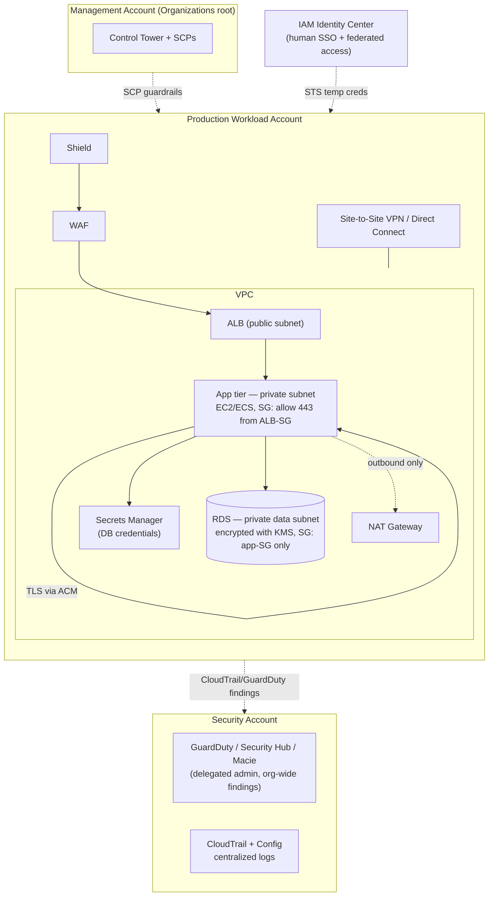

# Domain 1: Design Secure Architectures (30%)

This is the single biggest domain on SAA-C03, and its concepts (IAM, VPC security, encryption)
are assumed knowledge for every other domain — study this one first and most thoroughly.

In plain terms: this domain asks "who can do what, where can traffic go, and is data protected
both sitting still and moving around." Everything below maps those plain questions to specific
AWS services.

## Task 1.1 — Design secure access to AWS resources

> IAM, IAM Identity Center/SSO, federated access, multi-account strategy, least privilege, MFA,
> STS/role switching, SCPs, Control Tower

| Concept | Doc |
|---|---|
| IAM users, groups, roles, policies, least privilege, MFA | [`services/security-identity-compliance/iam.md`](../../../services/security-identity-compliance/iam.md) |
| IAM Identity Center (SSO) & federated human access | [`services/security-identity-compliance/iam-identity-center-sso.md`](../../../services/security-identity-compliance/iam-identity-center-sso.md) |
| STS, AssumeRole, cross-account role switching | [`services/security-identity-compliance/sts-and-role-switching.md`](../../../services/security-identity-compliance/sts-and-role-switching.md) |
| Service Control Policies (SCPs), AWS Organizations | [`services/security-identity-compliance/organizations-and-scps.md`](../../../services/security-identity-compliance/organizations-and-scps.md) |
| Multi-account strategy & Control Tower landing zone *(new — decision-level topic, no single-service home)* | [`multi-account-security-strategy.md`](multi-account-security-strategy.md) |

## Task 1.2 — Design secure workloads and applications

> VPC security — security groups, NACLs, route tables, NAT gateways, public/private subnet
> segmentation, Shield, WAF, Secrets Manager, Cognito, GuardDuty, Macie, VPN, Direct Connect

| Concept | Doc |
|---|---|
| VPC fundamentals | [`services/networking-content-delivery/vpc.md`](../../../services/networking-content-delivery/vpc.md) |
| Security groups vs. NACLs | [`services/networking-content-delivery/security-groups-vs-nacls.md`](../../../services/networking-content-delivery/security-groups-vs-nacls.md) |
| Subnets, route tables, Internet Gateway, NAT Gateway | [`services/networking-content-delivery/subnets-route-tables-igw-natgw.md`](../../../services/networking-content-delivery/subnets-route-tables-igw-natgw.md) |
| VPC security architecture patterns — how it all lays out together *(new — decision-level topic)* | [`vpc-security-architecture-patterns.md`](vpc-security-architecture-patterns.md) |
| AWS Shield (DDoS protection) | [`services/security-identity-compliance/shield.md`](../../../services/security-identity-compliance/shield.md) |
| AWS WAF (web application firewall) | [`services/security-identity-compliance/waf.md`](../../../services/security-identity-compliance/waf.md) |
| Secrets Manager vs. Parameter Store | [`services/security-identity-compliance/secrets-manager-vs-parameter-store.md`](../../../services/security-identity-compliance/secrets-manager-vs-parameter-store.md) |
| Cognito (app user authentication) | [`services/security-identity-compliance/cognito.md`](../../../services/security-identity-compliance/cognito.md) |
| GuardDuty (threat detection) | [`services/security-identity-compliance/guardduty.md`](../../../services/security-identity-compliance/guardduty.md) |
| Macie (sensitive data discovery) | [`services/security-identity-compliance/macie.md`](../../../services/security-identity-compliance/macie.md) |
| Security Hub & Inspector | [`services/security-identity-compliance/security-hub-and-inspector.md`](../../../services/security-identity-compliance/security-hub-and-inspector.md) |
| VPN (Site-to-Site / Client VPN) | [`services/networking-content-delivery/vpn.md`](../../../services/networking-content-delivery/vpn.md) |
| Direct Connect | [`services/networking-content-delivery/direct-connect.md`](../../../services/networking-content-delivery/direct-connect.md) |

## Task 1.3 — Determine appropriate data security controls

> KMS encryption at rest, ACM/TLS encryption in transit, key rotation, certificate renewal,
> backup/replication, data lifecycle policies

| Concept | Doc |
|---|---|
| KMS, encryption at rest, key rotation | [`services/security-identity-compliance/kms.md`](../../../services/security-identity-compliance/kms.md) |
| ACM, Private CA, TLS certificates, auto-renewal | [`services/security-identity-compliance/acm-and-private-ca.md`](../../../services/security-identity-compliance/acm-and-private-ca.md) |
| AWS Backup (centralized backup/replication policy) | [`services/storage/aws-backup.md`](../../../services/storage/aws-backup.md) |
| S3 storage classes & lifecycle policies | [`services/storage/s3-storage-classes.md`](../../../services/storage/s3-storage-classes.md) |
| S3 fundamentals (versioning, replication) | [`services/storage/s3.md`](../../../services/storage/s3.md) |

## Architecture: A Secure Multi-Account VPC

How these pieces compose into one real design — a company running a public web app with a
database tier, governed across multiple AWS accounts.

Step by step: **Control Tower**, run from the management account, applies SCP guardrails to every
workload account (e.g., "never disable CloudTrail," "stay in approved Regions"). Humans never get
IAM users inside the production account — they authenticate once through **IAM Identity Center**
and receive temporary STS credentials scoped to a specific role. Inside the production account,
internet traffic hits **Shield** (DDoS absorption) then **WAF** (request filtering) before
reaching the **ALB**, which lives in a public subnet. The ALB forwards only to the **app tier**,
which lives in a private subnet and holds a security group that accepts traffic from the ALB's
security group alone. The app tier pulls database credentials from **Secrets Manager** at runtime
(nothing hardcoded) and talks to **RDS**, which is encrypted at rest with **KMS** and sits in its
own private data subnet with a security group that only trusts the app tier. The app tier reaches
the internet outbound (patches, third-party APIs) only through a **NAT Gateway** — it is never
reachable from the internet directly. A **VPN or Direct Connect** link lets on-prem systems reach
into the VPC without traversing the public internet. Everywhere in the account, **CloudTrail**
and **Config** events and **GuardDuty/Macie** findings stream out to the centralized **Security
account**, so even a fully compromised production account can't erase evidence of the breach.

## Common exam scenarios

- *"A company wants developers to access multiple AWS accounts without creating IAM users in
  each one."* → IAM Identity Center (SSO) with permission sets, backed by STS temporary
  credentials — not per-account IAM users.
- *"No account, including administrators, should ever be able to disable CloudTrail."* → Service
  Control Policy (SCP) attached at the Organization root or relevant OU — IAM alone can't enforce
  a ceiling that even admins can't override.
- *"A security group references an entire VPC CIDR block for database access."* → Tighten it to
  reference the application tier's security group specifically — least-privilege network access.
- *"Static website assets need to be served securely with protection against DDoS and SQL
  injection attempts."* → CloudFront + Shield (DDoS) + WAF (request-level filtering) in front of
  the origin.
- *"Application code currently has a database password hardcoded and needs automatic rotation."*
  → Secrets Manager (not Parameter Store — Secrets Manager is the one with native automatic
  rotation).
- *"A mobile app needs to let users sign up/sign in without managing a user directory
  yourself."* → Amazon Cognito user pools, not IAM users.
- *"Sensitive PII in an S3 bucket needs to be discovered and classified automatically."* →
  Macie.
- *"A workload needs TLS certificates that renew automatically with no manual process."* → ACM
  (AWS Certificate Manager) integrated with ALB/CloudFront.

## Hands-on Labs

See [`labs.md`](labs.md) for runnable Floci exercises covering this domain.
