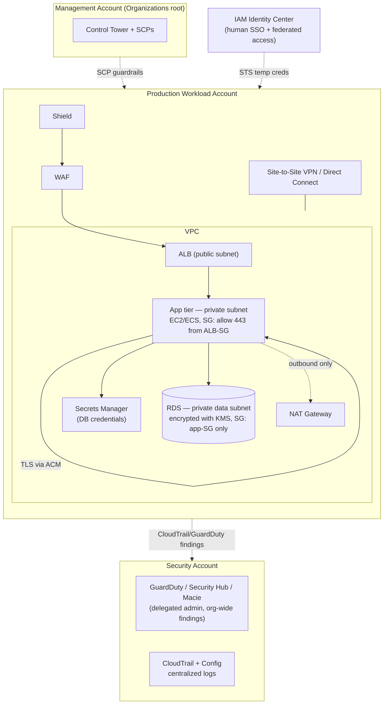
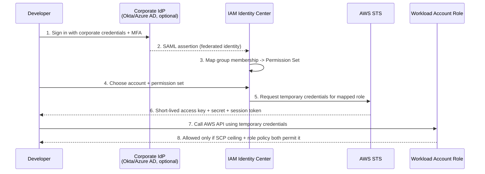
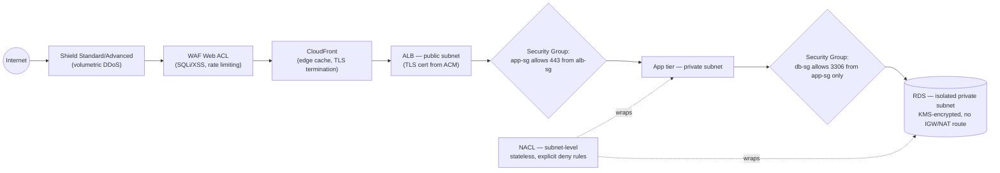
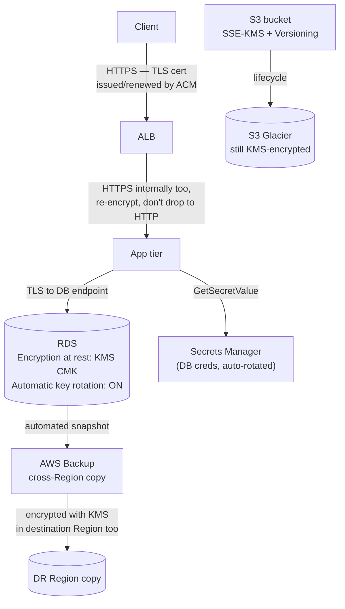

# Domain 1: Design Secure Architectures (30%)

This is the single biggest domain on SAA-C03, and its concepts (IAM, VPC security, encryption)
are assumed knowledge for every other domain — study this one first and most thoroughly.

In plain terms: this domain asks "who can do what, where can traffic go, and is data protected
both sitting still and moving around." Everything below maps those plain questions to specific
AWS services. Domain 1 alone is worth nearly a third of your score, and its three task
statements (1.1 access, 1.2 workloads, 1.3 data) recur as *sub-questions* inside Domain 2, 3, and
4 scenarios — a resilience question about a multi-Region failover will still expect you to know
that the standby database is encrypted with KMS, and a cost question about Spot Instances will
still expect the fleet to sit in a private subnet. Security is not a domain you finish and move
past; it is the lens every other domain is viewed through.

*Source: [AWS WAF Developer Guide — Shared Responsibility Model](https://docs.aws.amazon.com/waf/latest/developerguide/)*

## Why this domain is shaped the way it is

Every SAA-C03 security question is secretly a Shared Responsibility Model question. AWS secures
the physical data centers, the hypervisor, and the managed-service internals ("security **of**
the cloud"); you secure your account configuration, your data, your IAM policies, your network
topology, and your encryption choices ("security **in** the cloud"). The exam never asks you to
reason about AWS's side of that line — it only tests whether you know which lever on *your* side
fixes a given problem. Task 1.1 is the identity lever, Task 1.2 is the network/workload lever,
and Task 1.3 is the data lever. Nearly every wrong answer choice on a Domain 1 question either
(a) reaches for a heavier tool than the scenario needs (a brand-new AWS account when a tighter
IAM policy would do), (b) reaches for a lighter tool than the scenario needs (an IAM policy when
the scenario explicitly asks for something even admins can't override, which means SCP), or
(c) solves the right problem with the wrong service (WAF instead of Shield, Secrets Manager
instead of Parameter Store). Train yourself to ask "is this an identity problem, a network
problem, or a data problem?" before looking at the answer choices.

## Task 1.1 — Design secure access to AWS resources

> IAM, IAM Identity Center/SSO, federated access, multi-account strategy, least privilege, MFA,
> STS/role switching, SCPs, Control Tower

| Concept | Doc |
|---|---|
| IAM users, groups, roles, policies, least privilege, MFA | [`services/security-identity-compliance/iam.md`](../../../services/security-identity-compliance/iam.md) |
| IAM Identity Center (SSO) & federated human access | [`services/security-identity-compliance/iam-identity-center-sso.md`](../../../services/security-identity-compliance/iam-identity-center-sso.md) |
| STS, AssumeRole, cross-account role switching | [`services/security-identity-compliance/sts-and-role-switching.md`](../../../services/security-identity-compliance/sts-and-role-switching.md) |
| Service Control Policies (SCPs), AWS Organizations | [`services/security-identity-compliance/organizations-and-scps.md`](../../../services/security-identity-compliance/organizations-and-scps.md) |
| Multi-account strategy & Control Tower landing zone *(new — decision-level topic, no single-service home)* | [`multi-account-security-strategy.md`](multi-account-security-strategy.md) |
| Control Tower (full service deep-dive) & AWS Service Catalog (self-service account/resource provisioning) | [`services/management-governance/additional-governance-services.md`](../../../services/management-governance/additional-governance-services.md) |

Task 1.1 is really one idea repeated at three scales: **a human (or workload) should hold the
minimum permission needed, for the minimum time needed, and prove who they are before they get
it.** At the smallest scale that's an IAM policy scoped to one bucket. At human scale it's IAM
Identity Center handing out temporary STS credentials instead of long-lived IAM users. At
organizational scale it's a landing zone of separate AWS accounts, each with an SCP ceiling that
not even the account's own administrators can lift. Memorize that progression, not just the
individual service names — the exam's scenario wording ("a developer needs occasional access to
three accounts," "no user, including admins, should ever disable logging," "an application needs
to read from an S3 bucket in a different account") is choosing *which scale* the question is
testing, and the right-sized answer lives at that scale. At the organizational scale, a Control
Tower landing zone is frequently paired with **Service Catalog**, which lets a platform team
publish pre-approved, governance-compliant account and resource templates ("golden paths") that
other teams self-provision from — the same least-privilege philosophy applied to *infrastructure
choice* itself, not just permissions.

## Task 1.2 — Design secure workloads and applications

> VPC security — security groups, NACLs, route tables, NAT gateways, public/private subnet
> segmentation, Shield, WAF, Secrets Manager, Cognito, GuardDuty, Macie, VPN, Direct Connect

| Concept | Doc |
|---|---|
| VPC fundamentals | [`services/networking-content-delivery/vpc.md`](../../../services/networking-content-delivery/vpc.md) |
| Security groups vs. NACLs | [`services/networking-content-delivery/security-groups-vs-nacls.md`](../../../services/networking-content-delivery/security-groups-vs-nacls.md) |
| Subnets, route tables, Internet Gateway, NAT Gateway | [`services/networking-content-delivery/subnets-route-tables-igw-natgw.md`](../../../services/networking-content-delivery/subnets-route-tables-igw-natgw.md) |
| VPC security architecture patterns — how it all lays out together *(new — decision-level topic)* | [`vpc-security-architecture-patterns.md`](vpc-security-architecture-patterns.md) |
| AWS Shield (DDoS protection) | [`services/security-identity-compliance/shield.md`](../../../services/security-identity-compliance/shield.md) |
| AWS WAF (web application firewall) | [`services/security-identity-compliance/waf.md`](../../../services/security-identity-compliance/waf.md) |
| Secrets Manager vs. Parameter Store | [`services/security-identity-compliance/secrets-manager-vs-parameter-store.md`](../../../services/security-identity-compliance/secrets-manager-vs-parameter-store.md) |
| Cognito (app user authentication) | [`services/security-identity-compliance/cognito.md`](../../../services/security-identity-compliance/cognito.md) |
| GuardDuty (threat detection) | [`services/security-identity-compliance/guardduty.md`](../../../services/security-identity-compliance/guardduty.md) |
| Macie (sensitive data discovery) | [`services/security-identity-compliance/macie.md`](../../../services/security-identity-compliance/macie.md) |
| Security Hub & Inspector | [`services/security-identity-compliance/security-hub-and-inspector.md`](../../../services/security-identity-compliance/security-hub-and-inspector.md) |
| CloudHSM, Detective, Directory Service, Firewall Manager, Network Firewall, RAM, Artifact, Audit Manager (consolidated niche security services) | [`services/security-identity-compliance/additional-security-services.md`](../../../services/security-identity-compliance/additional-security-services.md) |
| VPN (Site-to-Site / Client VPN) | [`services/networking-content-delivery/vpn.md`](../../../services/networking-content-delivery/vpn.md) |
| Direct Connect | [`services/networking-content-delivery/direct-connect.md`](../../../services/networking-content-delivery/direct-connect.md) |

Task 1.2 splits cleanly into three sub-skills the exam tests independently: **network topology**
(where things sit — public subnet vs. private subnet, which security group references which),
**edge protection** (Shield for volumetric DDoS, WAF for request-level filtering — two different
layers for two different attack shapes), and **detection/response** (GuardDuty watching for
anomalous account/network behavior, Macie watching specifically for sensitive data exposure,
Security Hub/Inspector aggregating and scanning). A useful habit: whenever a scenario names an
attack or a leak, ask "is this something a *firewall* should have stopped, or something a
*detector* should flag after the fact?" — Shield/WAF/security groups are preventive, GuardDuty/
Macie/Security Hub are detective, and the exam expects you to reach for the right category. A
second tier of lower-frequency Task 1.2 services rounds out this picture: **CloudHSM** for
workloads needing dedicated, single-tenant hardware key custody beyond what KMS's multi-tenant
model offers, **Detective** for drilling into root cause *after* GuardDuty or Security Hub raises
a finding, **Network Firewall** and **Firewall Manager** for centralized, org-wide traffic
filtering and security-group hygiene, and **Directory Service** for workloads needing an actual
Active Directory rather than IAM federation — see
[`services/security-identity-compliance/additional-security-services.md`](../../../services/security-identity-compliance/additional-security-services.md)
for these plus **RAM**, **Artifact**, and **Audit Manager** on the compliance side.

## Task 1.3 — Determine appropriate data security controls

> KMS encryption at rest, ACM/TLS encryption in transit, key rotation, certificate renewal,
> backup/replication, data lifecycle policies

| Concept | Doc |
|---|---|
| KMS, encryption at rest, key rotation | [`services/security-identity-compliance/kms.md`](../../../services/security-identity-compliance/kms.md) |
| ACM, Private CA, TLS certificates, auto-renewal | [`services/security-identity-compliance/acm-and-private-ca.md`](../../../services/security-identity-compliance/acm-and-private-ca.md) |
| AWS Backup (centralized backup/replication policy) | [`services/storage/aws-backup.md`](../../../services/storage/aws-backup.md) |
| S3 storage classes & lifecycle policies | [`services/storage/s3-storage-classes.md`](../../../services/storage/s3-storage-classes.md) |
| S3 fundamentals (versioning, replication) | [`services/storage/s3.md`](../../../services/storage/s3.md) |
| Lake Formation (row/column/tag-based access control over a data lake, on top of the Glue Data Catalog) | [`services/analytics/lake-formation.md`](../../../services/analytics/lake-formation.md) |

Task 1.3 is the "data at rest vs. data in transit" split, plus the operational half of each:
**KMS** handles at-rest encryption and (critically for the exam) *automatic annual key rotation*
for AWS-managed and customer-managed keys that opt in; **ACM** handles in-transit TLS and —
equally exam-tested — *automatic certificate renewal*, removing the single most common real-world
outage cause (an expired cert nobody rotated manually). The second half of this task, backup and
lifecycle, is really a Domain 2/4 topic wearing a Domain 1 hat: a backup is a data-protection
control (Task 1.3) and a disaster-recovery mechanism (Domain 2) and a cost lever (Domain 4) all
at once — expect the exam to test the same AWS Backup fact from three different angles across
the paper.

## How This Domain's Services Work Together (End-to-End Walkthrough)

Before the individual diagrams below, here is the single continuous story they're each a zoomed-in
view of — trace one real request from a mobile banking app through every Domain 1 service in
order, the way a scenario question expects you to reconstruct it mentally. A customer opens the
app and taps "transfer funds." (1) Their device already holds a session issued earlier when they
logged in through **Cognito**, which authenticated them without the company ever managing a
password database itself. (2) The request leaves their phone over TLS and hits **Shield**, which
silently absorbs the background noise of constant internet-wide scanning and any attempted
volumetric flood — the request in question is legitimate and passes through untouched. (3) It
next hits **WAF**, attached to the **ALB**, which checks the request against managed rule groups
for SQL injection and known bad signatures — again, a legitimate request, so it's forwarded. (4)
The **ALB**, sitting in a public subnet, is the only thing in this entire path with a public IP;
it terminates TLS using a certificate **ACM** issued and silently auto-renews, and forwards the
request over re-encrypted HTTPS to the app tier. (5) The app tier lives in a **private subnet**,
reachable only because its security group explicitly trusts the ALB's security group — not the
whole VPC CIDR, not the internet. (6) To process the transfer, the app needs the database
password; it calls **Secrets Manager**, which hands back the current credential (silently rotated
on its own schedule, never hardcoded in the app's code). (7) The app writes the transfer to
**RDS**, sitting in an even more isolated private data subnet with no route to any Internet
Gateway at all, and the write lands on encrypted-at-rest storage because the instance's **KMS**
customer-managed key was enabled when the database was created — the same key that also protects
the Multi-AZ standby and every automated snapshot. (8) Every one of these steps — the Cognito
authentication, the ALB request, the RDS write, the Secrets Manager call — emits an event into
**CloudTrail**, which streams in real time into the centralized Security account from
`multi-account-security-strategy.md`, where **GuardDuty** continuously evaluates it against known
attack patterns and **Security Hub** aggregates the finding alongside every other account's
signal. (9) Separately, the engineer who built this app tier never had a standing IAM user in this
production account at all — they reached it once, during deployment, via **IAM Identity Center**
handing them a short-lived **STS** credential into a role whose permissions are capped not only by
that role's own policy but by an **SCP** attached at the Organizational Unit level that no
administrator in this account, however senior, can override. That is the complete Domain 1 request
lifecycle: identity (Cognito for the customer, Identity Center/STS/SCPs for the engineer), edge
defense (Shield, WAF), network isolation (public/private subnet tiers, security groups), data
protection (Secrets Manager, KMS), and detection (CloudTrail, GuardDuty, Security Hub) — all
operating on the same single request, simultaneously, not as separate unrelated features.

## Architecture: A Secure Multi-Account VPC

How these pieces compose into one real design — a company running a public web app with a
database tier, governed across multiple AWS accounts.

Step by step: **Control Tower**, run from the management account, applies SCP guardrails to every
workload account (e.g., "never disable CloudTrail," "stay in approved Regions"). Humans never get
IAM users inside the production account — they authenticate once through **IAM Identity Center**
and receive temporary STS credentials scoped to a specific role. Inside the production account,
internet traffic hits **Shield** (DDoS absorption) then **WAF** (request filtering) before
reaching the **ALB**, which lives in a public subnet. The ALB forwards only to the **app tier**,
which lives in a private subnet and holds a security group that accepts traffic from the ALB's
security group alone. The app tier pulls database credentials from **Secrets Manager** at runtime
(nothing hardcoded) and talks to **RDS**, which is encrypted at rest with **KMS** and sits in its
own private data subnet with a security group that only trusts the app tier. The app tier reaches
the internet outbound (patches, third-party APIs) only through a **NAT Gateway** — it is never
reachable from the internet directly. A **VPN or Direct Connect** link lets on-prem systems reach
into the VPC without traversing the public internet. Everywhere in the account, **CloudTrail**
and **Config** events and **GuardDuty/Macie** findings stream out to the centralized **Security
account**, so even a fully compromised production account can't erase evidence of the breach.

## Architecture: Identity Flow — from Human to Temporary Credential

A second diagram, zoomed into exactly what happens the instant a developer types their password —
this is the mechanism the previous diagram's "IAM Identity Center" box glosses over, and the exam
tests it at this level of detail.

The two checks in step 8 are the part candidates most often get wrong: a permission set can grant
`s3:*`, but if the account's SCP denies `s3:DeleteBucket` at the Organizational Unit level, the
developer **cannot** delete a bucket — full stop, no exception, not even for an account
administrator. SCPs are a *ceiling*, IAM/permission-set policies are the *grant* underneath that
ceiling, and the effective permission is always the intersection of the two, never the IAM side
alone.

## Architecture: Layered Network Defense (Edge to Database)

Every arrow in this diagram is a different, *independently sufficient* control — a mistake in
any one layer (an overly broad security group, a missing WAF rule) does not expose the database,
because the next layer still enforces its own narrower rule. This "defense in depth" framing is
exactly what Task 1.2 scenario questions are built to test: they describe a single misconfigured
layer and ask what *still* protects the resource, or they ask which layer to fix.

## Architecture: Data Protection — At Rest and In Transit Together

The point this diagram drives home: encryption is not a single checkbox, it's a *property that
must survive every hop and every copy* — the TLS certificate protects the wire, the KMS key
protects the disk, and both the cross-Region backup copy and the lifecycle-tiered Glacier copy
must remain encrypted too, or the weakest copy becomes the actual exposure.

## Full Worked Case Study: SecureBooks Financial — Multi-Account, Regulated Workload

**Company requirements.** SecureBooks is a fintech processing customer bank-account data. Their
compliance team hands the architecture team a list: (1) cardholder/bank data must never be
accessible from the public internet, in any form, at any point; (2) every credential used to
reach AWS must be short-lived — no standing IAM user access keys anywhere in the company; (3) the
security team must be able to prove, to an external auditor, that logs cannot be altered or
deleted by anyone inside a compromised workload account; (4) 40 engineers across three teams
(payments, risk, platform) need different levels of access, and no engineer should be able to
touch another team's production resources; (5) all data must be encrypted at rest and in transit,
with key rotation happening automatically, not as a manual quarterly task; (6) TLS certificates
must never be allowed to expire silently.

**Solution design.**

1. **Account structure (Task 1.1).** A Control Tower landing zone with a Management account (no
   workloads, billing + Organizations only), a Log Archive account, a Security Tooling account,
   and one production account *per team* (payments-prod, risk-prod, platform-prod), each paired
   with its own dev/staging account. This directly answers requirement 4 — a payments engineer's
   IAM Identity Center permission set simply has no mapping into risk-prod, so there is no IAM
   policy to misconfigure in the first place; the isolation is structural.
2. **Human access (Task 1.1).** IAM Identity Center is the only way any engineer reaches any
   account. No IAM users exist in any workload account. Permission sets are scoped per team per
   environment (e.g., `PaymentsProdReadOnly` for incident responders, `PaymentsProdDeveloper` for
   the on-call payments engineer), and every session hands out STS temporary credentials capped
   at one hour. This satisfies requirement 2 directly.
3. **SCP guardrails (Task 1.1).** An Organization-root SCP denies `cloudtrail:StopLogging`,
   `cloudtrail:DeleteTrail`, and `config:DeleteConfigurationRecorder` in every account, including
   for that account's own administrators — satisfying requirement 3's "even admins can't do this"
   bar, which plain IAM policies structurally cannot meet (an account admin can always edit or
   delete an IAM policy; they cannot touch an SCP that lives above their account).
4. **Centralized, tamper-resistant logging (Task 1.1 + 1.3).** Every account's CloudTrail and
   Config streams write-only into the Log Archive account; workload accounts get no delete
   permission on that destination bucket, which is also versioned and MFA-delete-protected. A
   compromised payments-prod account cannot erase its own breach evidence, because the evidence
   never lived there.
5. **Network isolation for sensitive data (Task 1.2).** Each production VPC uses the three-tier
   pattern: public subnets hold only the ALB (behind Shield Advanced + WAF with AWS Managed Rules
   for SQL injection/known bad actors); private app subnets hold ECS tasks; a third, fully
   isolated private data subnet (no route to any Internet Gateway, no NAT route either) holds
   RDS. This satisfies requirement 1 — there is no network path from the public internet to the
   database subnet, not "a security group that currently blocks it," an actual absence of route.
6. **Secrets (Task 1.2).** Database credentials and third-party API keys live in Secrets Manager
   with automatic 30-day rotation Lambda functions; nothing is hardcoded or stored in Parameter
   Store (which lacks native rotation).
7. **Encryption everywhere (Task 1.3).** RDS, EBS, and S3 all use customer-managed KMS keys with
   annual automatic rotation enabled. ALB-terminated and re-encrypted internal traffic both use
   ACM-issued certificates with auto-renewal, satisfying requirement 6 (no expiry risk) and the
   encryption-in-transit half of requirement 5.
8. **Backup and immutability (Task 1.3).** AWS Backup applies one org-wide backup plan across RDS,
   EBS, and DynamoDB, replicating backups cross-Region into a dedicated backup account with Vault
   Lock applied (WORM — compliance-mode, cannot be deleted even by the account root user before
   the retention period expires).

**Why this design, not a simpler one.** A single-account design with tight IAM policies alone
would fail requirement 3 outright — any IAM policy, including a deny, can be edited by an account
administrator, so "cannot be altered by anyone inside the account" is only achievable by moving
the enforcement *above* the account (an SCP) and the evidence *out of* the account (centralized
logging). A design using IAM users with rotated access keys would fail requirement 2's "short-
lived only" bar, because even a 90-day rotated access key is a standing credential for up to 90
days; only STS-issued, Identity-Center-brokered sessions satisfy "short-lived" in the strict sense
the exam (and real compliance frameworks) mean.

## Use Cases — Real Scenarios

- **Regional bank's core banking modernization.** Moving from a mainframe to AWS, the bank puts
  each business line (retail banking, credit cards, wealth management) in its own account under
  Control Tower, with an org-wide SCP blocking any Region outside the two they're licensed to
  operate in — satisfying a regulator's data-residency requirement structurally, not procedurally.
- **Telehealth startup handling PHI under HIPAA.** Patient video sessions and chart data sit in a
  dedicated account with its own KMS keys, Secrets Manager for provider-system API credentials,
  and Macie continuously scanning the S3 bucket where uploaded lab results land, flagging any
  accidental PII exposure in object metadata before an auditor ever would.
- **Online education platform protecting a graded-exam API from scraping/DDoS.** Shield Standard
  (free, always-on) handles routine volumetric noise; WAF rate-based rules specifically throttle
  any single IP hammering the exam-submission endpoint, distinguishing a real DDoS attempt (Shield's
  job) from a bot trying to brute-force exam answers (WAF's job).
- **Enterprise SaaS vendor onboarding a new enterprise customer that demands SSO.** Rather than
  building custom SAML handling per customer, the vendor's own IAM Identity Center federates with
  each customer's corporate IdP, and the customer's end users authenticate through Cognito-backed
  flows into the product itself — two different federation layers solving two different problems
  (workforce access vs. end-customer app login).
- **Government contractor achieving FedRAMP Moderate.** Every workload account enforces SCPs
  blocking public S3 buckets and unencrypted EBS volumes org-wide; GuardDuty and Security Hub run
  as delegated administrator from a dedicated Security account so the compliance team gets a single
  pane of glass without being granted admin rights into each program's isolated workload account.
- **Ad-tech company storing bidding logs with PII exposure risk.** Macie runs nightly across the
  raw bid-log S3 bucket, automatically flagging any log line that accidentally captured a user's
  email or phone number from an upstream integration bug — caught and remediated before it became
  a compliance incident, not after a customer complaint.
- **Manufacturing company separating OT (operational technology) from IT.** Factory-floor sensor
  data and corporate IT systems get entirely separate AWS accounts, connected only through a single,
  tightly-scoped cross-account IAM role an analytics Lambda assumes to read aggregated (never raw)
  sensor data — a factory-floor compromise can't reach corporate systems, and vice versa.
- **Nonprofit running a donor-payment page with a hardcoded Stripe key in legacy code.** An
  incident response review flags the hardcoded secret; the fix moves it into Secrets Manager with
  30-day automatic rotation, and a GitHub pre-commit hook is added to catch any future hardcoded
  credential before it's ever pushed, closing the same class of mistake structurally.
- **Multinational retailer standardizing TLS across 40 regional storefronts.** Rather than each
  region's team manually tracking certificate expiry (and occasionally missing one, causing an
  outage), ACM is adopted org-wide with auto-renewal, and a Config rule flags any ALB/CloudFront
  distribution found using a manually-uploaded (non-ACM, non-auto-renewing) certificate instead.
- **Energy utility isolating its SCADA monitoring dashboard.** The dashboard's VPC has no Internet
  Gateway route at all — operators reach it exclusively via Site-to-Site VPN from the utility's own
  network, and the underlying data pipeline reads from the OT network through a single, narrowly-
  scoped interface rather than a broad network peering, satisfying a critical-infrastructure
  security mandate that treats "no internet exposure, period" as non-negotiable.

## Common exam scenarios

- *"A company wants developers to access multiple AWS accounts without creating IAM users in
  each one."* → IAM Identity Center (SSO) with permission sets, backed by STS temporary
  credentials — not per-account IAM users.
- *"No account, including administrators, should ever be able to disable CloudTrail."* → Service
  Control Policy (SCP) attached at the Organization root or relevant OU — IAM alone can't enforce
  a ceiling that even admins can't override.
- *"A security group references an entire VPC CIDR block for database access."* → Tighten it to
  reference the application tier's security group specifically — least-privilege network access.
- *"Static website assets need to be served securely with protection against DDoS and SQL
  injection attempts."* → CloudFront + Shield (DDoS) + WAF (request-level filtering) in front of
  the origin.
- *"Application code currently has a database password hardcoded and needs automatic rotation."*
  → Secrets Manager (not Parameter Store — Secrets Manager is the one with native automatic
  rotation).
- *"A mobile app needs to let users sign up/sign in without managing a user directory
  yourself."* → Amazon Cognito user pools, not IAM users.
- *"Sensitive PII in an S3 bucket needs to be discovered and classified automatically."* →
  Macie.
- *"A workload needs TLS certificates that renew automatically with no manual process."* → ACM
  (AWS Certificate Manager) integrated with ALB/CloudFront.
- *"A company merges with another and needs each business unit billed and isolated separately
  but still visible under one consolidated invoice."* → AWS Organizations with a dedicated member
  account per business unit, consolidated billing enabled.
- *"An engineer accidentally has standing production access to a system they no longer work on,
  discovered months later during an audit."* → This is an access-review failure the exam frames
  as solved by IAM Identity Center permission sets tied to group membership (removing someone
  from the group revokes access everywhere at once) rather than per-account manual IAM cleanup.
- *"A workload in Account A needs to read objects from a bucket in Account B, and both accounts
  are in the same Organization."* → A cross-account IAM role in Account B that Account A assumes
  via STS, not a public bucket policy and not copying credentials between accounts.
- *"The security team needs a single dashboard showing GuardDuty, Security Hub, and Inspector
  findings across every account in the Organization, without being granted admin rights in each
  one."* → Delegated administrator for the relevant service, configured from a dedicated Security
  Tooling account.
- *"A compliance requirement states backups must be immutable and impossible to delete early,
  even by a compromised root user."* → AWS Backup Vault Lock in compliance mode.
- *"An application load balancer currently terminates TLS and forwards plaintext HTTP to the app
  tier inside the VPC."* → Re-encrypt from the ALB to the target using HTTPS, not plaintext HTTP,
  even though the traffic never leaves the VPC — "in transit" means any network hop, not just the
  public internet.
- *"A new AWS account must be provisioned for a new team, pre-configured with baseline logging,
  guardrails, and OU placement, without a manual multi-step setup each time."* → Control Tower
  Account Factory.

## Hands-on Labs

See [`labs.md`](labs.md) for runnable Floci exercises covering this domain — expanded to 5 labs
covering IAM/STS, KMS encryption, Cognito, a layered VPC security-group lab, and a capstone that
chains least privilege, encryption, and network isolation into one scenario.

## Where This Domain Connects

- Domain 2 (`../domain-2-resilient-architectures/`) reuses this domain's VPC subnet layout for
  Multi-AZ design, and its Secrets Manager/KMS controls for DR copies.
- Domain 3 (`../domain-3-high-performing-architectures/`) reuses this domain's network tiering
  when it asks about placement groups and VPC endpoints for performance.
- Domain 4 (`../domain-4-cost-optimized-architectures/`) revisits the same VPC endpoint and backup
  mechanisms from a cost angle — the *same* AWS Backup plan from this case study's requirement 8
  is also a cost-optimization lever once lifecycle tiering is added.
