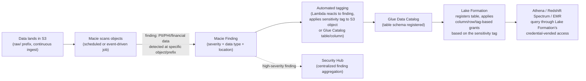

# Data Classification & Governance Strategy

> **Appears in:** [SAA-C03](../../../certifications/saa-c03/README.md) — Domain 1, Task 1.3


*Decision-level topic · sits on top of [`services/security-identity-compliance/macie.md`](../../../services/security-identity-compliance/macie.md), [`services/analytics/lake-formation.md`](../../../services/analytics/lake-formation.md), and [`services/storage/s3.md`](../../../services/storage/s3.md)*

## Definition

This doc answers a question the individual service docs each only partially cover: **given a
growing pile of data landing in S3 every day, how does an organization actually know what's
sensitive, stop the wrong people from seeing it, and prove both of those things to an auditor?**
It traces the full pipeline from "a file lands in a bucket" to "an analyst with the right role sees
only the columns they're allowed to see" — tying together **Macie** (discovery — *what* is
sensitive), **Lake Formation** (governance — *who* can see it), and **S3** (the storage substrate
both operate on) as three stages of one continuous workflow, not three unrelated services that
happen to touch the same bucket.

## Purpose

A data lake that grows without a classification and governance strategy becomes what practitioners
call a **"data swamp"** — a pile of files nobody can confidently say is safe to share, query, or
even legally retain. The failure isn't usually a missing encryption setting; it's that nobody
*knows what's in there* (the discovery gap Macie closes) or *who's actually allowed to see what*
(the governance gap Lake Formation closes) at the speed data actually arrives. This doc exists
because the exam increasingly tests this synthesis directly — a Domain 1 Task 1.3 question about
"sensitive data discovery and access governance" is really asking whether you can assemble Macie
and Lake Formation into one coherent pipeline, not recite either service's feature list in
isolation.

## How It Works — The Full Discovery-to-Governance Pipeline



**Step by step:** (1) raw data lands in S3 continuously, from upstream systems, application logs,
or batch exports. (2) **Macie** runs scheduled (or event-driven, via EventBridge on new-object
events) classification jobs using machine learning plus pattern matching to detect PII, PHI,
financial data (credit card numbers, SSNs) at the object level — crucially, **content-based**
detection, not just filename or prefix-based assumption. (3) A Macie finding identifies exactly
*which* object(s) and *what kind* of sensitive data was found, with a severity score. (4) This
finding can trigger an **automated remediation/tagging Lambda** — the most mature pattern applies a
sensitivity tag (e.g., `sensitivity=pii`) either directly to the S3 object or to the corresponding
Glue Data Catalog table/column once it's cataloged. (5) **Lake Formation**, using LF-TBAC
(tag-based access control), automatically applies the correct grant based on that tag — a table or
column tagged `sensitivity=pii` is only visible to principals whose own tag matches — **with no
per-table manual grant needed**, because the tagging from step 4 does that work automatically going
forward as new data lands. (6) Query engines (Athena, Redshift Spectrum, EMR) enforce this grant
identically via Lake Formation's credential-vending mechanism, regardless of which engine a given
analyst happens to use. (7) High-severity Macie findings separately stream into **Security Hub**
for centralized visibility alongside every other security signal in the organization.

### Official AWS diagram: Macie continuously scanning a data lake bucket


*Source: [AWS documentation — Macie sensitive data discovery](https://docs.aws.amazon.com/sap/latest/general/), © Amazon Web Services.*

**Discussion.** The detail worth internalizing from this diagram: Macie's scanning is continuous
and **independent of whether anyone asked it to look** — it doesn't wait for a human to suspect a
problem, it runs scheduled jobs that would catch, for example, an upstream integration bug that
accidentally logs a customer's email address into a bucket nobody expected to contain PII at all.
This is the exact "ad-tech company storing bidding logs" scenario from the domain README — the
failure mode Macie exists to catch is specifically the *accidental*, unplanned appearance of
sensitive data, not just auditing data you already knew was sensitive.

### Official AWS diagram: the Lake Formation permissions workflow this pipeline feeds into


*Source: [AWS Lake Formation Developer Guide — How it works](https://docs.aws.amazon.com/lake-formation/latest/dg/how-it-works.html), © Amazon Web Services.*

**Discussion.** This is the back half of the pipeline above, in more mechanical detail: once a
table/column is tagged (from Macie's finding, in this doc's pattern), every query against it funnels
through this exact check-permissions-then-vend-credentials flow, regardless of engine. The
connective insight this doc adds beyond either individual service doc: **the tag that drives this
diagram's permission check didn't have to be applied by a human reading every table manually** — it
can originate automatically from a Macie finding, closing the loop between "we discovered this is
sensitive" and "the system now enforces that sensitivity" with no manual hand-off step in between.

## Classification Taxonomy — A Working Model

| Sensitivity tier | Example data | Typical Macie finding type | Typical Lake Formation grant |
|---|---|---|---|
| **Public** | Published marketing content, public pricing | None expected | Broad `SELECT`, no restriction |
| **Internal** | Internal operational metrics, non-PII logs | Low/no findings | Broad `SELECT` within the organization |
| **Confidential (PII)** | Customer names, emails, addresses | `SensitiveData:S3Object/Personal` | Column-level exclusion for most roles; full access for a named, audited team |
| **Restricted (financial/health)** | Credit card numbers, SSNs, health records | `SensitiveData:S3Object/Financial`, `/Credentials` | Column-level exclusion for nearly everyone; row-level filters per authorized team; often paired with S3 Object Lock for retention |

This taxonomy is the practical translation layer between "a Macie finding fired" and "what grant
should Lake Formation actually apply" — without an agreed taxonomy, a finding is just a flag nobody
has pre-decided what to do with. Mature organizations define this table **before** turning on
automated tagging, so the Lambda in step 4 above has a deterministic mapping to apply rather than
requiring a human decision on every single finding.

## Use Cases — When to Apply This Pipeline

1. **A healthtech company ingesting lab results from multiple hospital partners.** Raw CSV exports
   land in S3 continuously from different hospital systems with inconsistent internal labeling.
   Macie scans every new file for PHI patterns regardless of what the source system claims it
   contains, and a tagging Lambda applies `sensitivity=phi` to any table/column a finding touches —
   closing the gap between what a partner *says* they sent and what's actually in the file.
2. **An ad-tech company whose bidding logs occasionally capture PII from an upstream integration
   bug.** Nightly Macie jobs catch an accidentally-logged email address or phone number *before* a
   customer complaint or a compliance audit does, flagging the specific log line and prefix for
   remediation.
3. **A multi-team data mesh sharing one Data Catalog across finance, marketing, and engineering.**
   LF-TBAC grants, keyed to the taxonomy table above, let finance see payment columns while
   marketing automatically does not — with the tag assignment itself partly automated from Macie's
   discovery findings rather than requiring a human to manually audit every new table.
4. **A law firm's e-discovery archive requiring both classification and immutability.** Documents
   flagged by Macie as containing privileged client communications get both a Lake Formation
   access restriction (who can query metadata about them) **and** S3 Object Lock in Compliance mode
   (nobody can delete the underlying files before the statutory retention period), combining the
   access-governance half with the retention-governance half of data protection.
5. **A SaaS company preparing evidence for a SOC 2 Type II audit.** The auditor asks "how do you
   know sensitive data isn't exposed to the wrong internal team" — the answer is a continuously-
   running, automated pipeline (Macie finding → tag → Lake Formation grant) rather than a one-time
   manual classification exercise that goes stale the moment new data arrives.

## When NOT to Build This Full Pipeline

- **A small, single-team data lake with no regulatory sensitivity requirement** — plain IAM/S3
  bucket policies (per `vpc-security-architecture-patterns.md`'s simpler-is-sometimes-correct
  philosophy) are sufficient; building a Macie → Lake Formation automated pipeline here is real,
  unnecessary operational overhead for a scenario with no fine-grained access differentiation need.
- **Data that's known, by design, to never contain sensitive information** (e.g., a bucket holding
  only public marketing assets) — running Macie jobs against it is a pure cost with no expected
  finding; scope Macie jobs to the buckets/prefixes where sensitive data is actually plausible.
- **A one-off, exploratory analytics sandbox** — forcing every exploratory table through formal
  Lake Formation grants before an analyst can even see what's in a dataset slows down genuinely
  exploratory work; a looser sandbox-zone governance posture (see `data-lake-concepts.md`'s zone
  pattern) is more appropriate until a table graduates to production status.

## Why It's Important

**Real world:** the single most common cause of a data lake turning into an unusable, legally risky
"data swamp" is the combination of (a) nobody actually knowing what sensitive data exists where,
and (b) access control that was set up once, manually, and never kept pace with new tables as the
lake grew. This pipeline directly targets both failure modes simultaneously — Macie's continuous
scanning solves (a), and Lake Formation's tag-driven grants solve (b) at the same growth rate the
data itself grows.

**Exam weight:** SAA-C03 Domain 1, Task 1.3 ("Determine appropriate data security controls") and
Domain 3, Task 3.5 (data lake ingestion/governance) both touch this synthesis — a scenario
describing "sensitive data discovery" *and* "different teams need different visibility into the
same table" in the same paragraph is testing whether you connect Macie and Lake Formation as one
pipeline rather than reaching for just one of the two services.

## Troubleshooting / Common Issues

- **"Macie found sensitive data but Lake Formation permissions never changed."** The connecting
  piece — the tagging Lambda reacting to the Macie finding — is a custom integration, not a native,
  automatic link between the two services; confirm that automation actually exists and is
  correctly mapping finding types to the sensitivity taxonomy's expected tags.
- **"A newly-created table isn't inheriting the expected sensitivity tag."** Tags don't always
  propagate automatically from a parent database or prefix convention to a brand-new table
  depending on how it was created — confirm the tagging automation (or a human step) actually ran
  against this specific new table, not just the prefix it lives under.
- **"Macie's classification job is expensive and slow against a multi-petabyte bucket."** Scope
  Macie jobs by prefix and sampling rate rather than scanning an entire bucket exhaustively on every
  run — full-bucket classification jobs at large scale carry a real, continuing cost that should be
  weighed against how frequently new, unclassified data actually lands in each prefix.
- **"An analyst can see a table's existence in the Data Catalog but querying it fails."** Expected
  behavior if Lake Formation has registered the location but the analyst's role has no grant on
  that specific table — catalog visibility (metadata) and query permission (data access) are
  evaluated separately by Lake Formation.

## Hands-on Lab (Floci)

Floci emulates S3, Glue Data Catalog, and Athena well but does not emulate Macie's ML-based
classification or Lake Formation's fine-grained permission engine. This lab approximates the
*workflow shape* locally and documents the real AWS CLI calls for the parts that can't be emulated.

```bash
# Locally emulatable: land data and catalog it
awslocal s3 mb s3://company-data-lake
echo "name,email,ssn" > sample.csv
echo "Jane Doe,jane@example.com,123-45-6789" >> sample.csv
awslocal s3 cp sample.csv s3://company-data-lake/raw/customers.csv
awslocal glue create-database --database-input '{"Name":"salesdb"}'
# ...then follow glue.md / athena.md for the full crawler + query setup

# Real AWS CLI shapes for the parts Floci doesn't model (illustrative, not Floci-executable):

# Start a Macie classification job scoped to the raw/ prefix
# aws macie2 create-classification-job --job-type SCHEDULED \
#   --s3-job-definition '{"bucketDefinitions":[{"accountId":"123456789012","buckets":["company-data-lake"]}]}' \
#   --schedule-frequency '{"weeklySchedule":{"dayOfWeek":"MONDAY"}}' --name weekly-pii-scan

# React to a finding (conceptual EventBridge target) and tag the Glue table
# aws glue update-table --database-name salesdb --table-input '{
#   "Name": "customers", "Parameters": {"sensitivity": "pii"}
# }'

# Grant column-level access based on that tag via LF-TBAC (see lake-formation.md for the full
# tag-based-access-control setup)
# aws lakeformation add-lf-tags-to-resource --resource '{"Table": {...}}' \
#   --lf-tags '[{"TagKey": "sensitivity", "TagValues": ["pii"]}]'
```

## Exam-Style Scenario Walkthroughs

**Scenario 1:** A retail company's data lake grows by millions of new objects daily from dozens of
upstream systems, some of which occasionally include customer PII in fields not documented in the
source system's schema. The security team needs ongoing assurance that such PII is detected and
access-restricted automatically, without a human reviewing every new file. What's the right
combination of services?

*Answer:* **Macie** scheduled classification jobs scanning new objects continuously (content-based
detection catches undocumented PII regardless of what the source schema claims), feeding findings
into an automated tagging step that drives **Lake Formation LF-TBAC** grants — the combination gives
ongoing, automatic detection-to-restriction without per-file human review, which neither service
alone provides (Macie detects but doesn't govern access; Lake Formation governs access but doesn't
detect what's sensitive on its own).

**Scenario 2:** A law firm needs documents flagged as privileged client communications to be both
(a) restricted so only the assigned case team can query their metadata, and (b) legally
undeletable for a mandatory 7-year retention period, even by a firm administrator. What two
mechanisms does this require, and why isn't one sufficient alone?

*Answer:* **Lake Formation** fine-grained grants for (a) — restricting query/metadata visibility —
plus **S3 Object Lock in Compliance mode** for (b) — guaranteeing the underlying files cannot be
deleted before the retention period, by anyone, including an administrator. Lake Formation alone
governs *visibility*, not *deletability* of the underlying S3 objects; Object Lock alone prevents
deletion but says nothing about who can query the catalog metadata — the requirement needs both,
addressing two genuinely different protection questions.

**Scenario 3:** A security review finds that Macie has been flagging PII in a specific S3 prefix for
months, but the corresponding Glue Catalog table still grants broad `SELECT` to every analyst role.
What's the most likely root cause, and what's missing from the pipeline?

*Answer:* the **automated tagging step connecting a Macie finding to a Lake Formation grant** is
either missing or broken — Macie and Lake Formation have no native, automatic integration; the
"finding triggers a tag triggers a grant" chain described in this doc's pipeline diagram is a
deliberate integration a team must build (typically EventBridge + Lambda), and its absence is
exactly why detection alone, without that connecting automation, produces zero actual access-control
change.

## Exam Tips

- **Macie detects, Lake Formation governs — they solve different halves of the same problem** and
  have **no native, automatic link** between them; a scenario implying one automatically configures
  the other is describing a gap a team must build, not a built-in feature.
- **Content-based detection is Macie's defining property** — don't confuse it with a simpler
  prefix/filename-based classification scheme; Macie looks inside the actual bytes.
- **LF-TBAC (tag-based access control) is what makes this pipeline scale** — without it, every new
  table would need an individually-written grant; with it, a consistent tag (however it got applied)
  automatically inherits the right grant.
- **Object Lock and Lake Formation are not substitutes for each other** — one governs deletability,
  the other governs query visibility; a scenario needing both properties needs both mechanisms.
- **Scope Macie jobs deliberately** — scanning every object in a multi-petabyte bucket on every run
  is a real, avoidable cost; targeting prefixes where sensitive data plausibly lands is the
  cost-conscious, still-correct design.

## Further Reading

- [Amazon Macie User Guide](https://docs.aws.amazon.com/macie/latest/user/what-is-macie.html)
- [AWS Lake Formation: Tag-based access control (LF-TBAC)](https://docs.aws.amazon.com/lake-formation/latest/dg/tag-based-access-control.html)
- [Amazon S3 User Guide — Object Lock](https://docs.aws.amazon.com/AmazonS3/latest/userguide/object-lock.html)

## Related Terms

- [`services/security-identity-compliance/macie.md`](../../../services/security-identity-compliance/macie.md)
- [`services/analytics/lake-formation.md`](../../../services/analytics/lake-formation.md)
- [`services/storage/s3.md`](../../../services/storage/s3.md) — Object Lock, Versioning, the underlying storage substrate
- [`multi-account-security-strategy.md`](multi-account-security-strategy.md) — Macie's delegated-administrator pattern across an Organization
- [`MASTER-CHUNK.md`](MASTER-CHUNK.md) — sections 16 (Macie), 23 (Lake Formation), and 25 (S3) individually
