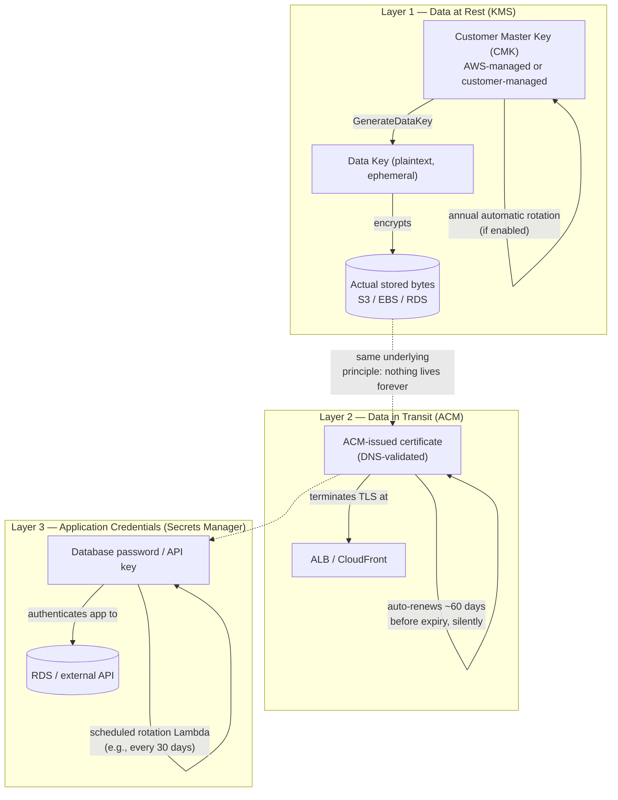
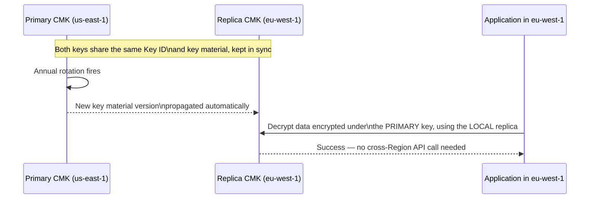
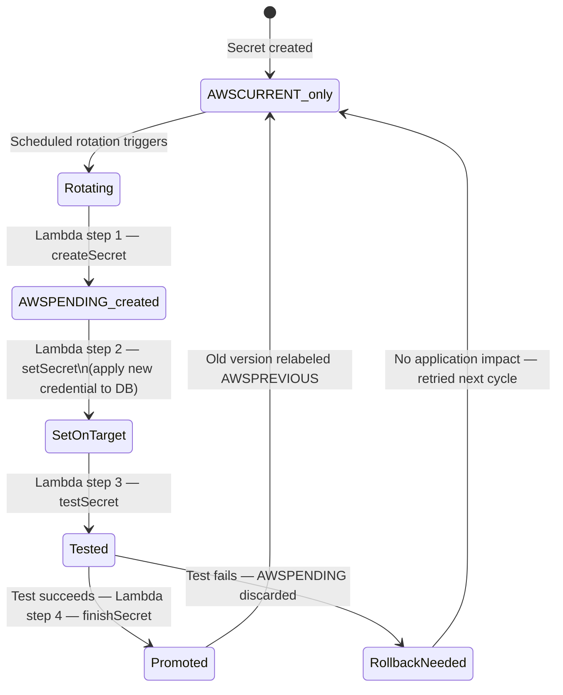

# Encryption Key Hierarchy & Rotation Strategy

> **Appears in:** [SAA-C03](../../../certifications/saa-c03/README.md) — Domain 1, Task 1.3


*Decision-level topic · sits on top of [`services/security-identity-compliance/kms.md`](../../../services/security-identity-compliance/kms.md), [`acm-and-private-ca.md`](../../../services/security-identity-compliance/acm-and-private-ca.md), and [`secrets-manager-vs-parameter-store.md`](../../../services/security-identity-compliance/secrets-manager-vs-parameter-store.md)*

## Definition

This doc answers a question none of the individual service docs fully answer on their own: **across
an entire organization's encryption surface — data at rest, TLS in transit, and application secrets
— what actually gets rotated, how often, by what mechanism, and what happens the moment each kind
of rotation fires?** It ties together KMS key rotation, ACM certificate renewal, and Secrets Manager
credential rotation as three instances of the *same underlying problem* — "a secret can't live
forever safely" — each solved with a different, non-interchangeable mechanism.

## Purpose

A recurring, expensive mistake in real production environments (and a favorite exam trap) is
treating "encryption" as a single yes/no checkbox instead of a **lifecycle with multiple rotating
parts that must all stay synchronized**. A database can be "encrypted with KMS" and still be
catastrophically insecure if the TLS certificate protecting the connection to it has silently
expired, or if the password used to authenticate to it hasn't changed in three years. This doc
exists to give you one coherent mental model of the entire key/credential hierarchy in one place,
rather than three separate, disconnected rotation facts memorized in isolation.

## How It Works — The Full Hierarchy, Top to Bottom



**Step by step, reading top to bottom as one coherent system protecting a single application:**

1. **Layer 1 protects the bytes sitting on disk.** A KMS Customer Master Key (CMK) is never used to
   encrypt bulk data directly — it generates a **data key** via envelope encryption (see
   [`MASTER-CHUNK.md`](MASTER-CHUNK.md) section 20 for the full `GenerateDataKey` sequence), and
   that data key does the actual bulk encryption. **Automatic annual rotation**, when enabled,
   rotates only the CMK's own backing key material — the data keys already in use keep working
   because KMS retains old key material versions internally to decrypt anything encrypted under
   them previously.
2. **Layer 2 protects the bytes while they're moving over the network.** ACM issues and (with DNS
   validation) **auto-renews** the TLS certificate an ALB or CloudFront distribution uses to
   terminate HTTPS — roughly 60 days before expiry, silently, with zero human action required as
   long as the validation CNAME record stays in place.
3. **Layer 3 protects the credential an application uses to authenticate to another system.**
   Secrets Manager's rotation Lambda runs on a schedule (commonly 30–90 days), creating a new
   credential, testing it, and promoting it — all without the application being restarted or ever
   seeing a plaintext credential outside the fetch-at-runtime call.

Each layer rotates on a **completely different schedule, by a completely different mechanism, and a
failure in one layer does not visibly manifest in another** — which is exactly why treating them as
one undifferentiated "encryption" checkbox is the mistake this whole doc exists to prevent. A KMS
key rotating correctly says nothing about whether the TLS certificate protecting the connection to
that encrypted database is about to expire.

### Official AWS diagram: the key hierarchy, generalized


*Source: [AWS Key Management Service Developer Guide — Key management concepts](https://docs.aws.amazon.com/kms/latest/developerguide/concepts.html), © Amazon Web Services.*

**Discussion.** This diagram is specific to Layer 1, but its *shape* — a layered hierarchy where the
top layer rotates independently of the bottom layer continuing to function — is the same shape as
the full three-layer system above it. The exam-relevant generalization: at every layer of this
hierarchy, from a single CMK's internal key-encryption-key structure all the way up through ACM
certificates and Secrets Manager credentials, **rotating a higher layer never requires re-processing
everything protected underneath it** — this is the architectural property that makes routine
rotation operationally cheap at every layer, not just the KMS-specific one this particular diagram
illustrates.

## AWS-Managed vs. Customer-Managed Keys — The Rotation Control Table

| | AWS-managed key (`aws/s3`, `aws/rds`, etc.) | Customer-managed key (CMK) |
|---|---|---|
| Who creates it | AWS, automatically, the first time a service needs one | You, explicitly |
| Rotation | **Automatic, every year, mandatory** — cannot be disabled | **Optional**, you choose to enable (every year) or leave off |
| Key policy control | None — you cannot view or edit it | Full control — you write the key policy |
| Cross-account sharing | **Not possible** | Possible via key policy grants |
| Deletion | Cannot be scheduled for deletion by you | You control deletion (with a mandatory 7–30 day waiting period) |
| Cost | Free | ~$1/month + per-request charges |
| Typical use | "I just want encryption on, I don't need control" | Compliance requires rotation evidence, cross-account sharing, or custom key policies |

**The exam-tested decision rule:** if a scenario needs **any** of cross-account sharing, custom key
policies, the ability to disable/delete the key, or **demonstrable rotation evidence for an
auditor**, the answer is a customer-managed key, never an AWS-managed key — AWS-managed keys rotate
automatically too, but you get no visibility or control over that fact to show an auditor, which
matters when the requirement is specifically "prove it," not just "do it."

## Multi-Region Keys — Rotation Across Geography



A **multi-Region key** lets data encrypted in one Region be decrypted in another **without a
cross-Region API call to KMS** — critical for DR scenarios where you need to decrypt a replicated
backup in a secondary Region even if the primary Region (and its KMS endpoint) is completely
unreachable. Rotation of the primary key's material propagates automatically to every replica,
keeping them in lockstep — this is distinct from simply creating two independent, unrelated CMKs
with the same alias in two Regions, which would **not** let you decrypt the same ciphertext in
both places, since they'd have entirely different, unrelated key material.

## Secrets Manager Rotation — The State Machine in Detail



The four-step rotation Lambda contract (`createSecret` → `setSecret` → `testSecret` →
`finishSecret`) is identical across every rotation template AWS ships (RDS, Redshift, DocumentDB)
and any custom rotation function you write yourself — recognizing these four named steps lets you
pinpoint exactly where a failed rotation stalled from a CloudWatch log alone, without needing to
read the Lambda's full source code.

## Use Cases — Designing a Rotation Strategy End to End

1. **A fintech's customer database, full stack.** Data at rest: RDS encrypted with a
   customer-managed KMS key, annual rotation enabled (for the audit evidence requirement). In
   transit: ALB terminates TLS with a DNS-validated ACM certificate (auto-renewing). Credentials:
   the app fetches the DB password from Secrets Manager with a 30-day rotation Lambda using the
   alternating-users strategy (zero downtime). All three layers independently rotating, all three
   independently monitored.
2. **A multi-Region DR architecture needing decrypt capability in the failover Region.** A
   multi-Region KMS key protects the primary database; its replica key in the DR Region lets backup
   restores there decrypt without any cross-Region API dependency during an actual disaster, when
   the primary Region might be the thing that's down.
3. **A compliance audit demanding provable key rotation.** Customer-managed keys with rotation
   enabled produce a visible rotation history (`GetKeyRotationStatus`, rotation timestamps) an
   auditor can inspect directly — an AWS-managed key rotates too, but offers no equivalent
   evidence trail to show.
4. **A certificate-expiry postmortem.** After an outage caused by an expired, manually-imported
   certificate, migrating every certificate to ACM with DNS validation removes the human-memory
   dependency entirely going forward, and a Config rule flags any future manually-uploaded
   certificate as a drift from the new baseline.
5. **Cross-account data sharing requiring independent key control.** A customer-managed CMK's key
   policy grants a specific partner account's role `kms:Decrypt` — something an AWS-managed key
   cannot do at all, since its key policy isn't user-editable.

## When NOT to Reach for the Heavier Mechanism

- Don't enable customer-managed keys (and their ~$1/month + request cost) everywhere by default —
  if a workload has no cross-account, custom-policy, or audit-evidence requirement, an AWS-managed
  key gets the same annual rotation for free.
- Don't put a credential that doesn't need rotation into Secrets Manager "to be consistent" — see
  [`secrets-manager-vs-parameter-store.md`](../../../services/security-identity-compliance/secrets-manager-vs-parameter-store.md)
  for the cost mismatch this causes at scale.
- Don't provision a multi-Region key for a single-Region workload — it's real additional complexity
  (key replication, key policy synchronization) that only pays for itself when cross-Region decrypt
  without a KMS round-trip is an actual requirement.
- Don't import a certificate instead of using ACM-native DNS validation unless the certificate's
  private key must be used by a non-ACM-integrated service outside AWS — imported certificates do
  not auto-renew, full stop.

## Why It's Important

**Real world:** the overwhelming majority of real "encryption incidents" aren't a missing encryption
checkbox — they're a rotation failure somewhere in this three-layer stack that nobody was watching:
a TLS certificate nobody renewed, a database password unchanged since a departed employee had it,
or a KMS key whose rotation status nobody ever checked (and which turned out to have been disabled
by someone years ago). Thinking in terms of this full hierarchy, rather than three disconnected
facts, is what separates "we encrypt everything" from "we actually know our encryption posture."

**Exam weight:** SAA-C03 Domain 1, Task 1.3 explicitly names key rotation and certificate renewal as
tested concepts, and scenario questions frequently combine two or three of these layers in one
paragraph (e.g., "a database is KMS-encrypted but its application's database password was never
rotated and an auditor flags it") specifically to test whether you treat them as one system or
three unrelated facts.

## Limits & Quotas (Cross-Cutting)

- **KMS key rotation**: automatic, annual, for AWS-managed keys (mandatory); optional and
  configurable for customer-managed symmetric keys — asymmetric and HMAC CMKs do **not** support
  automatic rotation at all, a frequently-missed exception.
- **ACM auto-renewal window**: begins automatically roughly 60 days before expiry for DNS-validated
  certificates; email-validated certificates require manual re-approval and do not reliably
  auto-renew.
- **Secrets Manager rotation window**: configurable, as short as hours; a target database that's
  slow to respond to the test step can cause rotation timeouts, a real operational tuning concern
  distinct from the rotation logic itself.
- **Multi-Region key replica limit**: a soft, raisable limit on how many Regional replicas a single
  multi-Region key can have — relevant for a company replicating across many Regions simultaneously.

## Troubleshooting / Common Issues

- **"Our KMS key shows 'rotation enabled' but I'm worried old data is now unreadable."** This is a
  misunderstanding, not a bug — KMS retains all previous key material versions internally
  specifically so data encrypted under an older rotation stays decryptable forever; rotation never
  invalidates previously-encrypted data.
- **"The TLS certificate renewed in ACM but the site still shows the old, expiring certificate."**
  Confirm the ALB/CloudFront distribution is actually referencing the certificate by ARN (which
  stays constant across a renewal) rather than something that cached an old certificate version —
  ACM's renewal replaces the certificate content in place under the same ARN, so a correctly
  configured distribution picks it up automatically.
- **"Secrets Manager rotation keeps failing at the testSecret step."** Almost always a connectivity
  or permissions issue between the rotation Lambda and the target database (wrong security group,
  wrong VPC, or the Lambda's execution role lacking a needed permission) — the credential itself is
  usually created successfully; it's the *validation* step that's failing.
- **"An asymmetric KMS key shows no rotation option in the console."** This is expected, not a
  misconfiguration — asymmetric (and HMAC) KMS keys do not support AWS's automatic annual rotation
  feature at all; if rotation is genuinely required for such a key, it must be done manually by
  creating a new key and migrating.

## Hands-on Lab (Floci)

```bash
# Layer 1: KMS key creation + rotation
awslocal kms create-key --description "app-data-key"
awslocal kms enable-key-rotation --key-id <key-id>
awslocal kms get-key-rotation-status --key-id <key-id>

# Layer 3: Secrets Manager rotation simulation (Layer 2 / ACM auto-renewal has no
# local emulation — it's a real-infrastructure DNS validation process; see acm-and-private-ca.md)
awslocal secretsmanager create-secret --name prod/db/credentials \
  --secret-string '{"username":"admin","password":"InitialPass123!"}'
awslocal secretsmanager rotate-secret --secret-id prod/db/credentials
awslocal secretsmanager list-secret-version-ids --secret-id prod/db/credentials \
  --query 'Versions[].{Version:VersionId,Stages:VersionStages}'

# Demonstrate that data encrypted under a key BEFORE rotation still decrypts AFTER
awslocal kms encrypt --key-id <key-id> --plaintext "pre-rotation-secret" \
  --output text --query CiphertextBlob > before-rotation.b64
awslocal kms enable-key-rotation --key-id <key-id>
# (in real AWS, rotation happens on AWS's schedule; conceptually, decrypt still works:)
awslocal kms decrypt --ciphertext-blob fileb://<(base64 -d before-rotation.b64) \
  --output text --query Plaintext | base64 -d
```

## Exam-Style Scenario Walkthroughs

**Scenario 1:** A company's RDS database uses an AWS-managed KMS key for encryption at rest. An
auditor asks for evidence of the key's rotation history and key policy. What's the gap, and what
should change?

*Answer:* AWS-managed keys rotate automatically but expose **no visible rotation history or
editable key policy** to the account — there's nothing to show the auditor beyond "AWS manages
this." Migrating to a **customer-managed key** (with rotation enabled) produces the
`GetKeyRotationStatus` evidence and a key policy the account controls, satisfying the specific
"show me proof" requirement an AWS-managed key structurally cannot.

**Scenario 2:** A disaster recovery design replicates an encrypted database backup to a secondary
Region, and the DR plan requires the backup to be decryptable even if the primary Region is
completely unreachable. A single-Region customer-managed key was used for the original encryption.
What's missing?

*Answer:* A **multi-Region key** — a single-Region CMK's key material doesn't exist anywhere else,
so decrypting the replicated backup in the DR Region would require a cross-Region API call back to
the (potentially unreachable) primary Region's KMS endpoint. A multi-Region key's replica carries
its own copy of the same key material locally in the DR Region, removing that dependency entirely.

**Scenario 3:** A security review finds a TLS certificate that was manually imported into ACM two
years ago (not ACM-issued) and expired without anyone noticing until customers reported a browser
warning. What's the structural fix, and why wasn't ACM's usual auto-renewal a safety net here?

*Answer:* **Imported certificates never auto-renew in ACM**, regardless of how they're attached to
an ALB/CloudFront — ACM's auto-renewal applies only to certificates **it issued** with DNS
validation. The fix is reissuing the certificate natively through ACM with DNS validation, which
then auto-renews going forward with no recurrence of the human-dependency failure mode.

## Exam Tips

- **Rotation of a higher layer never breaks data encrypted under earlier key material** — KMS
  retains old versions; this is the single most commonly misunderstood "won't this break my old
  data" exam distractor.
- **AWS-managed keys rotate automatically and mandatorily; customer-managed keys rotate only if you
  opt in** — and only customer-managed keys give you a key policy, cross-account sharing, or
  deletion control.
- **Asymmetric and HMAC KMS keys cannot use automatic rotation at all** — a frequently-tested
  exception to the general "KMS rotates annually" rule.
- **ACM auto-renewal requires DNS validation specifically** — imported or email-validated
  certificates do not reliably auto-renew; "the certificate keeps expiring" always points to one of
  these two non-DNS-validated paths.
- **Multi-Region keys solve a specific DR problem** (decrypt without a cross-Region API call) —
  don't confuse this with simply replicating ciphertext; the key material itself must also be
  present in the second Region.
- **Secrets Manager's four-step rotation contract** (`createSecret`/`setSecret`/`testSecret`/
  `finishSecret`) is the same across every rotation template — a troubleshooting question about
  "where did rotation fail" is testing whether you can map the failure to one of these four named
  steps.

## Further Reading

- [AWS KMS Developer Guide — Rotating AWS KMS keys](https://docs.aws.amazon.com/kms/latest/developerguide/rotate-keys.html)
- [AWS KMS Developer Guide — Multi-Region keys](https://docs.aws.amazon.com/kms/latest/developerguide/multi-region-keys-overview.html)
- [AWS Certificate Manager User Guide — Managed renewal](https://docs.aws.amazon.com/acm/latest/userguide/managed-renewal.html)
- [AWS Secrets Manager User Guide — Rotate secrets](https://docs.aws.amazon.com/secretsmanager/latest/userguide/rotating-secrets.html)

## Related Terms

- [`services/security-identity-compliance/kms.md`](../../../services/security-identity-compliance/kms.md)
- [`services/security-identity-compliance/acm-and-private-ca.md`](../../../services/security-identity-compliance/acm-and-private-ca.md)
- [`services/security-identity-compliance/secrets-manager-vs-parameter-store.md`](../../../services/security-identity-compliance/secrets-manager-vs-parameter-store.md)
- [`services/storage/aws-backup.md`](../../../services/storage/aws-backup.md) — encryption must survive every backup/replication hop too
- [`MASTER-CHUNK.md`](MASTER-CHUNK.md) — sections 20–22 cover KMS, ACM, and Secrets Manager individually
