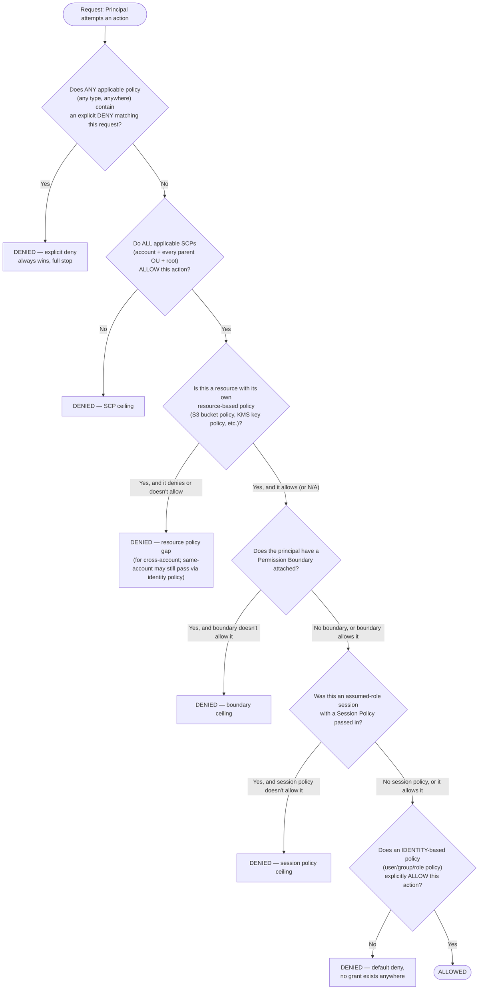
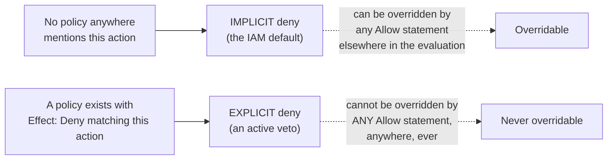
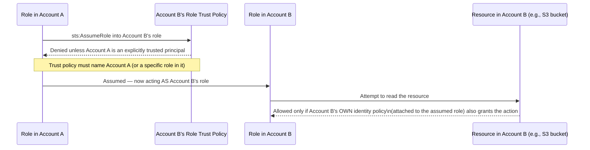

# IAM Policy Evaluation Logic — Deep Dive

> **Appears in:** [SAA-C03](../../../certifications/saa-c03/README.md) — Domain 1, Task 1.1


*Decision-level topic · sits on top of [`services/security-identity-compliance/iam.md`](../../../services/security-identity-compliance/iam.md), [`organizations-and-scps.md`](../../../services/security-identity-compliance/organizations-and-scps.md), and [`sts-and-role-switching.md`](../../../services/security-identity-compliance/sts-and-role-switching.md)*

## Definition

This doc explains **exactly how AWS decides allow-or-deny** when a principal attempts an action —
not what IAM *is* (that's `iam.md`), but the actual algorithm AWS runs every single time, across
every policy type that can apply to a single request: identity-based policies, resource-based
policies, permission boundaries, Service Control Policies (SCPs), and session policies. Most
candidates can define "least privilege" but cannot correctly predict the outcome when two of these
five policy types disagree — this doc is built entirely around that gap.

## Purpose

The exam doesn't test "can you write an IAM policy" in isolation nearly as often as it tests "given
these three policies that seem to contradict each other, what's the effective permission?" Getting
this wrong in production looks like: an administrator grants `AdministratorAccess` and a developer
still can't launch an EC2 instance (a permission boundary or SCP is silently capping it), or a
bucket policy explicitly denies an action and an "obviously correct" IAM policy still can't override
it (explicit deny always wins). Without a precise mental model of the evaluation order, every one of
these situations looks like a bug instead of the system working exactly as designed.

## How It Works — The Full Evaluation Algorithm

Plain explanation first: think of permission evaluation as passing through a series of checkpoints,
each one capable of stopping you, and **you need every applicable checkpoint to say yes** — not just
one of them.



**Step by step, in the exact order AWS actually evaluates this:**

1. **Explicit deny anywhere wins immediately.** If *any* applicable policy — identity-based,
   resource-based, SCP, permission boundary, or session policy — contains an explicit `Deny`
   matching the request, the request is denied, and no other policy's `Allow` can override it. This
   is the single most important rule in this entire document: explicit deny is not "one vote among
   many," it's a veto.
2. **SCPs are checked as a ceiling, not a grant.** Every SCP attached anywhere in the chain from the
   account up to the Organization root must allow the action (or simply not be configured to narrow
   it, since the default `FullAWSAccess` SCP allows everything until deliberately restricted). SCPs
   can only *remove* permission that IAM would otherwise grant — they never add permission on their
   own.
3. **Resource-based policies matter most for cross-account access.** If the target resource has its
   own policy (an S3 bucket policy, an SNS topic policy, a KMS key policy, a Secrets Manager
   resource policy), and the caller is in a *different* account, the resource policy must explicitly
   allow the caller — this is often the *only* grant needed for cross-account access, since the
   calling account's own IAM policy can't unilaterally grant access into someone else's resource.
   For same-account access, either the identity policy or the resource policy allowing it is
   typically sufficient (the exact combining behavior is resource-type-specific — S3 in particular
   evaluates the union of IAM and bucket policy for same-account principals, which is a frequently
   tested nuance).
4. **Permission boundaries cap what an identity-based policy can grant**, regardless of how
   generous that identity-based policy is. A role with `AdministratorAccess` attached but a boundary
   permitting only `s3:*` and `kms:*` effectively has only S3 and KMS permissions — the boundary and
   the identity policy are intersected, and only their overlap survives.
5. **Session policies narrow a specific STS session**, passed in at the moment of `AssumeRole` (or
   `GetFederationToken`). They're the same intersection logic as a boundary, but scoped to one
   session rather than permanently attached to the role.
6. **Finally, an identity-based policy must explicitly `Allow` the action.** If nothing in the
   chain has denied it and every ceiling has permitted it, AWS still needs *something* to have
   actually granted the permission — the default, with no matching `Allow` anywhere, is deny. IAM
   is **default-deny**; nothing is permitted unless something explicitly allows it.

### Official AWS diagrams: single-account evaluation and permission boundary intersection


*Source: [AWS IAM User Guide — Policy evaluation logic](https://docs.aws.amazon.com/IAM/latest/UserGuide/reference_policies_evaluation-logic.html), © Amazon Web Services.*

**Discussion.** This is AWS's own canonical evaluation diagram, and it visually confirms the order
above: explicit deny is checked first and short-circuits everything else, then organization-level
policies (SCPs/RCPs), then resource-based policies, then boundaries, then identity-based policies
last. A huge number of "why doesn't this work" production incidents trace back to checking this
diagram in the wrong order mentally — specifically, assuming an identity policy's `Allow` is the
final word without first checking whether an SCP, boundary, or an explicit deny somewhere else in
the chain already closed the door.


*Source: [AWS IAM User Guide — Permissions boundaries](https://docs.aws.amazon.com/IAM/latest/UserGuide/access_policies_boundaries.html), © Amazon Web Services.*

**Discussion.** This second diagram is the one most candidates misread on first encounter: it looks
like a Venn diagram of two separate grants being combined additively, but the shaded region is an
**intersection**, not a union. A role's actual permission is whatever both the identity-based policy
*and* the permission boundary agree on — being generous in one without being generous in the other
still produces a narrow result. This is exactly the mechanism Lab 7 in [`labs.md`](labs.md)
exercises hands-on.

## Explicit Deny vs. Implicit Deny — A Distinction the Exam Tests Directly



An **implicit deny** is simply the absence of any grant — IAM's default state. It's easily
overridden: if any applicable policy later in the evaluation grants the action, the implicit deny
never mattered. An **explicit deny** is an active statement somewhere saying `"Effect": "Deny"` for
this specific action/resource/condition — and once found, **no other policy, however permissive,
can undo it**. The exam loves describing a scenario where an administrator "definitely" granted an
action via `AdministratorAccess`, but a separate, easy-to-miss explicit deny (often in an SCP, or a
narrowly-scoped resource-based policy) still blocks it — the trick is recognizing which kind of
deny you're looking at.

## `NotAction` and `NotResource` — The Double-Negative Trap

```json
{
  "Version": "2012-10-17",
  "Statement": [
    {
      "Effect": "Allow",
      "NotAction": ["iam:*", "organizations:*"],
      "Resource": "*"
    }
  ]
}
```

This policy reads, in plain English, as **"allow every action except IAM and Organizations
actions"** — not "deny IAM and Organizations," but "allow literally everything else, including
actions that don't exist yet." `NotAction` combined with `Effect: Allow` is a famously dangerous
pattern precisely because it's forward-compatible with *future* AWS service launches: a brand-new
service AWS releases next year is automatically included in "everything else" this policy allows,
without anyone having deliberately granted it. The exam tests whether you recognize `NotAction` as
inherently broader and riskier than an equivalent `Action` allow-list, and as a pattern that should
almost always be paired with `Effect: Deny` (where it instead means "deny everything except this
narrow carve-out") rather than `Effect: Allow`.

## Condition Keys and Attribute-Based Access Control (ABAC)

```json
{
  "Version": "2012-10-17",
  "Statement": [
    {
      "Effect": "Allow",
      "Action": "s3:GetObject",
      "Resource": "arn:aws:s3:::company-data/*",
      "Condition": {
        "StringEquals": { "s3:ExistingObjectTag/department": "${aws:PrincipalTag/department}" }
      }
    }
  ]
}
```

This single policy statement, attached once to a shared role, grants each principal access only to
objects whose `department` tag matches **their own** `department` principal tag — a finance
employee sees finance-tagged objects, a marketing employee sees marketing-tagged objects, with zero
per-team policy duplication. This is **ABAC (Attribute-Based Access Control)**: instead of writing
one static policy per team (RBAC — Role-Based Access Control, which requires a new/edited policy
every time a new team or resource category appears), ABAC uses tags on both principals and
resources, and a single, generic policy evaluates the match at request time. The exam-relevant
tradeoff: ABAC scales dramatically better as teams/resources multiply (one policy forever vs. one
policy per team), but requires rigorous tagging discipline — an untagged or mistagged resource
silently falls outside every ABAC grant that depends on that tag, which is a real, common
production gotcha distinct from any IAM misconfiguration.

## Cross-Account Evaluation — Why Two Policies Must Both Agree



Cross-account access is a deliberate **two-sided handshake**: the destination account's role trust
policy must name the source account (or a specific role in it) as a trusted principal, *and* that
assumed role's own identity-based policy (in the destination account) must separately grant the
actual permission to read the resource. A trust policy alone only allows the `AssumeRole` call
itself — it grants zero permission to actually *do* anything once assumed. This two-sided
requirement is the most common root cause of "I can assume the role but every API call inside it
fails" — the trust relationship existing is necessary but never sufficient on its own.

## Use Cases — When to Apply This Reasoning

- **Debugging "my IAM policy looks right but the action still fails."** Walk the evaluation
  order from the top: explicit deny anywhere, then SCP, then resource policy, then boundary/session
  policy, then identity policy — in that order, not starting from "well, my identity policy
  clearly allows it."
- **Designing a permission boundary for self-service IAM delegation.** Letting a team lead create
  their own IAM roles/policies *within* a boundary that caps what those self-created policies can
  ever grant, so delegated IAM administration can't accidentally (or maliciously) escalate beyond a
  known ceiling.
- **Building an ABAC-based multi-tenant permission model** for a SaaS platform where each customer's
  data is tagged with a customer ID, and one generic policy scopes every request to the caller's own
  tagged customer ID — avoiding a hand-written policy per customer at scale.
- **Auditing for dangerous `NotAction`/`NotResource` allow statements** during a security review,
  specifically flagging any `Effect: Allow` + `NotAction` combination as a forward-compatibility
  risk requiring named, explicit actions instead.
- **Designing cross-account access for a shared services account** (e.g., a central logging or
  monitoring account reading from every workload account) — confirming both halves of the handshake
  (trust policy in the destination, identity policy on the assumed role) are each independently
  correct.

## When NOT to Reach for the More Complex Mechanism

- Don't reach for ABAC tagging if the organization has fewer than a handful of static teams/roles
  that rarely change — a handful of named, explicit RBAC policies is simpler to audit and reason
  about at small scale; ABAC's payoff is at genuine multi-team/multi-tenant scale.
- Don't use a permission boundary as a substitute for an SCP when the requirement is truly
  Organization-wide — a boundary is attached per-principal within one account and must be
  maintained consistently across every principal; an SCP enforces the same ceiling automatically
  across every account in an OU with one policy.
- Don't use `NotAction`/`NotResource` allow-style patterns as a shortcut for "everything except a
  few things" unless you've deliberately accepted the forward-compatibility risk — an explicit,
  named `Action` list, even if longer, is the safer default.

## Why It's Important

**Real world:** most production IAM incidents are not "a policy was too permissive" in a vacuum —
they're "two or more policies interacted in a way nobody traced through the actual evaluation
order," producing either an unexpected denial (an operational outage) or an unexpected allowance (a
security incident). Engineers who can mentally simulate this evaluation chain debug access issues in
minutes instead of hours of trial-and-error policy editing.

**Exam weight:** SAA-C03 Domain 1, Task 1.1 scenario questions routinely present 2–3 policies at
once (an SCP, an identity policy, sometimes a resource policy) and ask for the effective permission
— this is the single most common "which of these conflicting-looking policies wins" question shape
across the entire exam.

## Troubleshooting / Common Issues

- **"AdministratorAccess is attached but a specific action still fails."** Check, in order: an
  explicit deny anywhere, an SCP ceiling, a permission boundary, a session policy — `AdministratorAccess`
  is an identity-based policy and is evaluated *last*, after every ceiling above it.
- **"A bucket policy explicitly allows my account but I still get AccessDenied."** Confirm your own
  IAM identity-based policy also grants the S3 action for same-account access, and separately check
  Block Public Access settings, which can override even a permissive bucket policy at the
  account/bucket level.
- **"I can assume the cross-account role, but every subsequent call fails."** The trust policy
  (letting you assume the role) and the role's own identity-based policy (letting the assumed role
  actually act) are two separate grants — confirm the second one exists, not just the first.
- **"An ABAC-tagged policy isn't matching for a specific user."** Check whether the principal tag
  is actually set on that specific IAM user/role (not just the resource tag) — ABAC requires both
  sides to be tagged correctly, and a missing principal tag silently fails the condition match.

## Hands-on Lab (Floci)

```bash
# Demonstrate explicit deny overriding an otherwise-permissive policy
cat > allow-all-s3.json << 'EOF'
{ "Version": "2012-10-17", "Statement": [{ "Effect": "Allow", "Action": "s3:*", "Resource": "*" }] }
EOF
cat > deny-one-bucket.json << 'EOF'
{ "Version": "2012-10-17", "Statement": [
  { "Effect": "Deny", "Action": "s3:*", "Resource": "arn:aws:s3:::locked-bucket/*" }
]}
EOF
awslocal iam create-policy --policy-name AllowAllS3 --policy-document file://allow-all-s3.json
awslocal iam create-policy --policy-name DenyLockedBucket --policy-document file://deny-one-bucket.json
awslocal iam create-role --role-name ExplicitDenyTestRole --assume-role-policy-document file://trust.json
awslocal iam attach-role-policy --role-name ExplicitDenyTestRole --policy-arn arn:aws:iam::000000000000:policy/AllowAllS3
awslocal iam attach-role-policy --role-name ExplicitDenyTestRole --policy-arn arn:aws:iam::000000000000:policy/DenyLockedBucket

# Assume the role: s3 access to any OTHER bucket succeeds, but locked-bucket fails,
# proving the explicit deny wins even though AllowAllS3 is also attached
awslocal sts assume-role --role-arn arn:aws:iam::000000000000:role/ExplicitDenyTestRole \
  --role-session-name deny-test
```

## Exam-Style Scenario Walkthroughs

**Scenario 1:** A role has `AdministratorAccess` attached. A permission boundary limiting it to
`s3:*` and `dynamodb:*` is also attached. The role attempts `ec2:RunInstances`. What happens, and
why?

*Answer:* **Denied.** The effective permission is the intersection of the identity-based policy
(`AdministratorAccess`, which includes EC2) and the permission boundary (which does not include
EC2) — only the overlap survives, and EC2 is not in that overlap.

**Scenario 2:** An SCP at the Organization root allows every service except explicitly denying
`iam:CreateUser` across the whole Organization. An account administrator's own IAM policy grants
`iam:*`. Can that administrator create an IAM user?

*Answer:* **No.** The SCP's explicit deny on `iam:CreateUser` is enforced above the account and
cannot be overridden by any IAM policy inside the account, including one granting `iam:*` — SCPs
are a ceiling, and this particular SCP's ceiling explicitly excludes this one action regardless of
how broad the account's own IAM grant is.

**Scenario 3:** Account A's role assumes a role in Account B. Account B's role trust policy
correctly names Account A's role as a trusted principal. The assumed role in Account B has no
identity-based policy attached at all. What happens when the assumed role attempts any AWS API
call?

*Answer:* **Denied on every call**, because IAM is default-deny — a trust policy only governs
whether the `AssumeRole` call itself succeeds, not what the resulting session can actually do. With
zero identity-based policy attached to the Account B role, there is no grant anywhere for any
action, so every subsequent API call fails regardless of the successful assumption.

## Exam Tips

- **Explicit deny always wins, everywhere, with no exceptions** — this is the single fact worth
  over-memorizing in this entire document; nearly every "conflicting policy" question hinges on
  spotting (or ruling out) an explicit deny somewhere in the chain.
- **SCPs, permission boundaries, and session policies are all ceilings — never grants.** A question
  describing one of these three as "granting" a permission is describing a misunderstanding to
  correct, not a valid mechanism.
- **Cross-account access is always two separate grants** — the trust policy (can you assume the
  role) and the identity/resource policy (can the assumed role/your account actually act). Treat
  "I can assume it but can't do anything" as a signature phrase for a missing second grant.
- **`NotAction`/`NotResource` paired with `Allow` is a forward-compatibility risk**, not a style
  choice — recognize it as the riskier pattern when offered as a wrong-answer distractor.
- **ABAC vs. RBAC is a scale decision** — a question emphasizing "many teams/tenants, growing
  constantly, want one policy instead of one per team" points to ABAC; a small, static team count
  points to ordinary named RBAC policies.

## Further Reading

- [AWS IAM User Guide — Policy evaluation logic](https://docs.aws.amazon.com/IAM/latest/UserGuide/reference_policies_evaluation-logic.html)
- [AWS IAM User Guide — Permissions boundaries for IAM entities](https://docs.aws.amazon.com/IAM/latest/UserGuide/access_policies_boundaries.html)
- [AWS IAM User Guide — Attribute-based access control (ABAC)](https://docs.aws.amazon.com/IAM/latest/UserGuide/introduction_attribute-based-access-control.html)
- [AWS Organizations User Guide — Service control policies (SCPs)](https://docs.aws.amazon.com/organizations/latest/userguide/orgs_manage_policies_scps.html)

## Related Terms

- [`services/security-identity-compliance/iam.md`](../../../services/security-identity-compliance/iam.md) — the full IAM service doc this decision-level doc sits on top of
- [`services/security-identity-compliance/organizations-and-scps.md`](../../../services/security-identity-compliance/organizations-and-scps.md) — SCP mechanics in depth
- [`services/security-identity-compliance/sts-and-role-switching.md`](../../../services/security-identity-compliance/sts-and-role-switching.md) — AssumeRole and session policies
- [`multi-account-security-strategy.md`](multi-account-security-strategy.md) — how SCPs and delegated administration compose at the Organization level
- [`MASTER-CHUNK.md`](MASTER-CHUNK.md) — sections 1, 3, and 4 cover IAM, STS, and SCPs individually
