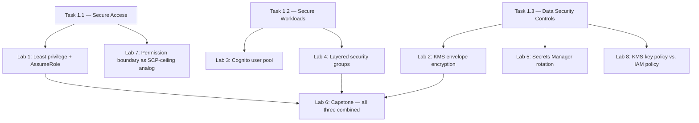

# Domain 1 Labs — Design Secure Architectures (Floci)

Setup once: see [`labs-floci/README.md`](../../../labs-floci/README.md) for the `awslocal` alias
and Floci container. These labs use IAM, STS, KMS, S3, and Cognito — all genuinely emulated by
Floci's control-plane APIs. (Organizations/SCPs, GuardDuty, Macie, Shield, and WAF are **not**
emulated by Floci — those are explained conceptually in the service docs instead; this file notes
where that applies.)

## Lab 1 — Least privilege + cross-account-style role assumption (Task 1.1)

Goal: feel how IAM least privilege and STS role assumption combine — the same mechanics IAM
Identity Center uses behind the scenes when it hands a human temporary credentials into a role.

```bash
# 1. Create an S3 bucket to protect
awslocal s3 mb s3://secure-app-data

# 2. Create a least-privilege policy: read-only access to this one bucket, nothing else
cat > s3-readonly.json << 'EOF'
{
  "Version": "2012-10-17",
  "Statement": [
    { "Effect": "Allow", "Action": ["s3:GetObject", "s3:ListBucket"],
      "Resource": ["arn:aws:s3:::secure-app-data", "arn:aws:s3:::secure-app-data/*"] }
  ]
}
EOF
awslocal iam create-policy --policy-name S3ReadOnlySecureData --policy-document file://s3-readonly.json

# 3. Create a role that trusts your own account (simulating a "cross-account" assumable role)
cat > trust.json << 'EOF'
{
  "Version": "2012-10-17",
  "Statement": [{ "Effect": "Allow", "Principal": { "AWS": "arn:aws:iam::000000000000:root" },
    "Action": "sts:AssumeRole" }]
}
EOF
awslocal iam create-role --role-name DataReaderRole --assume-role-policy-document file://trust.json
awslocal iam attach-role-policy --role-name DataReaderRole \
  --policy-arn arn:aws:iam::000000000000:policy/S3ReadOnlySecureData

# 4. Assume the role via STS and use the temporary credentials
awslocal sts assume-role --role-arn arn:aws:iam::000000000000:role/DataReaderRole \
  --role-session-name study-session

# 5. Confirm the temp credentials can read but NOT write (should fail)
awslocal s3 cp README.md s3://secure-app-data/README.md   # expect AccessDenied once you
                                                            # re-run with the assumed creds set
```

Why this matters: the "assume a narrow role for a narrow task, never hand out standing access"
pattern is exactly what IAM Identity Center automates at human scale, and what cross-account
roles automate at account scale.

## Lab 2 — Encrypt data at rest with KMS (Task 1.3)

Goal: practice envelope encryption — the mechanism behind "S3 bucket encrypted with a customer
-managed KMS key," "RDS encrypted storage," etc.

```bash
# 1. Create a customer-managed KMS key
awslocal kms create-key --description "study-app-data-key"
# capture the KeyId from the output

# 2. Encrypt a small piece of data directly (simulates what SDKs do under the hood)
awslocal kms encrypt --key-id <key-id> --plaintext "super-secret-db-password" \
  --output text --query CiphertextBlob > secret.b64

# 3. Decrypt it back
awslocal kms decrypt --ciphertext-blob fileb://<(base64 -d secret.b64) --output text --query Plaintext | base64 -d

# 4. Enable automatic key rotation (annual) — the real exam-tested KMS behavior
awslocal kms enable-key-rotation --key-id <key-id>
awslocal kms get-key-rotation-status --key-id <key-id>
```

Why this matters: KMS key rotation and envelope encryption come up constantly in Domain 1 Task
1.3 — this is the mechanism S3 SSE-KMS, RDS encryption, and EBS encryption all build on.

## Lab 3 — Cognito user pool for application authentication (Task 1.2)

Goal: stand up the mechanism behind "let app users sign themselves up without you managing a
user directory" — contrast this with IAM users, which are for *your own* AWS account access,
never for application end users.

```bash
# 1. Create a user pool
awslocal cognito-idp create-user-pool --pool-name study-app-users

# 2. Create an app client (what your frontend/mobile app actually talks to)
awslocal cognito-idp create-user-pool-client --user-pool-id <pool-id> --client-name study-app-client

# 3. Sign up a test user
awslocal cognito-idp sign-up --client-id <client-id> --username testuser@example.com \
  --password "TempPass123!" --user-attributes Name=email,Value=testuser@example.com

# 4. Admin-confirm the user (skips the real email verification step for local testing)
awslocal cognito-idp admin-confirm-sign-up --user-pool-id <pool-id> --username testuser@example.com

# 5. Authenticate and get back a JWT the app would use for subsequent API calls
awslocal cognito-idp initiate-auth --client-id <client-id> --auth-flow USER_PASSWORD_AUTH \
  --auth-parameters USERNAME=testuser@example.com,PASSWORD=TempPass123!
```

Why this matters: this is the "application users vs. AWS account users" distinction the exam
tests directly — Cognito for app-facing auth (issuing JWTs an API Gateway/app can validate),
IAM/Identity Center for AWS-resource access by humans and workloads.

## Lab 4 — Layered security groups across a three-tier topology (Task 1.2)

Goal: build the exact layered security-group pattern described in
`vpc-security-architecture-patterns.md` end to end, referencing security groups by ID rather than
CIDR — the least-privilege pattern the exam rewards.

```bash
# 1. Create the VPC and three security groups: ALB, app, db
awslocal ec2 create-vpc --cidr-block 10.0.0.0/16
awslocal ec2 create-security-group --group-name alb-sg --description "ALB tier" --vpc-id <vpc-id>
awslocal ec2 create-security-group --group-name app-sg --description "App tier" --vpc-id <vpc-id>
awslocal ec2 create-security-group --group-name db-sg --description "DB tier" --vpc-id <vpc-id>

# 2. ALB-SG: allow inbound 443 from the internet
awslocal ec2 authorize-security-group-ingress --group-id <alb-sg-id> \
  --protocol tcp --port 443 --cidr 0.0.0.0/0

# 3. App-SG: allow inbound 443 ONLY from the ALB security group (not a CIDR!)
awslocal ec2 authorize-security-group-ingress --group-id <app-sg-id> \
  --protocol tcp --port 443 --source-group <alb-sg-id>

# 4. DB-SG: allow inbound 3306 ONLY from the app security group
awslocal ec2 authorize-security-group-ingress --group-id <db-sg-id> \
  --protocol tcp --port 3306 --source-group <app-sg-id>

# 5. Confirm the chain — inspect each group's rules and verify none reference 0.0.0.0/0
#    except the ALB tier
awslocal ec2 describe-security-groups --group-ids <alb-sg-id> <app-sg-id> <db-sg-id> \
  --query 'SecurityGroups[].{Name:GroupName,Rules:IpPermissions}'
```

Why this matters: referencing a security group ID as the source (rather than a CIDR block) means
the rule automatically covers every instance that ever gets added to that group, present or
future — this is the single biggest practical difference between a least-privilege security group
chain and the common "just allow the whole VPC CIDR" shortcut the exam flags as wrong.

## Lab 5 — Rotating a Secrets Manager secret (Task 1.3)

Goal: practice the automatic-rotation mechanic this domain's "hardcoded password" exam scenario
is built around.

```bash
# 1. Store a database credential as a secret
awslocal secretsmanager create-secret --name prod/db/credentials \
  --secret-string '{"username":"admin","password":"InitialPass123!"}'

# 2. Retrieve it the way application code would at runtime (never hardcoded)
awslocal secretsmanager get-secret-value --secret-id prod/db/credentials

# 3. Manually trigger a rotation to see the versioning behavior Secrets Manager uses
#    internally (AWSCURRENT / AWSPREVIOUS staging labels)
awslocal secretsmanager rotate-secret --secret-id prod/db/credentials

# 4. List the secret's version stages to see both labels present after rotation
awslocal secretsmanager list-secret-version-ids --secret-id prod/db/credentials \
  --query 'Versions[].{Version:VersionId,Stages:VersionStages}'
```

Why this matters: the AWSCURRENT/AWSPREVIOUS staging mechanism is exactly how Secrets Manager
avoids any downtime during rotation — the old credential keeps working during the brief overlap
window, which is the detail that separates Secrets Manager's "automatic, zero-downtime rotation"
from Parameter Store's lack of any native rotation at all.

## Lab 6 — Capstone: chain least privilege, encryption, and network isolation (Tasks 1.1–1.3)

Goal: combine every earlier lab into one scenario resembling the domain README's case study — a
least-privilege role that can only decrypt one KMS key to read one S3 bucket, reachable only from
inside a simulated "app tier."

```bash
# 1. Create a KMS key dedicated to this one workload
awslocal kms create-key --description "capstone-workload-key"

# 2. Create a bucket and enable default SSE-KMS encryption using that key
awslocal s3 mb s3://capstone-secure-bucket
awslocal s3api put-bucket-encryption --bucket capstone-secure-bucket \
  --server-side-encryption-configuration '{"Rules":[{"ApplyServerSideEncryptionByDefault":{"SSEAlgorithm":"aws:kms","KMSMasterKeyID":"<key-id>"}}]}'

# 3. Create a role whose policy permits s3:GetObject on this one bucket AND kms:Decrypt on
#    this one key only — nothing broader
cat > capstone-policy.json << 'EOF'
{
  "Version": "2012-10-17",
  "Statement": [
    { "Effect": "Allow", "Action": "s3:GetObject", "Resource": "arn:aws:s3:::capstone-secure-bucket/*" },
    { "Effect": "Allow", "Action": "kms:Decrypt", "Resource": "<key-arn>" }
  ]
}
EOF
awslocal iam create-policy --policy-name CapstoneLeastPrivilege --policy-document file://capstone-policy.json
awslocal iam create-role --role-name CapstoneAppRole --assume-role-policy-document file://trust.json
awslocal iam attach-role-policy --role-name CapstoneAppRole \
  --policy-arn arn:aws:iam::000000000000:policy/CapstoneLeastPrivilege

# 4. Put an encrypted object and confirm the assumed role can read it, but a second role with
#    NO kms:Decrypt grant cannot (AccessDenied on decrypt, even though S3 permissions match)
awslocal s3 cp README.md s3://capstone-secure-bucket/notes.txt
awslocal sts assume-role --role-arn arn:aws:iam::000000000000:role/CapstoneAppRole \
  --role-session-name capstone-session
```

Why this matters: this lab deliberately separates the S3 permission from the KMS permission to
demonstrate that **SSE-KMS-encrypted objects require both** — a role with `s3:GetObject` but no
matching `kms:Decrypt` grant gets `AccessDenied` on the read, which is one of the most common
real-world (and exam) "why can't this role read an encrypted object" debugging scenarios.

## Lab 7 — Approximating an SCP ceiling with an IAM permission boundary (Task 1.1)

Goal: Floci doesn't emulate AWS Organizations/SCPs (they require multi-account infrastructure a
local single-account emulator can't model), but the underlying *concept* — "a ceiling that caps
what even a generous policy can do" — has a close single-account cousin: **IAM permission
boundaries**. This lab builds that cousin so you can feel the "ceiling vs. grant" distinction
hands-on before trusting it conceptually at the SCP/Organization level.

```bash
# 1. Create a permission boundary policy that acts as the "ceiling" — allows only S3 and KMS,
#    nothing else, no matter what a role's own policy grants
cat > boundary.json << 'EOF'
{
  "Version": "2012-10-17",
  "Statement": [
    { "Effect": "Allow", "Action": ["s3:*", "kms:Decrypt", "kms:Encrypt"], "Resource": "*" }
  ]
}
EOF
awslocal iam create-policy --policy-name DeveloperCeiling --policy-document file://boundary.json

# 2. Create a role WITH a permission boundary attached, then attach an overly broad policy to it
#    (simulating a developer who was accidentally granted AdministratorAccess)
awslocal iam create-role --role-name BoundedDevRole \
  --assume-role-policy-document file://trust.json \
  --permissions-boundary arn:aws:iam::000000000000:policy/DeveloperCeiling
awslocal iam attach-role-policy --role-name BoundedDevRole \
  --policy-arn arn:aws:iam::aws:policy/AdministratorAccess

# 3. Assume the role and confirm: S3/KMS calls succeed, but an EC2 call (not in the boundary)
#    fails with AccessDenied DESPITE the role's attached policy being full AdministratorAccess
awslocal sts assume-role --role-arn arn:aws:iam::000000000000:role/BoundedDevRole \
  --role-session-name boundary-test
# With the assumed credentials:
awslocal ec2 describe-instances   # expect AccessDenied — boundary blocks it, policy doesn't matter
awslocal s3 ls                    # expect success — inside the boundary
```

Why this matters: this is the single-account mechanical cousin of what an SCP does at the
Organization level. A permission boundary (or an SCP) is a **ceiling evaluated independently of**
the role's own policy — the *effective* permission is always the intersection of the two, never
the broader one alone. Notice the role in step 2 has `AdministratorAccess` attached and *still*
can't touch EC2, because the boundary never granted it. This is exactly the mental model tested
when a question describes "the account administrator attached a broad policy, but a user still
can't perform an action" — the answer is almost always a boundary or an SCP sitting above it, not
a broken IAM policy.

## Lab 8 — Cross-account-style KMS key policy, read vs. encrypt-only (Task 1.3)

Goal: practice the specific KMS failure mode that trips up most candidates — a principal having
`s3:GetObject` but still getting `AccessDenied` because the **key policy**, not the IAM policy,
is what's actually blocking the read.

```bash
# 1. Create a key with a restrictive key policy: only the key's own account root can administer
#    it, and only a specific role can actually use it to encrypt/decrypt
cat > key-policy.json << 'EOF'
{
  "Version": "2012-10-17",
  "Statement": [
    { "Sid": "EnableRootAdmin", "Effect": "Allow",
      "Principal": { "AWS": "arn:aws:iam::000000000000:root" },
      "Action": "kms:*", "Resource": "*" },
    { "Sid": "AllowOnlyThisRoleToUse", "Effect": "Allow",
      "Principal": { "AWS": "arn:aws:iam::000000000000:role/BoundedDevRole" },
      "Action": ["kms:Encrypt", "kms:Decrypt", "kms:GenerateDataKey"], "Resource": "*" }
  ]
}
EOF
awslocal kms create-key --description "restricted-key" --policy file://key-policy.json

# 2. Encrypt an object into a bucket using this key as the BoundedDevRole (should succeed)
awslocal s3api put-object --bucket secure-app-data --key test.txt --body README.md \
  --server-side-encryption aws:kms --ssekms-key-id <key-id>

# 3. Try to read it back as a DIFFERENT role that has full s3:GetObject permission in its
#    IAM policy, but is NOT named in the key policy above — expect AccessDenied on decrypt,
#    even though the S3-level permission is completely fine
```

Why this matters: this is the single most common real-world "why can't my role read this
encrypted object" debugging scenario, and it's a deliberate two-gate design: **S3 permission is
one gate, the KMS key policy is a second, independent gate**, and a caller needs both. A question
describing "IAM policy grants s3:GetObject, but the GetObject call still fails for a KMS-encrypted
object" is testing whether you check the key policy, not re-check the already-correct S3 policy.

## Diagram — This Domain's Labs Mapped to the Exam's Three Task Statements



Each lab deliberately targets exactly one task statement so you can self-diagnose *which* task
statement you're weakest on by noticing which lab felt unfamiliar — Lab 6 (the capstone) is the
only one that deliberately spans all three, because that's also how real exam scenarios are built:
a single question usually touches identity, network, *and* data in one paragraph.

## Use Cases — Real Scenarios (these labs' skills applied for real)

- **Payments startup's first SOC 2 audit.** The auditor asks to see evidence that database
  credentials are never hardcoded — Lab 5's Secrets Manager rotation mechanic is exactly what the
  engineering team demonstrates live during the audit walkthrough.
- **Healthcare SaaS proving encryption-at-rest to a hospital customer's security team.** Lab 2's
  KMS envelope-encryption exercise (encrypt, decrypt, enable rotation) is the hands-on proof point
  behind the one-line claim "all data is encrypted at rest with automatically rotated keys."
- **Mobile app startup choosing between IAM users and Cognito for its 50,000 end users.** Lab 3
  is literally the decision this team has to make correctly on day one — the exam (and real
  production security reviews) treat "we created IAM users for our app's customers" as a disqualifying
  mistake, not a style choice.
- **E-commerce company retrofitting a flat security group into tiers.** Lab 4's chained
  alb-sg/app-sg/db-sg exercise is the exact mechanical change a consultant performs during a real
  security remediation engagement after a penetration test finds `0.0.0.0/0` on the database port.
- **Fintech engineer debugging "why can't my Lambda read this encrypted S3 object."** Lab 6's
  capstone deliberately reproduces this exact real-world debugging scenario (S3 permission present,
  KMS permission missing) so the muscle memory of checking *both* grants is already built before it
  happens in production at 2am.
- **Contractor onboarding to a client's AWS account for a two-week engagement.** Lab 1's
  AssumeRole exercise is the mechanic behind the client issuing the contractor a narrowly-scoped,
  time-boxed role instead of a standing IAM user — exactly the pattern a security-conscious client
  insists on.
- **Internal tools team building a self-service "create my own test bucket" portal.** The
  least-privilege policy pattern from Lab 1 (scoped to one bucket's ARN, not `s3:*`) is the template
  every auto-generated per-user policy in that portal is built from.
- **Compliance team preparing evidence for a PCI-DSS assessment.** Being able to show live that
  key rotation is enabled (Lab 2, step 4) and that a secret's rotation history shows AWSCURRENT/
  AWSPREVIOUS staging (Lab 5) are both items a QSA (Qualified Security Assessor) will ask to see
  direct evidence of, not just a policy document claiming it.

## Exam Tips for This Domain's Labs

- **Lab 1's AssumeRole pattern is the mechanical foundation of IAM Identity Center** — every
  "federated SSO hands out temporary credentials" exam answer reduces to this exact `AssumeRole`
  call happening behind a nicer UI; know the mechanism, not just the product name.
- **Lab 2's rotation + Lab 8's key-policy gate are the two KMS facts tested together** most often:
  "automatic annual rotation" (a scheduling fact) and "the key policy is a second, independent
  permission gate beyond IAM" (an access-control fact) are different questions, don't conflate them.
- **Lab 4's security-group-ID-as-source pattern** (not a CIDR) is the single most common
  "spot the insecure configuration" answer across every Task 1.2 scenario — if you see a CIDR block
  where a security group ID would do, that's the thing to fix.
- **Lab 7's permission boundary is a single-account stand-in for an SCP** — remember the real
  exam answer for a true multi-account ceiling is an SCP attached at the Organization/OU level, not
  a permission boundary (which is account-scoped); the lab teaches the *concept*, not the
  production-correct mechanism for a cross-account requirement.


*Source: [AWS IAM User Guide — Cross-account roles](https://docs.aws.amazon.com/IAM/latest/UserGuide/), © Amazon Web Services.*

**Discussion.** This is the real, production-grade version of what Lab 1's `assume-role` call
approximates locally: a workload (not a human) in one account requests a token, presents it to a
destination account's STS endpoint, which validates it against the source account's trust
configuration before handing back temporary credentials scoped to a specific role. The exam detail
worth internalizing from this diagram is that **trust is always two-sided** — the destination role's
trust policy must name the source, *and* the source's own IAM policy must allow the `AssumeRole`
call — a single missing half of that pair is the most common real-world "why can't my Lambda assume
this cross-account role" support ticket, and it's exactly what Lab 1's locally-simulated trust
policy is teaching you to check first.

## Honest limitation

Organizations/SCPs, Control Tower, GuardDuty, Macie, Shield, and WAF are real multi-account or
managed-detection services that Floci's single-account emulator does not model — read
`organizations-and-scps.md`, `guardduty.md`, `macie.md`, `shield.md`, and `waf.md` for the
concepts, and treat these six labs as the hands-on half of Domain 1, not full coverage of it.
`vpc-security-architecture-patterns.md` and `multi-account-security-strategy.md` in this folder
carry the architectural reasoning these labs build hands-on muscle memory for.
