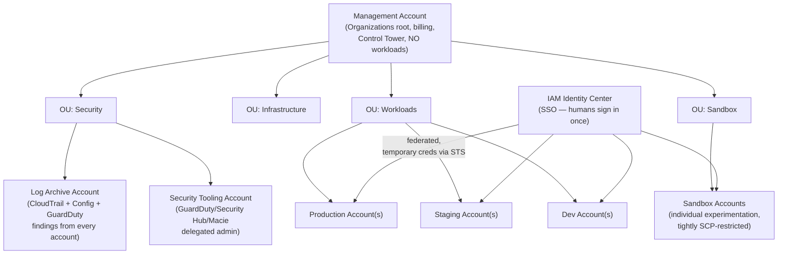

# Multi-Account Security Strategy (Landing Zone Pattern)

## Definition

A multi-account security strategy is the practice of splitting workloads across **many separate
AWS accounts** (instead of one big account with everything in it) and tying them together with
AWS Organizations, Control Tower, IAM Identity Center, and a small set of shared "security"
accounts — so that a mistake or breach in one account can't spread into another. This doc is the
architectural decision layer that sits on top of `organizations-and-scps.md`,
`iam-identity-center-sso.md`, and `sts-and-role-switching.md` — those docs explain the individual
mechanisms; this one explains how real organizations assemble them into a working account
structure (a "landing zone").

## Purpose

A single AWS account has no hard isolation between, say, a dev engineer's test resources and the
production database — IAM policies can reduce the blast radius, but one root-level mistake,
leaked root credential, or over-broad IAM policy can touch everything in the account. AWS's own
guidance (and the exam) treats **the account itself as the primary security boundary** — stronger
than any IAM policy, because IAM policies live inside an account and can be misconfigured, while
account boundaries are absolute (nothing crosses without an explicit cross-account trust policy).
Multi-account strategy exists to turn "one blob with internal fences" into "separate rooms with
guarded doors."

## How It Works

Plain explanation: an organization creates one **management account** (billing + Organizations
root, runs no workloads itself), then a small number of **foundational shared accounts**
(log archive, security tooling/audit) and **workload accounts** (one or more per team,
environment, or application — dev, staging, prod kept fully separate). AWS Control Tower
automates standing this structure up: it pre-wires a baseline OU layout, a set of guardrail SCPs,
centralized CloudTrail/Config logging into the log-archive account, and an **Account Factory**
for self-service creation of new, pre-governed accounts. Humans never get IAM users in individual
accounts — they sign into **IAM Identity Center** once and are handed temporary credentials
(via STS behind the scenes) into whichever account/role their group is permitted to assume.

Step by step: a developer signs into **IAM Identity Center** with their corporate credentials
(often federated from an external IdP like Okta/Azure AD). Identity Center maps their group
membership to a **permission set**, which Identity Center provisions as an IAM role in each
account they're allowed into. When they pick "dev account, DeveloperAccess," Identity Center
hands them temporary STS credentials scoped to that one role in that one account — nothing more.
Meanwhile, every account in the Organization has SCPs attached (inherited from the OU it sits in)
that cap what's possible *even for an account admin* — e.g., the Sandbox OU's SCP might block
all non-approved, potentially expensive services, while the Production OU's SCP blocks disabling
CloudTrail or leaving approved Regions. All CloudTrail logs and GuardDuty/Security Hub findings
from every account are automatically centralized into the Log Archive and Security Tooling
accounts, so a compromised workload account can't delete evidence of its own breach — the logs
never lived there in the first place.

## Key Components

- **Management account** — owns Organizations, consolidated billing, Control Tower; best
  practice: zero workloads, minimal human access.
- **Organizational Units (OUs)** — grouping by trust/compliance tier (Security, Infrastructure,
  Workloads, Sandbox), not by org chart — SCPs attach here.
- **Log Archive account** — write-once destination for CloudTrail/Config from every account;
  workload accounts get only read access, never delete.
- **Security Tooling account** — delegated administrator for GuardDuty, Security Hub, Macie so
  one team sees findings across the whole Organization without needing admin rights elsewhere.
- **Account Factory (Control Tower)** — self-service, pre-governed new account creation —
  every new account is born already inside an OU with baseline SCPs and logging wired up.
- **IAM Identity Center + permission sets** — the single human entry point; no long-lived IAM
  users inside workload accounts.
- **Guardrails** — Control Tower's pre-built SCP/Config-rule bundles (preventive = SCP,
  detective = Config rule) enforcing the baseline.

## Use Cases — When to Use It

- Any organization running more than a handful of environments/teams on AWS — the exam's default
  assumption for "enterprise" scenario questions is a multi-account setup.
- Regulatory separation — PCI-DSS cardholder data environment isolated into its own account so
  audit scope doesn't balloon to cover everything else.
- Strict prod/non-prod isolation — a bug or over-provisioned Auto Scaling group in dev can never
  touch production resources, because they're not reachable at all without an explicit
  cross-account role.
- Mergers/acquisitions or multi-team companies — each business unit gets its own account(s) for
  independent billing and blast-radius control, united under one Organization.

## When NOT to Use It / Alternatives

- A solo developer or tiny startup with one small workload — a single account with disciplined
  IAM (least privilege, MFA, no root use) is simpler and sufficient until team/compliance
  pressure justifies the operational overhead of a landing zone.
- If you need fine-grained permission differences *within* the same workload/team, that's still
  IAM policy design inside one account, not a new account boundary.

## Why It's Important

**Real-world:** the account boundary is the strongest, least-bypassable isolation AWS offers —
stronger than any IAM policy — which is why serious compliance programs (PCI, HIPAA, FedRAMP)
and every major cloud security framework treat multi-account design as foundational, not optional.

**Exam mapping:** SAA-C03 Domain 1, Task 1.1 names "multi-account strategy" and "Control Tower"
explicitly. Expect scenario questions where the "correct" answer is "move this workload to its
own account" rather than "write a more complex IAM policy."

## Pricing Model (summary)

AWS Organizations and Control Tower have **no additional service fee** — you pay only for
resources each member account consumes, rolled into one consolidated bill (which also unlocks
shared volume discounts on Savings Plans/S3 tiers across accounts). Official pricing:
https://aws.amazon.com/controltower/pricing/

## Hands-on Lab (Floci)

Floci runs as a single emulated account, so it cannot fully reproduce Organizations/Control
Tower's cross-account provisioning. See `labs.md` in this folder for the closest practical
approximation (simulating account-boundary-style isolation with IAM role boundaries and STS).

## Exam Tips

- "The account is the strongest security boundary" is the mental model the exam wants — when a
  scenario asks for the strongest possible isolation, the answer is usually a separate account,
  not a more restrictive IAM/SG rule.
- Control Tower = Organizations + automation (Account Factory, guardrails, centralized logging)
  — know it's built **on top of** Organizations, not a replacement for it.
- Management account should run no workloads — a question describing production resources in
  the management account is describing an anti-pattern.
- Centralized logging (Log Archive account) matters because it survives a compromise of the
  account being logged — a recurring "why not just keep logs in the same account" exam trap.

## Related Terms

- [`../../../services/security-identity-compliance/organizations-and-scps.md`](../../../services/security-identity-compliance/organizations-and-scps.md)
- [`../../../services/security-identity-compliance/iam-identity-center-sso.md`](../../../services/security-identity-compliance/iam-identity-center-sso.md)
- [`../../../services/security-identity-compliance/sts-and-role-switching.md`](../../../services/security-identity-compliance/sts-and-role-switching.md)
- [`../../../services/security-identity-compliance/iam.md`](../../../services/security-identity-compliance/iam.md)
