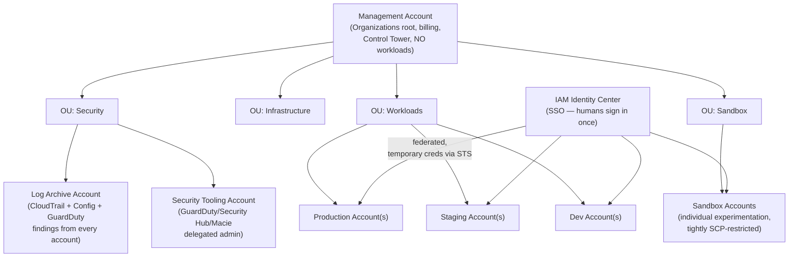
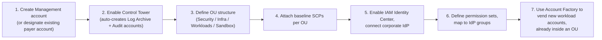

# Multi-Account Security Strategy (Landing Zone Pattern)

*Source: [AWS Prescriptive Guidance — Designing an AWS Control Tower Landing Zone](https://docs.aws.amazon.com/prescriptive-guidance/latest/designing-control-tower-landing-zone/account-structure.html)*

## Definition

A multi-account security strategy is the practice of splitting workloads across **many separate
AWS accounts** (instead of one big account with everything in it) and tying them together with
AWS Organizations, Control Tower, IAM Identity Center, and a small set of shared "security"
accounts — so that a mistake or breach in one account can't spread into another. This doc is the
architectural decision layer that sits on top of
[`organizations-and-scps.md`](../../../services/security-identity-compliance/organizations-and-scps.md),
[`iam-identity-center-sso.md`](../../../services/security-identity-compliance/iam-identity-center-sso.md),
and [`sts-and-role-switching.md`](../../../services/security-identity-compliance/sts-and-role-switching.md)
— those docs explain the individual mechanisms; this one explains how real organizations assemble
them into a working account structure (a "landing zone").

## Purpose

A single AWS account has no hard isolation between, say, a dev engineer's test resources and the
production database — IAM policies can reduce the blast radius, but one root-level mistake,
leaked root credential, or over-broad IAM policy can touch everything in the account. AWS's own
guidance (and the exam) treats **the account itself as the primary security boundary** — stronger
than any IAM policy, because IAM policies live inside an account and can be misconfigured, while
account boundaries are absolute (nothing crosses without an explicit cross-account trust policy).
Multi-account strategy exists to turn "one blob with internal fences" into "separate rooms with
guarded doors."

## How It Works

Plain explanation: an organization creates one **management account** (billing + Organizations
root, runs no workloads itself), then a small number of **foundational shared accounts**
(log archive, security tooling/audit) and **workload accounts** (one or more per team,
environment, or application — dev, staging, prod kept fully separate). AWS Control Tower
automates standing this structure up: it pre-wires a baseline OU layout, a set of guardrail SCPs,
centralized CloudTrail/Config logging into the log-archive account, and an **Account Factory**
for self-service creation of new, pre-governed accounts. Humans never get IAM users in individual
accounts — they sign into **IAM Identity Center** once and are handed temporary credentials
(via STS behind the scenes) into whichever account/role their group is permitted to assume.

Step by step: a developer signs into **IAM Identity Center** with their corporate credentials
(often federated from an external IdP like Okta/Azure AD). Identity Center maps their group
membership to a **permission set**, which Identity Center provisions as an IAM role in each
account they're allowed into. When they pick "dev account, DeveloperAccess," Identity Center
hands them temporary STS credentials scoped to that one role in that one account — nothing more.
Meanwhile, every account in the Organization has SCPs attached (inherited from the OU it sits in)
that cap what's possible *even for an account admin* — e.g., the Sandbox OU's SCP might block
all non-approved, potentially expensive services, while the Production OU's SCP blocks disabling
CloudTrail or leaving approved Regions. All CloudTrail logs and GuardDuty/Security Hub findings
from every account are automatically centralized into the Log Archive and Security Tooling
accounts, so a compromised workload account can't delete evidence of its own breach — the logs
never lived there in the first place.

## Account vesting order — how a landing zone actually gets built

Teams new to this pattern often ask "what order do we even do this in?" The practical sequence
the exam implicitly assumes:

Note that Control Tower's enrollment *itself* creates the Log Archive and Audit (security
tooling) accounts automatically — you don't hand-build those two; everything after step 2 is
customization of the baseline Control Tower already gave you.

## Key Components

- **Management account** — owns Organizations, consolidated billing, Control Tower; best
  practice: zero workloads, minimal human access.
- **Organizational Units (OUs)** — grouping by trust/compliance tier (Security, Infrastructure,
  Workloads, Sandbox), not by org chart — SCPs attach here.
- **Log Archive account** — write-once destination for CloudTrail/Config from every account;
  workload accounts get only read access, never delete.
- **Security Tooling account** — delegated administrator for GuardDuty, Security Hub, Macie so
  one team sees findings across the whole Organization without needing admin rights elsewhere.
- **Account Factory (Control Tower)** — self-service, pre-governed new account creation —
  every new account is born already inside an OU with baseline SCPs and logging wired up.
- **IAM Identity Center + permission sets** — the single human entry point; no long-lived IAM
  users inside workload accounts.
- **Guardrails** — Control Tower's pre-built SCP/Config-rule bundles (preventive = SCP,
  detective = Config rule) enforcing the baseline.
- **Cross-account roles** — the mechanism that lets a workload in one account (not just a human)
  reach a resource in another, via STS `AssumeRole`, always scoped to the minimum needed.

## Use Cases — When to Use It

- Any organization running more than a handful of environments/teams on AWS — the exam's default
  assumption for "enterprise" scenario questions is a multi-account setup.
- Regulatory separation — PCI-DSS cardholder data environment isolated into its own account so
  audit scope doesn't balloon to cover everything else.
- Strict prod/non-prod isolation — a bug or over-provisioned Auto Scaling group in dev can never
  touch production resources, because they're not reachable at all without an explicit
  cross-account role.
- Mergers/acquisitions or multi-team companies — each business unit gets its own account(s) for
  independent billing and blast-radius control, united under one Organization.
- Independent compliance boundaries — isolating a HIPAA-regulated workload in its own account so
  its audit, monitoring, and access review scope doesn't entangle with unrelated workloads.
- Experimentation without risk — a Sandbox OU lets individual engineers try services freely,
  guarded by an SCP that caps spend/service availability, without any path to production data.

## When NOT to Use It / Alternatives

- A solo developer or tiny startup with one small workload — a single account with disciplined
  IAM (least privilege, MFA, no root use) is simpler and sufficient until team/compliance
  pressure justifies the operational overhead of a landing zone.
- If you need fine-grained permission differences *within* the same workload/team, that's still
  IAM policy design inside one account, not a new account boundary.
- A short-lived proof-of-concept that will be torn down in weeks rarely justifies the Control
  Tower setup overhead — a single sandboxed account with a strict IAM boundary is pragmatic here,
  though even short projects benefit from being born inside an existing Sandbox OU if one already
  exists.

## Use Cases — Real Scenarios

- **Global law firm with 15 regional offices.** Each office's client-matter documents live in its
  own member account (attorney-client privilege and conflict-of-interest walls enforced at the
  account boundary, not just folder permissions), while a single management account handles
  consolidated billing across all 15 — satisfying both the confidentiality requirement and the
  CFO's desire for one invoice.
- **Biotech company running clinical trials across multiple pharma sponsors.** Each sponsor's
  trial data sits in its own account under a "Sponsors" OU with an SCP preventing any cross-sponsor
  data egress, so a single compromised researcher credential in one trial's account structurally
  cannot reach a competing sponsor's trial data — a requirement no IAM policy alone could prove to
  an external auditor.
- **Gaming company separating "live ops" from "new title development."** The live, revenue-
  generating game's production account has strict SCPs (no new Region deployment without a change
  ticket); the Sandbox OU for prototyping new titles allows broad experimentation with only a cost
  ceiling guardrail — different trust tiers for genuinely different risk profiles.
- **University IT department managing hundreds of individual research grants.** Control Tower's
  Account Factory vends a pre-governed, pre-logged account automatically whenever a new grant is
  approved, instead of IT manually provisioning each one over days — meeting both the speed
  researchers want and the baseline security posture compliance requires.
- **Retail bank separating its core banking system from its marketing website.** The marketing
  site (far lower sensitivity, public-facing, frequently updated by an external agency) sits in a
  completely separate account from core banking, so a marketing-site compromise (the more exposed,
  more frequently changed surface) has zero network or IAM path into the banking systems.
- **Private equity firm managing newly-acquired portfolio companies' AWS footprints.** Each
  acquisition's existing AWS account is invited into the firm's Organization under a "Portfolio"
  OU with baseline guardrail SCPs applied immediately, without needing to first migrate or
  re-architect the acquired company's workloads.
- **Defense contractor running both unclassified and controlled-unclassified-information (CUI)
  workloads.** The CUI workload sits in an account with a far stricter SCP set (no public IP
  addresses permitted anywhere in the account, enforced at the Organization level) than the
  unclassified side, with IAM Identity Center permission sets kept entirely separate so no
  engineer's access spans both tiers by default.
- **Fast-growing SaaS company that outgrew "one big account."** What started as a single account
  with increasingly complex IAM policies trying to separate dev/staging/prod is migrated into
  Control Tower with one account per environment — the team reports the actual IAM policies got
  *simpler*, not more complex, once the account boundary did the separation work instead.
- **Media conglomerate consolidating billing after years of each subsidiary paying AWS
  separately.** Bringing all subsidiary accounts under one Organization immediately unlocks
  shared-tier S3 and Savings Plan discounts across the combined spend, without requiring any
  subsidiary to migrate a single workload.

## Why It's Important

**Real-world:** the account boundary is the strongest, least-bypassable isolation AWS offers —
stronger than any IAM policy — which is why serious compliance programs (PCI, HIPAA, FedRAMP)
and every major cloud security framework treat multi-account design as foundational, not optional.

**Exam mapping:** SAA-C03 Domain 1, Task 1.1 names "multi-account strategy" and "Control Tower"
explicitly. Expect scenario questions where the "correct" answer is "move this workload to its
own account" rather than "write a more complex IAM policy."

## Pricing Model (summary)

AWS Organizations and Control Tower have **no additional service fee** — you pay only for
resources each member account consumes, rolled into one consolidated bill (which also unlocks
shared volume discounts on Savings Plans/S3 tiers across accounts). Official pricing:
https://aws.amazon.com/controltower/pricing/

## Common Mistakes (what wrong answers on the exam look like)

- Running production workloads in the management account "because it already exists" — the
  management account should have zero workloads; a question describing this is describing an
  anti-pattern to fix.
- Granting broad IAM Identity Center permission sets "to keep things simple" instead of scoping
  one permission set per role/environment — this reintroduces the exact over-permissioning
  multi-account design is meant to prevent.
- Storing CloudTrail logs only in the account being logged — if that account is compromised, the
  attacker can delete the evidence; centralizing into a dedicated Log Archive account is the fix.
- Using VPC peering or a shared security group as a substitute for a true account boundary when a
  scenario asks for the *strongest* isolation available — peering/SGs are network controls inside
  a weaker boundary than a separate account.
- Treating SCPs as a replacement for IAM policies — SCPs only ever remove permissions (a ceiling);
  they never grant anything. An SCP with no matching IAM/permission-set grant underneath still
  results in "access denied," which is a common exam trap testing whether you understand SCPs
  are a ceiling, not a grant mechanism.

## Hands-on Lab (Floci)

Floci runs as a single emulated account, so it cannot fully reproduce Organizations/Control
Tower's cross-account provisioning. See `labs.md` in this folder for the closest practical
approximation (simulating account-boundary-style isolation with IAM role boundaries and STS).

## Exam Tips

- "The account is the strongest security boundary" is the mental model the exam wants — when a
  scenario asks for the strongest possible isolation, the answer is usually a separate account,
  not a more restrictive IAM/SG rule.
- Control Tower = Organizations + automation (Account Factory, guardrails, centralized logging)
  — know it's built **on top of** Organizations, not a replacement for it.
- Management account should run no workloads — a question describing production resources in
  the management account is describing an anti-pattern.
- Centralized logging (Log Archive account) matters because it survives a compromise of the
  account being logged — a recurring "why not just keep logs in the same account" exam trap.
- Effective permission = IAM/permission-set grant ∩ SCP ceiling, always the intersection — never
  assume an administrator's broad IAM policy wins over a more restrictive SCP; the SCP always
  wins when the two disagree.
- Delegated administrator (for GuardDuty/Security Hub/Macie) lets a *non-management* account
  manage a service org-wide — a subtle but recurring exam distinction from the management
  account itself needing to hold every admin privilege.

## Related Terms

- [`../../../services/security-identity-compliance/organizations-and-scps.md`](../../../services/security-identity-compliance/organizations-and-scps.md)
- [`../../../services/security-identity-compliance/iam-identity-center-sso.md`](../../../services/security-identity-compliance/iam-identity-center-sso.md)
- [`../../../services/security-identity-compliance/sts-and-role-switching.md`](../../../services/security-identity-compliance/sts-and-role-switching.md)
- [`../../../services/security-identity-compliance/iam.md`](../../../services/security-identity-compliance/iam.md)
- [`../../../services/security-identity-compliance/guardduty.md`](../../../services/security-identity-compliance/guardduty.md),
  [`../../../services/security-identity-compliance/macie.md`](../../../services/security-identity-compliance/macie.md),
  [`../../../services/security-identity-compliance/security-hub-and-inspector.md`](../../../services/security-identity-compliance/security-hub-and-inspector.md) — the delegated-admin services this landing zone centralizes
- [`vpc-security-architecture-patterns.md`](vpc-security-architecture-patterns.md) — the
  network-level security layer that lives *inside* each workload account this doc describes
- [`../domain-4-cost-optimized-architectures/README.md`](../domain-4-cost-optimized-architectures/README.md)
  — multi-account billing also unlocks shared Savings Plan/Reserved Instance discounts
