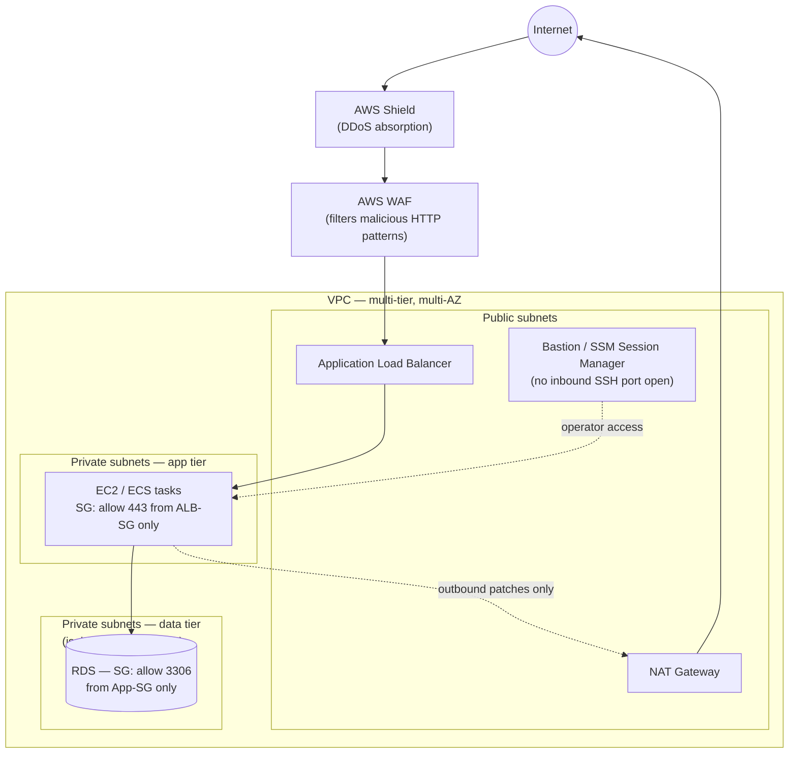

# VPC Security Architecture Patterns

## Definition

This is the decision layer on top of the individual VPC networking docs
(`vpc.md`, `security-groups-vs-nacls.md`, `subnets-route-tables-igw-natgw.md`) — it answers
"given these building blocks, how do you actually lay out a secure network?" rather than
explaining any one piece in isolation.

## Purpose

Knowing what a security group or a NAT gateway *is* doesn't tell you where to put your database,
how many subnet tiers you need, or why a bastion host beats opening SSH to the internet. The exam
tests this synthesis constantly: a question describes a workload and expects you to pick the
right subnet placement, the right layered firewall rules, and the right "how does this resource
reach the internet" answer — this doc collects that reasoning in one place.

## How It Works — The Layered Pattern

Plain explanation: production VPC security is built in **layers**, each one independently
capable of stopping a mistake in the layer around it — nothing relies on a single control.

Step by step: **Shield** sits at the edge absorbing volumetric DDoS before it reaches anything.
**WAF** attaches to the ALB/CloudFront and blocks malicious request *patterns* (SQLi, XSS) that
DDoS protection wouldn't catch — different problem, different layer. The **ALB lives in public
subnets** because it must be internet-reachable; everything behind it does not. The **app tier
is in private subnets**, reachable only from the ALB's security group (not from "anywhere," and
not even from the whole VPC CIDR — security groups should reference other security groups, not
IP ranges, wherever possible). The **data tier is in its own private subnets** with a security
group that only accepts traffic from the app tier's security group on the database port — the
database security group should never reference `0.0.0.0/0` or even the whole VPC CIDR. A
**NAT Gateway** lets the app tier reach the internet outbound (e.g., OS patches, hitting a
third-party API) without being reachable from it; the data tier commonly has **no route to a NAT
Gateway at all**, because a database should never need outbound internet access — if it does,
that's a red flag worth questioning in both real design and exam scenarios. Finally, operator
access to private instances goes through **Systems Manager Session Manager** (no open SSH/RDP
port, no bastion to patch and secure) or, if a bastion is explicitly required by the scenario,
one hardened bastion host rather than opening port 22 broadly.

## Key Decision Points

- **Security Groups vs NACLs — use both, for different jobs.** Security groups are
  stateful and instance-level (the default-deny, explicit-allow firewall you touch constantly);
  NACLs are stateless and subnet-level (a coarser, second layer — good for an explicit subnet-wide
  deny, e.g., blocking a known-bad IP range at the subnet boundary before it even reaches an
  instance's security group).
- **Public vs private subnet is defined by the route table**, not a label — a subnet with no
  route to an Internet Gateway is private regardless of its name.
- **Three-tier placement**: public (load balancer only) → private-app (compute) →
  private-data (database), each its own subnet group, each its own security group referencing
  the tier in front of it.
- **No direct internet exposure for data stores** — RDS/ElastiCache/EFS should sit in subnets
  with no route to an Internet Gateway and ideally no NAT route either.
- **Prefer Session Manager over bastion hosts** where the scenario allows it — it removes an
  open inbound port entirely and is IAM-governed, which the exam increasingly favors as the
  "most secure" answer over a traditional bastion.
- **VPC Flow Logs** at the ENI/subnet/VPC level for auditing what the security groups/NACLs
  actually permitted or blocked, feeding into GuardDuty and Security Hub.

## Common Mistakes (what wrong answers on the exam look like)

- Security group allowing `0.0.0.0/0` on a database port "because it was faster to set up."
- Relying on NACLs alone for instance-level control — NACLs don't track connection state, so
  you'd need explicit ephemeral-port return-traffic rules that are easy to get wrong.
- Putting EC2/RDS directly in a public subnet "to make outbound internet access simpler" instead
  of using a NAT Gateway from a private subnet.
- Opening SSH (port 22) from `0.0.0.0/0` instead of a bastion/Session Manager/VPN-restricted
  source.

## Why It's Important

**Exam mapping:** SAA-C03 Domain 1, Task 1.2 is built entirely around this synthesis — the exam
guide's own phrasing ("security groups, NACLs, route tables, NAT gateways, public/private subnet
segmentation") is a description of this exact layered pattern, not a list of isolated facts.

## Related Terms

- [`../../../services/networking-content-delivery/vpc.md`](../../../services/networking-content-delivery/vpc.md)
- [`../../../services/networking-content-delivery/security-groups-vs-nacls.md`](../../../services/networking-content-delivery/security-groups-vs-nacls.md)
- [`../../../services/networking-content-delivery/subnets-route-tables-igw-natgw.md`](../../../services/networking-content-delivery/subnets-route-tables-igw-natgw.md)
- [`../../../services/management-governance/systems-manager.md`](../../../services/management-governance/systems-manager.md)
- [`../../../services/security-identity-compliance/waf.md`](../../../services/security-identity-compliance/waf.md),
  [`../../../services/security-identity-compliance/shield.md`](../../../services/security-identity-compliance/shield.md)
