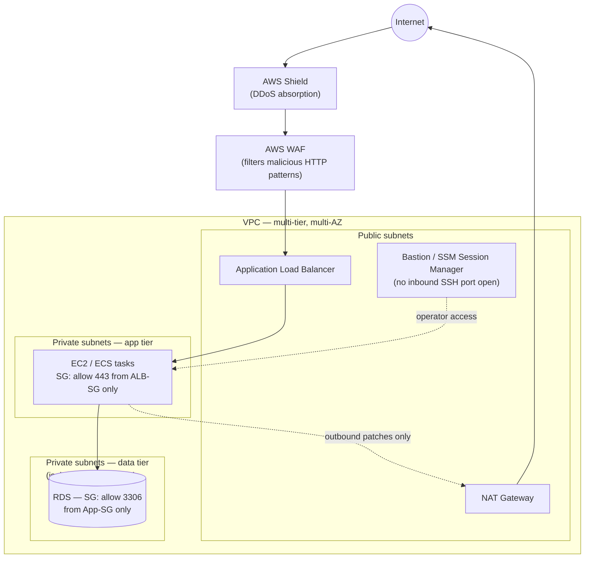
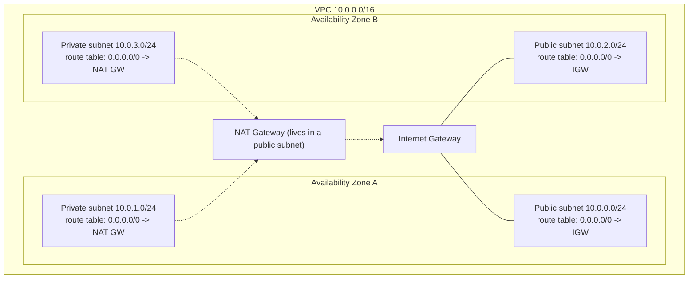
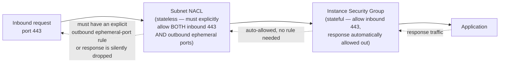
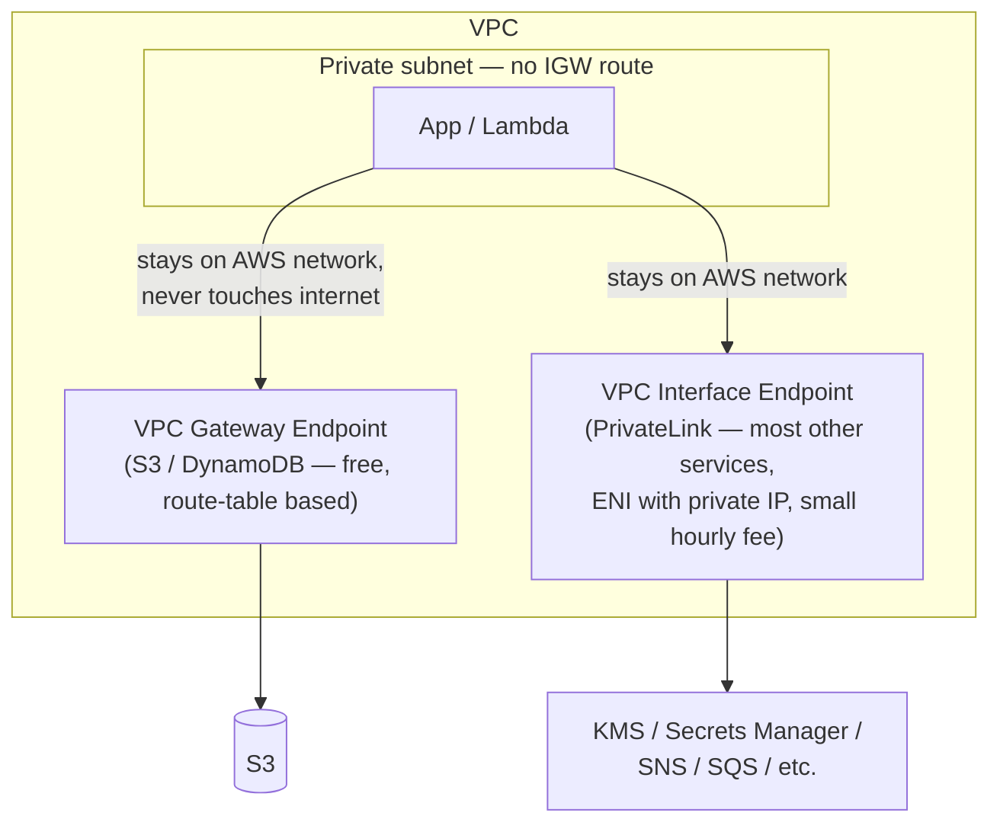

# VPC Security Architecture Patterns

*Source: [Amazon VPC User Guide — Subnets for your VPC](https://docs.aws.amazon.com/vpc/latest/userguide/configure-subnets.html)*

## Definition

This is the decision layer on top of the individual VPC networking docs
(`vpc.md`, `security-groups-vs-nacls.md`, `subnets-route-tables-igw-natgw.md`) — it answers
"given these building blocks, how do you actually lay out a secure network?" rather than
explaining any one piece in isolation.

## Purpose

Knowing what a security group or a NAT gateway *is* doesn't tell you where to put your database,
how many subnet tiers you need, or why a bastion host beats opening SSH to the internet. The exam
tests this synthesis constantly: a question describes a workload and expects you to pick the
right subnet placement, the right layered firewall rules, and the right "how does this resource
reach the internet" answer — this doc collects that reasoning in one place.

## How It Works — The Layered Pattern

Plain explanation: production VPC security is built in **layers**, each one independently
capable of stopping a mistake in the layer around it — nothing relies on a single control.

Step by step: **Shield** sits at the edge absorbing volumetric DDoS before it reaches anything.
**WAF** attaches to the ALB/CloudFront and blocks malicious request *patterns* (SQLi, XSS) that
DDoS protection wouldn't catch — different problem, different layer. The **ALB lives in public
subnets** because it must be internet-reachable; everything behind it does not. The **app tier
is in private subnets**, reachable only from the ALB's security group (not from "anywhere," and
not even from the whole VPC CIDR — security groups should reference other security groups, not
IP ranges, wherever possible). The **data tier is in its own private subnets** with a security
group that only accepts traffic from the app tier's security group on the database port — the
database security group should never reference `0.0.0.0/0` or even the whole VPC CIDR. A
**NAT Gateway** lets the app tier reach the internet outbound (e.g., OS patches, hitting a
third-party API) without being reachable from it; the data tier commonly has **no route to a NAT
Gateway at all**, because a database should never need outbound internet access — if it does,
that's a red flag worth questioning in both real design and exam scenarios. Finally, operator
access to private instances goes through **Systems Manager Session Manager** (no open SSH/RDP
port, no bastion to patch and secure) or, if a bastion is explicitly required by the scenario,
one hardened bastion host rather than opening port 22 broadly.

## Architecture: Internet Gateway vs. No Route — Public vs. Private, Precisely

The exam-critical fact this diagram encodes: **"public" and "private" are route-table labels, not
subnet properties.** A subnet becomes public the moment its route table sends `0.0.0.0/0` traffic
to an Internet Gateway; it is private the moment that route instead points to nothing, or to a
NAT Gateway. Two subnets with identical names and identical security groups can have completely
different exposure purely because of what their route table says — this is one of the single
most commonly misunderstood facts tested on Domain 1.

## Architecture: Security Group vs. NACL — Stateful vs. Stateless in Practice

This is the most frequently tested "gotcha" in this whole domain: forgetting that NACLs, being
stateless, need an **explicit outbound rule for the ephemeral port range** (1024-65535, typically)
to let return traffic leave the subnet — a security group never needs this because it tracks
connection state automatically. A scenario describing "inbound traffic reaches the instance but
the response never gets back to the client, and security groups look correctly configured" is
almost always describing a missing NACL outbound ephemeral-port rule.

## Architecture: Private Resources Reaching AWS Services Without Internet Exposure

A private-subnet resource that needs to reach S3, DynamoDB, KMS, Secrets Manager, or most other
AWS services does **not** need a NAT Gateway or Internet Gateway route at all if a VPC endpoint
exists for that service — which is both a security win (traffic never transits the public
internet, even conceptually through an IGW) and the direct mechanism behind the Domain 4 cost
pattern of avoiding NAT Gateway data-processing charges (see
[`../domain-4-cost-optimized-architectures/network-cost-optimization-decision-framework.md`](../domain-4-cost-optimized-architectures/network-cost-optimization-decision-framework.md)).

## Key Decision Points

- **Security Groups vs NACLs — use both, for different jobs.** Security groups are
  stateful and instance-level (the default-deny, explicit-allow firewall you touch constantly);
  NACLs are stateless and subnet-level (a coarser, second layer — good for an explicit subnet-wide
  deny, e.g., blocking a known-bad IP range at the subnet boundary before it even reaches an
  instance's security group).
- **Public vs private subnet is defined by the route table**, not a label — a subnet with no
  route to an Internet Gateway is private regardless of its name.
- **Three-tier placement**: public (load balancer only) → private-app (compute) →
  private-data (database), each its own subnet group, each its own security group referencing
  the tier in front of it.
- **No direct internet exposure for data stores** — RDS/ElastiCache/EFS should sit in subnets
  with no route to an Internet Gateway and ideally no NAT route either.
- **Prefer Session Manager over bastion hosts** where the scenario allows it — it removes an
  open inbound port entirely and is IAM-governed, which the exam increasingly favors as the
  "most secure" answer over a traditional bastion.
- **VPC Flow Logs** at the ENI/subnet/VPC level for auditing what the security groups/NACLs
  actually permitted or blocked, feeding into GuardDuty and Security Hub.
- **VPC endpoints remove the need for internet exposure entirely** for AWS-service traffic —
  default to a Gateway endpoint (S3/DynamoDB, free) or Interface endpoint (PrivateLink, most other
  services) over routing that traffic through a NAT Gateway.
- **Security groups default-deny inbound, default-allow outbound** — a very commonly tested
  default: a brand-new security group with no inbound rules blocks all inbound traffic but
  permits all outbound traffic until you add a rule restricting it.
- **NACL rules are evaluated in numeric order**, lowest rule number first, and the first match
  wins — unlike security groups, where all matching "allow" rules are simply additive.

## Common Mistakes (what wrong answers on the exam look like)

- Security group allowing `0.0.0.0/0` on a database port "because it was faster to set up."
- Relying on NACLs alone for instance-level control — NACLs don't track connection state, so
  you'd need explicit ephemeral-port return-traffic rules that are easy to get wrong.
- Putting EC2/RDS directly in a public subnet "to make outbound internet access simpler" instead
  of using a NAT Gateway from a private subnet.
- Opening SSH (port 22) from `0.0.0.0/0` instead of a bastion/Session Manager/VPN-restricted
  source.
- Forgetting that a NAT Gateway itself must live in a **public** subnet (it needs its own route
  to the Internet Gateway) even though it serves **private** subnet traffic — a NAT Gateway placed
  in a private subnet cannot reach the internet at all.
- Believing a security group change takes effect only on new connections — in fact, security
  group rule changes apply immediately to existing connections too (tightening a rule can drop an
  active session); this is the opposite behavior from how some engineers assume firewalls work.
- Treating a VPC endpoint as a replacement for IAM/resource policies — an endpoint controls *network
  reachability*, not *authorization*; you still need an IAM policy (and often an endpoint policy)
  granting the actual API permission.

## Full Worked Mini-Case: Retrofitting an Insecure Three-Tier App

**Starting state (what the exam calls out as wrong):** a company runs a web app with the ALB, EC2
app servers, and RDS database all in the *same* public subnet, one shared security group allowing
`0.0.0.0/0` on ports 22, 80, 443, and 3306, and SSH open directly to app servers and the database
host both.

**Retrofit, mapped to this doc's pattern:**

1. Create two new private subnet tiers (app, data) across two AZs; migrate EC2 app servers into
   the app-tier private subnets and RDS into the data-tier private subnets. The ALB alone stays
   in the public subnets.
2. Split the one shared security group into three: `alb-sg` (inbound 443 from `0.0.0.0/0`),
   `app-sg` (inbound 443 from `alb-sg` only), `db-sg` (inbound 3306 from `app-sg` only).
3. Remove the direct SSH rule entirely; attach the SSM agent/IAM instance profile to app servers
   and use Session Manager for operator access — no inbound port 22 anywhere.
4. Add a NAT Gateway in a public subnet, routed from the app-tier's route table, for the app
   tier's outbound-only internet needs; give the data tier no internet route of any kind.
5. Add a Gateway VPC Endpoint for S3 if the app reads/writes S3 objects, removing that traffic
   from the NAT Gateway path entirely.

Each numbered step maps directly to one bullet in "Key Decision Points" above — this is the
synthesis the exam is actually testing, not memorization of any single fact in isolation.

## Why It's Important

**Exam mapping:** SAA-C03 Domain 1, Task 1.2 is built entirely around this synthesis — the exam
guide's own phrasing ("security groups, NACLs, route tables, NAT gateways, public/private subnet
segmentation") is a description of this exact layered pattern, not a list of isolated facts.

## Exam Tips

- If a question's wrong answers all involve "a bigger/broader security group rule," the right
  answer is almost always "a narrower rule referencing a specific security group," not a broader
  CIDR.
- "Most secure operator access" almost always means Session Manager over a bastion host when both
  are offered as choices.
- When a scenario says "must never be reachable from the internet, under any circumstance," check
  for *route table* answers (no IGW/NAT route) before security-group answers — a missing route is
  a stronger guarantee than any firewall rule.
- Remember VPC Flow Logs capture ACCEPT/REJECT decisions at the ENI level and are the forensic
  trail GuardDuty and Security Hub read from — a scenario about auditing what traffic was blocked
  points here.

## Related Terms

- [`../../../services/networking-content-delivery/vpc.md`](../../../services/networking-content-delivery/vpc.md)
- [`../../../services/networking-content-delivery/security-groups-vs-nacls.md`](../../../services/networking-content-delivery/security-groups-vs-nacls.md)
- [`../../../services/networking-content-delivery/subnets-route-tables-igw-natgw.md`](../../../services/networking-content-delivery/subnets-route-tables-igw-natgw.md)
- [`../../../services/networking-content-delivery/vpc-endpoints-privatelink.md`](../../../services/networking-content-delivery/vpc-endpoints-privatelink.md)
- [`../../../services/management-governance/systems-manager.md`](../../../services/management-governance/systems-manager.md)
- [`../../../services/security-identity-compliance/waf.md`](../../../services/security-identity-compliance/waf.md),
  [`../../../services/security-identity-compliance/shield.md`](../../../services/security-identity-compliance/shield.md)
- [`multi-account-security-strategy.md`](multi-account-security-strategy.md) — the account-level
  boundary this VPC pattern lives inside of
- [`../domain-3-high-performing-architectures/network-performance-architecture-patterns.md`](../domain-3-high-performing-architectures/network-performance-architecture-patterns.md) —
  the same subnet/endpoint building blocks revisited for performance
- [`../domain-4-cost-optimized-architectures/network-cost-optimization-decision-framework.md`](../domain-4-cost-optimized-architectures/network-cost-optimization-decision-framework.md) —
  the same NAT Gateway/VPC endpoint choice revisited for cost
