# MASTER CHUNK — Domain 2: Design Resilient Architectures (26%)

> **Purpose of this file:** every one of this domain's 22 tested services/topics, in one
> standalone, scroll-and-study document. You should be able to read this file top to bottom the
> night before the exam and never have to jump to another file. Each entry follows the same
> shape: **Definition → Analogy → Purpose → When to Use → When NOT to Use → Use Cases → Why
> Important → How It Works (diagram) → Visual Reference (real AWS image) → Exam Tips**, plus a
> link to the full `services/` doc if you want more depth than a study chunk needs. For the
> deepest possible treatment of any one service — worked CLI examples, full pricing tables,
> troubleshooting runbooks, every quota — follow that link; this file is the 80/20 version of
> all 22, tuned for exam recall and real-architecture intuition, not operational reference.
>
> Domain 2 splits into two task statements this file constantly cross-references:
> **Task 2.1 — Design scalable and loosely coupled architectures** (the "architecture shape"
> question: decoupled vs. monolithic, can one slow piece drag down the rest) and
> **Task 2.2 — Design highly available and/or fault-tolerant architectures** (the "failure
> response" question: automatic failover, backup/DR). Every section below is tagged with which
> task(s) it maps to.

## Table of Contents

1. [Amplify](#1-aws-amplify) — Task 2.1
2. [AWS Backup](#2-aws-backup) — Task 2.2
3. [Device Farm](#3-aws-device-farm) — Task 2.1
4. [Fargate](#4-aws-fargate) — Task 2.1
5. [Step Functions](#5-aws-step-functions) — Task 2.1
6. [X-Ray](#6-aws-x-ray) — Task 2.2
7. [API Gateway](#7-amazon-api-gateway) — Task 2.1
8. [Aurora](#8-amazon-aurora) — Task 2.1 / 2.2
9. [CloudFront](#9-amazon-cloudfront) — Task 2.1
10. [EC2 Auto Scaling](#10-amazon-ec2-auto-scaling) — Task 2.1 / 2.2
11. [ECS](#11-amazon-ecs) — Task 2.1
12. [EKS](#12-amazon-eks) — Task 2.1
13. [EventBridge](#13-amazon-eventbridge) — Task 2.1
14. [Fraud Detector & Kendra](#14-amazon-fraud-detector--amazon-kendra) — Task 2.1
15. [Amazon MQ](#15-amazon-mq) — Task 2.1
16. [Pinpoint](#16-amazon-pinpoint) — Task 2.1
17. [RDS](#17-amazon-rds) — Task 2.2
18. [Route 53](#18-amazon-route-53) — Task 2.2
19. [SNS](#19-amazon-sns) — Task 2.1
20. [SQS](#20-amazon-sqs) — Task 2.1
21. [Containers vs. VMs vs. Serverless](#21-containers-vs-vms-vs-serverless) — Task 2.1
22. [Elastic Load Balancing](#22-elastic-load-balancing) — Task 2.1 / 2.2
23. [Messaging Patterns Overview](#23-messaging-patterns-overview) — Task 2.1
24. [Niche Compute Services](#24-niche-compute-services-outposts-wavelength-sar-vmware-cloud-on-aws) — Task 2.1

---

## 1. AWS Amplify

**Definition.** AWS Amplify is a set of tools and services for building and deploying full-stack
web and mobile applications quickly — it provisions a backend (auth, API, database, storage,
functions) from CLI commands or TypeScript config, gives you client libraries to call that
backend, and hosts/deploys your frontend with Git-push CI/CD — all without you hand-wiring each
underlying AWS service yourself.

**Analogy.** Building a full-stack app from raw AWS services is like building a house by
individually sourcing lumber, wiring, plumbing, and a crew for each room. Amplify is the
general contractor: you say "I need a login system, a database-backed API, and a place to store
files," and it pulls in the right trades (Cognito for auth, AppSync/DynamoDB for the API, S3 for
storage), wires them together correctly, and hands you a single, working front door — while you
can still walk into any individual room (open the Cognito console) and see exactly how it was
built.

**Purpose.** A typical full-stack app needs an auth service, an API layer, a database, file
storage, and a CI/CD-driven hosting pipeline before a single feature ships. Wiring all five
together correctly (consistent IAM roles, matching API schemas, a working deploy pipeline) is
real, repetitive work most app teams don't want to own. Amplify collapses that setup from
days/weeks of manual wiring to a CLI command or console click, while still deploying real,
individually-manageable AWS resources underneath.

**When to Use.** Standing up a full-stack mobile/web backend fast; rapid prototyping/hackathon
MVPs; static site/SPA hosting with Git-based CI/CD and PR previews; mobile apps needing
offline-first data sync (DataStore); apps needing drop-in, pre-styled auth UI; teams wanting
environment-per-Git-branch isolation.

**When NOT to Use.** An existing, complex backend architecture that doesn't map cleanly to
Amplify's categories (wire Cognito/AppSync/DynamoDB/S3 directly instead); you need fine-grained,
non-standard infrastructure control (use CloudFormation/CDK directly — Amplify generates
CloudFormation under the hood but optimizes for setup speed, not maximal control); your frontend
hosting is already solved elsewhere; heavy server-side rendering/backend logic beyond simple
Lambda functions (consider Elastic Beanstalk, App Runner, or ECS/Fargate instead).

**Use Cases.**
- A three-person startup needs auth + GraphQL API + file upload shipped in days, not sprints —
  `amplify init && amplify add api && amplify push` gets a working backend live same-day.
- A React SPA needs automatic build-and-deploy on every Git push, including PR preview URLs for
  reviewers, without hand-wiring S3 + CloudFront + a CI tool.
- A field-service mobile app must work fully offline and sync changes once connectivity returns —
  DataStore's built-in offline cache and conflict resolution handles this natively.
- A team wants dev/staging/prod as genuinely separate, isolated backend environments tied
  one-to-one with Git branches, with zero manual per-environment CloudFormation stack management.
- A mobile team wants a complete, pre-styled login/sign-up/MFA flow in a few lines of code instead
  of hand-building a Cognito Hosted UI integration from scratch.

**Why Important.** Amplify meaningfully lowers the barrier for small teams to ship a
production-grade, horizontally-scalable backend without becoming infrastructure experts — and
because every resource it provisions is real and individually inspectable, teams aren't locked
into Amplify's CLI forever if they outgrow it. On the exam, Amplify is a recognition-level
service: know what it bundles (auth + API + storage + hosting) and that it decouples the app
team from hand-wiring each underlying service, which is exactly the "loosely coupled, fast to
build" theme Task 2.1 tests.

**How It Works.**

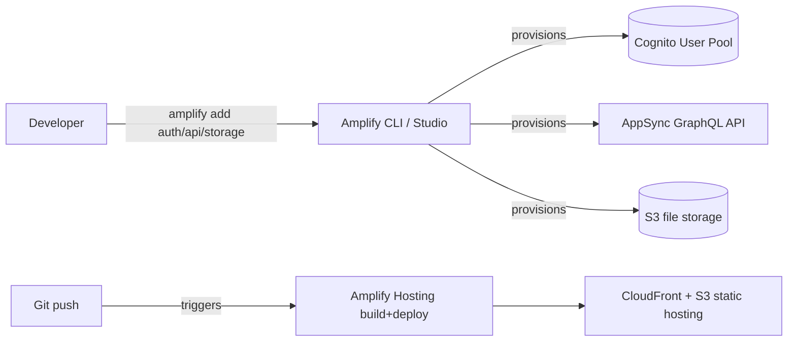

Each `amplify add <category>` command provisions a real, standalone AWS resource — not a hidden
proprietary runtime — and generates a config file (`aws-exports.js`/`amplify_outputs.json`) your
app imports once. Separately, Amplify Hosting watches your Git repo and redeploys the frontend on
every push to a tracked branch, with PR-based preview environments included.

**Visual Reference.**


*Source: [AWS Reference Architecture Diagrams — "ReadForMe"](https://docs.aws.amazon.com/reference-architecture-diagrams/latest/readforme/readforme.html).* This reference architecture
shows Amplify distributing a serverless mobile/web app's frontend (HTML/JS/CSS) to end-user
devices, while Cognito grants those devices temporary, scoped AWS credentials to call the rest of
the backend (Textract, Polly, Step Functions) directly — the exact "Amplify ships the client,
Cognito authorizes it, the rest is real AWS services" pattern this whole section describes. It's
a useful reminder that Amplify's value is concentrated at the client-to-backend handoff, not in
replacing the backend services themselves.

**Exam Tips.**
- **"Fast full-stack app backend without managing each AWS service individually"** is the
  direct Amplify trigger phrase.
- Amplify provisions **real, separately manageable AWS resources** — it is not a hidden
  proprietary compute platform; you can always "eject" to the raw Cognito/AppSync/S3 consoles.
- Don't confuse Amplify (build the backend) with **Device Farm** (test the app) or **Pinpoint**
  (engage users post-launch) — same exam category, three different lifecycle stages.

*Deeper dive:* [`services/front-end-web-mobile/amplify.md`](../../../services/front-end-web-mobile/amplify.md)

---

## 2. AWS Backup

**Definition.** AWS Backup is a fully managed, centralized backup service that lets you define
backup policies once (schedule, retention, cross-Region/cross-account copy rules) and apply them
across many AWS services — EBS, RDS, DynamoDB, EFS, S3, and more — from one console, instead of
configuring each service's own native backup feature separately.

**Analogy.** Without AWS Backup, backing up a multi-service application is like each department
in a company keeping its own filing cabinet with its own lock, its own schedule for archiving old
files, and its own offsite storage vendor — nothing is consistent, and an auditor asking "show me
everything backed up in the last 30 days" gets five different answers. AWS Backup is the single
company-wide records-management policy: one retention schedule, one vault, one audit trail,
applied uniformly across every department (service) at once.

**Purpose.** Each AWS storage/database service historically had its own, separately-configured
backup mechanism (RDS automated backups, EBS snapshots, DynamoDB point-in-time recovery) with no
unified policy, reporting, or cross-account/cross-Region copy management. AWS Backup exists to
centralize that: define a backup plan once, tag the resources it applies to, and get consistent
retention, lifecycle (transition to cold storage), cross-Region/cross-account copying, and
compliance reporting across every supported service from a single pane of glass.

**When to Use.** Any multi-service application where backup policy needs to be consistent,
centrally audited, and provably compliant (SOC2/HIPAA/PCI-DSS); cross-Region DR copies as the
"Backup & Restore" rung of the DR ladder; organizations managing backups across many AWS accounts
via AWS Organizations; any time a security/compliance review needs one report answering "what's
backed up, how long is it kept, and is it tested."

**When NOT to Use.** A single service with one simple backup need and no cross-service/
cross-account consistency requirement — that service's own native snapshot/backup feature may be
simpler to configure directly; extremely latency-sensitive continuous-replication DR needs (Aurora
Global Database/DynamoDB Global Tables are a better fit than scheduled backup copies for near-zero
RPO).

**Use Cases.**
- A healthcare company must prove to an auditor that every RDS instance, EFS file system, and S3
  bucket in production follows an identical 35-day retention policy — one AWS Backup plan, tagged
  resources, one compliance report, instead of five different configurations to audit separately.
- A company's DR strategy requires nightly snapshots copied to a second Region — AWS Backup's
  cross-Region copy rule does this declaratively, feeding the "Backup & Restore" rung of the DR
  ladder described in `disaster-recovery-strategies.md`.
- A platform team managing 40 AWS accounts under AWS Organizations wants one centrally-defined
  backup policy enforced on every account via AWS Backup's organization-wide policies, rather than
  per-account manual configuration.
- A data-lake team needs backup vaults with separate storage-administrator and
  backup-administrator IAM personas, so no single role can both create data and delete its own
  backups — a direct security-separation-of-duties requirement.
- A company recovering from a ransomware-style incident needs backup vaults with
  immutability/vault lock to guarantee backups can't be altered or deleted even by a compromised
  admin credential.

**Why Important.** Untested or inconsistent backups are one of the most common real causes of a
"we thought we had a backup" disaster-recovery failure. AWS Backup's centralization turns backup
policy from "five teams' separate tribal knowledge" into one declarative, auditable plan — a
direct, measurable reduction in real operational risk, and the exact mechanism Task 2.2's
"backup/DR strategies" wording points to.

**How It Works.**

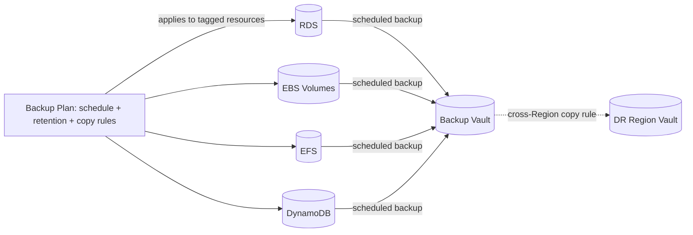

You tag resources (or select them by resource type), attach them to a backup plan with a cron-like
schedule and a retention period, and AWS Backup executes that plan automatically, storing recovery
points in a vault — optionally copying each recovery point to a vault in a second Region or a
second AWS account for disaster-recovery isolation.

**Visual Reference.**


*Source: AWS Storage Blog, "Back up and restore your Amazon S3 data lake" (2023).* The detail
worth internalizing from this diagram: AWS Backup deliberately separates the **storage
administrator** persona (who manages the data lake's S3 content day to day) from the **backup
administrator** persona (who manages vault policy and retention) — the same separation-of-duties
principle an auditor expects of any serious backup program, enforced here at the IAM role level
rather than left as a manual process convention.

**Exam Tips.**
- **"Centralized backup policy across multiple AWS services/accounts"** is the direct AWS Backup
  trigger phrase — distinguish from a single service's own native backup feature (RDS automated
  backups, EBS snapshots) used in isolation.
- AWS Backup is the mechanism feeding the **Backup & Restore** rung of the DR ladder, not Pilot
  Light/Warm Standby/Active-Active on its own — those need continuously-running infrastructure in
  the DR Region too, which AWS Backup's scheduled snapshots alone don't provide.
- Cross-account and cross-Region copy rules are the specific, nameable AWS Backup feature a
  scenario describing "copy backups to a separate account for ransomware protection" is pointing
  at.

*Deeper dive:* [`services/storage/aws-backup.md`](../../../services/storage/aws-backup.md)

---

## 3. AWS Device Farm

**Definition.** AWS Device Farm is an app-testing service that lets you test Android, iOS, and
web apps on real, physical phones and tablets hosted by AWS — either running automated test
suites across many real devices in parallel, or remotely controlling a single real device
interactively through your browser.

**Analogy.** Building and maintaining a physical device lab covering every phone/tablet model
your users might own is like a car manufacturer trying to own one of every competitor's vehicle
just to crash-test against them — expensive, constantly out of date as new models ship, and most
of the fleet sits idle most of the time. Device Farm is a shared, always-current car-testing
facility you rent by the hour: AWS owns and refreshes the fleet, you pay only for the minutes you
actually test on it.

**Purpose.** Mobile apps behave differently across real hardware (screen sizes, OS versions,
manufacturer customizations, chipset quirks) in ways emulators don't fully reproduce, and owning a
representative hardware lab is expensive and goes stale every year as new devices ship. Device
Farm lets any team test against a large, continuously refreshed fleet of real devices on demand,
paying only for actual testing time.

**When to Use.** Pre-release regression testing across real hardware before shipping; reproducing
a user-reported, device-specific bug on the exact model a developer doesn't own; a CI/CD pipeline
gate that blocks a release automatically on device-specific failures; screen-size/rendering
verification across form factors; quick crash-hunting via built-in, script-free Fuzz testing;
testing apps that must reach an internal/private VPC-hosted backend from a real device.

**When NOT to Use.** Everyday, fast-feedback unit/UI test runs during development — local
emulators/simulators are cheaper and faster for that routine loop; reserve Device Farm for
pre-release gates or genuinely hardware-specific verification; pure backend/API logic testing with
no device-specific UI concern — ordinary integration/unit test frameworks fit better.

**Use Cases.**
- A mobile team's CI pipeline runs the full Appium suite across 20 real Android/iOS devices in
  parallel on every release-candidate build, failing the build automatically if any device fails
  — in roughly the same wall-clock time testing on one device would take.
- QA needs to manually reproduce a layout bug a user reported on a specific mid-range Android
  phone the team doesn't own — Remote Access gives live, interactive control of that exact model
  through a browser, no hardware purchase needed.
- A fintech app under test needs to reach an internal, VPC-hosted staging API that's never been
  exposed publicly — Device Farm's VPC connectivity lets real devices reach that private endpoint
  for the duration of the test run.
- A small team with no time to write a full test suite wants basic crash-hunting coverage before
  a beta release — Device Farm's built-in, script-free Fuzz test provides randomized-input
  stress-testing with zero test code.
- A team verifies UI layout holds up across both small phones and large tablets by running the
  identical test suite against a custom device pool spanning screen sizes, catching a tablet-only
  layout bug an emulator-only pipeline missed entirely.

**Why Important.** Device fragmentation is one of the hardest-to-catch-in-development sources of
mobile bugs — a crash that only reproduces on one manufacturer's Android skin is nearly impossible
to anticipate without the actual hardware. Device Farm turns "do we have access to that device"
from a capital/logistics problem into an on-demand service call, which materially improves release
quality for teams of any size.

**How It Works.**

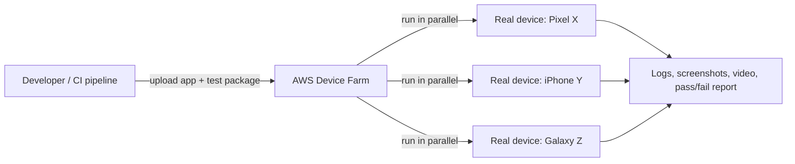

You upload your app package and test package (or use the built-in Fuzz test), select a device
pool, and Device Farm runs the suite on every device in parallel — the core time-saving mechanism,
since testing 20 devices takes roughly as long as testing one. Results return per-device: pass/
fail, logs, screenshots at each step, and a video recording of the run on that physical hardware.

**Visual Reference.**


*Source: [AWS Device Farm Developer Guide — Downloading artifacts](https://docs.aws.amazon.com/devicefarm/latest/developerguide/artifacts.html).* This hierarchy — Project → Run → Job (one
job per device) → Test Suite → Test — is the mental model worth internalizing: a single "Run"
fans out into one "Job" per device in the pool, and artifacts (logs/screenshots/video) are
generated at the Job level, which is exactly why Device Farm's parallel-device execution doesn't
multiply wall-clock time the way sequential per-device testing would.

**Exam Tips.**
- **"Real physical devices," "device fragmentation," "without maintaining a device lab"** are the
  Device Farm trigger phrases.
- Two distinct usage modes: **automated testing** (parallel suite runs across a pool) vs. **remote
  access** (live interactive control of one device) — a question may ask about either.
- Sits in the same "front-end web & mobile" exam category as **Amplify** (build the backend) and
  **Pinpoint** (engage users post-launch) — know these solve different stages of the mobile app
  lifecycle, not overlapping functions.

*Deeper dive:* [`services/front-end-web-mobile/device-farm.md`](../../../services/front-end-web-mobile/device-farm.md)

---

## 4. AWS Fargate

**Definition.** AWS Fargate is a serverless compute engine for containers — it runs ECS or EKS
workloads without you ever provisioning, patching, or managing the underlying EC2 servers. You
specify the vCPU/memory each container needs, and AWS runs it on infrastructure you never see.

**Analogy.** Running containers on your own EC2 fleet is like owning a fleet of delivery vans:
you buy them, maintain them, decide how many to keep running even overnight when demand is low,
and replace them when they break down. Fargate is like calling a rideshare instead — you specify
"I need a ride for this package, this size," a vehicle appears, does the job, and disappears; you
never own, park, or maintain a single van, and you pay only for the minutes you actually rode.

**Purpose.** Even after ECS/EKS removed the need to build your own orchestrator, teams still had
to size, patch, scale, and secure the EC2 instances containers ran on. Fargate removes that
remaining layer entirely: you describe the container's resource needs, and AWS handles capacity,
placement, isolation, and host OS patching — the container equivalent of what Lambda did for
functions.

**When to Use.** Spiky, unpredictable traffic with long idle gaps (per-second billing, zero idle
cost); teams with no dedicated ops/platform staff; multi-tenant SaaS needing hard per-tenant
compute isolation (each task gets its own micro-VM and ENI); batch/scheduled jobs via `RunTask`;
filling the gap beyond Lambda's 15-minute duration ceiling; scale-to-zero dev/test environments.

**When NOT to Use.** Dense, steady-state workloads at high predictable scale (EC2 launch type with
Reserved Instances/Savings Plans is cheaper per unit of compute at high utilization); GPU workloads,
custom kernel modules, or privileged/host-level access (Fargate supports none of this — use EC2 or
EKS with GPU node groups); EKS DaemonSets (no node concept exists on Fargate, so DaemonSets are
architecturally impossible).

**Use Cases.**
- A workload bursts unpredictably with long idle gaps between bursts — per-second billing with
  zero idle cost means never paying for warm-but-unused EC2 capacity sitting around between spikes.
- A small team with no dedicated ops staff wants containers in production without a patch cadence
  or AMI pipeline — AWS owns all host-level patching and capacity planning end to end.
- A multi-tenant SaaS platform needs hard compute isolation between tenants' workloads — each
  Fargate task gets its own micro-VM and ENI, with no shared host across tenants.
- A nightly ETL job runs as a scheduled `RunTask` call, billed only for the actual run duration
  with zero idle fleet cost between runs — the ECS-native equivalent of a cron job.
- A Step Functions workflow's fast steps run on Lambda, but one step (a large file transform) might
  exceed Lambda's 15-minute ceiling — that step calls `ECS RunTask` on Fargate instead, with no
  duration cap at all.

**Why Important.** Fargate shifts the "undifferentiated heavy lifting" of patching and capacity
planning entirely to AWS — a genuine reduction in operational risk, since unpatched hosts are a
top real-world breach vector — and lets small teams run production container workloads without a
dedicated platform/SRE function. It's a named example in Task 2.1 of scalable, loosely-coupled
compute that removes server management from the architecture.

**How It Works.**

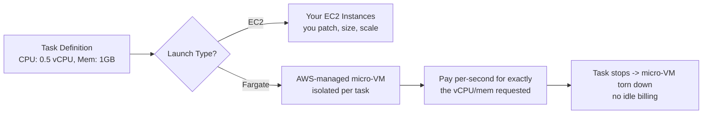

Fargate is not a standalone service you call directly — it's a launch type you select inside ECS
or EKS. Instead of your Task/Pod landing on an EC2 instance from your own fleet, AWS transparently
provisions a right-sized, isolated micro-VM, runs your container there, and tears it down when the
task stops; you're billed only for the seconds it actually ran.

**Visual Reference.**


*Source: [AWS Reference Architecture Diagrams — "Modern Serverless Mobile/Web Application Architecture"](https://docs.aws.amazon.com/reference-architecture-diagrams/latest/modern-serverless-mobile-web/modern-serverless-mobile-web.html).*
The piece of this diagram worth isolating: the backend processing layer runs as an **ECS on
Fargate** service reached privately from API Gateway via AWS PrivateLink, with container images
pulled from ECR through an interface VPC endpoint — no NAT Gateway or public internet path
required anywhere in the request path. This is the textbook answer to "serverless front end
calling a backend that needs a long-running process Lambda's duration limit doesn't fit" —
Fargate fills that gap without introducing EC2 fleet management into an otherwise fully
serverless architecture.

**Exam Tips.**
- **"No servers to manage"** tests Fargate *specifically as the launch type* — this is orthogonal
  to whether the orchestrator is ECS or EKS; don't let "no servers to manage" push you toward
  picking "EKS" or "ECS" when the real axis being tested is EC2-vs-Fargate.
- Cost-optimization framing: "predictable, steady, high-volume" → EC2 launch type; "spiky,
  unpredictable, or small team with no ops capacity" → Fargate.
- Fargate has a **hard maximum task size** (16 vCPU / 120 GB) and **no GPU support** — a scenario
  describing GPU or very large single-container needs disqualifies Fargate outright.

*Deeper dive:* [`services/containers/fargate.md`](../../../services/containers/fargate.md)

---

## 5. AWS Step Functions

**Definition.** AWS Step Functions is a serverless workflow orchestrator — you describe a
multi-step process (call this Lambda, check a condition, retry on failure, wait for human
approval) as a **state machine**, and Step Functions runs it, tracks exactly where it is, handles
retries/errors declaratively, and shows you the execution history visually.

**Analogy.** Coordinating a multi-step business process with hand-written Lambda-calling-Lambda
code is like running a relay race where each runner has to personally remember who hands off to
whom, what to do if the baton drops, and keep their own private notes about how the race is
going — with no one able to see the whole race at once. Step Functions is the race official with
a master scoreboard: it knows the entire course (every step), automatically signals the next
runner, has a documented recovery plan if a baton drops (retry/catch), and anyone can glance at
the scoreboard mid-race to see exactly where things stand.

**Purpose.** Coordinating multiple services into one business process traditionally meant either
a giant Lambda full of try/except chains, or a hand-rolled queue-based saga with no central
visibility into where a given execution currently is. Step Functions makes orchestration explicit,
visual, and resilient by default — the state machine itself owns retries, timeouts, parallel
branches, and error handling, with every execution's history inspectable step by step afterward.

**When to Use.** Multi-step business processes needing rollback on failure (the saga/compensation
pattern); workflows with conditional branching across multiple Lambda functions; orchestrating
native AWS service calls (DynamoDB, SNS, SQS) without an unnecessary Lambda wrapper; human-in-the-
loop approval spanning hours or days (`waitForTaskToken`, Standard Workflows only); processing
millions of records via Distributed Map; high-volume, short, event-heavy processing via Express
Workflows.

**When NOT to Use.** A single, simple function call with no branching/retries/multi-step
coordination — invoke the Lambda directly; one event needing to reach many independent,
unrelated consumers — that's SNS/EventBridge's job, not Step Functions; a durable work queue many
interchangeable workers pull from at their own pace — that's SQS.

**Use Cases.**
- An e-commerce order needs payment validation, inventory reservation, and shipping scheduling,
  with a clean automatic refund if any step fails partway — Parallel/Task states with Catch
  routing to a compensating "RefundPayment" state implement the saga pattern explicitly.
- A loan-approval pipeline branches differently based on credit score and requires a human
  underwriter's sign-off above a certain amount, with auditors needing to see exactly which path
  a given application took — Choice states plus task-token-based human approval provide both.
- A data migration must validate and transform every row in a 2-million-row manifest far beyond
  what a single Lambda invocation can handle economically — Distributed Map mode runs each item as
  its own child execution at massive fan-out.
- An IoT platform validates and routes millions of telemetry events per day, each processed in
  well under 5 minutes, without needing full execution-history retention — Express Workflows fit
  the volume/duration/cost profile Standard Workflows don't.
- A procurement workflow must pause for a manager's approval that might not arrive for two
  business days with zero polling cost — the `waitForTaskToken` pattern pauses the execution with
  no wasted invocations until the callback actually arrives.

**Why Important.** Step Functions turns "a bunch of Lambdas calling each other with custom retry
logic scattered across the codebase" into one visual, versioned, auditable definition — cutting
both bugs (declarative retry/catch beats hand-rolled try/except sprawl) and mean-time-to-diagnose,
since you can see exactly which execution got stuck at which state, with what input. It's the
named answer whenever Task 2.1 describes coordinated retries/rollback across multiple services.

**How It Works.**

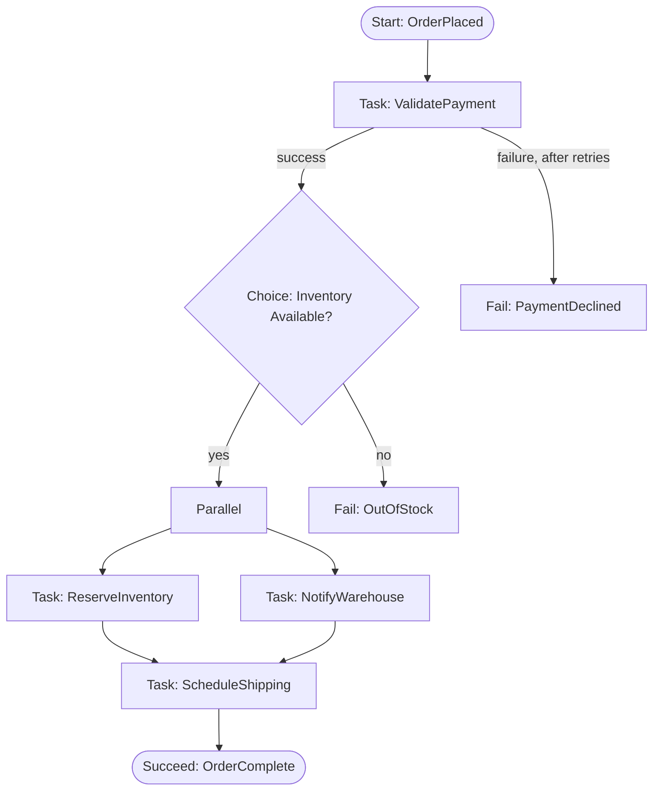

A state machine, defined in Amazon States Language (JSON), describes states and transitions:
Task states invoke Lambda or call AWS services directly, Choice states branch declaratively,
Parallel runs branches concurrently, Map fans out over a dataset, and Retry/Catch attached to any
state handles transient errors and permanent failures respectively — all without custom
orchestration code.

**Visual Reference.**


*Source: [AWS Step Functions Developer Guide — What is Step Functions?](https://docs.aws.amazon.com/step-functions/latest/dg/welcome.html).* The console renders exactly this kind of
graph for a running or completed execution, color-coding each state by outcome — which is the
actual day-to-day debugging workflow Step Functions enables: open a stuck execution and see, at a
glance, precisely which state it's stuck on and what input it received, instead of correlating
logs across several separate Lambda functions by hand.

**Exam Tips.**
- **Standard vs. Express** is a guaranteed topic: duration >5 minutes, exactly-once, full
  execution history in-console → Standard. High volume, short-lived, cost-sensitive at scale,
  at-least-once acceptable → Express.
- **"Orchestration"** is the keyword pointing to Step Functions — several Lambdas that must run
  in a specific order with conditional branching/retries/rollback is Step Functions, not a single
  Lambda with internal if/else.
- **Retry vs. Catch, precisely**: Retry always runs first and re-attempts the *same* state; Catch
  only engages once retries are exhausted and transitions to a *different* (often compensating)
  state.

*Deeper dive:* [`services/application-integration/step-functions.md`](../../../services/application-integration/step-functions.md)

---

## 6. AWS X-Ray

**Definition.** AWS X-Ray is a distributed tracing service — it follows a single request as it
travels through every component of your application (API Gateway, Lambda, a database call, a
downstream microservice) and stitches it all together into one visual timeline, so you can see
exactly where time was spent and where something broke.

**Analogy.** Debugging a slow request across six microservices without tracing is like trying to
figure out why a relay baton was slow by interviewing each runner separately, hoping their
wristwatches were all synchronized. X-Ray gives every baton a GPS tracker from the moment it
leaves the starting line — one continuous, timestamped trail through every runner, assembled
automatically into a single picture of exactly where the time went.

**Purpose.** A modern application split across API Gateway, several Lambda functions, Step
Functions, and a downstream database has no single log file — a user-facing request might touch
six services, each writing its own logs independently, with no shared thread connecting them.
X-Ray solves this: every request gets a trace ID that follows it through every service it touches,
and X-Ray assembles the pieces back into one coherent picture automatically.

**When to Use.** Serverless/microservice pipelines where a customer complaint ("checkout was
slow") needs attribution to one specific service/call; on-call triage during an incident needing
to localize which of many services is unhealthy fast (the service map); isolating third-party API
latency from your own code; visibility into what a Step Functions-invoked Lambda is actually doing
when the execution history alone doesn't explain a slow state; ML inference pipeline latency
breakdown (is it the model or the surrounding glue code).

**When NOT to Use.** Plain-text log search with no request-flow visualization need — that's
CloudWatch Logs' job, with X-Ray as the complement telling you *which* trace/time window to go
search; a genuinely single-service, single-log-file monolith with no cross-service call chain;
code-level CPU/memory profiling inside one process — that's CodeGuru Profiler's job, a different
granularity entirely.

**Use Cases.**
- A checkout flow spans API Gateway, three chained Lambda functions, and DynamoDB, and customers
  intermittently report slow checkouts with no pattern in any single service's own metrics —
  Active Tracing (a config flag, no code change) immediately shows which specific call in the
  chain is slow on a per-request basis.
- An on-call engineer gets paged for elevated 5xx errors across a 12-microservice ECS fleet under
  real time pressure — the service map immediately highlights the one red (high-error-rate) node
  among twelve, pointing the investigation at the right service in seconds.
- A payments company suspects a third-party card-network API is intermittently slow but can't
  prove it — a subsection wrapping just that outbound call shows its latency cleanly separated
  from the rest of the request, settling "is it us or them" with data.
- A Step Functions workflow occasionally stalls at an unpredictable step, and execution history
  alone doesn't show *why* a downstream Lambda call inside one state took unusually long — tracing
  that Lambda shows per-call timing and error detail execution history doesn't expose.
- A real-time fraud-scoring pipeline chains API Gateway → Lambda → SageMaker endpoint → Lambda,
  and the team needs to know whether model inference or surrounding glue code is the bottleneck
  before investing engineering time optimizing the wrong thing.

**Why Important.** As architectures decompose into more services, "where did this specific slow
or broken request actually go" becomes genuinely hard to answer without tracing — mean time to
resolve an incident is directly shaped by how fast an engineer can localize the problem to one
service. Task 2.2 names X-Ray explicitly for workload visibility/observability across decoupled
components — the same signal Route 53 and ELB health checks act on automatically, surfaced here
for a human during an incident.

**How It Works.**

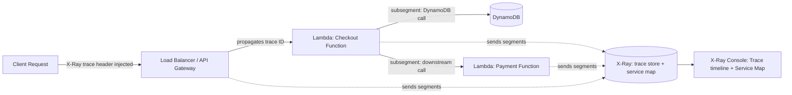

Every traced request gets a trace ID generated the moment it enters the system; each service
records its own segment/subsegment and reports it to X-Ray tagged with that same ID. X-Ray's
backend reassembles every segment sharing a trace ID into one end-to-end trace, and aggregates
many traces into a service map — a graph of every node your traffic touches, annotated with
latency and error rate per edge.

**Visual Reference.**


*Source: [AWS X-Ray Developer Guide — What is AWS X-Ray?](https://docs.aws.amazon.com/xray/latest/devguide/aws-xray.html).* The detail worth internalizing: the SDK (inside your
application process) sends segment data over UDP to the **daemon** — a separate, lightweight
process that buffers and batches before uploading to the X-Ray API. This two-hop design means
your application's request-handling thread never blocks on a network call to X-Ray itself; it
only does a fast local UDP write. On Lambda/Elastic Beanstalk the daemon already runs for you;
on EC2/ECS/EKS, you run it yourself as a process/sidecar/DaemonSet.

**Exam Tips.**
- **X-Ray vs. CloudWatch**: CloudWatch tells you *something* crossed a threshold (a metric/alarm);
  X-Ray tells you *why*, at the level of one specific request's path through your services.
- **Enabling tracing on Lambda is a configuration flag** ("Active Tracing"), not a code rewrite —
  a question implying X-Ray requires re-architecting a function is wrong.
- **Sampling is expected behavior, not a bug** — a question describing "some requests don't
  appear in X-Ray even though tracing is enabled" is usually describing normal sampling (1/sec +
  5% of the rest, by default), not a misconfiguration.

*Deeper dive:* [`services/developer-tools/x-ray.md`](../../../services/developer-tools/x-ray.md)

---

## 7. Amazon API Gateway

**Definition.** Amazon API Gateway is a fully managed service for creating, publishing, securing,
and monitoring APIs — the "front door" between API clients and your backend logic, handling
routing, auth, throttling, request/response transformation, and versioning.

**Analogy.** Without API Gateway, every client talking to your backend is like visitors walking
directly into a company's individual offices with no reception desk — no one checking IDs
(auth), no one limiting how many visitors can enter per minute (throttling), no consistent sign-in
sheet (logging). API Gateway is the reception desk: every visitor checks in at one place, gets
authorized, is rate-limited fairly, and is routed to the right office — while the offices
themselves (your Lambda functions) never have to worry about who's walking up to the building.

**Purpose.** Building a production-grade API by hand means solving authentication, rate limiting,
request validation, CORS, versioning, usage metering, caching, and monitoring before writing a
line of business logic. API Gateway exists so developers focus purely on backend logic (often a
Lambda function) while AWS handles all of that surrounding API infrastructure as a managed,
auto-scaling layer.

**When to Use.** A new serverless REST/HTTP API backed by Lambda and DynamoDB; fronting an
existing on-prem/EC2 HTTP backend to add auth/throttling/caching as an incremental modernization
step with no code change; a monetized partner API needing tiered rate limits/quotas per customer
(usage plans + API keys); a real-time chat/dashboard app needing persistent bidirectional
connections (WebSocket API); a compliance-driven internal API that must never be reachable from
the public internet (Private API type behind a VPC interface endpoint).

**When NOT to Use.** Extremely high-throughput, low-latency internal service-to-service calls —
consider direct ALB/NLB routing or VPC Lattice instead; basic HTTP routing with no auth/throttling
needs — an ALB alone may be cheaper per-request at high volume; GraphQL APIs — AppSync is
purpose-built for that; an extremely simple single-Lambda webhook with no auth complexity — a
Lambda Function URL can be simpler and cheaper.

**Use Cases.**
- A new product needs a REST/HTTP API backed by Lambda and DynamoDB with no servers to manage at
  any layer — the canonical serverless-backend pairing, trading per-request pricing at scale for
  zero capacity planning at low-to-moderate traffic.
- A company wants to modernize an existing on-prem HTTP backend incrementally — API Gateway fronts
  it directly via an HTTP integration, adding auth/throttling/caching immediately without touching
  legacy code yet.
- A SaaS company offers a public API with free/pro/enterprise pricing tiers, each with different
  rate limits and monthly quotas enforced per customer — usage plans and API keys achieve this
  natively, offloading metering entirely to the managed layer.
- An internal microservice API must never be reachable from the public internet, only from
  specific VPCs in the company's AWS Organization — a Private REST API type behind an interface
  VPC endpoint, with a resource policy naming allowed endpoints, satisfies this at the API
  Gateway configuration level.
- A data-processing endpoint occasionally needs more than 29 seconds to complete a request — since
  API Gateway's integration timeout is a hard, non-raisable ceiling, the fix is an asynchronous
  redesign (kick off the work via Step Functions/SQS, return immediately, client polls or receives
  a push later).

**Why Important.** API Gateway removes an enormous amount of "undifferentiated heavy lifting" —
teams that hand-build their own auth/throttling/versioning layer on raw EC2/load balancers spend
weeks on infrastructure API Gateway provides out of the box, and get it wrong more often. It's
named explicitly in Task 2.1 as part of scalable, loosely coupled, event-driven architecture
design.

**How It Works.**

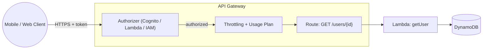

The client sends an HTTPS request with a bearer token; an authorizer (Cognito User Pool, Lambda
custom authorizer, or IAM/SigV4) validates it before anything else runs; the request passes
through throttling (account-level, per-method, and usage-plan limits, most restrictive wins),
then matches a route by path/method and invokes its integration — most commonly a Lambda function.

**Visual Reference.**


*Source: [AWS Documentation — "What is Amazon API Gateway?"](https://docs.aws.amazon.com/apigateway/latest/developerguide/welcome.html).* This is AWS's own framing of API Gateway as the
single front door between clients (web, mobile, services) and backend targets (EC2, Lambda, other
AWS services), simultaneously handling traffic management, authorization/access control,
monitoring, and API version management — the four concerns this whole section's "Purpose"
section describes as the undifferentiated work API Gateway removes from application teams.

**Exam Tips.**
- **HTTP API vs. REST API**: lowest cost/latency + simple JWT auth → HTTP API. Needs API
  keys/usage plans, request validation, caching, or private VPC-only APIs → REST API.
- **The 29-second integration timeout is hard, not soft** — a long-running backend scenario
  through API Gateway is almost always pointing at an asynchronous redesign, not a limit-increase
  request (this particular limit cannot be raised at all).
- **Private API Gateway requires an interface VPC endpoint (PrivateLink)** — "reachable only
  from inside our VPC" needs both a Private API type AND a VPC endpoint, not just one.

*Deeper dive:* [`services/networking-content-delivery/api-gateway.md`](../../../services/networking-content-delivery/api-gateway.md)

---

## 8. Amazon Aurora

**Definition.** Amazon Aurora is AWS's own relational database engine, wire-compatible with
MySQL and PostgreSQL but re-engineered underneath to be faster, self-healing, and far more elastic
— a single logical "cluster volume" holding 6 copies of your data spread across 3 Availability
Zones, decoupled from the compute instances running queries.

**Analogy.** A classic database's storage is like one filing cabinet a single clerk has to
physically carry data in and out of — fast enough for one office, but it becomes the bottleneck
the moment the office grows. Aurora's storage is like a distributed records vault with six
synchronized copies spread across three buildings: a write only needs four of the six vault
copies to confirm "received" before it's considered safe, so losing an entire building (an AZ)
still leaves the vault fully operational — and adding a new "reader" clerk who needs access to the
same vault takes minutes, not a full re-copy of every record.

**Purpose.** Classic relational databases (including RDS's own MySQL/PostgreSQL) were bottlenecked
by a storage architecture where the engine and storage are tightly coupled, replication ships
whole data pages, and crash recovery can take minutes. Aurora decouples compute from storage,
distributes storage across many nodes and AZs automatically, and replicates only minimal log
records — eliminating most of those pain points while keeping 100% SQL compatibility.

**When to Use.** A high-throughput application that has outgrown plain RDS's 5-replica ceiling;
a global SaaS app needing sub-second cross-Region read replication with fast promotion (Aurora
Global Database); spiky traffic with long idle periods (Aurora Serverless v2); an e-commerce
system needing both ACID transactions and sub-30-second failover during peak sales; dev/test
fleets needing dozens of near-identical, frequently refreshed databases (fast cloning).

**When NOT to Use.** A simple, small, cost-sensitive workload with steady low traffic — plain RDS
is usually cheaper, Aurora's I/O billing and premium aren't justified yet; the engine must be
Oracle or SQL Server specifically (Aurora doesn't support them, stay on RDS); you need NoSQL
flexible schema and millions of ops/sec — DynamoDB; heavy OLAP queries across billions of
historical rows — Redshift, not Aurora Parallel Query.

**Use Cases.**
- A SaaS application outgrows plain RDS's 5-replica ceiling under growing read traffic — Aurora's
  up-to-15-replica fan-out, all sharing the same storage layer, scales further without a schema
  or SQL rewrite.
- A global company needs sub-second cross-Region read replication with fast promotion for DR —
  Aurora Global Database, not a plain RDS cross-Region replica, satisfies both the latency and
  promotion-speed requirement.
- A spiky SaaS workload has long idle periods interrupted by sudden 10x bursts and the team
  doesn't want to manage capacity — Aurora Serverless v2 scales compute within configured ACU
  bounds automatically, including scaling near-zero overnight.
- An e-commerce checkout system needs sub-30-second failover during a peak sales event, tighter
  than classic RDS Multi-AZ's 60-120 second window — Aurora's quorum-based storage model and fast
  replica promotion deliver this directly.
- A dev team needs dozens of near-identical database environments refreshed per feature branch
  without ballooning storage cost — Aurora's copy-on-write fast cloning spins up a full working
  copy in seconds/minutes regardless of source dataset size.

**Why Important.** Aurora is frequently the default "just use this" recommendation for new
relational workloads on AWS because it combines open-source compatibility (no proprietary-
language lock-in) with meaningfully better throughput, faster failover, and cheaper read-scaling
than plain RDS, at a modest price premium. It appears across both Task 2.1 (replica scaling) and
Task 2.2 (Multi-AZ, Global Database) because the same service answers both the "scale reads" and
"survive failure" questions.

**How It Works.**

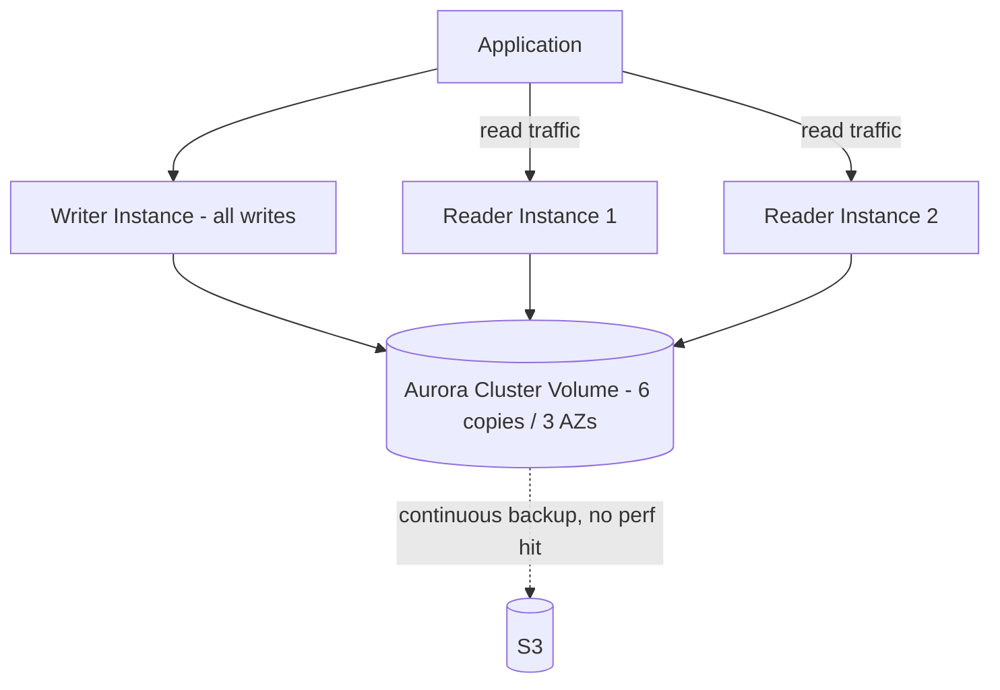

Writes require a quorum of 4 of 6 storage copies to acknowledge before being considered durable
(tolerating an entire AZ loss plus one more copy); reads require 3 of 6. All readers share the
*same* underlying cluster volume, so adding a reader takes minutes, not hours of copying — and any
reader can be promoted to writer in under 30 seconds during failover.

**Visual Reference.**


*Source: [AWS Aurora User Guide](https://docs.aws.amazon.com/AmazonRDS/latest/AuroraUserGuide/CHAP_AuroraOverview.html).* The detail this diagram makes visually obvious: the cluster volume
sits *below* both the writer and every reader instance as one shared layer — unlike classic RDS,
where a read replica is a genuinely separate, fully-copied database. That's precisely why Aurora
read replicas add in minutes instead of hours: there's no actual data copy happening, just a new
compute instance attaching to storage that already exists.

**Exam Tips.**
- The exam loves **"MySQL/PostgreSQL compatible, needs better performance and availability than
  RDS, minimal application changes"** — that's Aurora, not DynamoDB (which requires access-pattern
  redesign, not minimal changes).
- Know the **storage model**: 6 copies / 3 AZs / quorum writes (4 of 6) and reads (3 of 6) — this
  is mechanically why Aurora tolerates AZ failure without downtime, not just a marketing claim.
- Don't confuse **Aurora Replicas** (read scaling within one cluster) with **Aurora Global
  Database** (cross-Region) — different features solving different problems.

*Deeper dive:* [`services/database/aurora.md`](../../../services/database/aurora.md)

---

## 9. Amazon CloudFront

**Definition.** Amazon CloudFront is AWS's Content Delivery Network (CDN) — a globally
distributed network of caching servers (edge locations) that stores copies of your content
physically close to users, so it loads faster and your origin server handles far less direct
traffic.

**Analogy.** Without a CDN, every user request — Tokyo or São Paulo — travels all the way to
wherever your single server lives, like every customer worldwide having to drive to one central
warehouse for every purchase. CloudFront is a network of local pop-up stores (edge locations)
stocked with your most-requested items near every customer — most purchases are fulfilled from
the nearest pop-up instantly, and the central warehouse only ever restocks each pop-up
occasionally instead of shipping every single order itself.

**Purpose.** Without a CDN, every request travels to wherever your origin lives, adding latency
and putting full load on that one origin. CloudFront caches content at edge locations worldwide
so most requests are answered from a nearby cache instead of a round trip to origin, and it
absorbs traffic spikes/DDoS attempts at the edge before they reach your actual infrastructure.

**When to Use.** Global content delivery for a static website or SPA; dynamic API acceleration
in front of an ALB/API Gateway purely for optimized backbone routing and edge-absorbed DDoS
protection even with caching disabled; multi-Region origin failover for high availability;
video-on-demand with signed cookies for subscriber-only access; any public-facing service wanting
baseline DDoS protection (Shield Standard is automatically included).

**When NOT to Use.** Purely internal, VPC-only traffic with no external users — a CDN shortens
distance to end users, and internal east-west VPC traffic gains nothing from it; extremely
low/unpredictable traffic with tight cost sensitivity and no latency requirement — serving
directly from origin may be simpler; a non-AWS multi-cloud stack where the other provider's
native CDN integrates more tightly.

**Use Cases.**
- A marketing site or SPA with images, JS, and CSS bundles needs fast global loads — S3 +
  CloudFront is the canonical pattern, cutting both latency and origin load dramatically.
- A dynamic, mostly uncacheable API still benefits from sitting behind CloudFront purely for
  optimized backbone routing and edge-absorbed DDoS protection, even with caching disabled for
  those routes.
- A business-critical site needs to keep serving content if its primary origin Region has an
  outage — an origin group with a primary and secondary origin lets CloudFront fail over
  automatically on configured error codes, with no client-visible interruption or DNS change.
- A video-on-demand platform must ensure only authenticated subscribers can stream content without
  exposing the origin bucket directly — signed cookies scoped to `/videos/*` plus Origin Access
  Control on the S3 origin satisfy this in one shot, covering an entire path pattern per session.
- A software distributor needs fast global download times for large installers — CloudFront's
  edge caching and optimized long-haul network between edge and origin keep repeat downloads fast
  worldwide and cut S3 data-transfer cost at volume.

**Why Important.** CloudFront is frequently the cheapest, highest-leverage performance improvement
available — moving static assets behind a CDN can cut page load time dramatically and reduce
origin infrastructure cost, since most requests never reach it. It's also a first-line DDoS
defense, absorbing volumetric attacks at the edge. On Task 2.1, CloudFront is the named CDN
pattern for surviving traffic spikes without the origin ever seeing most of the load.

**How It Works.**

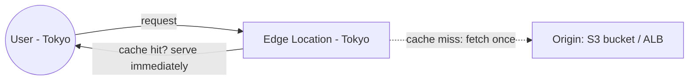

A user's request is routed via anycast DNS to the nearest edge location; a cache hit serves
immediately with no origin trip; a cache miss pulls once from origin, caches per the configured
TTL, and returns to the user — every subsequent nearby request is served from the edge, with the
origin seeing only the first request per edge location per cache-expiry window, not every user
request.

**Visual Reference.**


*Source: [AWS Documentation — "How CloudFront delivers content"](https://docs.aws.amazon.com/AmazonCloudFront/latest/DeveloperGuide/HowCloudFrontWorks.html).* The subtlety worth noting from
this diagram: CloudFront begins forwarding the response to the viewer **as soon as the first byte
arrives** from the origin on a cache miss, rather than waiting for the complete object — which is
part of why even a cache *miss* through CloudFront often feels faster than hitting the origin
directly, not just cache *hits*.

**Exam Tips.**
- **S3 + CloudFront + OAC** is the textbook secure static-hosting pattern — if a question
  describes a public S3 bucket serving a website directly, the "more secure" answer is almost
  always "CloudFront with Origin Access Control, bucket made private."
- **Cache invalidation vs. versioned object keys**: invalidation costs money and isn't instant
  across every edge; the recommended pattern for frequent updates is versioned filenames
  (`app.v2.js`), with invalidation reserved as an emergency rollback tool.
- Remember CloudFront includes **AWS Shield Standard automatically** at no extra cost — a common
  "which combination gives DDoS protection for free" exam answer.

*Deeper dive:* [`services/networking-content-delivery/cloudfront.md`](../../../services/networking-content-delivery/cloudfront.md)

---

## 10. Amazon EC2 Auto Scaling

**Definition.** EC2 Auto Scaling automatically adds or removes EC2 instances from a group based
on rules you set, so your application always has roughly the right amount of compute — not too
little (and falling over), not too much (and wasting money) — and automatically replaces any
instance that fails a health check.

**Analogy.** A restaurant staffing for a fixed number of waiters regardless of how busy it is will
either be understaffed on a Saturday night (orders backed up, customers leave) or overstaffed on a
slow Tuesday (paying wages for idle hands). EC2 Auto Scaling is a staffing agency that watches the
dining room in real time and calls in (or sends home) exactly the right number of waiters to match
how many tables are actually full right now — and if a waiter walks off the job mid-shift
(an unhealthy instance), a replacement is dispatched automatically without a manager having to
notice and call one in.

**Purpose.** A fixed number of servers is wrong almost all the time — too many at 3am, too few
during a sales spike. Auto Scaling lets you describe the desired state ("keep CPU around 50%,
between 2 and 10 instances") and AWS continuously reconciles reality to match it, launching
instances when load rises, terminating them when it falls, and replacing any that fail health
checks — all without a human watching a dashboard.

**When to Use.** Any EC2-backed web/app tier needing to match capacity to variable traffic;
replacing unhealthy instances automatically (a Task 2.2 availability mechanism, not just a cost
tool); worker fleets scaling off a custom metric like SQS queue depth rather than CPU; multi-AZ
resilience (an ASG spanning AZs survives one AZ's loss by simply launching replacement capacity
elsewhere); scheduled scaling for predictable daily/weekly traffic patterns.

**When NOT to Use.** A workload that's bursty, stateless, and genuinely tiny — Lambda avoids any
capacity planning at all, including an ASG's minimum floor; a workload needing hard compute
isolation per customer at small scale — containers (Fargate) may fit the isolation need more
cleanly than scaling a shared EC2 fleet.

**Use Cases.**
- A web tier's traffic triples during a product launch and settles back down afterward — target
  tracking on `ALBRequestCountPerTarget` scales the ASG out automatically during the spike and
  back in afterward, with no manual intervention.
- An Auto Scaling group's health check is only EC2 status checks, and an instance that's "up" but
  failing application-level requests isn't being replaced — switching to ELB health checks
  (application-aware) catches and replaces instances EC2-status-only checks would miss.
- A worker fleet processing SQS messages needs to grow and shrink based on actual backlog, not
  CPU, which can look fine even while a queue grows unboundedly — a target tracking policy on
  `ApproximateNumberOfMessagesVisible` scales workers directly off the leading signal of pending
  work.
- A three-tier application needs to survive the complete loss of one Availability Zone with no
  manual intervention — an ASG spanning multiple AZs simply launches replacement instances in the
  surviving AZs, restoring desired capacity automatically.
- A retailer knows from historical data that traffic reliably spikes every weekday morning at 9am
  — a scheduled scaling action pre-warms capacity ahead of the predictable spike instead of
  reacting to it after the fact, avoiding a brief under-capacity window a purely reactive policy
  would hit.

**Why Important.** The difference between a well-configured Auto Scaling group and a fixed fleet
is the difference between automatically absorbing a traffic spike and an outage, and between
automatically replacing a failed instance in minutes versus a multi-hour manual incident. This is
one of the most heavily tested Task 2.1/2.2 crossover topics — scaling is a Task 2.1 concern
(architecture shape), but instance replacement on health-check failure is squarely Task 2.2
(automatic fault tolerance).

**How It Works.**

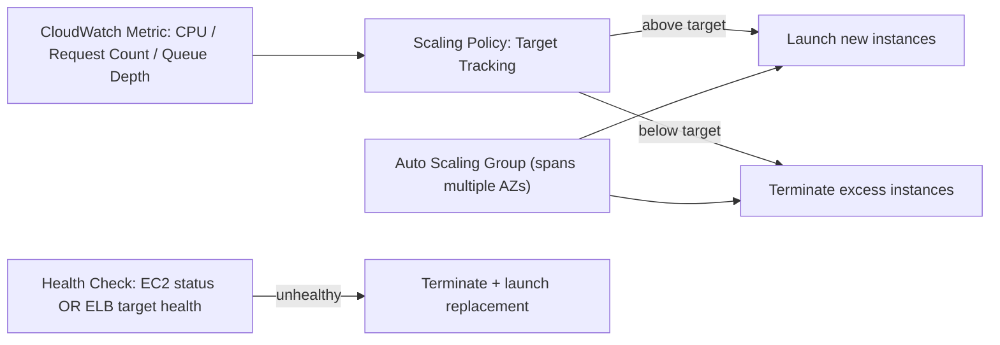

You define a desired-state policy (commonly target tracking on a CloudWatch metric); the ASG
continuously compares actual capacity against that target and launches or terminates instances to
close the gap, always respecting configured min/max bounds and spreading new instances across the
group's configured Availability Zones. Separately, health checks (EC2 status checks or,
preferably, ELB target health checks) continuously probe running instances and replace any that
fail.

**Visual Reference.**


*Source: [AWS Documentation — EC2 Auto Scaling](https://docs.aws.amazon.com/autoscaling/ec2/userguide/what-is-amazon-ec2-auto-scaling.html).* This lifecycle diagram is the mental model worth
memorizing for troubleshooting: an instance moves through distinct states (pending → in-service →
terminating) and lifecycle hooks can pause it at key transitions — e.g., to run a warm-up script
before it's marked in-service, or to drain connections before it's terminated — which is exactly
the mechanism behind graceful scale-in that doesn't drop in-flight user sessions.

**Exam Tips.**
- **"An instance is 'up' but failing application requests, and isn't being replaced"** → switch
  from EC2 status checks to **ELB health checks** — this exact phrasing is a guaranteed-type
  scenario.
- **Scale on the leading signal, not a lagging one**: queue depth (`ApproximateNumberOfMessages
  Visible`) for queue-consuming workers, not CPU, which can look healthy while a backlog grows.
- An ASG spanning multiple AZs is itself a Task 2.2 **availability** mechanism (automatic,
  routine, no human decision), distinct from a Task 2.2 **disaster recovery** strategy (deliberate,
  rare, sized to an RTO/RPO) — don't conflate "my ASG spans AZs" with "I have a DR plan for losing
  an entire Region."

*Deeper dive:* [`services/compute/ec2-auto-scaling.md`](../../../services/compute/ec2-auto-scaling.md)

---

## 11. Amazon ECS

**Definition.** Amazon ECS is a fully managed, AWS-native container orchestration service — you
describe your application as a Task Definition (which image, how much CPU/memory, which IAM
role), and ECS schedules, restarts, and load-balancer-wires the resulting containers across a
cluster of compute (EC2 or Fargate) without you building your own orchestrator.

**Analogy.** Running containers without an orchestrator is like a restaurant owner personally
deciding, by hand, which cook stands at which station every single shift, restarting a cook who
walks off mid-shift by personally noticing and calling a replacement, and manually updating the
seating chart every time a new table opens. ECS is the restaurant's shift-management system: you
declare "I always want 3 cooks on the grill station," and the system places them, replaces anyone
who leaves unexpectedly, and keeps the whole kitchen running to that staffing target without a
manager micromanaging every shift change by hand.

**Purpose.** Before container orchestrators, running containers at scale meant hand-rolling your
own scheduler: deciding which server runs which container, restarting crashed containers, rolling
out new versions without downtime, wiring up service discovery and load balancing. ECS is AWS's
own answer to this, deeply integrated with IAM, VPC, ELB, and CloudWatch, for teams who don't need
Kubernetes's full feature set and complexity.

**When to Use.** Teams starting fresh on AWS with no existing Kubernetes investment wanting
container orchestration with a smaller learning curve; microservices migrations off a monolith;
batch job orchestration via scheduled `RunTask`; multi-tenant SaaS isolation via `awsvpc`
networking (per-task ENI and security group); blue/green production rollouts via CodeDeploy;
mixed EC2+Fargate+Fargate-Spot cost optimization via Capacity Provider Strategies.

**When NOT to Use.** Multi-cloud portability or needing the Kubernetes ecosystem (Helm, Istio,
Argo CD, Operators) — use EKS instead, since ECS's API is AWS-proprietary; an organization with
deep existing Kubernetes expertise and tooling investment — standardizing on EKS avoids
maintaining two operational mental models; a single short-lived event-driven function — Lambda is
simpler and cheaper.

**Use Cases.**
- A team decomposing a legacy monolith into independently deployable services gives each service
  its own Task Definition/Service pair, scaled and deployed independently with no hand-built
  scheduler.
- A SaaS platform must isolate each tenant's compute without standing up a separate account or
  VPC per customer — `awsvpc` mode gives every task its own ENI and security group, so tenants
  can't reach each other's network traffic even on shared cluster capacity.
- A production release needs zero-downtime cutover with instant rollback — CodeDeploy's native
  ECS blue/green integration stands up a parallel task set and shifts ALB traffic to it, keeping
  the old set warm briefly for instant revert.
- A critical bug needs an immediate patch with nobody available to babysit the rollout — ECS's
  deployment circuit breaker auto-detects a crash-looping new revision and rolls back with zero
  alarm configuration required, unlike CodeDeploy's alarm-driven rollback.
- A cluster runs steady baseline traffic on cheap Reserved EC2 while bursting to Fargate/Fargate
  Spot for unpredictable spikes — a single Capacity Provider Strategy lets the scheduler do this
  placement math declaratively, from one Service definition.

**Why Important.** Containers are now the default packaging format for modern applications; ECS
removes the operational burden of running an orchestrator yourself, a major cost and reliability
lever since misconfigured orchestration is a common source of real outages. Task 2.1 names
containers/ECS/EKS explicitly as architecture-level building blocks for decoupled, horizontally
scalable systems; Task 2.2 tests that ECS Services spread tasks across multiple AZs and that the
deployment circuit breaker is itself a fault-tolerance feature.

**How It Works.**

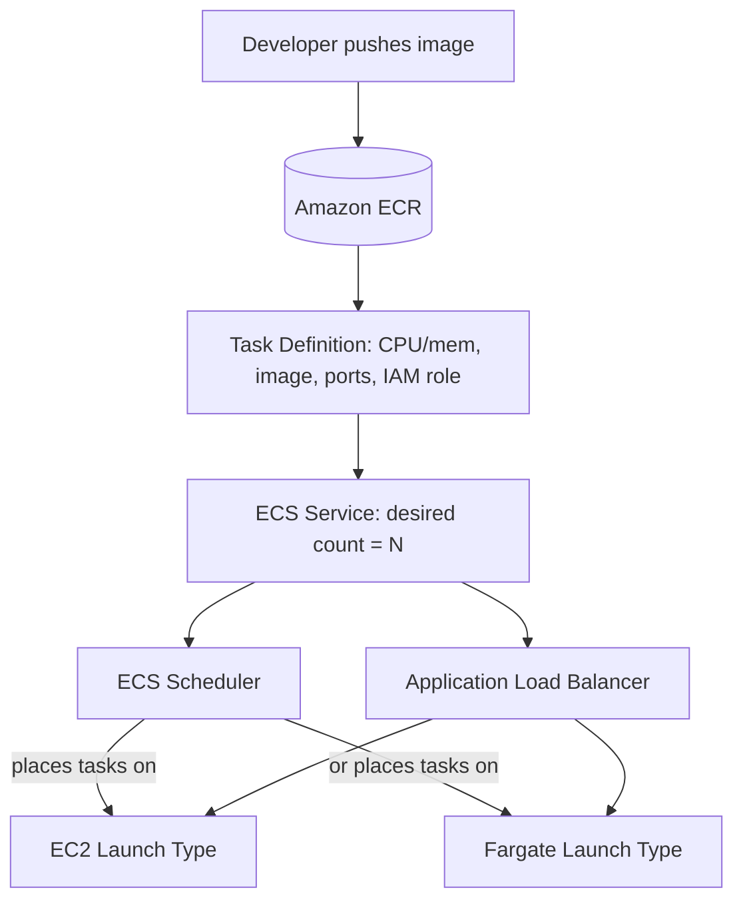

A Task Definition is the blueprint; an ECS Service keeps a target number of Tasks running,
registers them with a load balancer, and continuously health-checks and replaces failed ones. The
Cluster is a logical namespace — it only has capacity once you register EC2 instances or
associate Fargate capacity providers with it.

**Visual Reference.**


*Source: [Amazon ECS Developer Guide — "What is Amazon ECS?"](https://docs.aws.amazon.com/AmazonECS/latest/developerguide/Welcome.html).* This three-layer mental model — Capacity (EC2 or
Fargate infrastructure), Controller (the scheduler placing and managing tasks), and Provisioning
(console/CLI/CloudFormation/CodePipeline) — is the cleanest way to reason about ECS
troubleshooting: a problem is almost always isolable to exactly one layer (capacity not scaling,
controller not placing tasks, or a provisioning tool sending a malformed request).

**Exam Tips.**
- **Classic trap — ECS vs. EKS vs. Fargate**: ECS vs. EKS answers "which orchestrator/API"
  (AWS-proprietary vs. Kubernetes-standard); EC2 vs. Fargate answers "who manages the servers" and
  applies to *both* orchestrators. "Kubernetes-native tooling"/"portability" → EKS. "No desire to
  manage Kubernetes" → ECS. "No servers to patch" → Fargate (independent axis).
- **Execution role vs. task role** is tested directly: execution role = ECS pulling images/
  secrets/writing logs; task role = your application code calling AWS APIs.
- The **deployment circuit breaker** is an ECS-native, alarm-free rollback mechanism — don't
  confuse it with CodeDeploy's CloudWatch-alarm-triggered rollback, a separate mechanism used for
  blue/green deployments specifically.

*Deeper dive:* [`services/containers/ecs.md`](../../../services/containers/ecs.md)

---

## 12. Amazon EKS

**Definition.** Amazon EKS is a fully managed service that runs upstream, conformance-tested
Kubernetes for you — AWS manages the Kubernetes control plane (API server, etcd, scheduler) across
multiple AZs, while you keep the standard Kubernetes API, tooling, and ecosystem (Helm, kubectl,
Operators) completely unmodified.

**Analogy.** Choosing ECS is like choosing a car manufacturer's own proprietary dashboard and
service network — simpler to learn, deeply integrated, but your mechanic's certification doesn't
transfer if you switch brands. Choosing EKS is like choosing a car that runs on an open,
industry-standard engine architecture every certified mechanic worldwide already knows how to
service — you give up a little of that one-brand polish, but your team's skills, your existing
third-party tools, and your maintenance playbooks all transfer unmodified, whether the car is
parked in this garage or a different one entirely.

**Purpose.** Kubernetes is the de-facto industry standard for container orchestration, not just on
AWS. Many organizations already have Kubernetes expertise, Helm charts, Operators, and multi-cloud
or on-prem clusters, and want the *same* API on AWS rather than learning AWS's own proprietary
orchestrator. Running the Kubernetes control plane yourself is genuinely hard to do reliably; EKS
hands AWS that hardest, most failure-sensitive part.

**When to Use.** Lifting an existing on-prem/multi-cloud Kubernetes investment onto AWS unchanged;
multi-cloud or cloud-exit portability strategy; complex scheduling/admission policy requirements
(custom schedulers, OPA/Gatekeeper, CRDs) ECS has no equivalent for; GitOps continuous deployment
with Argo CD/Flux; ML/data platforms standardizing on Kubernetes-native frameworks (Kubeflow,
Spark-on-Kubernetes, Ray); zero-trust microservices needing a true service mesh (Istio/App Mesh)
with mTLS between every hop.

**When NOT to Use.** No Kubernetes expertise on the team and no multi-cloud portability need — ECS
gets most of the same orchestration benefit with a far smaller learning curve; a simple,
event-driven, short-lived workload — Lambda avoids container orchestration entirely; running your
own self-managed Kubernetes control plane on raw EC2 — almost never justified over EKS anymore.

**Use Cases.**
- A company migrates workloads from an on-premises Kubernetes cluster to AWS and wants to reuse
  existing Helm charts and Operators without rewriting deployment manifests — EKS's Kubernetes
  conformance means they work unmodified, while ECS's proprietary Task Definition model has no
  Helm/Operator compatibility at all.
- An organization wants to avoid single-cloud lock-in, running the same workloads across AWS and
  another cloud or on-prem — the Kubernetes API is identical everywhere EKS is tested against
  upstream conformance.
- A Pod needs permission to read from a specific S3 bucket, but other Pods on the same worker node
  must not have that permission — IRSA (IAM Roles for Service Accounts) scopes IAM access to the
  individual Pod's ServiceAccount, not the whole node.
- A data engineering team builds on Kubeflow or Spark-on-Kubernetes, frameworks that assume a real
  Kubernetes API underneath that only EKS (not ECS) provides.
- A Kubernetes-native app needs canary or blue/green rollouts with fine-grained traffic splitting
  via Argo Rollouts or Flagger — richer progressive-delivery tooling than ECS's deployment
  circuit breaker alone offers, at the cost of adopting and operating a third-party controller
  yourself (EKS has no built-in CodeDeploy integration the way ECS does).

**Why Important.** Kubernetes skills are broadly transferable across cloud providers and on-prem,
making EKS valuable for organizations avoiding vendor lock-in or running hybrid/multi-cloud.
Misconfigured Kubernetes RBAC and overly broad node IAM roles are a recurring source of real
security incidents — IRSA and EKS's IAM integration directly address that risk class. On the exam,
EKS appears in Task 2.1 as a container-based microservices option, and Task 2.2 tests that its
control plane already runs multi-AZ with no configuration required from you.

**How It Works.**

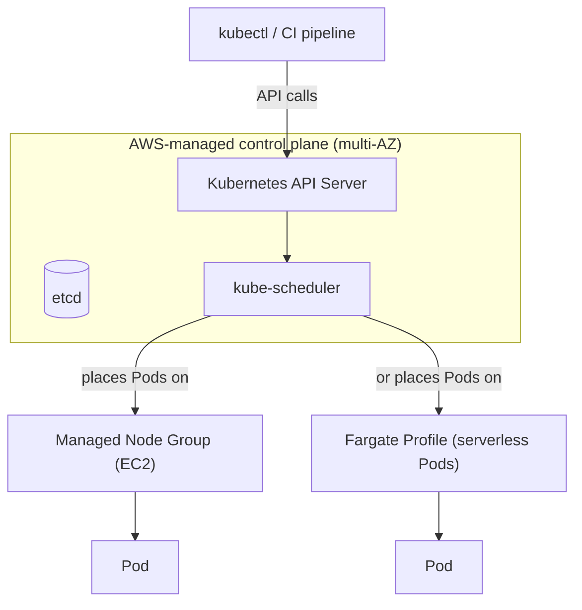

AWS runs the control plane across multiple AZs, patched and scaled for you — you only manage the
data plane (worker nodes), which can be fully serverless via Fargate profiles, semi-automated via
Managed Node Groups, fully manual via self-managed EC2, or (newest) fully handed off via EKS Auto
Mode. Pods get real VPC IPs via the AWS VPC CNI, so standard security groups apply directly to
them.

**Visual Reference.**


*Source: [AWS Reference Architecture Diagrams — "Modernize Applications with Microservices Using Amazon EKS"](https://docs.aws.amazon.com/reference-architecture-diagrams/latest/modernize-applications-with-microservices-using-amazon-eks/modernize-applications-with-microservices-using-amazon-eks.html).*
The step worth isolating in this diagram: CodeBuild doesn't call an AWS container API to redeploy
— it runs `kubectl set image` against the Kubernetes API server, and *Kubernetes itself* performs
the rolling update. This is the core practical difference from ECS: with EKS, your CI/CD pipeline
ends at "tell Kubernetes what I want," and Kubernetes' own reconciliation loop does the rest.

**Exam Tips.**
- **Classic trap — ECS vs. EKS vs. Fargate**: "Kubernetes," "portability," "multi-cloud," "Helm,"
  "existing k8s manifests" → EKS. "AWS-native, simplest option, no Kubernetes expertise needed" →
  ECS. Fargate is an orthogonal axis under either.
- Remember **EKS still has a cluster-hour cost even with Fargate profiles** — the control plane
  fee never disappears, a detail some cost-optimization questions exploit.
- **IRSA** is a favorite security-scenario answer for "give a specific Pod least-privilege AWS
  access without giving the whole node broad permissions."

*Deeper dive:* [`services/containers/eks.md`](../../../services/containers/eks.md)

---

## 13. Amazon EventBridge

**Definition.** Amazon EventBridge is a serverless event router. Things happen inside AWS and in
your own applications; EventBridge collects those events onto a bus, then uses rules (declarative
pattern-matching filters) to decide which events go to which targets — Lambda, SQS, Step
Functions, another AWS account, a SaaS app, and 20+ other target types.

**Analogy.** Without EventBridge, every system that needs to know about an event has to be
individually told about it by the producer — like a company where every employee has to
personally remember to call every other department that might care about something they just did.
EventBridge is a company-wide bulletin board with a smart mailroom: post one notice once, and the
mailroom automatically routes a copy to exactly the departments whose standing subscription rules
match its content — HR gets personnel notices, finance gets expense notices, and a new department
can start receiving relevant notices tomorrow with zero change to how notices get posted.

**Purpose.** As systems grow, dozens of things can happen and dozens of other things need to react
to a subset of them. Routing that by hand means every producer needs if/else logic about every
possible consumer. EventBridge centralizes that routing: producers emit an event with a `source`
and `detail`, and a rules engine — not application code — decides who gets notified based on
declarative content-matching.

**When to Use.** Reacting to AWS service activity without polling (e.g., an EC2 state change or
CodePipeline failure firing a Lambda instantly); content-based routing across many different event
types from many different sources; massive-scale per-tenant scheduled jobs (EventBridge
Scheduler); SaaS-to-AWS integrations without building webhook infrastructure (partner event
buses); cross-account security event aggregation; starting a multi-step business process from a
single trigger (feeding Step Functions).

**When NOT to Use.** A simple one-to-many broadcast with no content-based routing need — plain SNS
is simpler and cheaper; a durable, pollable queue a single worker drains at its own pace — SQS;
sub-second guaranteed ordering of a high-volume stream multiple consumers replay from any point —
Kinesis Data Streams, since EventBridge doesn't guarantee delivery order and isn't built for
ordered replay.

**Use Cases.**
- A security team wants a Lambda to fire the instant an EC2 instance's state changes, not on a
  polling schedule — EventBridge's automatic default-bus delivery for AWS service events removes
  polling latency and wasted invocations entirely.
- An order-events bus needs high-value orders to trigger a Step Functions workflow, EU orders to
  route to a compliance queue, and every order to land in an audit log — all declaratively, via
  three separate rules matching the same event stream differently.
- A SaaS platform needs to run a nightly report for each of 50,000 tenants, each at their own
  local midnight — EventBridge Scheduler is purpose-built for millions of independent schedules,
  unlike a handful of shared cron-style scheduled rules.
- A central security account in an AWS Organization needs to receive and automatically triage
  GuardDuty findings from every member account — cross-account event bus forwarding into a central
  security bus enables immediate automated remediation, not just after-the-fact batch review.
- A GuardDuty finding with HIGH severity should trigger automatic instance isolation, while all
  findings (any severity) should also reach a SIEM ingestion queue — two separate rules on the
  same bus, each matching a different slice of the same stream, keep the two reactions
  independent so a bug in one can't break the other.

**Why Important.** EventBridge is what makes modern event-driven architecture practical at AWS
scale — it replaces a web of point-to-point integrations and custom polling scripts with one
declarative rules engine that sees events from virtually every AWS service plus your own code.
Task 2.1's "loosely coupled, event-driven architecture" wording increasingly favors EventBridge
over hand-rolled polling, and it's the single most frequently tested "silent failure" topic in
this domain — more on that in the Exam Tips below.

**How It Works.**

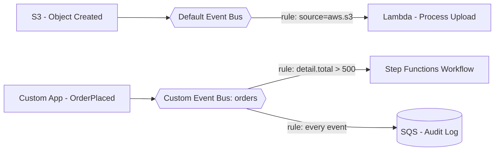

Events (JSON documents with a `source`, `detail-type`, and `detail` payload) arrive on a bus —
default, custom, or partner. Every rule attached to that bus has an event pattern; EventBridge
checks the incoming event against every rule's pattern and, for each match, invokes that rule's
target(s) — one event can match many rules simultaneously.

**Visual Reference.**


*Source: [AWS Well-Architected Framework — Serverless Applications Lens, Event-Driven Architectures](https://docs.aws.amazon.com/wellarchitected/latest/serverless-applications-lens/event-driven-architectures.html).*
This diagram's core lesson: a single event bus can simultaneously ingest from AWS services,
custom applications, and SaaS partners — three categorically different source types — and route
all of them through the *same* rules engine to the *same* kinds of targets, which is exactly why
EventBridge, not SNS, is the answer whenever a scenario's event sources aren't limited to "things
my own application publishes."

**Exam Tips.**
- **EventBridge vs. SNS**: content-based filtering across multiple AWS service sources →
  EventBridge. A simple broadcast with no content logic → SNS, usually the simpler intended answer.
- **Missing DLQ = silent event loss** — this is the single most frequently tested EventBridge
  failure mode: if retries are exhausted with no `DeadLetterConfig` on the target, EventBridge
  drops the event with literally nothing left behind, unlike SQS/SNS which have a DLQ-by-default
  *mental model* even when it must still be explicitly wired.
- **Archive & Replay is not a retry mechanism** — it's a manually-triggered historical replay,
  captures events only from when archiving was enabled, and is distinct from a target's automatic
  `RetryPolicy`.

*Deeper dive:* [`services/application-integration/eventbridge.md`](../../../services/application-integration/eventbridge.md)

---

## 14. Amazon Fraud Detector & Amazon Kendra

### Amazon Fraud Detector

**Definition.** Amazon Fraud Detector is a managed service that builds custom fraud-detection
machine learning models from your own historical event data (no ML expertise required) and
returns a real-time fraud risk score for new events your application can act on immediately.

**Analogy.** Building your own fraud model from scratch is like training a brand-new bank teller
yourself, from zero, to recognize every known fraud pattern using only your own branch's
transaction history — slow, and you need an ML expert on staff to do it well. Fraud Detector is
like hiring a teller who already has years of fraud-pattern training baked in, and who you then
additionally brief on your branch's own specific history — getting a trained, specialized
evaluator fast, without personally teaching them statistics.

**Purpose.** Building a fraud-detection model from scratch requires ML expertise and large volumes
of correctly-labeled historical data — a serious barrier for most teams, who end up buying an
expensive third-party product or shipping only basic rule-based checks. Fraud Detector lets a team
with its own historical transaction data get a trained, purpose-built model and a real-time
scoring API, combining a trained ML model and configurable business rules in one evaluation.

**When to Use.** An e-commerce company has years of labeled fraud/non-fraud data and wants a
real-time checkout risk score; new-account-signup fraud scoring; combining a model's score with
custom business rules ("always flag orders over $X shipping to a new address") in one evaluation.

**When NOT to Use.** You need full control and flexibility over a custom model and already have
ML expertise and build time — SageMaker gives you that, at the cost of far more build effort for a
generic fraud-specific job Fraud Detector already does fast.

**Use Case.** An e-commerce company's checkout flow calls Fraud Detector's real-time scoring API
synchronously at the moment of purchase, combining the model's score with the company's own
configurable rules to decide approve/review/block — the exact architecture Task 2.1's "call out
to a managed AI service off the critical path, or synchronously when the business logic genuinely
requires it" theme describes.

**Why Important.** A slow or momentarily degraded AI service shouldn't drag down a primary
request path — Fraud Detector's low-latency, purpose-built scoring API is designed to sit inline
at checkout without being the architecture's weak link, which is exactly why Task 2.1 lists it
alongside SQS/EventBridge decoupling patterns: the same instinct (don't let one component's
slowness become everyone's problem) applies whether the component is a queue or a managed AI call.

---

### Amazon Kendra

**Definition.** Amazon Kendra is a managed, intelligent enterprise search service using natural
language processing and semantic understanding — not keyword matching — to let users ask
natural-language questions across multiple connected document repositories and get ranked,
relevant answers back.

**Analogy.** Traditional keyword search is like asking a librarian to hand you every book
containing the literal word "vacation" and leaving you to skim all of them for the actual policy.
Kendra is like asking a knowledgeable colleague "how many vacation days do I get after 5 years?"
and getting the actual answer back directly — understanding what you meant, not just matching the
words you typed, and pulling from whichever of several filing cabinets (SharePoint, S3,
Salesforce) actually holds the answer.

**Purpose.** Traditional enterprise search returns documents containing literal keywords, forcing
users to guess the right words and manually skim results. Kendra lets users ask a real question in
plain language and get a direct, ranked answer or passage back — pulled from documents scattered
across many different systems unified into one searchable index.

**When to Use.** Unifying search across SharePoint, S3, Salesforce, and ServiceNow into one
natural-language-queryable index; feeding a Retrieval-Augmented Generation (RAG) pipeline's
grounding step via the Retrieve API.

**When NOT to Use.** A basic keyword-index search tool is sufficient and semantic/NLP-driven
relevance isn't needed — a simple OpenSearch keyword index is lighter-weight.

**Use Case.** An HR team's policy documents are scattered across SharePoint, a shared S3 bucket,
and ServiceNow, and employees struggle with keyword search across any single system — Kendra
connects to all three as data sources, indexes them together, and lets an employee ask "how many
vacation days do I get after 5 years" in plain language and get a direct answer regardless of
which underlying system holds it.

**Why Important.** Kendra's Retrieve API is purpose-built for RAG pipelines — grounding an LLM's
answers in your actual enterprise documents — a direct, testable intersection with generative-AI
scenarios, and the same "decoupled managed AI service" pattern Task 2.1 groups with Fraud
Detector.

**How It Works (both services, side by side).**

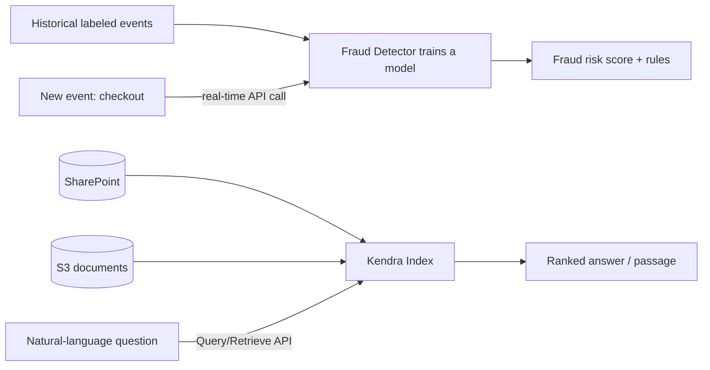

**Visual References.**


*Source: [Amazon Fraud Detector User Guide — "Detecting fraud with Amazon Fraud Detector"](https://docs.aws.amazon.com/frauddetector/latest/ug/frauddetector-workflow.html).* This workflow
diagram makes the continuous-improvement loop explicit: fraud detection isn't a one-time model
deploy — the guide emphasizes evaluating performance scores and metrics after deployment on an
ongoing basis, since fraud patterns themselves evolve over time.


*Source: [Amazon Kendra Developer Guide — Tutorial: Building a metadata-enriched search solution](https://docs.aws.amazon.com/kendra/latest/dg/tutorial-search-metadata.html).* This tutorial
workflow shows the typical setup sequence — connect data sources, enrich with metadata, build the
index, then query — underscoring that Kendra's value (semantic relevance) depends on getting the
indexing/metadata step right first, not just pointing it at raw documents.

**Exam Tips.**
- **Fraud Detector**: "real-time fraud risk score," "our own historical labeled data," "no ML
  expertise required" → Amazon Fraud Detector, distinct from building a custom model in SageMaker.
- **Kendra**: "natural language enterprise search across multiple document repositories,"
  "semantic search, not keyword matching" → Amazon Kendra; note its Retrieve API's RAG
  intersection as a specifically testable detail.
- Both appear in Task 2.1 as examples of "call out to a managed AI service" done the
  decoupled/resilient way — the architecture pattern is the actual exam point more than deep
  service trivia.

*Deeper dive:* [`services/machine-learning-ai/fraud-detector-and-kendra.md`](../../../services/machine-learning-ai/fraud-detector-and-kendra.md)

---

## 15. Amazon MQ

**Definition.** Amazon MQ is a managed message broker service for Apache ActiveMQ and RabbitMQ —
it runs and operates the actual open-source broker software for you, exposed through the
industry-standard protocols (JMS, AMQP 0-9-1, STOMP, MQTT, WebSocket) existing applications
already speak, so a JMS/AMQP-based application can move to AWS largely unchanged on the client
side.

**Analogy.** Migrating an application built against a specific broker protocol to a cloud-native
queue is like asking everyone in a company who's only ever spoken French to suddenly conduct every
meeting in Mandarin — technically possible, but it means retraining every single person at once.
Amazon MQ is a professional interpreter who moves into the building: everyone keeps speaking the
language (protocol) they already know, and the move to new office space (AWS infrastructure)
happens without anyone having to relearn how to communicate.

**Purpose.** Many enterprise applications were built directly against a specific broker's wire
protocol, not a cloud-native API. Rewriting that messaging layer to use SQS/SNS means also
rewriting every producer and consumer — often a far larger undertaking than migrating the
infrastructure underneath a working application. Amazon MQ is a drop-in managed replacement for a
self-hosted ActiveMQ/RabbitMQ broker, so application code keeps working largely unchanged while
AWS takes over patching, scaling, and failover.

**When to Use.** Migrating an existing JMS/AMQP/STOMP/MQTT application off a self-hosted broker
with minimal code change; an IoT fleet of already-deployed devices speaking MQTT natively that
can't have firmware updated; a phased cloud migration where infrastructure must move first,
application modernization deliberately deferred to a later phase.

**When NOT to Use.** Any brand-new application with no existing broker-protocol dependency — SQS
(queuing) or SNS (pub/sub) are AWS's explicitly recommended defaults for new designs, fully
serverless with no capacity planning; extremely high-throughput, must-scale-indefinitely
messaging with no protocol-compatibility need — SQS/SNS/Kinesis remove the instance-sizing
ceiling a provisioned Amazon MQ broker still has.

**Use Cases.**
- A 15-year-old Java/JMS claims-processing system can't have every producer/consumer rewritten to
  the SQS API without real regression risk — pointing the existing JMS `ConnectionFactory` at a
  new Amazon MQ endpoint is typically just a configuration change, not an application rewrite.
- A logistics platform's self-managed RabbitMQ cluster is tiring to patch and failover-test — 
  Amazon MQ for RabbitMQ is a largely drop-in replacement, preserving the AMQP client code and
  exchange/queue topology while AWS now owns patching and clustered HA.
- A fleet of bedside hospital monitoring devices speaks MQTT natively and firmware updates are
  slow/regulated — Amazon MQ's MQTT support lets them connect with no firmware change at all.
- A financial back-office migration plan explicitly forbids touching application code in its
  infrastructure-migration phase — Amazon MQ lets the infrastructure move now, deferring any
  SQS/SNS rewrite (if ever undertaken) to a separately-scoped, later phase.
- A greenfield microservices design has no existing broker protocol dependency anywhere — the
  correct answer here is explicitly **SQS**, not Amazon MQ, a trap the exam tests directly.

**Why Important.** Enterprise cloud migrations overwhelmingly involve existing applications with
real, working JMS/AMQP messaging layers — forcing every one through a full rewrite before moving
to the cloud would make many migrations commercially unworkable. Amazon MQ decouples the
(lower-risk) move to managed infrastructure from the (higher-risk, often-optional) decision to
modernize the messaging layer — two separate decisions that don't have to happen in the same
project, and the single highest-value exam fact to carry forward.

**How It Works.**

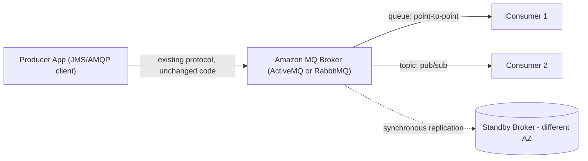

You provision a broker (single-instance or active/standby for HA), choosing ActiveMQ or RabbitMQ
as the engine; your application connects using whichever standard protocol its client already
speaks, sending/receiving through queues or topics exactly as it would against a self-hosted
broker, with AWS handling patching and (in HA mode) automatic standby promotion.

**Visual Reference.**


*Source: [Amazon MQ Developer Guide — Deployment options for Amazon MQ for ActiveMQ brokers](https://docs.aws.amazon.com/amazon-mq/latest/developer-guide/amazon-mq-broker-architecture.html).*
The detail worth internalizing: both brokers share the same underlying EFS storage volume
(replicated across AZs) and only one is active at any moment — if the active broker fails,
Amazon MQ promotes the standby, which already has access to the same EFS-backed data, so no
messages are lost in the handoff. RabbitMQ brokers instead use a clustered deployment (three nodes
across three AZs) — each engine runs its *own* native HA mechanism, not one uniform AWS layer.

**Exam Tips.**
- **The defining trigger phrase is "migrating an existing application"** that already uses JMS,
  AMQP, STOMP, or MQTT, or names ActiveMQ/RabbitMQ directly — see that and the answer is Amazon
  MQ; see a *new* decoupling need with no such phrase and the answer is SQS/SNS.
- **Don't pick Amazon MQ just because a scenario says "message broker"** — SQS/SNS are brokers in
  the generic sense too; the specific signal is protocol compatibility with an *existing* system.
- **Amazon MQ is not more scalable than SQS/SNS** — the opposite tradeoff: less operational
  overhead than self-hosting, but still bounded by a provisioned broker's instance size.

*Deeper dive:* [`services/application-integration/amazon-mq.md`](../../../services/application-integration/amazon-mq.md)

---

## 16. Amazon Pinpoint

**Definition.** Amazon Pinpoint is a managed service for engaging customers through multi-channel
messaging — email, SMS, push notifications, voice, and in-app messages — with built-in audience
segmentation, campaign scheduling, and delivery/engagement analytics unified across channels.

**Analogy.** Running customer messaging without Pinpoint is like five separate departments
(email team, SMS team, push-notification team, an analytics team stitching results together
after the fact) each independently deciding who to contact and tracking their own results in
separate spreadsheets — duplicate messages, inconsistent opt-out handling, and no unified picture
of what actually worked. Pinpoint is the single marketing operations desk that owns the master
customer list, decides who's in which audience segment, and reports results across every channel
in one dashboard.

**Purpose.** Customer engagement messaging gets genuinely hard at scale: meaningful segmentation,
honoring opt-outs consistently, tracking delivery/engagement, and coordinating the same campaign
across multiple channels without five bespoke pipelines. Pinpoint gives application teams this as
one managed service instead of wiring SES, a push service, a third-party SMS gateway, and a
homegrown analytics pipeline separately.

**When to Use.** Re-engagement push campaigns targeting a dynamically-defined inactive-user
segment; transactional messaging needing multi-channel fallback (email first, SMS if no
engagement within a window); A/B testing message copy/send-time before a full rollout; branching,
multi-step onboarding journeys adapting to real user behavior; centralizing delivery/engagement
analytics across channels in one dashboard.

**When NOT to Use.** Simple, unsegmented, one-off transactional email (password reset, order
confirmation) — plain SES directly is simpler and cheaper, Pinpoint's layer is overhead you don't
need; simple pub/sub fan-out push with no segmentation need — plain SNS mobile push is
lighter-weight; purely internal/operational alerting (not customer-facing) — SNS or CloudWatch
Alarms + SNS, not Pinpoint.

**Use Cases.**
- A mobile app wants to win back users who haven't opened it in 14+ days — a dynamic segment
  feeding a push campaign automates targeting without manual list-building, with built-in
  engagement analytics SNS alone doesn't provide.
- A critical notification must reach a user even if they ignore email — a Journey sends email
  first and branches to SMS if no engagement is detected within a configured window, coordinated
  from one place with shared segment/event data.
- A team wants to know which of two push-copy variants performs better before a full rollout —
  Pinpoint's built-in A/B variant splitting and reporting automates both the split and the
  comparison.
- A new user needs a multi-step onboarding sequence that adapts based on what they do (or don't
  do) — Journeys support branching logic keyed on real engagement, not a fixed one-size-fits-all
  drip schedule.
- A retail customer enters a geofenced area near a physical store — Pinpoint integrates with
  Amazon Location Service-driven geofence events to trigger a targeted campaign the moment that
  happens.

**Why Important.** Fragmented, uncoordinated messaging across channels is a common source of both
poor user experience (duplicate/conflicting messages) and compliance risk (failing to honor
opt-outs consistently). Pinpoint's unified endpoint/segment/opt-out model reduces both risks by
centralizing the logic in one service. It sits alongside Amplify and Device Farm in Task 2.1's
"decoupled front-end lifecycle" grouping — Pinpoint specifically being the post-launch engagement
piece, moved off the critical request path and into its own asynchronous channel.

**How It Works.**

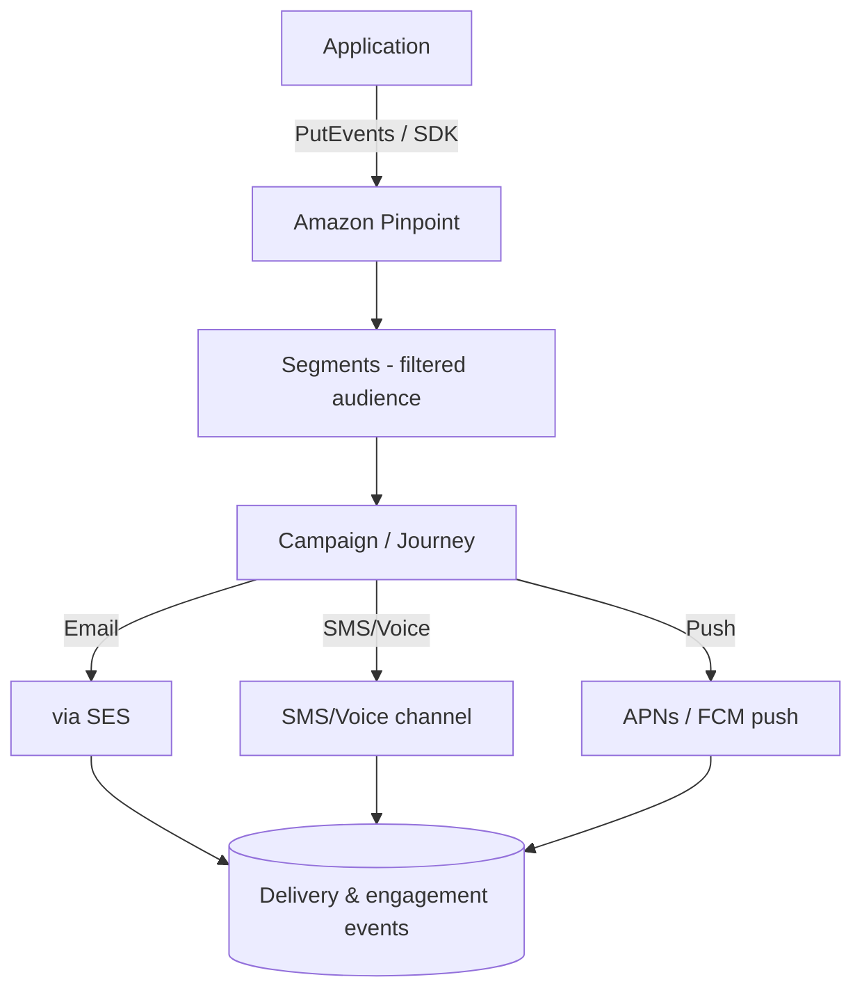

You define a filtered audience Segment (static or dynamic), create a Campaign (one-time/scheduled)
or Journey (multi-step, branching) targeting it, and Pinpoint sends through the appropriate
channel — email via SES, SMS/voice directly, push via APNs/FCM — with delivery and engagement
events flowing back into built-in analytics or out to Kinesis Firehose for a custom pipeline.

**Visual Reference.**


*Source: [AWS Pinpoint Resilient Architecture Guide](https://docs.aws.amazon.com/pinpoint/latest/archguide/architectures.html).* This is AWS's own reference architecture for making Pinpoint
itself resilient — traffic split across two Regions under normal conditions, with event data
replicated so reporting data isn't lost if traffic needs to fail over entirely to one Region. It's
a useful reminder that even a "front-end lifecycle" service like Pinpoint gets the same
multi-Region resilience treatment as any Task 2.2 workload once engagement messaging becomes
business-critical.

**Exam Tips.**
- **"Segmented," "multi-channel campaign," "engagement analytics," "push/SMS/email together"**
  are Pinpoint trigger phrases.
- Distinguish from **SES** (plain transactional/bulk email, no built-in segmentation/analytics)
  and **SNS** (plain pub/sub push, no segmentation/campaign concept) — Pinpoint sits a layer
  above both, often using them underneath for actual channel delivery.
- **Journeys** = branching, multi-step, trigger-based flows; **Campaigns** = simpler one-time or
  scheduled single-message sends — know which term a question is describing.

*Deeper dive:* [`services/front-end-web-mobile/pinpoint.md`](../../../services/front-end-web-mobile/pinpoint.md)

---

## 17. Amazon RDS

**Definition.** Amazon RDS is a managed service that runs a traditional relational database for
you — MySQL, PostgreSQL, MariaDB, Oracle, or SQL Server — without you installing, patching,
backing up, or babysitting the database server yourself. You still design the schema and write
the SQL; RDS takes everything below the SQL layer off your plate.

**Analogy.** Running your own database server is like owning and personally maintaining a car —
you do the oil changes, replace the brakes, and are the one who gets the 2am call if it breaks
down on the highway. RDS is a car with a full-service lease: you still drive it exactly how you
want (your schema, your SQL, your tuning), but the dealership handles every oil change, every
scheduled recall, and swaps in a working replacement automatically if something fails — you just
keep driving.

**Purpose.** Before RDS, running a relational database meant provisioning a server, installing
the engine, configuring storage, writing backup scripts, patching on a schedule, and building
failover — all before a line of application code. RDS takes that entire operational burden off
engineering teams while still giving them the full relational engine they already know.

**When to Use.** Any workload needing ACID transactions across multiple tables as the default
(order + inventory debited atomically); lift-and-shift of an existing on-prem MySQL/PostgreSQL/
Oracle/SQL Server application with minimal rewrite; a multi-tenant SaaS schema expressing
tenant-scoped referential integrity via foreign keys; a reporting replica offloading read-heavy
dashboard queries from a live OLTP primary; disaster recovery via a cross-Region read replica.

**When NOT to Use.** Needing to scale writes horizontally across many nodes or handle massive,
unpredictable traffic — DynamoDB; wanting MySQL/PostgreSQL compatibility but needing 5x the
throughput, storage up to 128 TB, and serverless scale-to-zero — Aurora/Aurora Serverless v2; heavy
OLAP queries across billions of rows for BI — Redshift, not a read replica; your app is fundamentally
about relationships/graph traversal — Neptune.

**Use Cases.**
- An e-commerce order must debit inventory and record payment atomically, with a clean rollback
  if either fails — RDS's ACID transaction guarantee is the default for every multi-statement
  transaction, not an explicit, scoped exception the way DynamoDB's `TransactWriteItems` is.
- A banking ledger needs double-entry bookkeeping across arbitrary account pairs where the books
  must always balance — the textbook relational use case, where foreign keys enforce referential
  integrity and multi-row transactions are the normal mode of operation.
- An existing on-prem MySQL/PostgreSQL/Oracle/SQL Server application moves to AWS with minimal
  rewrite — RDS preserves the exact engine, schema, and SQL, unlike a NoSQL migration that would
  force an access-pattern redesign.
- A reporting team's dashboard queries are slowing down checkout page load times — a read replica
  takes reporting traffic off the primary entirely, with zero changes to the write path.
- A security audit flags that the production database is reachable from the internet — the fix is
  a networking/security-group change (not publicly accessible, security group scoped to the app
  tier), not a database engine change, Multi-AZ, or encryption — a common exam trap testing
  whether you recognize the *actual* category of fix a finding needs.

**Why Important.** Relational databases still run the majority of the world's business-critical
transactional systems. The difference between a well-configured Multi-AZ RDS instance and a
single unmanaged server is the difference between a 2-minute automatic failover and a multi-hour
outage (or data loss) when hardware eventually fails. Task 2.2 names Multi-AZ and backup/DR
strategies explicitly; Task 2.1 names read replicas for scaling — RDS is one of the few services
genuinely central to both task statements.

**How It Works.**

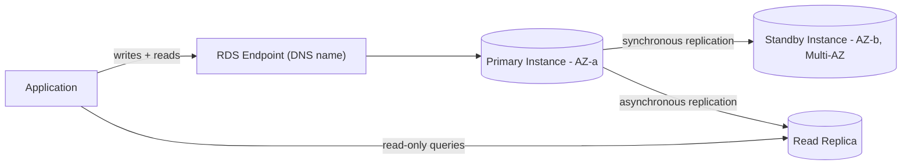

The application connects to a stable DNS endpoint, not a server IP. In Multi-AZ mode, every write
is also sent synchronously to a standby in a different AZ before being acknowledged — if the
primary dies, RDS fails over automatically and repoints the endpoint DNS, typically in 60-120
seconds. Read replicas are separate, optional, asynchronous copies whose job is offloading read
traffic, not availability.

**Visual Reference.**


*Source: [AWS RDS User Guide — Multi-AZ deployments](https://docs.aws.amazon.com/AmazonRDS/latest/UserGuide/Concepts.MultiAZ.html).* The detail this diagram makes concrete: Multi-AZ provisions
and maintains the standby *automatically* — there's no manual replication setup, and the standby
exists purely for failover, never serving application read traffic on its own (that's what a
separate, asynchronous read replica is for). Conflating these two — "I have a standby, so reads
can go there too" — is one of the most common real misunderstandings this diagram exists to
correct.

**Exam Tips.**
- **Multi-AZ ≠ read scaling.** It's purely for availability/failover. If a question says "improve
  read performance," the answer is a **Read Replica**, not Multi-AZ — this pairing is tested
  relentlessly.
- **"Lift and shift an on-prem SQL Server/Oracle database" with "minimal code changes" and "same
  engine"** is the classic RDS trigger phrase, not Aurora/DynamoDB.
- **Encryption at rest cannot be enabled on an existing unencrypted instance** — the only path is
  snapshot → copy with encryption → restore as a new instance. This is a guaranteed exam trap.

*Deeper dive:* [`services/database/rds.md`](../../../services/database/rds.md)

---

## 18. Amazon Route 53

**Definition.** Amazon Route 53 is AWS's highly available, scalable DNS web service — it
translates human-readable names into IP addresses, registers domain names, and performs
health-check-based traffic routing, making DNS itself part of your availability strategy, not
just a lookup table.

**Analogy.** Plain DNS is like a phone book that always gives out the same number for a business,
even if that location has burned down. Route 53 is a smart receptionist who, before transferring
any caller, actually checks whether each branch location is currently open and answering the
phone — automatically routing callers only to branches that are actually up, and even routing
different callers to whichever branch is genuinely closest or fastest for them specifically.

**Purpose.** Every application needs users to find it by name, and that lookup needs to be fast,
globally available, and resistant to failure. Running your own reliable, globally distributed DNS
infrastructure is hard — Route 53 gives you that as a managed service, and goes further by baking
in health checks and routing policies so DNS itself executes your availability/traffic-management
strategy.

**When to Use.** A public-facing app's root domain needing an Alias record (CNAME can't exist at
the zone apex); active-passive multi-Region disaster recovery via Failover routing with health
checks; global latency-based routing across 3+ Regions; weighted canary/blue-green deployments;
hybrid DNS resolution between on-prem and VPC via Resolver endpoints; compliance-driven
geolocation content restriction.

**When NOT to Use.** You need routing decisions with no DNS caching delay at all — for truly
instant network-layer failover, front backends with AWS Global Accelerator instead, which reroutes
within seconds using static anycast IPs, not DNS TTL propagation; internal service discovery
inside a single VPC between microservices might fit AWS Cloud Map or ECS/EKS-native discovery
better, though a private hosted zone remains a valid simpler option.

**Use Cases.**
- A public web app's root domain (`example.com`, no subdomain) needs to point at an ALB, which a
  CNAME record cannot do per the DNS spec — a Route 53 **Alias record** resolves this at the zone
  apex, for free, with no extra DNS hop.
- A primary Region's ALB must automatically hand off to a secondary Region's standby if health
  checks detect failure, with no manual intervention — Failover routing with health checks on the
  primary is the classic DR pattern underlying most of Task 2.2's cross-Region scenarios.
- A global application wants each user routed to whichever Region genuinely responds fastest, not
  just the geographically nearest — Latency-based routing uses AWS's own measured network latency
  data, which doesn't always correlate with simple geographic distance.
- An application must serve different legal content to EU users versus the rest of the world,
  enforced at the DNS layer rather than in application code — Geolocation routing resolves
  differently based on the resolver's geographic location, centralizing enforcement in one place.
- A merged on-prem/AWS hybrid environment needs on-prem systems to resolve AWS private hosted zone
  names, and VPC-resident systems to resolve on-prem internal domains — Route 53 Resolver inbound/
  outbound endpoints bridge both directions over Direct Connect/VPN.

**Why Important.** DNS is one of the most common single points of failure in real outages — a
fully functional application is still completely unreachable if nobody can resolve its name.
Route 53's global anycast name server network and SLA make this failure mode rare, which is
exactly why it's the default choice for production AWS workloads. Task 2.2 names "Route 53
routing/failover" explicitly as core Domain 2 content.

**How It Works.**

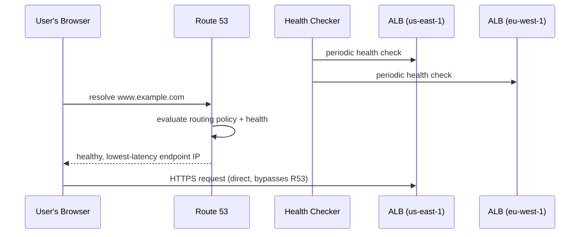

Route 53's health checker continuously probes endpoints in the background, independent of any
user request. When a user's resolver asks for a name, Route 53 evaluates the configured routing
policy (simple, weighted, latency-based, failover, geolocation, geoproximity, multi-value, or
IP-based) and returns the IP of whichever answer that policy — and current health-check state —
dictates. From there the client talks directly to the backend; Route 53 is out of the data path.

**Visual Reference.**


*Source: [AWS Documentation — "Resolving DNS queries between VPCs and your network"](https://docs.aws.amazon.com/Route53/latest/DeveloperGuide/resolver-overview-DSN-queries-to-vpc.html).* This
diagram is worth internalizing for the hybrid-DNS scenario specifically: a Resolver **outbound**
endpoint forwards a query from a VPC to on-prem DNS servers, and a Resolver **inbound** endpoint
carries queries the other direction — both endpoints are independent of each other, so a
hybrid-DNS requirement might need only one direction configured, not necessarily both.

**Exam Tips.**
- **Alias record vs. CNAME**: Alias records are free, work at the zone apex (which CNAME cannot,
  per DNS spec), and are AWS's preferred way to point at ALB/CloudFront/S3 — "root domain pointing
  at an ALB" always means Alias record, never CNAME.
- **Routing policy keyword matching**: "lowest latency" → Latency-based. "percentage of traffic /
  canary" → Weighted. "active/standby, automatic failover" → Failover. "route by user's country" →
  Geolocation. "shift traffic with a bias dial between locations" → Geoproximity.
- **DNS failover is not instant like a load balancer removing an unhealthy target** — it depends
  on TTL and resolver caching; don't confuse the two failure-handling speeds on the exam.

*Deeper dive:* [`services/networking-content-delivery/route53.md`](../../../services/networking-content-delivery/route53.md)

---

## 19. Amazon SNS

**Definition.** Amazon SNS is a fully managed publish/subscribe messaging service. A publisher
sends one message to a topic, and SNS instantly delivers an independent copy to *every*
subscriber attached — email, SMS, mobile push, SQS queues, Lambda functions, or HTTP endpoints,
all at once.

**Analogy.** A topic is a radio station: one broadcast, every tuned-in listener hears it, in
parallel, without the broadcaster knowing or caring how many radios are turned on. Compare this
to SQS's to-do list — SNS is the opposite shape: instead of one worker picking one task off a
list, every single subscriber gets its own full copy of the exact same announcement at the same
moment.

**Purpose.** Many systems need to notify several different, unrelated consumers about the same
event. Before pub/sub, the publisher had to know about and call each consumer directly. SNS lets
the publisher talk only to one topic — subscribers can be added or removed with zero change to
the publisher's code, each getting an independent, parallel, near-instant copy.

**When to Use.** Fan-out to independent microservices reacting to one business event; alerting a
human and a system simultaneously from one trigger (a CloudWatch Alarm emailing an engineer and
posting to Slack); mobile/SMS push at scale without building APNs/FCM connection management
yourself; processing one uploaded object multiple independent ways (thumbnail + metadata + virus
scan, each its own pipeline); cross-account security event forwarding; FIFO-ordered notifications
for a specific business key.

**When NOT to Use.** The message needs to be durably held until a single consumer is ready, with
retry on failure — that's SQS's job; SNS's own retry policy covers brief outages but not a
consumer down longer than that window (pair SNS → SQS fan-out for durability *and* fan-out
together); complex routing based on content matched against many AWS service sources —
EventBridge's rules engine is richer; need a replayable, ordered event log many independent
readers can consume from any point — Kinesis Data Streams.

**Use Cases.**
- An "order placed" event needs to reach billing, shipping, and analytics systems independently,
  each owned by a different team — SNS → three SQS queues decouples the order service from every
  consumer's availability and API shape, and a fourth consumer can be added later with zero
  publisher change.
- A CloudWatch Alarm needs to both email the on-call engineer and post to a Slack webhook the
  instant it fires — one topic, two subscriptions, no custom fan-out code in the alerting
  pipeline.
- An image upload needs thumbnail generation, EXIF extraction, and malware scanning as three
  independent pipelines that shouldn't block each other — S3 event → SNS → three SQS queues → three
  Lambdas, since S3 natively targets only a limited number of destinations per event type directly.
- A central security account needs GuardDuty findings forwarded from every member account in an
  AWS Organization — SNS topic policies granting cross-account subscription permission let the
  central account react in near-real-time rather than only on the next scheduled bucket scan.
- A trading platform needs "order placed" and "order cancelled" events for the same order ID
  delivered and processed in that exact order by downstream FIFO consumers — a FIFO SNS topic
  feeding FIFO SQS queues is the fit, trading away Standard SNS's broader protocol support and
  higher throughput specifically to guarantee order.

**Why Important.** SNS is the backbone of "broadcast an event once, let every team build their
own reaction" architectures — it decouples the number and identity of consumers from the
publisher entirely, letting large organizations add new downstream systems without touching the
original application's code. Task 2.1's "loosely coupled architectures" wording directly tests
recognizing a one-to-many broadcast requirement and reaching for SNS (often SNS→SQS fan-out)
instead of direct service-to-service calls.

**How It Works.**

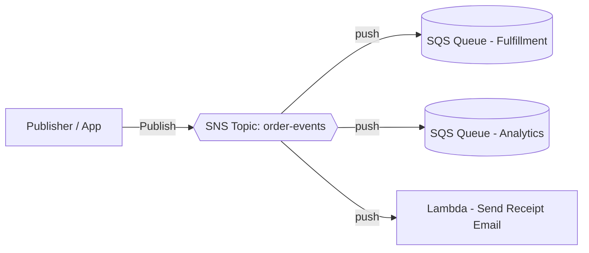

The publisher calls `Publish` once against the topic ARN, with no idea how many subscribers exist.
SNS immediately pushes an independent copy to every current subscription, in parallel — one slow
or failing subscriber doesn't block delivery to the others. Subscription filter policies let each
subscriber see only messages matching certain attributes, so one topic can serve many different
subscriber needs declaratively instead of requiring a topic per event type.

**Visual Reference.**


*Source: [AWS Documentation — "What is Amazon SNS?"](https://docs.aws.amazon.com/sns/latest/dg/welcome.html).* This is the single clearest illustration of the fan-out pattern's purpose: one
publish event becomes two independently-durable SQS queues, each feeding its own EC2-based
consumer — order processing and data analysis can each fail, retry, or scale completely
independently of the other, despite both reacting to the exact same original message.

**Exam Tips.**
- **SQS vs. SNS, the single question that decides it**: "does more than one consumer need this
  message?" → SNS. "Does exactly one worker pull and process this at its own pace?" → SQS. Both at
  once (durability *and* fan-out) → **SNS → multiple SQS queues**.
- **SNS is push, not pull** — subscribers don't poll; SNS delivers to them, the opposite of SQS.
- **Filter policies let one topic serve many subscriber needs declaratively** — a message failing
  to match a filter policy is silently dropped for that subscriber, no error, no DLQ entry, a
  common "why didn't this arrive" trap.

*Deeper dive:* [`services/application-integration/sns.md`](../../../services/application-integration/sns.md)

---

## 20. Amazon SQS

**Definition.** Amazon SQS is a fully managed message queue. One part of your system drops a
message into the queue, and another part picks it up and processes it later — the two sides never
talk directly, or even need to be running at the same time.

**Analogy.** A to-do list sitting between two workers: one writes tasks onto the list and moves on
immediately without waiting to see them done; the other reads tasks off the list whenever they
have capacity, at their own pace. If the second worker is on a break, the list simply holds the
tasks — nothing is lost, nothing forces the first worker to wait around.

**Purpose.** Before queues, if Service A called Service B directly and B was down, slow, or
overwhelmed, A's request failed or hung — and a sudden burst of requests could take B down
entirely. SQS decouples producers from consumers: the producer enqueues and moves on; the
consumer drains the queue whenever it has capacity, absorbing spikes and surviving downstream
outages.

**When to Use.** Decoupling a web app from slow background work; buffering a traffic spike that
would otherwise crash a downstream service; load leveling between microservices with different
throughput capabilities; order-of-operations-sensitive processing per entity (FIFO with
per-entity message groups); durable fan-out buffering behind SNS; scaling a worker fleet directly
off backlog depth.

**When NOT to Use.** Many subscribers need the same message (one-to-many fan-out) — use SNS or
SNS→SQS fan-out, since a single SQS queue delivers each message to only one consumer; complex
content-based routing across many AWS services — EventBridge; a durable, replayable event log
multiple independent consumer groups each read from the beginning — Kinesis Data Streams or MSK.

**Use Cases.**
- A user uploads an image and the app shouldn't make them wait for resizing to finish — the app
  enqueues a "resize this image" message and returns instantly; a worker fleet drains the queue at
  its own pace, decoupling user-facing latency from background processing time entirely.
- An order-processing backend comfortably handling 50 orders/sec gets hit with 500/sec during a
  flash sale — SQS absorbs the burst and workers drain it steadily, buying the same resilience as
  over-provisioning for the rare peak, at a fraction of the idle-capacity cost.
- A banking system must process a "withdraw" event before a "deposit reversal" for the same
  account, but doesn't care about relative ordering across different accounts — SQS FIFO with
  per-account message groups gives strict per-entity ordering while still scaling across many
  independent groups.
- An Auto Scaling Group needs to grow and shrink based on actual pending work, not guesswork — the
  `ApproximateNumberOfMessagesVisible` metric driving a scaling policy is a direct, leading signal,
  letting workers scale up before CPU utilization even climbs.
- Several independent microservices (billing, shipping, analytics) each need their own durable
  copy of every order event, with their own retry/DLQ even if one is temporarily down — SNS fanning
  out into multiple SQS queues is the fit; plain SNS alone would lose the message for a subscriber
  down longer than its own retry window.

**Why Important.** SQS is the cheapest, simplest way to make a system resilient to partial
failure — often the first service introduced when a monolith is broken into services, because it
buys huge reliability for very little operational cost. Task 2.1's "scalable and loosely coupled
architectures" wording explicitly calls out queuing as the decoupling mechanism, and SQS between
tiers (web → queue → worker) is the textbook answer whenever a scenario describes surviving a slow
or failing downstream component.

**How It Works.**

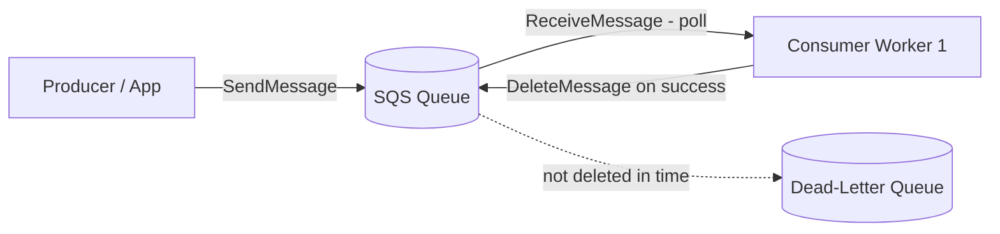

A producer calls `SendMessage`; SQS stores it durably and returns success immediately without the
producer waiting for processing. A consumer polls, receives the message (which becomes invisible
to other consumers for a configurable visibility timeout), processes it, and calls `DeleteMessage`
to confirm — if that call never arrives (crash, timeout), the message automatically becomes
visible again for retry, and after `maxReceiveCount` failed attempts, moves to a dead-letter queue
instead of looping forever.

**Visual Reference.**


*Source: [AWS Documentation — "What is Amazon Simple Queue Service?"](https://docs.aws.amazon.com/AWSSimpleQueueService/latest/SQSDeveloperGuide/welcome.html).* The lifecycle this diagram
depicts — send, receive (invisible during visibility timeout), delete — is the entire mental
model needed to reason about SQS's at-least-once delivery guarantee: a consumer that crashes
*between* receiving and deleting leaves the message visible again automatically once the timeout
elapses, which is precisely why consumers must be written to be idempotent regardless of how
carefully visibility timeouts are tuned.

**Exam Tips.**
- **SQS vs. SNS, the classic trap**: SQS is pull-based, one consumer per message (point-to-point);
  SNS is push-based, many subscribers per message (pub/sub). "Multiple services need to react to
  the same event" points to SNS (often fanning into multiple SQS queues), not a single SQS queue.
- **FIFO vs. Standard tradeoff**: FIFO = ordering + exactly-once, lower throughput ceiling, higher
  cost. Standard = unlimited throughput, cheaper, best-effort ordering, possible duplicates.
- **Visibility timeout vs. retention period** — don't confuse them. Visibility timeout = how long
  a message is hidden after being received. Retention period = how long an unprocessed message
  survives in the queue at all (up to 14 days) before SQS deletes it regardless of DLQ settings.

*Deeper dive:* [`services/application-integration/sqs.md`](../../../services/application-integration/sqs.md)

---

## 21. Containers vs. VMs vs. Serverless

**Definition.** These are three different answers to the same question: how much of the computer
do you want to manage yourself, versus hand to AWS? A **VM** is a full emulated computer with its
own OS kernel running on shared hardware. A **container** packages an app and its dependencies
(not a full kernel) into a lightweight unit sharing the host's kernel. **Serverless** removes the
"server" concept almost entirely — you supply code or an image, and the provider handles
everything about where/how it runs, scaling to zero when idle.

**Analogy.** A VM is like renting an entire private house — you control everything inside it, but
you're also responsible for its own roof, plumbing, and utilities, and it exists whether you're
home or not. A container is like renting a furnished apartment in a shared building — you share
the building's foundation and utilities (the kernel) with other tenants, but your unit is still
isolated and yours. Serverless is like booking a hotel room by the hour precisely when you need
one — you never own or maintain any part of the building, you're billed only for the hours you
actually occupied a room, and the building disappears from your bill entirely the moment you
check out.

**Purpose.** Every cloud architecture decision starts here: how much infrastructure do you want to
own? Each model moves the line between "what you manage" and "what the provider manages" further
toward the provider, trading control for reduced operational burden — and each trades differently
on cost, startup latency, portability, and flexibility.

**When to Use.** VM (EC2): legacy software licensed to a specific machine identity; GPU-heavy ML
training needing specific drivers/kernel modules; workloads needing the absolute lowest cost at
very large, predictable, steady scale (Reserved/Savings Plans). Containers (ECS/EKS): microservices
migrations needing consistent packaging across environments and fast horizontal per-service
scaling. Serverless (Lambda): infrequent, bursty, short-lived event-driven glue code with no idle
cost between triggers.

**When NOT to Use.** Don't use VMs for a stateless workload that fits in a container — you're
paying for OS-management overhead you don't need. Don't use containers for extremely short,
bursty, low-traffic event handling where even a container's few-second startup is overkill — use
Lambda. Don't use serverless for processes exceeding 15 minutes, needing persistent local state or
specialized hardware, or very high-and-constant traffic where per-invocation billing costs more
than a steady-state fleet.

**Use Cases.**
- Software license validation is tied to a specific kernel/hardware fingerprint — only a full VM
  preserves license validity the way no container or function can.
- A monolith is being decomposed into independently deployable services — containers give
  consistent packaging across dev/staging/prod and fast horizontal scaling per service, at the
  cost of adding an orchestration layer (ECS/EKS) with its own operational surface.
- Infrequent, bursty processing between two services (an event-driven webhook) — serverless scales
  to zero and bills per invocation with no idle cost between triggers, at the cost of a hard
  15-minute execution ceiling.
- A batch pipeline has quick steps and at least one step that might run over 15 minutes — Step
  Functions calls Lambda for the fast steps and Fargate `RunTask` for the long one, accepting the
  complexity of operating two compute models for the flexibility of fitting both constraints.
- A workload has constant, high, predictable request volume 24/7 with no idle periods — the
  counter-intuitive, exam-favorite case where **serverless is likely more expensive** than
  Reserved EC2/Fargate with Savings Plans, because per-invocation billing scales linearly (or
  worse) with volume at that scale.

**Why Important.** This single decision shapes your cost structure, your team's operational
burden, your deployment speed, and your blast radius during an incident. Picking VMs when
containers would do means paying an ops tax forever; picking Lambda for a workload running
constantly at high volume can be *more* expensive than a steady container fleet. Task 2.1
directly lists "microservices, event-driven patterns, containers, ECS/EKS" alongside compute
scaling choices — this comparison is the mental model the exam expects you to apply, not just
memorize in isolation.

**How It Works.**

```mermaid
flowchart TB
    subgraph VM["Virtual Machines (EC2)"]
        HV[Hypervisor] --> VM1[Guest OS 1 + App 1]
        HV --> VM2[Guest OS 2 + App 2]
    end
    subgraph CTR["Containers (ECS/EKS/Fargate)"]
        Host[Host OS Kernel] --> C1[Container 1: App + libs]
        Host --> C2[Container 2: App + libs]
    end
    subgraph SL["Serverless (Lambda)"]
        Event[Event/Request] --> Alloc[Provider allocates on demand]
        Alloc --> Zero[Scales to zero when idle]
    end
    VM -->|lighter, faster start| CTR
    CTR -->|no server concept at all| SL
```

A VM's hypervisor partitions physical hardware into isolated guests, each with its own full OS
kernel — slowest to boot, most control. Containers share a host kernel via namespaces/cgroups —
starting one means starting a process, not booting an OS, seconds not minutes. Serverless has no
provisioned unit at all — the platform reacts to an event, allocates ephemeral compute, runs your
code, and tears it down, scaling to exactly zero when idle.

**Visual Reference.**


*Source: [AWS Architecture Blog — "Compute Abstractions on AWS: A Visual Story"](https://aws.amazon.com/blogs/architecture/compute-abstractions-on-aws-a-visual-story/).* The key insight from
this post, directly relevant to exam reasoning: these abstraction levels are not a strict ladder
where higher is always better — a workload needing direct access to specialized hardware
deliberately chooses a *lower* abstraction level, trading operational convenience for control. The
exam consistently rewards "match the abstraction level to the workload's actual constraint," never
"always pick the most abstracted/serverless option."

**Exam Tips.**
- Classic phrasing: "with minimal operational overhead"/"no server management" → push toward
  serverless/Fargate; "full control over the OS/kernel" → push toward EC2; "consistent across
  environments, standardized packaging" → push toward containers.
- Watch for **cost-optimization scenarios that invert intuition**: constant, high, predictable
  traffic often favors reserved EC2/containers over Lambda — don't default to "serverless = always
  cheaper."
- A workload needing **>15 minutes of continuous execution** can never be a vanilla Lambda
  function, and **GPUs or custom kernel modules** can never run on Fargate — both are instant
  disqualifiers independent of how attractive the rest of the option sounds.

*Deeper dive:* [`services/containers/containers-vs-vms-vs-serverless.md`](../../../services/containers/containers-vs-vms-vs-serverless.md)

---

## 22. Elastic Load Balancing

**Definition.** Elastic Load Balancing (ELB) is AWS's managed service for automatically
distributing incoming traffic across multiple targets so no single server gets overwhelmed and
traffic keeps flowing even if some targets fail. It comes in four flavors: **Application Load
Balancer (ALB)**, **Network Load Balancer (NLB)**, **Gateway Load Balancer (GWLB)**, and the
legacy **Classic Load Balancer (CLB)**.

**Analogy.** A load balancer is like a host seating guests at a restaurant with several identical
kitchens in the back — the host (the load balancer) constantly checks which kitchen is actually
open and not backed up (health checks), and only sends new tables to kitchens that are genuinely
ready, instantly stopping seating at a kitchen that catches fire and redirecting everyone to the
ones still working. An ALB host also reads the ticket's content (HTTP path) to decide which
specific kitchen specializes in that dish; an NLB host just passes tickets straight through at
blistering speed without reading them at all.

**Purpose.** Before ELB, scaling meant running your own load-balancing software on an EC2
instance — itself a single point of failure you had to patch and keep available yourself. ELB is a
fully managed, horizontally scaling, highly available load balancer requiring no capacity planning
from you, integrating natively with Auto Scaling, health checks, and (for ALB) application-layer
routing logic.

**When to Use.** ALB: HTTP/HTTPS content-aware routing (path/host-based), microservices mesh
behind one domain, WebSocket apps, authentication offload via Cognito/OIDC. NLB: raw TCP/UDP at
extreme speed, a fixed static IP per AZ for partner firewall allowlisting, true TLS passthrough for
compliance. GWLB: transparently inserting third-party firewall/IDS appliances into a traffic path
across many VPCs.

**When NOT to Use.** A single-instance workload with no scaling need — a Route 53 record with
health checks may suffice; global multi-Region traffic steering by latency/health across Regions
(not just load distribution within one) — that's Route 53 routing policies or Global Accelerator,
used *with* ELB, not instead of it; static content only — serve directly from S3 + CloudFront, no
load balancer needed.

**Use Cases.**
- A standard web app needs HTTPS termination, path-based routing, and health-check-driven failover
  across an Auto Scaling group — an ALB handles all three natively, removing the single point of
  failure a lone instance represents.
- A gaming company needs UDP support and the lowest possible latency, with a partner firewall
  requiring a fixed IP allowlist entry — NLB is the only ELB type supporting UDP at all, and the
  only one offering a static IP per AZ; ALB supports neither requirement.
- A security team wants every packet entering/leaving several VPCs inspected by a third-party
  next-gen firewall without any application team changing their routing beyond a one-time route
  table update — Gateway Load Balancer, paired with GWLB endpoints per VPC, inserts the appliance
  transparently to both client and application.
- A regulated workload requires the load balancer itself never have access to decrypted traffic —
  NLB in TCP mode forwards encrypted bytes without ever decrypting them, at the cost of losing
  ALB's path/host-based HTTP routing entirely.
- A team wants to gradually shift production traffic from v1 to v2 while watching error rates,
  with instant rollback capability — weighted target groups on a single ALB listener rule shift
  (and revert) instantly, per-request, with no DNS TTL propagation delay unlike a Route 53
  weighted-record cutover.

**Why Important.** Choosing the wrong load balancer type is a common production mistake — using
an ALB for a non-HTTP TCP protocol (it simply can't route it) or an NLB when you needed
host/path-based routing (it's blind to HTTP content entirely). ELB is also usually the single most
visible component in an outage — if it misbehaves, everything behind it looks down — so its
health-check and cross-zone behavior is critical to real incident response. Task 2.1 lists load
balancing explicitly; it's one of the most reliably tested single topics on the whole exam.

**How It Works.**

```mermaid
flowchart TB
    Client((Clients))
    subgraph ALB_Path["Layer 7 — HTTP/HTTPS routing"]
        ALB["Application Load Balancer"]
        TG1["Target Group: /api/* -> ECS service"]
        TG2["Target Group: /images/* -> EC2 fleet"]
    end
    subgraph NLB_Path["Layer 4 — ultra-low-latency TCP/UDP"]
        NLB["Network Load Balancer (static IP per AZ)"]
    end
    Client -->|"HTTPS :443"| ALB
    ALB -->|"path-based rule"| TG1
    ALB -->|"path-based rule"| TG2
    Client -->|"TCP :443"| NLB
```

The load balancer receives all incoming traffic, continuously health-checks registered targets,
and forwards only to targets passing the health check — automatically pulling a failed target out
of rotation and restoring it once it recovers. Which type to pick depends on the OSI layer: ALB
understands HTTP content (L7), NLB handles raw TCP/UDP at extreme speed and fixed IPs (L4), GWLB
transparently inserts third-party appliances (L3/4, GENEVE encapsulation).

**Visual Reference.**


*Source: [AWS Documentation — "What is an Application Load Balancer?"](https://docs.aws.amazon.com/elasticloadbalancing/latest/application/introduction.html).* This diagram's listener → rule →
target group chain is the exact mental model for troubleshooting a misrouted request: trace it
listener first (is TLS even terminating correctly), then rule (did the right rule match, in
priority order), then target group (is the selected target actually healthy) — in that order, not
backwards.

**Exam Tips.**
- **ALB = Layer 7 (content-aware), NLB = Layer 4 (speed/static IP), GWLB = Layer 3/4 (appliance
  insertion), CLB = legacy, never pick it for new designs.** This single mapping resolves most ELB
  questions.
- **Static IP requirement in the question = NLB, almost always** — ALB has no native static/
  Elastic IP (you'd need Global Accelerator in front of it for that).
- **"Preserve client IP without extra configuration" = NLB** (preserves it natively at the TCP
  layer); ALB needs the `X-Forwarded-For` header, since it terminates and re-originates the
  connection.

*Deeper dive:* [`services/networking-content-delivery/elastic-load-balancing.md`](../../../services/networking-content-delivery/elastic-load-balancing.md)

---

## 23. Messaging Patterns Overview

**Definition.** "Messaging patterns" are the handful of reusable ways independent parts of a
system can exchange information without calling each other directly. SQS, SNS, EventBridge, and
Step Functions each implement a different pattern, and real architectures almost always combine
more than one.

**Analogy.** Four different tools in a toolbox, each built for a distinct job: SQS is a mailbox
(one letter, one recipient, held safely until they check it); SNS is a town crier (one
announcement, everyone in earshot hears it at once); EventBridge is a smart mail-sorting office
(reads the content of every letter and routes it only to the departments whose standing rules
match); Step Functions is the project manager who takes a multi-step process and makes sure each
step happens in the right order, retried correctly, with a visible status board the whole team can
check at any time.

**Purpose.** Reading about SQS, SNS, EventBridge, and Step Functions one at a time can leave their
*relationship* unclear — which is exactly what exam scenario questions probe ("which combination
of services..."). This overview maps how the individual patterns fit together: point-to-point
(SQS), publish/subscribe (SNS), event-driven routing (EventBridge), and orchestration (Step
Functions).

**When to Use.** Use this combined mental model whenever a scenario's prose describes more than
one distinct messaging need simultaneously — e.g., "notify several teams about an event, durably,
and also kick off a multi-step approval process for high-value ones." Decompose the paragraph into
which parts need fan-out, which need routing, which need orchestration, and which need a plain
durable queue, before even looking at answer choices.

**When NOT to Use.** A single synchronous request/response API with no background work needs none
of these four; a genuinely single-producer/single-consumer job with no routing logic needs just
one SQS queue, not EventBridge + Step Functions ceremony layered on top for no resilience gain —
over-engineering is itself a tested failure mode.

**Use Cases.**
- Many services need to independently react to the same business event, each needing it held
  durably so a brief outage doesn't lose it — SNS fan-out to multiple SQS queues is the fit,
  versus EventBridge, which adds a rules engine that's valuable once routing varies by event
  content but pure overhead if every subscriber wants every event unconditionally.
- Routing needs to vary by event content, from many different sources including AWS services and
  SaaS partners — EventBridge's native ingestion of 200+ AWS service event sources and schedules
  is something SNS filter policies (which only filter what *you* publish yourself) can't replicate.
- A process needs a specific, ordered, branching, retryable sequence of steps with visibility into
  exactly where any one execution currently stands — Step Functions, usually triggered by an
  EventBridge rule, is the fit; chaining Lambdas that invoke each other directly is simpler
  initially but loses the single, auditable execution history.
- GuardDuty/CloudTrail findings from many accounts need HIGH-severity ones to trigger automated
  remediation while ALL findings also reach a SIEM queue — EventBridge routing into both Step
  Functions (remediation) and SQS (SIEM ingestion) from the same bus keeps the two reactions
  independent, so a bug in one can't break the other.
- An IoT platform ingests millions of daily telemetry events mostly needing batch buffering, but a
  "critical alert" subset needs to kick off an incident workflow immediately — EventBridge routes
  the critical subset into Step Functions while everything else lands in an SQS buffer, since
  running every telemetry event through a state machine would be far more expensive than necessary.

**Why Important.** Event-driven architecture — decoupling producers from consumers via queues,
topics, routers, and orchestrators instead of direct synchronous calls — is the dominant design
style for resilient, independently-scalable systems on AWS, and nearly every non-trivial
serverless/microservices architecture uses at least two of these four together. Task 2.1's "Design
scalable and loosely coupled architectures" is, almost word for word, this entire overview:
recognizing which combination removes tight coupling and single points of failure from a described
system.

**How It Works.**

```mermaid
flowchart TD
    subgraph Sources
        WEB[Web/Mobile App]
        AWSVC["AWS Service Events"]
        CRON[Scheduled Trigger]
    end
    WEB --> EB{{EventBridge}}
    AWSVC --> EB
    CRON --> EB
    EB -->|rule match: order_placed| SF[[Step Functions Workflow]]
    EB -->|rule match: audit all| SQSAUDIT[(SQS - Audit Queue)]
    SF -->|Task: notify| SNS{{SNS Topic}}
    SF -->|Task: durable handoff| SQSWORK[(SQS - Fulfillment Queue)]
    SNS -->|push| EMAIL[Email Subscriber]
    SNS -->|push| SQSBILL[(SQS - Billing Queue)]
```

EventBridge decides *what should react*, Step Functions decides *in what order and with what
logic*, SNS decides *who else needs to know right now*, and SQS decides *how do we hold this
safely until someone's ready*. None replace each other — each covers a distinct piece of the
event-driven puzzle, and most production systems combine at least two.

**Visual Reference.**


*Source: [AWS Lambda Developer Guide — "Creating event-driven architectures with Lambda"](https://docs.aws.amazon.com/lambda/latest/dg/concepts-event-driven-architectures.html).* The
before/after this diagram depicts — direct, synchronous service-to-service calls replaced by
event-based routing through an intermediary — is the single visual summary of everything Task 2.1
tests about loose coupling: the "after" picture is exactly the shape every use case above is
building toward, regardless of which specific one of the four services ends up as that
intermediary.

**Exam Tips.**
- **The exam rarely asks "what is SQS" in isolation at the scenario level** — it describes a
  business situation and expects the *right combination*. Practice labeling a paragraph: "this
  part needs pub/sub," "this part needs a durable pull queue," "this part needs content-based
  routing," "this part needs multi-step orchestration."
- **Memorize the one failure-handling exception**: of the four, only EventBridge silently drops a
  failed delivery with no DLQ by default — a scenario describing "events occasionally go missing
  with no trace" in an EventBridge-involved pipeline points at a missing `DeadLetterConfig`.
- **Don't over-select services** — if a distractor answer adds EventBridge and Step Functions to a
  scenario that's really just "one producer, one consumer, no routing, no multi-step logic," the
  simpler SQS-only answer is usually correct; the exam tests restraint as much as recall.

*Deeper dive:* [`services/application-integration/messaging-patterns-overview.md`](../../../services/application-integration/messaging-patterns-overview.md)

---

## 24. Niche Compute Services (Outposts, Wavelength, SAR, VMware Cloud on AWS)

**Definition.** Four lower-exam-weight compute services consolidated here because each is a
recognition-level topic rather than a deep-architecture one: **AWS Outposts** (AWS-operated racks
shipped to your own data center), **AWS Wavelength** (AWS compute embedded inside telco 5G
networks), the **Serverless Application Repository (SAR)** (a catalog of packaged, deployable
serverless apps), and **VMware Cloud on AWS** (VMware's own virtualization stack running on
dedicated AWS bare-metal infrastructure).

**Analogy.** Outposts is AWS shipping a fully-staffed branch office into your own building, still
run by headquarters' rules. Wavelength is AWS opening a tiny express counter *inside* a telco's
own storefront so a 5G customer never has to leave the building to get served. SAR is a recipe
box — someone else already worked out the exact ingredients (a SAM/CloudFormation template) and
cooking steps for a common dish, and you just place one order to have it made in your own
kitchen. VMware Cloud on AWS is moving your entire existing restaurant franchise, staff and
equipment and recipes all intact, into a new building AWS built for you — nobody has to relearn
how to cook.

**Purpose.** Some workloads legally, technically, or operationally cannot move to a public AWS
Region at all (data residency, ultra-low on-prem latency, existing VMware investment, telco-edge
latency), and each of these four services removes a different specific barrier to using AWS-native
tooling anyway, rather than forcing a wholly separate, non-AWS stack for that one constrained
workload.

**When to Use.** **Outposts** — data must remain physically on-premises while still using
EC2/EBS/ECS/EKS/RDS APIs and tooling. **Wavelength** — ultra-low-latency mobile applications (AR/
VR, real-time gaming, connected vehicles) where traffic shouldn't leave the carrier's own 5G
network. **SAR** — a common serverless pattern (image resizing, a Slack bot) shouldn't be
hand-rebuilt by every team that needs it. **VMware Cloud on AWS** — a large existing VMware/
vSphere investment needs to move to AWS without re-architecting or retraining staff.

**When NOT to Use.** **Outposts** when you just need network connectivity to an unchanged Region
— that's Direct Connect, not local compute. **Wavelength** for general edge caching — that's
CloudFront, not telco-embedded compute. **SAR** when you need a fully custom, bespoke
infrastructure design — it's a distribution/catalog mechanism, not a substitute for your own
CloudFormation/CDK. **VMware Cloud on AWS** for a greenfield design with no existing VMware
investment — native EC2 is the simpler, cheaper default.

**Use Cases.**
- A hospital must keep patient imaging data physically within its own building per regulatory
  requirement, but wants its cloud team's existing EC2/EBS tooling — Outposts runs that workload
  on AWS-managed hardware physically inside the hospital, control plane still anchored to a Region.
- A cloud gaming company needs sub-20ms latency for real-time game-state updates to mobile players
  on 5G — running game server logic in a Wavelength Zone keeps traffic entirely inside the
  carrier's network, avoiding the extra latency of routing out to a standard, more distant Region.
- A team needs a standard "resize uploaded images" pipeline without hand-writing the Lambda/S3-
  trigger wiring — a published SAR application deploys a working, versioned pipeline directly
  into their account via console or CloudFormation.
- An enterprise running a large on-premises VMware data center needs to exit a data center lease
  quickly without re-platforming hundreds of VMs — VMware Cloud on AWS lifts those VMs onto
  AWS-hosted VMware infrastructure using the same vMotion/vSphere tooling the team already knows.
- A manufacturing floor's control systems need ultra-low-latency local processing that can't
  tolerate a round trip to even the nearest public Region — Outposts' on-premises placement is the
  only option among this group of four that's literally inside the building.

**Why Important.** Each of these services exists specifically to avoid forcing an all-or-nothing
choice between "stay fully on legacy/non-AWS infrastructure" and "re-architect everything to move
to AWS" — they're recognition-level exam content precisely because the actual skill being tested
is matching a narrow, specific constraint (data residency, 5G-edge latency, VMware investment, or
avoiding duplicated serverless wiring) to the one of these four services built for exactly that
constraint, not deep architectural reasoning about any one of them.

**How It Works (Outposts, the most commonly tested of the four).**

```mermaid
flowchart LR
    Region[AWS Region] <-->|"Service Link: Direct Connect or internet"| Outpost["AWS Outposts rack, on customer premises"]
    Outpost --> EC2[EC2 instances]
    Outpost --> EBS[(EBS volumes)]
    Outpost --> Local[Local on-prem systems, low-latency access]
```

An Outpost physically sits on-premises but connects back to its home AWS Region over a Direct
Connect or internet-based "service link," extending a VPC onto customer hardware — the control
plane still lives in the Region, while EC2/EBS workloads run locally for the data-residency or
latency reason the workload demands.

**Visual Reference.**


*Source: [AWS Reference Architecture Diagrams — Outposts Networking](https://docs.aws.amazon.com/reference-architecture-diagrams/latest/outposts-networking/outposts-networking.html).*
The detail worth internalizing: the Outpost still depends on that service-link connection back to
its home Region for control-plane operations (API calls, management) even though the actual
EC2/EBS data plane runs entirely locally — an Outpost that loses its service link can usually
keep running already-launched workloads, but can't accept new control-plane operations until
connectivity is restored, which is a real operational constraint worth knowing exists.

**Exam Tips.**
- **Outposts**: "must remain on-premises," "data residency," "low-latency to local on-prem
  systems," but still wants AWS-native APIs/tools → Outposts. Contrast with Direct Connect (a
  network link to an unchanged Region, not local compute) and Local Zones/Wavelength (AWS-operated
  infrastructure geographically close but not literally inside your building).
- **Wavelength**: "5G," "mobile edge," "ultra-low latency for mobile devices" → Wavelength.
  Contrast with CloudFront (edge caching generally, not telco-embedded compute).
- **SAR**: "pre-built serverless application," "share a SAM/CloudFormation-packaged app across
  teams" → SAR — a distribution/catalog mechanism, not a compute service itself.
- **VMware Cloud on AWS**: "existing VMware/vSphere environment," "lift-and-shift without
  re-architecting" → VMware Cloud on AWS, contrasted against a native EC2 migration (which requires
  converting VMs to AMIs and re-architecting around native AWS services).

*Deeper dive:* [`services/compute/niche-compute-services.md`](../../../services/compute/niche-compute-services.md)

---

## Quick-Reference: Which Service Answers Which Question

| If the scenario needs... | Reach for... |
|---|---|
| One consumer pulling durable work at its own pace | SQS |
| One event, many independent subscribers, right now | SNS |
| Event routing by content from many different sources (AWS + custom + SaaS + schedule) | EventBridge |
| A specific, ordered, branching, retryable multi-step process | Step Functions |
| Fast global HTTP API front door with auth/throttling | API Gateway |
| MySQL/PostgreSQL-compatible database needing better scale/failover than RDS | Aurora |
| A traditional relational engine (incl. Oracle/SQL Server), minimal changes | RDS |
| Global CDN + edge DDoS absorption for static/dynamic content | CloudFront |
| Match EC2 capacity to variable load, replace unhealthy instances automatically | EC2 Auto Scaling |
| AWS-native container orchestration, simplest learning curve | ECS |
| Kubernetes-standard orchestration, portability, existing k8s tooling | EKS |
| Serverless compute for containers under ECS/EKS, no servers to patch | Fargate |
| DNS-level routing, failover, and global latency-based traffic steering | Route 53 |
| Distribute traffic across targets within one Region, health-check-driven | Elastic Load Balancing |
| Distributed tracing to localize a slow/broken request across services | X-Ray |
| Centralized, auditable backup policy across many services/accounts | AWS Backup |
| Migrating an existing JMS/AMQP app with minimal code change | Amazon MQ |
| Segmented, multi-channel customer engagement messaging with analytics | Pinpoint |
| Testing a mobile app on real physical device hardware | Device Farm |
| Fast full-stack app backend without hand-wiring each AWS service | Amplify |
| Real-time fraud risk scoring from your own historical labeled data | Fraud Detector |
| Natural-language enterprise search across multiple document repositories | Kendra |
| Deciding how much server management to own (VM vs. container vs. function) | Containers vs. VMs vs. Serverless |
| Data must stay physically on-premises but still use AWS-native APIs/tools | AWS Outposts |
| Ultra-low-latency mobile app embedded inside a telco's 5G network | AWS Wavelength |
| Deploying a pre-packaged, reusable serverless application pattern | Serverless Application Repository |
| Lift-and-shift an existing VMware/vSphere estate without re-architecting | VMware Cloud on AWS |

## Where This Connects

- [`README.md`](README.md) — the domain's full task-statement breakdown, worked case study, and
  end-to-end architecture diagrams this master chunk's per-service sections assume as background.
- [`disaster-recovery-strategies.md`](disaster-recovery-strategies.md) — the RTO/RPO decision
  ladder (Backup & Restore → Pilot Light → Warm Standby → Multi-Site Active/Active) that AWS
  Backup, RDS/Aurora Multi-AZ, and Route 53 failover routing all feed into.
- [`event-driven-microservice-architecture-patterns.md`](event-driven-microservice-architecture-patterns.md) —
  a deeper synthesis of SQS/SNS/EventBridge/Step Functions/API Gateway/containers into one
  coherent decoupled-architecture design philosophy.
- [`multi-az-vs-multi-region-failover-decision-framework.md`](multi-az-vs-multi-region-failover-decision-framework.md),
  [`loose-coupling-patterns-deep-dive.md`](loose-coupling-patterns-deep-dive.md),
  [`rto-rpo-worked-scenarios.md`](rto-rpo-worked-scenarios.md) — three new focused topic docs
  going deeper than this master chunk on specific decision frameworks this domain tests heavily.
- [`labs.md`](labs.md) — runnable Floci exercises for the mechanics behind sections 19, 20, 5,
  and 17 above (SQS, Step Functions, RDS replica/Multi-AZ) specifically.

---

## Appendix A: Full Worked Case Studies — Combining Services End to End

Reading 23 sections one at a time can leave the *combinations* unclear, which is exactly what
scenario questions test. These four case studies each trace one realistic system through several
of this domain's services at once, in the same "situation → design decision → why not a simpler
answer" shape the exam rewards.

### Case Study 1 — GlobalCart: A Multi-Region E-Commerce Platform

**Situation.** GlobalCart runs an e-commerce platform currently in a single Region (`us-east-1`)
on a monolithic EC2 fleet with a single RDS instance. The board has set two hard requirements
after a competitor's multi-day outage made headlines: (1) survive the loss of an entire Region
within a 15-minute RTO and a 2-minute RPO; (2) support EU customers with sub-100ms page loads
without routing their traffic through `us-east-1` first.

**Design.**

```mermaid
flowchart TB
    Users((Global Users)) --> R53["Route 53: latency-based routing + health checks"]
    R53 -->|US users| CFUS["CloudFront"]
    R53 -->|EU users| CFEU["CloudFront"]
    CFUS --> ALBUS["ALB - us-east-1"]
    CFEU --> ALBEU["ALB - eu-west-1"]
    ALBUS --> ECSUS["ECS on Fargate - us-east-1"]
    ALBEU --> ECSEU["ECS on Fargate - eu-west-1"]
    ECSUS --> AuroraW["Aurora Global DB - Writer (us-east-1)"]
    ECSEU --> AuroraR["Aurora Global DB - Secondary Reader (eu-west-1)"]
    AuroraW <-->|"sub-second cross-Region replication"| AuroraR
    ECSUS -->|enqueue async work| SQSUS[(SQS)]
    ECSEU -->|enqueue async work| SQSEU[(SQS)]
    Backup[AWS Backup] -.->|cross-Region copy| AuroraW
```

1. **Multi-Region active/active, not a single Region with DR.** Because the requirement is
   sub-100ms for *both* US and EU users simultaneously (not just surviving an outage), this is a
   Task 2.1 "scalability/latency" problem *and* a Task 2.2 "survive a Region loss" problem at once
   — Route 53 latency-based routing sends each user to whichever Region genuinely responds
   fastest, with CloudFront caching static assets at the edge in front of each regional stack.
2. **Aurora Global Database, not plain RDS cross-Region replicas.** The 2-minute RPO requirement
   rules out anything relying on periodic snapshots; Aurora Global Database's sub-second
   cross-Region replication and fast (minutes-level) promotion comfortably satisfy both the RPO
   and the RTO, where a plain RDS cross-Region read replica's slower replication lag and promotion
   time would not.
3. **ECS on Fargate in both Regions**, not raw EC2 — the team has no desire to manage a patch
   cadence in two Regions simultaneously, and Fargate's per-task isolation and zero host
   management directly removes that burden, accepting Fargate's per-task cost premium over a
   steady, heavily-utilized EC2 fleet as worth it for a platform this business-critical.
4. **SQS in each Region**, not one shared cross-Region queue — background work (confirmation
   emails, inventory sync) stays Region-local so a network partition between Regions never blocks
   either Region's ability to accept orders and enqueue its own async work independently.
5. **AWS Backup still runs** on top of all this — Aurora Global Database protects against a
   *Region* outage, but AWS Backup's separately-stored, cross-Region-copied recovery points protect
   against a *data corruption or accidental deletion* event that active-active replication would
   otherwise faithfully replicate to every Region just as fast as the original mistake.

**Why not simpler.** A single-Region Warm Standby was considered and rejected — it would satisfy
the RTO/RPO numbers alone, but not the "EU users shouldn't route through `us-east-1` first"
latency requirement, which specifically demands active-active, not active-passive.

### Case Study 2 — MedAlert: A HIPAA-Regulated Healthcare Notification Platform

**Situation.** MedAlert sends time-sensitive medication reminders and lab-result notifications to
patients via SMS, push, and email, and separately must give auditors a complete, provable record
of every patient-record access for any given request. A recent incident showed a single slow
third-party SMS gateway backing up the entire notification pipeline for two hours.

**Design.**

```mermaid
flowchart TD
    App["Patient Portal App"] -->|API call| APIGW["API Gateway - Private, VPC endpoint only"]
    APIGW --> Lambda["Lambda: NotificationDispatcher"]
    Lambda -->|PutEvents| EB{{EventBridge}}
    EB -->|rule: channel=sms| SQSSMS[(SQS - SMS Queue)]
    EB -->|rule: channel=push/email| Pinpoint["Amazon Pinpoint"]
    EB -->|rule: ALL events| AuditQ[(SQS - Compliance Audit Queue)]
    SQSSMS --> Worker["Worker Fleet - Auto Scaling on queue depth"]
    Lambda -.->|traced| XRay[(X-Ray)]
    Pinpoint -.->|traced| XRay
    Worker -.->|traced| XRay
```

1. **A Private API Gateway**, not a public one — the patient portal's backend API must never be
   reachable from the public internet per the platform's compliance posture, satisfied by a
   Private REST API type behind a VPC interface endpoint with a resource policy naming it
   explicitly.
2. **EventBridge, not a single Lambda branching internally**, to split SMS, push/email, and the
   compliance audit trail into three independent reactions to the same "SendNotification" event —
   a bug in the SMS-specific code path can no longer touch the audit-logging path at all, because
   they're now separate rules, not separate branches of shared code.
3. **SQS specifically for the SMS channel**, decoupling it from the direct-push Pinpoint path —
   this is the direct fix for the original incident: a slow third-party SMS gateway now only backs
   up the SMS queue, with a worker fleet auto-scaling on queue depth, while push/email notifications
   through Pinpoint are entirely unaffected.
4. **Pinpoint for push/email**, not raw SNS — the product team also wants delivery/engagement
   analytics (did the patient actually open the reminder) that plain SNS mobile push doesn't
   provide, and Pinpoint's segment/campaign model is the natural fit even though this is
   transactional rather than marketing messaging.
5. **X-Ray across the Lambda dispatcher, Pinpoint calls, and worker fleet** gives the compliance
   team (and engineering) a complete per-request trace — directly useful both for debugging a slow
   notification and for showing an auditor exactly which services touched a specific patient
   notification, in order.

**Why not simpler.** A single SNS topic fanning out to SMS/push/email directly was considered —
it would solve the "notify multiple channels" need, but SNS's own retry policy (not a durable,
backlog-absorbing queue) wouldn't have prevented the original incident the same way an SQS-backed
SMS worker fleet does; the queue is specifically what buys load-leveling against a slow downstream
gateway.

### Case Study 3 — ReplayTV: A Live-Sports Streaming Platform

**Situation.** ReplayTV streams live sporting events to a global audience. A Regional outage
during a live, un-repeatable broadcast is commercially catastrophic — there's no "we'll recover it
tomorrow" option. Separately, the platform's chat and live-stats feature needs persistent,
bidirectional connections to push real-time score updates to viewers.

**Design.**

```mermaid
flowchart TB
    Viewers((Global Viewers)) --> R53["Route 53 - latency + health-checked failover"]
    R53 --> CF["CloudFront - video segment delivery"]
    CF --> OriginGroup["Origin Group: primary + secondary S3/MediaPackage origin"]
    Viewers --> WSAPI["API Gateway WebSocket API"]
    WSAPI --> ConnFn["Lambda: $connect / $disconnect"]
    ConnFn --> DDB[("DynamoDB: active connection IDs")]
    StatsService["Live Stats Service"] -->|PutEvents| EB{{EventBridge}}
    EB -->|rule: score_update| PushFn["Lambda: push to all connections"]
    PushFn --> DDB
    PushFn -->|post-to-connection| WSAPI
```

1. **Multi-Site Active/Active, deliberately the most expensive DR rung**, is the correct choice
   here specifically *because* the workload is a live, un-repeatable event — the near-zero-RTO
   cost of full duplicate capacity in two Regions is judged worth it for this workload alone,
   while the same company's back-office systems run on cheaper Pilot Light, a direct application
   of `disaster-recovery-strategies.md`'s ladder to one specific, judged-critical workload.
2. **CloudFront with an origin failover group** in front of video segment delivery specifically —
   separate from the Route 53-level Regional failover, this origin group lets CloudFront fail
   over to a secondary origin automatically on configured error codes, with no DNS change or
   client-visible interruption, covering an *origin*-level failure distinct from a full Regional
   outage.
3. **API Gateway WebSocket API, not a REST/HTTP API**, for live score push — persistent,
   bidirectional connections are exactly what WebSocket's `$connect`/`$disconnect`/custom-route
   model is built for, with connection IDs tracked in DynamoDB since API Gateway itself doesn't
   persist a queryable connection list.
4. **EventBridge routing a "score_update" event to the push Lambda**, not the stats service
   calling the push Lambda directly — this keeps the live-stats computation decoupled from the
   push-delivery mechanism, so a future second consumer (e.g., a separate analytics pipeline) can
   subscribe to the same score-update events with zero change to the stats service.

**Why not simpler.** Warm Standby was explicitly rejected for the live-streaming path — its
minutes-level RTO is not "near-zero," and for a live, un-repeatable broadcast, minutes of downtime
during the event is still commercially unacceptable in a way it wouldn't be for, say, an
overnight batch reporting system.

### Case Study 4 — LedgerFlow: A Financial Services Batch Reconciliation Pipeline

**Situation.** LedgerFlow reconciles millions of daily transaction records across multiple banking
partners every night. The current pipeline is a single, long-running EC2 script that occasionally
fails partway through, forcing a full manual restart from scratch, and that sometimes runs long
enough to risk missing its downstream SLA.

**Design.**

```mermaid
flowchart TD
    Sched["EventBridge Scheduler - nightly trigger"] -->|StartExecution| SF[["Step Functions: Reconciliation Saga"]]
    SF -->|Task| Validate["Lambda: Validate manifest"]
    Validate --> MapState["Map State - DISTRIBUTED mode"]
    MapState --> Child1["Child execution: partner batch 1..N"]
    MapState --> Child2["Child execution: partner batch N+1..2N"]
    Child1 & Child2 --> Results[(S3 - Reconciled Results)]
    SF -->|on any failure, Catch| Compensate["Lambda: flag partial run, notify"]
    SF -->|Task: on success| SNS{{SNS: Reconciliation Complete}}
    SNS --> Email[Email - Finance Team]
    SNS --> AuditSQS[(SQS - Audit Log)]
```

1. **Step Functions Distributed Map, not a single long-running script**, processes millions of
   records across many partner batches as independent child executions — a failure in one
   partner's batch no longer forces a full restart of every other partner's already-completed
   work, directly solving the original "forced full manual restart" pain point.
2. **EventBridge Scheduler, not a cron job on an EC2 instance**, triggers the nightly run — removing
   the single point of failure a cron job tied to one specific instance represents, and giving
   built-in per-schedule retry/DLQ the old EC2-cron approach never had.
3. **Explicit Catch routing to a compensating Lambda**, rather than letting a failure simply
   crash the script — the saga/compensation pattern flags exactly which partial run failed and
   notifies the finance team precisely, instead of a generic failure page needing manual log
   archaeology to even locate.
4. **SNS fanning the completion signal to both email and an audit SQS queue** — the finance team
   gets an immediate human notification while the audit trail is durably captured independently,
   with neither depending on the other's success.

**Why not simpler.** A single Lambda per partner batch, invoked directly by the nightly scheduler
without Step Functions, was considered — it would work for the happy path, but loses Step
Functions' execution history (exactly which batch failed, with what input) that the finance team
specifically needs when reconciliation inevitably breaks on a malformed partner file at 2am.

---

## Appendix B: Common Exam Traps, One Line Per Service

| Service | The trap | The correct instinct |
|---|---|---|
| Amplify | Assuming it's a proprietary runtime, not real AWS resources | It provisions real, individually-manageable Cognito/AppSync/S3/Lambda resources |
| AWS Backup | Treating it as a full DR strategy by itself | It's the Backup & Restore rung's mechanism, not Pilot Light/Warm Standby's compute layer |
| Device Farm | Confusing it with emulator-based CI testing | Its specific value is *real* physical hardware, not faster/cheaper emulation |
| Fargate | Assuming "no servers" means "no sizing decisions" | You still choose vCPU/memory per task — Fargate removes host management, not capacity planning |
| Step Functions | Conflating Retry and Catch | Retry re-attempts the same state first; Catch only fires once retries are exhausted, routing elsewhere |
| X-Ray | Treating sampling gaps as bugs | Default sampling (1/sec + 5%) is expected behavior, not misconfiguration |
| API Gateway | Assuming the 29-second timeout can be raised | It's a hard ceiling — the fix is an asynchronous redesign, not a limit increase |
| Aurora | Assuming Aurora Replicas = Aurora Global Database | Replicas scale reads within one cluster; Global Database replicates cross-Region |
| CloudFront | Using cache invalidation as the default update strategy | Versioned object keys are cheaper and faster; invalidation is the emergency-only tool |
| EC2 Auto Scaling | Relying on EC2 status checks alone | ELB (application-aware) health checks catch failures EC2 status checks miss |
| ECS | Mixing up execution role and task role | Execution role = ECS pulling images/secrets/logs; task role = your app's own AWS calls |
| EKS | Picking EKS just because "containers" are mentioned | EKS is for Kubernetes-specific needs (Helm, portability); ECS is the simpler AWS-native default |
| EventBridge | Assuming failed target deliveries always land somewhere | With no DLQ configured, EventBridge drops them silently — the single most tested gotcha |
| Fraud Detector | Reaching for it when full custom-model control is needed | SageMaker is the right tool when generic managed scoring isn't flexible enough |
| Amazon MQ | Picking it by default for any "message broker" scenario | It's specifically for migrating an *existing* JMS/AMQP app, not greenfield decoupling |
| Pinpoint | Using it for a single, simple transactional email | Plain SES is simpler/cheaper when there's no segmentation/analytics need |
| RDS | Assuming Multi-AZ improves read performance | Multi-AZ is pure failover; a Read Replica is the read-scaling answer |
| Route 53 | Trying to use a CNAME at the zone apex | Use an Alias record — CNAME cannot exist at the root domain per DNS spec |
| SNS | Assuming a filter-policy mismatch raises an error | A non-matching message is silently dropped for that subscriber, no error, no DLQ entry |
| SQS | Tuning visibility timeout shorter than real processing time | This causes duplicate processing — size it above your p99 processing time |
| Containers vs VMs vs Serverless | Assuming serverless is always cheapest | At constant, high, predictable volume, reserved EC2/Fargate usually wins |
| Elastic Load Balancing | Picking NLB for path-based routing | NLB is blind to HTTP content entirely — that requires ALB |
| Messaging Patterns Overview | Stacking all four services by default | Match pattern complexity to the actual coupling/scale problem — restraint is tested too |

## Appendix C: One-Line Pricing Model Cheat Sheet

| Service | Billed primarily by |
|---|---|
| Amplify | Build minutes + GB served (Hosting); underlying resources at their own standard rates |
| AWS Backup | Backup storage (GB-month) + restore requests + cross-Region/account copy transfer |
| Device Farm | Device-minutes of test execution or interactive session time |
| Fargate | Per-second vCPU/memory reserved per task |
| Step Functions | Per state transition (Standard) or per invocation+duration+memory (Express) |
| X-Ray | Per trace recorded + per trace retrieved, beyond a monthly free tier |
| API Gateway | Per API call + data transfer out; REST APIs add optional hourly caching |
| Aurora | Per-vCPU instance-hour (or per-ACU for Serverless v2) + storage GB-month + I/O requests |
| CloudFront | Data transfer out (per GB) + per-HTTP(S)-request |
| EC2 Auto Scaling | No direct charge — you pay for the EC2 instances the group launches |
| ECS | No orchestration fee — EC2 instance-hour or Fargate per-second billing underneath |
| EKS | Fixed hourly cluster fee + whatever compute backs the worker nodes |
| EventBridge | Per custom/partner event published; AWS-service events to the default bus are free |
| Fraud Detector / Kendra | Per prediction/API call (Fraud Detector); per hour + per query (Kendra) |
| Amazon MQ | Per broker-hour (by instance size/deployment mode) + storage + data transfer |
| Pinpoint | Per message/channel sent + monthly active/targeted endpoints |
| RDS | Per instance-hour (doubled for Multi-AZ) + storage GB-month + backup storage beyond free tier |
| Route 53 | Per hosted zone/month + per million queries + per health check (Alias queries to AWS resources are free) |
| SNS | Per request published + per notification delivered, priced per protocol |
| SQS | Per request (64 KB chunks), first 1M/month free |
| Containers vs VMs vs Serverless | N/A — conceptual; see each layer's own service for billing |
| Elastic Load Balancing | Hourly charge + Load Balancer Capacity Units (LCU), billed on the highest dimension |
| Messaging Patterns Overview | N/A — conceptual; every hop in a combined chain bills independently per its own service |

---

## Appendix D: Two More Worked Case Studies

### Case Study 5 — PeakPlay: A Mobile Gaming Leaderboard Under Launch-Day Load

**Situation.** PeakPlay is launching a new mobile game with a global real-time leaderboard. The
team expects an unpredictable, possibly 50x traffic spike on launch day that will taper off over
the following two weeks, and has a small engineering team with no dedicated ops staff. The app
itself must be validated across a wide range of real Android/iOS devices before submission to app
stores, and post-launch the team wants to re-engage players who stop opening the app.

**Design.**

```mermaid
flowchart TB
    Mobile["Mobile App (built via Amplify)"] --> APIGW["API Gateway HTTP API"]
    APIGW --> Lambda["Lambda: SubmitScore"]
    Lambda -->|enqueue| SQS[(SQS - Score Update Queue)]
    SQS --> Worker["ECS on Fargate - Leaderboard Worker, scales on queue depth"]
    Worker --> Aurora[("Aurora Serverless v2 - Leaderboard DB")]
    Lambda -.->|traced| XRay[(X-Ray)]
    DeviceFarm["Device Farm - pre-launch test"] -.->|validates| Mobile
    Pinpoint["Pinpoint - re-engagement campaigns"] -.->|post-launch| Mobile
```

1. **Amplify for the mobile app backend** — a small team with no ops staff ships auth
   (Cognito), the score-submission API, and Git-push CI/CD for the companion web dashboard without
   hand-wiring each piece, directly matching Amplify's "fast full-stack backend, no dedicated ops
   staff" use case.
2. **Device Farm for pre-launch validation** — before submitting to app stores, the team runs
   the full test suite across a real device pool spanning common Android/iOS models, catching
   hardware-specific bugs an emulator-only CI pipeline would miss, exactly the "test on real
   devices without owning them" trigger.
3. **SQS + Fargate scaling on queue depth, not CPU** — score submissions burst unpredictably by
   up to 50x; the worker fleet's target-tracking policy on `ApproximateNumberOfMessagesVisible`
   scales out ahead of CPU even registering the spike, and Fargate's per-second billing with zero
   idle cost matches the "spiky, small team, no ops capacity" signal precisely — EC2 launch type
   was rejected here specifically because of that signal.
4. **Aurora Serverless v2 for the leaderboard database** — launch-day traffic is the definition
   of "spiky, unpredictable, long idle periods interrupted by sudden bursts," scaling compute
   within configured ACU bounds automatically rather than forcing the team to guess a fixed
   instance size for a launch-day peak that tapers off over two weeks.
5. **Pinpoint for post-launch re-engagement** — once players start going inactive, a dynamic
   "inactive 14+ days" segment feeding a push campaign automates win-back messaging with built-in
   engagement analytics, a different lifecycle stage entirely from the launch-day scaling problem
   above.

**Why not simpler.** EC2 Auto Scaling behind an ALB was considered for the worker fleet — it would
work, but the team's explicit lack of ops staff and the genuinely unpredictable, short-lived
traffic shape both point toward Fargate's lower operational overhead over EC2's patch-cadence
burden, even accepting Fargate's modest per-task cost premium.

### Case Study 6 — CityWatch: A Smart-City IoT Telemetry and Incident Platform

**Situation.** CityWatch ingests telemetry from tens of thousands of city sensors (traffic,
air-quality, water-level) continuously. Most readings need only batch-style aggregation, but a
"flood risk" or "air quality hazard" reading must trigger an immediate, auditable multi-step
incident response (notify city operations, dispatch crews, alert the public). The platform also
runs on a mix of city-owned on-premises hardware (for data residency law) and AWS.

**Design.**

```mermaid
flowchart TD
    Sensors["Tens of thousands of IoT sensors"] -->|MQTT| MQ["Amazon MQ - MQTT broker"]
    MQ --> IngestFn["Lambda: normalize reading"]
    IngestFn -->|PutEvents| EB{{EventBridge}}
    EB -->|rule: ALL readings| SQS[(SQS - Telemetry Buffer)]
    EB -->|rule: hazard detected| SF[["Step Functions: Incident Response"]]
    SQS --> Analytics["Worker Fleet - batch aggregation"]
    SF -->|Task| SNS{{SNS: Alert Fan-out}}
    SNS --> OpsEmail[Email - City Operations]
    SNS --> PublicSMS[SMS - Public Alert System]
    Outposts["AWS Outposts - on-prem hardware, data residency"] -.->|same EC2/EBS APIs| IngestFn
```

1. **Amazon MQ for sensor ingestion, not plain SQS/SNS** — the existing fleet of already-deployed
   sensors speaks MQTT natively and firmware updates are slow and in some cases regulated, so
   Amazon MQ's native MQTT protocol support lets them connect unchanged, while everything behind
   the broker is modern, cloud-native AWS services — the textbook "existing protocol dependency"
   trigger that rules out a greenfield SQS/SNS answer here.
2. **EventBridge splitting "all readings" from "hazard detected"** — routing every reading to a
   batch-aggregation SQS buffer while a separate, narrower rule matches only hazard-level content
   and starts Step Functions, so the vast majority of routine telemetry never touches the far more
   expensive orchestration layer at all.
3. **Step Functions for the incident response**, not a single Lambda — "notify city operations,
   dispatch crews, alert the public" is exactly the multi-step, auditable, ordered process Step
   Functions is built for, with a visible execution history regulators or city auditors can review
   after any real incident.
4. **SNS fanning the alert out to both internal email and public SMS simultaneously** — one topic,
   two subscriptions, with no custom fan-out code in the alerting pipeline itself, matching the
   "notify a human and a system simultaneously" pattern from this file's SNS section.
5. **AWS Outposts for the on-premises portion** — data-residency law requires some processing to
   stay physically inside city-owned facilities; Outposts runs the same EC2/EBS APIs and tooling
   the rest of the platform already uses, avoiding a wholly separate, non-AWS on-premises stack
   just for the regulated portion.

**Why not simpler.** Routing *every* telemetry reading through Step Functions was considered and
explicitly rejected — at tens of thousands of sensors reporting continuously, that would be far
more expensive than necessary for the vast majority of readings that need no orchestration at all;
only the content-matched hazard subset earns that treatment.

---

## Appendix E: Glossary — Terms Used Across This File

- **RTO (Recovery Time Objective)** — how long the business can tolerate being down after a
  disaster. See `disaster-recovery-strategies.md` for the full ladder this number drives.
- **RPO (Recovery Point Objective)** — how much data (measured in time since last backup/sync) the
  business can tolerate losing.
- **Multi-AZ** — automatic, routine, same-Region high availability (seconds-to-minutes recovery,
  no human decision) — distinct from disaster recovery, which is deliberate and Region-scoped.
- **Quorum** — the minimum number of distributed copies that must acknowledge a read or write for
  it to be considered valid (Aurora's 4-of-6 write / 3-of-6 read model is the concrete example
  used throughout this file).
- **Fan-out** — one event delivered to many independent subscribers (SNS's defining pattern).
- **Point-to-point** — one message delivered to exactly one consumer (SQS's defining pattern).
- **Saga / compensation pattern** — an explicit rollback (compensating) step reached via Catch
  after a Parallel or Task failure, used because Step Functions has no native cross-service
  transaction rollback.
- **Idempotency** — a consumer's ability to safely process the same message more than once with
  no incorrect side effect — required throughout this domain because most services here are
  at-least-once, not exactly-once, by default.
- **Claim-check pattern** — storing a large payload in S3 and passing only a pointer/reference
  through a message (SQS/SNS/EventBridge/Step Functions all share the same ~256 KB payload
  ceiling, making this pattern reusable across all four).
- **Launch type (Fargate vs. EC2)** — the "who manages the servers" axis, orthogonal to the
  "which orchestrator" axis (ECS vs. EKS) — a frequently tested distinction in this file's ECS/
  EKS/Fargate sections.
- **Dead-letter queue (DLQ)** — a landing zone for messages/events that failed processing or
  delivery repeatedly; every service in this domain implements this concept slightly differently
  (see Appendix B and the Messaging Patterns Overview section's comparison table).

---

## Appendix F: Self-Check — 24 Scenario Questions, One Per Service/Topic

Cover the right-hand column and test whether the left-hand scenario resolves correctly before
checking. These are deliberately written in the same "situation, pick the service" shape as the
real exam, one per entry in this file's table of contents.

1. **"A small team needs auth, an API, and file storage for a new app shipped in days, without
   managing each AWS service individually."** → **Amplify**.
2. **"A compliance audit needs one report proving every RDS instance and EFS file system follows
   an identical 35-day retention policy."** → **AWS Backup**.
3. **"QA must reproduce a layout bug reported on a specific phone model nobody on the team owns."**
   → **Device Farm** (Remote Access specifically).
4. **"A batch job might run over 15 minutes and must be billed only for actual run time with zero
   idle infrastructure."** → **Fargate** (via ECS `RunTask`, often orchestrated by Step Functions).
5. **"Several Lambda functions must run in a specific order with conditional branching and
   automatic rollback if a later step fails."** → **Step Functions**.
6. **"A customer complaint about a slow checkout needs attribution to one specific call in a
   six-service chain, with no clear pattern in any single service's own metrics."** → **X-Ray**.
7. **"A data-processing endpoint occasionally needs more than a minute to complete, and the team
   wants to keep API Gateway as the entry point."** → Redesign asynchronously — **API Gateway's**
   29-second integration timeout is a hard, non-raisable ceiling.
8. **"A relational workload needs to survive the complete loss of an Availability Zone with zero
   data loss and minimal write-availability interruption."** → **Aurora**'s 6-copy/3-AZ quorum
   design.
9. **"A public S3 bucket serving a static website directly is flagged as a security risk, but the
   site must stay publicly reachable."** → **CloudFront** with Origin Access Control, bucket made
   private.
10. **"An Auto Scaling group's health check is only EC2 status checks, and an instance that's 'up'
    but failing application requests isn't being replaced."** → Switch to **ELB (application-
    aware) health checks**.
11. **"A team is decomposing a monolith into independently deployable services and wants AWS-
    native container orchestration with the smallest learning curve."** → **ECS**.
12. **"A company is migrating from an on-premises Kubernetes cluster and wants to reuse existing
    Helm charts without rewriting deployment manifests."** → **EKS**.
13. **"Events are matching an EventBridge rule but occasionally never reach the target, with no
    error anywhere."** → Missing **`DeadLetterConfig`** on that target — EventBridge drops
    undelivered events silently by default.
14. **"An e-commerce checkout needs a real-time fraud risk score using the company's own
    historical labeled transaction data, with no ML expertise on staff."** → **Fraud Detector**.
15. **"A 15-year-old Java/JMS claims-processing system needs to move to AWS with minimal code
    change."** → **Amazon MQ** (ActiveMQ engine).
16. **"A company wants to send targeted push notifications to users inactive for two weeks and
    track open/click rates."** → **Pinpoint**.
17. **"A reporting team's dashboard queries are slowing down checkout page load times."** → Add a
    **RDS Read Replica** and point reporting traffic at it (not Multi-AZ).
18. **"A company's root domain (`example.com`, no subdomain) must point at an ALB, and the DNS
    console rejects a CNAME record for it."** → **Route 53 Alias record**.
19. **"An 'order placed' event must reach billing, shipping, and analytics teams independently,
    each needing their own durable, retryable copy."** → **SNS fan-out to multiple SQS queues**.
20. **"A producer writes at a much faster rate than a downstream consumer can process, and the
    producer's burst shouldn't overwhelm the consumer."** → Insert an **SQS** queue as a buffer.
21. **"A workload needs specific GPU drivers and kernel modules not available in any managed
    container runtime."** → **EC2** (the VM abstraction level) — rules out both Fargate and
    Lambda regardless of how attractive their simplicity sounds.
22. **"A gaming company needs UDP support and the lowest possible latency, with a partner firewall
    requiring a fixed IP allowlist entry."** → **Network Load Balancer (NLB)**.
23. **"Many independent teams' services all need to react to the same business event without the
    publisher knowing who's listening, and routing must vary by event content from multiple AWS
    service sources."** → **EventBridge**, not SNS (content-based routing across many sources is
    the differentiator).
24. **"A workload runs 24/7 at consistently high, predictable utilization, and the team already
    has strong EC2 operational practices."** → **EC2 (Reserved Instances/Savings Plans)**, *not*
    Fargate or Lambda — the counter-intuitive, exam-favorite inversion of "serverless is always
    cheaper."

If any of these took more than a few seconds to resolve, re-read that numbered section above
before moving to `disaster-recovery-strategies.md` or the three focused topic docs linked in
"Where This Connects."

---

## Completeness Note

This file covers all 24 named entries from the Domain 2 service appendix (Amplify through Niche
Compute Services), each with a definition, analogy, purpose, when-to-use/when-not-to-use pair, 4-6
concrete use cases, a "why it's important" paragraph tying back to the exam's Task 2.1/2.2 split, a
Mermaid diagram with a step-by-step explanation, at least one real, curl-verified AWS documentation
image with discussion, and 2-3 exam tips — plus six cross-service worked case studies, a 24-item
self-check quiz, and three quick-reference appendices (exam traps, pricing model, glossary). Every
image URL embedded in this file returned HTTP 200 at the time of writing; re-verify with a `curl -I`
if AWS has since reorganized its documentation tree. For depth beyond what a single study chunk can
hold — exact current quotas, full troubleshooting runbooks, worked pricing tables — follow the
"Deeper dive" link at the end of each numbered section into that service's own `services/` doc.
