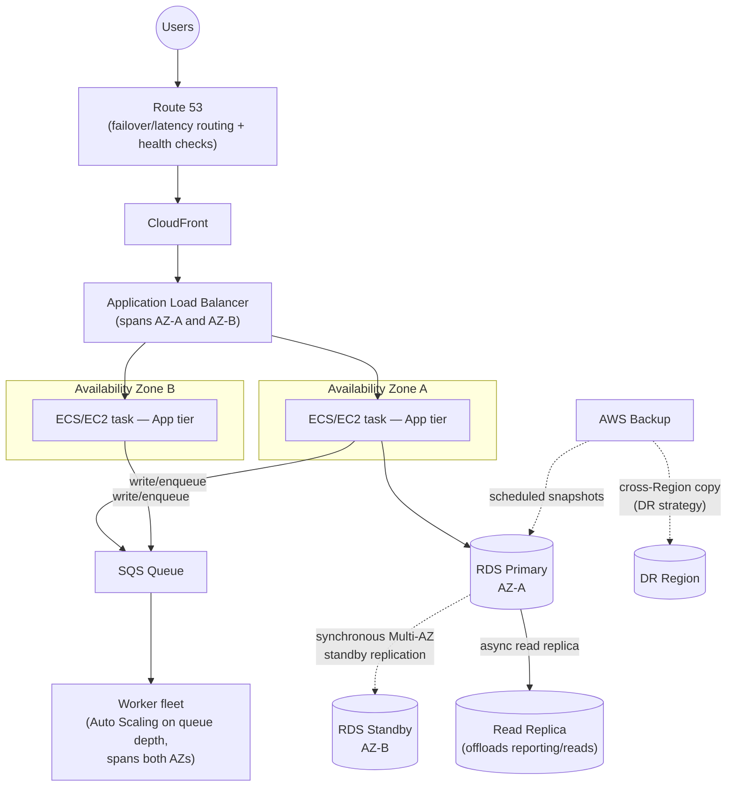
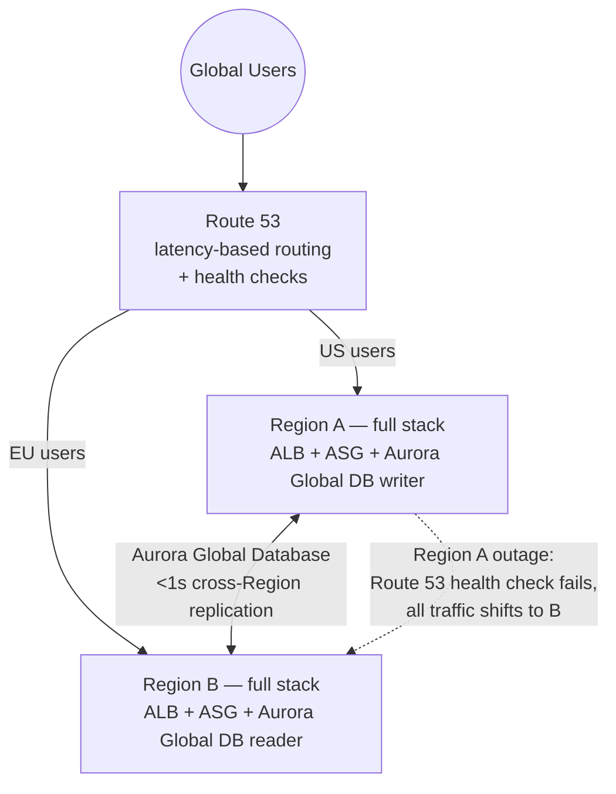
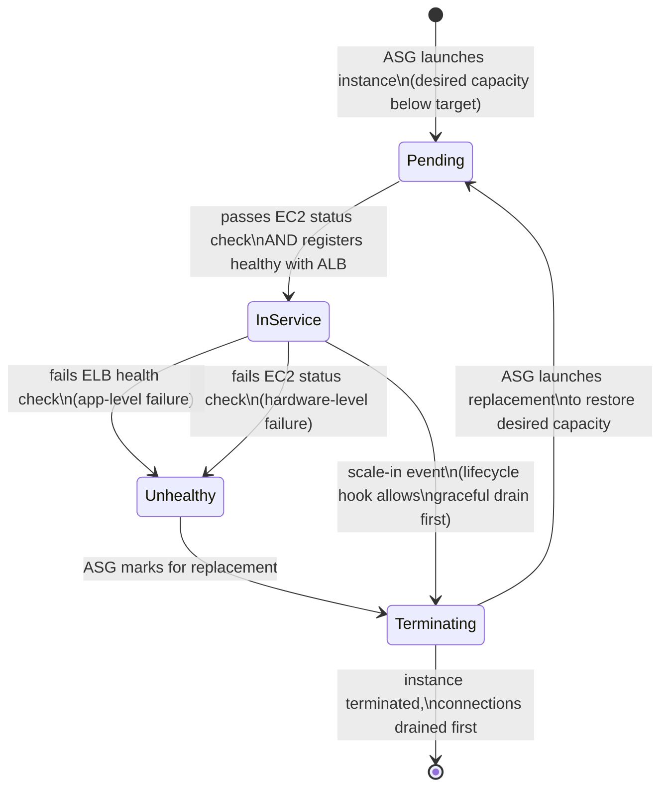
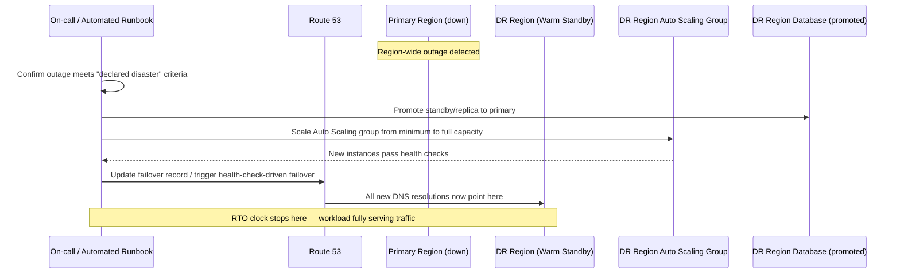

# Domain 2: Design Resilient Architectures (26%)

In plain terms: this domain asks "what happens when a piece fails, and can the system keep
running (or grow) without everyone being stuck waiting on everyone else." It builds directly on
Domain 1's VPC/networking foundation — read that domain first.

Resilience on the exam means two related but distinct things, and nearly every Domain 2 question
is testing which one applies: **scalability/loose coupling** (Task 2.1 — can the system grow and
shrink with load, and does one component's slowness or failure avoid dragging down the rest?) and
**availability/fault tolerance** (Task 2.2 — does the system keep serving traffic through a
routine failure, and can it recover from a catastrophic one?). The services overlap heavily (Auto
Scaling, load balancing, and multi-AZ design show up in both), but the *question being asked* is
different: 2.1 is about *architecture shape* (decoupled vs. monolithic), 2.2 is about *failure
response* (automatic failover, backup/DR). Keep that split in your head while reading scenario
stems — it tells you which half of this domain you're in before you even look at the answers.


*Source: [AWS Well-Architected Framework — REL04-BP02 Implement loosely coupled dependencies](https://docs.aws.amazon.com/wellarchitected/2025-02-25/framework/rel_prevent_interaction_failure_loosely_coupled_system.html)*

## Task 2.1 — Design scalable and loosely coupled architectures

> API Gateway, SQS, microservices, event-driven patterns, horizontal/vertical scaling, CDN,
> containers, ECS/EKS, load balancing, multi-tier architecture, Step Functions, read replicas

| Concept | Doc |
|---|---|
| API Gateway | [`services/networking-content-delivery/api-gateway.md`](../../../services/networking-content-delivery/api-gateway.md) |
| SQS (queuing) | [`services/application-integration/sqs.md`](../../../services/application-integration/sqs.md) |
| SNS (pub/sub) | [`services/application-integration/sns.md`](../../../services/application-integration/sns.md) |
| EventBridge (event bus) | [`services/application-integration/eventbridge.md`](../../../services/application-integration/eventbridge.md) |
| Messaging patterns comparison | [`services/application-integration/messaging-patterns-overview.md`](../../../services/application-integration/messaging-patterns-overview.md) |
| Step Functions (workflow orchestration) | [`services/application-integration/step-functions.md`](../../../services/application-integration/step-functions.md) |
| EC2 Auto Scaling (horizontal/vertical scaling) | [`services/compute/ec2-auto-scaling.md`](../../../services/compute/ec2-auto-scaling.md) |
| CloudFront (CDN) | [`services/networking-content-delivery/cloudfront.md`](../../../services/networking-content-delivery/cloudfront.md) |
| ECS | [`services/containers/ecs.md`](../../../services/containers/ecs.md) |
| EKS | [`services/containers/eks.md`](../../../services/containers/eks.md) |
| Fargate | [`services/containers/fargate.md`](../../../services/containers/fargate.md) |
| Containers vs. VMs vs. serverless | [`services/containers/containers-vs-vms-vs-serverless.md`](../../../services/containers/containers-vs-vms-vs-serverless.md) |
| Elastic Load Balancing | [`services/networking-content-delivery/elastic-load-balancing.md`](../../../services/networking-content-delivery/elastic-load-balancing.md) |
| RDS read replicas | [`services/database/rds.md`](../../../services/database/rds.md) |
| Aurora (replicas, Aurora Serverless) | [`services/database/aurora.md`](../../../services/database/aurora.md) |
| Event-driven & microservice architecture patterns — how it all composes *(new — decision-level topic)* | [`event-driven-microservice-architecture-patterns.md`](event-driven-microservice-architecture-patterns.md) |
| Loose coupling patterns deep dive — the reusable techniques behind this task's one-sentence theme *(new — decision-level topic)* | [`loose-coupling-patterns-deep-dive.md`](loose-coupling-patterns-deep-dive.md) |
| AWS Amplify (full-stack app scaffolding — auth/API/storage wired together) | [`services/front-end-web-mobile/amplify.md`](../../../services/front-end-web-mobile/amplify.md) |
| AWS Device Farm (real-device mobile testing before a scaled backend ever sees traffic) | [`services/front-end-web-mobile/device-farm.md`](../../../services/front-end-web-mobile/device-farm.md) |
| Amazon Pinpoint (multi-channel engagement messaging, decoupled from the core app) | [`services/front-end-web-mobile/pinpoint.md`](../../../services/front-end-web-mobile/pinpoint.md) |
| AWS Serverless Application Repository (SAR) — packaged, reusable serverless app patterns | [`services/compute/niche-compute-services.md`](../../../services/compute/niche-compute-services.md) |
| Amazon Fraud Detector & Amazon Kendra — managed AI services consumed as decoupled components | [`services/machine-learning-ai/fraud-detector-and-kendra.md`](../../../services/machine-learning-ai/fraud-detector-and-kendra.md) |
| Amazon MQ — managed ActiveMQ/RabbitMQ broker for migrating existing JMS/AMQP applications | [`services/application-integration/amazon-mq.md`](../../../services/application-integration/amazon-mq.md) |

"Loosely coupled" is the thread that ties this whole task together: every service in this table
exists to let one component change, scale, or fail *without the others noticing*. API Gateway
decouples a client from knowing which backend compute model serves it; SQS/SNS/EventBridge
decouple a producer from knowing who (or how many) consumers exist; read replicas decouple read
traffic from write traffic; containers decouple the application from the underlying host. When a
scenario says two services are "tightly coupled" or a failure "cascades," the fix is almost always
inserting one of this table's services as a buffer between them. The same decoupling instinct
extends to the front-end and intelligence layers of the stack. **Amplify** provisions a scalable
mobile/web backend (auth, API, storage) without an app team hand-wiring each piece, **Device
Farm** validates a mobile client against real hardware before it ever reaches that scaled
backend, and **Pinpoint** moves multi-channel customer messaging into its own managed,
asynchronous channel instead of bolting notification code onto the request path. **SAR** lets a
team deploy a proven, packaged serverless application pattern instead of hand-assembling the same
Lambda/SQS/DynamoDB wiring from scratch. And when a workload needs to call out to a managed AI
service — **Fraud Detector** scoring a transaction in real time, or **Kendra** answering a search
query — the same SQS/EventBridge decoupling pattern from this task's core lesson applies: the call
happens off the critical path, so a slow or momentarily degraded AI service doesn't drag down the
primary request. One more recurring exam trap sits in this same table: when a scenario describes
*migrating* an existing JMS- or AMQP-based application rather than building something new,
**Amazon MQ** is the right managed broker — a drop-in replacement for a self-hosted ActiveMQ/
RabbitMQ broker that needs little to no application code change, which is a fundamentally
different problem than the greenfield SQS/SNS decoupling this task otherwise tests.

## Task 2.2 — Design highly available and/or fault-tolerant architectures

> Multi-AZ, Auto Scaling, Route 53 routing/failover, backup/DR strategies

| Concept | Doc |
|---|---|
| EC2 Auto Scaling (health checks, scaling policies) | [`services/compute/ec2-auto-scaling.md`](../../../services/compute/ec2-auto-scaling.md) |
| Route 53 (routing policies, health checks, failover) | [`services/networking-content-delivery/route53.md`](../../../services/networking-content-delivery/route53.md) |
| AWS Backup | [`services/storage/aws-backup.md`](../../../services/storage/aws-backup.md) |
| RDS Multi-AZ | [`services/database/rds.md`](../../../services/database/rds.md) |
| Aurora (Multi-AZ, Global Database) | [`services/database/aurora.md`](../../../services/database/aurora.md) |
| Elastic Load Balancing (spans multiple AZs) | [`services/networking-content-delivery/elastic-load-balancing.md`](../../../services/networking-content-delivery/elastic-load-balancing.md) |
| Disaster recovery strategies (RTO/RPO, backup→pilot light→warm standby→multi-site) *(new — decision-level topic)* | [`disaster-recovery-strategies.md`](disaster-recovery-strategies.md) |
| AWS X-Ray — distributed tracing for workload visibility across decoupled components | [`services/developer-tools/x-ray.md`](../../../services/developer-tools/x-ray.md) |
| Multi-AZ vs. Multi-Region decision framework — which failure scope a requirement actually describes *(new — decision-level topic)* | [`multi-az-vs-multi-region-failover-decision-framework.md`](multi-az-vs-multi-region-failover-decision-framework.md) |
| RTO/RPO worked numeric scenarios — placing a stated RTO/RPO on the right DR rung *(new — decision-level topic)* | [`rto-rpo-worked-scenarios.md`](rto-rpo-worked-scenarios.md) |

A critical distinction this task hinges on: **availability is automatic and routine; disaster
recovery is deliberate and rare.** Multi-AZ RDS failing over to its standby, an Auto Scaling group
replacing an unhealthy instance, an ALB routing around one bad target — these all happen within
seconds to minutes, with no human decision involved, and they protect against the loss of *part*
of a Region. Disaster recovery (the four strategies in `disaster-recovery-strategies.md`) is a
*planned response*, sized to a stated RTO/RPO, for losing an *entire* Region. A scenario that
conflates the two ("we have Multi-AZ, so we're protected if the Region goes down") is describing
a gap the exam wants you to catch. Knowing a failure happened — fast enough to act on it — also
depends on visibility into the request path itself: **X-Ray**'s distributed tracing turns
"something in this decoupled system is unhealthy" into "this specific service, on this specific
call, is the one failing," the same signal Route 53 and ELB health checks act on automatically,
just surfaced for a human during an incident instead of consumed by an automated failover
mechanism.

## Architecture: A Resilient, Multi-AZ, Decoupled System



Step by step: **Route 53** is the entry point, health-checking endpoints and routing users away
from anything unhealthy — this is the mechanism that actually executes failover, not a passive
DNS record. **CloudFront** caches static content at the edge, reducing load on the origin.
The **ALB spans both Availability Zones**, so losing one AZ entirely still leaves healthy app
tasks reachable — the **Auto Scaling group behind it also spans both AZs** and replaces any
failed instance automatically. Instead of the app tier calling the worker fleet directly
(tight coupling), it **enqueues work in SQS** — the **worker fleet auto-scales based on queue
depth** and, because it polls a durable queue rather than receiving a direct call, a worker
crashing mid-task doesn't lose that task (the message becomes visible again for another worker
to pick up). On the database side, **RDS Multi-AZ** keeps a synchronously-replicated standby in
a second AZ purely for automatic failover (not for serving reads) — that's a high-availability
mechanism, distinct from the **asynchronous read replica**, which *does* serve live read traffic
to take load off the primary. Finally, **AWS Backup** takes scheduled snapshots and can copy them
cross-Region — the actual disaster-recovery layer, protecting against the loss of the entire
Region, not just one AZ.

## Architecture: Request Lifecycle Through a Decoupled System (Sequence View)

A second view of the same system, showing *order of operations* rather than topology — useful for
scenarios that ask "what happens, in what order, when X fails."

```mermaid
sequenceDiagram
    participant C as Client
    participant ALB as ALB (Multi-AZ)
    participant App as App Task (AZ-A)
    participant Q as SQS Queue
    participant W as Worker (Auto Scaling)
    participant DB as RDS Primary

    C->>ALB: HTTPS request
    ALB->>App: forward (health-checked target)
    App->>DB: synchronous write (order record)
    App->>Q: enqueue async work (send confirmation email, etc.)
    App-->>C: 200 OK (fast — doesn't wait on Q)
    Note over Q,W: Decoupled: App moves on immediately
    W->>Q: poll for messages
    Q-->>W: deliver message
    W->>W: process (send email)
    W->>Q: delete message on success
    Note over App,DB: If AZ-A fails mid-request, ALB<br/>simply stops routing to App in AZ-A;<br/>AZ-B app tasks keep serving new requests
```

The detail worth memorizing here: the client gets its response **before** the asynchronous work
(the SQS-queued task) completes — this is exactly what "loosely coupled" buys you operationally,
not just architecturally. A slow or temporarily-down downstream email provider never makes the
client's checkout request itself slow.

## Architecture: Multi-Region Active/Active (the top of the resilience spectrum)



This is Task 2.2's most expensive, fastest-recovery answer — included here so you can compare it
directly against the Backup/Pilot Light/Warm Standby ladder in `disaster-recovery-strategies.md`
rather than treating it as an unrelated, separate fact.

## How This Domain's Services Work Together (End-to-End Walkthrough)

Trace one complete order through a resilient e-commerce platform, the same continuous story the
two diagrams above are each a partial view of. A customer on their phone taps "place order."
(1) **Route 53** has already resolved the app's domain to the healthy Region/endpoint — if this
were a disaster-recovery drill, this is the exact point where Route 53's health check would have
silently redirected the customer to a standby Region instead, with no visible difference to them.
(2) The request reaches an **ALB** that spans two Availability Zones; it happens to land on an
**ECS task running in AZ-A**, one of several identical tasks an **Auto Scaling group** keeps
running across both AZs. (3) That app task does the one thing that genuinely must happen
synchronously before the customer can be told "order placed" — it writes the order record to the
**RDS primary**, which is running Multi-AZ, meaning a synchronous standby in AZ-B is already
holding an identical copy of that write, ready to take over automatically if AZ-A's primary ever
fails, with zero data loss and no human intervention. (4) Everything else about this order —
sending a confirmation email, updating the recommendation engine, notifying the warehouse — does
not need to happen before the customer gets their "order placed" response, so the app task
**enqueues each of those as a message in SQS** and immediately returns 200 OK to the client. (5)
Separately and independently, a **worker fleet** (its own Auto Scaling group, scaling purely on
SQS queue depth, not CPU) polls that queue whenever it's ready, processes each message, and only
deletes it from the queue after successfully completing the work — so if a worker crashes mid-task,
the message simply becomes visible again for another worker to pick up, losing no work. (6) A
read-heavy reporting dashboard elsewhere in the company queries this same order data constantly,
but it's pointed at a separate **asynchronous read replica**, not the primary — keeping reporting
load from ever competing with the synchronous order-writing path for the same database capacity.
(7) Nightly, **AWS Backup** takes a scheduled snapshot of the primary and replicates a copy
cross-Region — the deliberate, planned disaster-recovery layer that exists entirely separately
from the automatic, routine Multi-AZ failover in step 3; losing one AZ is handled by step 3 alone,
in seconds, with no human decision, while losing the entire Region is the scenario this backup
copy (and the standby Region infrastructure it feeds) is sized to recover from, on a much longer,
deliberately-chosen timeline. That single order touches scalability/loose coupling (ALB, Auto
Scaling, SQS, worker fleet) and availability/fault tolerance (Multi-AZ RDS, Route 53 health checks,
cross-Region backup) simultaneously — which is exactly why Domain 2's two task statements, while
conceptually distinct, show up together in nearly every real request.

## Full Worked Case Study: StreamVista Media — Scaling a Monolith Into a Resilient System

**Company requirements.** StreamVista runs a video-on-demand platform currently as a single EC2
instance running a monolithic app plus a single RDS instance, no replicas, no Multi-AZ. Growth has
brought three problems the architecture team must solve: (1) during popular releases, the single
app server falls over under load; (2) a slow "generate recommendations" background job blocks the
main request thread, making the whole site feel sluggish even for unrelated requests; (3) the
company's SLA with content partners now requires 99.95% uptime and a documented plan to survive
the loss of an entire AWS Region within 4 hours (RTO), losing no more than 15 minutes of
transactional data (RPO).

**Solution design.**

1. **Break the monolith's background work out (Task 2.1).** The "generate recommendations" job is
   extracted into its own Lambda function, triggered by messages the main app drops into an SQS
   queue instead of running the job inline. The main request thread returns to the client the
   instant the message is enqueued — the slow job no longer blocks anything.
2. **Horizontal scaling behind a load balancer (Task 2.1 + 2.2).** The single EC2 instance is
   replaced with an ECS service running on Fargate, behind an ALB, in an Auto Scaling target-
   tracking configuration keyed on request count per target. The service runs across two AZs
   from day one.
3. **Database read scaling (Task 2.1).** Video metadata reads (which dwarf writes) are pointed at
   a new RDS read replica; writes still go to the primary. This alone removes most of the load
   that used to compete with writes on a single instance.
4. **Multi-AZ for automatic failover (Task 2.2).** RDS Multi-AZ is enabled on the primary,
   providing a synchronous standby that Route 53/RDS failover mechanics promote automatically if
   the primary AZ has an issue — this covers the 99.95% SLA's routine-failure half.
5. **DR strategy selection (Task 2.2).** Given the 4-hour RTO / 15-minute RPO requirement, the
   team rules out plain Backup & Restore (RTO too slow if infrastructure must be built from
   scratch) and rules out Multi-Site Active/Active (cost not justified by the stated numbers).
   They select **Warm Standby**: a scaled-down (minimum-capacity) copy of the entire stack runs
   continuously in a second Region, with the database continuously replicated via an Aurora
   cross-Region read replica (promoted to primary on failover). On a declared disaster, Route 53
   failover routing redirects all traffic to the standby Region while its Auto Scaling group
   scales up to full capacity — comfortably inside the 4-hour window, and the continuous
   replication keeps data loss under the 15-minute RPO.
6. **CDN in front of everything (Task 2.1).** CloudFront is placed in front of the ALB for static
   video assets and thumbnails, cutting both latency and the origin's data transfer load.

**Why this design, not a simpler one.** Pilot Light was considered and rejected specifically
because the stated 4-hour RTO is tight enough that scaling compute up *from nothing* (pilot
light's model) risked missing the window under realistic provisioning/DNS-propagation delays;
Warm Standby's already-running minimum fleet removes that risk at a known, bounded extra cost.
Multi-Site Active/Active was rejected because it roughly doubles standing compute cost for a
requirement (4-hour RTO, not near-zero) that Warm Standby already satisfies — a textbook
"don't over-engineer past the stated requirement" lesson the exam rewards.

## Use Cases — Real Scenarios

- **Airline booking platform decoupling seat-hold from payment processing.** When a customer
  selects a seat, the hold is written synchronously (must be instant, must prevent double-booking);
  the loyalty-points calculation, email itinerary, and partner-airline codeshare notification all
  move through SQS, so a slow codeshare-partner API never makes seat selection feel sluggish.
- **Food delivery app's driver-assignment system surviving a restaurant-partner API outage.**
  Order placement and payment stay synchronous and fast; "notify the restaurant's POS system" goes
  through SQS with a dead-letter queue, so a restaurant's flaky point-of-sale integration being down
  for an hour delays only that restaurant's order notifications, not the entire platform's checkout.
- **Regional hospital system's patient-portal database surviving a routine AZ maintenance
  event.** RDS Multi-AZ promotes the standby automatically during a planned AWS maintenance window,
  and because the application already reconnects via the same DB endpoint, patients scheduling
  appointments at 2am never notice the failover happened.
- **Streaming service rolling out a new Region for European users.** Rather than one single global
  Region absorbing both US and EU traffic (adding transatlantic latency for EU users and
  concentrating all risk in one Region), the service deploys Multi-Region active/active with Route
  53 latency-based routing, so a US-Region outage never affects EU subscribers at all.
- **Insurance claims-processing company recovering from a declared regional AWS outage.** Their
  documented Pilot Light strategy — a continuously-replicated Aurora cross-Region read replica plus
  pre-baked AMIs for the claims-processing app tier — is activated during an actual Regional event,
  and the team hits their 45-minute RTO target because the data layer was already warm.
- **B2B SaaS company's reporting dashboard overwhelming its production OLTP database.** A read
  replica is added specifically for the reporting service's queries, immediately removing reporting
  load from the primary that handles live customer transactions, with zero changes to the write
  path.
- **Concert ticketing platform surviving an on-sale traffic spike for a sold-out stadium show.**
  SQS buffers the burst of "attempt purchase" requests; a worker fleet scales out based on queue
  depth, processing purchases at a sustainable rate instead of the database connection pool being
  overwhelmed by tens of thousands of simultaneous synchronous write attempts.
- **Logistics company's package-tracking event pipeline reacting to the same scan event from
  multiple internal teams.** A single "package scanned" event published to EventBridge is
  independently consumed by the customer-notification team, the analytics team, and the fraud-
  detection team — each new consumer added later with zero change to the scanning service itself.
- **Online learning platform's video-processing pipeline recovering from a worker crash mid-
  transcode.** Because transcoding jobs are SQS-queued rather than directly invoked, a worker
  instance that crashes mid-job simply returns the message to visibility after its timeout, and a
  healthy worker picks it back up — no lost uploads, no manual re-queue needed.
- **Regional grocery chain's order-fulfillment system choosing Warm Standby over Pilot Light.**
  Given a stated 20-minute RTO requirement — tighter than Pilot Light's typical tens-of-minutes
  recovery window — the architecture team specifically selects Warm Standby's already-running
  minimum fleet, accepting its higher idle cost as the price of reliably meeting the tighter number.

## Common exam scenarios

- *"A queue-consuming worker fleet needs to handle unpredictable bursts of background jobs
  without manual intervention."* → SQS + Auto Scaling target-tracking on `ApproximateNumberOf
  MessagesVisible` (scale on queue depth).
- *"Two services are tightly coupled and a failure in one cascades to the other."* → Decouple
  with SQS/SNS/EventBridge so one service's failure doesn't block the other.
- *"The database primary must fail over automatically within the same Region with no data
  loss."* → RDS/Aurora Multi-AZ (synchronous standby) — not a read replica.
- *"Read-heavy reporting queries are slowing down the production database."* → Add a read
  replica and point reporting traffic at it.
- *"The application must survive the loss of an entire AWS Region with near-zero downtime."* →
  Multi-site active/active across Regions with Route 53 latency or weighted routing.
- *"A workflow has several ordered steps with retries and conditional branching across multiple
  Lambda functions."* → Step Functions state machine, not custom orchestration code.
- *"Static assets need to load fast globally and survive origin failures."* → CloudFront with an
  origin failover group.
- *"The company needs to recover within one hour after losing a Region but wants to minimize
  standing cost."* → Pilot Light or Warm Standby, depending on exactly how fast "within one hour"
  needs to be and the acceptable idle spend.
- *"A producer service writes at a much faster rate than a downstream consumer can process."* →
  Insert an SQS queue as a buffer so the consumer processes at its own sustainable rate without
  dropping messages — the producer's burst doesn't overwhelm it.
- *"Many independent teams' services all need to react to the same business event (e.g., 'order
  placed') without the publisher knowing who's listening."* → SNS fan-out or EventBridge, not a
  growing list of direct point-to-point calls from the publisher.
- *"An Auto Scaling group's health check is only EC2 status checks, and an instance that is 'up'
  but failing application-level requests isn't being replaced."* → Switch to ELB health checks
  (application-aware), not just EC2 instance status checks.
- *"A single-Region application just needs higher availability within that Region, not disaster
  recovery."* → Multi-AZ deployment (RDS Multi-AZ, ALB/ASG spanning AZs) — do not reach for a
  cross-Region DR strategy when the requirement is AZ-level, not Region-level.
- *"A stateful application currently stores session data on the local instance disk, breaking
  when Auto Scaling replaces the instance."* → Externalize session state (ElastiCache or
  DynamoDB) so any instance in the Auto Scaling group can serve any user's session — the
  underlying "don't tie state to one instance" principle behind horizontal scaling.
- *"A company wants a documented, tested failover runbook they can execute on demand, rather than
  fully automatic failover."* → This still maps to one of the four DR strategies (often Pilot
  Light or Warm Standby) — "documented and testable" doesn't change which strategy fits, it's a
  operational requirement layered on top of the RTO/RPO-driven choice.
- *"A monolithic application's single slow component is the only thing under heavy load, but the
  whole fleet must be scaled to compensate."* → Extract that component into its own independently
  scaled service (microservice) instead of oversizing the entire monolith's fleet.

## Architecture: Auto Scaling Health-Check Lifecycle (State View)

A third lens on the same resilience story — this time following one EC2 instance through its
entire health-check-driven lifecycle, useful for any scenario asking "what state is this instance
in, and what happens next."



The detail this state diagram makes explicit: an instance can become `Unhealthy` via **two
independent paths** — a hardware-level EC2 status-check failure, or an application-level ELB
health-check failure — and only the second one catches an instance that's technically running but
silently failing to serve real requests, which is exactly the gap behind this file's
"EC2 status checks alone" exam trap. Notice also that a *scale-in* event (not a failure at all)
takes the same `Terminating` path, but passes through a lifecycle hook first specifically so
in-flight connections can drain before the instance disappears — graceful scale-in, not an abrupt
kill.

## Architecture: Disaster Recovery Runbook Execution (Sequence View)

A fourth lens, this time on the *deliberate, human-decision* half of Task 2.2 — what actually
happens, in order, when a Regional disaster is declared and a Warm Standby runbook executes.



This sequence is the mechanical answer to "what does Warm Standby's RTO number actually consist
of" — it's not one instantaneous event, it's: detect, confirm, promote the database, scale compute
up from its warm-but-reduced baseline, pass health checks, then redirect traffic. Each of those
steps consumes part of the stated RTO budget, which is exactly why a tight RTO (see
`rto-rpo-worked-scenarios.md`'s Worked Scenario 2) needs a rung with enough pre-warmed headroom to
clear all five steps reliably, not just a rung whose "typical" number happens to be smaller than
the ceiling on paper.

## Common Mistakes (What Wrong Answers Look Like Across This Domain)

- **Conflating Multi-AZ with disaster recovery** — "we have Multi-AZ, so we're protected if the
  Region goes down" is never true; Multi-AZ's blast-radius ceiling is one AZ, never the whole
  Region. See `multi-az-vs-multi-region-failover-decision-framework.md` for the full decision tree
  this mistake violates.
- **Scaling the whole fleet to compensate for one slow component** instead of extracting that
  component into its own independently-scaled piece — this is the "oversized monolith" trap this
  domain's StreamVista case study solves by extracting the recommendations job specifically,
  rather than just adding more identical monolith instances.
- **Picking the most resilient-sounding DR tier regardless of the stated RTO/RPO** — Multi-Site
  Active/Active "to be safe" when Backup & Restore already clears the actual numbers is an
  over-engineering trap tested about as often as its under-engineering mirror image. See
  `rto-rpo-worked-scenarios.md`'s Worked Scenario 4.
- **Decoupling the transport without decoupling the failure mode** — inserting an SQS queue
  between two services is only half the fix if the consumer isn't also idempotent; a crash between
  receiving and deleting a message redelivers it, and a non-idempotent consumer turns that
  resilience feature into a duplicate-processing bug. See `loose-coupling-patterns-deep-dive.md`
  Pattern 6.
- **Relying on EC2 status checks alone** for an Auto Scaling group's health determination — an
  instance that's technically "up" but failing every application request keeps serving (and
  failing) traffic until an ELB health check, not an EC2 status check, catches it.
- **Treating a read replica and a Multi-AZ standby as interchangeable** — one serves live read
  traffic and does nothing for failover by itself; the other exists purely for automatic failover
  and never serves application traffic on its own. Needing both read scaling *and* availability
  means provisioning both, not picking one and assuming it covers the other's job too.

## Full Worked Case Study 2: NorthPeak Logistics — A Regulated, Multi-Region Freight Platform

**Company requirements.** NorthPeak Logistics runs a freight-tracking and billing platform used
by trucking partners across the US and EU. Unlike StreamVista's single-company SLA, NorthPeak
operates under a regulatory requirement (cross-border freight documentation must be retrievable
within a legally defined window even during a declared disaster) and a separate, purely
commercial requirement (EU partners have complained about latency routing through the US).

**Solution design.**

1. **Separate the regulatory requirement from the commercial one (Task 2.1 + 2.2, applied
   per-workload, not uniformly).** The architecture team resists the instinct to apply one
   resilience posture company-wide — the freight-documentation subsystem gets a different DR tier
   than the general billing dashboard, because their actual requirements differ.
2. **EU latency problem, solved independently of DR (Task 2.1).** A second Region is stood up in
   `eu-west-1`, serving EU partners directly via Route 53 latency-based routing, with its own ALB,
   ECS on Fargate service, and Aurora Global Database secondary cluster. This decision is driven
   purely by latency — DR benefit is a side effect, not the primary justification (see
   `multi-az-vs-multi-region-failover-decision-framework.md`'s distinction between the two
   justifications for active/active).
3. **Regulatory RTO/RPO, solved specifically for the documentation subsystem (Task 2.2).** The
   freight-documentation service has a legally defined 1-hour RTO and a 10-minute RPO. Applying
   `rto-rpo-worked-scenarios.md`'s reasoning: Pilot Light's typical tens-of-minutes RTO clears a
   1-hour ceiling with real margin (unlike the tighter 30-minute case in that doc's Worked
   Scenario 2), so the team selects **Pilot Light** for this specific subsystem — continuously
   replicated core data (meeting the 10-minute RPO) with minimal standing compute, scaled up only
   on a declared disaster.
4. **The general billing dashboard gets a cheaper tier still (Task 2.2).** With no regulatory
   RTO/RPO attached and an internal tolerance of several hours' downtime, the billing dashboard
   uses plain **Backup & Restore** via AWS Backup with cross-Region copy rules — deliberately the
   cheapest rung, because nothing about this specific subsystem's actual requirements demands more.
5. **Loose coupling between the two subsystems (Task 2.1).** The documentation subsystem and the
   billing dashboard were historically entangled in the same monolith's codebase and database.
   They're split so that documentation availability during a disaster doesn't depend on, or get
   dragged down by, the billing dashboard's own health — applying
   `loose-coupling-patterns-deep-dive.md`'s Pattern 5 (service discovery) and Pattern 1 (queue-
   mediated handoff) to decouple them operationally, not just logically.

**Why this design, not a simpler one.** A single, uniform DR tier applied company-wide (e.g.,
Warm Standby everywhere) was explicitly rejected — it would satisfy the regulatory requirement
with margin to spare, but at needlessly high standing cost for the billing dashboard, which never
had a tight RTO/RPO requirement in the first place. This case study's core lesson, distinct from
StreamVista's: **resilience tier is a per-workload decision, not a company-wide one** — the right
architecture applies exactly the rung each specific piece's actual requirements demand, no more,
no less.

## Use Cases — Real Scenarios (continued)

- **A multi-tenant SaaS platform isolating one noisy tenant's traffic spike from affecting every
  other tenant.** Per-tenant SQS queues (or per-tenant rate-limited API Gateway usage plans) mean
  one tenant's burst only backs up that tenant's own queue/quota, never starving the others of
  shared capacity.
- **A company's disaster-recovery runbook fails its first live drill because the DR Region's Auto
  Scaling group takes longer to reach full capacity than expected.** The fix isn't a faster DR
  tier necessarily — it's often pre-warming the DR Region's launch templates/AMIs and testing the
  actual scale-up step under realistic load, exactly the "RTO consists of several sequential
  steps, each with its own variability" lesson from the Disaster Recovery Runbook sequence diagram
  above.
- **A logistics company needs its EU customers' requests to stop routing through a US Region
  entirely, for both latency and data-residency reasons.** Multi-Region active/active with Route
  53 geolocation (not just latency-based) routing, ensuring EU traffic never crosses the Atlantic
  even when US Region latency happens to test faster on a given day.
- **An e-commerce platform's Auto Scaling group passes a live disaster-recovery drill for compute,
  but the drill reveals the database read replica in the DR Region was silently lagging by six
  hours due to a misconfigured replication link.** This is specifically why DR drills must
  validate the *data* layer's actual currency, not just confirm compute can scale up — a scaled-up
  app tier serving six-hour-stale data is not a successful recovery.
- **A video platform's recommendation engine periodically times out, and because it was called
  synchronously from the main page-load path, every page load slows down with it.** Moving the
  recommendation call to an asynchronous, cached, pre-computed pattern (or gracefully degrading
  to "no personalized recommendations" rather than blocking) removes an unrelated feature's failure
  from the critical page-load path entirely.

## Hands-on Labs

See [`labs.md`](labs.md) for runnable Floci exercises covering this domain — expanded to 8 labs
covering SQS decoupling, Step Functions orchestration, RDS replica/Multi-AZ distinctions, SNS
fan-out, EventBridge content-based routing, Route 53 failover routing, and a capstone chaining
multiple patterns into one resilient mini-architecture.

## Where This Domain Connects

- Domain 1 (`../domain-1-secure-architectures/`) — every compute tier in this domain's diagrams
  sits inside the VPC subnet layout that domain defines; the worker fleet and app tier security
  groups are unchanged from Domain 1's pattern.
- Domain 3 (`../domain-3-high-performing-architectures/`) revisits SQS/read-replica scaling from a
  pure-performance angle rather than a resilience angle — same services, different lens.
- Domain 4 (`../domain-4-cost-optimized-architectures/`) revisits Multi-AZ and Warm Standby from a
  cost angle — this domain's case study's Warm Standby fleet is a direct Domain 4 cost
  optimization target once the resilience requirement is satisfied.
- [`MASTER-CHUNK.md`](MASTER-CHUNK.md) — all 22 of this domain's services/topics in one
  standalone file, each with its own diagram, real AWS image, and exam tips, for a single-file
  night-before-the-exam review.
- [`multi-az-vs-multi-region-failover-decision-framework.md`](multi-az-vs-multi-region-failover-decision-framework.md),
  [`loose-coupling-patterns-deep-dive.md`](loose-coupling-patterns-deep-dive.md), and
  [`rto-rpo-worked-scenarios.md`](rto-rpo-worked-scenarios.md) — three focused topic docs going
  deeper than this README on specific decision frameworks this domain leans on repeatedly.
