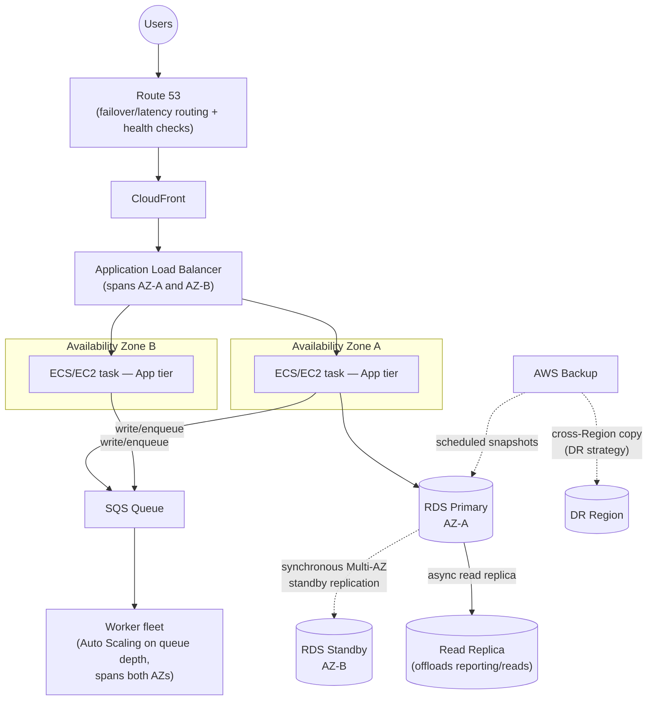

# Domain 2: Design Resilient Architectures (26%)

In plain terms: this domain asks "what happens when a piece fails, and can the system keep
running (or grow) without everyone being stuck waiting on everyone else." It builds directly on
Domain 1's VPC/networking foundation — read that domain first.

## Task 2.1 — Design scalable and loosely coupled architectures

> API Gateway, SQS, microservices, event-driven patterns, horizontal/vertical scaling, CDN,
> containers, ECS/EKS, load balancing, multi-tier architecture, Step Functions, read replicas

| Concept | Doc |
|---|---|
| API Gateway | [`services/networking-content-delivery/api-gateway.md`](../../../services/networking-content-delivery/api-gateway.md) |
| SQS (queuing) | [`services/application-integration/sqs.md`](../../../services/application-integration/sqs.md) |
| SNS (pub/sub) | [`services/application-integration/sns.md`](../../../services/application-integration/sns.md) |
| EventBridge (event bus) | [`services/application-integration/eventbridge.md`](../../../services/application-integration/eventbridge.md) |
| Messaging patterns comparison | [`services/application-integration/messaging-patterns-overview.md`](../../../services/application-integration/messaging-patterns-overview.md) |
| Step Functions (workflow orchestration) | [`services/application-integration/step-functions.md`](../../../services/application-integration/step-functions.md) |
| EC2 Auto Scaling (horizontal/vertical scaling) | [`services/compute/ec2-auto-scaling.md`](../../../services/compute/ec2-auto-scaling.md) |
| CloudFront (CDN) | [`services/networking-content-delivery/cloudfront.md`](../../../services/networking-content-delivery/cloudfront.md) |
| ECS | [`services/containers/ecs.md`](../../../services/containers/ecs.md) |
| EKS | [`services/containers/eks.md`](../../../services/containers/eks.md) |
| Fargate | [`services/containers/fargate.md`](../../../services/containers/fargate.md) |
| Containers vs. VMs vs. serverless | [`services/containers/containers-vs-vms-vs-serverless.md`](../../../services/containers/containers-vs-vms-vs-serverless.md) |
| Elastic Load Balancing | [`services/networking-content-delivery/elastic-load-balancing.md`](../../../services/networking-content-delivery/elastic-load-balancing.md) |
| RDS read replicas | [`services/database/rds.md`](../../../services/database/rds.md) |
| Aurora (replicas, Aurora Serverless) | [`services/database/aurora.md`](../../../services/database/aurora.md) |
| Event-driven & microservice architecture patterns — how it all composes *(new — decision-level topic)* | [`event-driven-microservice-architecture-patterns.md`](event-driven-microservice-architecture-patterns.md) |

## Task 2.2 — Design highly available and/or fault-tolerant architectures

> Multi-AZ, Auto Scaling, Route 53 routing/failover, backup/DR strategies

| Concept | Doc |
|---|---|
| EC2 Auto Scaling (health checks, scaling policies) | [`services/compute/ec2-auto-scaling.md`](../../../services/compute/ec2-auto-scaling.md) |
| Route 53 (routing policies, health checks, failover) | [`services/networking-content-delivery/route53.md`](../../../services/networking-content-delivery/route53.md) |
| AWS Backup | [`services/storage/aws-backup.md`](../../../services/storage/aws-backup.md) |
| RDS Multi-AZ | [`services/database/rds.md`](../../../services/database/rds.md) |
| Aurora (Multi-AZ, Global Database) | [`services/database/aurora.md`](../../../services/database/aurora.md) |
| Elastic Load Balancing (spans multiple AZs) | [`services/networking-content-delivery/elastic-load-balancing.md`](../../../services/networking-content-delivery/elastic-load-balancing.md) |
| Disaster recovery strategies (RTO/RPO, backup→pilot light→warm standby→multi-site) *(new — decision-level topic)* | [`disaster-recovery-strategies.md`](disaster-recovery-strategies.md) |

## Architecture: A Resilient, Multi-AZ, Decoupled System

Step by step: **Route 53** is the entry point, health-checking endpoints and routing users away
from anything unhealthy — this is the mechanism that actually executes failover, not a passive
DNS record. **CloudFront** caches static content at the edge, reducing load on the origin.
The **ALB spans both Availability Zones**, so losing one AZ entirely still leaves healthy app
tasks reachable — the **Auto Scaling group behind it also spans both AZs** and replaces any
failed instance automatically. Instead of the app tier calling the worker fleet directly
(tight coupling), it **enqueues work in SQS** — the **worker fleet auto-scales based on queue
depth** and, because it polls a durable queue rather than receiving a direct call, a worker
crashing mid-task doesn't lose that task (the message becomes visible again for another worker
to pick up). On the database side, **RDS Multi-AZ** keeps a synchronously-replicated standby in
a second AZ purely for automatic failover (not for serving reads) — that's a high-availability
mechanism, distinct from the **asynchronous read replica**, which *does* serve live read traffic
to take load off the primary. Finally, **AWS Backup** takes scheduled snapshots and can copy them
cross-Region — the actual disaster-recovery layer, protecting against the loss of the entire
Region, not just one AZ.

## Common exam scenarios

- *"A queue-consuming worker fleet needs to handle unpredictable bursts of background jobs
  without manual intervention."* → SQS + Auto Scaling target-tracking on `ApproximateNumberOf
  MessagesVisible` (scale on queue depth).
- *"Two services are tightly coupled and a failure in one cascades to the other."* → Decouple
  with SQS/SNS/EventBridge so one service's failure doesn't block the other.
- *"The database primary must fail over automatically within the same Region with no data
  loss."* → RDS/Aurora Multi-AZ (synchronous standby) — not a read replica.
- *"Read-heavy reporting queries are slowing down the production database."* → Add a read
  replica and point reporting traffic at it.
- *"The application must survive the loss of an entire AWS Region with near-zero downtime."* →
  Multi-site active/active across Regions with Route 53 latency or weighted routing.
- *"A workflow has several ordered steps with retries and conditional branching across multiple
  Lambda functions."* → Step Functions state machine, not custom orchestration code.
- *"Static assets need to load fast globally and survive origin failures."* → CloudFront with an
  origin failover group.
- *"The company needs to recover within one hour after losing a Region but wants to minimize
  standing cost."* → Pilot Light or Warm Standby, depending on exactly how fast "within one hour"
  needs to be and the acceptable idle spend.

## Hands-on Labs

See [`labs.md`](labs.md) for runnable Floci exercises covering this domain.
