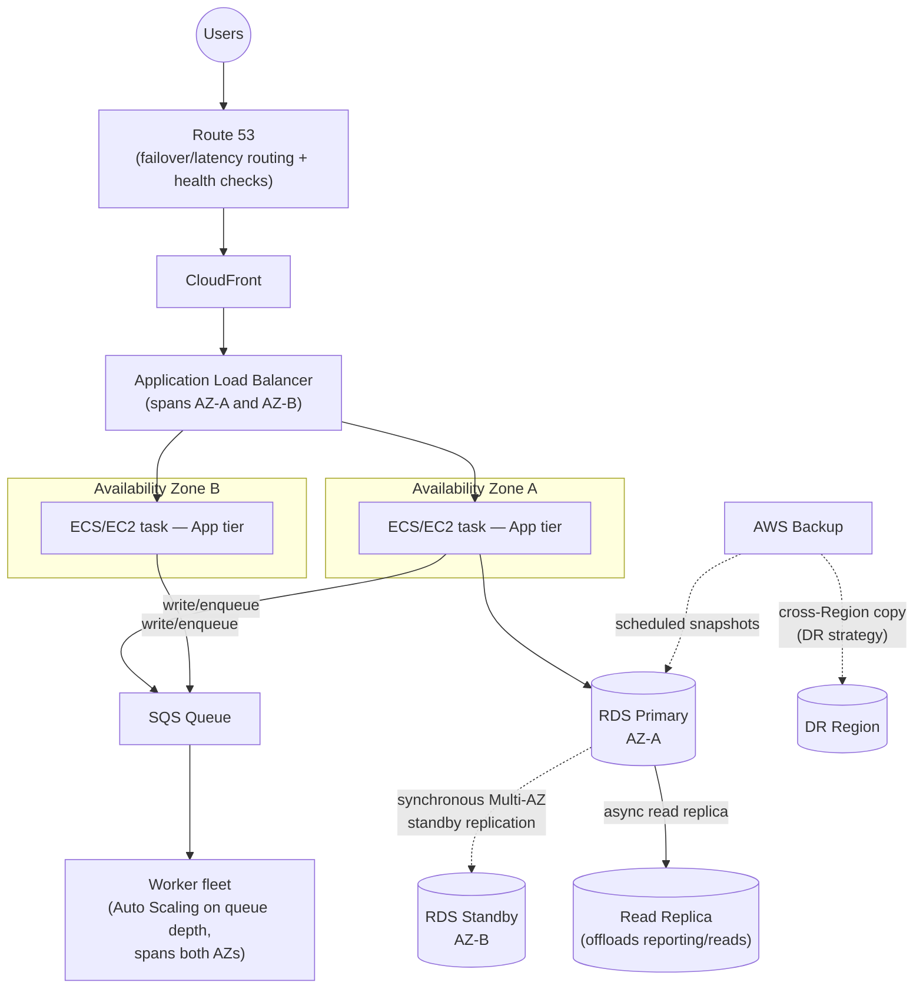
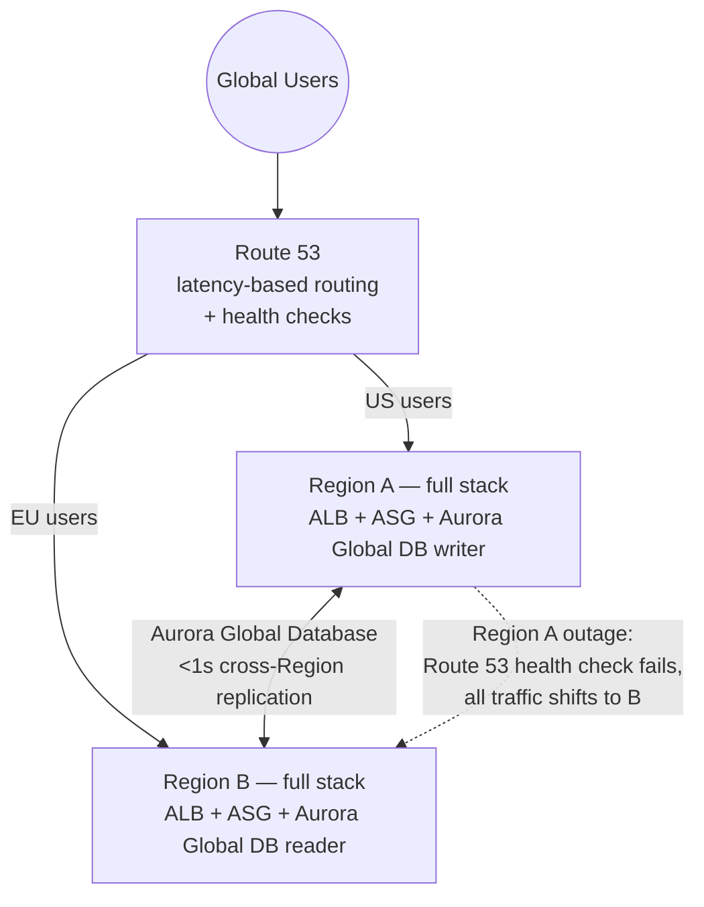

# Domain 2: Design Resilient Architectures (26%)

In plain terms: this domain asks "what happens when a piece fails, and can the system keep
running (or grow) without everyone being stuck waiting on everyone else." It builds directly on
Domain 1's VPC/networking foundation — read that domain first.

Resilience on the exam means two related but distinct things, and nearly every Domain 2 question
is testing which one applies: **scalability/loose coupling** (Task 2.1 — can the system grow and
shrink with load, and does one component's slowness or failure avoid dragging down the rest?) and
**availability/fault tolerance** (Task 2.2 — does the system keep serving traffic through a
routine failure, and can it recover from a catastrophic one?). The services overlap heavily (Auto
Scaling, load balancing, and multi-AZ design show up in both), but the *question being asked* is
different: 2.1 is about *architecture shape* (decoupled vs. monolithic), 2.2 is about *failure
response* (automatic failover, backup/DR). Keep that split in your head while reading scenario
stems — it tells you which half of this domain you're in before you even look at the answers.


*Source: [AWS Well-Architected Framework — REL04-BP02 Implement loosely coupled dependencies](https://docs.aws.amazon.com/wellarchitected/2025-02-25/framework/rel_prevent_interaction_failure_loosely_coupled_system.html)*

## Task 2.1 — Design scalable and loosely coupled architectures

> API Gateway, SQS, microservices, event-driven patterns, horizontal/vertical scaling, CDN,
> containers, ECS/EKS, load balancing, multi-tier architecture, Step Functions, read replicas

| Concept | Doc |
|---|---|
| API Gateway | [`services/networking-content-delivery/api-gateway.md`](../../../services/networking-content-delivery/api-gateway.md) |
| SQS (queuing) | [`services/application-integration/sqs.md`](../../../services/application-integration/sqs.md) |
| SNS (pub/sub) | [`services/application-integration/sns.md`](../../../services/application-integration/sns.md) |
| EventBridge (event bus) | [`services/application-integration/eventbridge.md`](../../../services/application-integration/eventbridge.md) |
| Messaging patterns comparison | [`services/application-integration/messaging-patterns-overview.md`](../../../services/application-integration/messaging-patterns-overview.md) |
| Step Functions (workflow orchestration) | [`services/application-integration/step-functions.md`](../../../services/application-integration/step-functions.md) |
| EC2 Auto Scaling (horizontal/vertical scaling) | [`services/compute/ec2-auto-scaling.md`](../../../services/compute/ec2-auto-scaling.md) |
| CloudFront (CDN) | [`services/networking-content-delivery/cloudfront.md`](../../../services/networking-content-delivery/cloudfront.md) |
| ECS | [`services/containers/ecs.md`](../../../services/containers/ecs.md) |
| EKS | [`services/containers/eks.md`](../../../services/containers/eks.md) |
| Fargate | [`services/containers/fargate.md`](../../../services/containers/fargate.md) |
| Containers vs. VMs vs. serverless | [`services/containers/containers-vs-vms-vs-serverless.md`](../../../services/containers/containers-vs-vms-vs-serverless.md) |
| Elastic Load Balancing | [`services/networking-content-delivery/elastic-load-balancing.md`](../../../services/networking-content-delivery/elastic-load-balancing.md) |
| RDS read replicas | [`services/database/rds.md`](../../../services/database/rds.md) |
| Aurora (replicas, Aurora Serverless) | [`services/database/aurora.md`](../../../services/database/aurora.md) |
| Event-driven & microservice architecture patterns — how it all composes *(new — decision-level topic)* | [`event-driven-microservice-architecture-patterns.md`](event-driven-microservice-architecture-patterns.md) |

"Loosely coupled" is the thread that ties this whole task together: every service in this table
exists to let one component change, scale, or fail *without the others noticing*. API Gateway
decouples a client from knowing which backend compute model serves it; SQS/SNS/EventBridge
decouple a producer from knowing who (or how many) consumers exist; read replicas decouple read
traffic from write traffic; containers decouple the application from the underlying host. When a
scenario says two services are "tightly coupled" or a failure "cascades," the fix is almost always
inserting one of this table's services as a buffer between them.

## Task 2.2 — Design highly available and/or fault-tolerant architectures

> Multi-AZ, Auto Scaling, Route 53 routing/failover, backup/DR strategies

| Concept | Doc |
|---|---|
| EC2 Auto Scaling (health checks, scaling policies) | [`services/compute/ec2-auto-scaling.md`](../../../services/compute/ec2-auto-scaling.md) |
| Route 53 (routing policies, health checks, failover) | [`services/networking-content-delivery/route53.md`](../../../services/networking-content-delivery/route53.md) |
| AWS Backup | [`services/storage/aws-backup.md`](../../../services/storage/aws-backup.md) |
| RDS Multi-AZ | [`services/database/rds.md`](../../../services/database/rds.md) |
| Aurora (Multi-AZ, Global Database) | [`services/database/aurora.md`](../../../services/database/aurora.md) |
| Elastic Load Balancing (spans multiple AZs) | [`services/networking-content-delivery/elastic-load-balancing.md`](../../../services/networking-content-delivery/elastic-load-balancing.md) |
| Disaster recovery strategies (RTO/RPO, backup→pilot light→warm standby→multi-site) *(new — decision-level topic)* | [`disaster-recovery-strategies.md`](disaster-recovery-strategies.md) |

A critical distinction this task hinges on: **availability is automatic and routine; disaster
recovery is deliberate and rare.** Multi-AZ RDS failing over to its standby, an Auto Scaling group
replacing an unhealthy instance, an ALB routing around one bad target — these all happen within
seconds to minutes, with no human decision involved, and they protect against the loss of *part*
of a Region. Disaster recovery (the four strategies in `disaster-recovery-strategies.md`) is a
*planned response*, sized to a stated RTO/RPO, for losing an *entire* Region. A scenario that
conflates the two ("we have Multi-AZ, so we're protected if the Region goes down") is describing
a gap the exam wants you to catch.

## Architecture: A Resilient, Multi-AZ, Decoupled System



Step by step: **Route 53** is the entry point, health-checking endpoints and routing users away
from anything unhealthy — this is the mechanism that actually executes failover, not a passive
DNS record. **CloudFront** caches static content at the edge, reducing load on the origin.
The **ALB spans both Availability Zones**, so losing one AZ entirely still leaves healthy app
tasks reachable — the **Auto Scaling group behind it also spans both AZs** and replaces any
failed instance automatically. Instead of the app tier calling the worker fleet directly
(tight coupling), it **enqueues work in SQS** — the **worker fleet auto-scales based on queue
depth** and, because it polls a durable queue rather than receiving a direct call, a worker
crashing mid-task doesn't lose that task (the message becomes visible again for another worker
to pick up). On the database side, **RDS Multi-AZ** keeps a synchronously-replicated standby in
a second AZ purely for automatic failover (not for serving reads) — that's a high-availability
mechanism, distinct from the **asynchronous read replica**, which *does* serve live read traffic
to take load off the primary. Finally, **AWS Backup** takes scheduled snapshots and can copy them
cross-Region — the actual disaster-recovery layer, protecting against the loss of the entire
Region, not just one AZ.

## Architecture: Request Lifecycle Through a Decoupled System (Sequence View)

A second view of the same system, showing *order of operations* rather than topology — useful for
scenarios that ask "what happens, in what order, when X fails."

```mermaid
sequenceDiagram
    participant C as Client
    participant ALB as ALB (Multi-AZ)
    participant App as App Task (AZ-A)
    participant Q as SQS Queue
    participant W as Worker (Auto Scaling)
    participant DB as RDS Primary

    C->>ALB: HTTPS request
    ALB->>App: forward (health-checked target)
    App->>DB: synchronous write (order record)
    App->>Q: enqueue async work (send confirmation email, etc.)
    App-->>C: 200 OK (fast — doesn't wait on Q)
    Note over Q,W: Decoupled: App moves on immediately
    W->>Q: poll for messages
    Q-->>W: deliver message
    W->>W: process (send email)
    W->>Q: delete message on success
    Note over App,DB: If AZ-A fails mid-request, ALB<br/>simply stops routing to App in AZ-A;<br/>AZ-B app tasks keep serving new requests
```

The detail worth memorizing here: the client gets its response **before** the asynchronous work
(the SQS-queued task) completes — this is exactly what "loosely coupled" buys you operationally,
not just architecturally. A slow or temporarily-down downstream email provider never makes the
client's checkout request itself slow.

## Architecture: Multi-Region Active/Active (the top of the resilience spectrum)



This is Task 2.2's most expensive, fastest-recovery answer — included here so you can compare it
directly against the Backup/Pilot Light/Warm Standby ladder in `disaster-recovery-strategies.md`
rather than treating it as an unrelated, separate fact.

## Full Worked Case Study: StreamVista Media — Scaling a Monolith Into a Resilient System

**Company requirements.** StreamVista runs a video-on-demand platform currently as a single EC2
instance running a monolithic app plus a single RDS instance, no replicas, no Multi-AZ. Growth has
brought three problems the architecture team must solve: (1) during popular releases, the single
app server falls over under load; (2) a slow "generate recommendations" background job blocks the
main request thread, making the whole site feel sluggish even for unrelated requests; (3) the
company's SLA with content partners now requires 99.95% uptime and a documented plan to survive
the loss of an entire AWS Region within 4 hours (RTO), losing no more than 15 minutes of
transactional data (RPO).

**Solution design.**

1. **Break the monolith's background work out (Task 2.1).** The "generate recommendations" job is
   extracted into its own Lambda function, triggered by messages the main app drops into an SQS
   queue instead of running the job inline. The main request thread returns to the client the
   instant the message is enqueued — the slow job no longer blocks anything.
2. **Horizontal scaling behind a load balancer (Task 2.1 + 2.2).** The single EC2 instance is
   replaced with an ECS service running on Fargate, behind an ALB, in an Auto Scaling target-
   tracking configuration keyed on request count per target. The service runs across two AZs
   from day one.
3. **Database read scaling (Task 2.1).** Video metadata reads (which dwarf writes) are pointed at
   a new RDS read replica; writes still go to the primary. This alone removes most of the load
   that used to compete with writes on a single instance.
4. **Multi-AZ for automatic failover (Task 2.2).** RDS Multi-AZ is enabled on the primary,
   providing a synchronous standby that Route 53/RDS failover mechanics promote automatically if
   the primary AZ has an issue — this covers the 99.95% SLA's routine-failure half.
5. **DR strategy selection (Task 2.2).** Given the 4-hour RTO / 15-minute RPO requirement, the
   team rules out plain Backup & Restore (RTO too slow if infrastructure must be built from
   scratch) and rules out Multi-Site Active/Active (cost not justified by the stated numbers).
   They select **Warm Standby**: a scaled-down (minimum-capacity) copy of the entire stack runs
   continuously in a second Region, with the database continuously replicated via an Aurora
   cross-Region read replica (promoted to primary on failover). On a declared disaster, Route 53
   failover routing redirects all traffic to the standby Region while its Auto Scaling group
   scales up to full capacity — comfortably inside the 4-hour window, and the continuous
   replication keeps data loss under the 15-minute RPO.
6. **CDN in front of everything (Task 2.1).** CloudFront is placed in front of the ALB for static
   video assets and thumbnails, cutting both latency and the origin's data transfer load.

**Why this design, not a simpler one.** Pilot Light was considered and rejected specifically
because the stated 4-hour RTO is tight enough that scaling compute up *from nothing* (pilot
light's model) risked missing the window under realistic provisioning/DNS-propagation delays;
Warm Standby's already-running minimum fleet removes that risk at a known, bounded extra cost.
Multi-Site Active/Active was rejected because it roughly doubles standing compute cost for a
requirement (4-hour RTO, not near-zero) that Warm Standby already satisfies — a textbook
"don't over-engineer past the stated requirement" lesson the exam rewards.

## Common exam scenarios

- *"A queue-consuming worker fleet needs to handle unpredictable bursts of background jobs
  without manual intervention."* → SQS + Auto Scaling target-tracking on `ApproximateNumberOf
  MessagesVisible` (scale on queue depth).
- *"Two services are tightly coupled and a failure in one cascades to the other."* → Decouple
  with SQS/SNS/EventBridge so one service's failure doesn't block the other.
- *"The database primary must fail over automatically within the same Region with no data
  loss."* → RDS/Aurora Multi-AZ (synchronous standby) — not a read replica.
- *"Read-heavy reporting queries are slowing down the production database."* → Add a read
  replica and point reporting traffic at it.
- *"The application must survive the loss of an entire AWS Region with near-zero downtime."* →
  Multi-site active/active across Regions with Route 53 latency or weighted routing.
- *"A workflow has several ordered steps with retries and conditional branching across multiple
  Lambda functions."* → Step Functions state machine, not custom orchestration code.
- *"Static assets need to load fast globally and survive origin failures."* → CloudFront with an
  origin failover group.
- *"The company needs to recover within one hour after losing a Region but wants to minimize
  standing cost."* → Pilot Light or Warm Standby, depending on exactly how fast "within one hour"
  needs to be and the acceptable idle spend.
- *"A producer service writes at a much faster rate than a downstream consumer can process."* →
  Insert an SQS queue as a buffer so the consumer processes at its own sustainable rate without
  dropping messages — the producer's burst doesn't overwhelm it.
- *"Many independent teams' services all need to react to the same business event (e.g., 'order
  placed') without the publisher knowing who's listening."* → SNS fan-out or EventBridge, not a
  growing list of direct point-to-point calls from the publisher.
- *"An Auto Scaling group's health check is only EC2 status checks, and an instance that is 'up'
  but failing application-level requests isn't being replaced."* → Switch to ELB health checks
  (application-aware), not just EC2 instance status checks.
- *"A single-Region application just needs higher availability within that Region, not disaster
  recovery."* → Multi-AZ deployment (RDS Multi-AZ, ALB/ASG spanning AZs) — do not reach for a
  cross-Region DR strategy when the requirement is AZ-level, not Region-level.
- *"A stateful application currently stores session data on the local instance disk, breaking
  when Auto Scaling replaces the instance."* → Externalize session state (ElastiCache or
  DynamoDB) so any instance in the Auto Scaling group can serve any user's session — the
  underlying "don't tie state to one instance" principle behind horizontal scaling.
- *"A company wants a documented, tested failover runbook they can execute on demand, rather than
  fully automatic failover."* → This still maps to one of the four DR strategies (often Pilot
  Light or Warm Standby) — "documented and testable" doesn't change which strategy fits, it's a
  operational requirement layered on top of the RTO/RPO-driven choice.
- *"A monolithic application's single slow component is the only thing under heavy load, but the
  whole fleet must be scaled to compensate."* → Extract that component into its own independently
  scaled service (microservice) instead of oversizing the entire monolith's fleet.

## Hands-on Labs

See [`labs.md`](labs.md) for runnable Floci exercises covering this domain — expanded to 5 labs
covering SQS decoupling, Step Functions orchestration, RDS replica/Multi-AZ distinctions, SNS
fan-out, and a capstone chaining all four into one resilient mini-architecture.

## Where This Domain Connects

- Domain 1 (`../domain-1-secure-architectures/`) — every compute tier in this domain's diagrams
  sits inside the VPC subnet layout that domain defines; the worker fleet and app tier security
  groups are unchanged from Domain 1's pattern.
- Domain 3 (`../domain-3-high-performing-architectures/`) revisits SQS/read-replica scaling from a
  pure-performance angle rather than a resilience angle — same services, different lens.
- Domain 4 (`../domain-4-cost-optimized-architectures/`) revisits Multi-AZ and Warm Standby from a
  cost angle — this domain's case study's Warm Standby fleet is a direct Domain 4 cost
  optimization target once the resilience requirement is satisfied.
