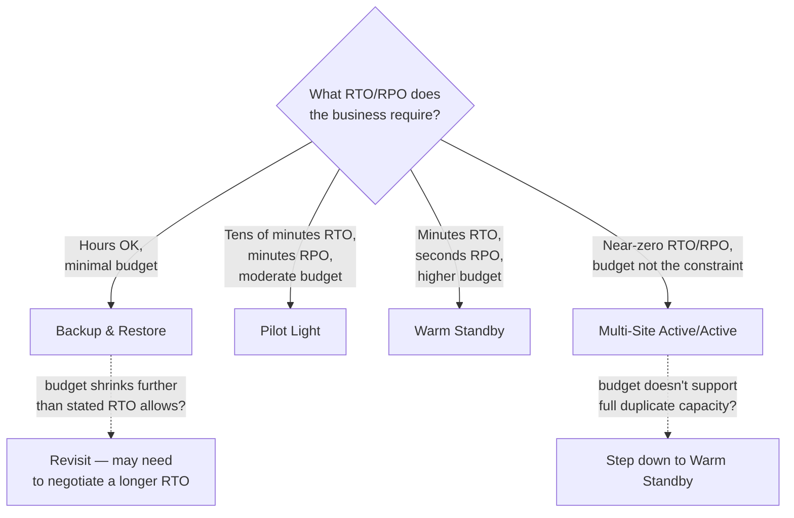
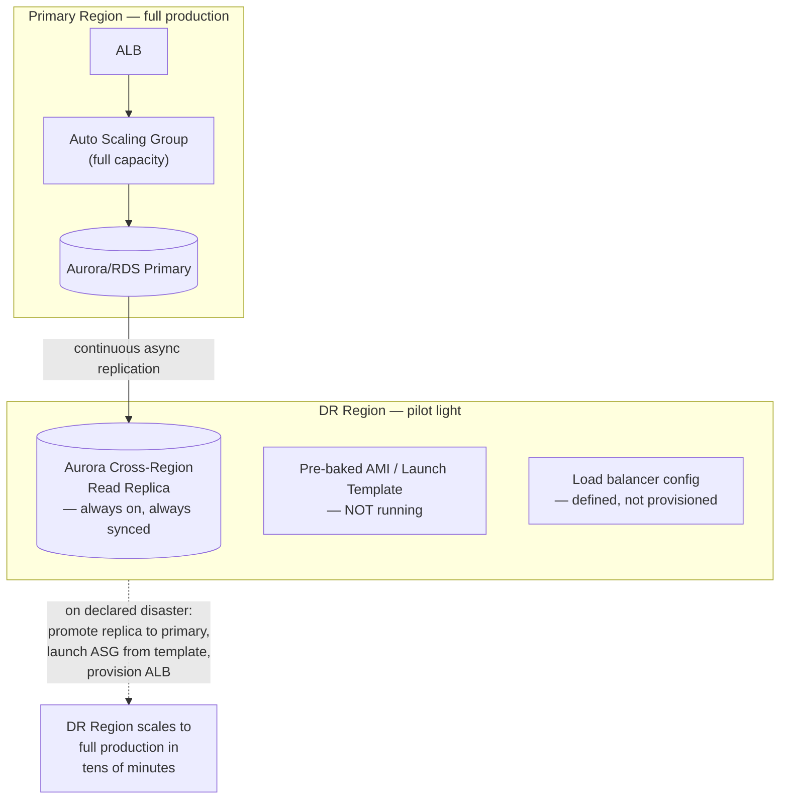
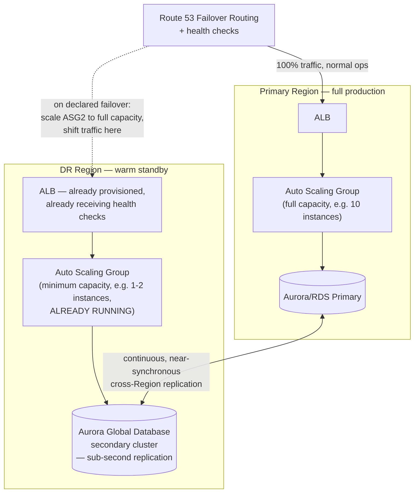
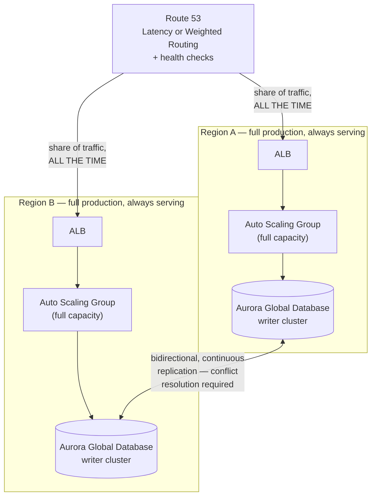
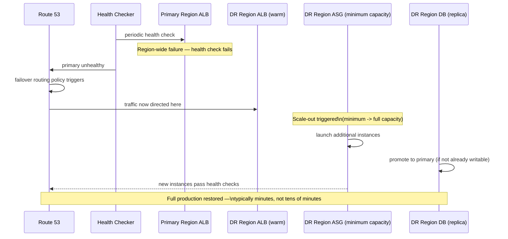

# Disaster Recovery Strategies (RTO/RPO, Backup to Multi-Site)

*Source: [AWS Well-Architected Framework — REL13-BP02 Use defined recovery strategies to meet the recovery objectives](https://docs.aws.amazon.com/wellarchitected/latest/framework/rel13-bp02.html)*

## Definition

This is the decision layer on top of `aws-backup.md`, `route53.md`, and the Multi-AZ features
documented inside `rds.md`/`aurora.md` — it names the four standard DR strategies AWS (and the
exam) organizes around, ordered by how much it costs vs. how fast it recovers. For the prerequisite
judgment call of *whether a requirement even needs Multi-Region DR in the first place* (as opposed
to being satisfied by same-Region Multi-AZ alone), see
`multi-az-vs-multi-region-failover-decision-framework.md`; for more worked RTO/RPO numeric
exercises beyond the one in this doc, see `rto-rpo-worked-scenarios.md`.

## Analogy

Think of these four strategies as four different answers to "how do I keep a second, backup
kitchen ready in case my main restaurant burns down?" **Backup & Restore** is keeping your
recipes and supplier contact list in a fireproof safe — if disaster strikes, you still have to
find a new building, buy new equipment, and hire a new crew before you can cook again; slow, but
cheap to maintain in the meantime. **Pilot Light** is keeping that same fireproof safe, plus a
walk-in fridge in a second building already stocked and kept fresh daily — the hardest thing to
quickly replace (fresh ingredients) is already handled, but you still need to bring in stoves and
staff before you can actually serve a meal. **Warm Standby** is running a small, fully-functional
second restaurant in that second building right now, just with a skeleton crew and a short menu —
if the main location burns down, you call in the rest of the staff and expand the menu, and you're
serving full dinner service again within the hour. **Multi-Site Active/Active** is running two
full, independently profitable restaurants in two different cities simultaneously, every single
day — if one burns down, the other was already open, already fully staffed, and simply absorbs
the displaced customers starting immediately; nobody ever has to "reopen" anything.

## How It Works — The Four Strategies

"Highly available" and "disaster-recoverable" are related but different goals: high availability
handles routine failures (one server dies, one AZ has an issue) automatically and fast; disaster
recovery handles the rare, severe case (a whole Region is unusable) and is a deliberate choice
about how much money you're willing to spend standing by versus how long you're willing to be
down when it happens. The exam tests this as a direct cost/speed tradeoff using two numbers:
**RTO (Recovery Time Objective)** — how long you can be down — and **RPO (Recovery Point
Objective)** — how much data you can afford to lose, measured in time since the last backup.

Step by step through the spectrum, each one layering more standing infrastructure (and cost) on
top of the one before it:

1. **Backup & Restore** — regularly back up data (AWS Backup, S3 cross-Region replication,
   RDS snapshots) to a second Region, but run **nothing** there day to day. On disaster, you
   provision infrastructure from scratch (often via CloudFormation/CDK templates kept ready) and
   restore data. Cheapest option; slowest recovery (RPO in hours, RTO up to 24 hours).
2. **Pilot Light** — a minimal, always-on core sits in the DR Region (e.g., a replicated database
   kept continuously in sync), but the rest of the application (app servers, load balancers)
   exists only as pre-built, un-launched templates/AMIs. On disaster, you scale the "pilot light"
   up into a full environment. Faster than backup & restore because the data layer is already
   warm (RPO in minutes, RTO in tens of minutes).
3. **Warm Standby** — a scaled-down but fully functional copy of the entire application already
   runs in the DR Region at all times (e.g., a small Auto Scaling group, minimum instance count).
   On disaster, you scale it up to full production capacity and redirect traffic. Noticeably
   faster recovery (RPO in seconds, RTO in minutes), noticeably more idle cost than pilot light.
4. **Multi-Site Active/Active** — full production capacity runs in two (or more) Regions
   simultaneously, both actively serving real traffic all the time, with Route 53 (often latency
   or weighted routing with health checks) distributing load between them. On disaster, the
   surviving Region simply absorbs all traffic — effectively zero additional recovery time, but
   the most expensive strategy because you're paying for full redundant capacity permanently.

## Choosing a Strategy — The Decision Diagram

*Source: [AWS Well-Architected Framework — REL13-BP02](https://docs.aws.amazon.com/wellarchitected/latest/framework/rel13-bp02.html)*

The exam's framing is almost always "given this RTO/RPO number, which strategy fits" or the
reverse — "given this strategy, what RTO/RPO does it imply." Internalize the four strategies as a
single ordered ladder (cost and recovery speed increase together, in lockstep) rather than four
disconnected facts; a question's wrong answers are usually one rung too high or too low on this
same ladder.

## Architecture Detail: What "Pilot Light" Actually Looks Like

The core idea the exam tests: in Pilot Light, **only the data layer is "hot."** Everything else
(compute, load balancer) is pre-configured but dormant, so the data gap (the hardest thing to
recreate quickly) is already closed, while the easier-to-stand-up pieces (stateless compute) are
only launched once a disaster is actually declared — this is precisely why Pilot Light costs less
than Warm Standby (no idle compute bill) but recovers slower than it (compute still needs to
launch from scratch).

## Architecture Detail: What "Warm Standby" Actually Looks Like

The detail that separates Warm Standby from Pilot Light, made visible in the diagram: **every
piece of infrastructure in the DR Region is already running**, just at reduced scale — the ALB is
provisioned and already passing health checks, and the Auto Scaling group already has at least
one instance in service, not merely a launch template sitting dormant. On failover, the only work
required is a scale-out event (minimum to full capacity) and a traffic redirect — there's no
"launch from scratch" step at all, which is exactly why Warm Standby's RTO lands in minutes rather
than Pilot Light's tens of minutes.

## Architecture Detail: What "Multi-Site Active/Active" Actually Looks Like

*Source: [AWS Well-Architected Framework — Reliability Pillar, REL13-BP02, "Multi-site active/active"](https://docs.aws.amazon.com/wellarchitected/latest/reliability-pillar/rel_planning_for_recovery_disaster_recovery.html)*

Notice the structural difference from every rung below it: there is no "DR Region" label at all in
this diagram — both Regions are symmetric, both running full production capacity, both receiving
real traffic continuously via Route 53's normal (not failover-only) routing policy. The
Well-Architected Framework's own guidance calls out the real cost of this symmetry directly:
bidirectional replication means **write conflicts between two Regions must be actively avoided or
resolved** — a genuinely harder engineering problem than any lower rung faces, which is exactly
why Active/Active is explicitly described as "the most operationally complex of the DR strategies,
and should only be selected when business requirements necessitate it."

## Sequence View: Warm Standby Failover, Step by Step

Compare this directly against the Pilot Light activation diagram above: Warm Standby's sequence
skips the "launch ASG from template" step entirely (it already has running instances to scale
*from*, not launch *from nothing*) — that's the single biggest contributor to the RTO gap between
the two rungs.

## Key Decision Points

- **RTO vs. RPO drive everything** — a scenario stating "cannot lose more than 5 minutes of data"
  is an RPO requirement (pushes toward continuous replication, ruling out nightly-backup-only
  strategies); "must be back online within 1 hour" is an RTO requirement (rules out cold
  backup-and-restore if provisioning from scratch takes longer than that).
- **Multi-AZ is not disaster recovery** — Multi-AZ (e.g., RDS Multi-AZ, an ALB spanning AZs)
  protects against the loss of one Availability Zone *within* a Region automatically and is
  table-stakes high availability, not a DR strategy for a whole-Region event. DR strategies in
  this doc are specifically about surviving the loss of an entire Region.
- **Route 53 health checks + failover routing** is the mechanism that actually executes the
  "redirect traffic to the DR Region" step in every strategy above except backup & restore
  (where DNS is usually just repointed manually/via automation after infrastructure is rebuilt).
- **Cost scales with standing infrastructure, not data volume** — the expensive part of warm
  standby/active-active is the idle (or active) compute sitting in the second Region, not the
  backup storage itself.
- **Testing the DR plan is itself part of the requirement** — a documented strategy nobody has
  ever executed is a common real-world (and exam-implied) gap; AWS Resilience Hub and periodic
  game-day failover drills are the practical answer to "how do we know this actually works."
- **Data replication mechanism differs by strategy** — Backup & Restore relies on point-in-time
  snapshots copied cross-Region; Pilot Light/Warm Standby/Active-Active rely on continuous
  replication (Aurora Global Database, DynamoDB Global Tables, S3 Cross-Region Replication) —
  know which replication primitive backs which strategy.
- **A single-Region multi-AZ design plus a cross-Region backup copy is NOT the same as Pilot
  Light** — without pre-staged compute templates and a tested failover runbook, a backup copy
  alone is still Backup & Restore, regardless of how fast the backup itself is taken.

## Full Worked Example: Matching Numbers to a Strategy

A retailer states: "We can tolerate being down for up to 30 minutes during a Regional outage, and
we can afford to lose at most 2 minutes of order data." Walking the ladder: Backup & Restore is
ruled out immediately (RTO measured in hours, far exceeding 30 minutes). Multi-Site Active/Active
is not *required* by these numbers even though it would satisfy them — the stated RTO/RPO don't
demand near-zero, so paying for full duplicate capacity would be over-engineering. That leaves
Pilot Light (RTO in tens of minutes — right at the edge of 30 minutes, risky) versus Warm Standby
(RTO in minutes, comfortably inside 30, RPO in seconds, comfortably inside 2 minutes) — **Warm
Standby is the correct answer**, chosen specifically because Pilot Light's typical recovery window
is too close to the stated ceiling to be a safe fit, while Active/Active would be the wrong,
over-engineered answer for a 30-minute/2-minute requirement that Warm Standby already satisfies.

## Second Worked Example: A Looser Requirement, Deliberately Choosing a Cheaper Rung

A regional non-profit's donor-management system states: "We can tolerate up to 12 hours of
downtime during a Regional outage, and losing up to 6 hours of the most recent donation records is
acceptable, since paper receipts exist as a fallback record for that window. Our board has
explicitly asked us to minimize ongoing AWS spend." Walking the ladder from the bottom this time:
Backup & Restore's typical profile (hours-level RTO, hours-level RPO) fits comfortably inside both
stated ceilings, and the explicit cost-minimization instruction removes any reason to consider a
rung above it — **Backup & Restore is correct here**, using AWS Backup with a scheduled snapshot
plan and a documented (and periodically tested) restore runbook. This example exists specifically
to counterbalance the first one: not every requirement points toward Warm Standby or higher, and
recognizing when the *cheapest* rung is the correct answer is tested just as often as recognizing
when a tighter requirement rules it out.

## Third Worked Example: When RTO and RPO Disagree About Which Rung Fits

A mid-size logistics company's shipment-tracking database states: "Losing more than 2 minutes of
the most recent tracking scans is unacceptable because customs documentation depends on it being
current (tight RPO), but if the Region goes down, we can tolerate up to 3 hours of downtime while
operations staff manually coordinate with carriers in the meantime (looser RTO)." This is a
deliberately asymmetric requirement. Checking each number against its own mechanism (as
`rto-rpo-worked-scenarios.md` explores in more depth): the 2-minute RPO requires continuous,
near-real-time replication — ruling out Backup & Restore's snapshot-based model regardless of how
loose the RTO is — while the 3-hour RTO is comfortably cleared even by Pilot Light's tens-of-
minutes profile, with no need to pay for Warm Standby's always-running compute. **The correct
answer is Pilot Light specifically**, built with continuous cross-Region replication to satisfy
the tight RPO, while leaving compute dormant (templates only) since the RTO doesn't demand an
already-running fleet — a deliberately "mixed" answer that a simple "pick one rung for both
numbers" habit would miss.

## Use Cases — Real Scenarios

- **Regional airline's reservation system choosing Warm Standby.** A 4-hour RTO and 10-minute RPO
  mandate from the board (set after a competitor's multi-day outage made headlines) rules out
  Backup & Restore outright; the airline runs a minimum-capacity standby fleet continuously in a
  second Region, scaling to full capacity only when a disaster is declared.
- **Online brokerage legally required to prove near-zero data loss.** Securities regulators
  effectively mandate an RPO measured in seconds for trade data, which only Multi-Site Active/
  Active or a tightly-coupled Warm Standby with synchronous-enough replication can satisfy — Pilot
  Light's minutes-level RPO is explicitly ruled out during the architecture review.
- **Regional grocery chain's e-commerce platform accepting a longer RTO to control cost.** Online
  grocery ordering can tolerate a documented 6-hour outage without major revenue impact (customers
  shop in-store instead), so the company deliberately chooses Pilot Light over Warm Standby,
  accepting a slower recovery in exchange for materially lower standing infrastructure cost.
- **Government unemployment-benefits portal preparing for a legally mandated uptime SLA during
  a recession.** Anticipating a surge in both traffic and public scrutiny, the agency temporarily
  upgrades from its normal Pilot Light posture to Warm Standby for the recession's duration, then
  steps back down once demand normalizes — treating the DR tier itself as seasonally adjustable.
- **Independent software vendor serving a single enterprise customer with a strict contractual
  RTO.** The contract specifies a 30-minute RTO penalty clause; the vendor's architecture team uses
  this doc's ladder to show the customer in writing why Warm Standby (not the cheaper Pilot Light)
  is the only tier that reliably satisfies the penalty clause's numbers.
- **Media company's live-sports-streaming platform running Multi-Site Active/Active.** Because a
  Regional outage during a live, un-repeatable sporting event would be commercially catastrophic
  (no "we'll just recover it tomorrow" option exists for a live broadcast), the near-zero-RTO cost
  of full duplicate capacity in two Regions is judged worth it specifically for this workload, while
  the same company's back-office systems run on cheaper Pilot Light.
- **Mid-size manufacturer testing its DR plan for the first time in three years.** A scheduled
  "game day" failover drill discovers the pre-baked AMIs referenced in their Pilot Light runbook
  are two major OS versions out of date — exposing that an untested DR plan is not a real DR plan,
  regardless of which rung of the ladder it claims to be on.
- **Payment processor replicating with DynamoDB Global Tables for a Multi-Site setup.** Rather
  than hand-rolling cross-Region replication logic, the processor's transaction-ledger table uses
  DynamoDB Global Tables' built-in multi-Region active-active replication as the data layer
  underneath its Multi-Site Active/Active application tier.
- **A university research computing platform choosing Pilot Light for its grant-funded
  supercomputing cluster's metadata store.** A tight budget (grant funding, not ongoing revenue)
  and a tolerant 45-minute RTO for the (non-time-critical) metadata layer push the architecture
  team toward Pilot Light specifically, deliberately avoiding Warm Standby's always-on compute
  cost for a research workload where a 45-minute recovery window genuinely doesn't harm anyone.
- **A ride-sharing platform's surge-pricing engine running Warm Standby while its driver-location
  tracking runs Active/Active.** The same company applies two different DR tiers to two different
  subsystems based on their actual requirements — surge pricing can tolerate a few minutes of
  staleness during failover, but live driver-location data directly affects rider safety and ETA
  accuracy, justifying the higher Active/Active cost for that one subsystem specifically.

## Common Mistakes (what wrong answers look like)

- Treating Multi-AZ as sufficient disaster recovery for a stated "entire Region" outage
  requirement — Multi-AZ only ever protects within one Region.
- Choosing Multi-Site Active/Active when the stated RTO/RPO don't actually demand near-zero
  recovery — an unnecessarily expensive, over-engineered answer.
- Choosing Backup & Restore when the stated RTO is measured in minutes — recovery from scratch
  almost never completes that fast.
- Forgetting that Pilot Light still requires pre-baked AMIs/launch templates ready to go — if a
  scenario describes having to build AMIs *during* the disaster, that's effectively Backup &
  Restore wearing a Pilot Light label.
- Assuming a cross-Region read replica alone constitutes a DR strategy without also having a
  tested plan (and ideally automation) to promote it and stand up compute around it.

## Why It's Important

**Real-world:** choosing the wrong DR strategy either wastes money (active-active for a workload
that can tolerate an hour of downtime) or breaks a business SLA (backup-and-restore for a system
that needs to recover in minutes). This is a direct business-requirements-to-architecture
translation skill.

**Exam mapping:** SAA-C03 Domain 2, Task 2.2 ("design highly available and/or fault-tolerant
architectures... backup/DR strategies") names this explicitly. Expect scenarios that give you an
RTO/RPO number and ask which of the four strategies fits, or that describe a strategy and ask you
to name it.

## Exam Tips

- Memorize the ladder in order and which direction cost/speed move together — if you can place
  any one strategy on the ladder, you can reason about the other three relative to it.
- "RPO" = data loss tolerance; "RTO" = downtime tolerance — these two words get swapped in
  distractor answers constantly; read the scenario word-for-word rather than pattern-matching.
- A scenario naming a specific replication technology (Aurora Global Database, DynamoDB Global
  Tables) as "always on and synced" is describing Pilot Light, Warm Standby, or Active/Active —
  never Backup & Restore, which uses discrete snapshots, not continuous replication.
- If a scenario's main stated constraint is minimizing *standing cost* rather than minimizing
  recovery time, that's a signal to default toward the cheaper end of the ladder (Backup &
  Restore or Pilot Light) unless the RTO/RPO numbers rule those out.

## Related Terms

- [`../../../services/storage/aws-backup.md`](../../../services/storage/aws-backup.md)
- [`../../../services/networking-content-delivery/route53.md`](../../../services/networking-content-delivery/route53.md)
- [`../../../services/database/rds.md`](../../../services/database/rds.md),
  [`../../../services/database/aurora.md`](../../../services/database/aurora.md) — Multi-AZ and cross-Region read replicas
- [`../../../services/compute/ec2-auto-scaling.md`](../../../services/compute/ec2-auto-scaling.md)
- [`event-driven-microservice-architecture-patterns.md`](event-driven-microservice-architecture-patterns.md) —
  the Task 2.1 scalability patterns this doc's Warm Standby/Active-Active fleets still need to use
- [`multi-az-vs-multi-region-failover-decision-framework.md`](multi-az-vs-multi-region-failover-decision-framework.md) —
  the prerequisite judgment call for whether a requirement is even asking for Multi-Region DR
- [`rto-rpo-worked-scenarios.md`](rto-rpo-worked-scenarios.md) — five more fully worked numeric
  RTO/RPO exercises beyond the three in this doc
- [`../domain-1-secure-architectures/README.md`](../domain-1-secure-architectures/README.md) —
  every DR Region copy must preserve the same KMS encryption and VPC security posture as primary
- [`../domain-4-cost-optimized-architectures/README.md`](../domain-4-cost-optimized-architectures/README.md) —
  the direct cost tradeoff of each rung on this ladder, worked through in dollar terms
