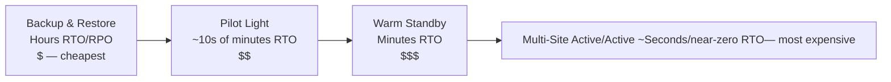

# Disaster Recovery Strategies (RTO/RPO, Backup to Multi-Site)

## Definition

This is the decision layer on top of `aws-backup.md`, `route53.md`, and the Multi-AZ features
documented inside `rds.md`/`aurora.md` — it names the four standard DR strategies AWS (and the
exam) organizes around, ordered by how much it costs vs. how fast it recovers.

## Purpose

"Highly available" and "disaster-recoverable" are related but different goals: high availability
handles routine failures (one server dies, one AZ has an issue) automatically and fast; disaster
recovery handles the rare, severe case (a whole Region is unusable) and is a deliberate choice
about how much money you're willing to spend standing by versus how long you're willing to be
down when it happens. The exam tests this as a direct cost/speed tradeoff using two numbers:
**RTO (Recovery Time Objective)** — how long you can be down — and **RPO (Recovery Point
Objective)** — how much data you can afford to lose, measured in time since the last backup.

## How It Works — The Four Strategies

Step by step through the spectrum, each one layering more standing infrastructure (and cost) on
top of the one before it:

1. **Backup & Restore** — regularly back up data (AWS Backup, S3 cross-Region replication,
   RDS snapshots) to a second Region, but run **nothing** there day to day. On disaster, you
   provision infrastructure from scratch (often via CloudFormation/CDK templates kept ready) and
   restore data. Cheapest option; slowest recovery (hours).
2. **Pilot Light** — a minimal, always-on core sits in the DR Region (e.g., a replicated database
   kept continuously in sync), but the rest of the application (app servers, load balancers)
   exists only as pre-built, un-launched templates/AMIs. On disaster, you scale the "pilot light"
   up into a full environment. Faster than backup & restore because the data layer is already
   warm.
3. **Warm Standby** — a scaled-down but fully functional copy of the entire application already
   runs in the DR Region at all times (e.g., a small Auto Scaling group, minimum instance count).
   On disaster, you scale it up to full production capacity and redirect traffic. Noticeably
   faster recovery, noticeably more idle cost than pilot light.
4. **Multi-Site Active/Active** — full production capacity runs in two (or more) Regions
   simultaneously, both actively serving real traffic all the time, with Route 53 (often latency
   or weighted routing with health checks) distributing load between them. On disaster, the
   surviving Region simply absorbs all traffic — effectively zero additional recovery time, but
   the most expensive strategy because you're paying for full redundant capacity permanently.

## Key Decision Points

- **RTO vs. RPO drive everything** — a scenario stating "cannot lose more than 5 minutes of data"
  is an RPO requirement (pushes toward continuous replication, ruling out nightly-backup-only
  strategies); "must be back online within 1 hour" is an RTO requirement (rules out cold
  backup-and-restore if provisioning from scratch takes longer than that).
- **Multi-AZ is not disaster recovery** — Multi-AZ (e.g., RDS Multi-AZ, an ALB spanning AZs)
  protects against the loss of one Availability Zone *within* a Region automatically and is
  table-stakes high availability, not a DR strategy for a whole-Region event. DR strategies in
  this doc are specifically about surviving the loss of an entire Region.
- **Route 53 health checks + failover routing** is the mechanism that actually executes the
  "redirect traffic to the DR Region" step in every strategy above except backup & restore
  (where DNS is usually just repointed manually/via automation after infrastructure is rebuilt).
- **Cost scales with standing infrastructure, not data volume** — the expensive part of warm
  standby/active-active is the idle (or active) compute sitting in the second Region, not the
  backup storage itself.

## Why It's Important

**Real-world:** choosing the wrong DR strategy either wastes money (active-active for a workload
that can tolerate an hour of downtime) or breaks a business SLA (backup-and-restore for a system
that needs to recover in minutes). This is a direct business-requirements-to-architecture
translation skill.

**Exam mapping:** SAA-C03 Domain 2, Task 2.2 ("design highly available and/or fault-tolerant
architectures... backup/DR strategies") names this explicitly. Expect scenarios that give you an
RTO/RPO number and ask which of the four strategies fits, or that describe a strategy and ask you
to name it.

## Related Terms

- [`../../../services/storage/aws-backup.md`](../../../services/storage/aws-backup.md)
- [`../../../services/networking-content-delivery/route53.md`](../../../services/networking-content-delivery/route53.md)
- [`../../../services/database/rds.md`](../../../services/database/rds.md),
  [`../../../services/database/aurora.md`](../../../services/database/aurora.md) — Multi-AZ and cross-Region read replicas
- [`../../../services/compute/ec2-auto-scaling.md`](../../../services/compute/ec2-auto-scaling.md)
