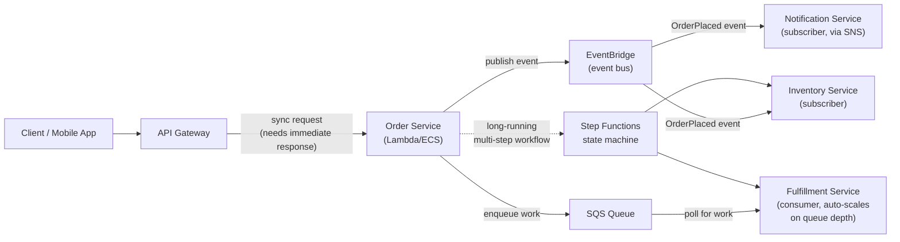

# Event-Driven & Microservice Architecture Patterns

## Definition

This is the decision/pattern layer on top of the individual messaging and compute docs
(`sqs.md`, `sns.md`, `eventbridge.md`, `step-functions.md`, `api-gateway.md`, `ecs.md`, `eks.md`)
— it explains *why* and *how* you break one big application into smaller, independent pieces
that talk to each other through queues and events instead of direct, synchronous calls.

## Purpose

A traditional "monolith" (one big application, one deployment, direct in-process function calls)
is simple at small scale but becomes fragile and slow to change as it grows: one team's bug can
take down the whole app, one slow component blocks everything behind it, and scaling means
scaling the entire thing even if only one part is under load. Microservice and event-driven
patterns exist to let each piece scale, fail, and deploy **independently** — which is also
exactly what "loosely coupled" means in the exam's own wording for this task.

## How It Works

Plain explanation: instead of Service A calling Service B directly and waiting for a response
(tight coupling — if B is slow or down, A is stuck), A drops a message into a **queue** or
publishes an **event**, and moves on immediately. B picks up that message whenever it's ready.
Neither service needs to know the other exists, how many instances of it are running, or whether
it's healthy right now — the queue/event bus absorbs the difference.

Step by step: the client talks to **API Gateway**, which is the one synchronous, request/response
boundary — it has to answer *something* quickly. The **Order Service** that handles the request
does only the minimal synchronous work (validate, save the order) and then immediately hands off
everything else: it **publishes an event** ("OrderPlaced") to **EventBridge**, which fans that
event out to any number of independent subscribers (Inventory Service, Notification Service via
SNS) without the Order Service knowing or caring who's listening — new subscribers can be added
later with zero change to the Order Service. For work that must definitely happen exactly once
and can be retried safely, the Order Service instead **enqueues a message in SQS** — the
Fulfillment Service polls that queue at its own pace and can **auto-scale purely based on queue
depth** (more messages waiting → more consumer instances), which is the textbook SAA-C03 scaling
pattern. For a process with multiple ordered steps, retries, and waiting periods (e.g., "reserve
inventory, charge payment, then fulfill, with rollback on any failure"), **Step Functions**
coordinates the sequence explicitly as a state machine instead of chaining services together with
ad-hoc code.

## Key Decision Points

- **SQS vs. SNS vs. EventBridge** — SQS is point-to-point (one message, one consumer, pulled);
  SNS is pub/sub fan-out (one message, many immediate subscribers, pushed); EventBridge is a
  schema-aware event bus with content-based routing rules, commonly used for decoupling across
  many services/even across accounts. See `messaging-patterns-overview.md` for the full
  comparison.
- **Synchronous vs. asynchronous** — only use a synchronous call (API Gateway → Lambda, direct
  service-to-service HTTP) when the caller genuinely needs an answer *right now*; default to
  async (queue/event) for anything that can tolerate a short delay — this is the core of "loosely
  coupled."
- **Horizontal vs. vertical scaling** — loosely coupled services scale horizontally (add more
  identical workers behind a queue/load balancer); a monolith often can only scale vertically
  (a bigger single machine) until it's broken apart, which is slower and hits a hard ceiling.
- **Multi-tier vs. microservices** — a classic 3-tier app (web/app/data) is still a valid,
  simpler pattern for smaller systems; microservices add operational complexity (many
  deployables, distributed tracing, eventual consistency) and are worth it only once a monolith's
  independent-scaling/deployment needs justify that cost.
- **Containers (ECS/EKS) vs. Lambda for the service runtime** — Lambda suits short, bursty,
  event-triggered work with no idle cost; ECS/EKS suit longer-running, more complex, or
  already-containerized services. See `containers-vs-vms-vs-serverless.md`.

## Common Mistakes

- Services calling each other synchronously in a long chain (A→B→C→D) — one slow/failed link
  takes the whole chain down; this is tight coupling wearing a microservices costume.
- Using SNS where ordering and exactly-once delivery matter but FIFO SQS would fit better, or
  vice versa — using plain SQS where many independent subscribers need the same message (that's
  SNS or EventBridge fan-out territory, or SNS-fan-out-to-SQS for durable multi-consumer fan-out).
- Scaling the whole monolith to handle load on one small, slow component instead of extracting
  that component into its own independently scaled service.

## Why It's Important

**Exam mapping:** SAA-C03 Domain 2, Task 2.1 is built entirely around this synthesis — "scalable
and loosely coupled architectures" names API Gateway, SQS, microservices, event-driven patterns,
and read replicas as a single cohesive design philosophy, not isolated trivia.

## Related Terms

- [`../../../services/application-integration/sqs.md`](../../../services/application-integration/sqs.md)
- [`../../../services/application-integration/sns.md`](../../../services/application-integration/sns.md)
- [`../../../services/application-integration/eventbridge.md`](../../../services/application-integration/eventbridge.md)
- [`../../../services/application-integration/step-functions.md`](../../../services/application-integration/step-functions.md)
- [`../../../services/application-integration/messaging-patterns-overview.md`](../../../services/application-integration/messaging-patterns-overview.md)
- [`../../../services/networking-content-delivery/api-gateway.md`](../../../services/networking-content-delivery/api-gateway.md)
- [`../../../services/containers/containers-vs-vms-vs-serverless.md`](../../../services/containers/containers-vs-vms-vs-serverless.md)
