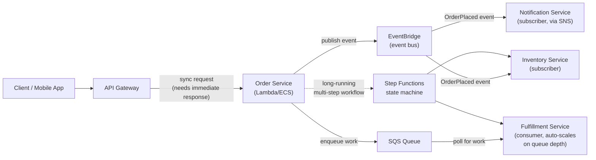
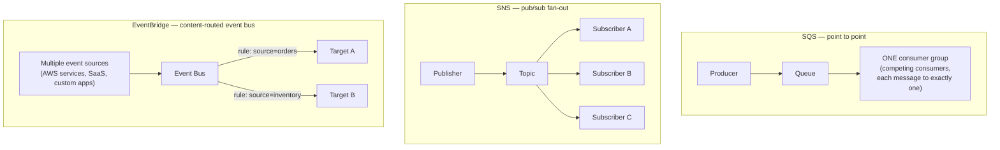
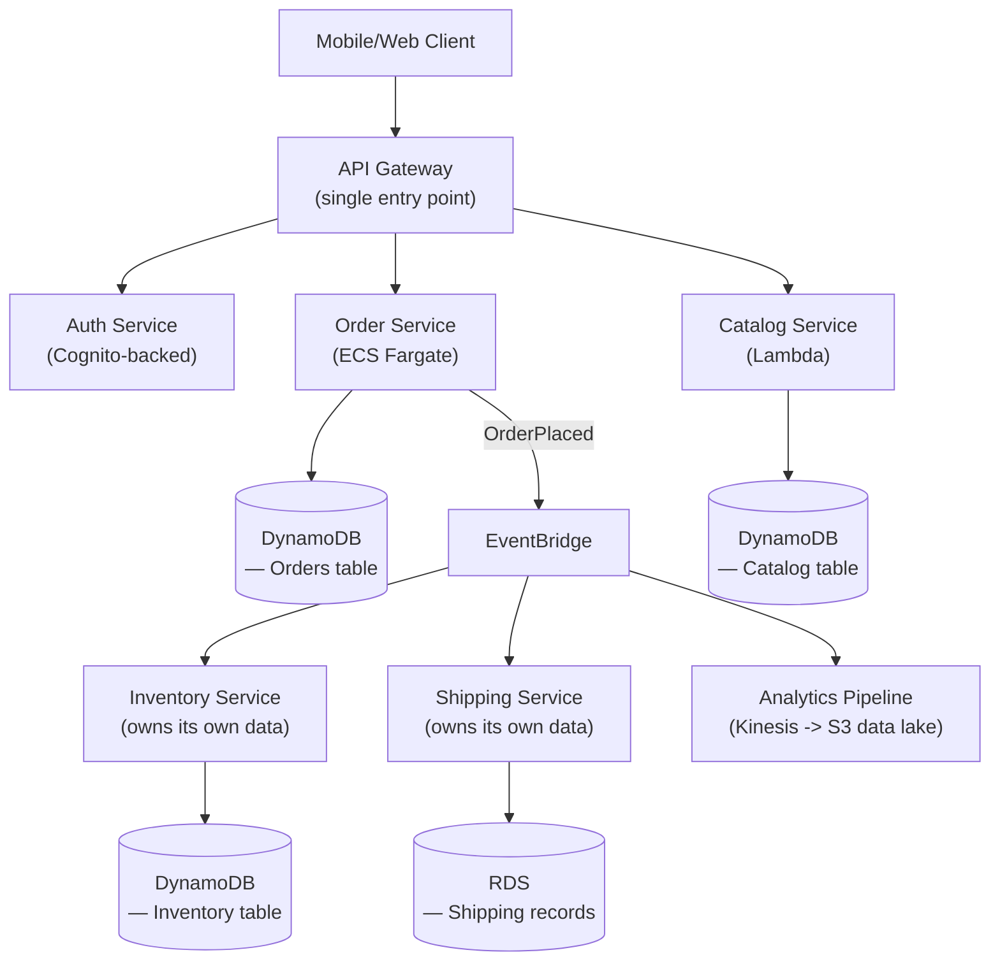

# Event-Driven & Microservice Architecture Patterns

*Source: [AWS Well-Architected Framework — Serverless Applications Lens, Event-Driven Architectures](https://docs.aws.amazon.com/wellarchitected/latest/serverless-applications-lens/event-driven-architectures.html)*

## Definition

This is the decision/pattern layer on top of the individual messaging and compute docs
(`sqs.md`, `sns.md`, `eventbridge.md`, `step-functions.md`, `api-gateway.md`, `ecs.md`, `eks.md`)
— it explains *why* and *how* you break one big application into smaller, independent pieces
that talk to each other through queues and events instead of direct, synchronous calls.

## Purpose

A traditional "monolith" (one big application, one deployment, direct in-process function calls)
is simple at small scale but becomes fragile and slow to change as it grows: one team's bug can
take down the whole app, one slow component blocks everything behind it, and scaling means
scaling the entire thing even if only one part is under load. Microservice and event-driven
patterns exist to let each piece scale, fail, and deploy **independently** — which is also
exactly what "loosely coupled" means in the exam's own wording for this task.

## How It Works

Plain explanation: instead of Service A calling Service B directly and waiting for a response
(tight coupling — if B is slow or down, A is stuck), A drops a message into a **queue** or
publishes an **event**, and moves on immediately. B picks up that message whenever it's ready.
Neither service needs to know the other exists, how many instances of it are running, or whether
it's healthy right now — the queue/event bus absorbs the difference.

Step by step: the client talks to **API Gateway**, which is the one synchronous, request/response
boundary — it has to answer *something* quickly. The **Order Service** that handles the request
does only the minimal synchronous work (validate, save the order) and then immediately hands off
everything else: it **publishes an event** ("OrderPlaced") to **EventBridge**, which fans that
event out to any number of independent subscribers (Inventory Service, Notification Service via
SNS) without the Order Service knowing or caring who's listening — new subscribers can be added
later with zero change to the Order Service. For work that must definitely happen exactly once
and can be retried safely, the Order Service instead **enqueues a message in SQS** — the
Fulfillment Service polls that queue at its own pace and can **auto-scale purely based on queue
depth** (more messages waiting → more consumer instances), which is the textbook SAA-C03 scaling
pattern. For a process with multiple ordered steps, retries, and waiting periods (e.g., "reserve
inventory, charge payment, then fulfill, with rollback on any failure"), **Step Functions**
coordinates the sequence explicitly as a state machine instead of chaining services together with
ad-hoc code.

## Architecture: The Buffering Pattern at Different Processing Rates

*Source: [AWS Lambda Developer Guide — Understanding event-driven architectures](https://docs.aws.amazon.com/lambda/latest/dg/concepts-event-driven-architectures.html)*

This diagram is the single clearest illustration of *why* queues exist in this domain: the order
acceptance service can absorb a burst far faster than payment processing can ever process it, and
a direct synchronous call between the two would force the faster service down to the slower one's
pace (or fail outright under load). The queue lets each service run at its own natural speed.

## Architecture: SQS vs. SNS vs. EventBridge, Side by Side

The exam-relevant distinction in one line each: **SQS** — one message is processed by exactly one
consumer (even with many consumer instances competing for messages, each individual message goes
to only one of them); **SNS** — one message is pushed immediately to *every* subscriber at once;
**EventBridge** — events from many different sources are matched against rules and routed only to
the targets whose rule matches, adding schema awareness and cross-account/cross-service routing
that plain SNS doesn't have. A common combined pattern is **SNS fan-out to SQS** — a publisher
sends once to an SNS topic, which fans out to several SQS queues, giving you both "every
subscriber gets it" (SNS) and "each subscriber processes it durably and at its own pace" (SQS) at
once.

## Architecture: A Full Microservices Decomposition

The principle this diagram tests: **each microservice owns its own data store** — Order Service
never reaches directly into Inventory's database, it only ever communicates through the event bus.
This is what makes independent deployment and scaling actually safe: a schema change inside
Inventory's own database can never break Order Service, because Order Service never touched it
directly in the first place.

## Key Decision Points

- **SQS vs. SNS vs. EventBridge** — SQS is point-to-point (one message, one consumer, pulled);
  SNS is pub/sub fan-out (one message, many immediate subscribers, pushed); EventBridge is a
  schema-aware event bus with content-based routing rules, commonly used for decoupling across
  many services/even across accounts. See `messaging-patterns-overview.md` for the full
  comparison.
- **Synchronous vs. asynchronous** — only use a synchronous call (API Gateway → Lambda, direct
  service-to-service HTTP) when the caller genuinely needs an answer *right now*; default to
  async (queue/event) for anything that can tolerate a short delay — this is the core of "loosely
  coupled."
- **Horizontal vs. vertical scaling** — loosely coupled services scale horizontally (add more
  identical workers behind a queue/load balancer); a monolith often can only scale vertically
  (a bigger single machine) until it's broken apart, which is slower and hits a hard ceiling.
- **Multi-tier vs. microservices** — a classic 3-tier app (web/app/data) is still a valid,
  simpler pattern for smaller systems; microservices add operational complexity (many
  deployables, distributed tracing, eventual consistency) and are worth it only once a monolith's
  independent-scaling/deployment needs justify that cost.
- **Containers (ECS/EKS) vs. Lambda for the service runtime** — Lambda suits short, bursty,
  event-triggered work with no idle cost; ECS/EKS suit longer-running, more complex, or
  already-containerized services. See `containers-vs-vms-vs-serverless.md`.
- **Each service owns its own data** — a core microservices rule the exam assumes: sharing one
  database across services reintroduces tight coupling at the data layer even if the compute
  layer looks decoupled.
- **Dead-letter queues (DLQs)** — a message that repeatedly fails processing should route to a
  DLQ after a configured number of retries rather than looping forever or being silently dropped
  — the exam-tested mechanism for handling "poison pill" messages in a queue-based architecture.
- **FIFO vs. standard SQS** — standard queues are higher-throughput with at-least-once, best-
  effort ordering; FIFO queues guarantee exactly-once processing and strict ordering within a
  message group, at a lower throughput ceiling — pick FIFO only when a scenario explicitly
  requires strict order or exactly-once semantics.

## Common Mistakes

- Services calling each other synchronously in a long chain (A→B→C→D) — one slow/failed link
  takes the whole chain down; this is tight coupling wearing a microservices costume.
- Using SNS where ordering and exactly-once delivery matter but FIFO SQS would fit better, or
  vice versa — using plain SQS where many independent subscribers need the same message (that's
  SNS or EventBridge fan-out territory, or SNS-fan-out-to-SQS for durable multi-consumer fan-out).
- Scaling the whole monolith to handle load on one small, slow component instead of extracting
  that component into its own independently scaled service.
- Letting multiple microservices read and write the same shared database table directly — this
  silently reintroduces the coupling the pattern is meant to remove.
- Omitting a dead-letter queue, so a single malformed message blocks or repeatedly re-processes
  forever, consuming worker capacity without making progress.
- Choosing EventBridge for a simple point-to-point handoff where plain SQS would be simpler and
  cheaper — EventBridge adds latency and complexity that only pays off once content-based routing
  or many independent targets are actually needed.

## Full Worked Mini-Case: Decoupling a Ticket-Booking Monolith

**Starting state:** a concert ticket-booking monolith processes "buy ticket" requests
synchronously end to end — validate seat availability, charge the card, update seat inventory,
send a confirmation email — all inside one request/response cycle. During a popular on-sale, the
email-sending step (which calls a slow third-party provider) backs up the entire request queue,
causing legitimate purchases to time out.

**Retrofit:**

1. The synchronous path shrinks to just "validate seat availability + reserve it + charge the
   card" — the three steps genuinely needed before the client can be told "purchase confirmed."
2. "Send confirmation email" moves to an SQS queue; a separate, independently auto-scaled worker
   fleet consumes it. A slow email provider now only delays the email, never the purchase
   response.
3. "Update downstream reporting/analytics" moves to an EventBridge event ("TicketPurchased") so
   the reporting team's service and the marketing team's service can each subscribe independently,
   without the purchase flow needing to know either exists.
4. A dead-letter queue is attached to the email queue so a malformed message (e.g., corrupted
   email address) doesn't block the queue for other customers' confirmations.

This mini-case maps directly onto "Key Decision Points" above — recognizing which step is
genuinely synchronous (steps that must complete before responding) versus which can be deferred
(everything else) is the actual skill Task 2.1 tests.

## Use Cases — Real Scenarios

- **Food delivery marketplace fanning out an "order placed" event to five independent teams.**
  The payments team, the restaurant-notification team, the courier-dispatch team, the loyalty-
  points team, and the fraud-detection team all subscribe to the same EventBridge event
  independently — a sixth team can be added next quarter with zero change to the order service.
- **Online learning platform decoupling video upload from transcoding.** An instructor's raw video
  upload completes instantly from their perspective (synchronous S3 PUT); the actual transcoding
  into multiple resolutions happens via an SQS-queued worker fleet that auto-scales with the queue,
  so a flood of uploads during a course launch never makes individual uploads feel slow.
- **Insurance company processing claims through a multi-step approval workflow.** "Validate claim
  → check fraud score → route to adjuster → await adjuster decision → disburse or deny" is modeled
  as a Step Functions state machine with built-in retries and a human-approval wait state, replacing
  what used to be a fragile chain of Lambda functions calling each other directly.
- **Ride-sharing app buffering surge-pricing recalculation during a sudden demand spike.** Ride
  requests themselves stay synchronous and fast; the computationally heavier surge-pricing model
  recalculation is decoupled onto SQS so a citywide event (concert letting out) doesn't slow down
  the core "request a ride" flow even as pricing briefly uses slightly stale surge multipliers.
- **B2B logistics platform integrating with dozens of partner carriers' APIs of wildly varying
  reliability.** Each carrier integration lives behind its own SQS queue with its own dead-letter
  queue and retry policy, so one carrier's API having a bad day never backs up shipments destined
  for a different, healthy carrier.
- **News publisher's comment-moderation pipeline.** A posted comment is saved instantly (synchronous
  write, fast user experience); automated toxicity scoring and the "notify moderators of flagged
  content" step both happen asynchronously via EventBridge, decoupling the publishing experience
  from the (occasionally slow, ML-model-backed) moderation pipeline.
- **IoT smart-thermostat manufacturer processing millions of device telemetry events.** Device
  readings publish into EventBridge; a "software update available" rule routes only devices on an
  old firmware version to an update-notification service, while a separate "anomaly detected" rule
  routes unusual readings to a support-alert service — one event stream, multiple independently
  evolving downstream consumers.
- **Healthcare scheduling platform separating appointment booking from reminder SMS delivery.**
  Booking an appointment is synchronous; scheduling the 24-hours-before SMS reminder goes through
  SQS with a delay, so a third-party SMS provider outage delays reminders, never bookings.
- **Enterprise HR SaaS company's payroll-run orchestration.** "Calculate gross pay → apply tax
  withholding → run compliance checks → disburse via ACH → generate pay stubs" runs as a Step
  Functions workflow with an explicit rollback branch if the compliance-check step fails, rather
  than a monolithic payroll script that's difficult to partially retry.

## Why It's Important

**Exam mapping:** SAA-C03 Domain 2, Task 2.1 is built entirely around this synthesis — "scalable
and loosely coupled architectures" names API Gateway, SQS, microservices, event-driven patterns,
and read replicas as a single cohesive design philosophy, not isolated trivia.

## Exam Tips

- If a scenario's pain point is phrased as "one slow part makes everything slow," the fix is
  almost always decoupling that part behind a queue, not scaling the whole fleet.
- "Many independent subscribers need the same event" signals SNS or EventBridge, never plain SQS
  alone.
- "Exactly one consumer should process each message, and consumers should scale with backlog
  size" signals SQS + Auto Scaling on queue depth.
- A workflow description with words like "steps," "retries," "wait for," or "branch depending on
  the result" signals Step Functions, not a hand-rolled chain of Lambda invocations.

## Related Terms

- [`../../../services/application-integration/sqs.md`](../../../services/application-integration/sqs.md)
- [`../../../services/application-integration/sns.md`](../../../services/application-integration/sns.md)
- [`../../../services/application-integration/eventbridge.md`](../../../services/application-integration/eventbridge.md)
- [`../../../services/application-integration/step-functions.md`](../../../services/application-integration/step-functions.md)
- [`../../../services/application-integration/messaging-patterns-overview.md`](../../../services/application-integration/messaging-patterns-overview.md)
- [`../../../services/networking-content-delivery/api-gateway.md`](../../../services/networking-content-delivery/api-gateway.md)
- [`../../../services/containers/containers-vs-vms-vs-serverless.md`](../../../services/containers/containers-vs-vms-vs-serverless.md)
- [`disaster-recovery-strategies.md`](disaster-recovery-strategies.md) — Warm Standby/Active-Active
  DR Regions still need this doc's decoupled service design replicated in each Region
- [`../domain-1-secure-architectures/vpc-security-architecture-patterns.md`](../domain-1-secure-architectures/vpc-security-architecture-patterns.md) —
  the VPC endpoint pattern that lets these services reach SQS/SNS/EventBridge without NAT Gateway
  exposure
- [`../domain-3-high-performing-architectures/README.md`](../domain-3-high-performing-architectures/README.md) —
  revisits SQS/Step Functions/containers from a pure-throughput angle
