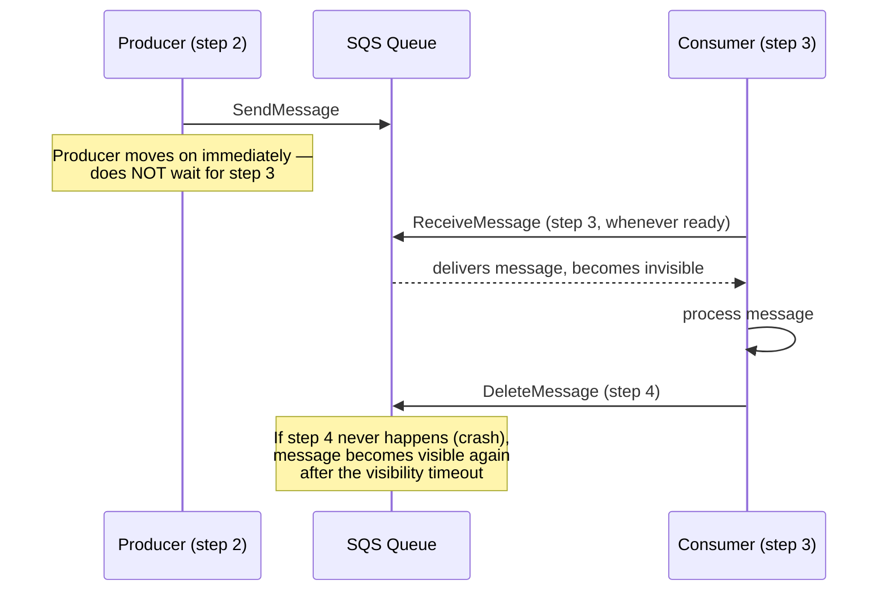
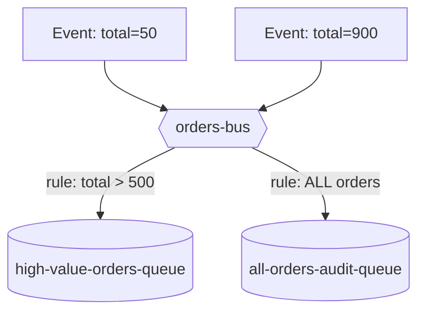

# Domain 2 Labs — Design Resilient Architectures (Floci)

Setup once: see [`labs-floci/README.md`](../../../labs-floci/README.md). These labs use SQS,
SNS, EventBridge, Lambda, API Gateway, Step Functions, RDS, and Route 53's API surface — all
exercised through Floci. (True cross-AZ network failure physics, actual DNS propagation delay
across global resolvers, and Multi-AZ's real synchronous-replication failover event are
control-plane/global behaviors Floci does not simulate end-to-end; this file notes exactly where
that applies, lab by lab, rather than overclaiming coverage.)

## Lab 1 — Decouple a producer and consumer with SQS (Task 2.1)

Goal: feel the difference between a direct synchronous call and a decoupled, queue-based one —
the core "loosely coupled" pattern.

```bash
# 1. Create the queue
awslocal sqs create-queue --queue-name order-events-queue

# 2. "Producer" sends a message — it does not wait for anyone to process it
awslocal sqs send-message --queue-url http://localhost:4566/000000000000/order-events-queue \
  --message-body '{"orderId": "A-1001", "status": "placed"}'

# 3. "Consumer" polls for work whenever it's ready — completely independent of the producer
awslocal sqs receive-message --queue-url http://localhost:4566/000000000000/order-events-queue \
  --max-number-of-messages 1

# 4. After successfully processing, the consumer deletes the message (capture ReceiptHandle
#    from step 3's output)
awslocal sqs delete-message --queue-url http://localhost:4566/000000000000/order-events-queue \
  --receipt-handle <receipt-handle>

# 5. Check queue depth — this is the metric Auto Scaling would react to in real AWS
awslocal sqs get-queue-attributes --queue-url http://localhost:4566/000000000000/order-events-queue \
  --attribute-names ApproximateNumberOfMessages
```

Why this matters: `ApproximateNumberOfMessages` is exactly the CloudWatch metric a real Auto
Scaling target-tracking policy scales a worker fleet on — queue depth up, add workers; queue
depth down, remove them.



This sequence is the lab's actual lesson in one picture: steps 1-2 (producer) and steps 3-4
(consumer) never have to happen at the same wall-clock time — run the producer command, wait five
minutes, then run the consumer command, and it still works identically. That's the entire
operational meaning of "decoupled" made concrete instead of abstract.

## Lab 2 — Event-driven workflow with API Gateway + Step Functions + Lambda (Task 2.1)

Goal: build the synchronous-entry/asynchronous-orchestration pattern from
`event-driven-microservice-architecture-patterns.md` end to end.

```bash
# 1. Create a simple Lambda function (zip a one-line handler first, e.g. index.py with a
#    lambda_handler returning a fixed response)
awslocal lambda create-function --function-name ProcessOrderStep \
  --runtime python3.12 --handler index.lambda_handler --role arn:aws:iam::000000000000:role/lambda-role \
  --zip-file fileb://function.zip

# 2. Define a Step Functions state machine that calls it
cat > statemachine.json << 'EOF'
{
  "Comment": "Order processing workflow",
  "StartAt": "ProcessOrder",
  "States": {
    "ProcessOrder": {
      "Type": "Task",
      "Resource": "arn:aws:lambda:us-east-1:000000000000:function:ProcessOrderStep",
      "End": true
    }
  }
}
EOF
awslocal stepfunctions create-state-machine --name OrderWorkflow \
  --definition file://statemachine.json --role-arn arn:aws:iam::000000000000:role/sfn-role

# 3. Trigger it the way API Gateway would (via a start-execution call)
awslocal stepfunctions start-execution --state-machine-arn <state-machine-arn> \
  --input '{"orderId": "A-1002"}'

# 4. Check the execution result
awslocal stepfunctions describe-execution --execution-arn <execution-arn>
```

Why this matters: API Gateway's job is just the synchronous front door; the actual multi-step
business logic (with retries/branching) belongs in Step Functions, not stuffed into one giant
Lambda — this is the "why Step Functions exists" lesson the exam tests.

## Lab 3 — RDS primary + read replica (Task 2.1 / 2.2)

Goal: distinguish a read replica (serves live read traffic) from Multi-AZ (pure failover
standby, not readable) — a very commonly confused exam pair.

```bash
# 1. Create a primary RDS instance (Floci backs this with real Docker Postgres)
awslocal rds create-db-instance --db-instance-identifier orders-primary \
  --db-instance-class db.t3.micro --engine postgres --master-username admin \
  --master-user-password StudyPass123! --allocated-storage 20

# 2. Create a read replica pointing at it
awslocal rds create-db-instance-read-replica --db-instance-identifier orders-read-replica \
  --source-db-instance-identifier orders-primary

# 3. Confirm both instances exist and inspect their roles
awslocal rds describe-db-instances --query 'DBInstances[].{Id:DBInstanceIdentifier,Role:ReadReplicaDBInstanceIdentifiers}'
```

Why this matters: in real AWS, point reporting/analytics queries at the read replica's own
endpoint, never the primary's — this offloads read traffic exactly as Task 2.1 expects. Multi-AZ
(a separate RDS setting, not a separate instance you connect to) is the distinct high-availability
failover mechanism covered conceptually in `disaster-recovery-strategies.md`.

## Lab 4 — SNS fan-out to multiple SQS queues (Task 2.1)

Goal: build the "one event, many independent subscribers, each durably buffered" pattern from
`event-driven-microservice-architecture-patterns.md` — the combined SNS+SQS pattern that shows up
constantly in real decoupled systems.

```bash
# 1. Create an SNS topic representing "OrderPlaced" events
awslocal sns create-topic --name order-placed-topic

# 2. Create two separate SQS queues representing two independent subscriber services
awslocal sqs create-queue --queue-name inventory-service-queue
awslocal sqs create-queue --queue-name notification-service-queue

# 3. Subscribe both queues to the topic (each gets its own durable copy of every message)
awslocal sns subscribe --topic-arn arn:aws:sns:us-east-1:000000000000:order-placed-topic \
  --protocol sqs --notification-endpoint arn:aws:sqs:us-east-1:000000000000:inventory-service-queue
awslocal sns subscribe --topic-arn arn:aws:sns:us-east-1:000000000000:order-placed-topic \
  --protocol sqs --notification-endpoint arn:aws:sqs:us-east-1:000000000000:notification-service-queue

# 4. Publish one message to the topic
awslocal sns publish --topic-arn arn:aws:sns:us-east-1:000000000000:order-placed-topic \
  --message '{"orderId": "A-1003", "status": "placed"}'

# 5. Confirm BOTH queues received their own independent copy of the message
awslocal sqs receive-message --queue-url http://localhost:4566/000000000000/inventory-service-queue
awslocal sqs receive-message --queue-url http://localhost:4566/000000000000/notification-service-queue
```

Why this matters: this is the exact mechanism behind "many independent teams' services all react
to the same event" — a new third subscriber can be added later by subscribing one more queue to
the topic, with zero change to the publisher or the existing subscribers.

## Lab 6 — EventBridge content-based routing (Task 2.1)

Goal: build the "one event stream, multiple rules, each routing only matching events to a
different target" pattern from `event-driven-microservice-architecture-patterns.md` and
`MASTER-CHUNK.md`'s EventBridge section — the capability plain SNS filter policies only partially
replicate.

```bash
# 1. Create a custom event bus (keeping it separate from the default bus)
awslocal events create-event-bus --name orders-bus

# 2. Create two SQS queues representing two different reactions to the same event stream
awslocal sqs create-queue --queue-name high-value-orders-queue
awslocal sqs create-queue --queue-name all-orders-audit-queue

# 3. Create a rule matching only HIGH-VALUE orders (content-based routing)
cat > high-value-pattern.json << 'EOF'
{
  "source": ["custom.orders"],
  "detail-type": ["OrderPlaced"],
  "detail": {
    "total": [{"numeric": [">", 500]}]
  }
}
EOF
awslocal events put-rule --name HighValueOrderRule --event-bus-name orders-bus \
  --event-pattern file://high-value-pattern.json

# 4. Create a second rule matching EVERY order (the audit trail)
cat > all-orders-pattern.json << 'EOF'
{
  "source": ["custom.orders"],
  "detail-type": ["OrderPlaced"]
}
EOF
awslocal events put-rule --name AllOrdersAuditRule --event-bus-name orders-bus \
  --event-pattern file://all-orders-pattern.json

# 5. Attach each rule to its own queue target
HV_ARN=$(awslocal sqs get-queue-attributes --queue-url http://localhost:4566/000000000000/high-value-orders-queue --attribute-names QueueArn --query Attributes.QueueArn --output text)
AUDIT_ARN=$(awslocal sqs get-queue-attributes --queue-url http://localhost:4566/000000000000/all-orders-audit-queue --attribute-names QueueArn --query Attributes.QueueArn --output text)
awslocal events put-targets --rule HighValueOrderRule --event-bus-name orders-bus \
  --targets "Id"="1","Arn"="$HV_ARN"
awslocal events put-targets --rule AllOrdersAuditRule --event-bus-name orders-bus \
  --targets "Id"="1","Arn"="$AUDIT_ARN"

# 6. Publish a LOW-value order — should land in the audit queue only
awslocal events put-events --entries '[{"Source":"custom.orders","DetailType":"OrderPlaced","EventBusName":"orders-bus","Detail":"{\"orderId\":\"A-3001\",\"total\":50}"}]'

# 7. Publish a HIGH-value order — should land in BOTH queues
awslocal events put-events --entries '[{"Source":"custom.orders","DetailType":"OrderPlaced","EventBusName":"orders-bus","Detail":"{\"orderId\":\"A-3002\",\"total\":900}"}]'

# 8. Confirm the routing worked as expected
awslocal sqs receive-message --queue-url http://localhost:4566/000000000000/high-value-orders-queue
awslocal sqs receive-message --queue-url http://localhost:4566/000000000000/all-orders-audit-queue
```



Why this matters: step 6's low-value order should appear **only** in the audit queue, and step
7's high-value order should appear in **both** — the moment you see that split happen, the
abstract "EventBridge matches rules against event content and routes independently per rule"
description from the service docs becomes a concrete, observed behavior. This is also the lab to
revisit if a future rule needs adding (e.g., "EU orders") — notice adding step 9's hypothetical
third rule would require zero change to steps 1-7 at all, the same "add a subscriber with zero
publisher change" property SNS fan-out demonstrated in Lab 4, but now driven by event *content*
rather than a flat subscription list.

## Lab 7 — Route 53 failover routing configuration (Task 2.2, API-level)

Goal: configure the actual Route 53 resources a failover routing policy depends on — health
checks and failover record sets — even though Floci cannot simulate the underlying DNS
propagation or true cross-Region network failure physics (see "Honest limitation" below).

```bash
# 1. Create a hosted zone for a study domain
awslocal route53 create-hosted-zone --name example-study.com --caller-reference lab7-$(date +%s)

# 2. Create a health check against a (mock) primary endpoint
awslocal route53 create-health-check --caller-reference lab7-hc-$(date +%s) \
  --health-check-config IPAddress=203.0.113.10,Port=80,Type=HTTP,ResourcePath=/health,RequestInterval=30,FailureThreshold=3

# 3. Create the PRIMARY failover record, associated with that health check
cat > primary-record.json << 'EOF'
{
  "Changes": [{
    "Action": "CREATE",
    "ResourceRecordSet": {
      "Name": "app.example-study.com",
      "Type": "A",
      "SetIdentifier": "primary",
      "Failover": "PRIMARY",
      "TTL": 60,
      "ResourceRecords": [{"Value": "203.0.113.10"}],
      "HealthCheckId": "<health-check-id-from-step-2>"
    }
  }]
}
EOF
awslocal route53 change-resource-record-sets --hosted-zone-id <zone-id> \
  --change-batch file://primary-record.json

# 4. Create the SECONDARY failover record (the DR Region endpoint, no health check needed on it)
cat > secondary-record.json << 'EOF'
{
  "Changes": [{
    "Action": "CREATE",
    "ResourceRecordSet": {
      "Name": "app.example-study.com",
      "Type": "A",
      "SetIdentifier": "secondary",
      "Failover": "SECONDARY",
      "TTL": 60,
      "ResourceRecords": [{"Value": "198.51.100.20"}]
    }
  }]
}
EOF
awslocal route53 change-resource-record-sets --hosted-zone-id <zone-id> \
  --change-batch file://secondary-record.json

# 5. Inspect the health check's current status
awslocal route53 get-health-check-status --health-check-id <health-check-id>
```

Why this matters, and what this lab deliberately does NOT prove: configuring these two records
correctly — one `PRIMARY` tied to a health check, one `SECONDARY` with none — is the actual exam-
tested mechanic of failover routing. What this lab (and Floci generally) cannot demonstrate is the
real-world physics of a health check actually transitioning from healthy to unhealthy against a
truly unreachable endpoint, or genuine DNS TTL-driven propagation delay across resolvers
worldwide — both called out explicitly in "Honest limitation" below. Use this lab to get the
`PRIMARY`/`SECONDARY` + `HealthCheckId` API shape into muscle memory; read
`../../../services/networking-content-delivery/route53.md` for the real failover-timing behavior.

## Lab 8 — Capstone: decouple, auto-scale, and add a dead-letter queue (Task 2.1 + 2.2)

Goal: combine queue-based decoupling, scale-on-depth reasoning, and failure handling into one
mini-architecture resembling the domain README's StreamVista case study.

```bash
# 1. Create a dead-letter queue first
awslocal sqs create-queue --queue-name order-processing-dlq

# 2. Create the main queue with a redrive policy pointing failed messages at the DLQ after
#    3 failed receive attempts
DLQ_ARN=$(awslocal sqs get-queue-attributes \
  --queue-url http://localhost:4566/000000000000/order-processing-dlq \
  --attribute-names QueueArn --query Attributes.QueueArn --output text)
awslocal sqs create-queue --queue-name order-processing-queue \
  --attributes "RedrivePolicy={\"deadLetterTargetArn\":\"$DLQ_ARN\",\"maxReceiveCount\":\"3\"}"

# 3. Send a normal message and a deliberately "poison" message (e.g., malformed JSON an
#    application would reject every time)
awslocal sqs send-message --queue-url http://localhost:4566/000000000000/order-processing-queue \
  --message-body '{"orderId": "A-2001", "status": "placed"}'
awslocal sqs send-message --queue-url http://localhost:4566/000000000000/order-processing-queue \
  --message-body 'not-valid-json{{{'

# 4. Simulate a worker repeatedly failing to process the poison message by receiving it without
#    deleting it 3 times in a row (each receive increments its receive count)
for i in 1 2 3; do
  awslocal sqs receive-message --queue-url http://localhost:4566/000000000000/order-processing-queue \
    --attribute-names ApproximateReceiveCount
done

# 5. Confirm the poison message has moved to the DLQ instead of looping forever
awslocal sqs receive-message --queue-url http://localhost:4566/000000000000/order-processing-dlq
```

Why this matters: this is the production-grade pattern this domain's README calls out as missing
from a naive queue setup — without a DLQ, one malformed message can consume worker capacity
indefinitely (constantly retried, never succeeding, never cleared), silently degrading the whole
pipeline's throughput exactly like the tight-coupling failures this domain is built to prevent.

## Use Cases — Real Scenarios (these labs' skills applied for real)

- **On-call engineer diagnosing why a backlog of orders isn't being processed.** Lab 1's
  `ApproximateNumberOfMessages` check is the exact first command a real on-call engineer runs when
  a team reports "orders seem stuck" — confirming whether the problem is an empty queue (upstream
  issue) or a growing one (downstream/worker issue) before looking anywhere else.
- **Startup replacing a fragile, hand-rolled Lambda-calls-Lambda payment workflow.** Lab 2's
  mini state machine is the pattern a team reaches for the first time they experience "we need to
  retry step 2 without re-running step 1" — exactly the operational pain Step Functions exists to
  remove.
- **Database team explaining to a product manager why reporting queries are slow.** Lab 3's
  primary/read-replica setup is the live demonstration used in that conversation — pointing the
  reporting tool at the replica's own endpoint instead of the primary's is often the entire fix.
- **Platform team building a "broadcast this event to every subscribed team" internal tool.**
  Lab 4's SNS-fan-out-to-SQS pattern is the exact architecture behind a self-service internal
  events platform where any team can subscribe their own queue to a shared topic without needing
  the publishing team's involvement.
- **Incident postmortem after one malformed message silently clogged a queue for six hours.**
  Lab 8's dead-letter-queue exercise reproduces the exact failure mode from the postmortem,
  building the muscle memory to configure a redrive policy *before* that incident happens again
  rather than after.
- **Consultant auditing a client's "resilient" architecture that turns out to have no DLQs
  anywhere.** The capstone lab's combination of a main queue, DLQ, and redrive policy is the
  concrete checklist item the consultant adds to every subsequent architecture review.
- **SRE team writing a runbook for "the order-processing queue is backing up" pages.** Lab 1's
  `ApproximateNumberOfMessages` check and Lab 8's redrive-policy mechanics become the two
  diagnostic steps the on-call runbook tells a paged engineer to check first, in that order,
  before escalating further.
- **Fintech team validating a multi-step payment workflow's retry behavior before launch.** Lab 2's
  mini state machine is extended into a pre-launch test plan that deliberately fails one step to
  confirm Step Functions retries it correctly without re-running the already-completed steps —
  exactly the behavior a production incident would otherwise surface the hard way.
- **Security team building a central GuardDuty-findings triage pipeline.** Lab 6's content-based
  routing exercise is the exact skeleton behind "route HIGH-severity findings to an automated
  remediation workflow while ALL findings still reach a SIEM ingestion queue" — the same two-rules-
  on-one-bus shape, just with real GuardDuty events instead of synthetic order events.
- **Platform team drafting the DR runbook's Route 53 section before a disaster-recovery drill.**
  Lab 7's primary/secondary record creation is the literal Infrastructure-as-Code snippet that
  runbook's "cut over DNS" step references — writing it once as a lab exercise means the real
  runbook isn't drafted for the first time during an actual incident.

## Honest limitation

Floci does not simulate true cross-AZ network failure, Route 53 health-check-driven failover
actually detecting a truly unreachable endpoint, DNS propagation delay across real-world global
resolvers, or Multi-AZ's actual synchronous-replication failover event — those behaviors are
described conceptually in `../../../services/networking-content-delivery/route53.md`,
`../../../services/database/rds.md`, and `disaster-recovery-strategies.md`. Lab 7 specifically
demonstrates the *API shape* of failover routing (PRIMARY/SECONDARY records tied to a health
check) without being able to demonstrate the actual failover *event* — don't mistake successfully
running Lab 7's commands for having validated real failover timing. Use these labs for the
API/workflow muscle memory; read the docs for the resiliency behavior itself.
