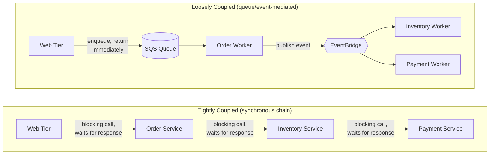
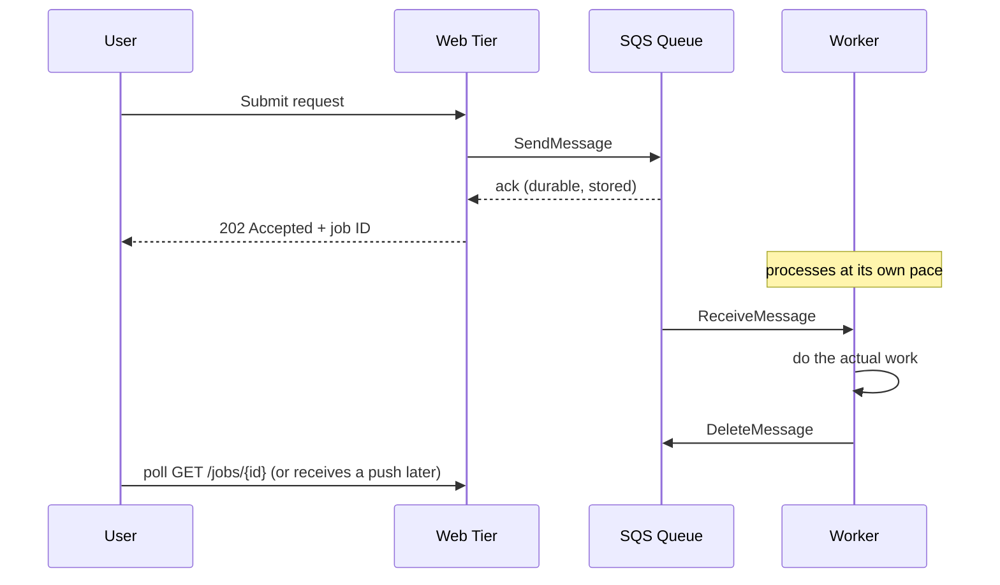
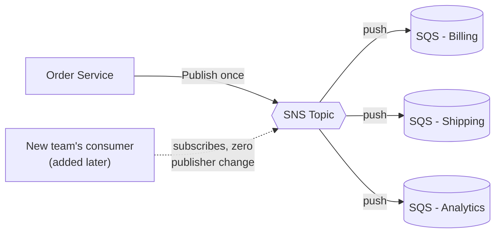
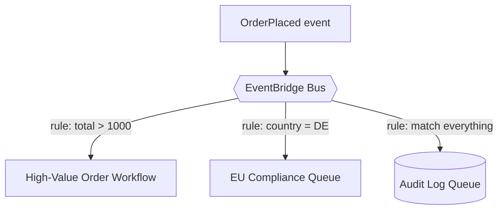
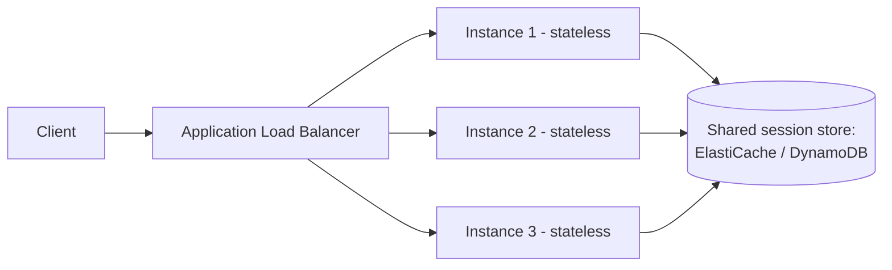
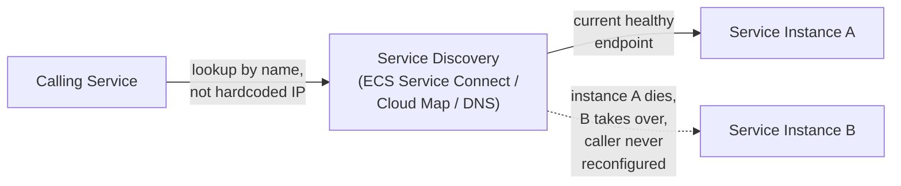
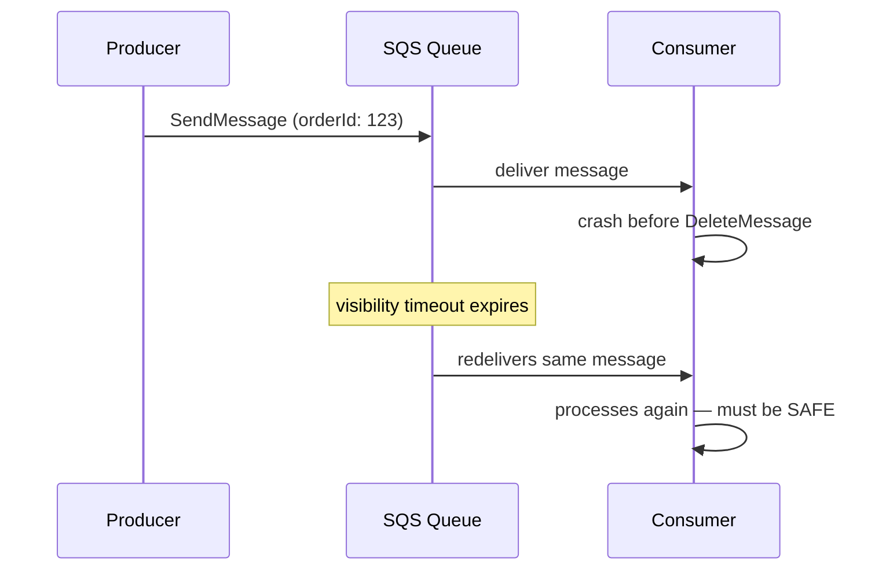
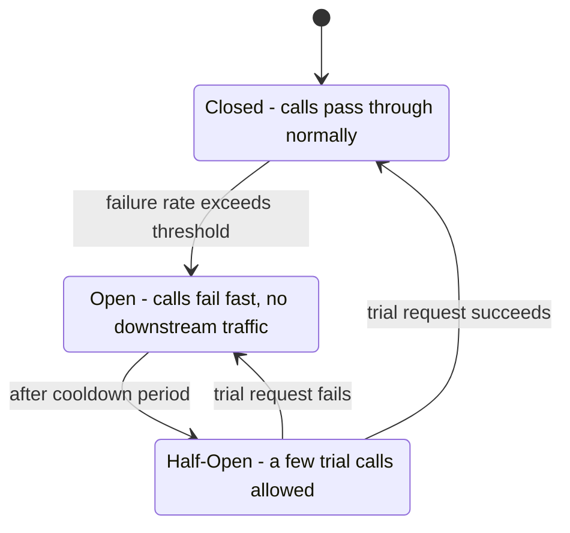
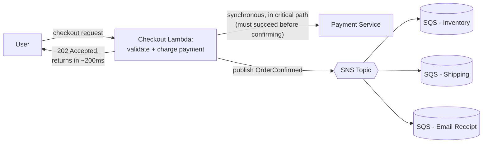

# Loose Coupling Patterns Deep Dive

*Source: [AWS Prescriptive Guidance — Database decomposition, Cohesion and coupling](https://docs.aws.amazon.com/prescriptive-guidance/latest/database-decomposition/cohesion-coupling.html)*

## Definition

Loose coupling is an architecture property, not a single service: two components are loosely
coupled when a change, slowdown, or failure in one does not force a change, slowdown, or failure
in the other. This doc is the pattern-catalog layer underneath Task 2.1's "design scalable and
loosely coupled architectures" wording — it names the specific, repeatable techniques (queues,
events, asynchronous APIs, service discovery, stateless compute, idempotency, circuit breakers)
that actually produce loose coupling in a real AWS architecture, rather than treating "use SQS" as
a one-off fact disconnected from the broader design principle it serves.

## Purpose

Tightly coupled systems fail in a specific, recognizable way: a slowdown or outage in one
component propagates directly into every component that calls it synchronously, often cascading
into a full outage from what started as one service's bad day. Loose coupling exists specifically
to contain that blast radius — not by making individual components more reliable, but by changing
*how* components depend on each other so one component's failure mode can't reach across the
boundary into the next.

## How It Works — Tight Coupling vs. Loose Coupling, Side by Side

In the tight chain, if the Payment Service slows down, every upstream caller is now also slow —
the Web Tier's user-facing latency is directly at the mercy of a service three hops away that the
user never heard of. In the loose version, the Web Tier's response time is decoupled from
anything downstream of the queue entirely; a slow Payment Worker only delays when *that specific
step* completes, never blocking the user-facing request, and Inventory and Payment Workers now
fail or scale completely independently of each other too, since EventBridge delivers to each
independently.

## Pattern 1 — Asynchronous Request/Response via Queueing

The producer's responsibility ends the moment the message is durably enqueued — it never waits
for the work itself to finish. This single change is what lets a web tier absorb a traffic spike
that would otherwise overwhelm a downstream worker: the queue holds the backlog, and the worker
fleet drains it at whatever pace it can actually sustain, scaling out on queue depth
(`ApproximateNumberOfMessagesVisible`) rather than being forced to match the producer's burst
rate instantly.

## Pattern 2 — Publish/Subscribe Fan-Out

The Order Service has no idea how many subscribers exist, and critically, **adding a fourth
consumer requires zero change to the Order Service's code** — this is loose coupling's clearest
practical payoff: the set of things that react to an event is not even knowable from the
publisher's code, by design. Contrast this with a tightly coupled version where the Order Service
would need a new function call (and therefore a new deployment) every time another team wanted to
react to the same event.

## Pattern 3 — Content-Based Event Routing

This is loose coupling applied to *logic*, not just to delivery — the publisher doesn't encode any
"if high value, also notify X" branching itself; that routing decision lives declaratively in
EventBridge rules, external to the publisher's code entirely. A new routing rule (e.g., "orders
from a new region need a new tax workflow") is a configuration change to the event bus, not a
code change to the Order Service.

## Pattern 4 — Stateless Compute Behind a Load Balancer

Loose coupling isn't only about messaging — it also means no single compute instance is
*load-bearing* for any specific user's session. If session state lived only in Instance 2's local
memory, that instance's failure would mean that user's session is lost — a tight coupling between
"this user" and "this one specific server." Externalizing session state to a shared store means
any instance can serve any request, which is exactly what lets an ASG terminate and replace an
unhealthy instance without anyone's session breaking.

## Pattern 5 — Service Discovery Instead of Hardcoded Endpoints

A caller that hardcodes a downstream service's IP address or instance ID is tightly coupled to
that *specific instance's* lifecycle — replacing it means updating every caller. Service discovery
(DNS-based, ECS Service Connect, or AWS Cloud Map) lets the caller depend on a stable *name*; which
actual instance answers that name can change freely underneath, with zero reconfiguration needed
on the calling side.

## Pattern 6 — Idempotency as Loose Coupling's Quiet Prerequisite

Every queue/event pattern above only works safely if the consumer can process the **same**
message twice without a bad outcome — most AWS messaging services are at-least-once, not
exactly-once, by default (SQS Standard, SNS, EventBridge). A consumer that isn't idempotent (e.g.,
one that double-charges a customer on redelivery) turns the resilience benefit of loose coupling
into a correctness bug. The fix is almost always a deduplication check keyed on a stable ID (an
order ID, a DynamoDB conditional write, or SQS FIFO's native deduplication) before the consumer's
side effect runs.

## Pattern 7 — Circuit Breakers and Graceful Degradation

Even a well-decoupled asynchronous architecture can have a component that calls a downstream
dependency synchronously inside one step (a Lambda calling an external payment API, for example).
A circuit breaker stops that one step from hammering an already-failing dependency with a stream
of requests destined to time out anyway — once the failure rate crosses a threshold, it "opens"
and fails fast locally for a cooldown period, then cautiously tests whether the dependency has
recovered before fully reopening. This is the synchronous-call equivalent of what a queue does for
asynchronous calls: contain one component's bad day from directly becoming every caller's bad day.

## Worked Example: Decoupling a Tightly Coupled Monolith Checkout Flow

**Before (tightly coupled):** A single checkout Lambda function directly, synchronously calls the
inventory service, then the payment service, then the shipping service, then the email service —
in sequence, within one invocation, before returning to the user.

**Problem:** The shipping service occasionally takes 8 seconds to respond during peak hours. Every
checkout now takes at least 8 seconds, and if shipping times out entirely, the whole checkout fails
even though payment already succeeded — a correctness problem (payment taken, order not recorded)
layered on top of a latency problem.

**After (loosely coupled):**

The redesign keeps exactly one synchronous call in the critical path — payment, because the user
genuinely needs to know *before* the page changes whether the charge succeeded — and moves
inventory decrement, shipping scheduling, and the receipt email to asynchronous SNS→SQS fan-out.
The user now sees a fast, consistent response regardless of shipping service health, and a slow or
temporarily-down shipping service now only delays shipping scheduling itself, with its own
DLQ-backed retry, never blocking checkout confirmation or any of the other three reactions to the
same event.

## Key Decision Points

- **Decide what genuinely must be synchronous before decoupling anything** — usually only the
  step whose result the user needs to see immediately (payment approval/decline) belongs in the
  critical path; everything else is a candidate for asynchronous fan-out.
- **Choose the pattern by the actual coupling problem, not by habit** — one slow downstream step
  behind a burst-prone producer → queue (Pattern 1). Many independent reactions to one event →
  pub/sub (Pattern 2). Reactions that vary by event content → content-based routing (Pattern 3).
- **Loose coupling at the messaging layer is undone by tight coupling at the data layer** — if
  every "decoupled" consumer still reads and writes the exact same tightly-shared database tables
  with no clear ownership boundary, you've only decoupled the transport, not the actual coupling
  that causes cascading failures during contention.
- **Idempotency isn't optional once you decouple** — budget for it explicitly; it's the single
  most commonly skipped step when teams first adopt queue/event patterns, and the gap it leaves is
  usually only discovered via a production duplicate-processing incident.
- **Not every component needs the same degree of decoupling** — a low-traffic internal admin tool
  calling a database directly is not a design flaw; over-applying event-driven patterns to simple,
  low-risk interactions adds operational complexity without a matching resilience payoff.

## Common Mistakes (What Wrong Answers Look Like)

- Assuming "loosely coupled" simply means "we used SQS somewhere" — a system with one queue
  feeding one tightly-synchronous chain of five other direct service calls is still mostly tightly
  coupled; the pattern has to be applied at every link that matters, not once anywhere.
- Decoupling the transport (adding a queue) without addressing idempotency — this converts a
  latency/availability win into a silent correctness bug the first time a consumer crashes
  mid-processing.
- Over-decoupling a simple, low-volume, low-risk internal interaction that never needed queueing
  or event routing in the first place — the exam tests restraint here just as it does for
  messaging-pattern selection generally (see `messaging-patterns-overview.md`'s own point on this).
- Treating stateless compute as "automatic" — an application that accidentally keeps session
  state in local instance memory (even without explicitly intending to) silently reintroduces
  tight coupling between a user and one specific server, invisible until that instance is
  terminated.
- Forgetting that a circuit breaker protects the *caller*, not the *callee* — it doesn't make the
  downstream dependency recover faster; it stops the caller from making things worse while waiting.

## Use Cases — Real Scenarios

- **A web application's checkout flow is directly, synchronously calling five downstream services
  in sequence, and a slowdown in any one of them slows down the entire checkout.** Apply Pattern 1
  (queue the non-critical-path steps) exactly as in the worked example above, keeping only payment
  validation synchronous.
- **Multiple independent teams each need to react to the same "user signed up" event, and new
  teams are added every quarter.** Pattern 2 (SNS pub/sub, likely fanning into each team's own SQS
  queue) lets new consumers subscribe with zero change to the signup service's code.
- **An order-routing system needs to treat high-value orders, EU orders, and all orders completely
  differently, and that routing logic keeps changing as the business evolves.** Pattern 3
  (EventBridge content-based rules) keeps that routing logic out of the publisher entirely, so it
  can change without a redeploy of the order service.
- **An Auto Scaling group keeps losing user sessions whenever it scales in or replaces an
  unhealthy instance.** Pattern 4 (externalize session state to ElastiCache/DynamoDB) removes the
  hidden tight coupling between a user and whichever specific instance first served them.
- **A microservices migration keeps breaking every time a service's IP changes after a
  redeployment, forcing manual updates to every caller's configuration.** Pattern 5 (service
  discovery via ECS Service Connect or AWS Cloud Map) replaces hardcoded endpoints with a stable
  name resolution layer.
- **A payment integration calls a flaky third-party API directly, and during the third party's
  outages, the calling Lambda function burns through its concurrency limit retrying hopeless
  requests, starving capacity from unrelated, healthy requests.** Pattern 7 (a circuit breaker, via
  a library or a Step Functions Catch-based pattern) fails fast during the outage, freeing capacity
  for everything else instead of queueing behind doomed retries.

## Common Exam Scenarios

- *"Multiple services need to react to the same event, and new reactions are added over time
  without code changes to the publisher."* → SNS pub/sub (Pattern 2), the most frequently tested
  loose-coupling pattern on the exam.
- *"A slow or bursty downstream step shouldn't block a fast, user-facing request."* → Queue the
  slow step asynchronously (Pattern 1) — a guaranteed-type scenario in Task 2.1.
- *"A question describes a consumer processing the same message twice and causing an incorrect
  result (double-charge, duplicate record)."* → Missing idempotency (Pattern 6) — the fix is a
  deduplication check in the consumer, not a messaging-service configuration change.
- *"A third-party API's outage is dragging down an otherwise healthy application's capacity."* →
  Circuit breaker / graceful degradation (Pattern 7).

## Why It's Important

**Real-world:** Loose coupling is the single most repeatable technique for preventing one
component's bad day from becoming the whole system's outage — it's the architectural equivalent of
compartmentalized bulkheads on a ship, and its absence is a common root cause cited in real
post-incident reviews ("a slow downstream dependency took down an unrelated, healthy service").

**Exam mapping:** This doc is effectively the full expansion of Task 2.1's "design scalable and
loosely coupled architectures" clause — every pattern here maps to a named, individually testable
AWS mechanism (SQS, SNS, EventBridge, stateless ASG design, service discovery) that recurs across
this domain's other docs.

## Exam Tips

- When a scenario describes cascading failure ("when X is slow, Y also becomes slow/unavailable"),
  the answer is almost always introducing a queue or event layer between X and Y, not making X
  itself faster or more available.
- **"Add a new consumer with zero change to the publisher"** is the signature phrase for pub/sub
  fan-out (SNS) specifically — distinguish it from a simple queue, where only one consumer reads
  each message.
- Don't forget idempotency as an implicit requirement whenever a queue/event-based answer is
  selected — the exam occasionally tests this directly by describing a duplicate-processing bug as
  the *symptom*, expecting you to diagnose a missing idempotency check as the *cause*.
- Restraint matters: a scenario describing a simple, low-risk, low-volume interaction with no
  stated coupling problem doesn't need every pattern in this doc applied to it — the exam rewards
  matching the pattern to the actual problem stated.

## Related Terms

- [`messaging-patterns-overview.md`](../../../services/application-integration/messaging-patterns-overview.md) in
  [`../../../services/application-integration/`](../../../services/application-integration/messaging-patterns-overview.md) —
  the service-selection layer (SQS vs. SNS vs. EventBridge vs. Step Functions) this doc's patterns
  are built from.
- [`event-driven-microservice-architecture-patterns.md`](event-driven-microservice-architecture-patterns.md) —
  a deeper synthesis of these patterns into complete microservice architectures.
- [`../../../services/application-integration/sqs.md`](../../../services/application-integration/sqs.md),
  [`../../../services/application-integration/sns.md`](../../../services/application-integration/sns.md),
  [`../../../services/application-integration/eventbridge.md`](../../../services/application-integration/eventbridge.md) —
  the individual service mechanics behind Patterns 1-3.
- [`../../../services/compute/ec2-auto-scaling.md`](../../../services/compute/ec2-auto-scaling.md) —
  the stateless-compute pattern (Pattern 4) applied at the Auto Scaling Group level.
- [`README.md`](README.md) — this domain's full task-statement breakdown referencing loose
  coupling as a core Task 2.1 theme.
