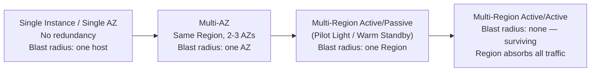
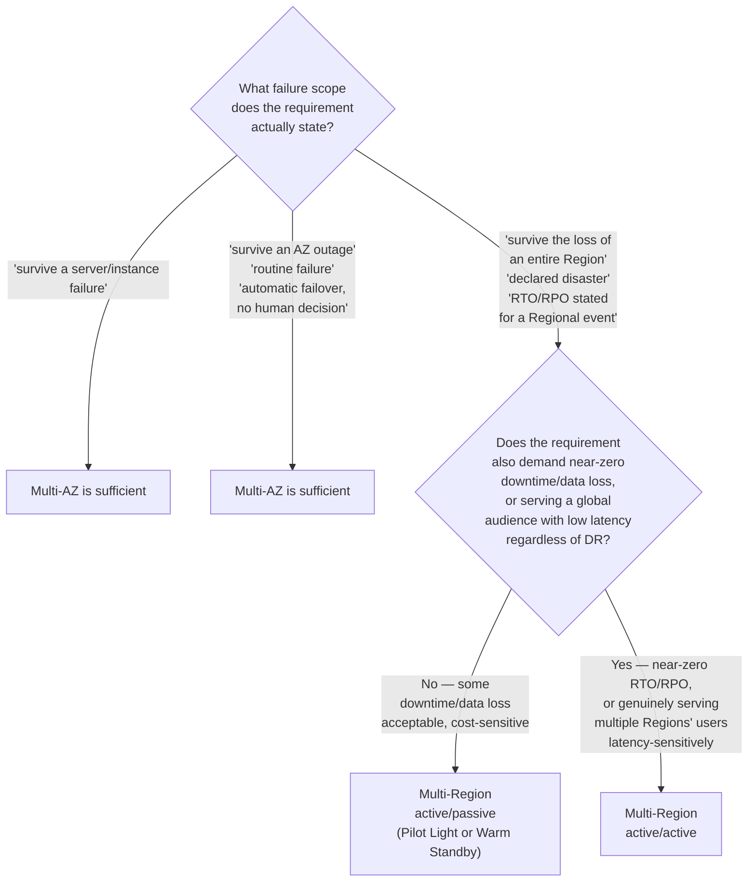
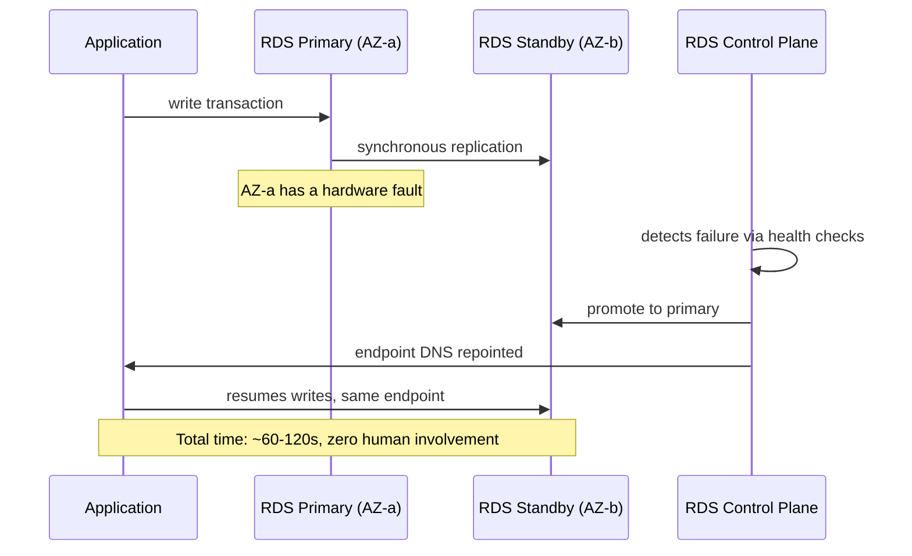
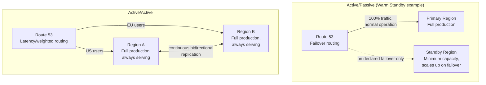

# Multi-AZ vs. Multi-Region Failover Decision Framework

*Source: [AWS Well-Architected Framework — Reliability Pillar, REL13-BP02](https://docs.aws.amazon.com/wellarchitected/latest/reliability-pillar/rel_planning_for_recovery_disaster_recovery.html)*

## Definition

This doc is the decision layer sitting between `disaster-recovery-strategies.md`'s four-rung
ladder and the individual service docs (`rds.md`, `aurora.md`, `route53.md`,
`elastic-load-balancing.md`) — it answers the single question those docs assume you've already
answered: **is this requirement actually asking for Multi-AZ, or is it asking for Multi-Region?**
Confusing the two is one of the most common real architecture mistakes and one of the most
reliably tested distinctions on the SAA-C03 exam.

## Purpose

"High availability" and "disaster recovery" sound like synonyms in casual conversation, but they
protect against two structurally different failure scopes, at two structurally different costs,
with two structurally different recovery speeds. A scenario that says "survive a server failure"
and a scenario that says "survive a Region-wide outage" demand different architectures — and the
exam exploits this difference constantly by describing an AZ-level requirement and offering a
tempting, over-engineered Multi-Region answer (or the reverse: a genuine Region-level requirement
with an insufficient Multi-AZ-only answer among the choices). This doc exists to make that
judgment call mechanical instead of intuitive.

## How It Works — The Blast-Radius Ladder

Step by step through the ladder, each rung protecting against a progressively larger failure
domain:

1. **Single instance / single AZ** — the starting point almost every architecture begins at
   before any resilience work is done. One hardware fault, one AZ-level event (power, network,
   flooding in that one data center cluster), and the workload is fully down. No redundancy.
2. **Multi-AZ (same Region)** — an ASG spanning multiple AZs, an RDS/Aurora Multi-AZ deployment,
   an ALB that itself spans AZs by design. This protects against the loss of **one AZ within a
   Region** automatically, in seconds to a couple of minutes, with **no human decision involved**.
   This is **Task 2.2's "highly available" half** — routine, automatic, AZ-scoped.
3. **Multi-Region active/passive** — a second Region holds standby infrastructure (at varying
   readiness levels — see the Pilot Light/Warm Standby rungs in `disaster-recovery-strategies.md`)
   that is **not normally serving production traffic**. A human (or an automated runbook) makes a
   **deliberate decision** to fail over, sized to a stated RTO/RPO. This protects against the loss
   of an **entire Region**.
4. **Multi-Region active/active** — both (or all) Regions serve production traffic
   simultaneously, all the time. Losing any one Region simply means the survivors absorb all
   traffic — the highest-cost, fastest-recovery rung, and the only one with **no failover event to
   even wait for**, since the "DR Region" was already fully serving traffic before and after.

The critical idea the exam leans on hardest: **rungs 2 and 3+ protect against entirely different
failure scopes.** A system with excellent Multi-AZ coverage and zero Multi-Region coverage will
still go fully down if its one Region has a genuine, full outage — Multi-AZ was never designed to
protect against that, and no amount of additional AZ redundancy within one Region changes that
fact.

## The Decision Tree

Walking through the actual decision logic a scenario question expects: first, identify the
**stated failure scope** in the prose — words like "instance," "server," "one node" point to
Multi-AZ being sufficient on their own; words like "Region," "declared disaster," or an explicit
RTO/RPO tied to "losing a Region" point past Multi-AZ entirely, into the Multi-Region branch. Once
in that branch, the second fork is cost-sensitivity versus recovery-speed/latency requirements —
exactly the same RTO/RPO-driven logic `disaster-recovery-strategies.md` applies, just focused here
specifically on the "how many Regions, how actively" axis rather than the full four-rung ladder.

## Multi-AZ, Concretely: What "Automatic, No Human Decision" Looks Like

No one on the operations team is paged to approve this; no runbook is executed by hand; the
application's connection string never changes (it's the same DNS endpoint, repointed
transparently). This is precisely why Multi-AZ is classified as **availability**, not **disaster
recovery** — DR, by contrast, is a planned response a human (or an automated but deliberately-
gated runbook) decides to execute, sized to a business-chosen RTO/RPO, specifically because
Regional failover carries real risk (split-brain, data consistency across a slower cross-Region
replication link) that AZ-local synchronous failover does not.

## Multi-Region, Concretely: Active/Passive vs. Active/Active in One Picture

The mechanical difference the exam tests directly: in **active/passive**, Route 53 (or an
equivalent) sends essentially all traffic to the primary under normal conditions, and the standby
Region only starts receiving traffic after a failover decision — meaning the standby's cost is
proportional to how "warm" it's kept (Pilot Light's near-zero idle compute vs. Warm Standby's
running-but-scaled-down fleet). In **active/active**, there is no "failover moment" to the
surviving Region from that Region's own perspective — it was already serving its share of
production traffic continuously; what changes on a Regional loss is purely that Route 53 stops
sending traffic to the failed Region and the survivor(s) absorb the rest.

## Worked Example: Reading a Scenario's Failure Scope Correctly

**Scenario A:** *"An e-commerce platform's database must automatically recover from the loss of
a single server with zero data loss, with no manual intervention and the shortest possible
downtime."*

Failure scope: **one server** (an instance-level, same-Region event). This is a Multi-AZ
requirement, full stop — RDS/Aurora Multi-AZ with synchronous replication to a standby in a
second AZ satisfies "automatic," "no manual intervention," and "zero data loss" (synchronous
replication) all at once. Reaching for a Multi-Region active-active answer here would be
*over-engineering* for a requirement that never once mentioned a Region-level event — a classic
exam trap in the other direction from the one usually discussed.

**Scenario B:** *"A financial services company must be able to continue operations within 30
minutes if an entire AWS Region becomes unavailable, with no more than 5 minutes of data loss,
and the business has explicitly stated cost should be minimized."*

Failure scope: **an entire Region** (now squarely in Multi-Region territory), with an explicit
30-minute RTO and 5-minute RPO, and an explicit cost-minimization constraint. Walking the ladder:
Pilot Light's typical tens-of-minutes RTO is right at the edge and risky against a 30-minute
ceiling; Warm Standby's minutes-level RTO comfortably satisfies both numbers while still being
cheaper than a full active/active deployment the stated numbers don't actually demand. **Warm
Standby (Multi-Region active/passive)** is the answer — picking Multi-AZ alone here would
under-engineer past a requirement that explicitly names "an entire Region," and picking
active/active would over-engineer past a cost-minimization constraint the stated RTO/RPO don't
require satisfying with near-zero numbers.

**Scenario C:** *"A global media company serves live, un-repeatable broadcast events to both US
and European audiences simultaneously and states that even a few minutes of downtime during a
live broadcast is commercially unacceptable, with cost explicitly not the primary constraint."*

Failure scope: **an entire Region**, *and* the "commercially unacceptable, cost not primary"
language rules out every active/passive rung — **Multi-Region active/active** is the only fit,
because the requirement isn't really "recover fast after losing a Region," it's "never have a
visible interruption for this specific audience-facing workload at all."

## Key Decision Points

- **The single most important signal is the stated failure scope** — "instance," "server," "node"
  → Multi-AZ; "Region," "declared disaster," a cross-Region RTO/RPO → Multi-Region. Read this word
  before anything else in the scenario.
- **Multi-AZ is "free" relative to Multi-Region in a specific sense** — it's table-stakes for any
  production workload and doesn't require standing up and paying for infrastructure in a second
  Region at all. A scenario satisfied by Multi-AZ alone that reaches for a Multi-Region answer is
  almost always the over-engineered, wrong choice.
- **Active/passive's cost scales with "how warm" the standby is kept** — Pilot Light (cheapest,
  slowest), Warm Standby (moderate cost, moderate speed) — see `disaster-recovery-strategies.md`
  for the full cost/speed ladder these two sit on.
- **Active/active is justified by one of two distinct reasons, not just "the highest tier is
  safest"**: either (1) the RTO/RPO numbers genuinely demand near-zero, or (2) the business
  already needs multiple Regions serving a global audience with low latency *regardless* of DR,
  and getting DR "for free" out of that existing active/active footprint is a bonus, not the
  primary driver.
- **Data replication technology must match the chosen rung** — RDS Multi-AZ's synchronous standby
  is a same-Region mechanism; Aurora Global Database, DynamoDB Global Tables, and S3 Cross-Region
  Replication are the cross-Region mechanisms feeding the Multi-Region rungs. A scenario describing
  "continuously synced across Regions" is never describing plain RDS Multi-AZ.
- **Route 53 (or Global Accelerator) is the mechanism that actually executes a Regional failover**
  in every rung above plain Multi-AZ — know that the compute/database redundancy alone doesn't
  reroute traffic; a routing layer with health checks is also required.

## Common Mistakes (What Wrong Answers Look Like)

- Treating "Multi-AZ" and "Multi-Region" as synonyms, or assuming more AZs in one Region
  eventually becomes equivalent to a second Region — it never does; they protect against
  categorically different failure scopes.
- Picking a Multi-Region active/active answer for a requirement that only ever described an
  AZ-level or instance-level failure — expensive, unnecessary, and the "no, simpler is correct"
  trap the exam tests as often as the reverse.
- Picking Multi-AZ alone for a requirement explicitly describing surviving "the loss of an entire
  Region" — Multi-AZ provides zero protection against that scope, regardless of how many AZs are
  spanned.
- Assuming Warm Standby and active/active are interchangeable once a workload "needs to be in two
  Regions" — the cost and architecture differ enormously depending on whether the second Region
  serves real traffic continuously or only activates on a declared disaster.
- Forgetting that a database's own replication technology (Multi-AZ standby vs. a cross-Region
  read replica vs. Aurora Global Database vs. active-active global tables) must itself match the
  chosen rung — a Multi-Region active/active application tier backed by a database that's only
  Multi-AZ (same-Region) is architecturally inconsistent and still fully down if the primary
  Region fails.

## Use Cases — Real Scenarios

- **A SaaS company's primary database must fail over automatically within the same Region with
  zero data loss, with no requirement stated about surviving a Regional outage.** RDS/Aurora
  Multi-AZ satisfies this exactly — introducing a second Region here would be solving a problem
  the business never asked to have solved.
- **An insurance company's claims-processing system must meet a board-mandated 4-hour RTO and
  15-minute RPO after losing an entire Region, with cost explicitly a secondary concern to meeting
  the SLA reliably.** Warm Standby (Multi-Region active/passive) sits comfortably inside both
  numbers without paying for full active/active capacity the stated RTO doesn't actually require.
- **A streaming platform's live, un-repeatable broadcast events must never visibly interrupt for
  viewers in any Region, and cost is explicitly not the primary constraint for this specific
  workload.** Multi-Region active/active, while the same company's back-office reporting systems
  run on cheaper Pilot Light — the DR tier is chosen per-workload, not uniformly across the whole
  company.
- **A regional grocery chain's e-commerce platform can tolerate a documented 6-hour outage
  without major revenue impact (customers shop in-store instead) if its single Region goes down.**
  Pilot Light, deliberately choosing a slower-recovery, cheaper rung because the stated business
  tolerance for downtime genuinely supports it — picking Warm Standby or Active/Active here would
  be paying for resilience the business explicitly doesn't need.
- **A hospital system's patient-portal database must survive a routine, planned AWS maintenance
  event inside one Region with zero visible impact to patients scheduling appointments at 2am.**
  This is a pure Multi-AZ scenario — RDS Multi-AZ's automatic standby promotion during a planned
  maintenance window handles it entirely, with no Multi-Region infrastructure involved at all.
- **A global fintech platform must serve both US and EU customers with sub-100ms latency for
  regulatory and UX reasons, independent of any disaster-recovery requirement, and happens to gain
  DR as a side benefit.** Multi-Region active/active chosen primarily for the latency/compliance
  requirement — the DR benefit is real but secondary to why the architecture exists in this shape.

## Common Exam Scenarios

- *"A question describes surviving a hardware failure within a single Region, with automatic,
  no-human-decision recovery."* → Multi-AZ (RDS/Aurora Multi-AZ, an ASG/ALB spanning AZs) — do not
  reach for cross-Region infrastructure.
- *"A question states an explicit RTO/RPO tied to losing 'an entire Region' or a 'declared
  disaster.'"* → You are now in Multi-Region territory; apply the RTO/RPO numbers against the
  Pilot Light/Warm Standby/Active-Active ladder exactly as `disaster-recovery-strategies.md`
  describes.
- *"A question emphasizes near-zero downtime/data loss specifically, or serving multiple
  Regions' users with low latency as a first-class requirement, not just as a DR nicety."* →
  Multi-Region active/active is justified; verify the question isn't also emphasizing cost
  minimization, which would point toward a cheaper active/passive rung instead.
- *"A question's main stated constraint is minimizing standing cost, with a looser RTO/RPO."* →
  Default toward the cheaper rungs (Multi-AZ alone if the failure scope is AZ-level; Pilot Light
  if it's genuinely Region-level) unless the numbers explicitly rule those out.

## Why It's Important

**Real-world:** Teams that conflate Multi-AZ with "we have disaster recovery" discover the gap
only during an actual Regional event — by definition, the worst possible time to discover an
architecture never protected against the failure that's currently happening. Getting this
distinction right upfront is a direct, measurable risk-management decision, not an academic one.

**Exam mapping:** SAA-C03 Domain 2, both Task 2.1 (loosely coupled architecture choices that
happen to span Regions) and Task 2.2 ("design highly available and/or fault-tolerant
architectures... backup/DR strategies") test this distinction directly and repeatedly — it is one
of the highest-frequency single ideas on the entire exam.

## Exam Tips

- Memorize the **blast-radius ladder** (instance → AZ → Region passive → Region active) and
  practice identifying which rung a scenario's stated failure scope actually describes before
  reading the answer choices.
- **"Automatic, no human decision" = Multi-AZ. "Declared disaster, sized to an RTO/RPO" =
  Multi-Region.** This single sentence resolves the majority of ambiguous-sounding questions.
- A scenario that *only* ever mentions AZ-level or instance-level failure, with no Regional
  language anywhere, should never have a Multi-Region answer selected, no matter how resilient
  that answer sounds in isolation.
- Active/active is justified by near-zero RTO/RPO numbers *or* a genuine, independent multi-Region
  latency/compliance requirement — not simply "more resilience is always better."

## Related Terms

- [`disaster-recovery-strategies.md`](disaster-recovery-strategies.md) — the full four-rung
  cost/speed ladder this doc's Multi-Region branch maps directly onto.
- [`../../../services/database/rds.md`](../../../services/database/rds.md),
  [`../../../services/database/aurora.md`](../../../services/database/aurora.md) — the Multi-AZ
  and cross-Region replication mechanisms this doc's two branches rely on.
- [`../../../services/networking-content-delivery/route53.md`](../../../services/networking-content-delivery/route53.md) —
  the routing layer that actually executes every Multi-Region failover described here.
- [`../../../services/compute/ec2-auto-scaling.md`](../../../services/compute/ec2-auto-scaling.md) —
  the compute-tier mechanism behind "an ASG spanning AZs" in the Multi-AZ branch.
- [`rto-rpo-worked-scenarios.md`](rto-rpo-worked-scenarios.md) — more worked numeric examples
  applying the RTO/RPO reasoning this doc's decision tree depends on.
- [`README.md`](README.md) — this domain's task-statement overview and the StreamVista case study
  that applies this exact Multi-AZ-vs-Multi-Region judgment call end to end.
