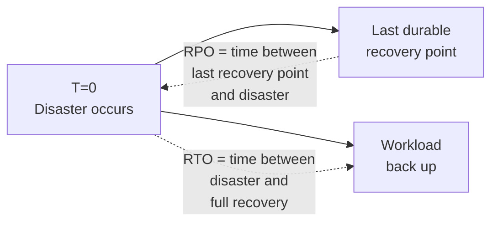
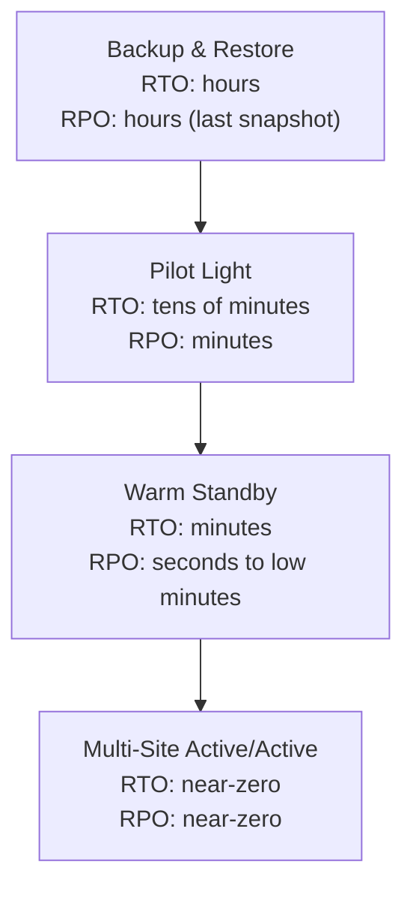
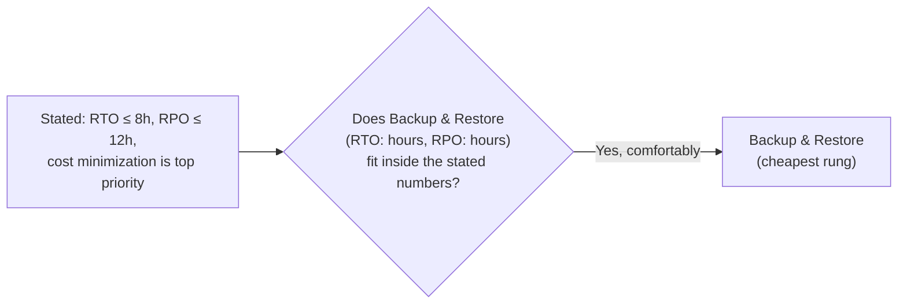
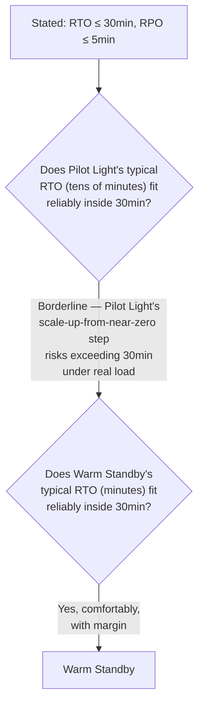
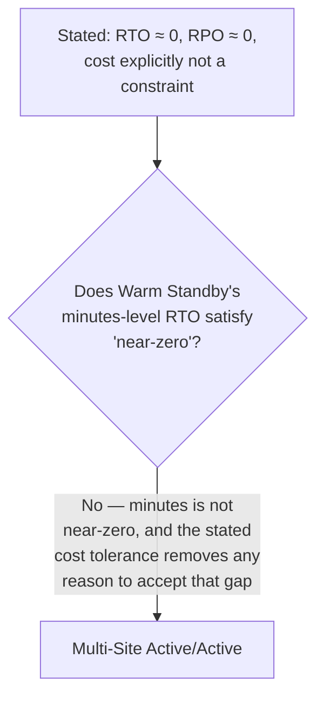
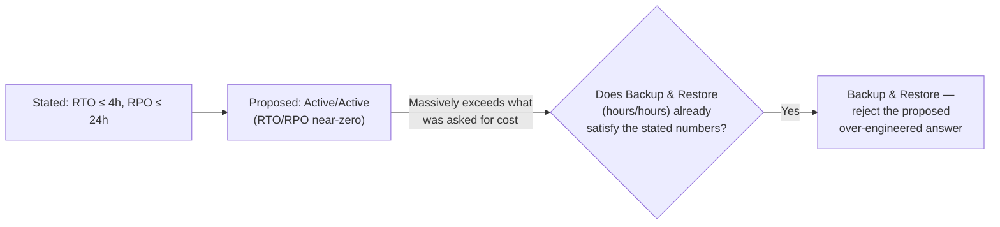
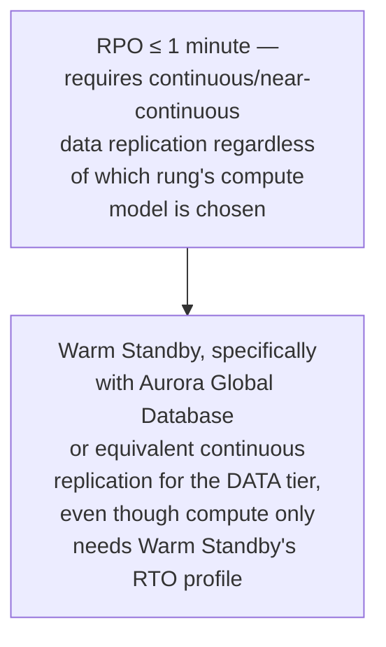

# RTO/RPO Worked Scenarios

*Source: [AWS Well-Architected Framework — Reliability Pillar, REL13-BP02](https://docs.aws.amazon.com/wellarchitected/latest/reliability-pillar/rel_planning_for_recovery_disaster_recovery.html)*

## Definition

**RTO (Recovery Time Objective)** is the maximum acceptable time between a disaster starting and
the workload being back up and serving traffic. **RPO (Recovery Point Objective)** is the maximum
acceptable amount of data (measured as elapsed time since the last durable copy) the business can
tolerate losing. This doc exists to turn those two definitions — easy to state, easy to forget how
to actually *apply* — into a repeatable numeric exercise: given a stated RTO/RPO pair, which of the
four DR rungs (`disaster-recovery-strategies.md`) actually satisfies both numbers, and why not the
cheaper or more expensive neighboring option?

## Purpose

The exam rarely tests "define RTO" in isolation — it gives you a number (or a business
requirement implying one) and expects you to select the cheapest architecture that still meets it.
Getting this wrong in either direction is a real failure mode: under-engineering (an RTO promise
the chosen architecture can't actually deliver) leaves a company exposed during the one event
where it matters most; over-engineering (paying for Warm Standby or Active/Active when Pilot Light
would satisfy a looser RTO/RPO) wastes budget indefinitely for no corresponding benefit. This doc
works through that judgment call with real numbers, repeatedly, until the pattern is automatic.

## How It Works — Placing RTO/RPO on the Same Timeline

RPO looks *backward* from the disaster (how much data since the last safe copy do we lose?); RTO
looks *forward* from the disaster (how long until we're serving traffic again?). They are
independent numbers measuring independent things — a strategy can have an excellent RTO and a
terrible RPO (fast to restore, but restoring old data) or the reverse (continuously synced data,
but a slow manual cutover process) — which is exactly why both numbers must be checked separately
against any candidate architecture, never assumed to move together.

## The Four-Rung Ladder, With Realistic RTO/RPO Ranges

(Full mechanics of each rung — what infrastructure actually runs in the DR Region at each level —
live in `disaster-recovery-strategies.md`; this doc assumes that background and focuses purely on
the RTO/RPO arithmetic of choosing between them.)

## Worked Scenario 1 — The Comfortable Fit

**Requirement:** *"A mid-sized retailer's order-history reporting system can tolerate up to 8
hours of downtime and up to 12 hours of data loss if its Region fails. Minimizing recurring cost
is the business's stated top priority."*

**Reasoning:**

Backup & Restore's typical profile — hours-level RTO (restoring from snapshot, standing up
infrastructure from scratch or from an AMI/CloudFormation template, then restoring data) and
hours-level RPO (depending on backup frequency) — fits comfortably inside both stated ceilings,
and the business explicitly prioritized cost minimization over faster recovery. Picking anything
higher on the ladder (Pilot Light or above) here would mean paying standing infrastructure cost in
a second Region for a speed improvement the business explicitly said it doesn't need.

**Answer: Backup & Restore**, using AWS Backup with cross-Region copy rules feeding the restore,
exactly the mechanism described in `../../../services/storage/aws-backup.md`.

## Worked Scenario 2 — The Rung Boundary

**Requirement:** *"A healthcare scheduling system must be restored within 30 minutes of a declared
Regional disaster, with no more than 5 minutes of patient-record data loss. The business has
flagged cost as a secondary concern to meeting this SLA reliably."*

**Reasoning:**

This is the scenario this doc exists to drill: Pilot Light's RTO is *typically* described as "tens
of minutes," which sits uncomfortably close to a hard 30-minute ceiling once you account for the
time needed to scale minimal/idle DR-Region infrastructure up to production capacity under real
load — a step that itself can eat into the margin unpredictably. Warm Standby, which already runs
a scaled-down but *live* copy of the full stack in the DR Region, needs only to scale that existing
fleet up and redirect traffic — a smaller, faster, more *reliable* step that comfortably clears a
30-minute ceiling with margin to spare, which matters specifically because the business said
meeting the SLA *reliably* is the priority, not just meeting it on a good day.

**Answer: Warm Standby.** The 5-minute RPO is satisfied by continuous or near-continuous data
replication to the DR Region (e.g., Aurora Global Database, DynamoDB Global Tables, or frequent
log shipping) kept current in the already-running Warm Standby database tier.

## Worked Scenario 3 — The Expensive, Clearly-Justified Fit

**Requirement:** *"A payments processor's core transaction system must have near-zero downtime
and near-zero data loss if a Region fails — any interruption during business hours results in
seven figures of lost transaction revenue per minute, and the business has explicitly authorized
whatever cost is necessary to meet this bar."*

**Reasoning:**

Warm Standby's "minutes" RTO, while excellent relative to Pilot Light, is still not "near-zero" —
and critically, the requirement explicitly removed cost as a constraint, which eliminates the
*only* reason one would normally accept Warm Standby's small remaining gap instead of paying for
Active/Active's genuinely near-zero numbers. When a requirement states both an extreme RTO/RPO
*and* explicitly authorizes the cost to meet it, that's the signal the exam uses to point
unambiguously at the top rung — don't second-guess it downward by assuming "near-zero" is loose
language once the requirement already told you cost isn't the limiting factor.

**Answer: Multi-Site Active/Active**, with continuous bidirectional data replication and Route 53
or Global Accelerator already routing live production traffic to both Regions before any failure
occurs.

## Worked Scenario 4 — The Trap: Stated Numbers That Don't Match the Real Driver

**Requirement:** *"A company's internal HR analytics dashboard, used only during business hours by
a small internal team, needs to recover within 4 hours of a Regional outage with up to 24 hours of
data loss acceptable. The engineering team proposes Multi-Site Active/Active 'to be safe.'"*

**Reasoning:**

This is the mirror-image trap: a team (or an exam answer choice) proposes the most resilient
option available regardless of what was actually asked for. The stated RTO (4 hours) and RPO (24
hours) are generously satisfied by the *cheapest* rung, Backup & Restore — there is no stated
business driver (no revenue-per-minute figure, no regulatory requirement, no "cost is not a
constraint" language) that justifies paying for standing infrastructure in a second Region at all,
let alone fully duplicated active capacity. "To be safe" is not, by itself, a requirement — the
correct answer matches the *stated* numbers, not the most impressive-sounding option on the list.

**Answer: Backup & Restore**, and explicitly reject the Active/Active proposal as over-engineered
relative to the stated requirement — a recurring exam pattern worth recognizing on sight.

## Worked Scenario 5 — When RTO and RPO Point to Different Rungs

**Requirement:** *"An e-commerce platform's order database must lose no more than 1 minute of
data if a Region fails (near-zero RPO, driven by financial-reconciliation requirements), but the
business can tolerate up to 2 hours of downtime (moderate RTO) while a runbook is executed, since
the storefront itself degrades gracefully to a 'temporarily unavailable, orders are safe' state
during that window."*

**Reasoning:** This is the scenario that tests whether you actually evaluate RTO and RPO
*separately* rather than assuming one rung's typical profile for both numbers automatically fits.
A near-zero RPO requirement, taken alone, might suggest needing Active/Active's continuous
replication — but the *RTO* here is a comfortable 2 hours, which Warm Standby (minutes-level RTO)
clears easily, and even Pilot Light's tens-of-minutes RTO would likely clear it too. The binding
constraint is specifically **data replication currency** (the RPO), not recovery speed (the RTO).

**Answer: Warm Standby**, but built with a continuously-replicating database tier (Aurora Global
Database or DynamoDB Global Tables) specifically to satisfy the tight RPO — while the *compute*
tier only needs to be "warm," not fully active, because the RTO alone wouldn't have demanded more.
This is the clearest illustration that **RPO is primarily a data-replication decision and RTO is
primarily a compute/traffic-cutover decision** — they can be satisfied by different sub-choices
within the same overall rung.

## Key Decision Points

- **Evaluate RTO and RPO as two separate questions against two separate mechanisms** — RPO is
  answered by "how current is my replicated/backed-up data," RTO is answered by "how fast can
  compute and traffic actually cut over." A single rung's "typical" numbers are a starting
  assumption, not a guarantee — verify both independently against the specific requirement.
  shown in Worked Scenario 5.
- **Treat stated numbers as ceilings to clear with reasonable margin, not targets to hit exactly**
  — a Pilot Light RTO "typically tens of minutes" against a hard 30-minute ceiling (Scenario 2) is
  a margin problem even if the typical number is technically under 30; prefer the rung with
  comfortable headroom when the ceiling is tight.
- **Look for an explicit cost signal in the requirement** — "cost is a secondary concern,"
  "whatever cost is necessary," or conversely "minimize recurring cost" — and let it break ties
  between two rungs that both technically satisfy the stated RTO/RPO.
- **"To be safe" or "the most resilient option" is not itself a requirement** — the correct
  answer is the cheapest rung that satisfies the *actual stated* RTO/RPO numbers, every time,
  unless an explicit business driver justifies going further.
- **A tight RPO doesn't automatically demand a fast RTO, and vice versa** — don't let one number's
  urgency bleed into assuming the other number needs the same urgency; check them independently.

## Common Mistakes (What Wrong Answers Look Like)

- Picking Active/Active or Warm Standby "to be safe" when the stated RTO/RPO numbers are
  comfortably satisfied by Backup & Restore or Pilot Light — the single most common
  over-engineering trap.
- Picking Pilot Light for a tight (e.g., 15-30 minute) RTO without accounting for the scale-up
  step's own variability — Pilot Light's idle-to-production ramp is itself a source of recovery
  time that a bare "typically tens of minutes" estimate can understate under real load.
- Assuming RTO and RPO must come from the same rung's typical profile, missing scenarios (like
  Worked Scenario 5) where the real requirement only stresses one of the two numbers tightly.
- Forgetting that compute readiness (RTO) and data currency (RPO) are satisfied by different
  underlying mechanisms — a Warm Standby compute tier paired with only periodic (not continuous)
  database replication would satisfy a loose RPO but silently fail a tight one, even while the
  compute side looks fully ready.
- Ignoring an explicit cost signal in the requirement and defaulting to whichever rung "sounds
  most resilient" rather than the cheapest one that actually clears the stated bar.

## Use Cases — Real Scenarios

(See Worked Scenarios 1-5 above for the full numeric walkthroughs; summarized here for quick
recall.)
- **Internal reporting dashboard, RTO 8h / RPO 12h, cost-sensitive** → Backup & Restore.
- **Healthcare scheduling, RTO 30min / RPO 5min, reliability over cost** → Warm Standby (Pilot
  Light's margin is too tight against a hard 30-minute ceiling).
- **Payments processor, RTO/RPO near-zero, cost explicitly authorized** → Multi-Site Active/Active.
- **HR dashboard, RTO 4h / RPO 24h, team over-proposes Active/Active** → Backup & Restore is
  correct; reject the over-engineered proposal.
- **E-commerce order DB, RTO 2h / RPO 1min (financial reconciliation driven)** → Warm Standby
  compute paired specifically with continuously-replicating data tier, since the RPO (not the RTO)
  is the binding constraint.

## Common Exam Scenarios

- *"A question gives you two numbers and asks which DR strategy to choose."* → Independently check
  both numbers against each rung's typical RTO/RPO profile; pick the cheapest rung clearing both
  with reasonable margin.
- *"A question's numbers sit right at a rung boundary (e.g., 30 minutes, right where Pilot Light
  and Warm Standby meet)."* → Prefer the rung with margin, especially if the question emphasizes
  reliability/consistency of meeting the SLA, not just the number itself.
- *"A proposed answer choice is the most resilient option available, but the stated numbers are
  loose and cost is emphasized."* → That answer is very likely the intended wrong choice —
  over-engineering is tested as often as under-engineering.
- *"A question stresses only one of RTO or RPO tightly, with the other comparatively loose."* →
  Resist assuming both numbers demand the same rung; solve the tight one's underlying mechanism
  (replication currency for RPO, compute/traffic cutover speed for RTO) specifically.

## Why It's Important

**Real-world:** RTO/RPO are the two numbers that actually get written into a business continuity
plan and reviewed by auditors, insurers, and boards after an incident — getting the *architecture*
to actually match the *promised* numbers (not just sound resilient) is the entire point of a DR
strategy existing at all. A plan with impressive-sounding infrastructure that doesn't actually
clear its own promised RTO under real load is arguably worse than an honest, cheaper plan with
numbers everyone trusts.

**Exam mapping:** SAA-C03 Domain 2, Task 2.2 explicitly names backup and disaster-recovery
strategies, and RTO/RPO arithmetic exactly like the five worked scenarios above is one of the most
consistently recurring scenario shapes on the real exam.

## Exam Tips

- Build the habit of writing down (mentally or literally) the stated RTO and RPO as two separate
  numbers before looking at the answer choices, and checking each DR rung's typical profile against
  both independently.
- When a question's numbers sit near a rung boundary, favor the rung with margin over the "exactly
  typical" rung, especially if reliability/consistency language appears in the requirement.
- Watch for the explicit-cost-signal tiebreaker ("minimize cost" vs. "cost is not a constraint") —
  it resolves most otherwise-ambiguous two-rungs-both-technically-fit situations.
- Recognize and reject "most resilient option available" as a default answer when the stated
  numbers don't demand it — this over-engineering trap appears about as often as the
  under-engineering one.

## Related Terms

- [`disaster-recovery-strategies.md`](disaster-recovery-strategies.md) — the full mechanics of
  each of the four rungs this doc's worked scenarios select between.
- [`multi-az-vs-multi-region-failover-decision-framework.md`](multi-az-vs-multi-region-failover-decision-framework.md) —
  the prerequisite judgment call (is this even a Multi-Region question) that precedes applying
  this doc's RTO/RPO arithmetic.
- [`../../../services/storage/aws-backup.md`](../../../services/storage/aws-backup.md) — the
  mechanism behind the Backup & Restore rung used in Scenarios 1 and 4.
- [`../../../services/database/aurora.md`](../../../services/database/aurora.md) — Aurora Global
  Database, the continuous-replication mechanism referenced in Scenarios 3 and 5.
- [`../../../services/networking-content-delivery/route53.md`](../../../services/networking-content-delivery/route53.md) —
  the failover/traffic-routing mechanism that executes the RTO side of every rung above Backup &
  Restore.
- [`README.md`](README.md) — this domain's full task-statement overview and worked case study.
