# Domain 3 Master Chunk — Design High-Performing Architectures (24%)

> **Purpose of this file:** every service and decision topic in SAA-C03 Domain 3, in one place,
> at full depth, so you never have to tab-jump between 34+ individual docs while studying or
> drilling exam scenarios. Each entry is self-contained: Definition, a plain-English analogy,
> Purpose, When to Use, When NOT to Use, 4-6 real Use Cases, Why It's Important, at least one
> explained Mermaid diagram, at least one real (curl-verified) AWS documentation image with
> discussion, and Exam Tips. If you want *more* depth than fits here (pricing tables, full
> troubleshooting runbooks, Floci labs, quota tables), the individual `services/<category>/*.md`
> file linked at the end of each section has it — this file is the "read once, cover everything"
> version, not a replacement for those.
>
> **How this domain's services group together (5 task statements):**
> 1. **Task 3.1 — Storage.** EBS, EFS, FSx, S3, S3 Storage Classes.
> 2. **Task 3.2 — Compute.** EC2, EC2 Auto Scaling, Lambda, Fargate, AWS Batch, Containers vs.
>    VMs vs. Serverless, ECS, EKS.
> 3. **Task 3.3 — Database.** Aurora, RDS, DynamoDB, ElastiCache, DocumentDB, Neptune, Redshift,
>    Database Selection Guide, Niche Database Services.
> 4. **Task 3.4 — Network.** VPC, Elastic Load Balancing, CloudFront, Global Accelerator,
>    Direct Connect, Transit Gateway & VPC Peering, VPC Endpoints & PrivateLink.
> 5. **Task 3.5 — Data ingestion/transformation.** Kinesis Family, Glue, EMR, Data Lake Concepts,
>    Athena, Elastic Transcoder & Kinesis Video Streams, DataSync, Data Pipeline & Data Exchange.

## Table of Contents

**Task 3.1 — Storage:** [EBS](#1-amazon-ebs-elastic-block-store) ·
[EFS](#2-amazon-efs-elastic-file-system) · [FSx](#3-amazon-fsx-family) ·
[S3](#4-amazon-s3-simple-storage-service) · [S3 Storage Classes](#5-s3-storage-classes)

**Task 3.2 — Compute:** [EC2](#6-amazon-ec2) · [EC2 Auto Scaling](#7-ec2-auto-scaling) ·
[Lambda](#8-aws-lambda) · [Fargate](#9-aws-fargate) · [AWS Batch](#10-aws-batch) ·
[Containers vs. VMs vs. Serverless](#11-containers-vs-vms-vs-serverless) ·
[ECS](#12-amazon-ecs) · [EKS](#13-amazon-eks)

**Task 3.3 — Database:** [Aurora](#14-amazon-aurora) · [RDS](#15-amazon-rds) ·
[DynamoDB](#16-amazon-dynamodb) · [ElastiCache](#17-amazon-elasticache) ·
[DocumentDB](#18-amazon-documentdb) · [Neptune](#19-amazon-neptune) ·
[Redshift](#20-amazon-redshift) · [Database Selection Guide](#21-database-selection-guide) ·
[Niche Database Services](#22-niche-database-services)

**Task 3.4 — Network:** [VPC](#23-amazon-vpc) · [Elastic Load Balancing](#24-elastic-load-balancing) ·
[CloudFront](#25-amazon-cloudfront) · [Global Accelerator](#26-aws-global-accelerator) ·
[Direct Connect](#27-aws-direct-connect) ·
[Transit Gateway & VPC Peering](#28-transit-gateway--vpc-peering) ·
[VPC Endpoints & PrivateLink](#29-vpc-endpoints--privatelink)

**Task 3.5 — Data ingestion:** [Kinesis Family](#30-kinesis-family) · [AWS Glue](#31-aws-glue) ·
[Amazon EMR](#32-amazon-emr) · [Amazon Athena](#33-amazon-athena) ·
[Data Lake Concepts](#34-data-lake-concepts) ·
[Elastic Transcoder & Kinesis Video Streams](#35-elastic-transcoder--kinesis-video-streams) ·
[AWS DataSync](#36-aws-datasync) ·
[Data Pipeline & Data Exchange](#37-aws-data-pipeline--aws-data-exchange)

---

# Task 3.1 — High-Performing Storage Solutions

## 1. Amazon EBS (Elastic Block Store)

**Definition:** EBS is network-attached block storage — a virtual hard drive you attach to a
single EC2 instance. It behaves exactly like a raw disk: format it with a filesystem and the OS
reads/writes blocks directly.

**Plain-English Analogy:** EBS is like renting a storage unit that's physically wired directly to
*your* apartment (one instance) — only you can drive up and use it, but you can disconnect it and
have it reattached to a different apartment in the same neighborhood (Availability Zone) later. An
instance's local "instance store" disk, by contrast, is like storage built into a rental car: great
while you have the car, gone the moment you return it.

**Purpose:** An EC2 instance's own local disk is ephemeral — stop or terminate the instance and
that data vanishes. Databases, boot volumes, and anything that must persist across reboots need
storage that survives independently of the instance's lifecycle. EBS gives EC2 durable,
low-latency, resizable disks that behave like local storage but live on the network and can be
snapshotted, detached, and reattached elsewhere. Every EBS volume is physically tied to a single
Availability Zone — the storage racks backing it live in that AZ's facility, so the attached
instance must be colocated there to keep latency low.

**When to Use:** boot volumes for EC2 fleets; self-managed relational databases on EC2 needing
consistent low-latency block I/O; scratch disks for compute jobs; any single-instance workload
needing a persistent, resizable disk with snapshot/restore and encryption built in.

**When NOT to Use:** multiple instances needing concurrent read/write to the same files (use EFS
or FSx); serving files over HTTP/an API rather than mounting a disk (use S3); needing storage that
survives the loss of an entire AZ without manual snapshot/restore (pair with Multi-AZ RDS or
scheduled cross-Region snapshot copies instead); extreme-throughput sequential big-data workloads
at the lowest possible cost (S3 + Athena/EMR often fits better).

**Use Cases:**
1. **Boot volumes for a web server fleet** — gp3 is the default, resizable without downtime.
2. **Self-managed PostgreSQL on EC2 for a SaaS company** needing full control over extensions —
   io2 gives the consistent low-latency block I/O a transactional database needs.
3. **Pre-migration snapshot-and-rollback for a trading platform** before a risky schema change —
   instant point-in-time disk restore if the migration fails.
4. **Golden AMI with Fast Snapshot Restore** so an Auto Scaling group launches fully warmed-up
   instances the instant a flash-sale traffic spike hits.
5. **Tiered big-data cluster storage** — gp3 for hot working data, st1 for large sequential
   shuffle files, sc1 for cold historical partitions, on the same node.
6. **Cross-Region DR for an ERP system** via scheduled Data Lifecycle Manager snapshot copies to
   a secondary Region, since EBS volumes themselves can't span Regions.

**Why Important:** EBS underpins the majority of EC2-hosted workloads — every lift-and-shift
migration, every self-managed database on EC2, every custom AMI depends on it. Snapshot strategy
is also core disaster-recovery and ransomware-resilience practice (immutable, point-in-time
recovery points). On the exam, volume-type selection (gp3 vs. io2 vs. st1/sc1) is one of the most
reliably recurring Task 3.1 scenario patterns.

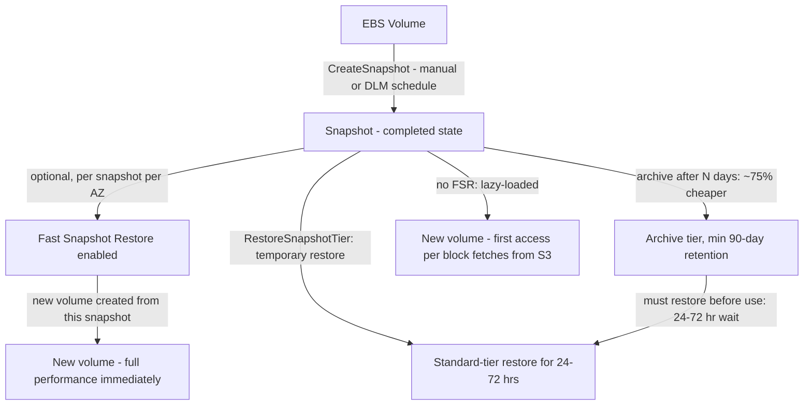

*Walkthrough:* by default, a volume created from a snapshot lazy-loads blocks — the first read of
each block fetches it from S3-backed storage on demand, which can cause a brief performance dip
right after a restore. **Fast Snapshot Restore (FSR)** pre-warms a specific snapshot in a specific
AZ so every volume created from it has full IOPS/throughput immediately — at an hourly cost per
snapshot-per-AZ, so it's reserved for frequently-restored "golden" snapshots, not every ad-hoc
backup. The **Archive tier** is the "Glacier of EBS snapshots" — cheaper, but with a 90-day minimum
and a 24-72 hour restore wait.


*Snap A is a full copy of the volume's 10 GiB. Snap B only physically stores the 4 GiB that
changed since Snap A, but logically represents a complete, restorable 10 GiB point-in-time state
by referencing Snap A's unchanged blocks. Snap C repeats the pattern. Total stored data for all
three snapshots: 16 GiB, not 30 GiB — this is why "incremental" doesn't mean "each snapshot alone
is useless": every snapshot is independently, fully restorable. Source: [Amazon EBS User Guide —
How Amazon EBS snapshots work](https://docs.aws.amazon.com/ebs/latest/userguide/how_snapshots_work.html).*

**Exam Tips:**
- "Multiple EC2 instances need concurrent read/write to the same files" rules EBS out (it attaches
  to one instance at a time, barring the Multi-Attach niche case) — that's EFS or FSx.
- "Highest possible IOPS, demanding transactional database" → io2 Block Express; "balanced,
  general-purpose, independently tunable IOPS/throughput" → gp3; "large sequential throughput, big
  data/log processing" → st1; "coldest, cheapest, rarely accessed sequential" → sc1.
- "Temporary, scratch, doesn't need to survive a restart" → Instance Store, not EBS — and any
  stated durability requirement immediately rules Instance Store back out.

**Full doc:** [`services/storage/ebs.md`](../../../services/storage/ebs.md)

---

## 2. Amazon EFS (Elastic File System)

**Definition:** EFS is a managed, elastic NFS file system that many compute resources — EC2
instances, containers, Lambda functions — can mount and use at the same time, like a shared
network drive that automatically grows and shrinks as you add or remove files.

**Plain-English Analogy:** If EBS is a storage unit wired to one apartment, EFS is a shared
warehouse floor with multiple loading docks (mount targets, one per AZ) — any number of trucks
(compute instances) across the building can drive up to their nearest dock and see the exact same
inventory in real time, add to it, or take from it.

**Purpose:** Plenty of real workloads need the opposite of EBS's "one server, one disk": a fleet of
web servers all serving the same uploaded content, batch workers sharing a dataset, containers
needing persistent shared storage without each one owning its own volume. Before EFS, teams ran
their own NFS server — a single point of failure to manage and scale by hand. EFS gives that
shared-filesystem experience fully managed. It also has no provisioned size at all — billed purely
on bytes stored, the same mental model as S3, which is why EFS billing looks so different from
EBS's "pay for what you provisioned" model.

**When to Use:** shared content directories across a horizontally-scaled EC2/container fleet;
persistent storage for ECS/EKS tasks that get rescheduled across nodes and AZs; shared scratch
space for Lambda functions or batch/HPC workers; lift-and-shift of an existing on-prem NFS server.

**When NOT to Use:** Windows workloads (EFS speaks NFS, not SMB — use FSx for Windows File
Server); single-instance block storage like a database's data directory (use EBS, cheaper for that
pattern); extreme HPC/ML throughput at massive parallel scale (consider FSx for Lustre); durable
object storage served over HTTP without a compute instance in the loop (use S3).

**Use Cases:**
1. **Shared render-farm storage for a VFX studio** — hundreds of render nodes across AZs need
   concurrent access to the same scene files with POSIX locking.
2. **WordPress/CMS fleet behind a load balancer** — any instance must show media uploaded via a
   different instance; EFS mounted at the uploads directory solves this without a rewrite.
3. **Container persistent storage on EKS for a multi-tenant SaaS platform** — pods reschedule
   across nodes/AZs constantly, but tenant data must persist regardless of which node a pod lands.
4. **Lambda-based ML inference sharing a model artifact** across every concurrent invocation and
   AZ without re-downloading from S3 on every cold start.
5. **Genomics research shared scratch space** — dozens of EC2 nodes process the same reference
   dataset concurrently, each able to read/write intermediate results others see.
6. **Cross-Region DR for a trading platform's reference data** via EFS Replication, keeping a
   read-only standby file system promotable to writable if the primary Region fails.

**Why Important:** EFS is the standard answer whenever an architecture needs shared state across
a horizontally-scaled fleet without re-architecting into object storage or a database — extremely
common in traditional web apps and legacy migrations. SAA-C03 Domain 3 Task 3.1 explicitly names
the object/file/block tradeoff among S3, EFS, and EBS as one of its most reliably tested patterns.

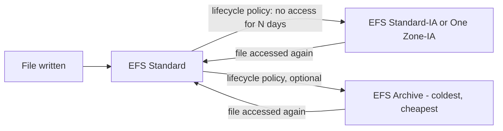

*Walkthrough:* EFS Lifecycle Management works like S3 Intelligent-Tiering — set a policy ("move
files not accessed in 30 days to IA"), and EFS automatically demotes/promotes individual files
based on real access, with no application changes and no different mount path; the file instantly
reappears at the Standard rate the moment it's read again.


*A Regional EFS file system has one mount target per AZ — every EC2 instance in a given AZ shares
that AZ's single mount target, and all mount targets read/write the same underlying file system.
This is the picture to recall whenever a question describes "multiple AZs, same shared files."
Source: [Amazon EFS User Guide — Managing mount targets](https://docs.aws.amazon.com/efs/latest/ug/accessing-fs.html).*

**Exam Tips:**
- Keywords "mount," "shared," "POSIX," "multiple instances" point at EFS, not S3 or EBS.
- "Windows," "SMB" rules EFS out immediately — that's FSx for Windows File Server.
- One Zone storage classes trade multi-AZ resilience for lower price — only for recreatable or
  already-redundant data, the same risk profile as S3 One Zone-IA.

**Full doc:** [`services/storage/efs.md`](../../../services/storage/efs.md)

---

## 3. Amazon FSx (family)

**Definition:** FSx is a family of fully managed, third-party-compatible file systems — four
purpose-built flavors (Windows File Server, Lustre, NetApp ONTAP, OpenZFS), each a managed version
of specific, well-known file system technology, so you get its native feature set without
installing, patching, or operating it yourself.

**Plain-English Analogy:** If EFS is a generic shared warehouse, FSx is four specialty warehouses
each built to a specific industry standard — one wired for Windows forklifts (SMB/AD), one
engineered for extreme parallel throughput (Lustre), one running real NetApp equipment
(ONTAP), and one built on ZFS racking (OpenZFS) — you pick the one whose native protocol and
feature set your existing operation already depends on.

**Purpose:** EFS covers Linux/NFS shared storage well, but doesn't speak SMB, isn't tuned for
extreme-throughput HPC/ML, and doesn't replicate NetApp-specific enterprise features
(deduplication, cloning, SnapMirror). FSx exists for organizations — often migrating from an
existing on-prem system — that need a managed, native-compatible equivalent, running the *actual
upstream software* as a managed service so existing tooling and operational knowledge transfer
directly.

**When to Use:** Windows enterprise file shares needing SMB + Active Directory integration (FSx
for Windows File Server); ML training/HPC workloads needing extreme parallel throughput, often
linked directly to an S3 bucket (FSx for Lustre); lift-and-shift of an existing NetApp environment
needing multiprotocol access and instant clones (FSx for NetApp ONTAP); Linux apps wanting
ZFS-style snapshots without NetApp licensing (FSx for OpenZFS).

**When NOT to Use:** simple Linux NFS shared storage with no special feature requirement — plain
EFS is simpler and cheaper; don't reach for FSx just because it's "more powerful." Object storage
over HTTP → S3 (and Lustre is often paired *with* S3, not instead of it). Single-instance block
storage → EBS.

**Use Cases:**
1. **Windows enterprise file shares for a law firm migrating off on-prem** — SMB shares with NTFS
   ACLs, DFS namespaces, and shadow-copy "previous versions" restore exactly as before.
2. **ML training for a large language model across hundreds of GPU nodes** — FSx for Lustre,
   linked to the S3 training-data bucket via a Data Repository Association, avoids S3 itself
   becoming the I/O bottleneck at that concurrency.
3. **Genomics sequencing pipeline** needing extremely high aggregate throughput across many nodes
   reading the same reference/sample data — FSx for Lustre persistent deployment with an HDD+SSD
   cache tier at a fraction of all-SSD cost.
4. **Media rendering farm scratch space** — a scratch-deployment Lustre file system pre-populated
   from S3 for the job's duration, discarded afterward, avoiding replication cost for ephemeral data.
5. **Lift-and-shift of an on-prem NetApp environment** relying on instant zero-copy clones for
   dev/test refresh and SnapMirror DR — FSx for NetApp ONTAP is the only AWS option running real
   ONTAP software.
6. **Multiprotocol database storage** where Linux analytics, Windows reporting, and a database
   server (iSCSI) must all touch the same dataset — only FSx for NetApp ONTAP offers genuine
   multiprotocol access to one dataset.

**Why Important:** FSx is the practical bridge for enterprises whose applications are not
Linux/NFS-native — Windows file shares and NetApp environments are extremely common in regulated
and legacy enterprise IT. FSx for Lustre specifically has become a standard building block in
large-scale ML training pipelines, sitting between S3 and thousands of GPU training nodes
precisely to avoid S3 I/O bottlenecks at that scale.

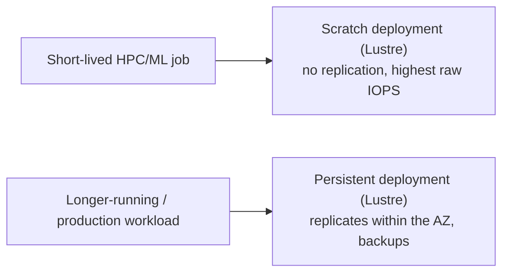

*Walkthrough:* Scratch has no replication at all — if the underlying hardware fails, that data is
gone. That's fine for a short-lived job whose source data lives durably in S3 and whose output is
exported back before the file system is deleted anyway: a mid-job failure just means re-running
the job. Persistent trades a little extra cost for durability a longer-running or production
workload actually needs — the decision is really "how bad is it if this file system's contents
disappear tonight?"


*A real genomics-workflow architecture using three separate FSx for Lustre file systems (reference
data, source data, working/output data), each linked to its own S3 bucket via a Data Repository
Association — reference and source are read-only imports, while the working file system has both
import and export paths so results land back in S3 as the single source of truth. Source: [AWS
Storage Blog — Using Amazon FSx for Lustre for Genomics Workflows](https://aws.amazon.com/blogs/storage/using-amazon-fsx-for-lustre-for-genomics-workflows-on-aws/).*

**Exam Tips:**
- Match the scenario's protocol/feature keyword to the flavor: "Windows," "SMB," "Active
  Directory" → Windows File Server; "HPC," "ML training," "genomics," "linked to S3" → Lustre;
  "multiprotocol," "NetApp," "SnapMirror," "instant clone" → NetApp ONTAP; "ZFS snapshots on
  Linux, no NetApp need" → OpenZFS.
- Don't default to the most specialized (and often priciest) FSx flavor when EFS would do.
- "Scratch" deployment = no replication, acceptable only when source data lives durably elsewhere.

**Full doc:** [`services/storage/fsx.md`](../../../services/storage/fsx.md)

---

## 4. Amazon S3 (Simple Storage Service)

**Definition:** S3 is AWS's object storage service. Files ("objects") live inside containers
("buckets"), reached over HTTP(S) by a key string — not a traditional filesystem. No drive to
format, no fixed capacity to plan for, practically no upper storage limit.

**Plain-English Analogy:** S3 is like a planet-sized self-service post office with no size limit
on packages and no limit on how many PO boxes you can rent — you drop a labeled package (object) in
a box (bucket), and anyone with the right key can retrieve it from anywhere on Earth, instantly,
without ever touching a physical shelf yourself.

**Purpose:** Before S3 (2006), "storage" meant buying physical disks, planning capacity years in
advance, and building your own redundancy/backup. S3 made storage durable by default (11 nines of
durability — 99.999999999%), elastic (never provision size), and billed per GB actually used. 11
nines is about **not losing data** — AWS models it as losing roughly one object out of 10,000,000
every 10,000 years — not the same thing as availability (S3 Standard's uptime SLA is ~99.99%, a
much lower number); AWS achieves this by redundantly storing each object across a minimum of three
physical facilities and continuously self-healing bit rot invisibly.

**When to Use:** static website/SPA hosting; data lake foundation for analytics; media archives at
petabyte scale; compliance log retention with Object Lock; backup/DR targets; ML training data
staging; event-driven pipelines (S3 trigger → Lambda/SNS/SQS).

**When NOT to Use:** a real filesystem mounted on a server needing random in-place edits or POSIX
locking (use EBS or EFS); microsecond/low-millisecond transactional read-write for a database (use
EBS-backed RDS/EC2 or DynamoDB); booting an OS (only EBS/instance store can be a boot volume);
extremely small, extremely frequent reads/writes of the same key (consider DynamoDB or a cache in
front of S3).

**Use Cases:**
1. **Static website/SPA hosting for a marketing site** — S3 + CloudFront scales to any traffic
   spike with zero servers to patch.
2. **Data lake foundation for enterprise analytics** — a retailer centralizes clickstream, POS,
   and inventory data as partitioned Parquet, queried ad hoc by Athena/Redshift Spectrum.
3. **Media archive for a broadcast studio** — petabyte-scale raw footage, lifecycle-tiered into
   Glacier classes, replacing a tape library the studio would otherwise own and refresh.
4. **Compliance log retention for a financial firm** — CloudTrail/ALB/VPC Flow Logs centrally
   retained 7 years for SOX/PCI audits, with Object Lock guaranteeing immutability.
5. **Backup/DR target for a healthcare provider's EHR database** — nightly RDS snapshots and
   exports, replicated cross-Region, satisfying HIPAA contingency-planning requirements.
6. **Game patch/asset distribution for a global player base** — uploaded once, fanned out via
   CloudFront, absorbing launch-day download spikes without studio-provisioned edge nodes.

**Why Important:** S3 is the default home for almost every unstructured byte an AWS-based company
owns — cheap, essentially infinitely durable, and the data substrate behind data lakes, ML
pipelines, static hosting, and backups industry-wide. S3 is arguably the single most tested AWS
service across all three certs; on SAA-C03 it anchors Domain 1 (encryption/replication), Domain 3
Task 3.1 (object vs. block vs. file tradeoffs — a named task statement), and Domain 4 (cost-
optimized storage via classes/lifecycle).

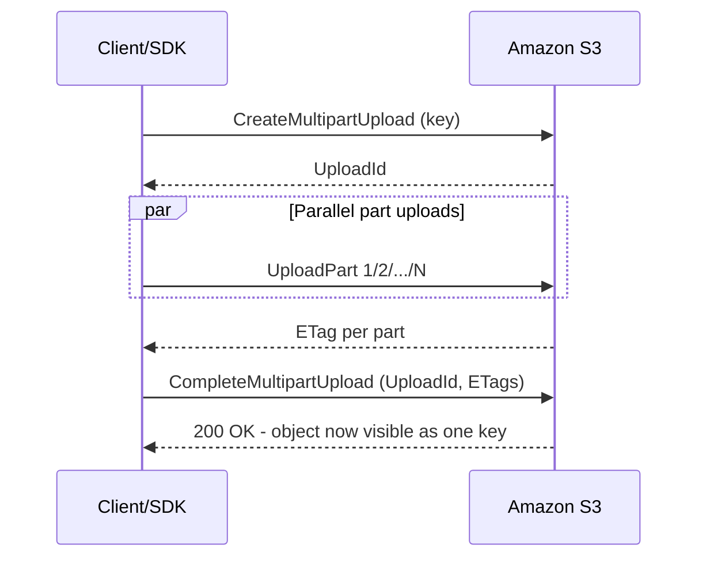

*Walkthrough:* uploading a multi-gigabyte object as one HTTP PUT is fragile — any network blip
fails the whole transfer. Multipart upload splits it into independently-uploaded parts (5 MB-5 GB
each) uploaded in parallel, in any order; the object doesn't exist as a readable key until
`CompleteMultipartUpload` succeeds. **Incomplete multipart uploads silently consume billed storage**
— a very common real-world cost leak fixed with a lifecycle rule that aborts them after N days.


*How S3's strong read-after-write consistency model (since Dec 2020) resolves two near-simultaneous
writes to the same key — every reader, from any client, sees the same final value immediately
after the last write completes. This eliminated an entire category of pre-2020 "read-after-write
race condition" workarounds architectures used to have to build by hand. Source: [Amazon S3 User
Guide — Welcome to Amazon S3](https://docs.aws.amazon.com/AmazonS3/latest/userguide/Welcome.html).*

**Exam Tips:**
- "11 nines" = durability (won't lose it), not availability (uptime) — don't conflate the two.
- S3 is not a mountable filesystem — "mount," "POSIX," "multiple instances share the same file"
  rules S3 out in favor of EFS/FSx.
- Presigned URLs are the answer whenever a scenario needs to let an unauthenticated/external user
  temporarily upload or download one specific private object without granting them IAM access.

**Full doc:** [`services/storage/s3.md`](../../../services/storage/s3.md)

---

## 5. S3 Storage Classes

**Definition:** Different pricing/performance tiers you assign to an object inside the same
bucket, using the same API — the data, durability guarantee, and access mechanism don't
fundamentally change; what changes is storage cost, retrieval cost/speed, and (for some classes)
how many AZs back the copy.

**Plain-English Analogy:** Think of a parking garage with a valet-speed ground floor (Standard),
a slightly-slower upper floor (IA), and an off-site impound lot you need advance notice to retrieve
from (Glacier tiers) — same car, same garage company, wildly different price depending on how
quickly you need it back.

**Purpose:** A product photo served to customers all day needs millisecond access; a 7-year-old
tax record almost never gets opened. Storing both at the same price is wasteful. Storage classes
let you (or an automated lifecycle rule) match cost to actual access pattern. The gap between the
most expensive class (S3 Standard) and cheapest (Glacier Deep Archive) is roughly **23x per
GB-month** — correctly tiering a large, mostly-cold dataset is routinely the single biggest lever
over an AWS storage bill, bigger than almost any compute optimization.

**When to Use:** Standard for genuinely hot, frequently-accessed data; Intelligent-Tiering for
unpredictable/changing access patterns; Standard-IA for infrequent-but-instant-access data (monthly
reports); One Zone-IA for recreatable/secondary copies only; Glacier Instant Retrieval for rarely
touched archives needing zero restore wait; Glacier Flexible Retrieval/Deep Archive for compliance
archives essentially never read.

**When NOT to Use:** don't put data you can't afford to lose on One Zone-IA (no cross-AZ
redundancy); don't archive data accessed more than quarterly into Glacier tiers (retrieval fee +
wait usually costs more than Standard-IA); don't use Deep Archive for anything with an
unpredictable "might need this tomorrow" requirement (12-48 hour retrieval is a hard constraint).

**Use Cases:**
1. **Live product images on S3 Standard** for an e-commerce site needing millisecond latency and
   full multi-AZ resilience on every page load.
2. **Shared data lake on Intelligent-Tiering** where different teams' access patterns vary and
   change over time — automatic monitoring removes the burden of hand-tuned rules per team.
3. **Monthly financial reports on Standard-IA** for an accounting firm — infrequent but needs
   millisecond access the moment a client review happens.
4. **Medical imaging archive on Glacier Instant Retrieval** for a hospital network — rarely
   reopened, but when a clinician needs one, zero restore-wait is a clinical requirement.
5. **Regulatory records on Glacier Deep Archive** for an insurance company — 7-10 year retention,
   essentially never read, cheapest possible rate is the only requirement that matters.
6. **Log retention pipeline (Standard → Standard-IA → Glacier)** for a SaaS company — logs are hot
   for 30 days, occasionally checked for 90, then archival, with a single lifecycle rule automating
   the whole descent.

**Why Important:** storage class choice is one of the highest-leverage, lowest-effort cost
optimizations in any AWS bill — misconfigured (or absent) lifecycle rules are a textbook FinOps
finding. Getting durability class wrong (One Zone-IA for critical data) is also a real resiliency
risk, not just a cost one. SAA-C03 Domain 4 Task 4.1 names storage classes/lifecycle directly;
Domain 3 Task 3.1 touches the retrieval-latency performance tradeoff.

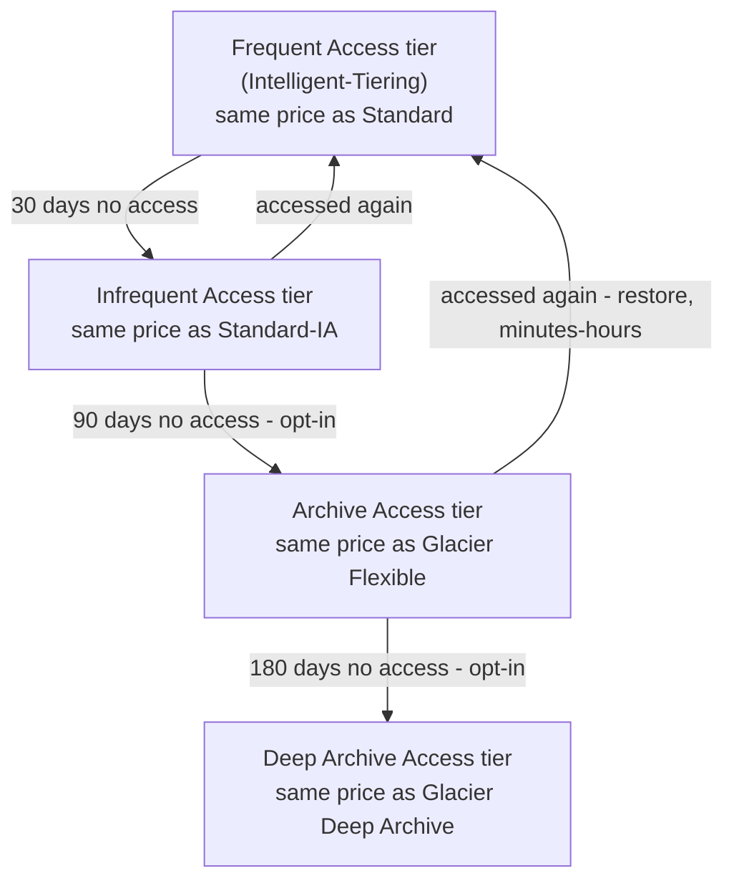

*Walkthrough:* S3 Intelligent-Tiering is itself a small internal state machine, not one tier —
Archive and Deep Archive Access tiers are opt-in (configured per bucket/prefix); without opting in,
objects only oscillate between Frequent and Infrequent. Objects under 128 KB are never monitored
and always stay at the Frequent Access rate, since the monitoring fee wouldn't be worth it on tiny
objects — a detail that matters directly for the break-even math below.


*Not every class can transition directly to every other class — you cannot transition *backward*
from a colder class to a warmer one via Lifecycle (you'd need to re-upload/copy the object).
Source: [Amazon S3 User Guide — Transitioning objects using S3 Lifecycle](https://docs.aws.amazon.com/AmazonS3/latest/userguide/lifecycle-transition-general-considerations.html).*

**Exam Tips:**
- Durability is the same (11 nines) across every multi-AZ class — storage classes change cost and
  retrieval speed, not whether you'll lose the data (except One Zone-IA, which trades away AZ
  redundancy specifically).
- IA and Glacier classes bill a **128 KB minimum object size** and have **minimum storage
  durations** (30/90/180 days) — early deletion still bills the remainder; millions of tiny objects
  in these classes can cost *more* than Standard once this floor kicks in.
- "Unpredictable access pattern" is the Intelligent-Tiering tell; a stated, known age-based pattern
  points at a hand-authored lifecycle rule instead.

**Full doc:** [`services/storage/s3-storage-classes.md`](../../../services/storage/s3-storage-classes.md)


---

# Task 3.2 — High-Performing and Elastic Compute Solutions

## 6. Amazon EC2

**Definition:** EC2 lets you rent a virtual computer in AWS's data centers, by the second, and use
it like any server — install software, open ports, store files, run a website — except you never
touch physical hardware, and you can create or destroy it in about a minute.

**Plain-English Analogy:** EC2 is like leasing a fully-equipped office by the hour instead of
buying and building your own building — you pick the floor plan (instance type), move in (boot),
work as long as you need, and hand the keys back the moment you're done, never having touched
plumbing or electrical (physical hardware).

**Purpose:** Before cloud computing, "I need a server" meant ordering hardware, waiting weeks,
racking it, and guessing capacity — guess low and it falls over, guess high and you waste money
idle. EC2 removes all of that: AWS already owns the physical fleet; you claim a slice of it (an
**instance**) for as long as needed and give it back when done. Nearly every other AWS compute
service (Elastic Beanstalk, ECS/EKS EC2 launch type, EMR, parts of RDS) is EC2 running underneath a
more opinionated management layer.

**When to Use:** workloads needing full OS/kernel control, custom AMIs, GPU access, or specific
instance families; self-managed databases; lift-and-shift migrations; licensed software tied to a
machine identity; any workload needing the lowest level of abstraction with the most control.

**When NOT to Use:** stateless workloads that fit cleanly in a container (use ECS/EKS/Fargate —
less ops overhead); extremely short, bursty, event-driven logic (use Lambda); workloads wanting
zero infrastructure management at all.

**Use Cases:**
1. **Self-managed PostgreSQL database for a SaaS company** needing full control over extensions
   and tuning that RDS's managed model doesn't expose.
2. **Lift-and-shift of a legacy ERP application** expecting a local disk mount with no
   application-rewrite budget.
3. **GPU-heavy ML training job** needing specific driver versions and direct hardware access no
   container or function abstraction level offers.
4. **Tightly-coupled HPC cluster** (CFD simulation, weather modeling) placed in a cluster placement
   group for the lowest possible inter-instance network latency.
5. **Software licensed to a specific machine/kernel identity** — only full OS/kernel control
   preserves license validity.
6. **Cost-optimized batch rendering farm** using Spot Instances across C-family compute-optimized
   types, tolerating 2-minute interruption notices since each frame-render job is independently
   retriable.

**Why Important:** EC2 is one of AWS's oldest and most foundational services (2006) — understanding
it deeply pays off across nearly every other compute service, since most are EC2 running under a
more opinionated layer. Instance-family/placement-group selection (Task 3.2) and purchasing-option
selection (Task 4.2) are among the most reliably recurring SAA-C03 exam patterns.

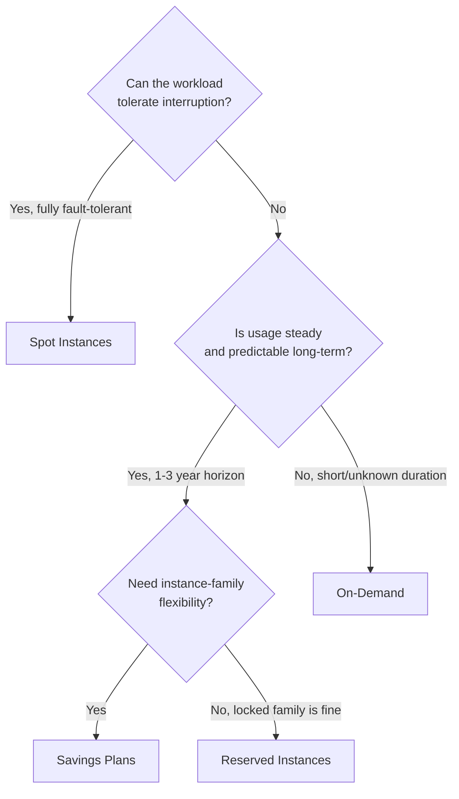

*Walkthrough:* this decision tree collapses EC2 pricing into two questions: can the workload
survive an instance disappearing with two minutes' notice, and if not, how confident are you in the
usage pattern over 1-3 years? A common expensive mistake is skipping straight to "Reserved
Instances save money" without first asking the interruption-tolerance question — locking in a
3-year RI for a workload that's actually bursty (and would work fine on Spot) wastes the
commitment's discount on capacity you didn't need to commit to.


*`pending` is the only way in, `terminated` is the only way out with no return path, and
`stopping`/`stopped` form a reversible loop. You're billed only while `running` — a stopped
instance keeps its instance ID, private IP, and attached EBS volumes, but releases its public IP
and any instance-store data, which is one of the most exam-relevant facts about EC2. Source: [Amazon
EC2 User Guide — Instance state changes](https://docs.aws.amazon.com/AWSEC2/latest/UserGuide/ec2-instance-lifecycle.html).*

**Exam Tips:**
- Read the vCPU:RAM ratio in a scenario's metric description — "CPU-bound, cost-sensitive" → C
  family; "in-memory cache/large dataset in RAM" → R family; "general app, unknown profile" → M
  family (safe default).
- `t`-family burstable instances are for genuinely bursty workloads with real idle time — sustained
  high CPU on a `t3`/`t4g` in Unlimited mode can silently cost *more* per hour than a fixed `m`
  instance, due to surplus CPU-credit charges.
- "Lowest latency between instances" → cluster placement group; "maximum fault isolation for a
  small number of critical instances" → spread placement group.

**Full doc:** [`services/compute/ec2.md`](../../../services/compute/ec2.md)

---

## 7. EC2 Auto Scaling

**Definition:** EC2 Auto Scaling automatically adds or removes EC2 instances from a group based on
rules you set, so your application always has roughly the right amount of compute — not too
little (and falling over), not too much (and wasting money).

**Plain-English Analogy:** it's a thermostat for compute capacity — you set a target (keep CPU
around 50%), and the system continuously adds or removes "heating/cooling" (instances) to hold
that target, instead of a person checking a dashboard and manually adjusting capacity at 3am.

**Purpose:** a fixed number of servers is wrong almost all the time — too many at 3am, too few
during a launch or sales spike. Auto Scaling lets you describe the *desired state* and AWS
continuously reconciles reality to match it: launching instances when load rises, terminating them
when it falls, and replacing any that fail health checks, all without a human watching a dashboard.

**When to Use:** any horizontally-scalable web/app tier behind a load balancer; queue-depth-driven
worker fleets; workloads with predictable daily/weekly traffic patterns (scheduled or predictive
scaling); cost-optimized fleets mixing On-Demand baseline with Spot for the bulk of capacity.

**When NOT to Use:** stateful, single-instance workloads that can't tolerate instances coming and
going (externalize state first, or don't use ASG for that tier); truly serverless event-driven
workloads (Lambda has no concept of "minimum fleet size" at all); container workloads (prefer ECS
Service Auto Scaling or EKS's Cluster Autoscaler/Karpenter operating at the container/pod level).

**Use Cases:**
1. **E-commerce flash-sale web tier** — a scheduled action pre-scales to peak capacity minutes
   before a sale opens, instead of reacting after users already see slow page loads.
2. **Fintech fraud-detection worker fleet** — target tracking on a custom "messages per worker"
   SQS metric keeps the fleet sized to the actual backlog rather than a fixed guess.
3. **Gaming matchmaking backend** — predictive scaling learns the recurring daily evening peak
   from historical CloudWatch data and pre-provisions ahead of it.
4. **Zero-downtime security patch rollout** — an instance refresh replaces instances in batches
   respecting a minimum healthy percentage, auto-pausing/rolling back if the new AMI fails health
   checks.
5. **Cost-optimized CI/CD build-runner fleet** — a mixed-instances policy weighted toward Spot,
   scaling on a "queued build jobs" custom metric, since a killed build simply retries.
6. **Healthcare patient-portal web tier** — a Multi-AZ ASG behind an ALB with ELB health checks
   self-heals from failed instances automatically, meeting an uptime SLA.

**Why Important:** Auto Scaling is the mechanism that actually delivers "the cloud scales" — not
magic, an automated feedback loop. Getting it wrong in either direction is expensive: too
conservative causes outages during real spikes; too aggressive pays for unused capacity. It's
central to SAA-C03 Domain 2 (resilient architectures, Multi-AZ ASGs) and Domain 4
(cost-optimized Spot/On-Demand mixes).

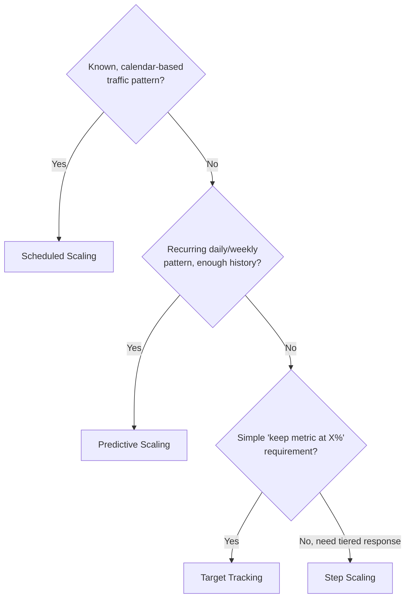

*Walkthrough:* read the scenario for two signals — is the traffic pattern genuinely known ahead of
time on a calendar (scheduled), or recurring but inferred from history (predictive)? If neither, is
the requirement a single target percentage (target tracking) or a tiered response curve at
different thresholds (step scaling)? Picking the wrong branch (e.g., step scaling for a simple
"keep CPU near 50%" requirement) adds unnecessary configuration complexity target tracking already
handles automatically.


*The canonical SAA-C03 "design a highly available web application" reference architecture — AWS
deliberately draws instances in every AZ, never concentrated in one, to make the fault tolerance
visually obvious. Source: [Amazon EC2 Auto Scaling User Guide — Auto Scaling benefits](https://docs.aws.amazon.com/autoscaling/ec2/userguide/auto-scaling-benefits.html).*

**Exam Tips:**
- ELB health checks (application-aware) catch failures EC2 status checks miss (an instance that's
  "up" but returning 500s) — a scenario describing missed failing instances usually points at
  switching from EC2-only to ELB health checks.
- Reserved vs. Target Tracking vs. Predictive vs. Scheduled are not interchangeable — match the
  scenario's stated traffic-pattern knowledge to the right policy type using the decision tree.
- "Scale based on X" wants the CloudWatch metric that reflects the *real* bottleneck (queue depth
  for a worker fleet) — not a default habit of CPUUtilization.

**Full doc:** [`services/compute/ec2-auto-scaling.md`](../../../services/compute/ec2-auto-scaling.md)

---

## 8. AWS Lambda

**Definition:** Lambda runs your code for you without you ever provisioning or managing a server —
you upload a function, tell AWS what should trigger it, and AWS runs it only when that trigger
fires, billing you only for the milliseconds it actually executed.

**Plain-English Analogy:** Lambda is like a vending machine for compute — you never keep an
employee on staff waiting for a customer; a request (coin) arrives, the machine does exactly one
job instantly, and it costs nothing to have the machine simply standing there between purchases.

**Purpose:** most applications spend most of their time idle, waiting for something to happen.
Running a full-time server to handle that is wasteful — you pay 24/7 for bursts of work. Lambda
solves "I just need this logic to run when X happens" without any surrounding server lifecycle —
no OS to patch, no capacity to plan, no idle cost. This is the foundational "serverless compute"
idea Lambda is widely credited with popularizing industry-wide.

**When to Use:** event-driven glue (S3 upload → process → write to DynamoDB); REST/HTTP API
backends behind API Gateway; fan-out processing via SNS; scheduled jobs under 15 minutes;
lightweight ML inference with spiky traffic.

**When NOT to Use:** long-running processes over 15 minutes (use Fargate, EC2, or Step Functions to
break work into steps); workloads needing consistent sub-10ms latency on every call without paying
for Provisioned Concurrency; high, sustained, predictable throughput (at large constant scale, a
provisioned server is often cheaper — see the worked cost example in the full doc); workloads
needing specialized hardware or full OS-level control.

**Use Cases:**
1. **E-commerce order-confirmation image processing** — resize/scan uploaded review photos; the
   work takes milliseconds, happens at unpredictable volume, with real idle time between uploads.
2. **Fintech real-time fraud-check API** — API Gateway + Lambda scales per-request automatically,
   so a 3am Black Friday spike is handled identically to a quiet Tuesday without pre-provisioning.
3. **Healthcare appointment-reminder scheduler** — an EventBridge-scheduled Lambda running every
   few minutes needs no server sitting idle between runs.
4. **Infrastructure compliance remediation** — automatically disabling IAM keys inactive 90 days,
   triggered by an AWS Config rule, a handful of times a day at most.
5. **SaaS multi-tenant webhook processing** — per-integration Lambda functions isolate blast radius
   so one integration partner's bug can't take down another's.
6. **Gaming leaderboard update glue** — event-driven, sub-second execution with huge swings in
   concurrent match-end events during peak play hours.

**Why Important:** Lambda is the clearest expression of "pay for value, not idle capacity," removing
an entire category of operational work (patching, capacity planning, scaling policies). It's also
a common source of surprising bugs for newcomers — cold starts, VPC networking quirks, and the
15-minute timeout all bite people who assume it behaves like a tiny always-on server.

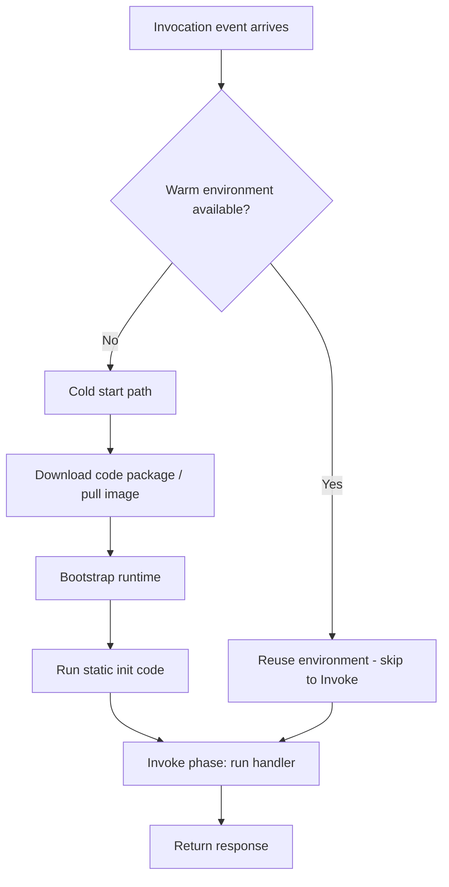

*Walkthrough:* every invocation checks for a warm environment first, and only pays the
download/bootstrap/init cost on the cold path. This is a genuine fork, not a gradual slowdown —
which is why cold-start mitigations (Provisioned Concurrency, SnapStart, smaller packages) each
target a specific box on the "cold" side rather than trying to make every invocation uniformly
faster.


*`Init` only happens once, before the first invocation — every subsequent invocation on a warm
environment skips straight to `Invoke`, which is why the second and third calls in this diagram are
faster than the first. Source: [AWS Lambda Developer Guide — Understanding the Lambda execution
environment lifecycle](https://docs.aws.amazon.com/lambda/latest/dg/lambda-runtime-environment.html).*

**Exam Tips:**
- 15-minute hard timeout — any scenario describing hours-long or unpredictable long duration rules
  Lambda out; look for Step Functions, Fargate, or Batch.
- Reserved concurrency *caps and guarantees* a slice of account concurrency for a function;
  provisioned concurrency *pre-warms* environments to avoid cold starts — these are not the same
  tool, and the exam tests the distinction directly.
- Synchronous (API Gateway — caller gets the error), asynchronous (S3/SNS — Lambda retries
  automatically, needs a DLQ/destination), and poll-based (SQS/Kinesis — batches, a poison-pill
  record can block the whole batch) invocation models determine who handles failure.

**Full doc:** [`services/compute/lambda.md`](../../../services/compute/lambda.md)

---

## 9. AWS Fargate

**Definition:** Fargate runs your containers for you without you ever provisioning, patching, or
managing the underlying EC2 instances — you describe the container (CPU, memory, image), and AWS
finds and manages the compute behind the scenes.

**Plain-English Analogy:** if EC2 is leasing an office and Lambda is a vending machine, Fargate is
a serviced office for a team of a specific headcount — you specify exactly how many desks and how
much space (CPU/memory) your "team" (container) needs, and the building manager (AWS) handles
everything about the physical space, never showing you a floor plan.

**Purpose:** running containers on ECS or EKS traditionally still meant managing an EC2 fleet to
host them — patching the OS, sizing instances, bin-packing containers efficiently. Fargate removes
that layer entirely: you stop thinking about *servers* and only think about *containers*, extending
the serverless idea proven by Lambda to the broader world of containerized workloads that don't
fit Lambda's 15-minute/stateless constraints.

**When to Use:** containerized microservices needing more control than Lambda but no server
management; PCI-scoped workloads needing per-task network isolation (`awsvpc` mode gives every task
its own ENI/security group); workloads whose duration or dependency size doesn't fit Lambda;
autoscaling async job-queue processing scaling to/from zero based on SQS depth.

**When NOT to Use:** very short, bursty, sub-second-to-minute functions (Lambda's per-millisecond
billing wins); workloads needing GPUs (Fargate doesn't support them — use EC2); very high,
sustained, predictable scale where a well-utilized Reserved/Savings-Plan EC2 fleet is cheaper per
unit of compute; workloads needing privileged host-level access or custom kernel modules.

**Use Cases:**
1. **E-commerce storefront microservices** — catalog, cart, checkout each become their own ECS
   service on Fargate, scaling independently with zero host provisioning.
2. **Fintech PCI-scoped payment processing** — `awsvpc` mode gives every task its own ENI/security
   group, narrowing PCI audit scope to the task level, not the shared host.
3. **Media on-demand transcoding workers** — an ECS service scaling from (and back to) zero based
   on SQS queue depth, paying for compute only while there's an actual backlog.
4. **Healthcare clinical-data validation pipeline** — handles container tasks longer than Lambda's
   15-minute limit without provisioning/patching an EC2 fleet for compliance reasons.
5. **SaaS multi-tenant background-job containers** — task-level `awsvpc` isolation keeps noisy or
   compromised tenant jobs from affecting others.
6. **Teams migrating off Lambda as workloads mature** — same serverless philosophy, full container
   runtime, no duration limit, once a function outgrows Lambda's timeout or package size.

**Why Important:** Fargate eliminates an entire job function's worth of toil (capacity-planning and
patching an EC2 fleet backing a container cluster) for a large share of real-world container
workloads. SAA-C03 Domain 2 (loosely-coupled architectures) and Domain 4 (Fargate vs. EC2-backed
container cost tradeoff) both reference it.

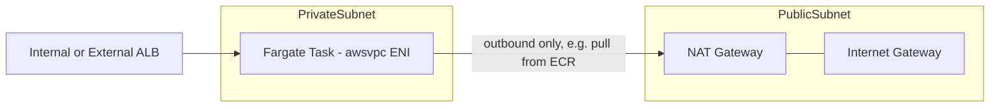

*Walkthrough:* this is the specific routing distinction that trips up many first-time Fargate
deployments — a task in a private subnet has no inbound internet route, but still needs an
*outbound* route (through a NAT Gateway) to pull its container image from ECR or call an external
API. Confusing "no inbound route" with "no outbound route" is exactly why a task that should be
secure sometimes also fails to start — if the NAT Gateway route is missing, the task can't pull its
image either.


*Each job type gets its own ECS service (desired count starting at zero) and its own SQS queue;
CloudWatch alarms on queue depth drive desired count up when work arrives and back to zero when the
queue drains — the containerized equivalent of Lambda's "pay only when running" model, achieved
through ECS Service Auto Scaling. Source: [AWS Reference Architecture Diagrams — Autoscaling
Asynchronous Job Queues](https://docs.aws.amazon.com/reference-architecture-diagrams/latest/autoscaling-async-job-queues/autoscaling-async-job-queues.html).*

**Exam Tips:**
- Task execution role (lets Fargate itself pull the image and write logs) vs. task role (what your
  application code calls other AWS services with) is a commonly confused, commonly tested pair —
  identical structure to ECS's own confusion, since Fargate is a launch type under ECS/EKS.
- "No GPU support" immediately rules Fargate out for ML training scenarios — that's EC2.
- Fargate Spot (~70% discount) is for fault-tolerant batch/background work tolerating a ~2-minute
  interruption warning — not for anything needing a guaranteed, uninterrupted run.

**Full doc:** [`services/compute/fargate.md`](../../../services/compute/fargate.md)

---

## 10. AWS Batch

**Definition:** AWS Batch runs large numbers of batch computing jobs by automatically provisioning
the right amount and type of compute, queuing work when capacity isn't ready, and scaling compute
back to zero when the queue is empty.

**Plain-English Analogy:** Batch is like a freight dispatch center — jobs (shipments) queue up,
the dispatcher (scheduler) matches them to available trucks (compute) sized for the load, adds
more trucks when the loading dock backs up, and sends every truck home the moment the dock is
empty — nobody pays for a truck sitting idle overnight.

**Purpose:** batch computing (jobs that run to completion rather than serve live requests) has a
different shape than a web app — you might need one large job or ten thousand small ones, with no
requirement to run *right now*, just *efficiently and eventually*. Batch packages the
queue/scheduler/autoscaler logic teams would otherwise hand-build. Under the hood it's a scheduling
layer built on top of ECS (and increasingly EKS) — its compute environments are really just ECS
clusters with a Batch-managed autoscaler attached.

**When to Use:** large-scale parallel processing with automatic capacity scaling tied to backlog
(ETL validation, nightly image processing); ML training hyperparameter sweeps on GPU-backed EC2;
media transcoding at scale with Spot cost efficiency; multi-stage pipelines expressed as job
dependencies.

**When NOT to Use:** workloads needing to respond to a live user request (use Lambda/Fargate/EC2
behind a load balancer); simple, short, infrequent jobs (a scheduled Lambda via EventBridge is much
less setup); complex workflows with branching logic or human approval steps (use Step Functions,
optionally calling Batch for the compute-heavy step); always-on services (use ECS/EKS directly).

**Use Cases:**
1. **E-commerce catalog re-indexing at scale** — an array job processes every SKU as an
   independent unit, scaling to the backlog and back to zero once the index finishes.
2. **Fintech risk-model backtesting sweep** — each parameter combination becomes one array job
   index running in parallel on Spot, with automatic retry if interrupted.
3. **Healthcare genomic variant-calling pipeline** — multi-stage job dependencies model
   validate → align → call-variants → report directly, with GPU-backed compute for the accelerated
   stage.
4. **Gaming server-side replay analysis** — an array job analyzes potentially millions of replays
   per night on Spot compute to detect cheating patterns at low cost.
5. **SaaS tenant-wide data migration jobs** — each tenant's migration becomes one job/array index,
   with per-tenant retry logic not blocking others.
6. **ML training hyperparameter sweeps** — an array job (or Batch orchestrating SageMaker training
   jobs) runs every combination in parallel on GPU compute, scaling to zero once training finishes.

**Why Important:** Batch quietly removes a huge amount of custom infrastructure data engineering
and research teams used to build themselves. Its biggest real-world cost lever is Spot usage —
most batch jobs are naturally interruption-tolerant, so Batch + Spot routinely delivers large real
savings over always-on EC2/Fargate for the same workload.

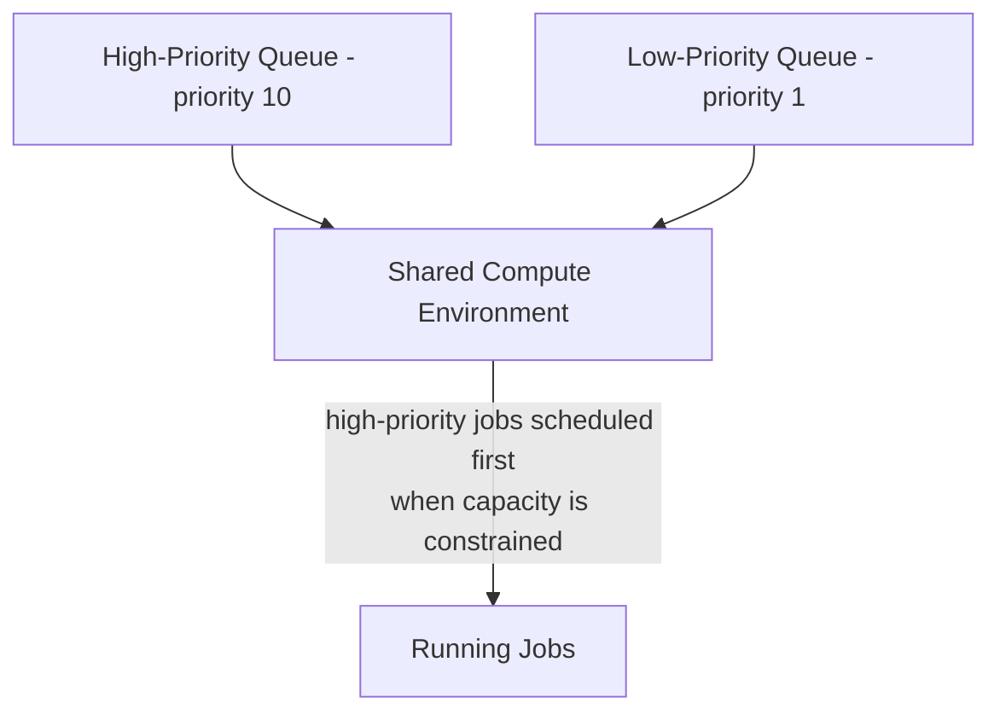

*Walkthrough:* two job queues share one compute environment's capacity, distinguished only by a
priority number. When capacity is plentiful, both queues run without contention; priority only
matters when capacity is constrained, at which point the scheduler drains the higher-priority queue
first — the mechanism behind a common real-world pattern: a "production" queue and a "best-effort"
queue sharing the same Spot fleet so the organization doesn't pay for two separate compute
environments.


*Workloads sit at the top, Batch's scheduling/orchestration logic sits in the middle, and the
actual capacity (EC2, Fargate, or ECS Managed Instances) sits at the bottom — the "Batch" layer is
pure orchestration, and the capacity layer is billed exactly as if you'd provisioned it yourself.
Source: [AWS Batch User Guide — What is AWS Batch?](https://docs.aws.amazon.com/batch/latest/userguide/what-is-batch.html).*

**Exam Tips:**
- Batch's compute environment sizing controls how *fast* the backlog drains, not how *much* the
  total job costs — a scenario about deadline pressure, not budget, points at raising max vCPU.
- GPU support exists only on EC2-backed compute environments, not Fargate-backed ones — a scenario
  needing both "Batch-style queueing" and GPUs rules out the Fargate launch type specifically.
- Array jobs (one job definition run N times with an index) are the answer whenever a scenario
  describes thousands of independent, same-shaped units of work — far simpler than submitting
  thousands of individual jobs.

**Full doc:** [`services/compute/aws-batch.md`](../../../services/compute/aws-batch.md)

---

## 11. Containers vs. VMs vs. Serverless

**Definition:** three different answers to "how much of the computer do I want to manage myself,
versus hand to AWS?" A VM is a full emulated computer with its own OS kernel; a container packages
an app and its dependencies (not a full kernel) sharing the host's kernel; serverless removes the
"server" concept almost entirely, scaling to zero when idle.

**Plain-English Analogy:** think of three ways to rent space for a restaurant — a VM is leasing an
entire standalone building (you handle everything about the building); a container is renting a
fully-equipped kitchen stall in a shared commercial kitchen (shared plumbing/electrical, your own
equipment and staff); serverless is a food-truck-for-hire you only pay when it's actually cooking an
order, gone entirely between orders.

**Purpose:** every cloud architecture decision starts here — how much infrastructure do you want to
own? Each model moves the "what you manage vs. what the provider manages" line further toward the
provider, trading control for reduced operational burden, and each trades differently on cost,
startup latency, portability, and flexibility.

**When to Use:** VMs for direct hardware/GPU access, custom kernel modules, or machine-identity-
locked licensing; containers for consistent packaging across environments and independently
deployable microservices; serverless for infrequent, bursty, short-lived event processing with
real idle time.

**When NOT to Use:** VMs when the workload is stateless and fits in a container (you're paying for
OS-management overhead unneeded); containers for extremely short, bursty, low-traffic handling
where even a few seconds of startup is overkill (use Lambda); serverless for long-running processes,
workloads needing persistent local state/specialized hardware, or very high-constant traffic where
per-invocation billing costs more than a steady-state fleet.

**Use Cases:**
1. **Legacy software licensed to a specific machine identity** — full OS/kernel control preserves
   license validity no container or function can.
2. **Microservices migration off a monolith** — consistent packaging across dev/staging/prod and
   fast horizontal scaling per service, at the cost of an added orchestration layer.
3. **Event-driven webhook/glue code** — serverless scales to zero with no idle cost between
   triggers, but the 15-minute ceiling and cold-start latency rule out sustained high-frequency work.
4. **Batch pipelines mixing short and long steps** — Step Functions calling Lambda for fast steps
   and Fargate `RunTask` for a step that might run over 15 minutes.
5. **GPU-heavy ML training** — only a VM (EC2) offers direct hardware access, forgoing container
   orchestration convenience.
6. **Cost optimization by traffic shape** — Reserved EC2 wins at steady, high, predictable volume;
   Lambda/Fargate win at spiky, low-average volume — picking the wrong layer for the actual shape
   is the single most common real-world and exam cost mistake.

**Why Important:** this single decision shapes cost structure, operational burden, deployment
speed, and incident blast radius. Picking VMs when containers would do means paying an ops tax
forever; picking Lambda for constant high-volume traffic can be *more* expensive than a steady
container fleet. SAA-C03 Domain 2 Task 2.1 and Domain 4 both directly test this spectrum.

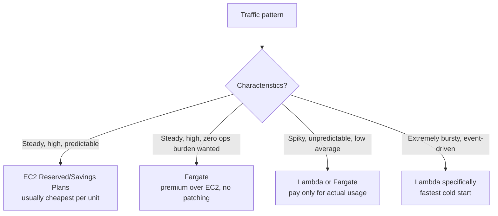

*Walkthrough:* there is no universally cheapest option — the crossover depends on **utilization
shape**, not raw workload size. A workload running 24/7 at 80% CPU is almost always cheaper on
Reserved EC2 than as Lambda invocations; a workload idle 95% of the time bursting rarely is often
*more* expensive on EC2 (paying for idle capacity) than Lambda/Fargate. "Serverless is always
cheaper" is a reliable wrong-answer trap the exam tests directly.


*Each successive layer shifts more "undifferentiated heavy lifting" (patching, scaling, capacity
planning) from the customer side of the shared-responsibility line to the AWS side. These levels
are not a strict ladder where higher is always better — a workload needing specialized hardware
deliberately chooses a *lower* abstraction level. Source: [AWS Architecture Blog — Compute
Abstractions on AWS: A Visual Story](https://aws.amazon.com/blogs/architecture/compute-abstractions-on-aws-a-visual-story/).*

**Exam Tips:**
- "Constant, high, predictable request volume 24/7 with no idle periods" is the counter-intuitive
  case where serverless is likely *more* expensive than Reserved EC2/Fargate — expect "Lambda" as
  a tempting but wrong answer here.
- "Specific GPU drivers/kernel modules not available in any managed container runtime" → EC2 (VM
  level) — rules out Fargate and often Lambda regardless of the rest of the architecture.
- "Function needs to run up to 45 minutes" disqualifies Lambda outright (hard 15-minute ceiling) —
  the correct move is down a level to Fargate/EC2, not a Lambda chaining workaround.

**Full doc:** [`services/containers/containers-vs-vms-vs-serverless.md`](../../../services/containers/containers-vs-vms-vs-serverless.md)

---

## 12. Amazon ECS

**Definition:** ECS is a fully managed service that runs and manages your containers on a cluster
of compute, without you building your own container-orchestration system. You tell it "run 3
copies of this container, keep them healthy," and ECS does the scheduling, restarting, and
load-balancer wiring.

**Plain-English Analogy:** ECS is AWS's own in-house concierge for running containers — simpler to
work with than hiring a universal, industry-standard facilities manager (Kubernetes/EKS), at the
cost of that concierge only knowing AWS's own building (you can't take the same concierge to
another property).

**Purpose:** before container orchestrators existed, running containers at scale meant hand-rolling
your own scheduler — deciding which server runs which container, restarting crashed containers,
rolling out new versions without downtime. AWS built ECS as its AWS-native answer, deeply
integrated with IAM, VPC, ELB, CloudWatch, and Fargate, so teams who don't need Kubernetes's full
complexity get orchestration with a much smaller learning curve.

**When to Use:** teams starting fresh on AWS with no existing Kubernetes investment; microservices
migrations off a monolith wanting independent scaling per service without hand-building a
scheduler; mixed EC2 + Fargate + Fargate Spot cost optimization via Capacity Provider Strategies;
scheduled batch jobs via EventBridge + `RunTask`.

**When NOT to Use:** needing multi-cloud portability or the Kubernetes ecosystem (Helm, Istio,
Operators) — use EKS instead, since ECS's API is AWS-proprietary; needing a single short-lived
task/event-driven function with zero orchestration thinking at all — use Lambda; an org already
deeply invested in Kubernetes expertise and tooling.

**Use Cases:**
1. **Public-facing web API behind an ALB** — Route 53 → ALB (public subnet) → ECS Service on
   Fargate (private subnet, `awsvpc`) → RDS/DynamoDB — the default modern containerized web
   service shape.
2. **Multi-tenant SaaS isolation via `awsvpc` networking** — every task gets its own ENI/security
   group so tenants can't reach each other's traffic even on shared cluster capacity.
3. **Blue/green production rollouts via CodeDeploy** — a parallel task set stands up, ALB traffic
   shifts to it, the old set stays warm briefly for instant rollback.
4. **Hotfix emergency deploys with the deployment circuit breaker** — auto-detects a crash-looping
   new revision and rolls back with zero alarm configuration required.
5. **SQS-backed worker queue consumers** — Service Auto Scaling on queue-depth metrics grows or
   shrinks the worker Service's desired count automatically.
6. **Mixed EC2 + Fargate + Fargate Spot cost optimization** — a Capacity Provider Strategy places
   steady baseline load on Reserved EC2 and burst load on Fargate/Fargate Spot declaratively.

**Why Important:** containers are now the default packaging format for modern applications — they
solve "works on my machine" and enable independent service deployment. ECS removes the operational
burden of running an orchestrator yourself, directly affecting both reliability (mis-configured
orchestration is a common outage cause) and cost (EC2-vs-Fargate launch type choice).

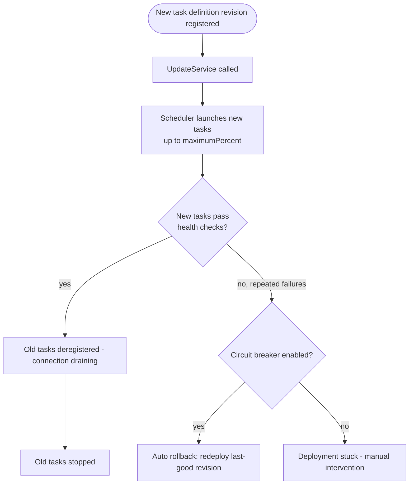

*Walkthrough:* the scheduler never does a hard cutover — it launches new tasks *alongside* the old
ones (bounded by `maximumPercent`), waits for them to become healthy, drains connections from the
old tasks, then terminates them, never dropping below `minimumHealthyPercent`. The deployment
circuit breaker is the safety net: if the new revision can't reach a steady healthy state, ECS
gives up automatically and reverts, rather than leaving the service flapping indefinitely.


*The three logical layers of every ECS deployment — Capacity (EC2 or Fargate infrastructure),
Controller (the scheduler placing/managing tasks), and Provisioning (console, CLI, CloudFormation/
CDK, CodePipeline). This is the cleanest way to reason about ECS troubleshooting — a problem is
almost always isolable to exactly one layer. Source: [Amazon ECS Developer Guide — What is Amazon
ECS?](https://docs.aws.amazon.com/AmazonECS/latest/developerguide/Welcome.html).*

**Exam Tips:**
- Task execution role (ECS pulling the image, writing logs) vs. task role (your app code calling
  other AWS services) is the single most-confused field pair — mixing these up is a classic
  distractor and a classic real "why can't my container reach S3" bug.
- `awsvpc` networking mode gives every task its own ENI/security group — mandatory for Fargate,
  best practice for EC2 launch type; `bridge`/`host` share the host's network stack.
- "Desired count" lives on the Service, not the Task Definition — the Task Definition is a
  stateless blueprint with no opinion on how many copies run.

**Full doc:** [`services/containers/ecs.md`](../../../services/containers/ecs.md)

---

## 13. Amazon EKS

**Definition:** EKS is a fully managed service that runs upstream, certified Kubernetes for you on
AWS — you keep the standard Kubernetes API, tooling, and ecosystem, while AWS manages the
hardest, most failure-sensitive part (the control plane: API server, etcd, scheduler).

**Plain-English Analogy:** if ECS is AWS's in-house concierge, EKS is hiring a universally-certified
facilities manager who speaks the same industry-standard language (Kubernetes) used at every other
building in the world — you can transfer your playbooks (Helm charts, operators) anywhere else that
manager also works, at the cost of a steeper learning curve than the in-house option.

**Purpose:** Kubernetes became the de-facto container orchestration standard industry-wide, not
just on AWS. Many organizations already have Kubernetes expertise, Helm charts, and multi-cloud
clusters, and want the *same* API on AWS rather than learning a proprietary orchestrator. Running
Kubernetes' control plane yourself is genuinely hard to do reliably and securely — EKS gives you
real, conformant Kubernetes with AWS managing the hardest part.

**When to Use:** lifting an existing on-prem/multi-cloud Kubernetes investment to AWS without
rewriting manifests; multi-cloud/cloud-exit portability strategy; complex scheduling/admission
policy requirements (custom schedulers, OPA/Gatekeeper); GitOps continuous deployment (Argo CD/
Flux); ML/data platforms standardizing on Kubernetes-native frameworks (Kubeflow, Spark-on-k8s).

**When NOT to Use:** no Kubernetes expertise on the team and no multi-cloud portability need — ECS
gets most of the same orchestration benefit with a much smaller learning curve; simple,
event-driven, or short-lived workloads — Lambda avoids container orchestration entirely; wanting
absolute least operational overhead — Fargate (as a launch type under either ECS or EKS) removes
node management, but the API choice (ECS vs. EKS) is separate.

**Use Cases:**
1. **Lifting an on-premises Kubernetes cluster to AWS** — existing Helm charts, operators, and
   manifests work unmodified, no rewrite onto an AWS-proprietary API.
2. **Multi-cloud or cloud-exit portability strategy** — the Kubernetes API is identical everywhere
   EKS is conformance-tested against upstream.
3. **Complex scheduling and admission policy requirements** — custom schedulers, pod affinity
   rules, or OPA/Gatekeeper admission policies ECS has no equivalent for.
4. **Multi-tenant SaaS isolation via namespaces and NetworkPolicy** — namespaces plus
   `NetworkPolicy` plus IRSA scope both network reachability and IAM access per tenant.
5. **ML/data platforms standardizing on Kubeflow, Spark-on-Kubernetes, or Ray** — these frameworks
   assume a real Kubernetes API underneath, which only EKS (not ECS) provides.
6. **Zero-trust microservices with a service mesh** — Istio/App Mesh run natively on EKS with no
   AWS-proprietary equivalent, enforcing mTLS on every service-to-service hop.

**Why Important:** Kubernetes skills are broadly transferable across cloud providers and on-prem,
making EKS valuable for organizations avoiding vendor lock-in or running hybrid/multi-cloud.
Misconfigured Kubernetes RBAC and overly broad node IAM roles are a recurring source of real
security incidents — IRSA and EKS's IAM integration directly address that risk class.

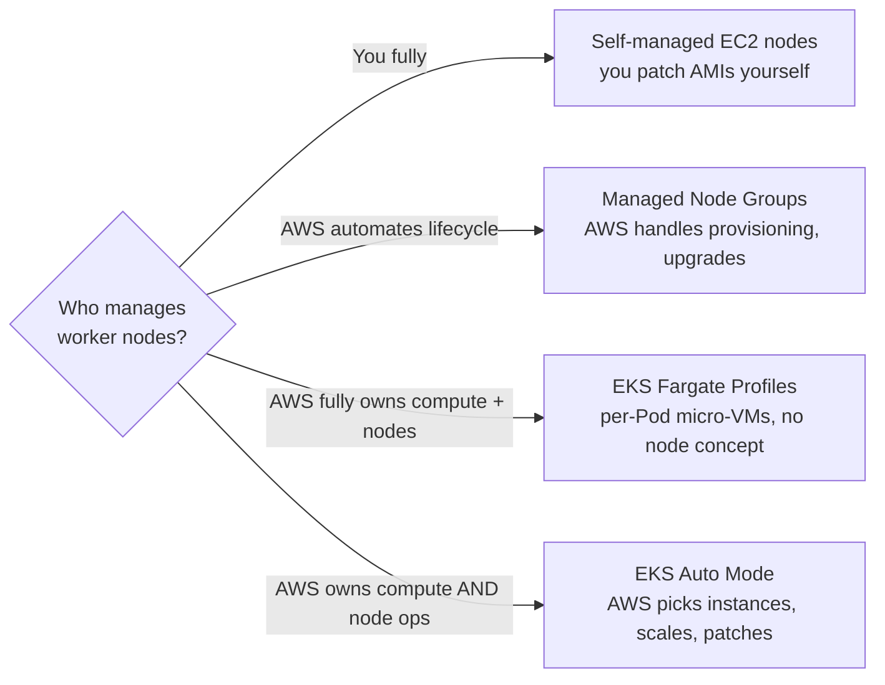

*Walkthrough:* Managed Node Groups are the most common production choice when you need more
node-level control than Fargate allows (DaemonSets, GPU instances, specific storage drivers) —
Fargate profiles eliminate the node concept entirely but can't run DaemonSets, privileged
containers, or (historically) GPUs. EKS Auto Mode is the newest option, extending AWS management
into the data plane to approach Fargate's simplicity while keeping the full Kubernetes API.


*A developer commits to CodeCommit, triggering CodePipeline; CodeBuild builds and pushes an image
to ECR, then runs `kubectl set image` against the Kubernetes API server, and Kubernetes' own
reconciliation loop performs the rolling update — the core practical difference from ECS, where
CodeDeploy typically drives the deployment instead. Source: [AWS Reference Architecture Diagrams —
Modernize Applications with Microservices Using Amazon EKS](https://docs.aws.amazon.com/reference-architecture-diagrams/latest/modernize-applications-with-microservices-using-amazon-eks/modernize-applications-with-microservices-using-amazon-eks.html).*

**Exam Tips:**
- "Reuse existing Helm charts/operators without rewriting deployment manifests" is the single
  clearest EKS-vs-ECS tell — ECS's task-definition model has no Helm/operator compatibility.
- IRSA (IAM Roles for Service Accounts) scopes IAM permissions to a specific Pod's ServiceAccount —
  giving the whole node's IAM instance profile broad access instead is the common wrong-answer trap.
- The control plane runs across multiple AZs and is patched by AWS automatically — a scenario
  asking "how do you make the control plane survive an AZ failure" is often testing whether you
  know this is *already true by default*, not a customer-side HA mechanism to build.

**Full doc:** [`services/containers/eks.md`](../../../services/containers/eks.md)

---

# Task 3.3 — High-Performing Database Solutions

## 14. Amazon Aurora

**Definition:** Aurora is AWS's own relational database engine, wire-compatible with MySQL and
PostgreSQL (your existing drivers, ORMs, and SQL just work) but re-engineered underneath to be
faster, self-healing, and far more elastic than running MySQL/PostgreSQL yourself.

**Plain-English Analogy:** if RDS is a reliable, well-maintained standard car, Aurora is the same
driving experience (same pedals, same steering wheel — MySQL/PostgreSQL compatible) but with a
completely re-engineered engine and chassis underneath built for far higher sustained speed and
near-instant recovery from a flat tire.

**Purpose:** AWS noticed classic relational databases were bottlenecked by a 1990s-era storage
architecture: engine and storage tightly coupled, replication shipping whole data pages, crash
recovery taking minutes. Aurora decouples compute from storage, distributes storage across many
nodes/AZs automatically, and replicates only minimal log records — eliminating most traditional
relational pain points at scale while keeping 100% SQL compatibility.

**When to Use:** high-throughput applications that have outgrown plain RDS's replica ceiling (5
replicas) or failover speed (60-120s); global applications needing sub-second cross-Region reads
(Aurora Global Database); spiky SaaS traffic with long idle periods (Aurora Serverless v2);
dev/test environments needing dozens of frequently-refreshed databases (fast cloning).

**When NOT to Use:** simple, small, cost-sensitive steady low-traffic workloads (plain RDS is
usually cheaper — Aurora's I/O billing and instance premium isn't worth it yet); needing NoSQL
flexible schema and massive horizontal write scale (DynamoDB); needing Oracle or SQL Server
specifically (Aurora doesn't support those engines — stay on RDS).

**Use Cases:**
1. **High-throughput SaaS application that has outgrown plain RDS** — needs read-replica fan-out
   beyond RDS's 5-replica ceiling, justifying Aurora's cost premium at genuine scale.
2. **Global SaaS application needing low-latency reads in multiple Regions** — Aurora Global
   Database gives sub-second cross-Region replication with one authoritative write Region.
3. **Spiky SaaS traffic with long idle periods and sudden 10x bursts** — Aurora Serverless v2
   scales compute within configured ACU bounds automatically.
4. **E-commerce order system requiring both relational guarantees and fast failover** — checkout
   logic needs multi-table ACID transactions and can't tolerate a 60-120s Multi-AZ failover window.
5. **Near-real-time analytics on live transactional data without a custom ETL pipeline** — a
   zero-ETL integration continuously replicates Aurora data into Redshift.
6. **Dev/test environments needing dozens of near-identical, frequently refreshed databases** —
   Aurora's copy-on-write fast cloning spins up a full working copy in seconds regardless of size.

**Why Important:** Aurora's separation of "durable" from "applied" (a write is durable the moment
a storage quorum acknowledges it, applied to data pages later, asynchronously) is responsible for
most of its throughput and failover-speed advantage — a genuinely different architecture, not
just "RDS but faster." SAA-C03 tests the RDS-vs-Aurora checklist directly, by scale/replica/
failover-speed signals in a scenario.

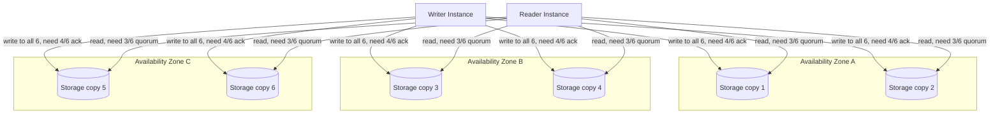

*Walkthrough:* the 6-copies-across-3-AZs number isn't arbitrary — writes require a quorum of 4 of
6 copies, tolerating the loss of an entire AZ (2 copies) plus one more copy elsewhere and still
reaching quorum. Reads require only 3 of 6, tolerating the same AZ loss plus one more while still
serving consistent reads. Aurora's "survives the loss of an entire AZ without downtime" claim is a
precise, mechanically-grounded statement derived directly from this quorum math.


*A primary cluster in one Region handles writes; secondary read-only clusters in up to several
other Regions replicate with typically sub-second lag and can be promoted to primary in minutes
during a regional disaster — the headline reason teams choose Global Database over a plain
cross-Region read replica. Source: [Amazon Aurora User Guide — Aurora Global Database](https://docs.aws.amazon.com/AmazonRDS/latest/AuroraUserGuide/aurora-global-database.html).*

**Exam Tips:**
- "MySQL/PostgreSQL compatible, needs sub-30-second failover, up to 15 read replicas" → Aurora,
  not RDS (RDS Multi-AZ failover is 60-120s and caps at 5 replicas).
- Aurora isn't "strictly better" than RDS — at small, steady, cost-sensitive scale, plain RDS is
  usually cheaper; the exam expects you to recognize the threshold where Aurora's premium pays off.
- Aurora Serverless v2 is the specific answer for "spiky/unpredictable relational load, team
  doesn't want to manage capacity" — not provisioned Aurora/RDS generically.

**Full doc:** [`services/database/aurora.md`](../../../services/database/aurora.md)

---

## 15. Amazon RDS

**Definition:** RDS is a managed service that runs a traditional relational (SQL) database for
you — MySQL, PostgreSQL, MariaDB, Oracle, or SQL Server — without you installing, patching,
backing up, or babysitting the database server yourself.

**Plain-English Analogy:** RDS is like hiring a building superintendent for an apartment you
already know how to live in — you still decorate and arrange your own rooms (schema, SQL,
tuning), but someone else handles the boiler, the roof, and the fire alarm system (OS patching,
storage, backups, failover).

**Purpose:** before RDS, running a relational database meant provisioning a server, installing
the engine, configuring storage, writing backup scripts, patching on schedule, and building a
failover system — all before writing a line of application code. RDS takes that entire
operational burden off engineering teams while keeping the full relational engine they already
know.

**When to Use:** lift-and-shift of an on-prem MySQL/PostgreSQL/Oracle/SQL Server application;
banking/financial ledgers needing strict ACID multi-table transactions as the default; internal
admin dashboards with ad-hoc, evolving SQL queries; licensed commercial database migration needing
Oracle/SQL Server specifically.

**When NOT to Use:** needing to scale writes horizontally across many nodes or handle massive
unpredictable traffic (DynamoDB); wanting MySQL/PostgreSQL compatibility but 5x the throughput and
serverless scale-to-zero (Aurora/Aurora Serverless v2); needing sub-millisecond caching in front of
a database (ElastiCache); heavy analytical queries across billions of rows (Redshift).

**Use Cases:**
1. **E-commerce order system with strict inventory/payment consistency** — an order must debit
   inventory and record payment atomically, which RDS's ACID transactions guarantee by default.
2. **Banking/financial ledger with double-entry bookkeeping** — foreign keys enforce referential
   integrity, and multi-row transactions are the normal mode of operation, not a rare case.
3. **Lift-and-shift of an on-prem MySQL/PostgreSQL/Oracle/SQL Server application** — minimal
   rewrite when the engine must stay Oracle/SQL Server or the workload is modest/cost-sensitive.
4. **SaaS application with per-tenant relational data** — foreign keys naturally express
   tenant-scoped referential integrity that DynamoDB would need to enforce at the app level.
5. **Reporting replica offloading read-heavy dashboards** — a Read Replica serves analyst queries
   so they don't compete with checkout-path traffic for CPU/IO on the primary.
6. **Blue/Green deployment for a major version upgrade** — a full staging copy validated against
   production-like traffic before cutover, with an immediate rollback path.

**Why Important:** relational databases encode business rules in their schema (foreign keys,
uniqueness constraints) and transaction guarantees (ACID) — those guarantees are only as good as
the infrastructure underneath them. RDS makes "the database never lies, and rarely goes down"
operationally cheap instead of operationally heroic.

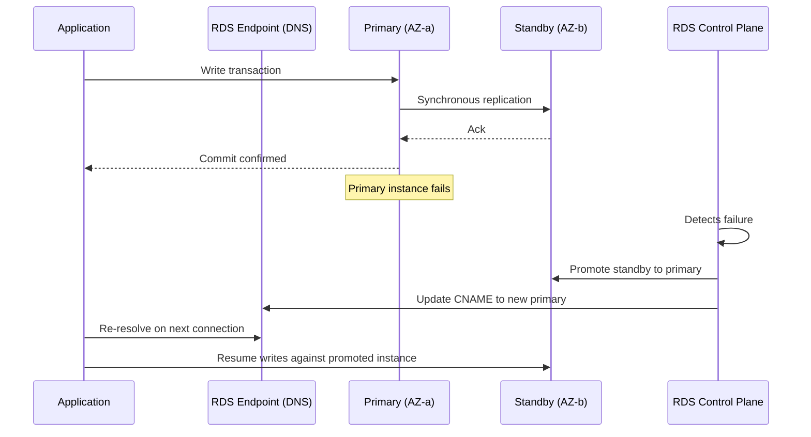

*Walkthrough:* the 60-120 second failover window is mostly DNS propagation and the promoted
standby coming fully online — applications that cache DNS resolutions aggressively or hold
long-lived connections without retry logic experience failovers lasting far longer *from the app's
perspective* than they actually took on the database side, which is exactly why RDS Proxy exists —
it absorbs the reconnect storm so the app doesn't have to.


*The standby is a synchronous, unreadable (standard Multi-AZ) or readable (Multi-AZ DB cluster
variant) copy in a different AZ — its job is availability, not read scaling, which is the single
most commonly confused distinction between Multi-AZ and Read Replicas on the exam. Source: [Amazon
RDS User Guide — Multi-AZ deployments](https://docs.aws.amazon.com/AmazonRDS/latest/UserGuide/Concepts.MultiAZ.html).*

**Exam Tips:**
- Multi-AZ = availability (synchronous standby, automatic failover); Read Replicas = read
  scaling (asynchronous, can lag) — conflating these is the single most common RDS exam trap.
- "A company has existing Oracle licenses it wants to use in the cloud" → Bring-Your-Own-License
  (BYOL), not License Included.
- Connection-per-request from Lambda exhausts `max_connections` fast — RDS Proxy is the answer,
  not "just open more connections" or switching away from RDS entirely.

**Full doc:** [`services/database/rds.md`](../../../services/database/rds.md)

---

## 16. Amazon DynamoDB

**Definition:** DynamoDB is a fully managed NoSQL key-value and document database that stores
data as items identified by a key, scales automatically to essentially unlimited size and request
rate, and responds in single-digit milliseconds no matter how big your table gets.

**Plain-English Analogy:** DynamoDB is like a city with an unlimited number of numbered P.O. boxes
— finding box #48291 takes exactly as long whether the city has a thousand boxes or a trillion,
because you go directly to its address rather than searching through every box in order.

**Purpose:** relational databases hit real limits at internet scale — sharding SQL across many
servers is hard and operationally painful, and a single primary can only take so many writes per
second. DynamoDB gives applications unlimited horizontal scaling with predictable low-latency
performance, trading away ad-hoc joins, complex multi-row transactions, and strict upfront schema.
The hardest discipline it demands is **access-pattern-first design** — know your queries before
designing your table, the opposite order from relational modeling.

**When to Use:** shopping cart/checkout state needing flat latency during flash-sale spikes;
session stores at massive scale; gaming leaderboards paired with DAX; IoT device state/telemetry
at millions of devices; serverless API backends (API Gateway + Lambda + DynamoDB) with no
connection-pool exhaustion risk.

**When NOT to Use:** complex JOINs across many entities or a schema that changes access patterns
often (use RDS/Aurora); strong multi-row, multi-table ACID transactions as the default (relational
models this more naturally); heavy analytical aggregation across millions of rows directly against
live data (export to Redshift or query via Athena/EMR); data fundamentally about relationships past
1-2 hops (Neptune).

**Use Cases:**
1. **E-commerce shopping cart/checkout state** — pure key lookup with flat latency regardless of
   concurrent shoppers during flash-sale spikes.
2. **Session store for web/mobile apps** — TTL auto-expires logged-out/stale sessions for free at
   tens of millions of concurrent sessions.
3. **Gaming leaderboard with real-time rank updates** — extremely read-heavy, paired with DAX for
   microsecond reads.
4. **IoT device state and recent telemetry** — millions of devices reporting every few seconds,
   keyed by deviceId with a timestamp sort key, TTL auto-expiring old readings.
5. **Serverless API backend** — DynamoDB's HTTP-API nature means no connection pool to exhaust
   across thousands of concurrent Lambda invocations, unlike RDS.
6. **Globally distributed product catalog with local writes** — Global Tables give true
   multi-writer active-active replication with automatic conflict resolution.

**Why Important:** DynamoDB is the concrete proof that giving up SQL's flexibility buys essentially
unbounded horizontal scale at flat latency — a tradeoff that's either exactly right or completely
wrong depending on whether access patterns are genuinely known upfront. SAA-C03 Domain 3 Task 3.3
tests this exact tradeoff, often via the "access patterns may change" tie-breaker phrase that
deliberately points away from DynamoDB.

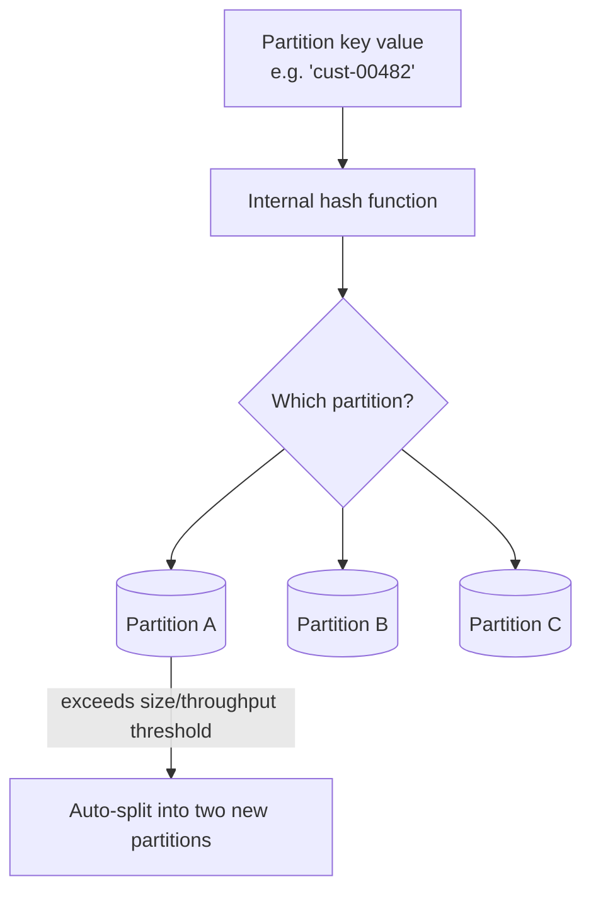

*Walkthrough:* DynamoDB automatically splits a partition when it exceeds roughly 10 GB or its
throughput demand consistently exceeds a single partition's share — this happens transparently,
but it's a *consequence* of key design, not something you control directly. A **hot partition**
happens when one partition key value gets disproportionate traffic (e.g., 90% of items having
`status="PENDING"`) — write sharding (appending a random/calculated suffix) is the standard fix.


*A good partition key spreads writes evenly across partitions, avoiding hot partitions — this is
the single most important DynamoDB design decision, and the reason latency stays flat whether a
table has 100 items or 100 billion. Source: [Amazon DynamoDB Developer Guide — Partitions and
data distribution](https://docs.aws.amazon.com/amazondynamodb/latest/developerguide/HowItWorks.Partitions.html).*

**Exam Tips:**
- "Access patterns may change" or "need ad-hoc reporting" is a deliberate tie-breaker phrase
  steering *away* from DynamoDB, toward relational.
- On-Demand capacity mode suits unpredictable/new workloads; Provisioned (with Auto Scaling) is
  cheaper once traffic is steady and well-understood — not "On-Demand is always safer."
- DynamoDB Transactions (up to 100 items/25 tables) handle the *occasional* all-or-nothing case —
  ongoing cross-account double-entry bookkeeping is still better modeled relationally.

**Full doc:** [`services/database/dynamodb.md`](../../../services/database/dynamodb.md)

---

## 17. Amazon ElastiCache

**Definition:** ElastiCache is a managed, in-memory data store (Redis/Valkey or Memcached) that
keeps frequently accessed data in RAM so applications read it back in sub-millisecond time instead
of hitting a slower disk-based database every time.

**Plain-English Analogy:** ElastiCache is sticky notes on your monitor for the phone numbers you
dial constantly — instantly glanceable, versus flipping through the full address book (the
database) every single time, with the explicit tradeoff that you have to remember to update the
sticky note when the real number changes.

**Purpose:** databases (even fast ones like Aurora or DynamoDB) read from disk-backed or
network-attached storage — slow compared to RAM. For data read far more often than it changes,
re-fetching from the database on every request wastes latency budget and database capacity.
ElastiCache puts a thin, managed layer of pure RAM in front of (or beside) your database. The
deeper tradeoff: every cache is a second copy of the truth, and keeping it in sync (invalidation)
remains entirely the application's responsibility — ElastiCache manages infrastructure, not your
invalidation logic.

**When to Use:** product catalog caching for high-traffic sites; session stores needing Multi-AZ
failover; real-time leaderboards via Redis Sorted Sets; API rate limiting via atomic `INCR` +
`EXPIRE`; semantic caching in front of LLM inference endpoints.

**When NOT to Use:** needing durable, authoritative storage (use a real database — ElastiCache is
not meant to be the source of truth); DynamoDB-specific caching with zero custom invalidation
logic (use DAX instead, purpose-built and API-compatible); workloads needing complex relational
queries (no joins/schema concept); budget-tight situations where read load isn't yet a confirmed
bottleneck (don't add a cache speculatively — measure first).

**Use Cases:**
1. **Product catalog cache for a high-traffic e-commerce site** — cache-aside with a TTL serves
   the overwhelming majority of reads from memory, meaningfully faster than a read replica.
2. **Session store for a web/mobile application** — Multi-AZ Redis failover means a node failure
   doesn't force mass re-login, at the cost of a small window of potential lost writes.
3. **Real-time gaming leaderboard with atomic rank updates** — Redis Sorted Sets give ranking
   natively from the data structure (`ZADD`/`ZREVRANGE`), not application-side sorting.
4. **API rate limiting/request throttling** — Redis's atomic `INCR` + `EXPIRE` makes a
   sliding-window or token-bucket limiter safe under concurrent requests without a separate lock.
5. **Semantic caching in front of an LLM inference endpoint** — caching responses to semantically
   similar (not just identical) prompts cuts both latency and model inference cost.
6. **Distributed locking for coordination across multiple app instances** — `SET key value NX EX
   ttl` implements a simple distributed lock for short-lived coordination needs.

**Why Important:** caching is the single biggest lever for database *read* performance in nearly
every exam scenario describing "read-heavy traffic overwhelming the database." SAA-C03 Domain 3
Task 3.3 treats ElastiCache as the first lever to reach for before even considering a faster
database engine.

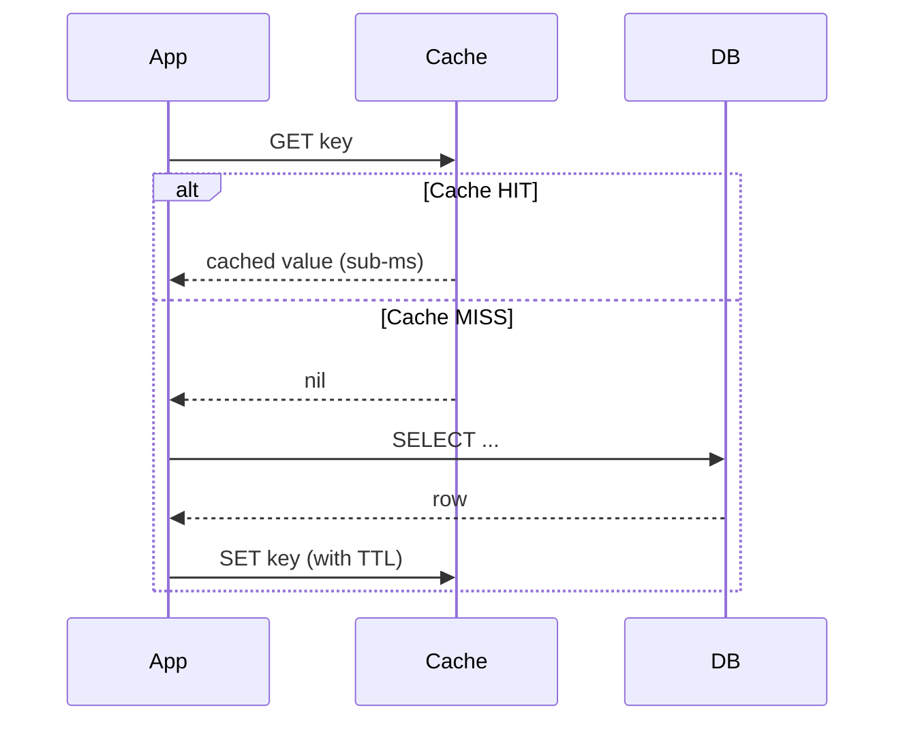

*Walkthrough:* this cache-aside pattern is the mechanism behind every "add caching to speed up
reads" exam scenario — application code (not the database) checks the cache first and populates
it on a miss, with a TTL bounding staleness. A scenario describing stale cached data causing bugs
usually points at a TTL/invalidation design problem, not a reason to abandon caching entirely.


*A primary node accepts writes; replica nodes serve reads and provide automatic failover if the
primary fails — conceptually similar to RDS Multi-AZ, but entirely in-memory and far faster to
fail over. Because Redis replication is asynchronous, a failover during a write burst can lose the
most recent, not-yet-replicated writes — the one meaningful durability tradeoff versus a true
database. Source: [Amazon ElastiCache for Redis User Guide](https://docs.aws.amazon.com/AmazonElastiCache/latest/dg/WhatIs.html).*

**Exam Tips:**
- Cache-aside is the default assumed pattern unless a question specifically describes
  write-through or write-behind — know all three exist, but cache-aside is the one to reach for
  by default.
- Redis Sorted Sets are the specific reason Redis is chosen over Memcached far more often than
  "it has persistence" — ranking comes from the native data structure, not app-side sorting.
- "Sub-millisecond caching for session data" → ElastiCache, not a database read replica (replicas
  still hit disk/engine overhead; a cache doesn't).

**Full doc:** [`services/database/elasticache.md`](../../../services/database/elasticache.md)

---

## 18. Amazon DocumentDB

**Definition:** DocumentDB is a managed document database that speaks the MongoDB wire protocol —
your existing MongoDB drivers, queries, and tools work against it — while AWS handles the
underlying infrastructure, scaling, backups, and patching.

**Plain-English Analogy:** DocumentDB is like a moving company that drives the exact same truck
and uses the exact same loading ramps your business already owns (MongoDB drivers/queries), but
you no longer have to maintain the truck's engine yourself (replica sets, sharding, failover).

**Purpose:** many applications naturally model data as flexible, nested JSON-like documents —
user profiles with arbitrary preferences, catalogs with wildly different attributes per category.
MongoDB became the dominant engine for this, but self-hosting (or MongoDB Atlas) means managing
replica sets and sharding yourself. DocumentDB implements the MongoDB wire protocol/API surface
on AWS's own distributed storage engine (borrowing Aurora's decoupled-storage design) — it is not
literally running MongoDB's own server code, so feature parity trails upstream MongoDB somewhat.

**When to Use:** lift-and-shift of an existing MongoDB-backed application; content management
systems with per-content-type varying schema; user profile stores with flexible, evolving
preference fields; catalogs with deeply nested product variants read together as one unit.

**When NOT to Use:** no existing MongoDB investment starting fresh (consider DynamoDB — it scales
further and is cheaper at extreme scale, though less query-flexible); genuinely relational data
with foreign keys and multi-table transactions (RDS/Aurora); needing the very latest native
MongoDB features (DocumentDB trails upstream version support); graph traversal/relationship-centric
queries (Neptune).

**Use Cases:**
1. **Lift-and-shift of an existing MongoDB-backed application** — driver code, aggregation
   pipelines, and queries unchanged; only the operational burden moves to AWS.
2. **Content management system with per-content-type varying schema** — articles, videos, and
   product pages each have different metadata shapes, modeled as documents rather than sparse
   relational tables.
3. **User profile store with flexible, evolving preference fields** — documents naturally absorb
   new optional fields per user without schema migrations.
4. **Catalog with deeply nested product variants** — a single product document embeds variants
   and specs as nested arrays, read together in one query rather than multiple JOINs.
5. **Multi-Region read scaling with Global Clusters** — serves local reads with low replication
   lag across Regions, promotable during a regional failure.
6. **Write-heavy workload outgrowing a single primary's throughput** — Elastic Clusters shard
   writes across multiple underlying clusters while preserving MongoDB query capability.

**Why Important:** DocumentDB's entire value proposition is "you already know/use MongoDB" — it's
not meant to out-scale DynamoDB, it's meant to avoid a rewrite for teams with existing MongoDB
investment. SAA-C03 occasionally tests this as a direct distractor against DynamoDB for
document-shaped data.

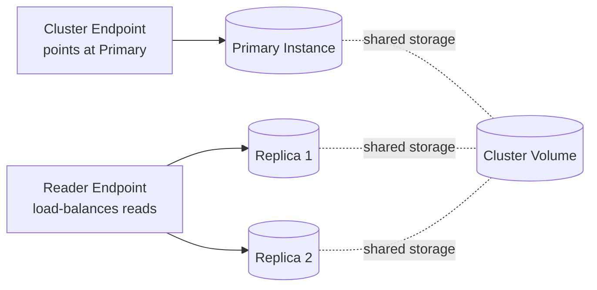

*Walkthrough:* because DocumentDB replicas share the same underlying storage volume as the
primary (the Aurora-family architecture), failover promotion is fast — the promoted replica
doesn't need to "catch up" on data it doesn't already have, unlike a traditional MongoDB replica
set where secondaries hold their own full data copy and must apply the oplog to stay current.


*The cluster endpoint always points at the current primary for writes; the reader endpoint
load-balances read-only connections across all available replicas automatically, picking up newly
added replicas without application config changes. Source: [Amazon DocumentDB Developer Guide —
Overview of Amazon DocumentDB endpoints](https://docs.aws.amazon.com/documentdb/latest/developerguide/docdb-connect-to-replica-set.html).*

**Exam Tips:**
- "Already uses MongoDB drivers/aggregation pipeline, wants minimal rewrite" is the single
  clearest DocumentDB tell versus DynamoDB.
- Don't assume 100% MongoDB feature parity — DocumentDB's supported API version trails upstream
  MongoDB; a scenario needing a specific cutting-edge MongoDB feature may need actual MongoDB/Atlas.
- "Document-shaped data" alone doesn't mean DocumentDB — if there's no existing MongoDB
  investment, DynamoDB is usually the cheaper, more scalable default.

**Full doc:** [`services/database/documentdb.md`](../../../services/database/documentdb.md)

---

## 19. Amazon Neptune

**Definition:** Neptune is a managed graph database built to store and rapidly traverse data
that's fundamentally about relationships between things — who knows whom, what connects to what —
rather than rows, documents, or key-value pairs.

**Plain-English Analogy:** Neptune is like navigating a subway map by literally walking the
tracks from station to station, versus a relational database's approach of cross-referencing
every possible station-pair in a giant spreadsheet each time you ask "how do I get from A to F" —
the subway-walk approach stays fast no matter how big the map gets, because each step only looks
at the next station, not the whole system.

**Purpose:** some data is naturally graph-relational, not SQL-relational — social networks, fraud
detection (accounts connected through shared devices), recommendation engines, knowledge graphs.
Modeling this in SQL means endless self-joins that get slower with every additional "hop." A
relational JOIN at depth N computes and materializes intermediate result sets that can grow
combinatorially; a graph engine walks edges directly using adjacency information, so the cost per
hop stays roughly constant regardless of how many hops came before.

**When to Use:** "people you may know" social recommendations (2-3 hop friend-of-friend
traversal); fraud ring detection via shared devices/payment methods several hops apart; knowledge
graphs for regulated domains needing RDF/SPARQL; IT/network dependency mapping; link prediction
via Neptune ML (graph neural networks).

**When NOT to Use:** data isn't really about relationships — standard transactional records (use
RDS/Aurora, don't model simple one-to-many data as a graph for sophistication's sake); simple
key-value lookups at massive scale with no traversal logic (DynamoDB); shallow 1-2 hop
relationships better served by a DynamoDB adjacency list or secondary index.

**Use Cases:**
1. **"People you may know" social recommendations** — a 2-3 hop traversal through FRIENDS_WITH
   edges finds mutual connections, which Neptune walks natively in one query.
2. **Fraud ring detection via shared devices/payment methods** — a 4-hop SQL join chain becomes
   unreadable and slow; Neptune's traversal cost scales with actual graph connectivity.
3. **Product recommendation engine ("customers who bought X also bought Y")** — collaborative
   filtering based on live graph proximity, reflecting current state rather than a stale
   precomputed table.
4. **Knowledge graph/semantic search for regulated domains** — a formal ontology queried via
   SPARQL over RDF triples, specifically when standardized vocabulary/interoperability matters.
5. **Link prediction with Neptune ML** — predicting the likelihood of a new connection (e.g., "is
   this account linked to a known fraud ring") trained directly on graph data via SageMaker.
6. **Organizational hierarchy/reporting-chain queries at large scale** — variable-depth traversal
   once recursive-CTE performance in a relational database becomes a genuine measured bottleneck.

**Why Important:** Neptune is the direct answer whenever a scenario's query pattern is "starting
from this node, walk relationships N hops out" — recognizing this shape (not the data's surface
appearance) is the actual tested skill. Forcing a genuinely shallow one-to-many relationship into
Neptune is explicitly called out as an anti-pattern.

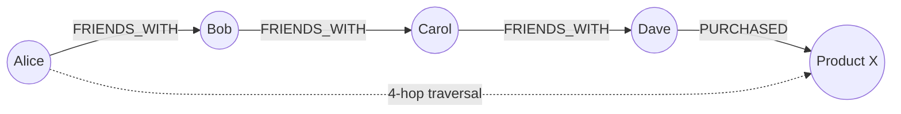

*Walkthrough:* a "find products purchased by friends-of-friends-of-friends" query is a direct walk
along existing adjacency structures — cost scales with edges actually traversed, bounded by real
connectivity, not total dataset size. The same query in SQL needs 3-4 self-joins, each ballooning
intermediate result sets past what query planners can optimize well beyond 2-3 joins.


*Neptune Workbench's Jupyter-notebook-based visual rendering of query paths is useful for
interactively exploring and debugging graph traversal results — seeing the actual path a query
walked is often the fastest way to confirm a traversal is doing what you expect. Source: [Amazon
Neptune User Guide — Visualizing graphs](https://docs.aws.amazon.com/neptune/latest/userguide/notebooks-visualization.html).*

**Exam Tips:**
- The query pattern "walk relationships N hops out" is the tell, regardless of how the data is
  superficially described (social, fraud, recommendations, dependency mapping — all the same
  shape).
- Property graph (Gremlin/openCypher) vs. RDF (SPARQL) is chosen per cluster, not mixed — RDF is
  specifically for formal ontologies/standardized vocabularies (life sciences, regulatory).
- Explicitly recognize the "simple one-to-many relationship modeled as a graph" anti-pattern — a
  question testing this wants you to say RDS/DynamoDB, not Neptune, despite surface-level graph
  vocabulary.

**Full doc:** [`services/database/neptune.md`](../../../services/database/neptune.md)

---

## 20. Amazon Redshift

**Definition:** Redshift is a managed data warehouse — a database built specifically to run
complex analytical queries across billions of rows of historical data quickly, rather than to
handle fast, small transactions.

**Plain-English Analogy:** if an OLTP database is a librarian fetching one specific book by call
number instantly, Redshift is a team that can simultaneously flip through every book in the
library counting how many mention a specific topic — a different job entirely, optimized for
breadth-across-everything rather than one precise lookup.

**Purpose:** operational databases are optimized for lots of small, fast reads/writes of
individual records; analysts need the opposite — huge, complex queries aggregating millions or
billions of historical rows at once. Running that against a live OLTP database competes with
production traffic and is slow anyway, because row-store layout isn't suited to wide-scan,
few-column aggregation. Redshift's columnar storage (column-by-column, not row-by-row) plus
massively parallel processing (MPP) are purpose-built for exactly this opposite I/O shape.

**When to Use:** executive BI dashboards aggregating years of sales/usage data; centralizing data
from many operational systems into one queryable warehouse; near-real-time analytics via zero-ETL
from Aurora/RDS; Lake House architectures querying both hot Redshift data and cold S3 data via
Spectrum.

**When NOT to Use:** fast lookups/updates of individual records for a live application (RDS/
Aurora/DynamoDB); occasionally querying data already in S3 without wanting to manage/pay for a
cluster at all (Athena is simpler and cheaper for genuinely infrequent, ad-hoc analytics);
unstructured big-data processing needing custom Spark code (EMR).

**Use Cases:**
1. **Executive BI dashboard aggregating years of sales/usage data** — columnar storage and MPP
   make a "revenue by region by month for 3 years" query fast where row-store OLTP would compete
   with production traffic and still be slow.
2. **Centralizing data from many operational systems into one queryable warehouse** — analysts
   query one place with standard SQL instead of federating across source systems.
3. **Near-real-time analytics on live transactional data via zero-ETL** — fresher data with less
   pipeline maintenance than scheduled Glue/EMR batch jobs.
4. **Lake House architecture querying both hot Redshift data and cold S3 data together** — recent
   data lives natively in Redshift; historical data stays in S3, queried via Spectrum without
   duplicating storage.
5. **Intermittent, bursty analytical workload (quarterly close reporting)** — Redshift Serverless
   avoids paying for a provisioned cluster idle 11 weeks out of 13.
6. **Historical log/clickstream analysis for product analytics** — billions of event rows queried
   by time range and dimension, where DynamoDB Scans would be slow and expensive at this volume.

**Why Important:** OLTP and OLAP workloads have opposite I/O shapes — trying to make one storage
engine excellent at both is why "just run the report against production" always eventually becomes
a real operational problem. SAA-C03 Domain 3.5/3.3 tests recognizing analytical workload shape and
routing it to Redshift rather than adding read replicas indefinitely to an OLTP database.

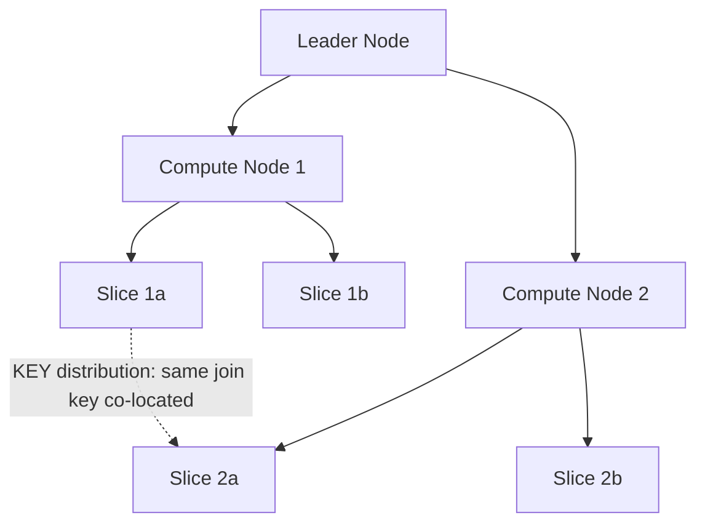

*Walkthrough:* each compute node is further divided into slices processing their own portion of
data in parallel. **KEY distribution** co-locates matching join-key rows on the same slice,
avoiding expensive cross-node shuffling; **ALL distribution** copies small dimension tables to
every node; **EVEN distribution** (the default) spreads rows round-robin. Choosing the wrong
distribution style causes **data skew** — the single most common real-world Redshift performance
problem, conceptually the same failure mode as a DynamoDB hot partition.


*The Leader Node receives the SQL query, builds an execution plan, and splits work across Compute
Nodes, each scanning only its own slice of data — this parallelism is why Redshift can scan
billions of rows in seconds rather than minutes/hours. Source: [Amazon Redshift Getting Started
Guide — Data warehouse system architecture](https://docs.aws.amazon.com/redshift/latest/gsg/getting-started.html).*

**Exam Tips:**
- Columnar storage + MPP is the mechanical reason Redshift beats row-store OLTP databases for
  wide-scan aggregation — know *why*, not just *that* it's faster.
- "Occasional, low-volume querying of data in S3, don't want to manage a cluster" → Athena, not
  Redshift (even Serverless) — Redshift earns its keep once volume/complexity/concurrent users grow.
- A `date`-based sort key on a huge fact table is the highest-leverage schema decision for queries
  almost always filtered by date range, via zone-map block-skipping.

**Full doc:** [`services/database/redshift.md`](../../../services/database/redshift.md)

---

## 21. Database Selection Guide

**Definition:** not a single service — the decision framework for picking which AWS database to
use for a given workload: relational (RDS/Aurora), key-value/NoSQL (DynamoDB), in-memory
(ElastiCache), document (DocumentDB), graph (Neptune), or analytical/data warehouse (Redshift).

**Plain-English Analogy:** this is a toolbox, not one multi-tool — a screwdriver, hammer, and
wrench each do one job better than a Swiss Army knife would, and a real workbench (application)
usually needs three or four different tools simultaneously, not one tool trying to do everything.

**Purpose:** AWS deliberately offers many different databases because different workloads
genuinely trade off against each other — you cannot simultaneously optimize for unlimited
horizontal write scale, complex ad-hoc joins, strict ACID across many tables, sub-millisecond
latency, and petabyte-scale analytical aggregation in one engine. This is "polyglot persistence" —
using multiple purpose-built databases within one system, each handling the part it's actually
good at.

**When to Use:** every new system's data-layer design should start here — list distinct data
needs separately (most real systems have 2-4 genuinely different shapes: transactional, cache,
analytical, relationship-heavy) rather than assuming one database serves everything.

**When NOT to Use (anti-patterns):** putting analytical workloads on your OLTP database; forcing a
graph problem into relational tables past 2-3 hops; choosing DynamoDB because it's "the scalable
one" when access patterns are still unknown/evolving; adding a cache before confirming the database
is actually the bottleneck; splitting a single logical transaction across two different database
services (no native two-phase commit across them).

**Use Cases:**
1. **E-commerce order system, banking ledger** → RDS or Aurora — strict relational consistency
   and multi-table JOINs are the default mode of operation, not an exception.
2. **Shopping cart, gaming leaderboard, IoT device state at massive scale** → DynamoDB — flat
   single-digit-millisecond latency regardless of table size, with known/simple access patterns.
3. **Quarterly revenue report across 3 years of sales data** → Redshift — columnar storage and MPP
   make wide, aggregate-heavy queries over billions of rows fast.
4. **Content management system already built on MongoDB** → DocumentDB — wire protocol
   compatibility means existing driver code/queries/aggregation pipelines work unchanged.
5. **Fraud ring detection, "people you may know," recommendation engine** → Neptune — multi-hop
   traversal cost scales with actual graph connectivity, not combinatorial JOIN blowup.
6. **Mixed workload: structured metadata plus large binary files** → split across services —
   metadata in RDS/DynamoDB, files in S3, database holds only a reference.

**Why Important:** the single most expensive and hardest-to-reverse architecture decision in most
systems is the choice of primary data store — migrating between database families after the fact
often means redesigning the entire data access layer, not just a connection string. SAA-C03 Domain
3.3 *is this decision tree*, almost verbatim.

```mermaid
flowchart TD
    Start{What's the primary workload?} -->|Bulk analytics / BI| Redshift[Amazon Redshift]
    Start -->|Operational, one record at a time| Q2{Strict relational structure<br/>needing JOINs + ACID?}
    Q2 -->|Yes| Q3{Massive write throughput,<br/>high availability?}
    Q3 -->|Yes| Aurora[Amazon Aurora]
    Q3 -->|No, moderate scale or Oracle/SQL Server| RDS[Amazon RDS]
    Q2 -->|No, flexible schema| Q4{Core pattern = walk relationships<br/>between many entities?}
    Q4 -->|Yes| Neptune[Amazon Neptune]
    Q4 -->|No| Q5{Existing MongoDB drivers/queries?}
    Q5 -->|Yes| DocumentDB[Amazon DocumentDB]
    Q5 -->|No, known access patterns| DynamoDB[Amazon DynamoDB]
```

*Walkthrough:* the fastest way to narrow the right database is asking, in order — is this data
operational or analytical? If operational, does it need strict relational structure? If not, is
relationship-traversal the actual core query pattern? Only after those forks does "document vs.
key-value" even become the relevant question — and caching (ElastiCache/DAX) is always an overlay
on top of whatever answer this tree gives, never the primary store itself.


*The same Redshift MPP architecture shown in its own section above anchors the very first fork of
this decision tree — "bulk analytics / BI / historical aggregation" is a complete, standalone
answer the moment it's recognized, regardless of what the underlying operational system looks
like. Source: [Amazon Redshift Getting Started Guide](https://docs.aws.amazon.com/redshift/latest/gsg/getting-started.html).*

**Exam Tips:**
- A scenario bundling two distinct needs (e.g., "friends playing now" + "leaderboard with
  microsecond reads") is testing whether you recognize it as *two* database decisions, not one.
- "Unknown, likely-to-change access patterns" is a deliberate tie-breaker phrase pointing toward
  relational (RDS/Aurora), away from DynamoDB's upfront-design-heavy model.
- Large binary files never belong directly in any of these databases — the correct answer is
  always S3 plus a reference/URL stored in whichever database holds the metadata.

**Full doc:** [`services/database/database-selection-guide.md`](../../../services/database/database-selection-guide.md)

---

## 22. Niche Database Services

**Definition:** three lower-exam-weight database services — **Aurora Serverless** (an auto-scaling
capacity mode of Aurora), **Amazon Keyspaces** (managed, Cassandra-API-compatible wide-column
database), and **Amazon QLDB** (a managed ledger database with cryptographically verifiable
history).

**Plain-English Analogy:** Aurora Serverless is a utility bill that scales with actual usage
instead of a flat monthly rate; Keyspaces is Cassandra with someone else maintaining the
ring/cluster for you; QLDB is a notarized, tamper-evident logbook where every page's seal
incorporates the previous page's seal, so altering any past entry breaks every seal after it.

**Purpose:** each of these answers a specific compatibility or guarantee need that the mainline
database services don't directly cover — Aurora Serverless for workloads whose *load itself*
varies unpredictably, Keyspaces for organizations with existing Cassandra investment wanting it
fully managed, QLDB for data needing mathematical (not just procedural) proof against tampering.

**When to Use:** Aurora Serverless for spiky/unpredictable relational workloads (dev/test, new
apps with unknown traffic, SaaS tenants with variable load); Keyspaces for existing Cassandra/CQL
applications wanting to stop operating clusters by hand; QLDB for financial/supply-chain/insurance
records needing provable, immutable audit history.

**When NOT to Use:** Aurora Serverless v1 specifically for latency-critical production traffic
that can't tolerate a cold-start pause (use v2, or provisioned Aurora); Keyspaces when there's no
existing Cassandra investment (DynamoDB is usually the more natural fresh-start choice); QLDB for
a routine audit-log need that doesn't require cryptographic tamper-evidence (a plain audit table
in RDS/DynamoDB is simpler) or for multi-party trust scenarios (Amazon Managed Blockchain, since
QLDB is a centralized ledger owned by one party).

**Use Cases:**
1. **SaaS company with highly unpredictable new-product adoption** — Aurora Serverless v2 scales
   compute within seconds as load increases and back down afterward, avoiding both over-sized
   fixed capacity and a manual resize during a live traffic surge.
2. **Existing high-write-throughput IoT sensor data store on Cassandra** — migrating to Keyspaces
   keeps the exact same CQL queries and driver code running, now fully managed.
3. **Insurance company needing auditable, tamper-evident claim-change history** — QLDB's
   hash-chained journal provides regulator-verifiable proof natively, instead of a trusted
   audit-log table.
4. **Dev/test database used only a few hours a day** — Aurora Serverless v1's pause/resume model
   is acceptable here specifically because latency-tolerance is explicit.
5. **Financial transaction ledger needing cryptographic proof of non-tampering** — QLDB's digest
   can be requested and independently verified against the chain at any time.
6. **Organization standardizing on managed, API-compatible replacements for self-hosted open-source
   engines** — Keyspaces (Cassandra), DocumentDB (MongoDB), and Aurora (MySQL/PostgreSQL) all
   follow the identical "same API, fully managed" pattern.

**Why Important:** these three round out the SAA-C03 database appendix's lower-weight but still
directly-tested services — each has a distinctive exam-trigger phrase that, once recognized, makes
the answer unambiguous rather than a guess among several plausible-sounding database names.

```mermaid
flowchart LR
    T1[Transaction 1] --> B1["Journal Block 1<br/>hash = H(data1)"]
    T2[Transaction 2] --> B2["Journal Block 2<br/>hash = H(data2 + H(Block1))"]
    T3[Transaction 3] --> B3["Journal Block 3<br/>hash = H(data3 + H(Block2))"]
    B1 -.->|chained hash| B2
    B2 -.->|chained hash| B3
```

*Walkthrough:* QLDB's journal blocks chain hashes together exactly like a blockchain — each
block's hash incorporates the previous block's hash, so altering any past entry breaks every
subsequent hash in the chain, making tampering mathematically detectable rather than merely
procedurally discouraged. QLDB exposes a cryptographic digest you can request and independently
verify at any time.


*A client program accesses Amazon Keyspaces by connecting to a predetermined endpoint and issuing
standard CQL statements — identical to how it would talk to self-hosted Cassandra, except AWS now
owns everything below the API surface (ring topology, repair jobs, node replacement). Source:
[Amazon Keyspaces Developer Guide — How it works](https://docs.aws.amazon.com/keyspaces/latest/devguide/how-it-works.html).*

**Exam Tips:**
- "Infrequent, unpredictable, variable workload, pay only for what you use, scale to zero" →
  Aurora Serverless; distinguish v1's cold-start pause from v2's fine-grained, no-connection-drop
  scaling when a question's details hinge on exactly that difference.
- "Apache Cassandra," "CQL," "wide-column," "existing Cassandra workload, want it managed" →
  Amazon Keyspaces — the direct Cassandra-compatibility analog to DocumentDB/Aurora.
- "Immutable," "cryptographically verifiable," "tamper-evident," "complete history of every
  change" → QLDB; "single company, one source of truth owned by us" points to QLDB, while
  "multiple independent organizations, no single trusted party" points to blockchain instead.

**Full doc:** [`services/database/niche-database-services.md`](../../../services/database/niche-database-services.md)

---

# Task 3.4 — High-Performing and Scalable Network Architectures

## 23. Amazon VPC

**Definition:** a VPC is your own private, logically isolated slice of the AWS network — a
virtual data center you fully control: you pick the IP address range, carve it into
sub-networks, decide what can talk to the internet, and decide what can talk to what.

**Plain-English Analogy:** a VPC is an entire gated office park you design from a blank lot —
you decide how many buildings (subnets) go where, which buildings have a street-facing door
(public subnets with an Internet Gateway route) and which are accessible only from inside the
park (private subnets), and every door has its own lock (security groups).

**Purpose:** before VPC existed, every EC2 instance landed on a single flat, shared network with
almost no control over IP addressing, isolation, or topology. VPC gives each customer the
networking experience of running their own physical data center — subnets, routing, firewalls,
address planning — without owning a single router or cable. It's the foundational layer every
other networking service is built on top of.

**When to Use:** every production AWS workload needs a deliberately-designed custom VPC (not the
auto-created default VPC); multi-tier applications needing isolation between web/app/data tiers;
hybrid cloud connectivity requiring careful CIDR planning; regulatory workloads needing an
architecturally enforced zero-internet-path isolated subnet.

**When NOT to Use:** a quick throwaway Lambda with no VPC-only resource access (VPC-attached
Lambdas add cold-start/ENI overhead and need a NAT Gateway for internet access); static website
hosting (S3 + CloudFront needs no VPC at all).

**Use Cases:**
1. **Multi-tier web application** — a VPC's subnet/route-table model enforces tier isolation
   natively (public subnet for web, private subnets for app/data) so a compromised web server
   can't reach the database directly.
2. **Hybrid cloud connectivity** — a VPC with a deliberately chosen, non-overlapping CIDR plus
   VPN/Direct Connect lets on-prem and AWS-side resources address each other by private IP.
3. **Multi-Region disaster recovery** — a second VPC in the DR Region, CIDR-planned not to
   collide with the primary, enables failover via Route 53 or peering/Transit Gateway.
4. **Microservices/container platform networking** — secondary CIDR blocks (often from the
   `100.64.0.0/16` CGNAT range) solve IP-per-pod exhaustion that the VPC CNI creates on EKS.
5. **Regulatory/compliance network isolation** — an isolated subnet with no IGW/NAT route, only
   VPC endpoints for the exact AWS services needed, gives an architecturally enforced isolation
   boundary, not just a written policy.
6. **Multi-account landing zone** — each account gets its own VPC(s) built from a standard CIDR
   allocation plan, stitched together via Transit Gateway for centralized routing/segmentation.

**Why Important:** VPC design mistakes are the single most common source of both security
incidents (overly permissive default VPCs, misconfigured public subnets exposing databases) and
outages (CIDR overlap blocking a merger/VPN, running out of IP space). SAA-C03 Domain 1 and
Domain 3 Task 3.4 both treat VPC fundamentals as the single most tested foundational topic.

```mermaid
flowchart TD
    Start(["Given a subnet, check its associated route table"])
    Q1{"Does it have a route 0.0.0.0/0 -> igw-xxxx?"}
    Q2{"Does it have a route 0.0.0.0/0 -> nat-gateway-id?"}
    Public["PUBLIC subnet"]
    Private["PRIVATE subnet (outbound-only via NAT)"]
    Isolated["ISOLATED subnet (no internet path at all)"]
    Start --> Q1
    Q1 -- Yes --> Public
    Q1 -- No --> Q2
    Q2 -- Yes --> Private
    Q2 -- No --> Isolated
```

*Walkthrough:* whether a subnet is "public" or "private" isn't a setting on the subnet itself —
it's purely determined by its route table. This decision tree resolves the majority of "is this
subnet exposed to the internet" exam questions without needing any other scenario context, and is
worth memorizing cold.


*A subnet is always 100% inside one AZ — this is why at least 2 subnets (one per AZ) are needed
for high availability. The Internet Gateway is the VPC's single door to the public internet,
attached once at the VPC level. Source: [Amazon VPC User Guide — What is Amazon VPC?](https://docs.aws.amazon.com/vpc/latest/userguide/what-is-amazon-vpc.html).*

**Exam Tips:**
- Public vs. private subnet is entirely a route-table fact, not a subnet "setting" — read the
  route table, not the subnet's label.
- Always leave CIDR headroom — running out of address space in a live VPC is a painful fix
  (secondary CIDR block, which complicates routing, or re-IP'ing everything).
- "An existing, populated VPC has run out of IP space" → attach a secondary CIDR block, not a
  full VPC rebuild.

**Full doc:** [`services/networking-content-delivery/vpc.md`](../../../services/networking-content-delivery/vpc.md)

---

## 24. Elastic Load Balancing

**Definition:** ELB is AWS's managed service for automatically distributing incoming traffic
across multiple targets so no single server gets overwhelmed and traffic keeps flowing even if
some targets fail — in four flavors: Application Load Balancer (ALB), Network Load Balancer (NLB),
Gateway Load Balancer (GWLB), and legacy Classic Load Balancer (CLB).

**Plain-English Analogy:** ALB is a receptionist who reads each visitor's request and directs them
to the correct department (path-based routing); NLB is a express turnstile that just lets traffic
through at maximum speed without reading anything about it; GWLB is a hidden security checkpoint
everyone passes through without knowing it's there.

**Purpose:** before ELB, scaling meant manually running your own load-balancing software — itself
a single point of failure you had to patch and keep highly available. ELB is fully managed,
horizontally scaling, and integrates natively with Auto Scaling, health checks, and (for ALB)
application-layer routing logic.

**When to Use:** ALB for HTTP/HTTPS path/host-based routing, WebSocket, Cognito authentication at
the load balancer; NLB for millions of requests/sec, microsecond latency, a fixed static IP per
AZ, or TLS passthrough for compliance; GWLB for transparently inserting third-party security
appliances into a traffic path across many VPCs.

**When NOT to Use:** single-instance workloads with no scaling need (adds cost/latency for no
benefit); global multi-Region traffic steering by latency/health (use Route 53 or Global
Accelerator, which sit above ELB); deep L7 business-rule routing beyond simple path/host rules
(consider API Gateway).

**Use Cases:**
1. **Multi-tier web application front door** — an ALB handles HTTPS termination, path-based
   routing, and health-check-driven failover across an Auto Scaling group natively.
2. **Hybrid cloud API front end with static IP allowlisting** — an NLB (or Global Accelerator in
   front of an ALB) provides the fixed IP a partner firewall requires, which ALB alone cannot.
3. **Compliance-driven TLS passthrough** — NLB in TCP mode forwards encrypted bytes without ever
   decrypting them, satisfying a "load balancer must never access decrypted traffic" requirement.
4. **Third-party security appliance insertion across many VPCs** — a Gateway Load Balancer, paired
   with GWLB endpoints per VPC, inserts a firewall/IDS transparently with no client/server changes.
5. **Blue/green and canary deployments** — weighted target groups on a single ALB listener rule
   shift traffic instantly, with no DNS propagation delay, unlike Route 53 weighted records.
6. **Extreme low-latency, non-HTTP backend** — a trading platform or gaming backend needing raw
   TCP/UDP at the lowest possible latency fits NLB's Layer 4 design precisely.

**Why Important:** choosing the wrong load balancer type is a common production mistake — e.g.
using ALB for non-HTTP TCP (it can't route it correctly) or NLB when host/path routing is
actually needed (NLB is blind to HTTP content). SAA-C03 Domain 3 Task 3.4 tests the ALB vs. NLB
vs. GWLB distinction as one of the most reliably tested single topics on the whole exam.

```mermaid
sequenceDiagram
    participant Client as Client Browser
    participant ALBNode as ALB Node
    participant TG as Target Group
    participant Target as EC2 Target

    Client->>ALBNode: TCP SYN, TLS ClientHello
    Note over ALBNode: TLS handshake terminates HERE
    ALBNode->>TG: decrypted HTTP request routed by listener rule
    TG->>Target: NEW connection, X-Forwarded-For header added
    Target-->>TG: HTTP response
    TG-->>ALBNode: response
    ALBNode-->>Client: HTTPS response (re-encrypted)
```

*Walkthrough:* the ALB terminates the client's TLS connection and opens a *separate* connection
to the target — this is why the target only ever sees the ALB's internal IP as the source unless
it reads `X-Forwarded-For`. Contrast with NLB, which in its default mode does *not* terminate the
TCP connection — it preserves the original client IP natively because it's forwarding, not
re-originating, the connection.


*A listener evaluates rules by priority and routes to a target group; one target can be
registered with multiple target groups. Content-based routing at the ALB is itself a performance
pattern — splitting traffic across independently-scaled target groups so a spike in one path
triggers scaling only for the target group actually under load. Source: [Elastic Load Balancing —
What is an Application Load Balancer?](https://docs.aws.amazon.com/elasticloadbalancing/latest/application/introduction.html).*

**Exam Tips:**
- "Path-based routing" → ALB; "millions of requests per second" or "static IP" → NLB — the
  exam's distinguishing clue is almost always one of these two phrasings.
- NLB preserves client IP natively at the packet level; ALB needs `X-Forwarded-For` because it
  re-originates the connection — this distinction is tested constantly.
- Classic Load Balancer is never the right "new design" answer — if a scenario describes a CLB in
  use today, the fix is migrating to ALB or NLB depending on traffic type.

**Full doc:** [`services/networking-content-delivery/elastic-load-balancing.md`](../../../services/networking-content-delivery/elastic-load-balancing.md)

---

## 25. Amazon CloudFront

**Definition:** CloudFront is AWS's Content Delivery Network (CDN) — a globally distributed
network of caching servers ("edge locations") that stores copies of your content physically close
to users, so it loads faster and your origin server handles far less direct traffic.

**Plain-English Analogy:** CloudFront is a chain of neighborhood branch libraries that each keep a
copy of the most popular books — most readers never have to travel to the one central archive
(your origin) at all, and the archive only ever has to produce one copy per branch, not one copy
per reader.

**Purpose:** without a CDN, every user request — Tokyo or São Paulo — travels all the way to
wherever your server lives, adding latency and putting full load on that one origin. CloudFront
caches content at hundreds of edge locations worldwide so most requests are answered from a
nearby cache, and absorbs traffic spikes/DDoS attempts at the edge before they reach your actual
infrastructure.

**When to Use:** global content delivery for static websites/SPAs; dynamic API acceleration even
with caching disabled (optimized backbone routing + edge-absorbed DDoS protection); multi-Region
origin failover for high availability; video-on-demand with signed cookies restricting access by
subscription.

**When NOT to Use:** purely internal, VPC-only traffic with no external users (a CDN exists to
shorten distance to end users); extremely low/unpredictable traffic with tight cost sensitivity
and no latency requirement (serving directly from origin may be simpler).

**Use Cases:**
1. **Global content delivery for a static website** — S3 + CloudFront is the canonical pattern,
   cutting both latency and origin load dramatically.
2. **Multi-tier application API acceleration** — a mostly-uncacheable API still benefits from
   CloudFront's optimized backbone routing and edge-absorbed DDoS protection.
3. **Multi-Region origin failover for high availability** — an origin group with primary and
   secondary origins fails over automatically on configured error codes, faster than DNS TTL wait.
4. **Compliance-driven private content distribution** — signed cookies scoped to `/videos/*` plus
   Origin Access Control on the S3 origin ensure only authenticated subscribers can stream.
5. **Software/game distribution at scale** — edge caching plus CloudFront's optimized long-haul
   network keep download times low worldwide for large installers/game assets.
6. **DDoS-resilient public front door** — every distribution includes AWS Shield Standard
   automatically at no extra cost.

**Why Important:** CloudFront is frequently the cheapest, highest-leverage performance improvement
available — moving static assets behind a CDN can cut page load time dramatically and reduce
origin infrastructure cost. SAA-C03 Domain 3 (High-Performing Architectures) explicitly lists CDN
as a core performance pattern, usually paired with S3 as the origin.

```mermaid
flowchart TB
    Viewer((Viewer))
    POP["Edge Location (POP) - closest to viewer"]
    REC["Regional Edge Cache - larger, longer-lived"]
    Origin["Origin"]
    Viewer --> POP
    POP -->|"cache miss"| REC
    REC -->|"cache miss"| Origin
    Origin -->|"object returned"| REC
    REC -->|"cached here too"| POP
    POP -->|"served to viewer, cached at edge"| Viewer
```

*Walkthrough:* this two-tier design means a genuinely rare object doesn't have to be re-fetched
from the origin by *every* edge location independently — once one edge pulls it through a
Regional Edge Cache, other nearby edges get a faster, closer-than-origin cache hit instead of each
needing their own trip all the way back to the origin.


*A viewer's request is routed to the nearest edge location; on a cache miss, CloudFront fetches
from the origin, begins forwarding the response to the viewer as soon as the first byte arrives,
and caches the object for future requests. Source: [Amazon CloudFront Developer Guide — How
CloudFront delivers content](https://docs.aws.amazon.com/AmazonCloudFront/latest/DeveloperGuide/HowCloudFrontWorks.html).*

**Exam Tips:**
- The single biggest lever on cache hit ratio is how narrow the cache key is — including every
  cookie/header/query string in the key can collapse the hit ratio to near-zero even for
  identical content.
- "Cacheable" is the word that should flip an answer between CloudFront and Global Accelerator —
  read scenarios for it explicitly.
- Origin Access Control (OAC) ensures an S3 origin is only reachable through CloudFront, not
  directly — a standard security best-practice pairing, not an optional extra.

**Full doc:** [`services/networking-content-delivery/cloudfront.md`](../../../services/networking-content-delivery/cloudfront.md)

---

## 26. AWS Global Accelerator

**Definition:** Global Accelerator gives your application a small set of static anycast IP
addresses that act as a fixed front door, then routes traffic over AWS's private global network
backbone to the closest, healthiest regional endpoint — improving performance and enabling
near-instant failover at the network layer instead of DNS.

**Plain-English Analogy:** Global Accelerator is like a single, unchanging phone number that
always rings whichever of your company's offices is closest to the caller and currently open —
the caller never has to look up a new number, and if the nearest office suddenly closes, the call
instantly reroutes to the next-nearest one without the caller noticing.

**Purpose:** two persistent problems with internet-routed, DNS-based global traffic management:
the public internet's routing isn't optimized for performance, and DNS-based failover is
inherently slow because clients/resolvers cache answers for the TTL duration. Anycast IPs mean
the same IP is announced from many AWS edge locations, so a user's traffic enters the AWS network
at the nearest edge and travels AWS's private backbone the rest of the way; failover happens by
rerouting at the network layer within seconds — no DNS cache to wait out.

**When to Use:** multi-tier applications needing a fixed IP despite an ALB front end (which has no
native static IP); multi-Region active-active workloads needing sub-minute failover; non-cacheable,
dynamic global traffic (where CloudFront's caching model offers nothing); UDP-based gaming
backends needing custom routing to specific instance:port combinations.

**When NOT to Use:** primarily static/cacheable content (CloudFront is the right tool — Global
Accelerator does not cache anything, it only optimizes the network path); single-Region
applications (gain nothing from it); cost-sensitive workloads where Route 53 TTL-based failover
timing is acceptable.

**Use Cases:**
1. **Multi-tier application needing a fixed IP despite an ALB front end** — Global Accelerator
   provides fixed anycast IPs in front of the existing ALB without re-architecting to NLB.
2. **Multi-Region active-active with sub-minute failover** — a trading platform needs failover
   within seconds of an outage, with partner systems pinned to a fixed, unchangeable IP.
3. **Global content delivery for non-cacheable, dynamic traffic** — Global Accelerator optimizes
   the network path itself rather than caching content, the right tool when nothing is cacheable.
4. **Microservices mesh UDP-based backend** — a gaming matchmaking backend needs the lowest
   possible latency globally, which Global Accelerator explicitly supports (CloudFront is
   HTTP-focused).
5. **Compliance-driven fixed-IP partner integration** — a B2B partner's security team insists on
   allowlisting one specific, unchanging IP rather than a domain name.
6. **Custom routing for gaming session backends** — a custom routing accelerator maps specific
   external ports to specific internal EC2 instance:port combinations across many VPCs.

**Why Important:** applications with hard real-time availability requirements cannot tolerate DNS
TTL delays during a Regional failure — Global Accelerator's sub-minute network-layer failover is
the difference between a blip and a visible outage. SAA-C03 Domain 2 and Domain 3 both reference
it as a distractor/correct-answer pair against Route 53 and CloudFront.

```mermaid
flowchart TB
    Accelerator["Accelerator"]
    subgraph EG_US["Endpoint Group: us-east-1 - Traffic Dial: 70%"]
        EP_US1["ALB (weight 100)"]
    end
    subgraph EG_EU["Endpoint Group: eu-west-1 - Traffic Dial: 30%"]
        EP_EU1["ALB (weight 100)"]
    end
    Accelerator -->|"70% of eligible traffic"| EG_US
    Accelerator -->|"30% of eligible traffic"| EG_EU
```

*Walkthrough:* **Traffic dial** operates at the endpoint group (Region) level — controlling what
percentage of traffic a whole Region's endpoint group is eligible to receive, often used to
gradually bring a newly deployed Region online or drain one ahead of maintenance. **Endpoint
weight** operates within a single endpoint group, distributing that group's share across
individual endpoints in the same Region — a scenario about "gradually shift traffic to a new
Region" is a traffic-dial question; "distribute load unevenly across two ALBs in the same Region"
is an endpoint-weight question.


*Endpoint weights determine what proportion of a listener's traffic each endpoint in a group
receives, calculated as each endpoint's weight divided by the sum of all weights in that group — a
weight of 0 removes an endpoint from rotation entirely without deleting it, useful for draining
ahead of maintenance. Source: [AWS Global Accelerator Developer Guide — How endpoint weights
work](https://docs.aws.amazon.com/global-accelerator/latest/dg/about-endpoints-endpoint-weights.html).*

**Exam Tips:**
- Global Accelerator terminates the client's TCP connection at the nearest edge and opens a
  *separate* new connection over AWS's backbone — conceptually similar to ALB's TLS
  termination-and-reencrypt, just happening at the very edge of AWS's network.
- CloudFront = cacheable content; Global Accelerator = non-cacheable/non-HTTP traffic still
  needing the fastest path — a common exam trap offers both as answer choices for one scenario.
- Setting client affinity to `SOURCE_IP` is the fix for stateful UDP protocols where a client's
  session state lives on one specific server.

**Full doc:** [`services/networking-content-delivery/global-accelerator.md`](../../../services/networking-content-delivery/global-accelerator.md)

---

## 27. AWS Direct Connect

**Definition:** Direct Connect is a dedicated, private physical network connection between your
own data center (or a colocation facility) and AWS — a real fiber link, not a connection that
travels over the public internet at all.

**Plain-English Analogy:** Direct Connect is your own private driveway straight from your house
to the highway on-ramp, versus a Site-to-Site VPN's use of public roads shared with every other
driver — the driveway has guaranteed, predictable capacity, but you have to pay to build it and
it takes weeks to pave.

**Purpose:** connecting to AWS over the public internet gives no guarantees — variable latency,
variable bandwidth, exposure to public network congestion/security surface. For large data
migrations, hybrid applications split between on-prem and AWS, or strict compliance requirements
forbidding public internet traversal, Direct Connect gives a dedicated physical link with
predictable performance and a smaller attack surface.

**When to Use:** hybrid cloud connectivity for large, steady data volumes; multi-tier applications
split across on-prem and AWS with latency-sensitive components on both sides; enterprise-scale
multi-VPC hybrid entry point via Direct Connect Gateway + Transit Gateway; compliance workloads
needing a literal "never touches the internet" guarantee.

**When NOT to Use:** quick setup, low/variable bandwidth, or temporary connectivity needs (Direct
Connect provisioning takes weeks to months — use Site-to-Site VPN, standable in minutes); small/
startup workloads without the budget or physical presence for dedicated circuits; a temporary
bandwidth spike (not an elastic, instantly-scalable resource).

**Use Cases:**
1. **Hybrid cloud connectivity for large, steady data volumes** — the dedicated physical link
   gives predictable bandwidth and lower per-GB rates at volume versus a Site-to-Site VPN.
2. **Multi-tier application split across on-prem and AWS** — a trading system cannot tolerate the
   public internet's variable latency for latency-sensitive cross-boundary traffic.
3. **Multi-Region enterprise hybrid connectivity** — a Direct Connect Gateway extends one physical
   connection's reach across multiple Regions without separate physical connections per Region.
4. **Global content delivery origin ingestion** — a media company ingests massive raw footage
   uploads via a public VIF reaching S3's public endpoint over the dedicated link, not the internet.
5. **Compliance-driven no-internet-traversal requirement** — Direct Connect is the only
   connectivity option that satisfies "never touches the internet" literally (VPN tunnels over it
   by definition).
6. **Direct Connect + VPN backup for automatic failover** — a parallel Site-to-Site VPN, BGP-
   configured with lower route preference, takes over automatically if Direct Connect's BGP
   session drops.

**Why Important:** Direct Connect is a cornerstone of serious enterprise hybrid-cloud architecture
— petabyte-scale migrations or latency-sensitive hybrid systems are impractical over the public
internet. It's also a frequent point of real misunderstanding: many teams assume it's automatically
redundant/encrypted, when neither is true without deliberate extra design.

```mermaid
flowchart TB
    subgraph Basic["Basic (single connection) - NOT resilient"]
        B1["One connection, one DX location"]
    end
    subgraph High["High Resiliency - recommended for production"]
        H1["Two connections, two DX locations, separate devices"]
    end
    subgraph Maximum["Maximum Resiliency - critical workloads"]
        M1["Four connections across two DX locations<br/>separate routers AND separate devices"]
    end
```

*Walkthrough:* AWS explicitly publishes these resiliency tiers because "add a Direct Connect
connection" is not synonymous with "now I have a redundant hybrid link" — a single dedicated
connection remains a single point of failure at the physical layer. Any scenario emphasizing
fault tolerance for Direct Connect specifically needs multiple connections at multiple locations,
not just a bigger single connection.


*All three virtual interface types ride over one physical Direct Connect connection — private VIF
for VPC access, public VIF for AWS public services (S3, DynamoDB) over the dedicated link instead
of the internet, and transit VIF for Transit Gateway access. Source: [AWS Direct Connect User
Guide — What is Direct Connect?](https://docs.aws.amazon.com/directconnect/latest/UserGuide/Welcome.html).*

**Exam Tips:**
- Direct Connect is **not encrypted by default** and **not redundant by default** — both require
  deliberate extra design (MACsec or an overlay VPN for encryption; multiple connections/locations
  for redundancy).
- A scenario naming a specific percentage/bandwidth/latency SLA for hybrid connectivity points at
  Direct Connect, not VPN.
- Direct Connect uses BGP, not static routes — this is what enables automatic failover to a backup
  VPN path when the DX BGP session drops.

**Full doc:** [`services/networking-content-delivery/direct-connect.md`](../../../services/networking-content-delivery/direct-connect.md)

---

## 28. Transit Gateway & VPC Peering

**Definition:** VPC Peering is a direct, one-to-one private network connection between exactly two
VPCs. Transit Gateway is a managed, scalable, central network hub that connects many VPCs, VPN
connections, and Direct Connect attachments through a single point.

**Plain-English Analogy:** VPC Peering is running a direct phone line between two specific offices;
Transit Gateway is installing a central phone switchboard that every office plugs into once,
letting the switchboard route any call to any other connected office without a dedicated wire
between every possible pair.

**Purpose:** as organizations grow past a handful of VPCs, pure peering becomes unmanageable —
peering doesn't transitively route (A peering with B and B peering with C doesn't let A reach C),
so N VPCs needing full connectivity requires roughly N×(N-1)/2 peering connections, a
connection-management nightmare at scale. Transit Gateway replaces that full mesh with a
hub-and-spoke model: every VPC attaches once, and the Transit Gateway routes between all of them
centrally.

**When to Use:** VPC Peering for a narrow, specific two-VPC relationship (e.g., one app VPC
reaching one shared-services VPC) with no plan to add a third party; Transit Gateway for
enterprise-scale multi-VPC/hybrid connectivity, centralized egress architectures, compliance-driven
dev/prod network segmentation, or multicast workload support peering fundamentally cannot provide.

**When NOT to Use:** Transit Gateway for just 2-3 VPCs (adds hourly cost and a hop for no real
benefit); trying to make VPC Peering "transitive" by adding more peering connections as a
workaround at real scale (the exact signal to migrate to Transit Gateway instead); either service
when you only need private access to specific AWS services, not whole-VPC connectivity (use a VPC
Endpoint instead).

**Use Cases:**
1. **Multi-tier application split across shared-services and app VPCs** — a single, narrowly-
   scoped VPC Peering connection is the simplest fit for exactly two VPCs with no hub fee.
2. **Hybrid cloud centralized entry point** — attaching a Direct Connect Gateway and VPN
   connections once to a Transit Gateway lets every attached VPC reach on-prem without a
   connection per VPC.
3. **Multi-Region disaster recovery backbone** — Transit Gateway peering connects two regional
   hubs directly, avoiding a mesh of inter-Region VPC peerings.
4. **Compliance-driven environment isolation** — separate Transit Gateway route tables for dev and
   prod attachments, both with shared-services routes propagated in but not each other's, enforce
   "dev never reaches prod" at the network layer.
5. **M&A account consolidation at scale** — migrating a merged organization's 15+ VPCs to a shared
   Transit Gateway collapses what would be 100+ individual peering connections into one attachment
   per VPC.
6. **Centralized egress architecture** — routing all spoke VPCs' internet-bound traffic through
   one central "egress VPC" attached to the same Transit Gateway reduces NAT Gateway sprawl.

**Why Important:** as companies adopt multi-account AWS strategies, Transit Gateway becomes the
backbone that makes that strategy operationally sane — without it, network engineering teams
drown in peering-connection sprawl. SAA-C03 Domain 2 and Domain 4 Task 4.4 both reference the
peering-vs-Transit-Gateway tradeoff (non-transitivity, connection count at scale, cost) as a
frequently tested comparison.

```mermaid
flowchart LR
    subgraph Peering["VPC Peering - non-transitive"]
        VPCA["VPC A"] <-->|"direct peering"| VPCB["VPC B"]
        VPCB -.->|"peered separately"| VPCC["VPC C"]
        VPCA -.-x|"CANNOT reach C without its own peering"| VPCC
    end
```

*Walkthrough:* even though B can reach both A and C, and traffic could theoretically flow A → B →
C at the network layer, AWS explicitly disallows this — a VPC peering connection only permits
traffic whose source and destination are the two directly peered VPCs. This isn't a
configuration limitation you can work around with route tables — it's an architectural rule of
the peering connection object itself, and the single most tested fact about peering.


*Each VPC's route table sends traffic destined for the other two VPCs to the Transit Gateway,
which routes it at Layer 3 based on destination IP — giving both full-mesh connectivity by default
and fine-grained segmentation (via per-attachment route tables) in one managed service. Source:
[Amazon VPC Transit Gateways — How AWS Transit Gateway works](https://docs.aws.amazon.com/vpc/latest/tgw/how-transit-gateways-work.html).*

**Exam Tips:**
- Non-transitivity is the single most tested peering fact — "A peers with B, B peers with C" does
  NOT mean A can reach C.
- "Many VPCs, growing, hard to manage peering connections" is the Transit Gateway tell; a narrow,
  permanent two-VPC relationship is the peering tell.
- Transit Gateway route table **association** (what an attachment can send traffic *to*) is
  distinct from **propagation** (what other attachments learn about *its* routes) — this
  distinction is exactly how dev/prod segmentation is enforced on a shared hub.

**Full doc:** [`services/networking-content-delivery/transit-gateway-and-peering.md`](../../../services/networking-content-delivery/transit-gateway-and-peering.md)

---

## 29. VPC Endpoints & PrivateLink

**Definition:** a VPC Endpoint lets resources inside a VPC reach an AWS service (or another VPC's
application) without that traffic ever leaving the AWS network or touching the public internet —
no NAT Gateway, no Internet Gateway, no public IP required. AWS PrivateLink is the underlying
technology, also letting you expose your *own* application as a privately-consumable service.

**Plain-English Analogy:** a Gateway Endpoint is a dedicated back-door hallway directly connecting
your building to one specific neighboring building (S3/DynamoDB only), free to use. An Interface
Endpoint is more like a private, secured elevator bank to any other building in the same
business park, with its own small maintenance fee, but still never stepping onto a public street.

**Purpose:** by default, reaching an AWS service's public API endpoint from a private subnet
requires routing out through a NAT Gateway and Internet Gateway, even though the traffic's final
destination is still inside AWS — wasteful (NAT Gateway per-GB cost) and a larger attack surface
than necessary. VPC Endpoints let AWS-service (and PrivateLink-exposed third-party) traffic travel
entirely within AWS's private network, cheaper and more securely.

**When to Use:** removing NAT Gateway from the critical path for S3/DynamoDB-heavy private-subnet
workloads (free Gateway Endpoints); Lambda-in-VPC calling other AWS services (Secrets Manager, SQS,
KMS) without adding a NAT Gateway just for that; compliance requirements that AWS API traffic must
never cross the public internet; SaaS vendors exposing a product privately to many customer VPCs
via PrivateLink.

**When NOT to Use:** public-facing resources meant to be reached over the internet anyway (an
endpoint adds nothing); occasional/low-volume AWS API calls from a subnet that already has a NAT
Gateway for other reasons (the marginal savings may not be worth the interface endpoint's hourly
charge — though Gateway Endpoints are free and always worth adding regardless); connecting whole
VPC networks to each other (that's Peering or Transit Gateway's job, not VPC Endpoints).

**Use Cases:**
1. **Multi-tier application removing NAT Gateway from the critical path** — a Gateway Endpoint
   (S3) plus an Interface Endpoint (Secrets Manager) handle both dependencies with no NAT Gateway
   needed at all.
2. **Hybrid cloud API traffic staying inside AWS** — Interface Endpoints keep AWS-API traffic from
   ever routing out to the internet, even though the instance also has hybrid connectivity.
3. **Global content delivery pipeline processing** — a Gateway Endpoint for S3 removes NAT Gateway
   cost entirely from a typically high-volume read/write path.
4. **Compliance requirement: AWS API traffic must never cross the public internet** — comprehensive
   Gateway + Interface Endpoint coverage for every AWS service touched satisfies PCI-DSS/HIPAA.
5. **SaaS vendor exposing a product privately to customer VPCs** — PrivateLink's Endpoint Service
   model avoids unmanageable peering sprawl as the customer base grows.
6. **Cost optimization retrofit on an existing, running VPC** — adding a free Gateway Endpoint for
   S3 removes that traffic's NAT Gateway cost with zero application changes, often the single
   highest-leverage, lowest-effort network cost optimization available.

**Why Important:** VPC Endpoints are one of the most common, high-value cost-optimization levers
in real AWS bills — teams running S3-heavy workloads from private subnets routinely cut meaningful
NAT Gateway data-processing costs by adding a free Gateway Endpoint. SAA-C03 Domain 4 Task 4.4
names VPC endpoints explicitly as a cost-optimization technique versus NAT Gateway.

```mermaid
sequenceDiagram
    participant App as Application
    participant DNS as VPC-internal DNS
    participant ENI as Interface Endpoint ENI (10.0.1.50)
    participant Service as AWS Service

    App->>DNS: resolve secretsmanager.us-east-1.amazonaws.com
    DNS-->>App: 10.0.1.50 (the ENI's private IP, NOT public)
    App->>ENI: TCP connection to 10.0.1.50:443
    ENI->>Service: forwarded over AWS's private network
    Service-->>App: response, same private path back
```

*Walkthrough:* the DNS override is what makes this invisible to application code — no SDK
configuration or endpoint URL change is required. The application calls the exact same hostname it
always would, and the private hosted zone automatically associated with the interface endpoint
intercepts that DNS query inside the VPC and answers with the private IP instead of letting it
resolve publicly.


*The default path — reaching an AWS service through an Internet Gateway — still technically stays
within the AWS network, but requires a public IP path and an IGW/NAT Gateway hop that an endpoint
removes entirely. Source: [Amazon VPC User Guide — Access AWS services through AWS
PrivateLink](https://docs.aws.amazon.com/vpc/latest/privatelink/privatelink-access-aws-services.html).*

**Exam Tips:**
- Gateway Endpoints (S3, DynamoDB only) are free and implemented as a route-table entry, no ENI —
  always worth adding regardless of traffic volume.
- Interface Endpoints (nearly every other service) create a billed ENI per AZ — a genuine
  cost/operational tradeoff against an existing NAT Gateway for low-volume traffic.
- "Lambda functions in private subnets reach S3 through a Gateway VPC Endpoint rather than a NAT
  Gateway" shaves a network hop off every invocation — a performance win that's also free.

**Full doc:** [`services/networking-content-delivery/vpc-endpoints-privatelink.md`](../../../services/networking-content-delivery/vpc-endpoints-privatelink.md)

---

# Task 3.5 — High-Performing Data Ingestion and Transformation Solutions

## 30. Kinesis Family (Data Streams, Firehose, Data Analytics/Managed Flink)

**Definition:** the Kinesis family is AWS's set of managed services for collecting, buffering, and
processing **streaming** data in near-real-time — Kinesis Data Streams for custom, low-latency
stream processing; Kinesis Data Firehose for zero-code streaming delivery straight into storage/
analytics destinations; and Managed Service for Apache Flink (formerly Kinesis Data Analytics)
for real-time SQL/Flink processing on a stream.

**Plain-English Analogy:** Data Streams is a conveyor belt you build custom robotic arms along to
grab and process items as they pass; Firehose is the same belt with an auto-sorter at the end that
drops items straight into the correct bin (S3, Redshift, OpenSearch) with zero programming;
Managed Flink is a continuously-running calculator sitting over the belt, computing running totals
in real time as items pass by.

**Purpose:** batch processing (run a job nightly, wait hours for results) is fundamentally the
wrong shape for use cases needing answers in seconds — fraud detection, live dashboards, IoT
alerting. The Kinesis family exists to ingest continuous, high-volume event data and let it be
acted upon within seconds of arrival, rather than waiting for the next scheduled batch run.

**When to Use:** custom, multi-consumer, replayable real-time processing (Data Streams); simple
"deliver this stream into S3/Redshift/OpenSearch, maybe lightly transform it" with zero
infrastructure (Firehose); real-time SQL aggregations/anomaly detection directly on a stream
(Managed Flink); any clickstream, IoT telemetry, or log-shipping pipeline needing sub-minute
visibility into events.

**When NOT to Use:** low-volume or non-urgent data where a scheduled batch job (Glue, EMR) is
simpler and cheaper; a need for message queuing/pub-sub with per-message processing guarantees and
dead-letter handling (use SQS/SNS/EventBridge instead — Kinesis is stream-shaped, not
queue-shaped); data that's already comfortably at rest and just needs periodic batch transforms.

**Use Cases:**
1. **Clickstream analytics feeding a real-time dashboard** — Data Streams ingests millions of
   click events/sec, with multiple independent consumer applications (fraud detection, live
   dashboard, data lake archival) reading the same stream in parallel.
2. **IoT telemetry at massive device scale** — thousands of sensors stream readings continuously;
   Firehose delivers them straight into S3 with zero custom consumer code, partitioned by arrival
   time automatically.
3. **Log shipping and centralized observability** — application logs stream via Firehose into
   OpenSearch Service for near-real-time search/dashboarding without a custom log-shipping agent.
4. **Real-time fraud/anomaly detection** — Managed Service for Apache Flink runs continuous SQL
   over a transaction stream, flagging anomalies within seconds rather than after a nightly batch
   job finds them the next morning.
5. **Feeding a data lake's raw zone continuously** — Firehose buffers and batches a stream before
   writing to S3 in right-sized Parquet files, avoiding the "too many tiny files" problem a naive
   per-event write pattern would create.
6. **Multi-consumer replay for reprocessing** — Data Streams retains events for a configurable
   window (up to 365 days with extended retention), letting a new consumer be added later and
   replay recent history, something a one-shot queue can't offer.

**Why Important:** streaming ingestion is the foundation almost every "real-time" requirement on
the exam ultimately rests on — recognizing Data Streams (build custom) vs. Firehose (zero-code
delivery) vs. Managed Flink (in-stream SQL) is one of SAA-C03 Task 3.5's most directly tested
distinctions.

```mermaid
flowchart LR
    Producers["Producers: app servers,\nIoT devices, clickstream SDK"] --> KDS[("Kinesis Data Streams\nshards, ordered, replayable")]
    KDS --> C1["Consumer 1: real-time\nfraud detection app"]
    KDS --> C2["Consumer 2: Lambda\nenrichment function"]
    KDS --> Firehose["Kinesis Data Firehose\n(reads from KDS or direct-ingest)"]
    Firehose -->|buffered, batched| S3[(S3 raw zone)]
    Firehose --> Redshift[(Redshift)]
    Firehose --> OS[(OpenSearch)]
    KDS --> Flink["Managed Service for\nApache Flink: real-time SQL"]
    Flink --> Alert["SNS alert on anomaly"]
```

*Walkthrough:* Data Streams is the durable, replayable, multi-consumer backbone — many independent
readers can consume the same events differently. Firehose, by contrast, is a one-way delivery
pipe with no replay/multi-consumer model — it either reads from a Data Streams stream or ingests
directly, buffers by size/time, and writes once to its configured destination. Choosing between
them is really "do I need multiple independent readers and replay" (Data Streams) vs. "do I just
need this stream landed somewhere with minimal buffering/transform" (Firehose).


*Producers send data records into shards (the stream's unit of parallel throughput — each shard
supports 1 MB/sec or 1,000 records/sec write, 2 MB/sec read); consumers read records in order per
shard, and because records are retained for a configurable window, multiple consumer applications
can each read the same shard independently without one affecting another's position. Source:
[Amazon Kinesis Data Streams Developer Guide — Key Concepts](https://docs.aws.amazon.com/streams/latest/dev/key-concepts.html).*

**Exam Tips:**
- "Need multiple consumers reading the same real-time stream, and need to replay recent history"
  → Kinesis Data Streams; "just land this stream into S3/Redshift/OpenSearch with no custom
  consumer code" → Firehose.
- Shard count directly determines Data Streams throughput — "the stream is throttled, writes are
  failing with ProvisionedThroughputExceededException" → add shards (or switch to On-Demand mode).
- Firehose buffers before delivering (by size or time interval, whichever triggers first) — this
  is why Firehose output isn't instantaneous the way a direct Data Streams consumer read is.

**Full doc:** [`services/analytics/kinesis-family.md`](../../../services/analytics/kinesis-family.md)

---

## 31. AWS Glue

**Definition:** AWS Glue is a serverless data integration service that discovers, catalogs,
cleans, transforms, and moves data between storage and analytics systems — combining a metadata
catalog (the Glue Data Catalog), a visual/code-based ETL engine, and crawlers that automatically
infer schema from raw files.

**Plain-English Analogy:** Glue is a factory that receives raw materials of unknown shape, has
robots (crawlers) that inspect and label every box automatically, and assembly lines (ETL jobs)
that clean/reshape the contents into standardized parts — all without you ever buying or
maintaining the machinery yourself.

**Purpose:** before Glue, cataloging and transforming data in a lake meant manually writing Hive
DDL to describe every table's schema and standing up/managing a Spark cluster just to run
transformation jobs. Glue automates schema discovery (crawlers), provides a shared metadata layer
every analytics service in the account can use (the Data Catalog), and runs Spark ETL jobs
serverlessly — no cluster to provision, patch, or scale.

**When to Use:** schema discovery and cataloging for any S3-based data lake; recurring, scheduled
ETL (clean, join, reshape, convert to Parquet) without wanting to manage Spark infrastructure;
visual, low-code data preparation for business analysts (Glue DataBrew); any pipeline where Athena,
Redshift Spectrum, or EMR need a shared, consistent schema definition.

**When NOT to Use:** workloads needing fine-grained control over Spark executor tuning, custom
non-standard distributed algorithms, or HBase/Presto-specific frameworks (use EMR instead); simple
ad-hoc one-off SQL queries with no recurring transformation need (use Athena directly); extremely
latency-sensitive, sub-second transformation needs (Glue jobs have real startup/cold-start latency,
unsuited to request/response-style processing).

**Use Cases:**
1. **Automatic schema discovery for a new data lake** — a Glue Crawler scans a raw S3 prefix,
   infers column types and partition structure, and registers a queryable table, with zero manual
   DDL authored by anyone.
2. **Recurring ETL converting raw JSON/CSV to partitioned Parquet** — a nightly Glue job cleans,
   joins, and converts files landing in a raw zone, writing optimized output to a curated zone for
   Athena/Redshift Spectrum to query cheaply.
3. **Shared Data Catalog serving multiple query engines** — Athena, Redshift Spectrum, and EMR all
   read the same Glue Data Catalog table definitions, so schema is defined once, not three times.
4. **Low-code data preparation for business analysts** — Glue DataBrew gives a visual interface
   for cleaning/normalizing data without writing Spark code, for teams without dedicated engineers.
5. **Change-data-capture style incremental ETL** — Glue job bookmarks track which S3 objects (or
   JDBC rows) were already processed, so a rerun only processes new/changed data, not the whole
   history every time.
6. **ML feature pipeline, moderate scale** — standard joins/filters/encodings over data too large
   for a single machine but not requiring EMR's full custom-Spark control feed a SageMaker
   training job directly from Glue's output.

**Why Important:** Glue is the connective tissue of nearly every AWS-native data lake — without
its catalog, Athena/Redshift Spectrum/EMR would each need separately-maintained, inevitably
inconsistent schema definitions. SAA-C03 Task 3.5 names Glue explicitly as the default serverless
ETL answer against EMR's "full control, manage your own cluster" alternative.

```mermaid
flowchart TB
    S3Raw[(S3 raw zone)] --> Crawler["Glue Crawler\ninfers schema + partitions"]
    Crawler --> Catalog[("Glue Data Catalog\nshared metadata layer")]
    S3Raw --> ETLJob["Glue ETL Job\nserverless Spark, visual or code"]
    Catalog -.schema.-> ETLJob
    ETLJob --> S3Curated[(S3 curated zone\nPartitioned Parquet)]
    S3Curated --> Catalog
    Catalog --> Athena["Athena"]
    Catalog --> Redshift["Redshift Spectrum"]
    Catalog --> EMR["EMR"]
```

*Walkthrough:* the Data Catalog is the single source of truth every downstream engine reads from
— a crawler populates it from raw data, an ETL job both reads the schema from it and writes a new,
updated schema back after transforming the data, closing the loop so Athena/Redshift/EMR always
see a current, consistent view of both raw and curated data without re-discovering schema
themselves.


*A crawler points at a data store, infers schema, and populates the Data Catalog with table
definitions; an ETL job then reads from that catalog, transforms the data, and loads it to a
target — this is the mechanism that lets a data lake have one consistent, centrally governed view
of "what tables exist" regardless of how many independent teams are landing data into it. Source:
[AWS Glue Developer Guide — AWS Glue concepts](https://docs.aws.amazon.com/glue/latest/dg/components-key-concepts.html).*

**Exam Tips:**
- "Serverless ETL with no cluster to manage" → Glue; "need full control over Spark tuning or a
  non-standard framework like HBase/Presto" → EMR — this is the single most tested Glue-vs-EMR
  distinction.
- Job bookmarks are the mechanism for incremental processing — a scenario describing "reprocess
  only new files each run" is testing whether you know bookmarks exist rather than a custom
  "track last-processed timestamp" solution.
- DataBrew is the low-code, analyst-facing sibling of Glue ETL — a scenario naming "business
  analysts, no code" alongside data cleaning points at DataBrew, not a hand-written Glue job.

**Full doc:** [`services/analytics/glue.md`](../../../services/analytics/glue.md)

---

## 32. Amazon EMR

**Definition:** Amazon EMR is a managed big-data platform that runs open-source frameworks —
Apache Spark, Hadoop, Hive, Presto/Trino, HBase — on a cluster of EC2 instances (or containers, or
serverless workers) that AWS provisions, configures, and can scale, giving you the full,
unrestricted open-source big-data ecosystem without racking physical servers.

**Plain-English Analogy:** EMR is a construction crew AWS assembles on demand — you specify which
tools you need (Spark? Hive? Presto?) and how big a crew, and it shows up fully pre-wired to work
together and to your data in S3; when the job's done, you send the crew home and stop paying.

**Purpose:** running real Hadoop/Spark clusters used to mean buying hardware and tuning dozens of
interdependent open-source components for weeks before a single job ran reliably. EMR gives teams
a correctly-configured, production-grade cluster in minutes, scalable up for a big job and back
down (or to zero) when done, paying only for what's running, while keeping the full open-source
ecosystem available rather than a cut-down AWS-only substitute.

**When to Use:** workloads needing fine-grained Spark/Hadoop tuning control (shuffle partitions,
executor memory); frameworks Glue doesn't cover (Hive, Presto/Trino, HBase specifically); cost-
sensitive, fault-tolerant batch processing taking advantage of Spot Task nodes; custom distributed
algorithms beyond what Glue's visual ETL or DataBrew's recipe model expresses; GPU-accelerated
large-scale preprocessing.

**When NOT to Use:** a job that's "clean this data on a schedule, zero ops burden" — Glue is the
simpler fit; ad-hoc SQL on data in S3 with no transformation pipeline — Athena answers that
directly; data warehousing with complex joins over curated structured data at BI scale — Redshift
usually wins over running Presto/Hive yourself on EMR.

**Use Cases:**
1. **Petabyte-scale nightly Spark ETL with hand-tuned executor memory** — a media company joins
   and reshapes 10TB/night of viewing logs, needing real Spark configuration knobs Glue abstracts
   away.
2. **Workloads needing Hive, Presto/Trino, or HBase specifically** — a team migrating an on-prem
   Hadoop stack relies on HBase for low-latency key lookups alongside Hive SQL, requiring the full
   open-source ecosystem EMR provides.
3. **Cost-sensitive, fault-tolerant batch processing with Spot** — a genomics lab runs large,
   interruptible overnight jobs with Spot Task nodes (On-Demand Core/Master) for significant
   savings on work that tolerates a retry.
4. **Custom distributed algorithms beyond standard joins/filters** — a quant trading firm runs a
   proprietary distributed simulation that doesn't map onto Glue's visual ETL or DataBrew's recipe
   model.
5. **GPU-accelerated large-scale ML preprocessing** — a computer vision team preprocesses millions
   of images with GPU-accelerated transforms before training, at a scale beyond a single
   SageMaker Processing instance.
6. **Unpredictable, bursty Spark workloads with zero capacity planning** — EMR Serverless
   allocates workers per job automatically, closing the operational gap with Glue while keeping
   full Spark framework flexibility.

**Why Important:** EMR remains the backbone of a huge share of real-world big-data pipelines at
scale — the honest "we actually need Spark/Hadoop/Presto with real control" option when managed/
serverless tools don't fit. SAA-C03 Task 3.5 names it explicitly as the "full framework control,
manage/tolerate a cluster" answer against Glue's serverless alternative.

```mermaid
flowchart LR
    S3in[(S3: Raw/Landing Data)] --> Master["EMR Master Node\ncluster coordinator"]
    Master --> Core1["Core Node\nSpark/Hadoop + HDFS"]
    Master --> Core2["Core Node\nSpark/Hadoop + HDFS"]
    Master --> Task1["Task Node\ncompute only, Spot"]
    Core1 -.shuffles data.-> Core2
    Core2 --> S3out[(S3: Processed Output)]
    S3out --> Athena2["Athena / Redshift Spectrum"]
```

*Walkthrough:* Master and Core nodes run On-Demand because losing the Master kills the cluster and
losing a Core node loses the HDFS blocks it was holding; Task nodes carry no HDFS data, so losing
one to a Spot reclamation only costs a retry of whatever task was running, not data loss — this
"why" (not just "Spot = cheaper") is exactly what the exam expects you to articulate.


*The Primary node coordinates the cluster and runs YARN's ResourceManager; Core nodes run tasks and
hold HDFS storage; Task nodes add pure compute capacity with no storage — this separation is why
Task nodes are the safe place to use Spot instances and Core/Primary are not. This diagram traces
a cluster through STARTING → BOOTSTRAPPING → RUNNING/WAITING → TERMINATING, the exact state machine
covered earlier in this entry. Source: [Amazon EMR Management Guide — Understanding how to create
and work with Amazon EMR clusters](https://docs.aws.amazon.com/emr/latest/ManagementGuide/emr-overview.html).*

**Exam Tips:**
- "Serverless, zero-ops ETL" → Glue; "need to hand-tune Spark/Hadoop, or need Hive/Presto/HBase
  specifically" → EMR — the core exam distinction, tested repeatedly across both SAA-C03 and
  cost-optimization (Domain 4) scenarios.
- Spot instances belong on Task nodes only — Core/Master nodes hold state (HDFS, cluster
  coordination) that a Spot interruption would actually lose, not just retry.
- EMRFS lets Spark/Hadoop treat S3 as if it were HDFS — this is what makes EMR clusters safely
  ephemeral (terminate the cluster, keep the data, because S3 — not local disk — is durable).

**Full doc:** [`services/analytics/emr.md`](../../../services/analytics/emr.md)

---

## 33. Amazon Athena

**Definition:** Amazon Athena is a serverless, interactive query service that runs standard SQL
directly against data sitting in S3 — no database to load data into, no servers to provision, no
cluster to manage — querying files (CSV, JSON, Parquet, ORC, Avro) as if they were already
database tables.

**Plain-English Analogy:** Athena is a librarian who, instead of making you check books out
first, lets you walk in, point at any shelf, and ask a question about what's on it — she reads
only the relevant books, answers your question, and charges you for exactly the pages she had to
read.

**Purpose:** before Athena, querying data sitting in S3 meant first loading it into a database or
warehouse — a whole ETL step just to ask a question. Athena lets you query data in place, the
moment it lands in S3, paying only for the query you run rather than for a database sitting there
24/7 waiting to be queried.

**When to Use:** ad-hoc or infrequent SQL queries against S3 data; incident investigation over log
files (VPC Flow Logs, CloudTrail); a SQL query layer on top of a curated data lake feeding
QuickSight dashboards; federated queries joining S3 data with RDS/DynamoDB/CloudWatch Logs without
a separate ETL/copy step.

**When NOT to Use:** frequent, complex analytical queries at large scale with many concurrent
users and strict latency SLAs (Redshift is more cost-predictable and faster at that scale); any
transactional/OLTP workload needing single-row inserts/updates at low latency (Athena is not a
database); workloads where query cost from scanning large unpartitioned/uncompressed files has
become expensive — that's a signal to convert to Parquet and partition, not to abandon Athena.

**Use Cases:**
1. **Incident investigation over log files** — a security team queries VPC Flow Logs for
   suspicious traffic during an active incident, right now, with nothing to provision.
2. **One-off or infrequent analytical queries** — a finance analyst answers "what were Q3 regional
   sales" exactly once this quarter, paying per-query rather than standing up a warehouse.
3. **SQL query layer on a curated data lake feeding BI dashboards** — QuickSight connects directly
   to Athena-backed datasets over partitioned Parquet with no separate database layer.
4. **Federated queries joining a lake against a live operational database** — a single Athena
   query joins curated S3 data with a live RDS table via the RDS connector, no copy step needed.
5. **Cost and usage analysis on AWS's own billing data** — Cost and Usage Reports land in S3 and
   get queried directly with partition projection on their date-based layout.
6. **ML data profiling before training** — a data scientist checks null rates, outliers, and row
   counts by category before deciding how to transform a dataset, without spinning up EMR just to
   look at distributions.

**Why Important:** Athena is often the cheapest, fastest way to get a first answer out of a data
lake — no infrastructure, pay-per-query, and the standard query/analysis endpoint of nearly every
AWS-native data lake pipeline. SAA-C03 Task 3.5 treats it as the default answer whenever a scenario
says "serverless, ad-hoc SQL over S3 data, no infrastructure to manage."

```mermaid
sequenceDiagram
    participant C as Client (console/JDBC/API)
    participant ATH as Athena
    participant GC as Glue Data Catalog
    participant S3 as S3
    C->>ATH: SELECT order_id, SUM(amount) FROM sales WHERE dt='2026-11-20' GROUP BY order_id
    ATH->>GC: Resolve table schema + partition locations
    GC-->>ATH: Columns, types, matching partition(s) only
    ATH->>ATH: Planning stage: prune partitions/columns
    ATH->>S3: Execution stage: scan only dt=2026-11-20 files, only needed columns
    S3-->>ATH: Matching rows
    ATH-->>C: Return result set + bytes-scanned stats
```

*Walkthrough:* partition pruning happens at the planning stage, before any S3 scan occurs — this
is why a well-partitioned table can make an otherwise-expensive query nearly free: the planner
simply never requests the irrelevant files from S3 at all. Converting unpartitioned CSV to
partitioned Parquet routinely cuts bytes scanned (and therefore cost) by 1,000x or more on the
exact same logical query.


*The "Data scanned" statistic shown after every Athena query is the direct basis for billing — it
is the single number every Athena cost-optimization technique (partitioning, columnar conversion,
CTAS) is working to shrink. Source: [Amazon Athena User Guide — Viewing query
statistics](https://docs.aws.amazon.com/athena/latest/ug/query-column-stats.html).*

**Exam Tips:**
- "Convert source data to Parquet and partition by the filtered column" is the correct fix for
  nearly every "Athena query is slow/expensive" scenario — it's the only lever that changes
  Athena's actual billing basis (bytes scanned).
- "Increase Athena's compute capacity" is always a wrong-answer distractor — Athena is serverless;
  there is no compute to provision or scale.
- CTAS (`CREATE TABLE AS SELECT ... WITH (format='PARQUET', partitioned_by=...)`) is the standard
  one-shot fix for an existing unoptimized table.

**Full doc:** [`services/analytics/athena.md`](../../../services/analytics/athena.md)

---

## 34. Data Lake Concepts

**Definition:** a data lake is a centralized storage repository holding data in its raw, native
format — structured, semi-structured, unstructured alike — at any scale, without forcing a rigid
schema on it before it's stored ("schema-on-read" rather than "schema-on-write"). On AWS, Amazon
S3 is the near-universal foundation for building one.

**Plain-English Analogy:** a data warehouse is a filing cabinet where every folder must be
pre-labeled and every document reformatted to fit before it's filed; a data lake is a big, cheap
warehouse where you drop boxes of any size and shape as they arrive, and index/label them later,
only when someone actually needs to find something.

**Purpose:** traditional warehouses require designing a schema and transforming data to fit it
before storage — fine when you know exactly what questions you'll ask, expensive and slow when you
don't, or when data arrives in wildly different shapes. A data lake lets an organization capture
everything cheaply in its original form and decide the valuable questions later, without
re-ingesting history every time a new question comes up.

**When to Use:** unifying wildly different data shapes (JSON logs, CSV exports, images, IoT
telemetry) under one roof; ML/AI training data assembly needing full raw history to reprocess as
modeling needs evolve; decoupling storage growth from compute cost; long-term, cost-efficient
compliance retention; multi-team governed data sharing (data mesh).

**When NOT to Use:** data that's already well-structured, known in advance, and queried frequently
by many users with strict performance SLAs — go straight to a warehouse (Redshift) and skip the
lake's extra cataloging/transformation steps; low-latency transactional application data (use
RDS/DynamoDB) — a lake serves analytical, not operational, workloads.

**Use Cases:**
1. **Unifying wildly different data shapes under one roof** — app logs, clickstream, exported
   database tables, and IoT readings all land in S3 before anyone decides exactly how to use each.
2. **ML/AI training data assembly** — raw historical events are never discarded or summarized away,
   letting a data science team re-engineer features or reprocess as modeling needs change.
3. **Decoupling storage growth from compute cost** — storage (S3) and compute (Athena/EMR) are
   billed and scaled completely independently, unlike a bundled warehouse.
4. **Long-term, cost-efficient compliance retention** — lifecycle-tiered raw-zone storage (S3 →
   Glacier) keeps years of records cheaply, satisfying audit requirements without warehouse-tier
   storage rates.
5. **Multi-team, multi-account governed data sharing** — Lake Formation cross-account grants let
   several business units each own and share their own data with central, auditable governance.
6. **Lake house ACID guarantees for concurrent pipelines** — Apache Iceberg/Hudi/Delta on S3 gives
   every reader a consistent snapshot even with multiple concurrent writers (a nightly Glue job and
   a streaming Firehose delivery writing to the same table).

**Why Important:** nearly every modern analytics and ML program at real scale is built on a data
lake because it's the only approach that scales economically to "capture everything now, figure
out the valuable question later." SAA-C03 Task 3.5 effectively tests "can you design the ingestion
→ transform → store → query pipeline that is a data lake," right alongside Kinesis, Glue, and EMR.

```mermaid
flowchart TD
    RAW[("Raw zone\nimmutable, source-of-truth\nnever modified in place")] --> STAGE[("Staging zone\ntransient, in-progress\ntransformation output")]
    STAGE --> CURATED[("Curated zone\nclean, partitioned, Parquet\nthe trusted business layer")]
    CURATED --> SANDBOX[("Sandbox/consumption zone\nanalyst-created derived tables")]
    RAW -.lifecycle policy.-> GLACIER[("S3 Glacier\ncold archival tier")]
    CURATED --> DC2[("Glue Data Catalog\nregistered schemas")]
```

*Walkthrough:* the raw zone is never edited in place — a transformation job always reads raw and
writes elsewhere; treating raw as mutable is the single most common way a lake's "we can always
reprocess from scratch" guarantee quietly breaks. The sandbox zone exists specifically so analyst
exploration can never risk the curated zone's integrity or be mistaken for official data.


*This AWS reference architecture shows the full shape a data lake question is usually testing:
multiple ingestion paths (DMS, DataSync, Kinesis, Data Exchange) feeding a Lake Formation-governed
S3 lake, with Glue cataloging and Athena/Redshift/EMR as consumption engines. Source: [AWS
Reference Architecture Diagrams — Modern Data Analytics Reference Architecture on
AWS](https://docs.aws.amazon.com/reference-architecture-diagrams/latest/modern-data-analytics-on-aws/modern-data-analytics-on-aws.html).*

**Exam Tips:**
- A "data swamp" (analysts can't find or trust data) is a governance/cataloging failure, not a
  storage problem — the fix is a Glue Data Catalog plus zone discipline plus Lake Formation
  permissions, never "add more storage" or "migrate everything to a warehouse."
- "Schema-on-read" (lake) vs. "schema-on-write" (warehouse) is the single defining distinction the
  exam uses to separate the two architectures.
- A lake house is not a separate storage system — it's a lake (S3) with a transactional table
  format (Iceberg/Hudi/Delta) layered on top; "ACID on S3," "time travel," and "upserts" are the
  lake house signal phrases.

**Full doc:** [`services/analytics/data-lake-concepts.md`](../../../services/analytics/data-lake-concepts.md)

---

## 35. Elastic Transcoder & Kinesis Video Streams

**Definition:** Elastic Transcoder is a managed media transcoding service that converts video/
audio files between formats, resolutions, and bitrates. Kinesis Video Streams is a fully managed
service for securely streaming live video (and other time-encoded data) from millions of connected
devices to AWS, durably storing it for real-time and batch consumption.

**Plain-English Analogy:** Elastic Transcoder is a translator who takes one master document and
produces several versions sized for different readers (a phone screen, a tablet, a desktop
monitor). Kinesis Video Streams is a security office's bank of monitors fed by every camera in a
building, where several different people — a live guard watching now, an auditor reviewing last
week's footage, an analyst running face-detection software — can each watch independently off the
exact same feed.

**Purpose:** transcoding media for different devices is computationally expensive and the codec
tooling is fiddly to run/scale yourself — Elastic Transcoder turns it into a managed API call with
presets. Streaming live video from many distributed devices reliably, with time-indexing and
support for multiple independent consumers, is a genuinely hard distributed-systems problem —
Kinesis Video Streams handles the ingestion, storage, and multi-consumer distribution as a managed
service.

**When to Use:** Elastic Transcoder for converting a stored video library into device-appropriate
output formats (or the newer MediaConvert for broader codec/format needs); Kinesis Video Streams
for any workload ingesting live video/audio/telemetry from distributed devices (security cameras,
dashcams, IoT sensors) needing both real-time and later batch access to the same footage.

**When NOT to Use:** Elastic Transcoder for live/real-time video (it's a file-based, batch
transcoding service, not a live stream processor); Kinesis Video Streams for a single static video
file needing format conversion only (that's Elastic Transcoder/MediaConvert's job, not a streaming
ingestion problem).

**Use Cases:**
1. **Streaming catalog preparation** — a media company converts high-resolution master files into
   mobile, web, and HD variants via Elastic Transcoder presets, writing results back to S3.
2. **Security camera fleet with real-time + forensic review** — Kinesis Video Streams ingests from
   every camera, with separate consumers doing live monitoring, ML-based analytics (via
   Rekognition Video), and stored-footage playback — all off the same underlying stream.
3. **Connected-vehicle telemetry and dashcam footage** — a fleet of vehicles streams dashcam video
   and sensor data continuously, durably stored and time-indexed for later incident review.
4. **Real-time video analytics pipeline** — Kinesis Video Streams paired with Rekognition Video
   detects specific events (a person entering a restricted area) as footage arrives, not after a
   batch review.
5. **WebRTC-based live, bidirectional video apps** — Kinesis Video Streams with WebRTC supports
   real-time, peer-to-peer video (e.g., a live camera-viewing mobile app), distinct from the
   standard durable producer/consumer model.
6. **Format conversion for legacy transcoding pipelines** — an existing Elastic Transcoder-based
   pipeline continues converting stored files, while new projects are steered toward the newer,
   more broadly-featured MediaConvert.

**Why Important:** media and IoT video workloads are a recurring niche-but-real exam category —
recognizing the file-based-batch (Elastic Transcoder) vs. live-streaming-ingestion (Kinesis Video
Streams) distinction, and KVS's pairing with Rekognition Video for ML analysis, is exactly what
SAA-C03's media-services appendix and MLA-C02's Media category both test.

```mermaid
flowchart LR
    Cam["Producer device:\nsecurity camera, dashcam,\nbody-worn camera"] -->|"Producer SDK"| KVS[("Kinesis video stream")]
    KVS -->|"parallel, independent\nconsumers"| C1["Real-time consumer:\nlive monitoring app"]
    KVS --> C2["Batch consumer:\nML video analytics (Rekognition)"]
    KVS --> C3["Playback consumer:\nstored footage review"]
```

*Walkthrough:* a producer pushes media into the stream once; three completely independent
consumers then read it on their own terms — none of them competing with or blocking the others.
This multi-consumer, durable-storage model is exactly what distinguishes Kinesis Video Streams from
a simple live-video relay with no storage or replay capability.


*AWS's own overview of how Kinesis Video Streams works — one or more producer devices push media
into a stream, which one or more independent consumer applications can read from in parallel,
either in real time or after the fact. Source: [Amazon Kinesis Video Streams Developer Guide — How
it works](https://docs.aws.amazon.com/kinesisvideostreams/latest/dg/how-it-works.html).*

**Exam Tips:**
- "Convert stored video/audio into multiple output formats for different devices" → Elastic
  Transcoder (or MediaConvert, its newer, broader-featured successor — exact naming in the
  question determines which is tested).
- "Stream live video from many devices, needing both real-time and later batch analysis of the
  same footage" → Kinesis Video Streams.
- KVS + Rekognition Video is the standard pairing for ML-based video analysis on a live stream —
  recognize this combination as a unit, not two unrelated services.

**Full doc:** [`services/media/elastic-transcoder-and-kinesis-video-streams.md`](../../../services/media/elastic-transcoder-and-kinesis-video-streams.md)

---

## 36. AWS DataSync

**Definition:** AWS DataSync is an online data transfer service that moves large amounts of files
and objects quickly and securely between on-premises storage, other clouds, edge locations, and
AWS storage services (S3, EFS, FSx), or between AWS storage services themselves, without custom
scripts handling retries, checksums, or scheduling.

**Plain-English Analogy:** DataSync is a professional moving crew with their own specialized truck
(the agent) that shows up, carefully inventories everything being moved, verifies nothing was
damaged or lost in transit, and can come back on a schedule to move only the new boxes that have
appeared since the last trip — versus a friend with a pickup truck (a hand-rolled `rsync` script)
who might forget to check that everything actually arrived intact.

**Purpose:** moving large file datasets into AWS used to mean writing and maintaining a custom
copy script, babysitting it through network blips, manually verifying every file arrived intact,
and re-running it by hand whenever new files appeared — unsustainable past a few hundred
gigabytes. DataSync turns "copy this dataset into AWS, correctly, repeatedly, verifiably" into a
managed job, running at up to 10x the speed of generic copy tools because its transfer protocol is
purpose-built to saturate the available network path.

**When to Use:** migrating an on-prem file server's active dataset into EFS/FSx/S3; feeding a data
lake with recurring on-premises file exports; seeding ML training data from on-prem storage into
S3 for SageMaker; cross-Region replication of a data lake with filtering/scheduling flexibility
beyond plain S3 CRR; decommissioning a legacy Hadoop cluster (HDFS) into S3.

**When NOT to Use:** truly offline, bandwidth-constrained bulk transfers at tens-to-hundreds-of-TB
scale with poor/no internet link (use the Snow Family instead); live, ongoing database replication
with change-data-capture semantics (use DMS — DataSync moves files/objects, not transactional rows);
interactive file transfer for external partners over SFTP/FTPS (use Transfer Family); a single,
tiny one-off file copy (a plain `aws s3 cp` is simpler).

**Use Cases:**
1. **Migrating a file server's active dataset into EFS with zero custom tooling** — a company
   retiring an on-prem NAS mirrors its NFS share into EFS via a DataSync agent, keeping both in
   sync with scheduled incremental tasks until cutover.
2. **Feeding a data lake with recurring on-premises exports** — a manufacturing plant exports
   daily sensor logs to a local file share; a scheduled DataSync task uploads only new files each
   night into an S3 prefix Glue/Athena already watches.
3. **Seeding ML training data from on-prem storage into S3** — a multi-terabyte image dataset
   moves from an on-prem HPC cluster's NFS mount into S3, with DataSync's built-in verification
   catching silent corruption a plain `aws s3 sync` wouldn't.
4. **Cross-Region replication of a data lake for DR or multi-Region training** — an agentless
   DataSync task mirrors a training-data bucket on a schedule, useful when filtering/scheduling
   flexibility matters more than S3 CRR's continuous event-driven model.
5. **Decommissioning a legacy Hadoop cluster into S3** — a DataSync agent with HDFS support reads
   the cluster directly and lands data as S3 objects for a Glue/EMR pipeline to pick up.
6. **Edge-to-cloud transfer using a Snow Family device as the agent** — a remote site with
   intermittent connectivity runs DataSync directly on a Snowcone/Snowball Edge device, syncing to
   AWS whenever connectivity allows, rather than waiting for a full offline ship-the-device cycle.

**Why Important:** every large migration or hybrid-cloud project eventually hits the "how do we
actually move the data, correctly" problem, and hand-rolled transfer scripts are a recurring source
of silent data-loss incidents. SAA-C03 lists DataSync in the Migration and Transfer appendix as the
default answer whenever a scenario describes moving large file datasets with emphasis on
"automatically, repeatedly, and with verified integrity."

```mermaid
flowchart LR
    Source["Source location:\nNFS / SMB / HDFS / object storage\non-prem, edge, or other cloud"] -->|"read"| Agent["DataSync Agent\nVM or Snow Family device"]
    Agent -->|"TLS-encrypted transfer"| Service["AWS DataSync service"]
    Service -->|"write"| Dest[("Destination:\nS3, EFS, or FSx")]
    Service -.->|"verify checksums"| Service
```

*Walkthrough:* the agent is only needed when the source isn't already an AWS storage service — for
AWS-to-AWS transfers (e.g., syncing one S3 prefix to another, or replicating EFS cross-Region), no
agent is required at all, because DataSync calls AWS storage APIs directly in that case.


*The classic use case the service was built for: a DataSync agent lives on-premises, reads from an
existing NFS/SMB share, and the service — not the agent — does the heavy lifting of chunking,
encrypting, verifying, and landing the data in AWS. Source: [AWS DataSync User Guide — How AWS
DataSync works](https://docs.aws.amazon.com/datasync/latest/userguide/how-datasync-transfer-works.html).*

**Exam Tips:**
- "Large file/object dataset, needs automatic retry and verified integrity, between on-prem and
  AWS storage" → DataSync; "transactional database rows with CDC" → DMS; "partners need to push/
  pull over SFTP themselves" → Transfer Family — three similarly-named but functionally distinct
  "migration and transfer" services.
- After the first full copy, DataSync's incremental transfers only move new/changed files — a
  scenario about efficient recurring syncs is testing recognition of this default behavior, not a
  custom change-detection mechanism.
- DataSync Discovery profiles an on-prem environment's real throughput/IOPS/capacity before a
  migration — the answer whenever a scenario says "size the target storage based on real workload
  data rather than guessing."

**Full doc:** [`services/migration-transfer/datasync.md`](../../../services/migration-transfer/datasync.md)

---

## 37. AWS Data Pipeline & AWS Data Exchange

**Definition:** AWS Data Pipeline is a (now maintenance-mode) web service for defining,
scheduling, and running data-driven workflows — data nodes, transformation activities, schedules,
and the EC2/EMR compute to run them. AWS Data Exchange is a service for finding, subscribing to,
and securely receiving third-party data (or publishing/licensing your own) without either side
building custom delivery or entitlement infrastructure.

**Plain-English Analogy:** Data Pipeline is an aging but still-functioning factory scheduling
system that tells each machine what to do and when, and pages someone if a machine jams — most
factories have since replaced it with newer scheduling software (Glue/Step Functions/MWAA), but
some older lines still run on it. Data Exchange is a subscription newsstand for data — a publisher
puts out a new issue (a revision), subscribers automatically get the new issue delivered, and their
access is cut off the instant their subscription lapses, with no one manually canceling anything.

**Purpose:** Data Pipeline existed to turn hand-rolled cron jobs and bespoke retry/dependency logic
into one declarative pipeline definition, before Glue, Step Functions, and MWAA existed as
purpose-built alternatives; AWS now steers new workloads to those instead, though Data Pipeline
remains a documented, in-scope legacy service. Data Exchange solves an entirely different problem
— getting licensed third-party data into your own analytics pipeline without negotiating a
bespoke SFTP/API delivery mechanism and manual entitlement expiration for every data relationship.

**When to Use:** Data Pipeline only for describing/maintaining an *existing* Data Pipeline
deployment (a new design question should point to Glue/Step Functions/MWAA instead); Data Exchange
whenever a scenario needs third-party licensed data (market data, demographic data, weather data)
flowing into your own S3/Redshift/Lake Formation-governed environment, or when your organization
wants to publish/license its own data to others.

**When NOT to Use:** Data Pipeline for any greenfield ETL design (Glue is the modern default) or
general-purpose workflow orchestration (Step Functions); Data Exchange for data you generate
yourself that needs to move between your own systems (that's DataSync/DMS/Transfer Family's job —
Data Exchange's entitlement/licensing model solves a two-organization relationship, not internal
data movement).

**Use Cases:**
1. **Legacy nightly EMR/Hive aggregation job still running on Data Pipeline** — an existing
   pipeline copies daily logs, runs a weekly EMR summary job with a precondition that all seven
   daily copies completed first, loads the result into Redshift, and notifies via SNS on failure.
2. **Greenfield replacement of an aging Data Pipeline deployment** — a team migrating off Data
   Pipeline moves scheduled EMR/Hive ETL to Glue, general cross-service orchestration to Step
   Functions, and complex DAG-style workflows to Amazon MWAA, matching each piece to its modern
   equivalent.
3. **Subscribing to third-party financial market data** — a hedge fund subscribes to a
   daily-refreshed FX-rate data set via Data Exchange, with each day's new revision appearing
   automatically in their entitled S3 location, feeding a SageMaker trading model.
4. **Publishing proprietary data to other organizations** — a company packages its own curated
   data set and lists it on AWS Marketplace via Data Exchange, with subscription billing and
   access revocation handled automatically rather than built in-house.
5. **Direct, non-public data sharing between two known organizations** — a Data Exchange data
   grant lets a provider hand a specific receiver account time-limited access without a public
   Marketplace listing.
6. **Compliance-driven automatic access expiration** — a scenario requiring that third-party data
   access literally stop at the end of a license term (not "someone remembers to revoke it") is
   solved natively by Data Exchange's entitlement model.

**Why Important:** Data Pipeline is tested as a legacy-literacy fact (recognizing its components
and, more importantly, recognizing when a *new* design question should route to Glue/Step
Functions/MWAA instead), while Data Exchange fills a genuinely distinct niche — the only service in
this category designed around a licensing relationship between separate organizations rather than
movement of your own data.

```mermaid
flowchart LR
    subgraph Provider["Data Provider"]
        Asset["Data set\n(files / API / Redshift share / S3 access / Lake Formation grant)"]
    end
    Asset -->|"publish"| ADX["AWS Data Exchange\n(catalog + entitlement + delivery)"]
    ADX -->|"discover & subscribe"| MP["AWS Marketplace listing"]
    MP --> Sub["Subscriber account"]
    ADX -->|"grant / revoke access automatically"| Sub
    Sub --> S3DX["Subscriber's own S3 / Redshift / Lake Formation"]
    S3DX --> Analytics["Athena / QuickSight / SageMaker"]
```

*Walkthrough:* a provider packages data into a data set made of revisions (new revisions let data
update over time without breaking a subscriber's access to prior versions). Data Exchange handles
entitlement bookkeeping automatically — granting access for exactly the agreed period and revoking
it the moment a subscription lapses, with zero manual cleanup on either side.


*Data Exchange's role in the bigger ingestion picture: while DMS, DataSync, Kinesis, and Transfer
Family ingest data your own systems generated, Data Exchange is the one ingestion path that brings
in data your organization never generated at all, flowing into the same Lake Formation-governed S3
data lake everything else lands in. Source: [AWS Reference Architecture Diagrams — Modern Data
Analytics Reference Architecture on AWS](https://docs.aws.amazon.com/reference-architecture-diagrams/latest/modern-data-analytics-on-aws/modern-data-analytics-on-aws.html).*

**Exam Tips:**
- A scenario describing an *existing* Data Pipeline setup and asking about its components (data
  nodes, activities, preconditions, Task Runner) is a legacy-literacy question; a scenario asking
  "design a new scheduled transformation pipeline today" should point to Glue or Step Functions,
  not a brand-new Data Pipeline.
- "Incorporate third-party data into an analytics/ML pipeline without building custom delivery or
  entitlement infrastructure" → AWS Data Exchange, not a custom S3-sharing setup, and not AWS
  Marketplace alone (Marketplace is the storefront; Data Exchange is the underlying data-set/
  revision/entitlement mechanism).
- "We generate this data ourselves and need to move/replicate it" → DMS/DataSync/Transfer Family;
  "we need someone else's licensed data, delivered and expiring automatically" → Data Exchange —
  this distinction is the core of every Data Exchange exam question.

**Full doc:** [`services/analytics/data-pipeline-and-data-exchange.md`](../../../services/analytics/data-pipeline-and-data-exchange.md)
