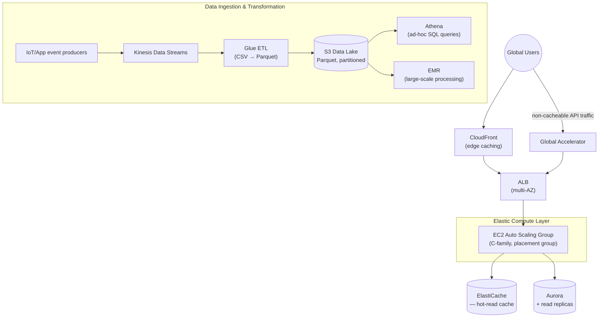
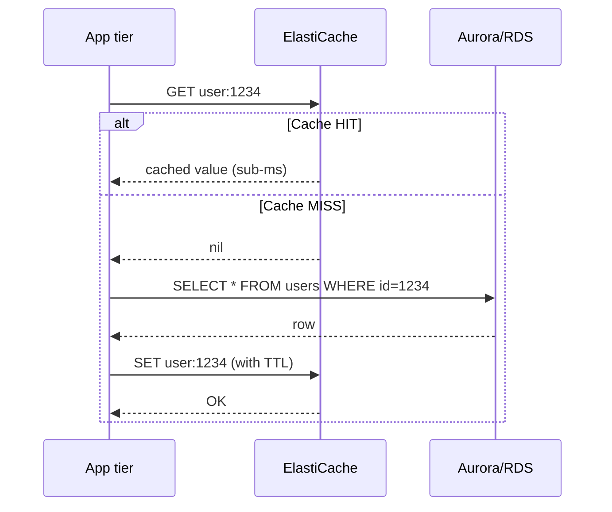
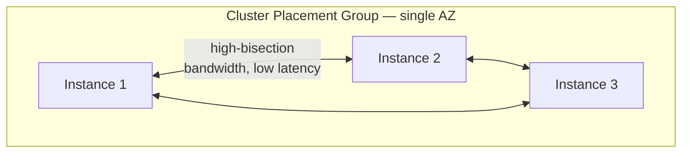

# Domain 3: Design High-Performing Architectures (24%)

In plain terms: this domain assumes you already know the services from Domains 1 & 2 (security,
networking, resiliency) and asks a different question about each one — "given these building
blocks, how do you squeeze the most performance out of them, and which one is fastest for this
specific access pattern?"

Performance questions on SAA-C03 almost always reduce to one of four repeating levers, and
recognizing which lever a scenario is pulling on is most of the battle: **(1) match the storage/
database shape to the access pattern** (object vs. file vs. block; relational vs. key-value vs.
cache), **(2) get the request physically closer to the user or the data** (CDN, Global
Accelerator, placement groups, same-AZ placement), **(3) remove a bottleneck by parallelizing or
offloading** (read replicas, caching, more Auto Scaling capacity), and **(4) pick the compute/
network primitive built for the specific throughput/latency profile described** (NLB over ALB for
raw throughput, Provisioned IOPS over gp3, Kinesis over polling). Every topic doc in this folder
is really just one of these four levers applied to a specific service category.

*Source: [Amazon EC2 User Guide — Storage options for your Amazon EC2 instances](https://docs.aws.amazon.com/AWSEC2/latest/UserGuide/Storage.html)*

## Task 3.1 — Determine high-performing and/or scalable storage solutions

> S3, EFS, EBS — object/file/block tradeoffs

| Concept | Doc |
|---|---|
| S3 (object storage) | [`services/storage/s3.md`](../../../services/storage/s3.md) |
| S3 storage classes | [`services/storage/s3-storage-classes.md`](../../../services/storage/s3-storage-classes.md) |
| EFS (shared file storage) | [`services/storage/efs.md`](../../../services/storage/efs.md) |
| EBS (block storage) | [`services/storage/ebs.md`](../../../services/storage/ebs.md) |
| FSx family | [`services/storage/fsx.md`](../../../services/storage/fsx.md) |
| Storage performance decision framework *(new — decision-level topic)* | [`storage-performance-decision-framework.md`](storage-performance-decision-framework.md) |

## Task 3.2 — Design high-performing and elastic compute solutions

| Concept | Doc |
|---|---|
| EC2 | [`services/compute/ec2.md`](../../../services/compute/ec2.md) |
| EC2 Auto Scaling | [`services/compute/ec2-auto-scaling.md`](../../../services/compute/ec2-auto-scaling.md) |
| Lambda | [`services/compute/lambda.md`](../../../services/compute/lambda.md) |
| Fargate | [`services/compute/fargate.md`](../../../services/compute/fargate.md) |
| AWS Batch | [`services/compute/aws-batch.md`](../../../services/compute/aws-batch.md) |
| Containers vs. VMs vs. serverless | [`services/containers/containers-vs-vms-vs-serverless.md`](../../../services/containers/containers-vs-vms-vs-serverless.md) |
| ECS / EKS | [`services/containers/ecs.md`](../../../services/containers/ecs.md), [`services/containers/eks.md`](../../../services/containers/eks.md) |
| Compute performance decision framework *(new — decision-level topic)* | [`compute-performance-decision-framework.md`](compute-performance-decision-framework.md) |

## Task 3.3 — Determine high-performing database solutions

| Concept | Doc |
|---|---|
| Database selection guide (workload-shape decision tree, already covers performance tradeoffs) | [`services/database/database-selection-guide.md`](../../../services/database/database-selection-guide.md) |
| RDS | [`services/database/rds.md`](../../../services/database/rds.md) |
| Aurora | [`services/database/aurora.md`](../../../services/database/aurora.md) |
| DynamoDB | [`services/database/dynamodb.md`](../../../services/database/dynamodb.md) |
| ElastiCache | [`services/database/elasticache.md`](../../../services/database/elasticache.md) |
| DocumentDB | [`services/database/documentdb.md`](../../../services/database/documentdb.md) |
| Neptune | [`services/database/neptune.md`](../../../services/database/neptune.md) |
| Redshift | [`services/database/redshift.md`](../../../services/database/redshift.md) |
| Aurora Serverless v2, Amazon Keyspaces, Amazon QLDB — niche database services | [`services/database/niche-database-services.md`](../../../services/database/niche-database-services.md) |

Task 3.3 is primarily "cache-aside first, then pick the right engine": the single biggest lever
for database *read* performance is not picking a faster database at all, it's putting
**ElastiCache** in front of the hottest keys so the database is never asked for them repeatedly.
Only after caching is accounted for does engine choice matter — DynamoDB for single-digit-
millisecond key-value access at any scale, Aurora for relational workloads needing the highest
MySQL/PostgreSQL-compatible throughput available, Redshift for OLAP/analytical queries across
huge datasets, Neptune/DocumentDB for graph/document-shaped access patterns a relational engine
handles poorly. Aurora Serverless v2 extends this same engine-choice logic to workloads whose
*load itself* varies unpredictably — it scales compute capacity in fine-grained increments within
seconds, so a spiky workload gets Aurora's relational performance without being sized for its own
peak around the clock.

## Task 3.4 — Determine high-performing and/or scalable network architectures

| Concept | Doc |
|---|---|
| VPC | [`services/networking-content-delivery/vpc.md`](../../../services/networking-content-delivery/vpc.md) |
| Elastic Load Balancing | [`services/networking-content-delivery/elastic-load-balancing.md`](../../../services/networking-content-delivery/elastic-load-balancing.md) |
| CloudFront | [`services/networking-content-delivery/cloudfront.md`](../../../services/networking-content-delivery/cloudfront.md) |
| Global Accelerator | [`services/networking-content-delivery/global-accelerator.md`](../../../services/networking-content-delivery/global-accelerator.md) |
| Direct Connect | [`services/networking-content-delivery/direct-connect.md`](../../../services/networking-content-delivery/direct-connect.md) |
| Transit Gateway & peering | [`services/networking-content-delivery/transit-gateway-and-peering.md`](../../../services/networking-content-delivery/transit-gateway-and-peering.md) |
| VPC endpoints / PrivateLink | [`services/networking-content-delivery/vpc-endpoints-privatelink.md`](../../../services/networking-content-delivery/vpc-endpoints-privatelink.md) |
| Network performance architecture patterns *(new — decision-level topic)* | [`network-performance-architecture-patterns.md`](network-performance-architecture-patterns.md) |

## Task 3.5 — Determine high-performing data ingestion and transformation solutions

> Kinesis, Glue, EMR, data lakes, CSV→Parquet

| Concept | Doc |
|---|---|
| Kinesis family (streaming ingestion) | [`services/analytics/kinesis-family.md`](../../../services/analytics/kinesis-family.md) |
| Glue (ETL, CSV→Parquet transformation) | [`services/analytics/glue.md`](../../../services/analytics/glue.md) |
| EMR (big data processing) | [`services/analytics/emr.md`](../../../services/analytics/emr.md) |
| Data lake concepts | [`services/analytics/data-lake-concepts.md`](../../../services/analytics/data-lake-concepts.md) |
| Athena (query data lake directly) | [`services/analytics/athena.md`](../../../services/analytics/athena.md) |
| Elastic Transcoder & Kinesis Video Streams (media transcoding / video stream ingestion) | [`services/media/elastic-transcoder-and-kinesis-video-streams.md`](../../../services/media/elastic-transcoder-and-kinesis-video-streams.md) |
| AWS DataSync (high-speed online transfer of on-prem datasets into S3/EFS/FSx) | [`services/migration-transfer/datasync.md`](../../../services/migration-transfer/datasync.md) |
| AWS Data Pipeline (legacy orchestration) & AWS Data Exchange (third-party data ingestion) | [`services/analytics/data-pipeline-and-data-exchange.md`](../../../services/analytics/data-pipeline-and-data-exchange.md) |

Two more ingestion sources extend this same pattern. **Kinesis Video Streams** ingests live
video/audio from cameras or mobile devices — the streaming equivalent of Kinesis Data Streams,
purpose-built for time-encoded media rather than arbitrary records — and **Elastic Transcoder**
then transforms a master video file into the multiple resolutions/bitrates different devices
need, the media equivalent of Glue's CSV→Parquet transformation. Separately, when the data to
ingest already exists on-premises rather than arriving live, **DataSync** is the managed transfer
mechanism that lands it in S3/EFS/FSx at up to 10x the speed of a hand-rolled copy script, feeding
the very same Glue/EMR/Athena pipeline described above. **AWS Data Exchange** is a different kind
of ingestion source entirely — third-party data a provider licenses to you rather than data your
own systems generate — landing in that same S3 data lake; **AWS Data Pipeline** is this pipeline's
legacy orchestration option, now largely superseded by Glue (for the transformation step) and
Step Functions (for general scheduling/dependency logic).

## Architecture: A High-Performing, Multi-Layer System

Step by step: cacheable traffic goes through **CloudFront**; non-cacheable API/dynamic traffic
goes through **Global Accelerator** onto the AWS backbone early — both converge on a **multi-AZ
ALB**. The ALB spreads requests across an **Auto Scaling group** sized to the compute family that
matches the bottleneck (compute- or memory-optimized, possibly in a placement group for
inter-instance latency). The app tier checks **ElastiCache** first for hot reads before falling
back to **Aurora** (with read replicas absorbing read-heavy traffic) — this cache-aside pattern is
the single biggest lever for database read performance. Separately, a **data ingestion pipeline**
takes high-volume event streams through **Kinesis Data Streams**, transforms them with **Glue**
(the canonical CSV→Parquet conversion — columnar Parquet is dramatically faster and cheaper to
query than row-based CSV), lands the result in an **S3 data lake** partitioned for query
efficiency, and exposes it to **Athena** for ad-hoc SQL and **EMR** for heavier, large-scale batch
processing — two different performance tools for two different query shapes against the same
underlying data lake.

## Architecture: The Cache-Aside Read Path, in Detail

This is the mechanism behind every "add caching to speed up reads" exam scenario — the
application code (not the database) is responsible for checking the cache first and populating it
on a miss, with a TTL to bound how stale cached data can get. A scenario describing cached data
that's gone stale and causing bugs is usually pointing at a TTL/invalidation design problem, not
a reason to abandon caching.

## Architecture: Cluster Placement Group for Tightly-Coupled Compute

*Source: [Amazon EC2 User Guide — Placement strategies for your placement groups](https://docs.aws.amazon.com/AWSEC2/latest/UserGuide/placement-strategies.html)*

Cluster placement groups trade availability for raw inter-instance network performance — all
instances land in one AZ, physically close together, specifically so tightly-coupled workloads
(HPC, distributed training, in-memory databases replicating heavily between nodes) get the lowest
possible latency and highest possible throughput between them. This is the opposite tradeoff from
a *spread* placement group (which maximizes fault isolation by spreading instances across distinct
hardware), so a scenario naming "lowest latency between nodes" versus "maximum fault tolerance for
a small number of critical instances" is choosing between cluster and spread, not between
placement groups and no placement group.

## How This Domain's Services Work Together (End-to-End Walkthrough)

Trace one request through a globally-used analytics dashboard, the same story the architecture
diagram above lays out spatially. A sales manager in Tokyo opens the dashboard and it loads
instantly. (1) The dashboard's JS/CSS/images are served from **CloudFront**, cached at an edge
location physically near Tokyo — the manager never waits on a round trip to the origin Region at
all for anything static. (2) The manager's "show me this week's top products" query, which can't be
cached because it's dynamic and per-filter, travels over **Global Accelerator**, entering the AWS
backbone network at the nearest edge location instead of crossing the public internet the whole
way to the origin Region — shaving meaningful round-trip time purely from routing, before any
compute even runs. (3) The request lands on an **ALB**, which forwards it to an **Auto Scaling
group of C-family (compute-optimized) instances** — chosen specifically because profiling earlier
showed this query path is CPU-bound, not memory- or I/O-bound. (4) The app checks **ElastiCache**
first for this exact query's cached result; because "top products this week" is asked by dozens of
managers throughout the day, it's very likely a cache hit, and the response comes back in
sub-millisecond time with no database touched at all. (5) On a cache miss (say, it's the first
request after the cache TTL expired), the app instead queries **Athena** directly against a data
lake sitting in **S3**, structured as partitioned, columnar **Parquet** files rather than raw CSV —
Athena only scans the relevant date partition's columns, not the entire multi-year dataset, which
is what makes this sub-second instead of the 8-12 seconds the same query took against raw CSV
before this pipeline existed. (6) That Parquet data itself didn't arrive in S3 by accident — a
separate, continuous pipeline ingests raw event data through **Kinesis Data Streams**, and a
**Glue ETL job** converts it from row-based CSV into partitioned Parquet on a schedule, which is
the actual mechanism that makes step 5's fast query possible in the first place. (7) After the
database/data-lake answer comes back, the app writes it into **ElastiCache** with a TTL before
responding to the manager, so the *next* person who asks the same question gets the sub-millisecond
cache-hit path from step 4 instead of repeating steps 5 and 6. This single dashboard load touches
all five Domain 3 task statements in sequence — storage shape (Parquet vs. CSV), compute family
match (C-family for a CPU-bound query path), database/cache layering (ElastiCache in front of
Athena), network routing (CloudFront + Global Accelerator), and data ingestion/transformation
(Kinesis + Glue) — which is exactly the PixelForge Analytics case study below, told as one
continuous request instead of three separate problem statements.

## Full Worked Case Study: PixelForge Analytics — From Slow Dashboard to Sub-Second Queries

**Company requirements.** PixelForge runs an internal analytics dashboard used by 200 employees.
Three complaints have reached the architecture team: (1) the dashboard's "top products this week"
query takes 8-12 seconds because it scans millions of raw CSV log files directly from S3 every
time it's run; (2) the API backend serving user profile lookups is CPU-bound and falling behind
during the morning login rush; (3) global sales offices in Tokyo and London report the dashboard
feels sluggish compared to the US office where it's hosted.

**Solution design.**

1. **Ingestion and transformation (Task 3.5).** Raw application logs, previously dumped as CSV
   directly into S3, are instead streamed through **Kinesis Data Streams**, processed by a
   **Glue ETL job** that converts them into partitioned, columnar **Parquet** files in a
   dedicated S3 data lake prefix (partitioned by date). The "top products" dashboard query is
   rewritten to run through **Athena** against the Parquet data lake instead of scanning raw CSV
   directly — Parquet's columnar format combined with partition pruning cuts the scanned data
   (and the query time) dramatically, bringing the query from 8-12 seconds to sub-second.
2. **Compute bottleneck (Task 3.2 + 3.3).** Profiling shows the user-profile API is CPU-bound, not
   I/O-bound, so the fix is a **C-family (compute-optimized) instance type** behind the existing
   Auto Scaling group, with the scaling policy switched from a flat CPU-utilization target to one
   that also accounts for request count per target — ensuring the fleet scales *before* CPU
   saturates, not after. A read-through **ElastiCache** layer is added in front of the profile
   database for the (heavily repeated) morning-rush profile lookups, cutting direct database load
   substantially.
3. **Global latency (Task 3.4).** The dashboard's static assets (JS/CSS/images) move behind
   **CloudFront**, instantly helping Tokyo/London load times for anything cacheable. For the
   dashboard's live API calls (not cacheable — they're per-user, dynamic), **Global Accelerator**
   is added in front of the ALB, routing London/Tokyo traffic onto the AWS backbone at the nearest
   edge location instead of the public internet the whole way, measurably cutting round-trip time
   for the non-cacheable portion of the traffic.

**Why this design, not a simpler one.** The team considered simply "making the S3 bucket bigger"
or switching to a larger EC2 instance type across the board as a first instinct, but diagnosed
that the actual bottleneck in point 1 was *query shape* (row-based CSV scanned in full) rather
than storage capacity — no amount of a bigger S3 bucket changes how much data Athena has to scan
per query; only the Parquet conversion and partitioning do. Similarly, in point 2, blindly scaling
the Auto Scaling group's *size* without first identifying the CPU-bound nature of the workload
could have thrown money at more of the wrong instance family; profiling first to confirm "CPU-
bound, not memory- or I/O-bound" is what justified the C-family switch specifically.

## Use Cases — Real Scenarios

- **Mobile game studio's matchmaking service needing sub-10ms lookups.** Player profile and
  skill-rating data sits in DynamoDB (not RDS) specifically because single-digit-millisecond,
  at-any-scale latency is a stated hard requirement, not a nice-to-have, and the access pattern is
  pure key-value.
- **News publisher's real-time traffic-spike handling during a breaking story.** CloudFront caches
  the article body and images at the edge within seconds of publication; ElastiCache holds the
  "most-read articles right now" ranking, so neither a sudden 50x traffic spike touches the origin
  database directly nor degrades the experience for readers worldwide.
- **Genomics research lab running an EMR cluster for a one-time large-scale analysis.** A
  thousand-node EMR cluster processes a multi-terabyte sequencing dataset over a weekend; C-family
  or memory-optimized instances are chosen per-node based on whether the specific pipeline stage is
  CPU-bound (alignment) or memory-bound (variant calling), then the whole cluster is torn down.
- **Global trading firm's matching engine needing the lowest possible inter-instance latency.**
  Matching-engine instances sit in a single cluster placement group within one AZ, specifically
  trading away multi-AZ fault tolerance for the lowest achievable network latency between the
  handful of instances that must coordinate on every trade.
- **IoT agricultural sensor network ingesting millions of soil-moisture readings per minute.**
  Kinesis Data Streams absorbs the ingestion burst with a shard count sized to the actual
  aggregate write rate; a Glue job converts the raw stream into partitioned Parquet in S3 so a
  farmer's dashboard query against six months of history stays fast instead of scanning raw JSON.
- **Video-streaming platform serving both live and on-demand content globally.** Live, interactive-
  feeling features (chat, reactions) that can't be cached ride Global Accelerator; the actual video
  segments, which are highly cacheable, ride CloudFront — the same platform deliberately using both
  services for two different traffic shapes within one product.
- **Financial reporting system needing EFS for a shared, concurrently-written working directory.**
  A fleet of 30 report-generation workers all read and write intermediate calculation files to the
  same EFS file system simultaneously — a pattern EBS (one instance at a time) structurally cannot
  support, making EFS the only fit regardless of cost.
- **E-commerce retailer's Auto Scaling group that was scaling too late during flash sales.** CPU
  utilization was the scaling trigger, but by the time CPU rose, response times had already
  degraded — switching the scaling metric to request-count-per-target catches load earlier,
  directly fixing the "scaling after the user already feels it" symptom.
- **Weather-data company needing ultra-low-latency scratch space for in-progress model runs.**
  Each forecast-model worker uses EC2 Instance Store for its temporary grid-computation buffers,
  explicitly accepting that this data vanishes on instance stop because the final output is written
  to S3 and the intermediate buffer was never meant to survive past the run.
- **SaaS analytics company separating ad-hoc exploration from scheduled heavy reporting.** Analysts
  run quick, exploratory one-off queries through Athena directly against the S3 data lake; a nightly
  scheduled job that joins years of data across multiple large tables runs on Redshift instead,
  because the join complexity and data volume at that point exceed what serverless ad-hoc querying
  handles efficiently.

## Common exam scenarios

- *"Multiple EC2 instances need concurrent read/write access to the same set of files."* → EFS,
  not EBS (EBS attaches to one instance; EFS is a shared network filesystem).
- *"A database requires the highest possible IOPS for a demanding transactional workload."* →
  EBS io2 Block Express, not gp3.
- *"Read-heavy traffic is overwhelming the primary database."* → Add a read replica, and/or
  place ElastiCache in front for the hottest keys.
- *"An application needs sub-millisecond caching for session data."* → ElastiCache (Redis or
  Memcached), not a database read replica (replicas still hit disk/engine overhead; a cache
  doesn't).
- *"Global users need low-latency access to static assets."* → CloudFront.
- *"A gaming or VoIP workload needs the fastest possible path across the internet, and the
  traffic can't be cached."* → Global Accelerator.
- *"Millions of small, raw CSV files need to be converted into an efficient columnar format for
  analytics."* → Glue ETL job converting CSV to Parquet, landing in S3.
- *"Ad-hoc SQL queries need to run directly against files sitting in S3 without standing up a
  database."* → Athena.
- *"A tightly-coupled HPC workload needs the lowest possible latency between a cluster of EC2
  instances."* → Cluster placement group.
- *"A small set of critical instances must never share the same underlying hardware, to avoid a
  single hardware failure taking down more than one at once."* → Spread placement group.
- *"A workload needs millions of requests per second at the lowest possible latency, with no need
  for HTTP-layer (Layer 7) routing features."* → Network Load Balancer, not Application Load
  Balancer.
- *"An EC2 instance needs ultra-low-latency, non-persistent scratch storage and durability is not
  required for this specific data."* → Instance Store (NVMe), not EBS.
- *"A Kinesis Data Streams application is falling behind the incoming data rate and records are
  expiring before being processed."* → Increase the shard count (each shard has a fixed
  read/write throughput ceiling) or switch to on-demand capacity mode.
- *"An application needs to query data across both its data lake in S3 and its data warehouse,
  for a large-scale historical analysis involving complex joins."* → Redshift (with Redshift
  Spectrum querying S3 data directly) rather than Athena alone, once query complexity and data
  volume exceed what ad-hoc serverless querying handles well.
- *"A new database workload is pure key-value, needs single-digit-millisecond latency at any
  scale, with access patterns known in advance."* → DynamoDB, not RDS/Aurora — the exam frames
  this as a performance decision (DynamoDB's latency profile at scale), not just a cost decision.

## Deeper Dive: Three More Analogies That Tie the Whole Domain Together

- **The restaurant analogy for the full request path.** CloudFront is the restaurant's host stand
  pre-setting tables for regulars who always order the same thing (cached content) — no trip to
  the kitchen needed. The ALB is the host directing each new arrival to the correct section
  (target group) based on what they're there for. ElastiCache is the server remembering the
  table's last order instead of walking back to ask the kitchen again. The database is the kitchen
  itself — the authoritative source, but the slowest stop if every single request has to go there.
- **The library-branch analogy for data ingestion.** Raw CSV logs landing directly in S3 are like
  dumping every book donation into one disorganized bin — technically "stored," but a search
  through it is painfully slow. Glue's CSV-to-Parquet conversion with partitioning is the
  librarian cataloging those books by subject and shelf (partition), so Athena's query is a
  direct walk to the right shelf instead of reading the entire bin cover to cover.
- **The relay-race analogy for placement groups and ENA.** A cluster placement group with Enhanced
  Networking is a relay team standing shoulder-to-shoulder on adjacent tracks, so the baton
  (network packet) barely travels any distance at all between handoffs — the fastest possible
  exchange, at the cost of everyone being vulnerable to the exact same track (AZ) going out of
  service.

## Real AWS Documentation Image: DynamoDB Partitioning and Key Design

*DynamoDB hashes a table's partition key and distributes items across physical partitions based on
that hash — this is the mechanism behind the matchmaking-service use case above achieving
single-digit-millisecond latency "at any scale": a well-chosen partition key spreads both storage
and request load evenly, while a poorly chosen one (e.g., a key with very few distinct values, or
one value receiving disproportionate traffic — a "hot partition") concentrates requests onto a
small number of partitions and throttles despite the table having plenty of overall provisioned
capacity. Source: [Amazon DynamoDB Developer Guide — Partitions and data
distribution](https://docs.aws.amazon.com/amazondynamodb/latest/developerguide/HowItWorks.Partitions.html).*
A scenario describing throttling on a DynamoDB table that still has headroom in its *overall*
provisioned/on-demand capacity is almost always a hot-partition key-design problem, not a capacity
problem — the fix is redesigning the partition key (or adding a random suffix to spread a hot key
across several logical partitions), not simply provisioning more throughput.

## Real AWS Documentation Image: Redshift's Leader Node and Compute Node Architecture

*A Redshift cluster's leader node receives the SQL query, builds an execution plan, and
distributes the work across compute nodes, each of which scans only its own local storage
slices in parallel — this massively parallel processing (MPP) architecture is exactly why Redshift
out-performs Athena for the "complex joins across curated, structured data at BI scale" use case
named in the Task 3.3 section above: the data is pre-loaded and distributed deliberately across
nodes ahead of query time, rather than scanned fresh from S3 per query. Source: [Amazon Redshift
Getting Started Guide — Amazon Redshift
architecture](https://docs.aws.amazon.com/redshift/latest/gsg/working-with-clusters.html).*

## Real AWS Documentation Image: The Kinesis Data Streams Shard Model

*Each shard provides a fixed throughput ceiling (1 MB/sec or 1,000 records/sec write; 2 MB/sec
read) — this is the mechanism behind the "Kinesis Data Streams application is falling behind"
exam scenario named above: records aren't lost outright when a shard is overwhelmed, but
write-throttling and growing processing lag are the direct, predictable consequence of too few
shards for the actual aggregate write rate. Source: [Amazon Kinesis Data Streams Developer Guide —
Key concepts](https://docs.aws.amazon.com/streams/latest/dev/key-concepts.html).*

## Additional Worked Exam Scenarios

**Scenario D — "The dashboard that got faster for 99% of queries but one query stayed slow."**
After PixelForge's Parquet migration (described in the case study above), nearly every dashboard
query runs in sub-second time, but one specific report — a full-history, all-time "lifetime
revenue by customer" query — still takes 15 seconds. **Diagnosis:** that one query, by definition,
can't benefit from date-based partition pruning the way the "top products this week" query does,
because it genuinely needs to scan the entire history, not a narrow date range — partitioning
helps queries that filter on the partition column, and this one structurally doesn't. **Fix:**
recognize this as a different workload shape entirely — a scheduled, pre-aggregated summary table
(maintained by a nightly Glue job, or moved to Redshift for genuinely complex, full-history
analytical joins) is the right lever here, not more partitioning tricks on the existing table.

**Scenario E — "Why did adding more EC2 instances not fix the slow checkout page?"** An e-commerce
site's checkout page remains slow during a flash sale even after the Auto Scaling group doubles its
instance count. **Diagnosis:** profiling shows the application tier itself has plenty of spare
capacity — the actual bottleneck is the relational database being hit directly for every single
page load's inventory-count check, and doubling the stateless app tier just means twice as many
instances making the same database calls at the same rate, with no new caching layer absorbing any
of it. **Fix:** this is a database/cache-layer problem, not a compute-layer one — adding
ElastiCache in front of the inventory-count reads (with a short TTL appropriate for how stale an
inventory count can tolerably be) addresses the actual bottleneck; more EC2 instances alone cannot.

## Why This Domain Is the Highest-Weighted on the Exam

At 24% of the exam, Domain 3 is tied for the largest single domain in SAA-C03 — a direct
reflection of how much of real-world AWS architecture work is, fundamentally, performance
engineering: picking the storage shape that matches the access pattern, picking the compute model
and instance family that matches the actual bottleneck, layering a cache in front of a database
before reaching for a bigger database, and getting a request onto AWS's own network as early in
its journey as possible. A useful standard of readiness for this domain specifically: pick any of
the 37 service/topic docs linked throughout this README at random, and verify you can state its
one-sentence Definition, one concrete Use Case where it's clearly the right fit, and one scenario
where it would be clearly the *wrong* fit — because nearly every Domain 3 exam question is built
exactly that way, presenting a scenario and testing whether the right/wrong-fit line is drawn
correctly.

## Hands-on Labs

See [`labs.md`](labs.md) for runnable Floci exercises covering this domain — expanded to 7 labs
covering Kinesis ingestion, DynamoDB throughput modes, EC2/Auto Scaling mechanics, ElastiCache
cache-aside, a capstone data-pipeline lab chaining ingestion through to query, simulated
content-based routing with S3 prefixes, and local I/O benchmarking mapped to EBS volume types.

## New Decision-Level Topic Docs (Cross-Cutting Deep Dives)

Three subtopics that cut across multiple Task statements got their own dedicated, standalone
deep-dive doc rather than being folded into a single service's page:

| Doc | Cuts across | Covers |
|---|---|---|
| [`caching-strategy-deep-dive.md`](caching-strategy-deep-dive.md) | Task 3.3, 3.4 | Every caching layer in a real stack (browser, CloudFront, API Gateway, ElastiCache, DAX, engine-internal) and how they relate — cache-aside vs. read-through vs. write-through, TTL/invalidation design, DAX vs. ElastiCache. |
| [`database-read-write-scaling-decision-tree.md`](database-read-write-scaling-decision-tree.md) | Task 3.3 | Diagnosing read-bound vs. write-bound vs. availability-bound database problems and routing to the correct fix — read replicas, Aurora Serverless v2, sharding, DynamoDB re-architecture, Multi-AZ (and why it's *not* a scaling feature). |
| [`data-partitioning-and-sharding-patterns.md`](data-partitioning-and-sharding-patterns.md) | Task 3.1, 3.3, 3.5 | The single "pick a key, spread the load" idea as it appears differently in DynamoDB partitions, Kinesis shards, S3/Athena query-pruning partitions, and manual database sharding — plus the hot-key/hot-partition/hot-shard failure mode that's identical in spirit across all of them. |

## One-File, Full-Depth Reference

[`MASTER-CHUNK.md`](MASTER-CHUNK.md) covers every one of this domain's 34+ services and topics —
EBS through VPC Endpoints & PrivateLink — in one self-contained file with a Definition, analogy,
Purpose, When to Use/NOT to Use, Use Cases, a Mermaid diagram, a real curl-verified AWS
documentation image, and Exam Tips for each, organized by the same five Task statements as this
README. Use it to study the whole domain in one pass without tab-jumping between the 34+
individual `services/<category>/*.md` files — those remain the deeper, more authoritative
references each `MASTER-CHUNK.md` entry links back to.

## Where This Domain Connects

- Domain 1 (`../domain-1-secure-architectures/`) — the VPC endpoint pattern from that domain's
  `vpc-security-architecture-patterns.md` is also this domain's answer for low-latency,
  no-NAT-hop access to S3/DynamoDB from a performance-sensitive app tier.
- Domain 2 (`../domain-2-resilient-architectures/`) — read replicas and Auto Scaling groups are
  the same services, viewed through a resilience lens there and a raw-throughput lens here.
- Domain 4 (`../domain-4-cost-optimized-architectures/`) — nearly every performance lever in this
  domain (bigger instance family, more read replicas, Provisioned IOPS) has a direct cost
  consequence worked through from the opposite angle in that domain's decision frameworks.
