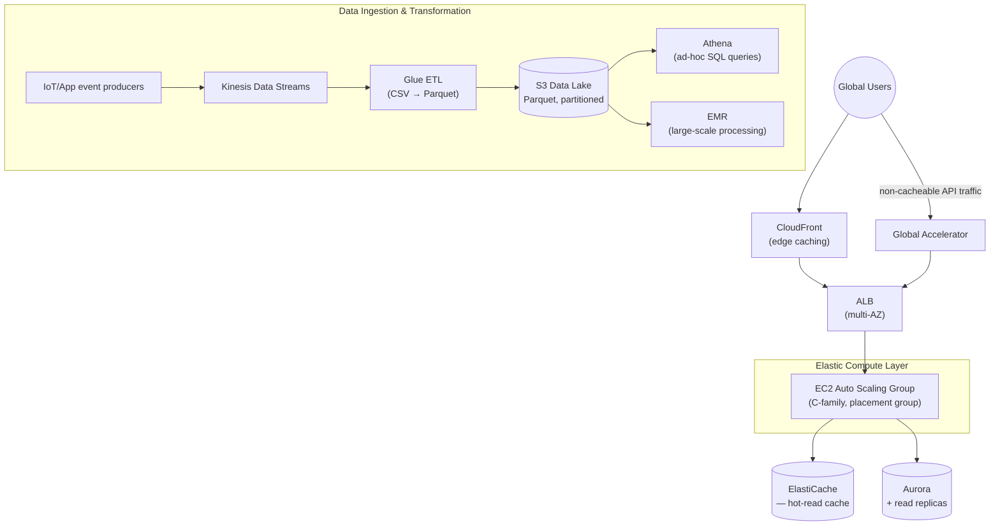

# Domain 3: Design High-Performing Architectures (24%)

In plain terms: this domain assumes you already know the services from Domains 1 & 2 (security,
networking, resiliency) and asks a different question about each one — "given these building
blocks, how do you squeeze the most performance out of them, and which one is fastest for this
specific access pattern?"

## Task 3.1 — Determine high-performing and/or scalable storage solutions

> S3, EFS, EBS — object/file/block tradeoffs

| Concept | Doc |
|---|---|
| S3 (object storage) | [`services/storage/s3.md`](../../../services/storage/s3.md) |
| S3 storage classes | [`services/storage/s3-storage-classes.md`](../../../services/storage/s3-storage-classes.md) |
| EFS (shared file storage) | [`services/storage/efs.md`](../../../services/storage/efs.md) |
| EBS (block storage) | [`services/storage/ebs.md`](../../../services/storage/ebs.md) |
| FSx family | [`services/storage/fsx.md`](../../../services/storage/fsx.md) |
| Storage performance decision framework *(new — decision-level topic)* | [`storage-performance-decision-framework.md`](storage-performance-decision-framework.md) |

## Task 3.2 — Design high-performing and elastic compute solutions

| Concept | Doc |
|---|---|
| EC2 | [`services/compute/ec2.md`](../../../services/compute/ec2.md) |
| EC2 Auto Scaling | [`services/compute/ec2-auto-scaling.md`](../../../services/compute/ec2-auto-scaling.md) |
| Lambda | [`services/compute/lambda.md`](../../../services/compute/lambda.md) |
| Fargate | [`services/compute/fargate.md`](../../../services/compute/fargate.md) |
| AWS Batch | [`services/compute/aws-batch.md`](../../../services/compute/aws-batch.md) |
| Containers vs. VMs vs. serverless | [`services/containers/containers-vs-vms-vs-serverless.md`](../../../services/containers/containers-vs-vms-vs-serverless.md) |
| ECS / EKS | [`services/containers/ecs.md`](../../../services/containers/ecs.md), [`services/containers/eks.md`](../../../services/containers/eks.md) |
| Compute performance decision framework *(new — decision-level topic)* | [`compute-performance-decision-framework.md`](compute-performance-decision-framework.md) |

## Task 3.3 — Determine high-performing database solutions

| Concept | Doc |
|---|---|
| Database selection guide (workload-shape decision tree, already covers performance tradeoffs) | [`services/database/database-selection-guide.md`](../../../services/database/database-selection-guide.md) |
| RDS | [`services/database/rds.md`](../../../services/database/rds.md) |
| Aurora | [`services/database/aurora.md`](../../../services/database/aurora.md) |
| DynamoDB | [`services/database/dynamodb.md`](../../../services/database/dynamodb.md) |
| ElastiCache | [`services/database/elasticache.md`](../../../services/database/elasticache.md) |
| DocumentDB | [`services/database/documentdb.md`](../../../services/database/documentdb.md) |
| Neptune | [`services/database/neptune.md`](../../../services/database/neptune.md) |
| Redshift | [`services/database/redshift.md`](../../../services/database/redshift.md) |

## Task 3.4 — Determine high-performing and/or scalable network architectures

| Concept | Doc |
|---|---|
| VPC | [`services/networking-content-delivery/vpc.md`](../../../services/networking-content-delivery/vpc.md) |
| Elastic Load Balancing | [`services/networking-content-delivery/elastic-load-balancing.md`](../../../services/networking-content-delivery/elastic-load-balancing.md) |
| CloudFront | [`services/networking-content-delivery/cloudfront.md`](../../../services/networking-content-delivery/cloudfront.md) |
| Global Accelerator | [`services/networking-content-delivery/global-accelerator.md`](../../../services/networking-content-delivery/global-accelerator.md) |
| Direct Connect | [`services/networking-content-delivery/direct-connect.md`](../../../services/networking-content-delivery/direct-connect.md) |
| Transit Gateway & peering | [`services/networking-content-delivery/transit-gateway-and-peering.md`](../../../services/networking-content-delivery/transit-gateway-and-peering.md) |
| VPC endpoints / PrivateLink | [`services/networking-content-delivery/vpc-endpoints-privatelink.md`](../../../services/networking-content-delivery/vpc-endpoints-privatelink.md) |
| Network performance architecture patterns *(new — decision-level topic)* | [`network-performance-architecture-patterns.md`](network-performance-architecture-patterns.md) |

## Task 3.5 — Determine high-performing data ingestion and transformation solutions

> Kinesis, Glue, EMR, data lakes, CSV→Parquet

| Concept | Doc |
|---|---|
| Kinesis family (streaming ingestion) | [`services/analytics/kinesis-family.md`](../../../services/analytics/kinesis-family.md) |
| Glue (ETL, CSV→Parquet transformation) | [`services/analytics/glue.md`](../../../services/analytics/glue.md) |
| EMR (big data processing) | [`services/analytics/emr.md`](../../../services/analytics/emr.md) |
| Data lake concepts | [`services/analytics/data-lake-concepts.md`](../../../services/analytics/data-lake-concepts.md) |
| Athena (query data lake directly) | [`services/analytics/athena.md`](../../../services/analytics/athena.md) |

## Architecture: A High-Performing, Multi-Layer System

Step by step: cacheable traffic goes through **CloudFront**; non-cacheable API/dynamic traffic
goes through **Global Accelerator** onto the AWS backbone early — both converge on a **multi-AZ
ALB**. The ALB spreads requests across an **Auto Scaling group** sized to the compute family that
matches the bottleneck (compute- or memory-optimized, possibly in a placement group for
inter-instance latency). The app tier checks **ElastiCache** first for hot reads before falling
back to **Aurora** (with read replicas absorbing read-heavy traffic) — this cache-aside pattern is
the single biggest lever for database read performance. Separately, a **data ingestion pipeline**
takes high-volume event streams through **Kinesis Data Streams**, transforms them with **Glue**
(the canonical CSV→Parquet conversion — columnar Parquet is dramatically faster and cheaper to
query than row-based CSV), lands the result in an **S3 data lake** partitioned for query
efficiency, and exposes it to **Athena** for ad-hoc SQL and **EMR** for heavier, large-scale batch
processing — two different performance tools for two different query shapes against the same
underlying data lake.

## Common exam scenarios

- *"Multiple EC2 instances need concurrent read/write access to the same set of files."* → EFS,
  not EBS (EBS attaches to one instance; EFS is a shared network filesystem).
- *"A database requires the highest possible IOPS for a demanding transactional workload."* →
  EBS io2 Block Express, not gp3.
- *"Read-heavy traffic is overwhelming the primary database."* → Add a read replica, and/or
  place ElastiCache in front for the hottest keys.
- *"An application needs sub-millisecond caching for session data."* → ElastiCache (Redis or
  Memcached), not a database read replica (replicas still hit disk/engine overhead; a cache
  doesn't).
- *"Global users need low-latency access to static assets."* → CloudFront.
- *"A gaming or VoIP workload needs the fastest possible path across the internet, and the
  traffic can't be cached."* → Global Accelerator.
- *"Millions of small, raw CSV files need to be converted into an efficient columnar format for
  analytics."* → Glue ETL job converting CSV to Parquet, landing in S3.
- *"Ad-hoc SQL queries need to run directly against files sitting in S3 without standing up a
  database."* → Athena.

## Hands-on Labs

See [`labs.md`](labs.md) for runnable Floci exercises covering this domain.
