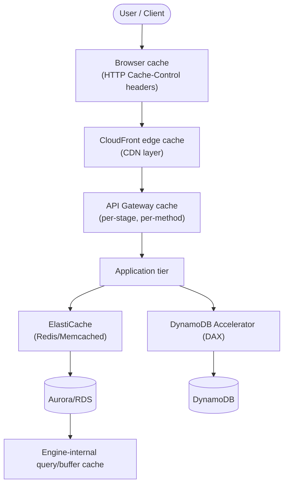
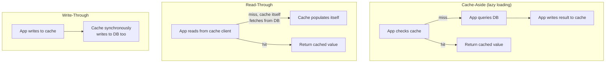
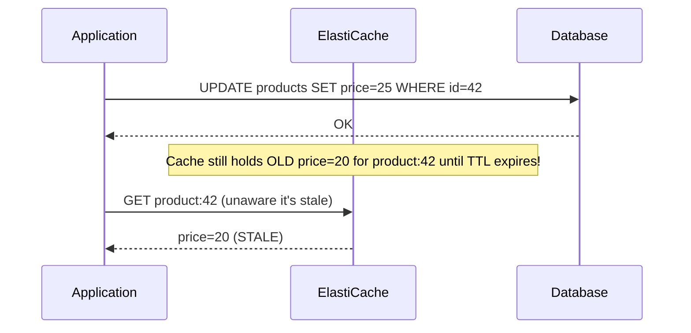
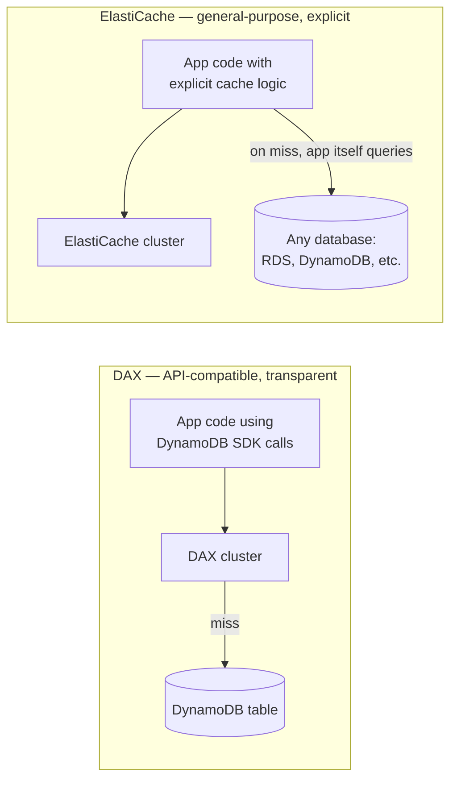

# Caching Strategy Deep Dive Across the Stack

*Source: [Amazon ElastiCache for Redis User Guide — Replication: Redis (cluster mode
disabled)](https://docs.aws.amazon.com/AmazonElastiCache/latest/red-ug/Replication.Redis-RepGroups.html)*

## Definition

Caching is storing a copy of data somewhere **faster to reach** than its original source, so
repeated requests for the same thing are answered from the fast copy instead of re-doing the
original (slower, more expensive) work every time. On AWS, caching isn't one service — it's a
layer that exists at nearly every tier of a real architecture: the browser, the CDN edge, the
load balancer/API layer, the application tier, and even inside the database engine itself. This
doc is the cross-cutting map of **every** caching layer a SAA-C03 scenario might be testing,
because the individual service docs (`cloudfront.md`, `elasticache.md`, `dynamodb.md`, etc.) each
cover their own layer in isolation but don't show how the layers stack.

## Purpose

Every cache exists to solve the same underlying problem — **the origin of truth is slower or more
expensive to reach than a copy of its answer would be** — but *where* in the request path that
problem shows up determines which caching service is the right fit. A request that's slow because
of **network distance** needs a cache physically close to the user (CDN). A request that's slow
because of **repeated identical computation or database reads** needs a cache close to the
compute tier (in-memory cache). A request that's slow because the **database engine itself** is
re-parsing or re-planning the same query needs a cache inside the database layer. Treating
"caching" as a single undifferentiated fix, rather than recognizing which layer's cache actually
matches the bottleneck, is the single most common caching mistake the exam tests.

## How It Works — The Full-Stack Caching Map

Step by step, from the user outward to the database: the **browser cache** (controlled by
`Cache-Control`/`ETag` HTTP headers your application sets) avoids even making a network request
when a resource hasn't changed. **CloudFront** caches at edge locations physically close to users,
serving whole HTTP responses without the request ever reaching your origin Region. **API Gateway
caching** sits in front of a backend API specifically, caching response payloads per
method/stage for a configured TTL — distinct from CloudFront because it understands API semantics
(query strings, headers as part of the cache key) rather than just URLs. Inside the application
tier, **ElastiCache** (Redis or Memcached) caches arbitrary computed results or database rows the
application explicitly manages (cache-aside) or that sits transparently in the read path
(read-through/write-through). **DAX** is DynamoDB's own purpose-built, API-compatible in-memory
cache, sitting directly in front of DynamoDB specifically (not a general-purpose cache for
anything else). Finally, the database engine itself (Aurora, RDS) maintains its own internal
buffer/query caches entirely transparently — invisible to application code, but still a real
caching layer the exam occasionally references when it asks about engine-level performance tuning.

## Architecture: Cache-Aside vs. Read-Through vs. Write-Through

**Cache-aside** (the most common pattern, and the one `README.md`'s sequence diagram in this
domain illustrates) puts the application explicitly in charge: check the cache, and on a miss,
query the database and populate the cache yourself. It's flexible (works with any cache and any
data shape) but means every piece of application code that reads this data must remember to
implement the same miss-handling logic. **Read-through** moves that miss-handling logic into the
caching layer itself (some ElastiCache client libraries and DAX both support this pattern) — the
application always talks to the cache, and the cache transparently fetches from the database on a
miss, so the "populate on miss" logic exists in exactly one place. **Write-through** writes go to
the cache first, and the cache synchronously writes through to the database before confirming —
this guarantees the cache is never stale immediately after a write, at the cost of making every
write pay the latency of both the cache write and the database write.

## Architecture: TTL and Invalidation — The Hardest Part of Caching

*Walkthrough:* this is "cache invalidation is one of the two hard problems in computer science,"
illustrated concretely — a cache-aside pattern populates the cache **on read**, not on write, so a
database update doesn't automatically refresh (or even know about) an existing cached copy. Three
standard fixes, each with a real tradeoff: **(1) short TTLs** bound how long staleness can persist,
at the cost of more frequent cache misses and database load; **(2) explicit invalidation on write**
(the application deletes or updates the cache key immediately after a successful database write)
eliminates staleness for that specific key but requires every write path to remember to do it;
**(3) versioned/keyed cache entries** (e.g., `product:42:v7`, incrementing the version on write)
sidestep the problem by never reusing a stale key, at the cost of old versions needing their own
expiration/cleanup.

## Architecture: DAX vs. ElastiCache — Two Different Caching Relationships

*Walkthrough:* DAX is DynamoDB-specific and **API-compatible** — existing DynamoDB SDK calls work
against DAX with minimal code changes, because DAX implements the same API surface and handles
the cache-miss-then-fetch logic transparently. ElastiCache is general-purpose — it can sit in
front of *any* data source (RDS, Aurora, DynamoDB, an external API, a computed result with no
database at all), but the application must write and own the cache-check/cache-populate logic
itself. A scenario describing "add microsecond-latency caching specifically in front of DynamoDB,
with minimal code changes" points to DAX; a scenario describing caching in front of RDS, or
caching a computed result that isn't a direct database read at all, points to ElastiCache.

## Key Decision Points

- **Match the cache layer to where the bottleneck actually is** — network distance (CloudFront),
  repeated database reads (ElastiCache/DAX), repeated API computation (API Gateway cache), or
  engine-internal query planning (not something you configure directly) are four different
  problems with four different fixes.
- **Cache-aside is the default, flexible choice**; read-through/write-through trade some
  flexibility for centralizing the miss-handling logic in one place rather than every call site.
- **TTL length is a direct staleness-vs-load tradeoff** — there is no "correct" universal TTL; it's
  set by how stale the data can tolerably be for the use case (seconds for a stock price, hours for
  a rarely-changing product description).
- **DAX is the answer whenever DynamoDB specifically, with minimal code change, microsecond
  latency** is named; **ElastiCache is the answer for everything else**, including caching in
  front of RDS/Aurora or caching data that isn't a direct database row at all.
- **CloudFront caches whole HTTP responses at the edge; ElastiCache caches arbitrary data the
  application defines** — a scenario about global, anonymous, cacheable content points to
  CloudFront; a scenario about per-session or per-query cached data close to the compute tier
  points to ElastiCache.
- **Write-heavy workloads benefit least from caching** — a cache primarily accelerates reads; a
  workload that's predominantly writes (and rarely re-reads the same data) gains little from any
  caching layer and should look at write-side scaling (sharding, provisioned throughput) instead.

## Use Cases — Real Scenarios

- **News publisher's breaking-story traffic spike.** CloudFront caches article bodies/images at
  the edge within seconds of publication; ElastiCache separately holds a frequently-recomputed
  "most-read articles right now" ranking — two different caching layers for two different
  bottlenecks (network distance for static content, repeated computation for a dynamic ranking)
  within the same product.
- **Mobile game backend needing microsecond player-profile lookups.** DAX sits directly in front
  of a DynamoDB player-profile table, absorbing the enormous read volume of "fetch my profile on
  every game-session start" with essentially no application code changes beyond pointing the SDK
  at the DAX endpoint.
- **E-commerce retailer's flash-sale inventory checks.** ElastiCache caches each product's
  available-inventory count with a short (seconds-scale) TTL in front of the relational database —
  short enough that oversold inventory risk stays acceptably low, long enough to absorb the bulk
  of read traffic during the sale's peak.
- **API Gateway-fronted weather API with a 10-minute-fresh data requirement.** API Gateway's
  built-in response caching, keyed per-stage and per-query-parameter, serves repeated identical
  requests (e.g., `?city=tokyo`) directly without re-invoking the backend Lambda function at all,
  for the duration of the configured TTL.
- **SaaS analytics dashboard with a "stale data" bug report.** Users report seeing out-of-date
  numbers after making a change; diagnosis reveals cache-aside reads are populating the cache with
  no corresponding invalidation on write — adding an explicit cache-delete immediately after the
  write path (rather than only relying on TTL expiration) resolves the specific complaint.
- **Global SaaS company separating cacheable and non-cacheable traffic deliberately.** The
  marketing site (fully cacheable) sits behind CloudFront; the per-tenant dashboard API (never
  cacheable, since every response differs by customer) explicitly bypasses CloudFront caching via
  `Cache-Control: no-store` headers, with ElastiCache instead handling the dashboard's actual
  repeated-read bottleneck at the application tier.

## When NOT to Use a Cache / When Caching Makes Things Worse

- **Write-heavy, rarely-re-read data** — caching primarily helps reads; a workload that writes far
  more than it re-reads gains little benefit while still paying the cache's operational/cost
  overhead.
- **Strongly-consistent, must-never-be-stale reads** (e.g., a bank balance immediately after a
  withdrawal) — a cache-aside pattern's inherent staleness window is a bad fit; either skip caching
  for this specific read path or use a very short TTL combined with explicit write-time
  invalidation.
- **Data that changes unpredictably and is rarely re-requested** — caching something that's
  unlikely to be asked for again before it changes wastes cache memory for no hit-rate benefit.
- **Treating a cache as a database** — a cache is not durable storage; data in ElastiCache
  (without persistence configured) can be lost on a node failure, and application logic must always
  be able to reconstruct the correct value from the actual source of truth.

## Common Mistakes

- Adding ElastiCache in front of a workload that's actually write-bound, expecting a read cache to
  fix a write-throughput problem.
- Forgetting to invalidate (or set an appropriately short TTL on) a cache entry after the
  underlying data changes, leading to user-visible staleness bugs.
- Using CloudFront for highly dynamic, per-user, non-cacheable API responses — adding an edge hop
  with no caching benefit (the correct fix for that traffic shape is Global Accelerator, not
  CloudFront, per `network-performance-architecture-patterns.md`).
- Choosing ElastiCache when DAX would require less code change and give better latency for a
  DynamoDB-specific caching need, simply out of unfamiliarity with DAX.
- Assuming a bigger/more-provisioned cache cluster fixes a fundamentally poor cache-key design
  (e.g., caching an entire large result set under one key that invalidates on every tiny change,
  rather than caching smaller, more granular pieces that change independently).

## Full Worked Mini-Case: Diagnosing a Multi-Layer Caching Failure

**Scenario:** a retail site's product page is still slow despite having "added caching
everywhere" — CloudFront in front of the whole site, ElastiCache in front of the database, and API
Gateway caching on the backend API. Investigation shows: (1) CloudFront's cache hit ratio is near
zero because the cache key includes a session cookie present on every request, even for anonymous
visitors viewing a public product page; (2) ElastiCache's cache hit ratio is healthy, but the
specific slow call is a *different* endpoint (live inventory count) that was never wired into the
caching layer at all; (3) API Gateway caching is configured correctly but caching the wrong
endpoint (a rarely-called admin endpoint) instead of the actual hot path.

**Diagnosis and fix, layer by layer:** (1) CloudFront's cache key should exclude the session
cookie for this specific public, non-personalized page — a cache key that varies per-user
effectively disables caching for content that's actually identical for everyone. (2) The live
inventory endpoint needs its own explicit ElastiCache integration — "we have caching" at the
infrastructure level doesn't mean every endpoint automatically benefits from it; each slow call
needs its bottleneck addressed specifically. (3) API Gateway's cache configuration should be moved
to the actual product-page endpoint, not the rarely-used admin endpoint it was mistakenly applied
to — caching the wrong thing provides zero benefit to the traffic that actually matters.

**The lesson:** "we added caching" is not a single checkbox — each layer must be correctly
configured (right cache key, right endpoint, right invalidation strategy) for its specific traffic
shape, and a cache that exists but is misconfigured provides the appearance of a fix with none of
the actual benefit.

## Why It's Important

**Real-world:** caching misconfiguration (wrong TTL, wrong cache key, caching the wrong endpoint)
is one of the most common sources of both "mysteriously still slow" performance incidents and
"why did the user see stale data" correctness bugs in production systems — understanding which
layer is responsible for which kind of staleness or miss is directly operational knowledge, not
just exam trivia.

**Exam mapping:** SAA-C03 Domain 3 Task 3.3 ("determine high-performing database solutions")
explicitly frames caching as the first lever to reach for before considering a bigger/different
database engine — nearly every "read-heavy traffic overwhelming the database" scenario has
ElastiCache or DAX as part of the correct answer. Task 3.4 similarly frames CloudFront as the
default answer for "global users, cacheable content, high latency" scenarios. Recognizing which
cache layer a scenario is actually describing — not just recognizing "caching" as a keyword — is
the specific skill this cross-cutting doc targets.

## Exam Tips

- "Microsecond latency, DynamoDB specifically, minimal code change" → DAX; "general caching need,
  any database or computed value" → ElastiCache.
- A scenario describing stale data appearing after an update is testing TTL/invalidation design,
  not a reason to remove caching entirely.
- "Global users, cacheable static/semi-static content" → CloudFront; "per-user, dynamic, never
  cacheable, but still needs speed" → Global Accelerator plus an application-tier cache
  (ElastiCache/DAX), not CloudFront.
- Cache-aside is the default pattern to assume unless a scenario explicitly describes read-through
  or write-through behavior.
- "The database still shows high load even with a cache in front of it" is testing whether the
  cache's hit ratio is actually healthy (right cache key, right TTL, right endpoint wired in) —
  not whether caching as a concept was a wrong choice.

## Related Terms

- [`../../../services/database/elasticache.md`](../../../services/database/elasticache.md)
- [`../../../services/database/dynamodb.md`](../../../services/database/dynamodb.md) — DAX detail
- [`../../../services/networking-content-delivery/cloudfront.md`](../../../services/networking-content-delivery/cloudfront.md)
- [`README.md`](README.md) — the cache-aside sequence diagram referenced throughout this doc
- [`database-read-write-scaling-decision-tree.md`](database-read-write-scaling-decision-tree.md) —
  the complementary decision tree for when caching alone isn't enough and the database itself
  needs to scale
- [`MASTER-CHUNK.md`](MASTER-CHUNK.md) — full depth on every individual service named above
