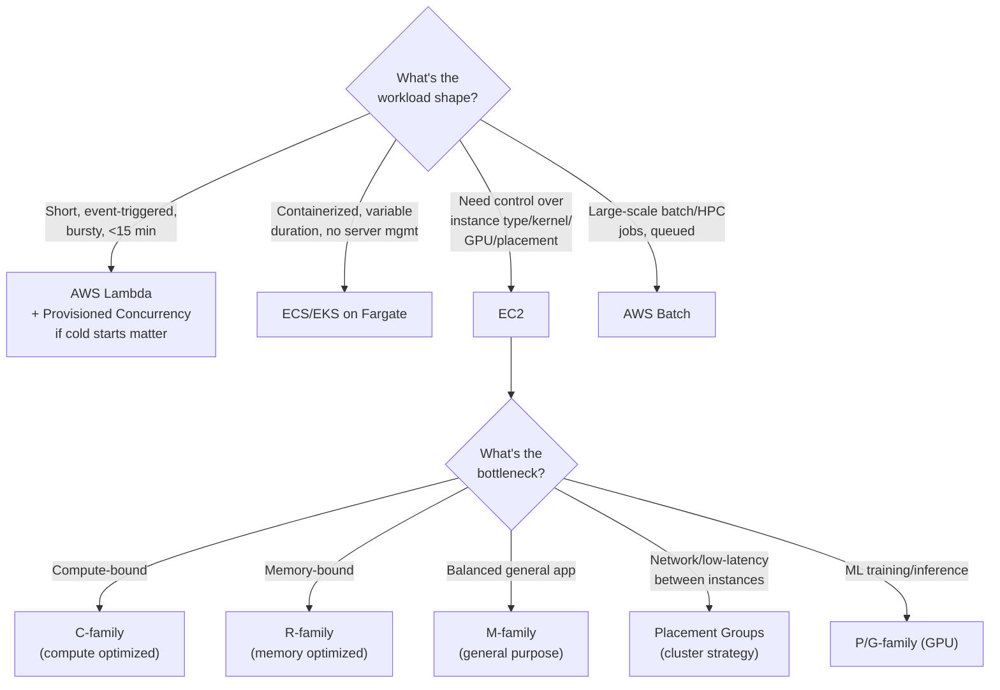
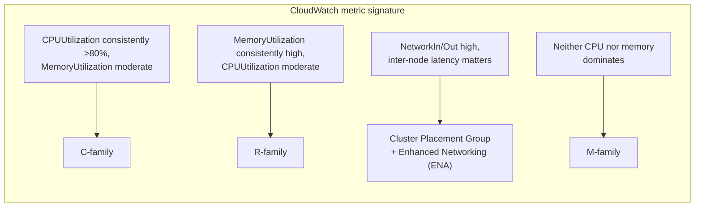
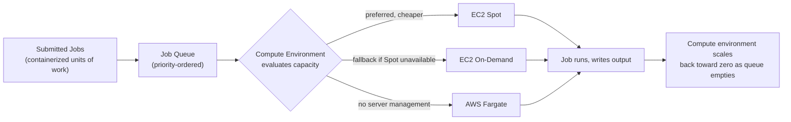
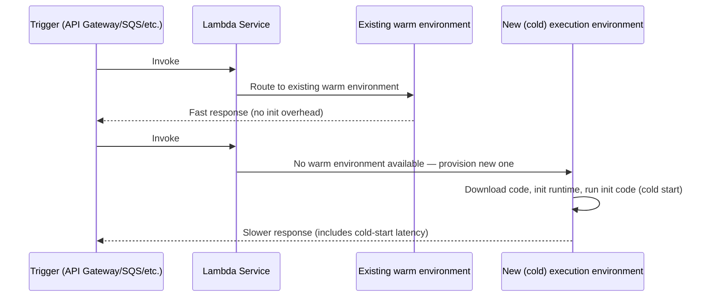

# Compute Performance Decision Framework

*Source: [Amazon EC2 User Guide — Placement strategies for your placement groups](https://docs.aws.amazon.com/AWSEC2/latest/UserGuide/placement-strategies.html)*

## Definition

A decision framework for choosing and tuning compute for performance — on top of the individual
docs `ec2.md`, `ec2-auto-scaling.md`, `lambda.md`, `fargate.md`, `aws-batch.md`,
`containers-vs-vms-vs-serverless.md`.

## Purpose

"High-performing compute" isn't one setting — it's a stack of choices: which compute model
(instance, container, function), which instance family, how it's placed on physical hardware,
and how it scales under load. The exam tests whether you can match a workload's performance
description to the right combination, not any single fact in isolation.

## How It Works — Layered Choices

Step by step: start with the **compute model**. Short-lived, event-triggered work (an API
backend handler, image-thumbnail-on-upload) that completes in minutes fits **Lambda** — if
**cold start latency** is itself a stated requirement (e.g., "response time must be consistently
fast"), add **Provisioned Concurrency** to keep execution environments warm. Containerized
workloads that need more control than Lambda but shouldn't require managing servers fit
**Fargate**. Workloads needing specific instance types, custom AMIs, GPU access, or kernel-level
tuning point to **EC2** directly. Large, queued, bursty batch/HPC jobs that need to provision and
tear down compute automatically point to **AWS Batch**.

Within EC2, the next layer is **instance family selection** based on the actual bottleneck: pick
**compute-optimized (C-family)** for CPU-bound workloads (batch processing, high-performance web
servers), **memory-optimized (R-family)** for in-memory caches/large datasets held in RAM,
**general purpose (M/T-family)** as the balanced default, and **GPU instances (P/G-family)** for
ML training/inference or graphics rendering. For workloads where **inter-instance network
latency/throughput** is the bottleneck (tightly coupled HPC, distributed training), a **cluster
placement group** packs instances physically close together on the same low-latency network
fabric — the specific exam-tested lever for that scenario.

Finally, performance under *load* is a scaling question: **Auto Scaling** with target-tracking
policies (CPU utilization, request count per target, or a custom CloudWatch metric) keeps the
fleet sized to current demand automatically — see `ec2-auto-scaling.md` for mechanics; the
decision that belongs here is *which metric* to scale on, which should be the metric that
actually reflects the bottleneck (queue depth for a worker fleet, request count for a web tier,
not always CPU).

## Architecture: Matching Instance Family to Workload Signature

Treat CloudWatch metrics as the diagnostic tool this decision framework runs on — a scenario that
describes specific metric behavior (not just "it's slow") is handing you the answer directly;
matching the *signature* of the bottleneck to the instance family optimized for it is the actual
tested skill, not memorizing family names.

## Key Decision Points

- **Lambda vs. Fargate vs. EC2** is primarily a tradeoff between operational overhead and control
  — Lambda (least control, zero server management, short durations only), Fargate (serverless
  containers, more flexible duration/resources), EC2 (full control, you manage everything).
- **Enhanced networking (ENA) and placement groups** matter specifically when the question
  describes inter-instance communication speed as the bottleneck, not raw per-instance CPU.
- **Right-sizing is a performance decision as much as a cost one** — an undersized instance
  starves the application; this decision framework and the cost one in Domain 4 are two sides of
  the same instance-family/size choice.
- **Auto Scaling health checks matter for performance, not just availability** — an ASG with ELB
  health checks (not just EC2 status checks) catches an instance that's "up" but failing
  application-level requests and replaces it before it drags down overall throughput.
- **Cluster vs. spread vs. partition placement groups** solve different problems — cluster
  (lowest latency, same AZ, worst fault isolation), spread (best fault isolation, limited
  instances per AZ), partition (large distributed systems like Hadoop/Cassandra needing
  rack-aware placement without full cluster-level co-location).
- **Lambda concurrency limits are a real performance ceiling** — a sudden burst that exceeds the
  account's concurrent execution limit causes throttling; Provisioned Concurrency and requesting
  a limit increase are the two levers, and the exam expects you to recognize throttling
  (`TooManyRequestsException`) as a concurrency-limit symptom, not a code bug.
- **Graviton (ARM-based) instances** offer a meaningfully better price-performance ratio for
  compatible workloads — a scenario optimizing for both cost and performance simultaneously, with
  a workload that can run on ARM, often points here.

## Use Cases — Real Scenarios

- **Video-rendering studio's nightly batch farm.** Hundreds of rendering jobs are CPU-bound and
  run on a fleet of C-family instances orchestrated by AWS Batch with Spot-backed compute
  environments, since each frame-rendering job is independently retriable and tolerant of
  interruption.
- **Real-time fraud-detection service needing consistently fast response under bursty load.** A
  Lambda function backed by Provisioned Concurrency keeps execution environments warm so a sudden
  burst of transactions never experiences a cold-start latency spike during the exact moment fraud
  detection matters most.
- **In-memory analytics engine for a hedge fund holding a full day's market data in RAM.** An
  R-family (memory-optimized) instance is selected specifically because CloudWatch shows memory
  utilization pegged near capacity while CPU sits comfortably underused — the textbook memory-bound
  signature.
- **HPC weather-simulation cluster needing the lowest possible inter-node latency.** A cluster
  placement group packs the simulation's tightly-coupled nodes physically close together within one
  AZ, accepting the fault-isolation tradeoff because the simulation itself is checkpointed and
  restartable if the (unlikely) single-AZ failure occurs.
- **Multi-tenant SaaS platform isolating a small number of dedicated-tier customers' instances.**
  A spread placement group ensures each of these customers' critical instances lands on genuinely
  distinct underlying hardware, so a single hardware failure can never simultaneously take down
  more than one premium customer's instance.
- **Mobile backend API migrating from EC2 to Fargate to remove patching overhead.** The team was
  spending significant engineering time on EC2 AMI patching for a containerized API that didn't
  need custom kernel tuning or GPU access — moving to ECS on Fargate removes the server-management
  layer entirely while keeping the same container images.
- **ARM-compatible microservice fleet cutting costs via Graviton.** A stateless Java microservice,
  already confirmed compatible with ARM, is migrated from `m5` to `m7g` (Graviton) instances,
  improving price-performance without any architecture change — a direct Task 3.2 lever that's also
  a Domain 4 win.
- **Retailer's checkout service missing failing instances under its old health-check setup.** EC2
  status checks showed instances as healthy while the application itself was returning 500 errors
  under load; switching the Auto Scaling group to ELB (application-aware) health checks let it
  correctly detect and replace the failing instances instead of leaving them in rotation.

## Common Mistakes

- Defaulting to a bigger general-purpose instance instead of diagnosing whether the bottleneck is
  actually CPU-, memory-, or network-bound first.
- Using EC2 status checks alone for Auto Scaling health, missing application-level failures that
  ELB health checks would catch.
- Forgetting that Lambda cold starts are a real, measurable latency cost for latency-sensitive,
  infrequently-invoked functions — Provisioned Concurrency exists specifically to remove this.
- Placing all instances of a tightly-coupled HPC cluster in a spread placement group (maximizing
  fault isolation) when the actual requirement is minimizing inter-node latency — the opposite of
  what's needed.
- Scaling an Auto Scaling group purely on CPU utilization when the real bottleneck (and the
  metric that should drive scaling) is queue depth or request count per target.

## Full Worked Mini-Case: Diagnosing a "Slow" Batch Job

**Scenario:** a nightly batch job that resizes and compresses millions of images runs on a fleet
of `m5.xlarge` (general purpose) instances and is missing its SLA window. CloudWatch shows
`CPUUtilization` pegged near 100% throughout the run, while `MemoryUtilization` stays comfortably
under 40%.

**Diagnosis using this framework:** the metric signature (CPU saturated, memory underused) points
straight at "Compute-bound" in the decision tree above — the fix is switching the fleet to
**C-family (compute-optimized)** instances of a comparable size, not simply adding more `m5.xlarge`
instances (which would add more underused memory alongside more CPU, when the actual constraint
is per-instance CPU throughput) and not switching to R-family (which would make the mismatch
worse). Because the job is also naturally parallelizable, queued, and bursty (runs once nightly,
idle otherwise), the team additionally considers migrating it to **AWS Batch** on Spot-backed
compute environments — matching both the performance diagnosis and the workload's natural shape
(queued, interruption-tolerant, bursty) to the right managed service.

## Deeper Dive: Three Analogies for the Compute-Model Choice

- **The staffing-agency analogy.** EC2 is hiring a full-time employee — you control their desk
  setup, software, and schedule completely, but you're responsible for managing them every single
  day. Fargate is hiring through a staffing agency that handles all the HR/payroll/onboarding
  overhead — you still describe the work (the container spec), but someone else manages the
  underlying "employee" (the server). Lambda is hiring a contractor who's paid per task and
  disappears the moment the task is done — you pay for exactly the work performed, nothing more,
  but you can't ask them to "stay logged in all day just in case."
- **The kitchen-brigade analogy for placement groups.** A cluster placement group is seating your
  entire relay-race team at one table so they can pass the baton (data) to each other instantly —
  fast handoffs, but if that one table collapses (an AZ-level event), the whole team is affected
  at once. A spread placement group is deliberately seating your most important VIPs at completely
  different tables across the restaurant, so no single kitchen accident (hardware failure) can
  affect more than one of them.
- **The elevator-bank analogy for Lambda concurrency.** Reserved/Provisioned Concurrency is
  reserving a specific elevator car to sit waiting at your floor at all times, doors open, ready
  the instant you need it — no wait for it to travel from another floor (a cold start). Standard
  on-demand concurrency is waiting for any available elevator to arrive, which is usually fast but
  occasionally means a genuinely new elevator car (execution environment) has to be brought online
  first.

## Architecture: AWS Batch's Managed Job Queue and Compute Environment

*Walkthrough:* a **job** (a containerized unit of work) is submitted to a **job queue**; AWS Batch
evaluates the queue against one or more **compute environments** (which can be EC2 On-Demand,
EC2 Spot, or Fargate) and provisions exactly the capacity needed to run the queued jobs, scaling
back down to zero when the queue empties. This is the mechanism behind the video-rendering studio
scenario above — a Batch compute environment configured to prefer Spot capacity, with a defined
fallback to On-Demand if Spot capacity isn't available, maximizes cost savings without blocking
jobs indefinitely waiting for Spot. Source: [AWS Batch User Guide — What Is AWS
Batch?](https://docs.aws.amazon.com/batch/latest/userguide/what-is-batch.html).

## Architecture: Lambda Concurrency Scaling and the Cold-Start Problem

*Walkthrough:* every concurrent invocation beyond what existing warm execution environments can
handle triggers a brand-new environment to be provisioned — downloading the function's code,
initializing the runtime, and running any module-level initialization code, all before the actual
handler logic even starts. Provisioned Concurrency sidesteps this entirely by keeping a specified
number of environments permanently warm and ready, which is why it's the correct answer whenever a
scenario explicitly calls out consistent, predictable latency as a requirement — "fast most of the
time" is a different (and lower) bar than "fast every time," and only Provisioned Concurrency
guarantees the latter.

## Real AWS Documentation Image: The EC2 Instance Lifecycle

*This lifecycle matters for the Instance Store durability trap discussed throughout this
framework: Instance Store data survives a `reboot` (the instance stays on the same physical host)
but is wiped the moment an instance transitions through `stopping`/`stopped` or `terminated` — a
scenario testing "does this data survive X" is really testing whether you can place X correctly on
this exact state diagram. Source: [Amazon EC2 User Guide — Instance
lifecycle](https://docs.aws.amazon.com/AWSEC2/latest/UserGuide/ec2-instance-lifecycle.html).*

## Real AWS Documentation Image: A Three-Tier Architecture Across Availability Zones

*This is the canonical shape nearly every Task 3.2 "design elastic compute" question is ultimately
testing: a web tier and an application tier each run as their own Auto Scaling group, spread
across multiple AZs behind their own load balancer tier, scaling independently based on whichever
CloudWatch metric actually reflects that tier's bottleneck. Source: [Amazon EC2 Auto Scaling User
Guide — Example architectures](https://docs.aws.amazon.com/autoscaling/ec2/userguide/what-is-amazon-ec2-auto-scaling.html).*

## Additional Worked Exam Scenarios

**Scenario A — "The Lambda function that works fine in testing but throttles in production."** A
payment-processing Lambda function performs flawlessly in a load test with 50 concurrent
invocations, but in production, a flash sale drives 2,000 simultaneous invocations and a large
fraction fail with `TooManyRequestsException`. **Diagnosis:** the account (or function-level
reserved concurrency setting) has a concurrency ceiling lower than 2,000, and invocations beyond
that ceiling are throttled rather than queued indefinitely. **Fix:** request a service quota
increase for the account's concurrent execution limit, and/or set a function-specific reserved
concurrency limit calibrated to the true expected peak, rather than assuming Lambda's "serverless"
label means infinite automatic headroom.

**Scenario B — "Two 'identical' workloads, wildly different EC2 bills for the same throughput."**
A team runs two batch workloads of similar size — one on `m5.4xlarge` instances, one migrated to
`m7g.4xlarge` (Graviton/ARM) instances after confirming ARM compatibility — and the Graviton fleet
costs meaningfully less for equivalent throughput. **Diagnosis/takeaway:** this isn't a performance
bug or an error — Graviton's price-performance advantage for compatible workloads is a real,
expected, and exam-tested fact, not an anomaly to "fix." A scenario asking "how do we improve
price-performance without changing the architecture" for an ARM-compatible workload should point
directly at a Graviton instance-family migration.

**Scenario C — "The HPC job that got slower after 'fixing' a single slow node."** A tightly-coupled
scientific-computing job spans 50 instances in a cluster placement group; one node is identified as
underperforming and is manually replaced with a new instance launched *outside* the placement
group (to "get it running again quickly"), after which overall job throughput drops further, not
recovers. **Diagnosis:** the replacement instance, sitting outside the cluster placement group, now
has meaningfully higher network latency to the other 49 nodes than they have to each other — a
tightly-coupled job's overall throughput is bounded by its slowest/highest-latency link, so one
node outside the placement group can bottleneck the entire cluster worse than one merely slow node
inside it did. **Fix:** always replace a failed/underperforming cluster placement group member with
another instance launched into the *same* placement group, not a quick substitute outside it.

## Why It's Important

**Exam mapping:** SAA-C03 Domain 3, Task 3.2 ("design high-performing and elastic compute
solutions") is this exact layered decision — compute model, instance family, placement, scaling
metric — evaluated together, not as separate trivia questions.

## Exam Tips

- If a scenario gives you a specific CloudWatch metric reading, that's the intended diagnostic
  clue — map it to the matching instance family rather than guessing from the workload
  description alone.
- "Lowest latency between instances" → cluster placement group; "maximum fault isolation for a
  small number of instances" → spread placement group; neither is a universal "better" choice.
- Cold-start latency complaints about Lambda point to Provisioned Concurrency, not necessarily a
  switch away from Lambda entirely.
- "Scale based on X" questions want you to name the CloudWatch metric that actually reflects the
  real bottleneck, not default to CPUUtilization out of habit.

## Related Terms

- [`../../../services/compute/ec2.md`](../../../services/compute/ec2.md),
  [`../../../services/compute/ec2-auto-scaling.md`](../../../services/compute/ec2-auto-scaling.md)
- [`../../../services/compute/lambda.md`](../../../services/compute/lambda.md),
  [`../../../services/compute/fargate.md`](../../../services/compute/fargate.md),
  [`../../../services/compute/aws-batch.md`](../../../services/compute/aws-batch.md)
- [`../../../services/containers/containers-vs-vms-vs-serverless.md`](../../../services/containers/containers-vs-vms-vs-serverless.md)
- [`network-performance-architecture-patterns.md`](network-performance-architecture-patterns.md) —
  the network-side half of the same placement-group/ENA reasoning
- [`storage-performance-decision-framework.md`](storage-performance-decision-framework.md) —
  the storage-side half of a fully-tuned instance (EBS volume type paired with instance family)
- [`../domain-4-cost-optimized-architectures/compute-cost-optimization-decision-framework.md`](../domain-4-cost-optimized-architectures/compute-cost-optimization-decision-framework.md) —
  the same instance-family/compute-model choice, revisited for purchasing-option cost
