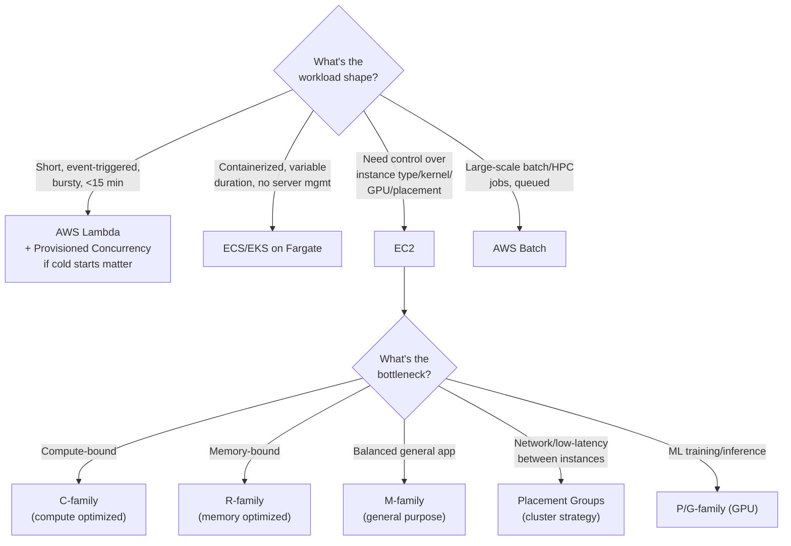

# Compute Performance Decision Framework

## Definition

A decision framework for choosing and tuning compute for performance — on top of the individual
docs `ec2.md`, `ec2-auto-scaling.md`, `lambda.md`, `fargate.md`, `aws-batch.md`,
`containers-vs-vms-vs-serverless.md`.

## Purpose

"High-performing compute" isn't one setting — it's a stack of choices: which compute model
(instance, container, function), which instance family, how it's placed on physical hardware,
and how it scales under load. The exam tests whether you can match a workload's performance
description to the right combination, not any single fact in isolation.

## How It Works — Layered Choices

Step by step: start with the **compute model**. Short-lived, event-triggered work (an API
backend handler, image-thumbnail-on-upload) that completes in minutes fits **Lambda** — if
**cold start latency** is itself a stated requirement (e.g., "response time must be consistently
fast"), add **Provisioned Concurrency** to keep execution environments warm. Containerized
workloads that need more control than Lambda but shouldn't require managing servers fit
**Fargate**. Workloads needing specific instance types, custom AMIs, GPU access, or kernel-level
tuning point to **EC2** directly. Large, queued, bursty batch/HPC jobs that need to provision and
tear down compute automatically point to **AWS Batch**.

Within EC2, the next layer is **instance family selection** based on the actual bottleneck: pick
**compute-optimized (C-family)** for CPU-bound workloads (batch processing, high-performance web
servers), **memory-optimized (R-family)** for in-memory caches/large datasets held in RAM,
**general purpose (M/T-family)** as the balanced default, and **GPU instances (P/G-family)** for
ML training/inference or graphics rendering. For workloads where **inter-instance network
latency/throughput** is the bottleneck (tightly coupled HPC, distributed training), a **cluster
placement group** packs instances physically close together on the same low-latency network
fabric — the specific exam-tested lever for that scenario.

Finally, performance under *load* is a scaling question: **Auto Scaling** with target-tracking
policies (CPU utilization, request count per target, or a custom CloudWatch metric) keeps the
fleet sized to current demand automatically — see `ec2-auto-scaling.md` for mechanics; the
decision that belongs here is *which metric* to scale on, which should be the metric that
actually reflects the bottleneck (queue depth for a worker fleet, request count for a web tier,
not always CPU).

## Key Decision Points

- **Lambda vs. Fargate vs. EC2** is primarily a tradeoff between operational overhead and control
  — Lambda (least control, zero server management, short durations only), Fargate (serverless
  containers, more flexible duration/resources), EC2 (full control, you manage everything).
- **Enhanced networking (ENA) and placement groups** matter specifically when the question
  describes inter-instance communication speed as the bottleneck, not raw per-instance CPU.
- **Right-sizing is a performance decision as much as a cost one** — an undersized instance
  starves the application; this decision framework and the cost one in Domain 4 are two sides of
  the same instance-family/size choice.
- **Auto Scaling health checks matter for performance, not just availability** — an ASG with ELB
  health checks (not just EC2 status checks) catches an instance that's "up" but failing
  application-level requests and replaces it before it drags down overall throughput.

## Why It's Important

**Exam mapping:** SAA-C03 Domain 3, Task 3.2 ("design high-performing and elastic compute
solutions") is this exact layered decision — compute model, instance family, placement, scaling
metric — evaluated together, not as separate trivia questions.

## Related Terms

- [`../../../services/compute/ec2.md`](../../../services/compute/ec2.md),
  [`../../../services/compute/ec2-auto-scaling.md`](../../../services/compute/ec2-auto-scaling.md)
- [`../../../services/compute/lambda.md`](../../../services/compute/lambda.md),
  [`../../../services/compute/fargate.md`](../../../services/compute/fargate.md),
  [`../../../services/compute/aws-batch.md`](../../../services/compute/aws-batch.md)
- [`../../../services/containers/containers-vs-vms-vs-serverless.md`](../../../services/containers/containers-vs-vms-vs-serverless.md)
