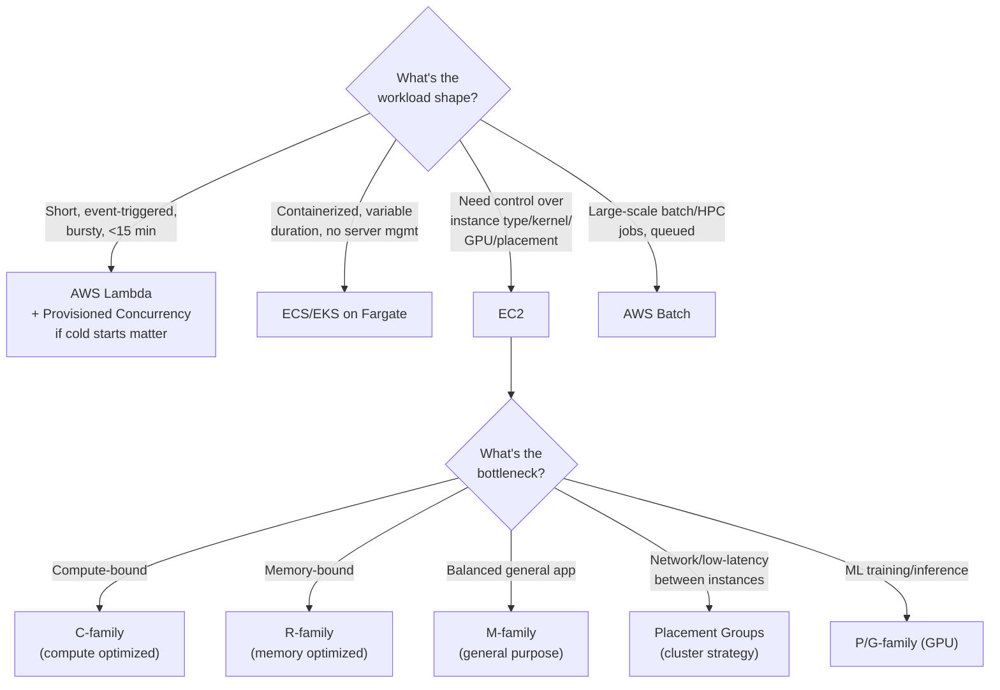
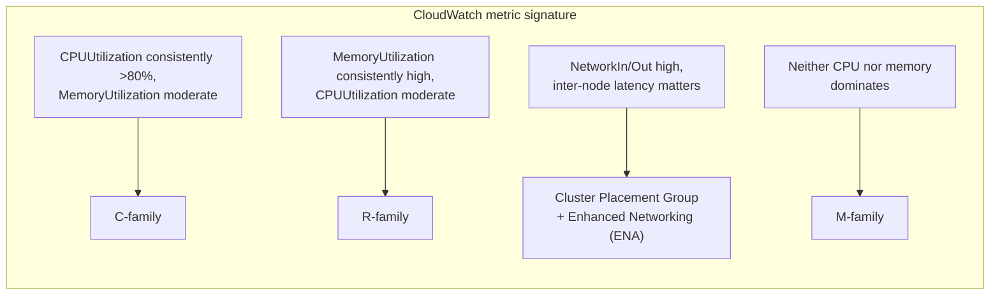

# Compute Performance Decision Framework

*Source: [Amazon EC2 User Guide — Placement strategies for your placement groups](https://docs.aws.amazon.com/AWSEC2/latest/UserGuide/placement-strategies.html)*

## Definition

A decision framework for choosing and tuning compute for performance — on top of the individual
docs `ec2.md`, `ec2-auto-scaling.md`, `lambda.md`, `fargate.md`, `aws-batch.md`,
`containers-vs-vms-vs-serverless.md`.

## Purpose

"High-performing compute" isn't one setting — it's a stack of choices: which compute model
(instance, container, function), which instance family, how it's placed on physical hardware,
and how it scales under load. The exam tests whether you can match a workload's performance
description to the right combination, not any single fact in isolation.

## How It Works — Layered Choices

Step by step: start with the **compute model**. Short-lived, event-triggered work (an API
backend handler, image-thumbnail-on-upload) that completes in minutes fits **Lambda** — if
**cold start latency** is itself a stated requirement (e.g., "response time must be consistently
fast"), add **Provisioned Concurrency** to keep execution environments warm. Containerized
workloads that need more control than Lambda but shouldn't require managing servers fit
**Fargate**. Workloads needing specific instance types, custom AMIs, GPU access, or kernel-level
tuning point to **EC2** directly. Large, queued, bursty batch/HPC jobs that need to provision and
tear down compute automatically point to **AWS Batch**.

Within EC2, the next layer is **instance family selection** based on the actual bottleneck: pick
**compute-optimized (C-family)** for CPU-bound workloads (batch processing, high-performance web
servers), **memory-optimized (R-family)** for in-memory caches/large datasets held in RAM,
**general purpose (M/T-family)** as the balanced default, and **GPU instances (P/G-family)** for
ML training/inference or graphics rendering. For workloads where **inter-instance network
latency/throughput** is the bottleneck (tightly coupled HPC, distributed training), a **cluster
placement group** packs instances physically close together on the same low-latency network
fabric — the specific exam-tested lever for that scenario.

Finally, performance under *load* is a scaling question: **Auto Scaling** with target-tracking
policies (CPU utilization, request count per target, or a custom CloudWatch metric) keeps the
fleet sized to current demand automatically — see `ec2-auto-scaling.md` for mechanics; the
decision that belongs here is *which metric* to scale on, which should be the metric that
actually reflects the bottleneck (queue depth for a worker fleet, request count for a web tier,
not always CPU).

## Architecture: Matching Instance Family to Workload Signature

Treat CloudWatch metrics as the diagnostic tool this decision framework runs on — a scenario that
describes specific metric behavior (not just "it's slow") is handing you the answer directly;
matching the *signature* of the bottleneck to the instance family optimized for it is the actual
tested skill, not memorizing family names.

## Key Decision Points

- **Lambda vs. Fargate vs. EC2** is primarily a tradeoff between operational overhead and control
  — Lambda (least control, zero server management, short durations only), Fargate (serverless
  containers, more flexible duration/resources), EC2 (full control, you manage everything).
- **Enhanced networking (ENA) and placement groups** matter specifically when the question
  describes inter-instance communication speed as the bottleneck, not raw per-instance CPU.
- **Right-sizing is a performance decision as much as a cost one** — an undersized instance
  starves the application; this decision framework and the cost one in Domain 4 are two sides of
  the same instance-family/size choice.
- **Auto Scaling health checks matter for performance, not just availability** — an ASG with ELB
  health checks (not just EC2 status checks) catches an instance that's "up" but failing
  application-level requests and replaces it before it drags down overall throughput.
- **Cluster vs. spread vs. partition placement groups** solve different problems — cluster
  (lowest latency, same AZ, worst fault isolation), spread (best fault isolation, limited
  instances per AZ), partition (large distributed systems like Hadoop/Cassandra needing
  rack-aware placement without full cluster-level co-location).
- **Lambda concurrency limits are a real performance ceiling** — a sudden burst that exceeds the
  account's concurrent execution limit causes throttling; Provisioned Concurrency and requesting
  a limit increase are the two levers, and the exam expects you to recognize throttling
  (`TooManyRequestsException`) as a concurrency-limit symptom, not a code bug.
- **Graviton (ARM-based) instances** offer a meaningfully better price-performance ratio for
  compatible workloads — a scenario optimizing for both cost and performance simultaneously, with
  a workload that can run on ARM, often points here.

## Common Mistakes

- Defaulting to a bigger general-purpose instance instead of diagnosing whether the bottleneck is
  actually CPU-, memory-, or network-bound first.
- Using EC2 status checks alone for Auto Scaling health, missing application-level failures that
  ELB health checks would catch.
- Forgetting that Lambda cold starts are a real, measurable latency cost for latency-sensitive,
  infrequently-invoked functions — Provisioned Concurrency exists specifically to remove this.
- Placing all instances of a tightly-coupled HPC cluster in a spread placement group (maximizing
  fault isolation) when the actual requirement is minimizing inter-node latency — the opposite of
  what's needed.
- Scaling an Auto Scaling group purely on CPU utilization when the real bottleneck (and the
  metric that should drive scaling) is queue depth or request count per target.

## Full Worked Mini-Case: Diagnosing a "Slow" Batch Job

**Scenario:** a nightly batch job that resizes and compresses millions of images runs on a fleet
of `m5.xlarge` (general purpose) instances and is missing its SLA window. CloudWatch shows
`CPUUtilization` pegged near 100% throughout the run, while `MemoryUtilization` stays comfortably
under 40%.

**Diagnosis using this framework:** the metric signature (CPU saturated, memory underused) points
straight at "Compute-bound" in the decision tree above — the fix is switching the fleet to
**C-family (compute-optimized)** instances of a comparable size, not simply adding more `m5.xlarge`
instances (which would add more underused memory alongside more CPU, when the actual constraint
is per-instance CPU throughput) and not switching to R-family (which would make the mismatch
worse). Because the job is also naturally parallelizable, queued, and bursty (runs once nightly,
idle otherwise), the team additionally considers migrating it to **AWS Batch** on Spot-backed
compute environments — matching both the performance diagnosis and the workload's natural shape
(queued, interruption-tolerant, bursty) to the right managed service.

## Why It's Important

**Exam mapping:** SAA-C03 Domain 3, Task 3.2 ("design high-performing and elastic compute
solutions") is this exact layered decision — compute model, instance family, placement, scaling
metric — evaluated together, not as separate trivia questions.

## Exam Tips

- If a scenario gives you a specific CloudWatch metric reading, that's the intended diagnostic
  clue — map it to the matching instance family rather than guessing from the workload
  description alone.
- "Lowest latency between instances" → cluster placement group; "maximum fault isolation for a
  small number of instances" → spread placement group; neither is a universal "better" choice.
- Cold-start latency complaints about Lambda point to Provisioned Concurrency, not necessarily a
  switch away from Lambda entirely.
- "Scale based on X" questions want you to name the CloudWatch metric that actually reflects the
  real bottleneck, not default to CPUUtilization out of habit.

## Related Terms

- [`../../../services/compute/ec2.md`](../../../services/compute/ec2.md),
  [`../../../services/compute/ec2-auto-scaling.md`](../../../services/compute/ec2-auto-scaling.md)
- [`../../../services/compute/lambda.md`](../../../services/compute/lambda.md),
  [`../../../services/compute/fargate.md`](../../../services/compute/fargate.md),
  [`../../../services/compute/aws-batch.md`](../../../services/compute/aws-batch.md)
- [`../../../services/containers/containers-vs-vms-vs-serverless.md`](../../../services/containers/containers-vs-vms-vs-serverless.md)
- [`network-performance-architecture-patterns.md`](network-performance-architecture-patterns.md) —
  the network-side half of the same placement-group/ENA reasoning
- [`storage-performance-decision-framework.md`](storage-performance-decision-framework.md) —
  the storage-side half of a fully-tuned instance (EBS volume type paired with instance family)
- [`../domain-4-cost-optimized-architectures/compute-cost-optimization-decision-framework.md`](../domain-4-cost-optimized-architectures/compute-cost-optimization-decision-framework.md) —
  the same instance-family/compute-model choice, revisited for purchasing-option cost
