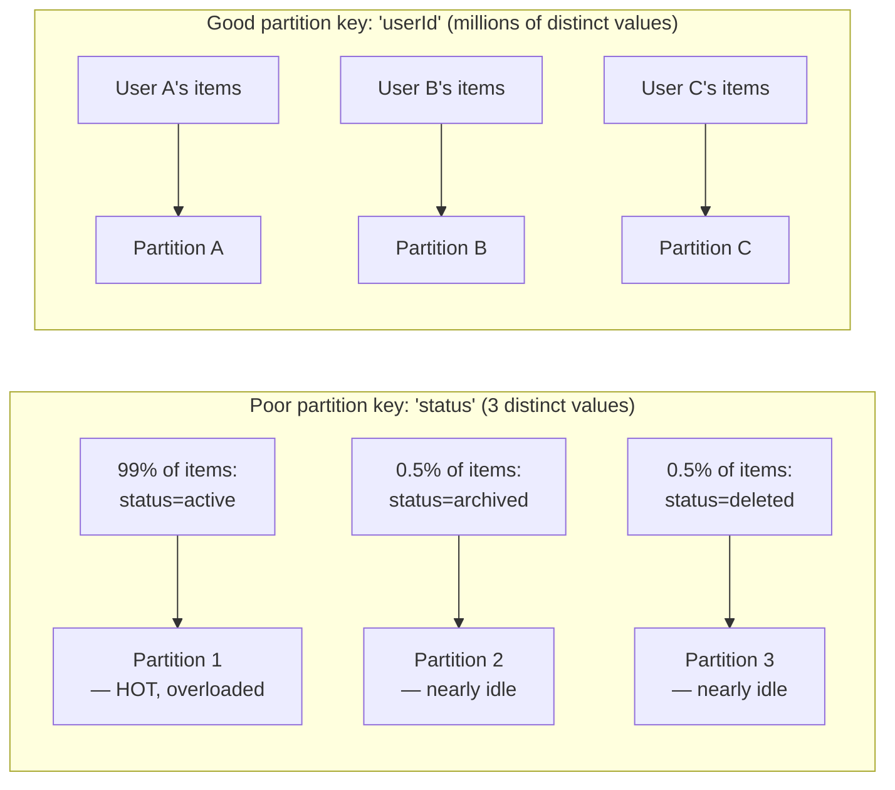
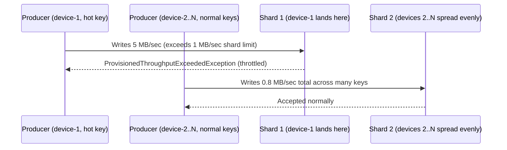
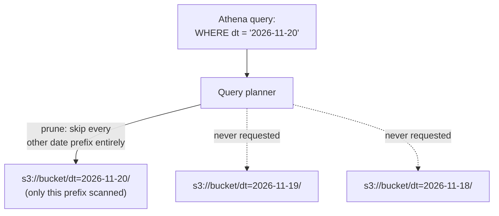

# Data Partitioning and Sharding Patterns Across the Domain

*Source: [Amazon DynamoDB Developer Guide — Partitions and data
distribution](https://docs.aws.amazon.com/amazondynamodb/latest/developerguide/HowItWorks.Partitions.html)*

## Definition

"Partitioning" and "sharding" are the same underlying idea applied across nearly every service in
this domain — **splitting data or traffic into smaller, independently-handleable pieces so no
single piece becomes a bottleneck.** The word and the exact mechanics differ by service (a
DynamoDB *partition*, a Kinesis *shard*, an S3/Athena *partition* in a data lake, an Auto Scaling
group spread across AZs), but the underlying reasoning — picking a good key so load distributes
evenly, and understanding what happens when it doesn't — is identical everywhere it shows up. This
doc is the cross-cutting map of that one idea, applied service by service, because the individual
docs each explain *their own* partitioning mechanism without stepping back to show the pattern.

## Purpose

Every service that partitions data does so to solve the same two problems at once: **scale beyond
what one machine/shard/partition could handle**, and **isolate one hot spot of load from affecting
everything else**. The practical skill the exam tests isn't memorizing that "DynamoDB has
partitions" — it's recognizing, for any given key design, whether that key will spread load evenly
or accidentally concentrate it onto one partition/shard, because a concentrated key defeats the
entire reason partitioning existed in the first place, no matter how much *overall* capacity is
provisioned.

## How It Works — Partitioning Across Five Services

```mermaid
flowchart TB
    subgraph DDB["DynamoDB"]
        DDBKey["Partition key hashed"] --> DDBP["Data spread across\nphysical partitions"]
    end
    subgraph Kinesis3["Kinesis Data Streams"]
        KKey["Partition key hashed"] --> KShard["Records spread across\nshards (throughput units)"]
    end
    subgraph S3Lake["S3 Data Lake / Athena"]
        S3Key["Partition columns\n(e.g., year/month/day)"] --> S3Prune["Query engine prunes\nirrelevant S3 prefixes"]
    end
    subgraph EBSVol["EBS / Database Sharding"]
        ShardKey["Application-chosen\nshard key (e.g., customer region)"] --> ShardDB["Data spread across\nseparate DB instances"]
    end
    subgraph ELBTarget["ELB / Auto Scaling"]
        ReqHash["Request routed by\nALB algorithm / AZ"] --> TargetSpread["Load spread across\ntargets and AZs"]
    end
```

**DynamoDB** hashes the partition key value and uses that hash to determine which physical
partition stores the item — a good key has high cardinality (many distinct values) and roughly
even access frequency across those values. **Kinesis Data Streams** does the same hashing trick,
but the unit is a *shard* (a fixed throughput allocation, not just a storage division) — an
uneven partition key here doesn't just waste storage balance, it directly throttles write
throughput on the hot shard. **S3 data lakes queried via Athena/Glue/EMR** use partitioning
differently — not for load distribution across machines, but so a query engine can skip
(**prune**) entire prefixes of irrelevant data without reading them at all, which is a cost and
latency lever, not a write-throughput one. **Database sharding** (the manual, application-level
kind, used when a single relational database can't scale further vertically) picks an explicit
shard key (customer ID range, geographic region, tenant ID) and routes each query to the correct
physical database instance — unlike DynamoDB, there's no automatic hashing; the application (or a
sharding middleware layer) must implement the routing logic itself. **Load balancing and Auto
Scaling**, while not usually called "partitioning," apply the identical principle to compute —
spreading requests across targets and Availability Zones so no single instance or AZ carries a
disproportionate share.

## Architecture: The Hot Partition Problem, Concretely

*Walkthrough:* a DynamoDB table using `status` as its partition key, where 99% of items share the
single value `active`, concentrates nearly all read/write traffic onto one physical partition — no
matter how much *overall* table throughput is provisioned, that one partition has its own ceiling,
and requests against it throttle long before the table's aggregate provisioned capacity is
exhausted. A key like `userId`, with millions of naturally distinct values and no single value
dominating access frequency, spreads both storage and request load evenly across many partitions
automatically. This exact mechanism — and the fix (redesign the key, or add a random "sharding
suffix" to spread a structurally low-cardinality key artificially, e.g., `status#<random 0-9>`) —
is one of the most frequently tested DynamoDB performance facts on the exam.

## Architecture: Kinesis Shard-Level Throughput, and What Happens When a Key Is Hot

*Walkthrough:* a single IoT device (or any single partition-key value) writing at a rate exceeding
one shard's 1 MB/sec or 1,000 records/sec ceiling gets throttled on that shard specifically, even
while every other shard in the exact same stream sits comfortably under capacity — the fix is
**not** simply adding more shards to the stream overall (resharding adds capacity, but a
single-hot-key problem persists on whichever shard that key hashes to even after a split, unless
the key design itself changes), but redesigning the partition key so no single value dominates one
producer's write volume this heavily, or splitting that one producer's writes across multiple
synthetic sub-keys.

## Architecture: S3/Athena Partitioning for Query Pruning (A Different Kind of "Partition")

*Walkthrough:* this is a fundamentally different kind of "partitioning" than DynamoDB's or
Kinesis's — there's no write-throughput ceiling being distributed here; a well-chosen S3/Athena
partition scheme (matching the columns queries actually filter on) determines how much data a
*query* has to scan, directly driving both query cost and latency. The hot-partition failure mode
doesn't apply the same way — the equivalent mistake here is choosing partition *granularity*
mismatched to query patterns (partitioning by hour when queries filter by day creates excessive
metadata overhead for no pruning benefit; not partitioning at all forces every query to scan the
entire dataset regardless of the actual filter).

## Key Decision Points

- **"Partition" means different things in different services** — DynamoDB/Kinesis partitioning
  distributes *write/read throughput capacity*; S3/Athena partitioning controls *how much data a
  query scans*. Confusing the two leads to misapplied fixes (e.g., "add more S3 partitions" doesn't
  fix a DynamoDB hot-partition throttling problem, and vice versa).
- **High cardinality and even access frequency are both required** for a good partition/shard key
  — a key with many distinct values but one value receiving 90% of traffic is still a hot-key
  problem, just a subtler one than a literally low-cardinality key.
- **Resharding/adding capacity doesn't fix a hot single-key problem** — if one key's value is
  structurally overloaded, more shards or more partitions elsewhere don't help that one key's own
  ceiling; the key design itself (or a synthetic sharding suffix) must change.
- **Database sharding is a manual, high-effort lever** reached for only after vertical scaling and
  caching are exhausted — unlike DynamoDB's automatic partitioning, application-level sharding
  means building and maintaining the routing logic yourself.
- **S3/Athena partition grain should match query grain** — partitioning finer than queries
  actually filter by adds metadata overhead without a pruning benefit; partitioning coarser than
  needed forces unnecessary scanning within each partition.

## Use Cases — Real Scenarios

- **Multi-tenant SaaS platform choosing a DynamoDB partition key.** Using `tenantId` alone as the
  partition key works well for small/medium tenants but creates a hot partition for one very large
  enterprise customer generating disproportionate traffic — the fix is a composite key (e.g.,
  `tenantId#shardNumber`, with shard number derived from a hash of something within that tenant's
  own data) to spread even one large tenant's load across multiple partitions.
- **IoT platform with one unusually high-volume device among thousands of normal ones.** A single
  misbehaving sensor sending readings 100x more frequently than normal throttles on its Kinesis
  shard while every other device's shard sits idle — the team adds client-side rate limiting on
  that specific device class and/or splits its key into multiple synthetic sub-streams.
- **Data lake analytics team redesigning a slow, expensive Athena table.** A table partitioned by
  `country` (a handful of distinct values, uneven data volume per country) performs poorly for
  queries that actually filter by date; re-partitioning by `year/month/day` (matching the actual
  query pattern) and converting to Parquet cuts both scan cost and latency dramatically, as
  detailed further in `athena.md`.
- **E-commerce company manually sharding a relational orders database by region.** Having exhausted
  vertical scaling on a single relational primary, the team implements application-level sharding
  by customer region (North America, EMEA, APAC each on a separate database instance), accepting
  the real operational complexity of cross-shard queries (e.g., "total orders across all regions"
  now requires fanning out to all shards) as the tradeoff for write scalability a single instance
  couldn't provide.
- **Streaming platform choosing a Kinesis partition key for user activity events.** Using `userId`
  as the partition key (naturally high cardinality, roughly even per-user event volume) spreads
  load evenly across shards; using `eventType` (a handful of distinct values, with one type
  dominating volume) would recreate the exact hot-shard problem described above.
- **Auto Scaling group spread evenly across Availability Zones.** Although not usually described as
  "partitioning," an Auto Scaling group balancing instance count evenly across AZs is applying the
  identical principle at the compute layer — no single AZ (or the targets within it) should carry a
  disproportionate share of traffic relative to the others.

## Common Mistakes

- Choosing a DynamoDB partition key based purely on what's convenient for queries (e.g., `status`,
  `category`) without checking whether it has both high cardinality and even access frequency.
- Assuming "add more shards/partitions" fixes a single hot-key problem, when the actual fix is
  redesigning the key or adding a sharding suffix to that specific key's values.
- Partitioning an S3 data lake table by a column nobody actually filters on, gaining zero query
  pruning benefit while still paying the metadata/file-count overhead of maintaining partitions.
- Reaching for manual database sharding before exhausting simpler levers (caching, read replicas,
  vertical scaling, or migrating the specific hot workload to DynamoDB) — sharding is the most
  operationally expensive lever in this entire document and should be a last resort, not a first
  instinct.
- Partitioning an Athena table at too fine a grain (e.g., by minute) for queries that filter by day
  — creating thousands of tiny partitions whose metadata overhead can outweigh the pruning benefit.

## Full Worked Mini-Case: A Social Media Platform's Trending-Topic Hot Key

**Scenario:** a social platform stores post-like counts in DynamoDB, keyed by `postId`. During a
viral event, one specific post receives an enormous share of all like-events platform-wide within
a few minutes, and writes to that post's item begin throttling — even though the table's overall
provisioned/on-demand capacity shows significant unused headroom across the rest of the table.

**Diagnosis using this framework:** this is the hot-partition pattern precisely — `postId` is a
genuinely high-cardinality key in general (millions of distinct posts), but during this specific
event, one single key value is receiving a wildly disproportionate share of write traffic, which
concentrates onto the one physical partition holding that item regardless of how well-distributed
every *other* post's traffic is.

**Fix:** rather than writing every like-event directly to that one item (which has a hard physical
ceiling no amount of overall table capacity can raise), the team adopts a **write-sharding**
pattern specifically for the hot item: each like-event writes to one of N synthetic sub-items
(`postId#0` through `postId#9`, chosen randomly or round-robin per write), and a periodic
aggregation step (or a read-time fan-out summing all N sub-items) computes the total like count.
This spreads the viral post's write load across N partitions instead of concentrating it onto one,
while every other, non-viral post in the table continues using a single unsharded item with no
added complexity — applying the expensive write-sharding pattern only where the actual hot-key
problem exists, not uniformly across the whole table.

## Why It's Important

**Real-world:** hot-partition and hot-shard incidents are a recurring, genuinely painful class of
production outage — they look like "the database/stream is broken" when the actual cause is a
specific key's traffic concentration, and diagnosing them requires recognizing the pattern (one
key, disproportionate traffic) rather than assuming a general capacity problem.

**Exam mapping:** this cross-cutting pattern underlies Task 3.1 (S3/data lake partitioning for
query performance), Task 3.3 (DynamoDB partition key design for throughput), and Task 3.5
(Kinesis shard sizing and partition key choice for streaming ingestion) simultaneously — recognizing
"hot key/hot partition/hot shard" as one recurring diagnostic pattern, applied across several
different services, is exactly the kind of cross-domain pattern-matching SAA-C03 rewards.

## Exam Tips

- "DynamoDB table throttling despite having headroom in overall provisioned/on-demand capacity" →
  hot partition key, diagnose and redesign the key (or add a sharding suffix), not "add more
  capacity."
- "Kinesis records falling behind / throttling on one producer specifically" → that producer's
  partition key is likely hot; check per-shard metrics, not just aggregate stream throughput.
- "Athena query slow/expensive despite the table being partitioned" → check whether the partition
  columns actually match the query's filter columns; a mismatched partition scheme provides zero
  pruning benefit regardless of how many partitions exist.
- "A single relational database can no longer handle write volume despite a bigger instance" →
  this is the signal for application-level sharding or migrating the hot write path to DynamoDB,
  not another vertical scale-up.
- A write-sharding fix (splitting one hot key into N synthetic sub-keys, aggregating later) is the
  standard DynamoDB answer for "one item/key is receiving disproportionate traffic" scenarios.

## Related Terms

- [`../../../services/database/dynamodb.md`](../../../services/database/dynamodb.md)
- [`../../../services/analytics/kinesis-family.md`](../../../services/analytics/kinesis-family.md)
- [`../../../services/analytics/athena.md`](../../../services/analytics/athena.md)
- [`../../../services/analytics/glue.md`](../../../services/analytics/glue.md)
- [`database-read-write-scaling-decision-tree.md`](database-read-write-scaling-decision-tree.md) —
  where this doc's key-design detail fits into the broader read/write scaling decision
- [`caching-strategy-deep-dive.md`](caching-strategy-deep-dive.md) — the complementary read-side
  lever that's usually tried before any partitioning/sharding redesign
- [`MASTER-CHUNK.md`](MASTER-CHUNK.md) — full depth on every service named above
