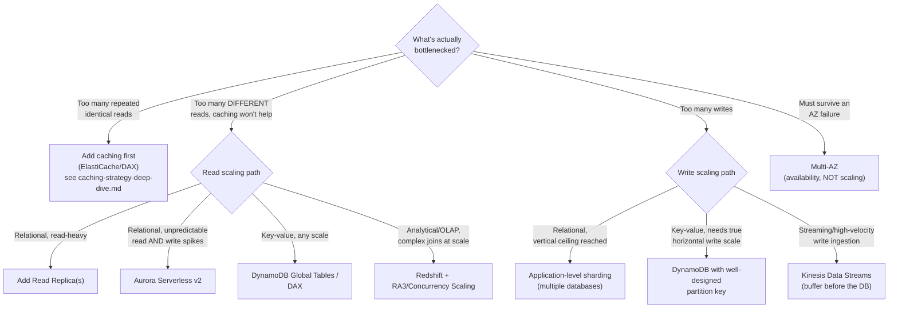
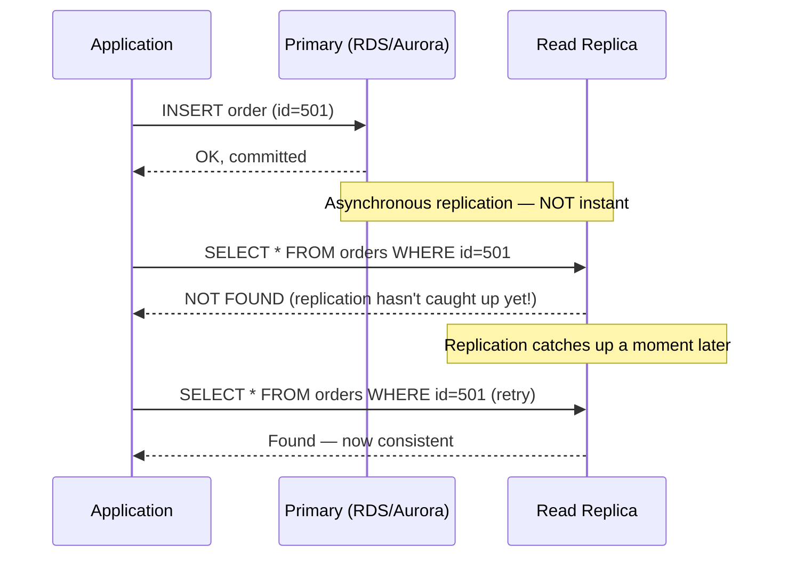
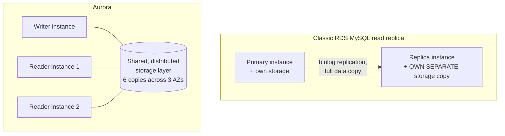

# Database Read/Write Scaling Decision Tree

*Source: [Amazon RDS User Guide — Multi-AZ
deployments](https://docs.aws.amazon.com/AmazonRDS/latest/UserGuide/Concepts.MultiAZ.html)*

## Definition

A decision tree for scaling a database once caching alone (see
[`caching-strategy-deep-dive.md`](caching-strategy-deep-dive.md)) isn't enough — read scaling
(read replicas, caching, Aurora's distributed storage), write scaling (sharding, partition key
design, choosing an engine built for horizontal write scale), and the distinct question of
**Multi-AZ** (availability, not scaling) are four different levers that get conflated constantly
on the exam. This doc separates them cleanly and shows the order in which a real architecture team
should reach for each one.

## Purpose

"The database is slow" is not one problem — it could be read-bound (too many SELECTs), write-bound
(too many INSERT/UPDATE/DELETEs), or availability-bound (needs to survive an AZ failure, which is
a completely different concern from raw throughput). Each of these has a distinct fix, and using
the wrong one — adding a read replica to fix a write bottleneck, for instance — spends real money
and engineering effort while leaving the actual problem untouched. This doc exists to make that
diagnosis mechanical rather than guesswork.

## How It Works — The Decision Tree

Step by step: the very first fork is **diagnosing which operation is actually the bottleneck** —
not assumed, measured (CloudWatch read/write IOPS, `ReadLatency`/`WriteLatency` metrics, or
query-level profiling). If reads are the bottleneck and the same queries repeat frequently,
**caching comes first**, full stop — it's cheaper and faster to implement than any database-level
scaling change, and often eliminates the need for one entirely. If reads are the bottleneck but
they're genuinely varied (not cache-friendly), the fix depends on the database shape: relational
read-heavy workloads add **read replicas**; relational workloads with unpredictable load
(sometimes idle, sometimes spiking) fit **Aurora Serverless v2**, which scales compute in
fine-grained increments within seconds rather than sizing for peak around the clock; pure
key-value workloads scale reads via **DynamoDB's own horizontal architecture** (and DAX/Global
Tables for cross-Region read scaling); analytical workloads needing complex joins at scale point
to **Redshift**, using RA3 nodes (decoupled storage/compute) and **Concurrency Scaling** to absorb
unpredictable concurrent query bursts.

Writes are structurally harder to scale than reads, because every write eventually has to land
somewhere durably and consistently — there's no "just add a cache" equivalent for the write path.
**Relational databases hit a real vertical ceiling** on write throughput (a single primary
instance, even Aurora's, can only accept writes so fast); once that ceiling is reached, the
options are application-level **sharding** (splitting data across multiple independent database
instances, each owning a subset of the data — genuinely complex to build and maintain) or
re-architecting onto a database designed for horizontal write scale from the ground up —
**DynamoDB**, where write throughput scales by adding partitions (assuming the partition key is
designed to spread writes evenly — see `data-partitioning-and-sharding-patterns.md`). For
**bursty, high-velocity write ingestion** (IoT telemetry, clickstream events) that doesn't need
to be immediately queryable, **Kinesis Data Streams buffering in front of the database** absorbs
the burst and lets a consumer write to the database at a smoothed, sustainable rate instead of the
database itself needing to absorb the raw spike.

## Architecture: Read Replica Lag and Why It Matters

*Walkthrough:* read replicas use **asynchronous** replication — a write committed on the primary
is not instantly visible on every replica; there's a real (usually small, but non-zero) lag
window. This is the exact mechanism behind the classic "I just wrote a row and immediately can't
read it back" bug when an application reads from a replica right after writing to the primary.
The standard fixes: read your own writes from the **primary** specifically for data you just
wrote (not a replica), accept eventual consistency for genuinely read-heavy, tolerant workloads
(the vast majority of replica use cases), or monitor `ReplicaLag` and route traffic away from a
replica that's falling too far behind.

## Architecture: Aurora's Shared Storage Layer vs. Classic Read Replica Architecture

*Walkthrough:* a classic RDS read replica maintains its **own full copy** of the data, kept in
sync via replication — meaning storage cost and replication lag scale with every replica added.
Aurora's readers instead share the **same underlying distributed storage volume** as the writer —
adding an Aurora reader doesn't duplicate storage at all, and because readers read from the same
storage layer the writer just committed to (with a typically much smaller lag window than classic
replication), Aurora Replicas generally show lower replica lag than classic RDS read replicas.
This is the specific architectural reason Aurora Replicas are the preferred read-scaling answer
over classic RDS read replicas whenever a scenario names Aurora specifically.

## Real AWS Documentation Image: Aurora Global Database for Cross-Region Read Scaling

*Aurora Global Database extends the shared-storage read-scaling model across Regions — secondary
Regions get fast, read-only access to the primary Region's data (typically within about one
second of replication lag) without the heavier cost of fully independent cross-Region read
replicas. Source: [Amazon Aurora User Guide — Using Amazon Aurora
global databases](https://docs.aws.amazon.com/AmazonRDS/latest/AuroraUserGuide/aurora-global-database.html).*
This is the correct answer whenever a scenario describes global users needing low-latency *read*
access to the same relational dataset — it is explicitly not a write-scaling mechanism (only the
primary Region can accept writes under normal operation), which is a frequently tested distinction
from a scenario that actually needs multi-Region *write* capability (a structurally harder problem
relational engines handle far less gracefully than DynamoDB Global Tables do).

## Key Decision Points

- **Diagnose before prescribing** — "the database is slow" must be resolved into "reads are slow,"
  "writes are slow," or "we need to survive an AZ failure" before any specific fix is chosen;
  these three have almost no overlap in their correct solutions.
- **Caching beats read replicas when reads repeat** — a read replica helps even for *varied*
  reads (since it's a full copy of the engine), but if the same queries repeat, caching is cheaper
  and faster to implement, and should be tried first.
- **Multi-AZ is not a read-scaling feature** — the standby in a Multi-AZ RDS deployment is not
  readable under normal operation (for RDS; Aurora's architecture differs) and exists purely for
  automatic failover during an AZ failure — a scenario conflating "Multi-AZ" with "read scaling"
  is testing whether you know this distinction.
- **Writes don't have a caching escape hatch** — unlike reads, there's no equivalent of "just
  cache it" for write-heavy bottlenecks; the real options are sharding, a horizontally-scalable
  engine (DynamoDB), or buffering bursty writes through Kinesis.
- **Aurora Replicas beat classic RDS read replicas on replication lag and storage cost**, because
  they share the underlying storage layer rather than maintaining independent full copies.
- **DynamoDB's write scalability depends entirely on partition key design** — a poorly chosen key
  (low cardinality, or one value receiving disproportionate traffic) creates a hot partition that
  throttles regardless of how much overall table throughput is provisioned.

## Use Cases — Real Scenarios

- **News site read-scaling for a breaking story.** Traffic to read the same few articles spikes
  50x; ElastiCache (caching, not a read replica) absorbs nearly all of it, since the bottleneck is
  repeated identical reads, not varied query load — adding read replicas here would be the wrong,
  more expensive lever.
- **SaaS analytics platform's unpredictable, bursty dashboard load.** Some customers query heavily
  during business hours, others barely at all; Aurora Serverless v2 scales compute to match actual
  demand within seconds, avoiding the cost of provisioning for every customer's peak simultaneously.
- **E-commerce order-processing system hitting a write ceiling.** A single relational primary can
  no longer keep up with order-write volume during a major sale; the team evaluates sharding orders
  by customer region versus migrating the orders table to DynamoDB with a well-designed partition
  key — choosing DynamoDB because horizontal write scaling is a core design goal there, not a
  bolt-on.
- **IoT platform ingesting millions of sensor writes per minute.** Rather than writing directly to
  a relational database (which would require an immense, likely cost-prohibitive write-IOPS
  provisioning to avoid becoming the bottleneck), Kinesis Data Streams buffers the burst, and a
  consumer writes to the database at a smoothed rate it can sustain continuously.
- **Global retailer needing fast, low-latency reads in multiple Regions for the same product
  catalog.** Aurora Global Database replicates the catalog to secondary Regions for fast local
  reads, while all writes (catalog updates from a central team) still go through the primary
  Region — the correct fit because the requirement is explicitly read-scaling, not multi-Region
  write capability.
- **Financial services firm needing an RDS deployment that survives an AZ outage without data
  loss.** Multi-AZ RDS with synchronous standby replication is the fit — explicitly a resiliency
  decision (the standby exists so a failure triggers automatic failover), not a scaling one; the
  team separately adds read replicas (a different feature entirely) to handle actual read-scaling
  needs.

## Common Mistakes

- Adding a read replica to fix a write-bound bottleneck — replicas scale reads, not writes.
- Treating Multi-AZ as a read-scaling mechanism — it's an availability feature; under normal
  operation the RDS standby isn't serving read traffic (Aurora's architecture differs since all
  Aurora Replicas, including any that happen to be the failover target, are independently
  readable).
- Scaling a relational database vertically (bigger instance) repeatedly instead of recognizing a
  genuine horizontal-write-scale need and re-architecting onto DynamoDB or sharding.
- Assuming DynamoDB "just scales" regardless of key design — a hot partition key throttles no
  matter how much overall throughput is provisioned.
- Reading immediately from a just-written-to replica and treating the resulting stale/missing data
  as a bug, rather than the expected consequence of asynchronous replication lag.

## Full Worked Mini-Case: A Ride-Sharing App's Mixed Read/Write Bottleneck

**Scenario:** a ride-sharing app's backend shows two distinct symptoms during peak hours: (1)
the "nearby available drivers" query, run by every rider opening the app, is slow because it hits
the primary database directly and the same geographic query shape repeats constantly across
thousands of riders in the same city simultaneously; (2) the "driver location update" write,
sent by every active driver every few seconds, is causing write contention on the same primary
database, and write latency is climbing during peak hours specifically.

**Diagnosis using this framework:** symptom (1) is a **read** problem with **highly repeated**
query shapes (the same "drivers near this city block" pattern, over and over) — the textbook
caching-first case, not a read-replica case, since a short-TTL ElastiCache layer (seconds-scale
TTL is fine, since driver positions change frequently anyway) absorbs the bulk of this traffic
with minimal staleness risk. Symptom (2) is a **write** problem with a very high write-frequency,
geographically-distributed access pattern that doesn't fit a single relational primary's vertical
ceiling — the team migrates driver location updates specifically to DynamoDB, partitioned by a
key that spreads writes evenly (e.g., a geohash-prefixed key, avoiding a hot partition from one
densely-driver-populated city dominating a single partition), while leaving ride-history and
billing data (lower write volume, needs relational joins/transactions) on the existing relational
database untouched.

**Why not one universal fix:** treating this as one "scale the database" problem and simply
provisioning a bigger relational instance would have thrown money at the write-contention symptom
without addressing its structural cause (a workload shape relational engines don't scale
horizontally for) and done nothing for the read-repetition symptom at all, since a bigger instance
doesn't reduce how often the exact same query repeats.

## Why It's Important

**Real-world:** misdiagnosing a database bottleneck (treating a write problem as a read problem,
or vice versa) wastes real engineering time and infrastructure spend while leaving users
experiencing the same slowness — this decision tree mirrors the actual diagnostic process a
competent database/platform engineer runs through in production incidents.

**Exam mapping:** SAA-C03 Domain 3 Task 3.3 ("determine high-performing database solutions") is
built almost entirely around this read-vs-write-vs-availability distinction — a very large
fraction of Task 3.3 scenario questions are testing exactly this diagnostic skill, often by
describing symptoms (not naming "read" or "write" directly) and expecting the correct fix to be
inferred from them.

## Exam Tips

- "Read-heavy, same queries repeating" → cache first, not a read replica.
- "Read-heavy, varied queries, relational" → read replicas (or Aurora Replicas specifically, if
  Aurora is already in play).
- "Write-heavy, relational database hitting a ceiling" → consider DynamoDB re-architecture or
  application-level sharding, not simply a bigger instance.
- "Must survive an AZ failure" is a Multi-AZ/availability question, not a scaling question — don't
  let "performance" framing in a question trick you into a scaling answer when the actual ask is
  resiliency.
- "Global users need fast reads of the same relational data" → Aurora Global Database; "global
  users need fast reads AND writes" → re-evaluate whether DynamoDB Global Tables fit better, since
  relational engines handle multi-Region writes far less gracefully.
- A scenario mentioning `ReplicaLag` or "stale data read right after a write" is testing
  recognition of asynchronous replication's inherent lag window, not a bug to "fix" by abandoning
  replicas.

## Related Terms

- [`caching-strategy-deep-dive.md`](caching-strategy-deep-dive.md) — the read-scaling lever that
  should almost always be tried before reaching for a database-level scaling change
- [`../../../services/database/aurora.md`](../../../services/database/aurora.md)
- [`../../../services/database/rds.md`](../../../services/database/rds.md)
- [`../../../services/database/dynamodb.md`](../../../services/database/dynamodb.md)
- [`../../../services/database/database-selection-guide.md`](../../../services/database/database-selection-guide.md)
- [`data-partitioning-and-sharding-patterns.md`](data-partitioning-and-sharding-patterns.md) —
  the partition-key design detail that determines whether DynamoDB's write scaling actually works
  in practice
- [`MASTER-CHUNK.md`](MASTER-CHUNK.md) — full depth on every database service named above
