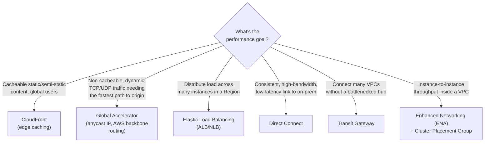
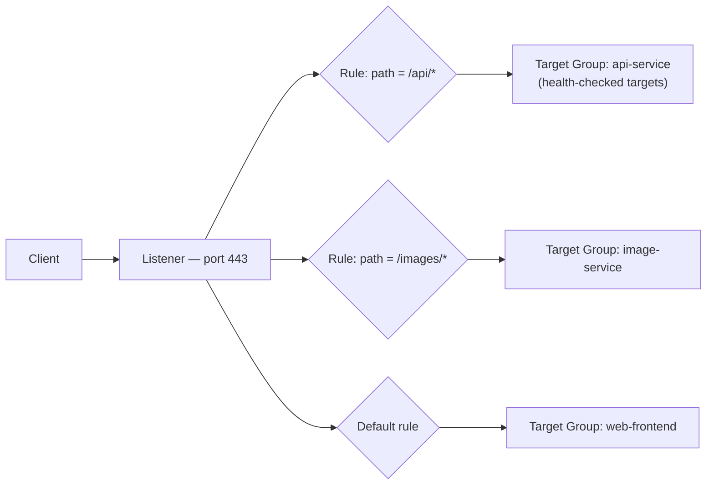
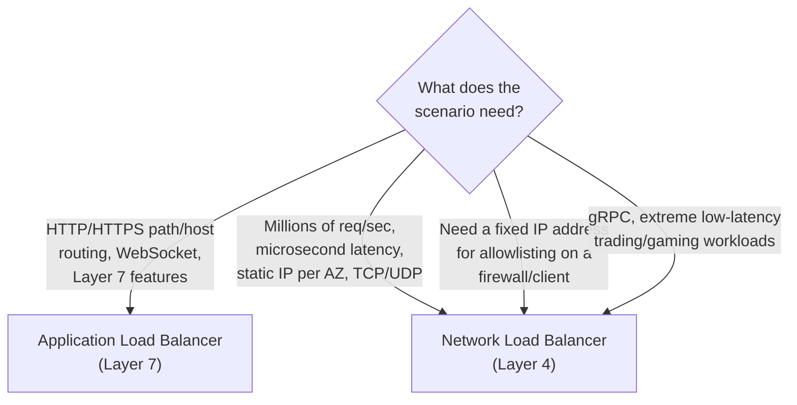
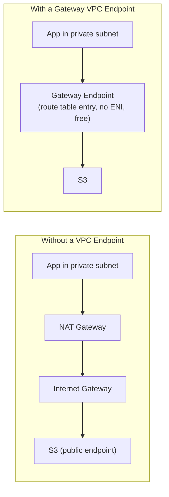
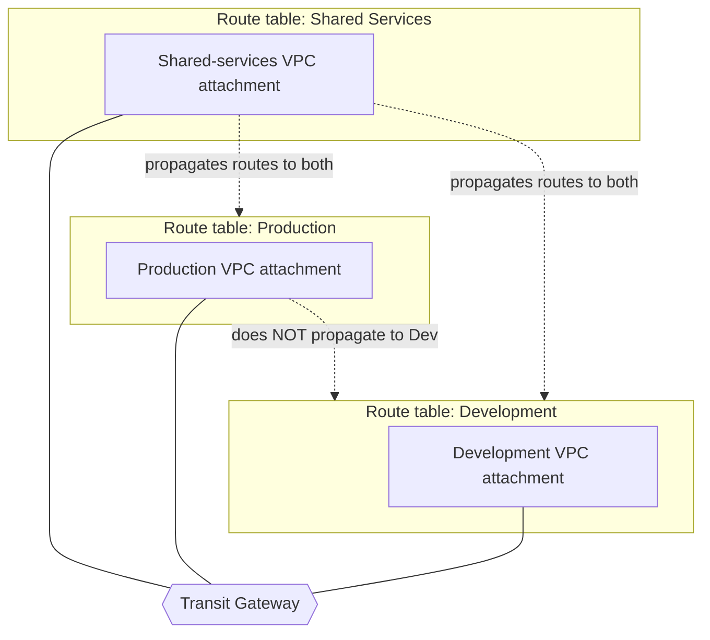

# Network Performance Architecture Patterns

*Source: [Elastic Load Balancing — What is an Application Load Balancer?](https://docs.aws.amazon.com/elasticloadbalancing/latest/application/introduction.html)*

## Definition

A decision layer on top of `vpc.md`, `elastic-load-balancing.md`, `cloudfront.md`,
`global-accelerator.md`, `direct-connect.md`, and `transit-gateway-and-peering.md` — it answers
"what actually makes network *performance* better," as opposed to network security or cost.

## Purpose

Network performance questions on the exam separate into a few repeating levers: get content
physically closer to users, reduce hops/overhead inside the AWS network, and avoid bottlenecking
a single path. Knowing which lever applies to which scenario is the actual tested skill.

## How It Works

Step by step: for **content that can be cached** (images, video, static site assets, even
dynamic content with proper cache headers), **CloudFront** terminates connections at edge
locations near the user and serves cached copies, cutting round-trip latency dramatically — the
default answer whenever "global users, fast content delivery" appears. For traffic that **can't
be cached** (dynamic API calls, gaming/UDP traffic, non-HTTP TCP) but still needs the fastest
possible path to an origin, **Global Accelerator** gives you static anycast IPs and routes
traffic onto the AWS global backbone network as early as possible (at the nearest edge location)
instead of the public internet the whole way — different mechanism, same "get onto AWS's fast
network sooner" goal as CloudFront, but for non-cacheable traffic, and documented to improve
performance for TCP/UDP applications by up to 60% versus the public internet path. Inside a
Region, **Elastic Load Balancing** spreads traffic across instances/targets (and across AZs) so
no single target becomes a bottleneck — ALB for HTTP-layer routing, NLB for extreme-throughput/
ultra-low-latency TCP/UDP. For a steady, high-volume, performance-sensitive connection to an
on-premises data center, **Direct Connect** provides a dedicated private link with predictable
latency and bandwidth, versus a VPN's internet-dependent, variable performance. When many VPCs
must talk to each other, a full mesh of VPC peering connections becomes its own bottleneck/
complexity problem at scale — **Transit Gateway** acts as a central hub so traffic takes one hop
through a purpose-built router instead of many point-to-point peering paths. Within a single VPC,
raw instance-to-instance throughput is improved with **Enhanced Networking (ENA)** drivers and,
for workloads sensitive to inter-instance latency specifically, a **cluster placement group**
that physically co-locates instances.

## Architecture: ALB Request Routing in Detail

*Source: [Elastic Load Balancing — What is an Application Load Balancer?](https://docs.aws.amazon.com/elasticloadbalancing/latest/application/introduction.html)*

Content-based routing at the ALB (path-based, host-based, or header-based rules) is itself a
performance pattern: it lets you split traffic across independently-scaled target groups so a
spike in one path (e.g., `/api/*`) triggers Auto Scaling only for the target group actually under
load, rather than over-provisioning a single monolithic target group sized for the sum of every
path's peak.

## Architecture: ALB vs. NLB — Choosing the Right Load Balancer Layer

The exam-tested distinguishing clue is almost always one of: **"path-based routing"** (ALB),
**"millions of requests per second"** or **"static IP"** (NLB). A scenario combining both needs
(e.g., path routing *and* a fixed IP) typically points toward an ALB behind a Global Accelerator,
since Global Accelerator — not the ALB itself — is what provides the static anycast IP in that
combination.

## Key Decision Points

- **CloudFront = cacheable content; Global Accelerator = non-cacheable/non-HTTP traffic that
  still needs the fastest path.** A common exam trap offers both as answer choices for a
  scenario that's clearly one or the other.
- **ALB vs. NLB for performance** — NLB handles millions of requests per second with
  microsecond latency (Layer 4); ALB adds Layer 7 features (path routing, host routing) at a
  modest latency cost. Choose based on whether Layer 7 routing is actually needed.
- **Direct Connect vs. VPN for performance** — Direct Connect is the answer whenever the
  scenario states a consistent bandwidth/latency requirement; VPN's performance rides on the
  public internet and is inherently variable.
- **Transit Gateway vs. full-mesh VPC peering** — peering is fine for a handful of VPCs;
  Transit Gateway is the performance/scale answer once the mesh would otherwise require many
  direct connections (and avoids peering's non-transitive routing limitation).
- **Content-based ALB routing is a scalability lever, not just an organizational one** — splitting
  traffic into independently-scaled target groups prevents one hot path from forcing the whole
  fleet to scale.
- **Global Accelerator also improves failover speed**, not just latency — because it doesn't rely
  on DNS TTL expiration to redirect traffic (unlike Route 53-only failover), it can shift traffic
  to a healthy endpoint faster than waiting for a DNS record to expire and be re-resolved.
- **VPC endpoints remove a network hop for AWS-service traffic**, which is also a latency win, not
  just a cost one — traffic to S3/DynamoDB/KMS never leaves the AWS network via an Interface or
  Gateway endpoint, shaving the round-trip a NAT Gateway + Internet Gateway path would otherwise
  add.

## Use Cases — Real Scenarios

- **Global SaaS company serving static marketing content plus a dynamic per-tenant API.** The
  marketing site sits fully behind CloudFront (cacheable); the per-tenant API, which can never be
  cached because every response differs by customer, rides Global Accelerator instead — the two
  services deliberately coexisting for two different traffic shapes within the same product.
- **Online multiplayer game needing a fixed IP for a console manufacturer's network allowlist.**
  The console platform's firewall requires allowlisting a specific, unchanging IP address, which an
  ALB cannot provide — the team places an NLB (or Global Accelerator) in front instead, specifically
  because of the static-IP requirement, not raw throughput.
- **Payments processor connecting to a bank's data center with a strict uptime SLA.** A primary
  Direct Connect circuit through one colocation facility is paired with a second Direct Connect
  circuit through a different facility/provider as the resilient, high-performance path the SLA
  demands — recognizing that a single DX circuit is itself a single point of failure.
- **Enterprise with 40 regional office VPCs that used to rely on a growing peering mesh.** As the
  VPC count crossed into the dozens, the peering mesh's quadratically growing connection count
  became both a performance-troubleshooting and management burden; migrating to a Transit Gateway
  hub-and-spoke model simplified routing to one hop per VPC.
- **API gateway company splitting traffic by path to scale independently.** `/v1/search/*` and
  `/v1/checkout/*` are routed to separate ALB target groups, each with its own Auto Scaling policy,
  so a traffic spike on the search path (far more common) doesn't force the checkout path's fleet
  to scale unnecessarily.
- **Private cloud-connected manufacturing plant needing predictable, low-jitter control-system
  latency.** The plant's real-time equipment-control traffic rides a dedicated Direct Connect link
  rather than a VPN, because the control loop's tolerance for latency variance (not just average
  latency) rules out the public internet's inherent jitter.
- **Serverless data-processing pipeline avoiding NAT Gateway latency for S3 access.** Lambda
  functions in private subnets reach S3 through a Gateway VPC Endpoint rather than a NAT Gateway,
  shaving a network hop off every invocation — a performance win that happens to also be free.
- **Streaming analytics company needing millions of requests per second with minimal latency
  overhead.** An NLB, not an ALB, fronts the ingestion tier specifically because the stated
  throughput number (millions of req/sec) and latency sensitivity rule out Layer-7 processing
  overhead that isn't actually needed for this traffic (no path-based routing requirement exists).

## Common Mistakes

- Choosing Global Accelerator for content that's actually cacheable — CloudFront is both cheaper
  and better suited for that traffic shape.
- Choosing ALB when the scenario explicitly needs a static IP address for a downstream firewall
  allowlist — ALB IP addresses are not static; NLB (or Global Accelerator in front of an ALB)
  provides that.
- Defaulting to VPC peering for a large and growing number of interconnected VPCs instead of
  recognizing the point where Transit Gateway's central-hub model becomes the more scalable and
  performant choice.
- Assuming Direct Connect alone provides redundancy — a single Direct Connect circuit is a single
  point of failure; a resilient design pairs it with either a second Direct Connect circuit (via
  a different location/provider) or a VPN as backup.

## Full Worked Mini-Case: A Global Trading Platform's Network Design

**Scenario:** a trading platform needs (a) the lowest possible latency between its matching-engine
EC2 instances within one Region, (b) a fast, reliable, low-latency path for institutional clients
connecting from fixed on-premises data centers, and (c) the fastest possible path for retail
mobile app users connecting over the public internet globally, for traffic that is per-user and
cannot be cached.

**Design mapped to this framework:** (a) matching-engine instances sit in a **cluster placement
group** within one AZ, using **Enhanced Networking (ENA)**, minimizing inter-instance latency for
the tightly-coupled matching logic. (b) institutional clients connect via **Direct Connect**,
giving them a dedicated, predictable-latency, high-bandwidth private link rather than riding the
public internet or even a VPN. (c) retail mobile traffic — dynamic, per-user, non-cacheable — is
routed through **Global Accelerator**, which gets it onto the AWS backbone at the nearest edge
location rather than crossing the uncontrolled public internet the whole way to the Region.
CloudFront is deliberately *not* used for (c) because the data is non-cacheable; using it anyway
would add an edge hop with no caching benefit.

## Deeper Dive: Three Analogies for the Network-Performance Levers

- **The postal-service analogy.** CloudFront is a chain of neighborhood post offices that each
  keep common packages pre-stocked locally — most pickups never require a trip to the central
  distribution warehouse. Global Accelerator is a priority courier service that, even for a custom
  one-off package that can't be pre-stocked anywhere, still gets it onto the fastest private
  overnight shipping network the instant it's handed over, rather than letting it ride the regular
  public mail system the whole way. Direct Connect is a dedicated private pipeline laid directly
  between two specific buildings — expensive and slow to install, but nothing else ever shares
  that pipe's capacity.
- **The highway-system analogy for Transit Gateway.** A full mesh of VPC peering connections is
  building a brand-new, separate direct road between every single pair of cities in a country —
  it works, but the number of roads needed explodes as more cities join. Transit Gateway is
  building one central regional highway interchange that every city connects to exactly once,
  letting traffic between any two cities flow through that one interchange instead of needing its
  own dedicated road.
- **The nightclub-bouncer analogy for ALB vs. NLB.** An ALB is a bouncer who actually reads your
  ID, checks which specific room (path) you're trying to enter, and directs you accordingly — a
  bit of processing overhead, but smart routing. An NLB is a turnstile at a subway station — it
  doesn't look at anything about you individually, it just lets enormous numbers of people through
  as fast as physically possible, which is exactly the job when raw throughput matters more than
  content-aware decisions.

## Architecture: VPC Endpoints — Removing the NAT Gateway Hop Entirely

*This diagram shows the "before" picture this section's VPC endpoint performance win is measured
against: traffic to an AWS service by default still has to traverse a NAT Gateway and Internet
Gateway path even though it technically never leaves the AWS network's edge — a VPC endpoint
collapses that into a direct, private path with one fewer hop and, for a Gateway Endpoint, zero
additional cost. Source: [Amazon VPC User Guide — Access AWS services through AWS
PrivateLink](https://docs.aws.amazon.com/vpc/latest/privatelink/privatelink-access-aws-services.html).*

*Walkthrough:* removing the NAT Gateway from the path is both a cost win (NAT Gateway bills per-GB
processed) and a genuine latency win — one fewer network hop per request, which compounds
meaningfully across a high-request-volume application. This is the mechanism behind the "Lambda
functions in private subnets reach S3 through a Gateway VPC Endpoint" use case named above, and
the reason VPC endpoints appear in both the cost-optimization and performance decision frameworks
for this domain.

## Architecture: Transit Gateway Routing Tables for Segmented Traffic

*Each VPC attachment's route table sends traffic destined for other attached VPCs to the Transit
Gateway, which performs Layer 3 routing centrally — this is what replaces what would otherwise be
a separate peering connection (and a separate routing decision) for every single VPC pair. Source:
[Amazon VPC Transit Gateways — How AWS Transit Gateway
works](https://docs.aws.amazon.com/vpc/latest/tgw/how-transit-gateways-work.html).*

*Walkthrough:* a Transit Gateway's performance benefit (one hop through a purpose-built router
instead of a tangled peering mesh) doesn't come at the cost of flat, unsegmented connectivity —
separate route tables per attachment, with selective route propagation, let the shared-services VPC
reach (and be reached by) both Production and Development, while Production and Development still
cannot reach each other directly, all through the same single hub, at the same low latency.

## Architecture: Direct Connect Virtual Interfaces

*A single physical Direct Connect connection can carry a **private VIF** (reaching one VPC), a
**public VIF** (reaching AWS public service endpoints like S3/DynamoDB over the dedicated link
instead of the internet), and a **transit VIF** (reaching a Transit Gateway, and through it, many
VPCs) — all simultaneously, over the same physical fiber. Source: [AWS Direct Connect User Guide —
What is AWS Direct Connect?](https://docs.aws.amazon.com/directconnect/latest/UserGuide/Welcome.html).*
A scenario describing "we need our on-prem data center to reach both a specific VPC *and* S3's
public endpoint, over the same dedicated connection, without crossing the internet for either" is
testing recognition that one physical connection supports multiple VIF types concurrently — it is
not a choice between a private VIF or a public VIF, but both running side by side when both needs
exist.

## Architecture: Global Accelerator Weighted Routing

*Endpoint weight is calculated as each endpoint's weight divided by the sum of all weights in its
endpoint group — setting a weight of 0 removes an endpoint from rotation entirely without deleting
it, the standard mechanism for gracefully draining an endpoint ahead of planned maintenance without
any DNS propagation delay. Source: [AWS Global Accelerator Developer Guide — About endpoint
weights](https://docs.aws.amazon.com/global-accelerator/latest/dg/about-endpoints-endpoint-weights.html).*
This is the performance-relevant detail that distinguishes Global Accelerator's traffic shifting
from Route 53 weighted routing: because Global Accelerator operates at the network layer rather
than through DNS resolution, a weight change (including draining an endpoint to zero) takes effect
within seconds, with no dependency on resolver caching or record TTLs anywhere in the path.

## Additional Worked Exam Scenarios

**Scenario A — "The 'redundant' hybrid link that went down anyway."** A company sets up two Direct
Connect connections for resiliency, both terminating at the same Direct Connect location through
the same colocation provider's single router. During a router maintenance event at that location,
both connections go down simultaneously. **Diagnosis:** this is the classic "Basic" resiliency
pattern masquerading as redundancy — two connections through the same physical location and router
share the exact same single point of failure one connection alone would have. **Fix:** AWS's
published "High Resiliency" model requires connections terminating at two separate Direct Connect
locations through separate devices; "Maximum Resiliency" adds separate routers at each location
too — a scenario emphasizing "true" redundancy for Direct Connect is testing recognition of this
specific multi-location requirement, not just "more than one connection."

**Scenario B — "The ALB that couldn't satisfy a partner's firewall requirement."** An integration
with a banking partner requires allowlisting a small, fixed set of IP addresses on the partner's
firewall, but the application currently sits behind an ALB, whose IP addresses can change over
time as AWS manages its underlying nodes. **Diagnosis:** ALB was never designed to expose static
IPs — this is a structural property of the service, not a misconfiguration to fix. **Fix:** place
an NLB in front of the application for a fixed per-AZ static IP, or place Global Accelerator in
front of the existing ALB to gain fixed anycast IPs without an architecture rewrite — both are
valid, with Global Accelerator being the lower-disruption choice when the ALB's Layer-7 routing
features are still needed.

**Scenario C — "Cross-Region latency that caching alone couldn't fix."** A SaaS company adds
CloudFront in front of their globally-used API, expecting the same latency win their static assets
saw, but per-request latency for their /api/orders endpoint barely improves. **Diagnosis:** the
endpoint returns a unique, per-customer, constantly-changing response — there is nothing cacheable
about it, so CloudFront's edge cache sees a near-100% miss rate and every request still travels all
the way back to the origin Region, just with an extra CloudFront hop added on top. **Fix:** replace
CloudFront with Global Accelerator for this specific non-cacheable API path, keeping CloudFront only
for the genuinely cacheable static-asset paths — recognizing that "add a CDN" is not a universal
latency fix independent of whether the content is actually cacheable.

## Why It's Important

**Exam mapping:** SAA-C03 Domain 3, Task 3.4 ("determine high-performing and/or scalable network
architectures") is exactly this set of "which network service gets me the fastest/most scalable
path" decisions.

## Exam Tips

- "Cacheable" is the single word that should flip your answer between CloudFront and Global
  Accelerator — read the scenario for it explicitly.
- "Millions of requests per second" or "static IP" flips ALB to NLB.
- A scenario naming a specific percentage/bandwidth/latency SLA for hybrid connectivity is
  pointing at Direct Connect, not VPN.
- "Many VPCs, growing, hard to manage peering connections" is the Transit Gateway tell.

## Related Terms

- [`../../../services/networking-content-delivery/cloudfront.md`](../../../services/networking-content-delivery/cloudfront.md)
- [`../../../services/networking-content-delivery/global-accelerator.md`](../../../services/networking-content-delivery/global-accelerator.md)
- [`../../../services/networking-content-delivery/elastic-load-balancing.md`](../../../services/networking-content-delivery/elastic-load-balancing.md)
- [`../../../services/networking-content-delivery/direct-connect.md`](../../../services/networking-content-delivery/direct-connect.md)
- [`../../../services/networking-content-delivery/transit-gateway-and-peering.md`](../../../services/networking-content-delivery/transit-gateway-and-peering.md)
- [`../../../services/networking-content-delivery/vpc.md`](../../../services/networking-content-delivery/vpc.md)
- [`compute-performance-decision-framework.md`](compute-performance-decision-framework.md) —
  the cluster placement group / ENA reasoning referenced above in full
- [`../domain-1-secure-architectures/vpc-security-architecture-patterns.md`](../domain-1-secure-architectures/vpc-security-architecture-patterns.md) —
  the same subnet/VPC-endpoint layout, viewed from a security angle
- [`../domain-4-cost-optimized-architectures/network-cost-optimization-decision-framework.md`](../domain-4-cost-optimized-architectures/network-cost-optimization-decision-framework.md) —
  the same Direct Connect/Transit Gateway/VPC endpoint choices, revisited for cost
